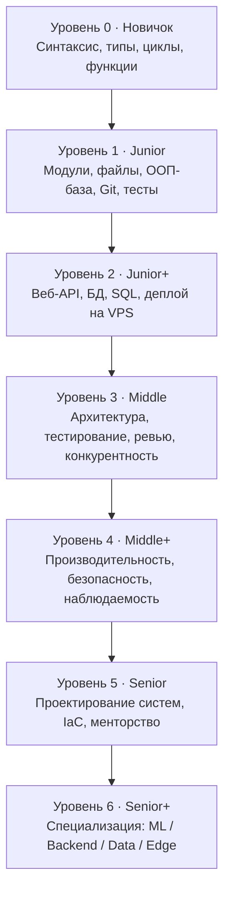
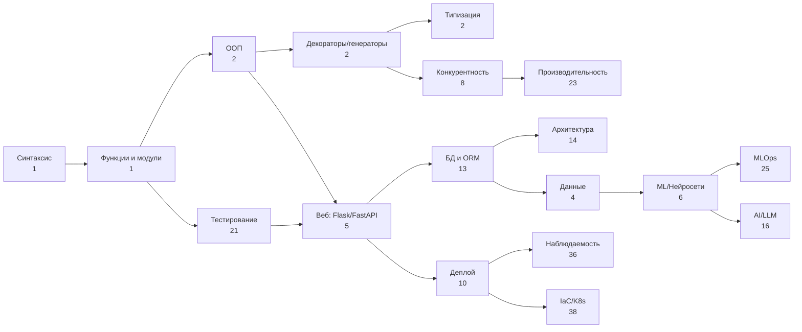
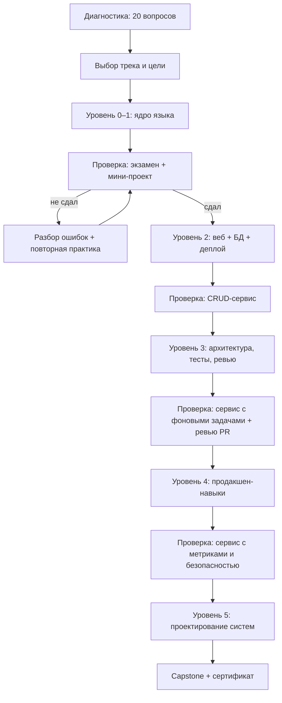
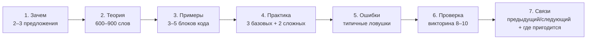
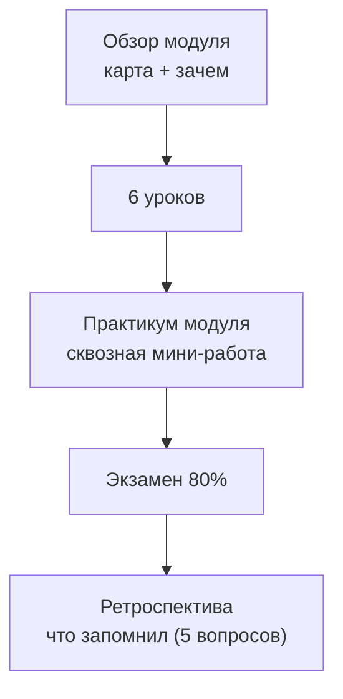
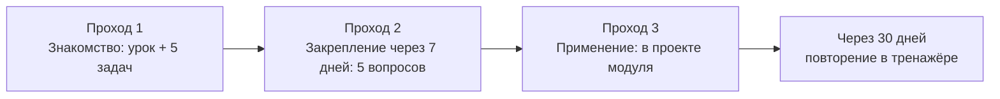
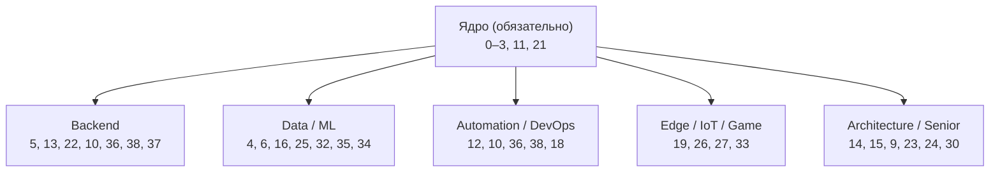

# PythonПро: план развития контента и обучения «от 0 до Senior»

**Дата:** 21 ноября 2026
**База анализа:** 39 модулей, 286 уроков, 37 экзаменов, 1 431 задача, 2 910 вопросов, 128 905 слов теории, 2 816 блоков кода.

---

## 1. Резюме

Курс закрывает **широту** (39 модулей — от переменных до Kubernetes и LLM), но ему не хватает **глубины на ключевых темах**, **связности между модулями** и **системы закрепления**. Главная задача следующего этапа — не добавлять новые темы, а превратить набор из 286 уроков в **управляемую траекторию с уровнями, повторениями и проверяемыми навыками**.

Три опоры плана:

1. **Модель компетенций** — 7 уровней с измеримыми критериями выхода (не «прошёл урок», а «умею делать X»).
2. **Спиральная структура** — каждая ключевая тема возвращается 3 раза: знакомство → практика → применение в проекте.
3. **Практика с обратной связью** — код-ревью, capstone-проекты, интервальные повторения, сертификация по трекам.

---

## 2. Диагностика текущего состояния

### 2.1. Факты по модулям

| № | Модуль | Уроков | Экз. | Слов | Задач | Оценка глубины |
|---|---|---|---|---|---|---|
| 0 | Что можно сделать с Python | 8 | ✅ | 4 562 | 40 | мотивация — ок |
| 1 | Основы Python | 14 | ✅ | 5 677 | 70 | ⚠️ тонко (400 слов/урок) |
| 2 | Продвинутый Python | 14 | ✅ | 5 092 | 70 | ⚠️ тонко для advanced |
| 3 | Стандартная библиотека | 9 | ✅ | 4 134 | 45 | ок |
| 4 | Анализ данных | 10 | ✅ | 3 764 | 50 | ⚠️ мало на тему |
| 5 | Веб-разработка | 20 | ✅ | 9 460 | 100 | ✅ глубоко |
| 6 | Нейросети | 7 | ✅ | 3 195 | 35 | ⚠️ тонко |
| 7 | Практические проекты | 7 | ✅ | 3 118 | 35 | ок |
| 8 | Конкурентность | 4 | ✅ | 2 414 | 20 | 🔴 критично мало |
| 9 | Инструменты Senior | 6 | ✅ | 2 716 | 30 | ⚠️ тонко |
| 10 | Деплой и продакшен | 4 | ✅ | 1 524 | 20 | 🔴 критично мало |
| 11 | Алгоритмы | 8 | ❌ | 4 564 | 40 | ✅ ок, нет экзамена |
| 12 | DevOps | 6 | ✅ | 2 502 | 30 | ок |
| 13 | Базы данных | 6 | ✅ | 3 131 | 30 | ок |
| 14 | Архитектура | 6 | ✅ | 2 536 | 30 | ⚠️ без практики |
| 15 | Карьера | 6 | ✅ | 2 265 | 30 | ок |
| 16 | Современный AI | 6 | ✅ | 2 286 | 30 | ок |
| 17 | Парсинг | 6 | ✅ | 2 889 | 30 | ок |
| 18 | Крутые фишки | 7 | ✅ | 1 942 | 35 | ⚠️ развлекательный |
| 19 | MicroPython | 6 | ✅ | 2 522 | 30 | ок |
| 20 | Практикум (11 работ) | 11 | ❌ | 4 850 | 56 | ✅ ок, нет экзамена |
| 21 | Тестирование | 7 | ✅ | 2 731 | 35 | ок |
| 22 | DRF | 6 | ✅ | 2 786 | 30 | ок |
| 23 | Производительность | 7 | ✅ | 4 128 | 35 | ✅ хорошо |
| 24 | Безопасность | 6 | ✅ | 2 490 | 30 | ок |
| 25 | MLOps | 6 | ✅ | 3 016 | 30 | ок |
| 26 | Игры и GUI | 7 | ✅ | 4 182 | 35 | ок |
| 27 | PyQt6/PySide6 | 8 | ✅ | 4 437 | 40 | ✅ хорошо |
| 28 | Популярные библиотеки | 6 | ✅ | 2 176 | 30 | ок |
| 29 | Excel и Word | 8 | ✅ | 3 222 | 40 | ✅ хорошо |
| 30 | Душа Python | 6 | ✅ | 2 287 | 30 | ок |
| 31 | Вёрстка (HTML/CSS/Jinja) | 6 | ✅ | 3 067 | 30 | ✅ хорошо |
| 32 | Большие данные | 6 | ✅ | 2 582 | 30 | ок |
| 33 | Компьютерное зрение | 6 | ✅ | 2 432 | 30 | ок |
| 34 | NLP | 6 | ✅ | 2 763 | 30 | ок |
| 35 | Научные вычисления | 6 | ✅ | 3 223 | 30 | ок |
| 36 | Наблюдаемость | 6 | ✅ | 3 220 | 30 | ок |
| 37 | Продвинутый Git | 6 | ✅ | 2 851 | 30 | ок |
| 38 | IaC/Kubernetes | 6 | ✅ | 2 169 | 30 | ок |

### 2.2. Сильные стороны

- **Полнота охвата**: нет крупных «белых пятен» — от синтаксиса до K8s, LLM и MicroPython.
- **Практика в каждом уроке**: 5 задач + 5 подсказок + 5 разборов, автопроверка по тестам.
- **Единый формат**: 2 816 блоков кода, 0 синтаксических ошибок, валидатор контента.
- **11 самостоятельных работ** — от «Виселицы» до полноценного сайта.
- **Платформа**: песочница, викторины, экзамены 80 %, XP/уровни, сертификат, тренажёр, режим собеседования.

### 2.3. Семь проблем (с числами)

| # | Проблема | Доказательство | Следствие |
|---|---|---|---|
| 1 | **Тонкость на ключевых темах** | Конкурентность — 4 урока / 2 414 слов; Деплой — 4 / 1 524; Основы — 400 слов/урок | Senior-темы недоданы, ученик не готов к интервью |
| 2 | **Дубли по темам** | Excel — 3 места (04, 18, 29); CSS/Jinja — 2 (05, 31); LLM — 2 (04, 16) | Ученик не понимает, «где основное», тратит время |
| 3 | **Нет возврата к материалу** | 0 механизмов повторения | Через месяц забывается 60–70 % |
| 4 | **Экзамены не везде** | Нет у модулей 11 и 20 | Нет проверки на двух важных блоках |
| 5 | **Метки не системны** | 775 уникальных тегов | Фильтры и карта навыков не работают |
| 6 | **Мало «мягких» навыков практики** | 1 работа по code review | Не тренируется чтение чужого кода — ключ к Senior |
| 7 | **Нет уровней и сертификации** | Сертификат один — «весь курс» | Ученик не видит, где он: Junior/Middle/Senior |

---

## 3. Целевая модель компетенций: 7 уровней

Не «сколько уроков пройдено», а **что человек умеет**.

| Уровень | Что умеет (критерии выхода) | Модули курса | Проверка |
|---|---|---|---|
| **0. Новичок** | Пишет скрипты 50+ строк: циклы, функции, файлы, обработка ошибок | 0, 1 | Экзамен 1 + 3 задачи с тестами |
| **1. Junior** | ООП, модули, venv, Git, pytest, читает чужой код | 2, 3, 21 (база) | Проект: CLI-утилита с тестами |
| **2. Junior+** | REST API на FastAPI/Flask, БД, SQL, HTML/CSS/Jinja, деплой | 5 (1–10), 31, 10 | Проект: CRUD-сервис + деплой |
| **3. Middle** | Архитектура, тесты, ревью, конкурентность, алгоритмы | 8, 11, 13, 14, 21, 22 | Проект: сервис с фоновыми задачами |
| **4. Middle+** | Профилирование, безопасность, наблюдаемость, БД глубоко | 23, 24, 36, 13, 37 | Проект: продакшен-сервис с метриками |
| **5. Senior** | Проектирование систем, IaC, K8s, менторство, trade-offs | 38, 14, 25, 15 | System design + ревью чужого PR |
| **6. Senior+** | Специализация: ML / Data / Vision / NLP / Edge | 4, 6, 16, 25, 32–35, 19 | Capstone в выбранном треке |

**Ключевое изменение:** сертификат выдаётся **по уровню**, а не «за всё». Уровень = экзамен + проект + (для 3+) ревью.

---

## 4. Карта навыков (12 доменов × 6 уровней)

| Домен | 0 | 1 | 2 | 3 | 4 | 5 |
|---|---|---|---|---|---|---|
| **Синтаксис и типы** | ✅ | ✅ | — | — | — | — |
| **ООП и паттерны** | — | ✅ | ✅ | ✅ | ✅ | ✅ |
| **Функциональное** | — | ✅ | ✅ | ✅ | — | — |
| **Асинхронность/конкурентность** | — | — | ✅ | ✅ | ✅ | ✅ |
| **Данные (pandas/NumPy)** | — | — | ✅ | ✅ | ✅ | ✅ |
| **Веб и API** | — | — | ✅ | ✅ | ✅ | ✅ |
| **БД и SQL** | — | — | ✅ | ✅ | ✅ | ✅ |
| **Тестирование** | — | ✅ | ✅ | ✅ | ✅ | ✅ |
| **Инструменты (Git/CI/Docker)** | — | ✅ | ✅ | ✅ | ✅ | ✅ |
| **Производительность** | — | — | — | ✅ | ✅ | ✅ |
| **Безопасность** | — | — | ✅ | ✅ | ✅ | ✅ |
| **Эксплуатация (логи/метрики/K8s)** | — | — | — | — | ✅ | ✅ |

**Граф зависимостей тем** (что нельзя изучать раньше prerequisite):

---

## 5. Схемы обучения

### 5.1. Путь ученика (сквозная схема)

### 5.2. Схема урока (целевая структура, 7 блоков)

Сейчас: теория → 5 задач → 5 подсказок → 5 разборов → викторина.
Целевая:

**Что добавить в каждый урок:**
- блок «Зачем это нужно» (мотивация до теории);
- блок «Типичные ошибки» (сейчас разрозненно);
- блок «Связи» — ссылки на prereq и на будущее применение;
- 2 задачи уровня «вызов» (сейчас все 5 одного уровня).

### 5.3. Схема модуля

### 5.4. Спираль: одна тема — три прохода

**Реализация:** тренажёр уже есть — нужно добавить **интервальные повторения**: вопросы из пройденных уроков возвращаются через 1, 7 и 30 дней (алгоритм SM-2 упрощённый). Это самая дешёвая и самая эффективная доработка.

### 5.5. Матрица «теория ↔ практика ↔ проект»

| Тип темы | Теория | Задачи | Проект |
|---|---|---|---|
| Синтаксис | 500 слов | 5 мелких | мини-скрипт |
| Концепция (ООП, async) | 800 слов | 5 + 2 сложных | модуль в проекте |
| Инструмент (Docker, pytest) | 700 слов | 5 практических | включить в capstone |
| Архитектура | 900 слов | 5 кейсов | design-документ |

---

## 6. Пробелы в контенте: что делать

### 6.1. Углубить (приоритет 1)

| Тема | Сейчас | Нужно | Действие |
|---|---|---|---|
| **Конкурентность** | 4 урока, 2 414 слов | 8 уроков | + asyncio-паттерны, backpressure, race conditions, тесты конкурентности, реальные кейсы |
| **Деплой** | 4 урока, 1 524 слов | 8 уроков | + откаты, миграции в проде, zero-downtime, бэкапы, инциденты |
| **Основы** | 400 слов/урок | 600 слов/урок | углубить типы, срезы, мутабельность, копирование |
| **Анализ данных** | 10 уроков, 376 слов/урок | 700 слов/урок | + временные ряды, groupby глубоко, merge/join, memory |
| **Нейросети** | 7 уроков, 456 слов/урок | 700 слов/урок | + регуляризация, batchnorm, оптимизаторы, переобучение |
| **Архитектура** | без практики | 3 кейса | + design-документ, ADR, диаграммы C4 |

### 6.2. Развести дубли

| Тема | Где сейчас | Решение |
|---|---|---|
| Excel | 04/08, 18/04, 29 (8 уроков) | 29 — основной; в 04/08 — ссылка; 18/04 — удалить/сократить до «фишка» |
| CSS/Jinja | 05/03, 05/16, 05/17, 05/05, 31 (6 уроков) | 31 — основной; в 05 оставить минимум + ссылка |
| LLM | 04/10, 16 (6 уроков) | 16 — основной; 04/10 — сократить до обзора |

### 6.3. Добавить (приоритет 2)

| Тема | Куда | Объём |
|---|---|---|
| Типизация глубже: `TypeVar`, `Generic`, `Protocol`, `ParamSpec`, mypy strict | 02-advanced | 2 урока |
| Django advanced: middleware, signals, кэш, custom tags | 05-web | 2 урока |
| asyncio-паттерны: семафоры, очереди, отмена, таймауты | 08-concurrency | 2 урока |
| System design практикум: 5 кейсов с диаграммами | 14-architecture | 1 практикум |
| Чтение чужого кода: разбор 5 open-source файлов | 20-works | 2 работы |
| Интервальные повторения и «экзамен уровня» | платформа | фича |
| Capstone-проекты по трекам (4 шт.) | 20-works | 4 работы |

### 6.4. Экзамены и проверки

- Добавить экзамены в модули **11 (Алгоритмы)** и **20 (Практикум)**.
- Ввести **экзамен уровня** (0→1, 1→2, …) — 30 вопросов + проект.
- Ввести **сертификаты по трекам** (Backend / Data / ML / Edge), а не один общий.

---

## 7. Пересборка курса в 6 треков

Сейчас 39 модулей идут «плоским списком» — ученик теряется. Треки решают это.

| Трек | Модули | Кому |
|---|---|---|
| **Ядро** | 0, 1, 2, 3, 11, 21 | всем |
| **Backend** | 5, 13, 22, 10, 36, 38, 37 | веб-разработчик |
| **Data / ML** | 4, 6, 16, 25, 32, 35, 34 | аналитик, ML-инженер |
| **Automation / DevOps** | 12, 10, 36, 38, 18 | DevOps, автоматизатор |
| **Edge / IoT / Game** | 19, 26, 27, 33 | embedded, gamedev |
| **Architecture / Senior** | 14, 15, 9, 23, 24, 30 | рост до Senior |

В платформе: страница «Треки» + привязка цели (уже есть `/goals/`) → переписать на треки.

---

## 8. Дорожная карта работ

### Фаза 1 — Фундамент качества (2–3 недели)

| # | Задача | Результат |
|---|---|---|
| 1 | Углубить модули 8 и 10 до 8 уроков | закрыт главный Senior-пробел |
| 2 | Добавить экзамены в 11 и 20 | 39/39 модулей с проверкой |
| 3 | Единый словарь тегов (~80) + миграция | работают фильтры и карта навыков |
| 4 | Убрать дубли (Excel, CSS/Jinja, LLM) | нет путаницы |
| 5 | Переработать шаблон урока: «Зачем», «Ошибки», «Связи» | единый стандарт глубины |
| 6 | Поднять теорию в 1, 2, 4, 6 до 600+ слов/урок | равномерная глубина |

### Фаза 2 — Уровни и повторения (4–6 недель)

| # | Задача | Результат |
|---|---|---|
| 7 | Модель уровней 0–6 в БД + критерии | ученик видит свой уровень |
| 8 | Экзамен уровня + сертификат уровня | мотивация и измеримость |
| 9 | Интервальные повторения (SM-2) в тренажёре | удержание знаний |
| 10 | 4 capstone-проекта по трекам | портфолио |
| 11 | Типизация глубже (2 урока), Django advanced (2), asyncio-паттерны (2) | закрыты средние пробелы |
| 12 | Страница «Треки» + переработка целей | навигация |

### Фаза 3 — Практика и сообщество (2–3 месяца)

| # | Задача | Результат |
|---|---|---|
| 13 | Code review: 2 работы + очередь ревью | навык чтения кода |
| 14 | System design практикум (5 кейсов) | подготовка к Senior-интервью |
| 15 | Еженедельный челлендж с автопроверкой | регулярность |
| 16 | Наставничество и разбор кода (опционально) | удержание и монетизация |
| 17 | Сертификация по трекам (PDF) | ценность для резюме |

---

## 9. Метрики качества

### Контент
- средняя глубина: **≥600 слов** теории на урок (сейчас 451);
- доля уроков с «Зачем/Ошибки/Связи»: **100 %**;
- дублей тем: **0**;
- экзаменов: **39/39** модулей + **6** уровневых;
- задач уровня «вызов»: **≥30 %**.

### Обучение (продуктовые)
- completion rate модуля: цель **≥60 %**;
- возврат на 7-й день: **≥40 %**;
- доля учеников, дошедших до capstone: **≥15 %**;
- средний балл экзамена: **75–85 %** (не 95 — значит, есть сложность).

### Технические
- 0 синтаксических ошибок в примерах (сейчас 0 ✔);
- покрытие тестами платформы **≥70 %**;
- время ответа страницы **<300 мс**;
- Uptime **≥99,5 %**.

---

## 10. Платформенные улучшения под обучение

| Улучшение | Зачем | Приоритет |
|---|---|---|
| Интервальные повторения | борьба с забыванием | 🔴 высокий |
| Уровни и сертификаты уровня | измеримый прогресс | 🔴 высокий |
| Capstone с ревью | портфолио и обратная связь | 🔴 высокий |
| Треки вместо плоского списка | навигация | 🟡 средний |
| Еженедельный челлендж | регулярность | 🟡 средний |
| PWA/офлайн | доступность | 🟢 низкий |
| Менторские сессии | удержание | 🟢 низкий |

---

## 11. Риски

| Риск | Вероятность | Митигация |
|---|---|---|
| Расползание объёма (ещё модули) | высокая | заморозить новые темы до Фазы 2 |
| Контент писали разные агенты — стиль «плывёт» | высокая | единый шаблон урока + выборочный ревью 10 % |
| Сложность растёт быстрее мотивации | средняя | capstone после каждого уровня, а не в конце |
| Дубли остаются | средняя | явная карта «основной урок темы» |
| Нет реальных учеников для метрик | высокая | бета-группа 10–20 человек в Фазе 1 |

---

## 12. Итог: что делать в первую очередь

1. **Углубить конкурентность и деплой** (8 уроков вместо 4) — это то, что отделяет Middle от Senior.
2. **Ввести интервальные повторения** — минимальные усилия, максимальный эффект на удержание.
3. **Сделать уровни и сертификаты уровня** — превращает курс в измеримый путь.
4. **Добавить capstone-проекты по трекам** — даёт портфолио и реальную практику.
5. **Убрать дубли и унифицировать шаблон урока** — качество вместо количества.

Курс уже покрывает 95 % тем Senior-программы. Дальнейший рост — не вширь, а **вглубь и в систему**: уровни, повторения, проекты, обратная связь.
