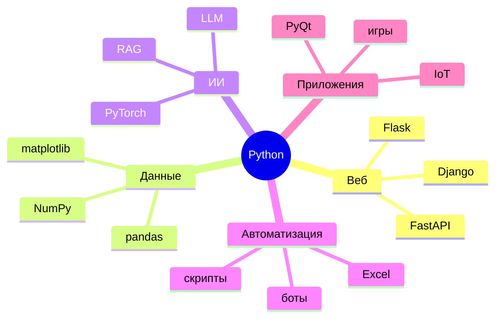

## Добро пожаловать в мир суперсил

Представь, что у тебя появился инструмент, которым можно построить почти всё: сайт, бота, игру, нейросеть, систему умного дома и даже управление космическим аппаратом. Звучит как фантастика? А между тем это реальность — и называется этот инструмент Python.

Этот модуль — не про скучный синтаксис. Он про ответ на главный вопрос: **зачем мне вообще учить Python?** Мы пройдём по всем суперсилам языка, увидим живые примеры и в конце поставим цель, ради которой ты продолжишь учиться. Вдохновение — это топливо, а Python — ракета.

## Карта возможностей

Вот что можно делать на Python — и это только верхушка:



Каждое направление — отдельный трек курса. Не нужно учить всё сразу: выбери то, что зажигает, и иди по нему.


## Что делает Python суперсилой

У Python есть несколько качеств, которые делают его одним из самых популярных языков в мире:

- **Читается как английский текст.** Код `if age >= 18: print("Можно голосовать")` понятен даже тому, кто никогда не программировал. Меньше магии — больше ясности.
- **«Батарейки в комплекте».** В стандартную библиотеку Python уже встроены сотни готовых инструментов: работа с файлами, датами, сетью, графикой, архивами, математикой. Многое можно сделать без установки чего-либо дополнительно.
- **Огромное сообщество.** На любой вопрос найдётся ответ, на любую задачу — готовый пример. Миллионы разработчиков делятся своими наработками.
- **Спрос на рынке.** Python стабильно входит в тройку самых востребованных языков: его используют в вебе, науке, ИИ, автоматизации и финансах.
- **От новичка до профессионала.** Можно начать с трёх строк кода, а через пару лет писать распределённые системы для миллионов пользователей.

## Твоя первая молния

Давай не будем тянуть. Создай файл `first.py` и напиши в нём:

```python
print("Привет, мир!")
print("Я выбираю Python как суперсилу")
```

Запусти командой `python first.py` и увидишь две строки. Поздравляю — ты только что написал настоящую программу! `print()` — это функция, которая выводит текст на экран. Текст обязательно берётся в кавычки.

Python умеет и считать:

```python
print(2 + 2)
print(10 * 5)
print("2 + 2 =", 2 + 2)
```

Третья строка интереснее: внутри одного `print()` передаётся строка и выражение, и Python напечатает их через пробел. Так код становится «говорящим»: `2 + 2 = 4`.

## Дзен Python

У Python есть философия — набор принципов, которые называются «Дзен Python». Выведи её прямо сейчас:

```python
import this
```

Ты увидишь красивые строки: «Красивое лучше уродливого», «Явное лучше неявного», «Простое лучше сложного». Это не поэзия, а практическое руководство: Python специально спроектирован так, чтобы код был читаемым и понятным. Именно поэтому на нём так комфортно учиться.

## Дата и время — твой первый помощник

Уже сейчас ты можешь написать программу, которая знает сегодняшнюю дату. Для этого есть модуль `datetime`:

```python
from datetime import datetime

now = datetime.now()
print("Сегодня:", now.strftime("%d.%m.%Y"))
print("Сейчас:", now.strftime("%H:%M"))
```

`datetime.now()` получает текущие дату и время, а `strftime()` превращает их в красивую строку. `%d` — день, `%m` — месяц, `%Y` — год, `%H` и `%M` — часы и минуты.

## Как устроены уроки этого модуля

Каждый урок — это короткое путешествие: теория с живыми примерами, пять задач для практики (с подсказками и разборами) и викторина. Не пропускай задачи — именно руками, а не глазами ты прокачаешь суперсилу. Если что-то не работает, читай текст ошибки: в нём почти всегда написано, что не так.

## Итог урока

Сегодня мы узнали:

- почему Python называют суперсилой: читаемость, стандартная библиотека, сообщество, спрос;
- как написать и запустить первую программу с `print()`;
- что Python умеет считать прямо в коде;
- что такое Дзен Python и как увидеть коман `import this`;
- как вывести текущую дату и время через `datetime`.

Суперсила уже в твоих руках. Теперь закрепим её практикой.

<!--TASK-->
### Задача 1
Создай файл `first_step.py` и напиши программу, которая выводит три строки: твоё имя, твою любимую суперспособность (любую, хоть «готовить пельмени») и фразу `Я начинаю путь Python-разработчика`. Запусти программу командой `python first_step.py` и убедись, что все три строки появились на экране. Если видишь ошибку — прочитай её текст и попробуй понять, что она означает.

### Задача 2
Запусти `import this` в своей программе и внимательно прочитай Дзен Python. Выбери одну фразу, которая тебе ближе всего, и сделай две вещи: добавь её как комментарий (строка, начинающаяся с `#`) в свой файл, а затем выведи её на экран через `print()`. В итоге программа должна выводить твою любимую фразу из Дзена, а комментарий должен остаться в коде как «заметка на будущее».

### Задача 3
Напиши программу `super_power.py`, которая выводит пять фактов о Python, разделённых пустыми строками. Используй символ переноса строки `\n` внутри строки, например: `print("Факт 1\n\nФакт 2")`. Придумай факты сам или возьми из урока: читаемость, встроенная библиотека, сообщество, спрос на рынке, простота для новичков. После запуска на экране должно быть пять отдельных абзацев.

### Задача 4
Напиши программу, которая считает и выводит: сколько минут в одном году (`365 * 24 * 60`), сколько часов в неделе (`7 * 24`), сколько секунд в сутках (`24 * 60 * 60`). Каждый результат выводи с подписью, как в примере: `print("Минут в году:", 365 * 24 * 60)`. Запусти программу и сверь результат: в году должно получиться число 525600.

### Задача 5
Напиши программу `my_year.py`, которая выводит текущий год (через `datetime.now().year`) и сообщение: `Прошло N лет с начала XXI века`, где N — это текущий год минус 2000. Например, в 2026 году N = 26. Программа должна вычислить N сама, а не хранить готовое число. Запусти и убедись, что обе строки выводятся корректно.
### Задача 6
Напиши программу `budget_week.py`, которая считает бюджет на неделю. Задай три переменные: `money = 2000` (сколько денег есть), `lunch = 250 * 5` (обед пять дней в неделю) и `travel = 40 * 10` (проезд туда-обратно десять раз). Посчитай суммарные расходы `spent = lunch + travel` и остаток `left = money - spent`. Выведи четыре строки с подписями: `Было: 2000`, `Обеды: 1250`, `Проезд: 400`, `Остаток: 350`. Все числа программа должна вычислять сама — готовые значения в код не вписывай.

### Задача 7
Напиши программу `day_of_year.py`, которая выводит сегодняшнюю дату в трёх форматах и номер дня в году. Используй `datetime.now()` и `strftime()`: шаблон `%d.%m.%Y` даёт `21.11.2026`, шаблон `%Y-%m-%d` — `2026-11-21`, а `%j` — номер дня в году тремя цифрами, например `325`. Выведи три строки: `Сегодня: ...`, `Формат ISO: ...`, `День года: ...`. Запусти программу и проверь, что все три строки относятся к сегодняшней дате, а не к дате из примера.
<!--/TASK-->

<!--HINT-->
### Подсказка 1
Для каждой строки используй отдельный вызов `print()` с текстом в кавычках. Помни: запуск файла — команда `python имя_файла.py` из терминала. Если появилась ошибка `SyntaxError`, ищи в сообщении строку и символ `^` — там Python «споткнулся».

### Подсказка 2
Комментарий начинается с символа `#` и идёт до конца строки — Python его игнорирует. Чтобы вывести фразу на экран, напиши `print("Твоя фраза")`. Не бойся, что комментарий «ничего не делает», — именно так и должно быть, он для людей.

### Подсказка 3
Символ `\n` внутри строки — это перенос на новую строку. Если написать `print("А\n\nБ")`, между буквами будет пустая строка. Так можно получить пять абзацев, передав в `print()` одну строку с несколькими `\n`.

### Подсказка 4
Выражения вроде `365 * 24 * 60` Python вычисляет сам, прямо внутри `print()`. Просто подставь их вместо чисел. Обрати внимание: умножение — это символ `*`, а не `x`.

### Подсказка 5
Чтобы получить год, напиши `from datetime import datetime` в начале файла, а затем используй `datetime.now().year` — это вернёт число, например `2026`. Вычесть 2000 можно прямо в `print()`: `datetime.now().year - 2000`.
### Подсказка 6
Сначала посчитай расходы в отдельных переменных: `lunch = 250 * 5`, `travel = 40 * 10`, затем `spent = lunch + travel` и `left = money - spent`. В `print()` передавай подпись и значение через запятую — Python напечатает их через пробел, например `print("Обеды:", lunch)`. Готовые числа в код не вписывай: пусть считает машина.

### Подсказка 7
Подключи `from datetime import datetime` и сохрани `now = datetime.now()`. Три раза вызови `now.strftime(...)` с разными шаблонами: `%d.%m.%Y`, `%Y-%m-%d` и `%j`. Помни, что `%j` возвращает строку из трёх символов с ведущими нулями: для пятого января это будет `005`, а не `5`.
<!--/HINT-->

<!--SOLUTION-->
### Разбор 1
Одно из возможных решений:

```python
print("Меня зовут Аня")
print("Моя любимая суперспособность — учить новое")
print("Я начинаю путь Python-разработчика")
```

Запускаем `python first_step.py` и видим:

```
Меня зовут Аня
Моя любимая суперспособность — учить новое
Я начинаю путь Python-разработчика
```

Что здесь происходит? Каждая строка — это вызов функции `print()` со строкой в кавычках. Python читает файл сверху вниз и выполняет каждую команду по очереди. Если забыть кавычку или скобку, получится `SyntaxError` — синтаксическая ошибка, при которой программа вообще не запустится. Сообщение об ошибке подскажет строку, где всё пошло не так. Это нормальная часть работы программиста: ошибки — не провал, а информация.

### Разбор 2
Решение:

```python
import this

# Моя любимая фраза из Дзена Python
print("Красивое лучше уродливого")
```

Запускаем — сначала появится весь Дзен, а затем наша фраза. Что здесь происходит? `import this` выводит философию Python на экран. Затем Python игнорирует строку с `#` (это комментарий) и выполняет `print()`. Обрати внимание на порядок: комментарий не мешает выполнению, он просто помогает читателю кода понять замысел. Такая привычка — писать, зачем сделан тот или иной шаг, — сделает твой код профессиональным уже с первых дней.

### Разбор 3
Решение:

```python
print("Python читается почти как английский текст\n\nPython имеет огромную встроенную библиотеку\n\nУ Python огромное сообщество\n\nPython востребован на рынке труда\n\nС Python легко начинать новичку")
```

Запускаем и видим пять абзацев, разделённых пустыми строками. Что здесь происходит? Символ `\n` — это символ переноса строки. Когда Python встречает его внутри строки, он переходит на новую строку при выводе. Два `\n` подряд дают пустую строку между абзацами. Так мы научились «оформлять» вывод: текст можно структурировать прямо внутри одной строки, не вызывая `print()` сотню раз.

### Разбор 4
Решение:

```python
print("Минут в году:", 365 * 24 * 60)
print("Часов в неделе:", 7 * 24)
print("Секунд в сутках:", 24 * 60 * 60)
```

Результат:

```
Минут в году: 525600
Часов в неделе: 168
Секунд в сутках: 86400
```

Что здесь происходит? Внутри `print()` через запятую передаются два значения: строка-подпись и арифметическое выражение. Python сначала вычисляет выражение (умножение слева направо), а потом печатает оба значения через пробел. Так код работает и как калькулятор, и как «говорящий» отчёт. Заметь: мы не считали ничего вручную — Python сделал это за нас, и это первая маленькая автоматизация в твоей жизни.

### Разбор 5
Решение:

```python
from datetime import datetime

year = datetime.now().year
print("Текущий год:", year)
print("Прошло", year - 2000, "лет с начала XXI века")
```

Результат (в 2026 году):

```
Текущий год: 2026
Прошло 26 лет с начала XXI века
```

Что здесь происходит? Строка `from datetime import datetime` подключает модуль `datetime`, который умеет работать с датами. `datetime.now()` создаёт объект «сейчас», а `.year` достаёт из него год как обычное число. Дальше мы кладём это число в переменную `year` и используем её в `print()`: подставляем в текст и вычитаем 2000. Переменная — это «коробка» с именем, в которой лежит значение. Это фундаментальная идея программирования, с которой ты будешь работать весь курс.
### Разбор 6
Одно из возможных решений:

```python
money = 2000
lunch = 250 * 5
travel = 40 * 10
spent = lunch + travel
left = money - spent

print("Было:", money)
print("Обеды:", lunch)
print("Проезд:", travel)
print("Остаток:", left)
```

Результат:

```
Было: 2000
Обеды: 1250
Проезд: 400
Остаток: 350
```

Что здесь происходит? Каждая строка с `=` создаёт переменную — «коробку» с именем, в которой лежит значение. Python сначала вычисляет выражение справа (`250 * 5` превращается в `1250`), а потом кладёт результат в переменную. Дальше мы пользуемся не числами, а именами: `spent = lunch + travel` складывает уже посчитанные значения, а `left = money - spent` вычитает расходы из бюджета. В `print()` через запятую передаются два значения, и Python печатает их через пробел. Главная выгода в том, что отчёт пересчитывается сам: поменяй `money` на 1500 — и все четыре строки честно покажут новый остаток, без единой правки в формулах.

### Разбор 7
Одно из возможных решений:

```python
from datetime import datetime

now = datetime.now()

print("Сегодня:", now.strftime("%d.%m.%Y"))
print("Формат ISO:", now.strftime("%Y-%m-%d"))
print("День года:", now.strftime("%j"))
```

Результат (для 21 ноября 2026 года):

```
Сегодня: 21.11.2026
Формат ISO: 2026-11-21
День года: 325
```

Что здесь происходит? `datetime.now()` создаёт объект с текущими датой и временем, а `strftime()` превращает его в строку по шаблону. В шаблоне `%d` — день двумя цифрами, `%m` — месяц, `%Y` — год из четырёх цифр, поэтому `%d.%m.%Y` даёт привычную запись `21.11.2026`, а `%Y-%m-%d` — международный формат, который удобно сортировать. Отдельный шаблон `%j` показывает порядковый номер дня в году: 21 ноября — это 325-й день, ведь до него прошли январь (31), февраль (28), март (31), апрель (30), май (31), июнь (30), июль (31), август (31), сентябрь (30) и октябрь (31), а потом ещё 21 день ноября. Один и тот же объект `now` используется трижды — мы не запрашиваем время заново, поэтому все три строки гарантированно описывают один момент.
<!--/SOLUTION-->

<!--QUIZ-->
Что такое Python?
- Язык программирования
- Текстовый редактор
- Операционная система
* Правильный ответ: Язык программирования
Python — это язык программирования, на котором пишут программы для самых разных задач.

Почему Python часто рекомендуют новичкам?
- Он единственный язык в мире
- Его код читается почти как английский текст
- Он не требует компьютера
* Правильный ответ: Его код читается почти как английский текст
Читаемый синтаксис и огромное сообщество делают Python идеальным первым языком.

Что выведет команда import this?
- Версию Python
- Философию Python («Дзен Python»)
- Список установленных библиотек
* Правильный ответ: Философию Python («Дзен Python»)
import this печатает набор принципов дизайна Python.

Что выведет print("Питон" + " — сила")?
- Питон — сила
- Питон —  сила
- Ошибку
* Правильный ответ: Питон — сила
Знак + склеивает строки ровно так, как они написаны, без добавления пробелов.

Сколько минут в году? Вычисли: 365 * 24 * 60.
- 525600
- 8760
- 52560
* Правильный ответ: 525600
365 дней умножить на 24 часа и на 60 минут даёт 525600 минут.

Какой командой запускается файл hello.py?
- python hello.py
- run hello.py
- start hello.py
* Правильный ответ: python hello.py
Файлы Python запускаются командой python имя_файла.py из терминала.

Что выведет print(7 + 8)?
- 78
- 15
- Ошибку
* Правильный ответ: 15
Python вычисляет выражение 7 + 8 и печатает результат 15.

Зачем нужны кавычки вокруг текста в print()?
- Чтобы указать, что это строка, а не код
- Для красоты
- Они необязательны
* Правильный ответ: Чтобы указать, что это строка, а не код
Кавычки говорят Python: «это текст, не пытайся выполнить его как команду».

Что делает datetime.now()?
- Возвращает текущую дату и время
- Устанавливает системные часы
- Печатает календарь на год
* Правильный ответ: Возвращает текущую дату и время
datetime.now() создаёт объект с текущими датой и временем, из которого можно достать год, месяц, день и часы.
Что делает запятая в print("Остаток:", left)?
- Печатает два значения через пробел
- Склеивает значения без пробела
- Печатает только второе значение
* Правильный ответ: Печатает два значения через пробел
print() принимает несколько аргументов и разделяет их пробелом.

Что означает шаблон %m в strftime?
- Номер месяца двумя цифрами
- Название месяца словом
- Количество минут
* Правильный ответ: Номер месяца двумя цифрами
В strftime %m — месяц от 01 до 12, а минуты обозначает %M (заглавная буква).

Что выведет print("2 + 2")?
- 4
- 2 + 2
- Ошибку
* Правильный ответ: 2 + 2
В кавычках записана строка, поэтому Python печатает её как текст и ничего не складывает.

Что Python делает со строкой, которая начинается с #?
- Игнорирует её до конца строки
- Выводит её на экран
- Считает её синтаксической ошибкой
* Правильный ответ: Игнорирует её до конца строки
Символ # открывает комментарий: Python не выполняет и не печатает такой текст.
<!--/QUIZ-->
