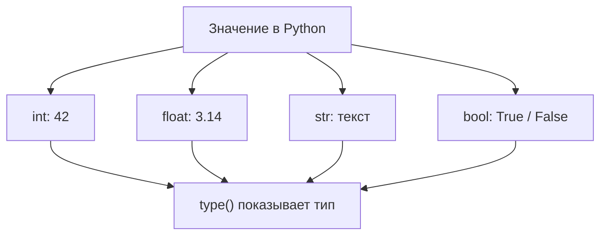

Привет! В прошлом уроке мы научились выводить текст на экран. Но программы, которые просто печатают строчки, не очень полезны. В большинстве программ нужно что-то хранить: число, текст, результат вычислений. Для этого в Python есть переменные. В этом уроке разберёмся, что это такое, какие бывают типы данных и как ими пользоваться.

## Что такое переменная

Переменная — это именованный «ящик», в котором хранится какое-то значение. Ты даёшь ящику имя, кладёшь туда значение, а потом можешь доставать его и использовать сколько угодно раз.

Создать переменную очень просто — нужно написать её имя, знак `=` и значение:

```python
name = "Аня"
age = 25
height = 1.68
```

Здесь мы создали три переменные: `name` хранит строку, `age` — целое число, `height` — дробное число. Знак `=` тут означает «положить значение в переменную», а не «равно» в математическом смысле.

Переменную можно перезаписать — положить в неё новое значение:

```python
age = 25
print(age)  # 25
age = 26
print(age)  # 26
```

Значение переменной можно использовать в выражениях и подставлять в `print()`:

```python
a = 10
b = 5
print(a + b)   # 15
print(a * b)   # 50
```

## Как называть переменные

Чтобы код было легко читать, придерживайся простых правил:

- имя должно быть понятным и описывать, что хранится: `user_age`, а не `x`;
- используй только латинские буквы, цифры и знак подчёркивания `_`;
- имя не может начинаться с цифры и не может совпадать с ключевыми словами Python (например, `if`, `for`, `True`);
- по общепринятому стилю PEP 8 слова в имени разделяют подчёркиванием: `my_name`, `total_price`.

Ты мог заметить: если писать `totalprice` — слитно, то читать тяжело. Поэтому в Python принят стиль `snake_case`: `total_price`.

## Основные типы данных

Тип данных определяет, что именно хранится в переменной и какие операции с этим значением можно делать. Познакомимся с четырьмя самыми важными типами.

**Числа.** Целые числа (`int`) — без дробной части: `5`, `-12`, `0`. Дробные числа (`float`) — с точкой: `3.14`, `-0.5`, `2.0`. Важно: в Python десятичная часть отделяется точкой, а не запятой.

```python
apples = 7          # int
pi = 3.14159        # float
```

**Строки (`str`).** Это текст в кавычках — одинарных или двойных. Мы уже видели такие в первом уроке:

```python
greeting = "Привет!"
empty_str = ""
```

**Булевы значения (`bool`).** Их всего два: `True` и `False`. Они нужны для проверок условий, с ними мы поработаем в следующих уроках:

```python
is_sunny = True
has_discount = False
```

## Функция type() и динамическая типизация

Python сам понимает, какой тип у значения. Узнать его можно функцией `type()`:

```python
print(type(42))        # <class 'int'>
print(type(3.14))      # <class 'float'>
print(type("текст"))   # <class 'str'>
print(type(True))      # <class 'bool'>
```

Тип переменной может меняться: сначала в `x` лежит строка, а потом число:

```python
x = "привет"
x = 10
```

Это называется динамической типизацией — тип определяется в момент присваивания. Это удобно, но требует внимательности: например, нельзя сложить строку и число напрямую:

```python
# print("Возраст: " + 25)  # Ошибка! Нельзя сложить str и int
```

## Преобразование типов

Чтобы превратить одно значение в другое, используют функции `int()`, `float()` и `str()`:

```python
pi_int = int(3.9)      # 3 — дробная часть отбрасывается
price = float("99.5")  # 99.5 — из строки получили число
year = str(2025)       # "2025" — число стало строкой
```

Преобразование строк в числа особенно пригодится в следующем уроке, когда мы научимся получать данные от пользователя.

## Как связаны типы данных

Схема помогает запомнить четыре основных типа и то, как узнать тип значения:



## Итог урока

Мы узнали:

- что такое переменная и как в неё класть значения;
- как правильно называть переменные по стилю snake_case;
- основные типы данных: `int`, `float`, `str`, `bool`;
- как смотреть тип значения функцией `type()`;
- как преобразовывать типы функциями `int()`, `float()`, `str()`.

Теперь закрепим всё практикой.

<!--TASK-->
### Задача 1
Напиши программу, которая создаёт четыре переменные: твоё имя (строка), возраст (целое число), рост в метрах (дробное число) и флаг `is_student` (булево значение). Выведи каждую переменную на экран с подписью — например, `Имя: Аня`. Затем выведи тип каждой переменной функцией `type()`. Проверь, что программа запускается без ошибок, а в выводе рядом с каждым значением появляется его тип.

### Задача 2
Создай переменную `x` со значением `10` и выведи её. Затем положи в `x` новое значение `20` и выведи снова. После этого увеличь значение на 5, записав результат обратно в ту же переменную: `x = x + 5`, и выведи ещё раз. Запусти программу — на экране должно появиться три числа: 10, 20 и 25. В комментарии к третьей строке кратко объясни, что делает запись `x = x + 5`.

### Задача 3
Представь, что ты пишешь программу для онлайн-кинотеатра. Создай три переменные: `film_title` (название фильма), `ticket_price` (цена билета как дробное число) и `tickets_count` (количество билетов как целое число). Выведи их значения на экран с подписями. Добавь комментарий, в котором объясни, почему имя `2film` использовать нельзя, а имя `film-title` тоже.

### Задача 4
Создай переменную `value` со значением `"привет"` и выведи её тип функцией `type()`. Затем присвой той же переменной число `42` и снова выведи тип. Наконец присвой ей `3.14` и выведи тип в третий раз. Обрати внимание: имя переменной не меняется, меняется только её тип. В комментарии в конце программы запиши, какой тип был у значения в каждом из трёх случаев.

### Задача 5
Даны две величины: строка `"12.5"` (цена за килограмм в виде текста) и целое число `3` (сколько килограммов нужно купить). Преврати строку в дробное число функцией `float()`, умножь на `3` и выведи итоговую стоимость. Затем преврати число `2026` в строку функцией `str()` и сложи её со строкой `" год"`, чтобы получить текст `2026 год` и выведи его. В конце выведи тип результата умножения.
### Задача 6
Создай две переменные: `a = 3` и `b = 8`, и выведи их в формате `a = 3, b = 8`. Затем поменяй значения местами с помощью третьей переменной `temp`: сохрани в неё `a`, положи в `a` значение `b`, а в `b` — то, что лежало в `temp`. Выведи результат. После этого снова поменяй значения местами, но уже без третьей переменной — множественным присваиванием `a, b = b, a`. Снова выведи обе переменные. Добавь комментарии к каждому способу обмена и объясни, зачем нужна временная переменная.

Ожидаемый результат:

```
a = 3, b = 8
После обмена: a = 8, b = 3
После второго обмена: a = 3, b = 8
```

### Задача 7
Ты планируешь поездку на автомобиле и хочешь заранее посчитать расход топлива. Создай три переменные: `distance = 420` (километров), `consumption = 7.5` (литров на 100 километров) и `fuel_price = 62.30` (рублей за литр). Посчитай, сколько литров понадобится, по формуле `distance / 100 * consumption`, а затем умножь количество литров на цену. Выведи оба значения с подписями, округлив стоимость до двух знаков после запятой функцией `round()`. В конце выведи тип каждой из трёх исходных переменных, чтобы убедиться, что числа с точкой имеют тип `float`, а расстояние — `int`.

Ожидаемый результат:

```
Топливо: 31.5 л
Стоимость: 1962.45 руб.
<class 'int'> <class 'float'> <class 'float'>
```

<!--/TASK-->

<!--HINT-->
### Подсказка 1
Для вывода «Имя: Аня» используй `print("Имя:", name)` — так несколько значений печатаются через запятую. Тип узнаётся так: `print(type(name))`. Не забудь: `height` должен быть числом с точкой, а не с запятой.

### Подсказка 2
Первый вывод — обычный `print(x)` с `x = 10`. Потом перезапиши переменную: `x = 20` и снова выведи. Для увеличения используй `x = x + 5`: справа от `=` вычисляется старое значение плюс 5, и результат кладётся обратно.

### Подсказка 3
Имена переменных пишутся в стиле snake_case: маленькими латинскими буквами, слова через `_`. Цена — дробное число, например `350.5`; количество — целое, например `2`. Для вывода с подписью используй несколько значений через запятую.

### Подсказка 4
Каждый раз одна и та же команда `print(type(value))` — меняется только то, что лежит в `value`. Сначала строка `"привет"`, потом целое число `42`, потом дробное `3.14`. Типы покажутся в формате `<class '...'>`.

### Подсказка 5
Цена-строка превращается в число так: `float("12.5")`. Умножение: `float("12.5") * 3`. Для склейки «2026 год» используй `str(2026) + " год"`. Тип результата умножения проверь функцией `type()`.
### Подсказка 6
Временная переменная нужна, чтобы не потерять одно из значений: `temp = a`, затем `a = b`, затем `b = temp`. Множественное присваивание делает то же самое одной строкой: `a, b = b, a` — Python сначала вычисляет правую часть, а потом раскладывает результаты по переменным.

### Подсказка 7
Количество литров: `liters = distance / 100 * consumption`. Стоимость: `liters * fuel_price`. Округление до двух знаков: `round(cost, 2)`. В одном `print()` можно передать несколько вызовов `type()` через запятую — они напечатаются через пробел.
<!--/HINT-->

<!--SOLUTION-->
### Разбор 1
Одно из возможных решений:

```python
name = "Аня"
age = 25
height = 1.68
is_student = True

print("Имя:", name)
print("Возраст:", age)
print("Рост:", height)
print("Студент:", is_student)

print("Тип имени:", type(name))
print("Тип возраста:", type(age))
print("Тип роста:", type(height))
print("Тип флага:", type(is_student))
```

Результат:

```
Имя: Аня
Возраст: 25
Рост: 1.68
Студент: True
Тип имени: <class 'str'>
Тип возраста: <class 'int'>
Тип роста: <class 'float'>
Тип флага: <class 'bool'>
```

Что здесь происходит? Мы создаём четыре переменные с разными типами. Затем каждая `print()` выводит подпись и значение через запятую — Python печатает их через пробел. В конце мы передаём `type(name)` прямо внутрь `print()`: сначала вычисляется тип, потом он печатается. Обрати внимание, что `height = 1.68` записано с точкой — это важно, иначе Python посчитает число целым, а не дробным.

Если ты получил ошибку — скорее всего, где-то опечатка в имени переменной или лишняя запятая. Python подскажет номер строки, где проблема.

### Разбор 2
Решение:

```python
x = 10
print(x)

x = 20
print(x)

x = x + 5  # берём старое значение (20), прибавляем 5 и кладём обратно
print(x)
```

Результат:

```
10
20
25
```

Что здесь происходит? Сначала в `x` лежит 10 — печатаем. Затем `x = 20` перезаписывает ящик: старое значение 10 пропадает, теперь там 20. Третья строка — самая интересная: `x = x + 5`. Python сначала смотрит направо от `=` и вычисляет `x + 5`, то есть `20 + 5 = 25`, а потом кладёт результат в `x`. Так запись в ту же переменную позволяет накапливать результат. Такой приём встречается постоянно, например в счётчиках.

### Разбор 3
Решение:

```python
film_title = "Интерстеллар"
ticket_price = 350.5
tickets_count = 2

print("Фильм:", film_title)
print("Цена билета:", ticket_price)
print("Количество билетов:", tickets_count)

# Имя не может начинаться с цифры (2film — ошибка),
# а дефис запрещён (film-title — ошибка): разрешены
# только буквы, цифры и символ подчёркивания.
```

Результат:

```
Фильм: Интерстеллар
Цена билета: 350.5
Количество билетов: 2
```

Что здесь происходит? Имена переменных осмысленные: по одному имени понятно, что хранится. Это и есть цель правил: код читается как текст. Значение `350.5` — дробное, поэтому его тип `float`; `2` — целое, тип `int`. В комментарии отражено главное правило: имя не может начинаться с цифры, и в нём нельзя использовать дефис — Python воспримет `film-title` как вычитание. Если нарушить правило, получишь `SyntaxError` ещё до запуска.

### Разбор 4
Решение:

```python
value = "привет"
print(type(value))

value = 42
print(type(value))

value = 3.14
print(type(value))

# Типы: 1) str, 2) int, 3) float
```

Результат:

```
<class 'str'>
<class 'int'>
<class 'float'>
```

Что здесь происходит? Переменная `value` одна и та же, но в разные моменты в ней лежат значения разных типов: строка, целое число, дробное число. Это и есть динамическая типизация — Python сам определяет тип в момент присваивания, и нам не нужно ничего объявлять заранее. Функция `type()` возвращает сам тип, и мы его печатаем. Такое поведение удобно, но требует внимательности: если позже попытаешься сложить `value` с числом, когда в нём лежит строка, Python выдаст ошибку.

### Разбор 5
Решение:

```python
price_per_kg = "12.5"
kg = 3

total = float(price_per_kg) * kg
print(total)

year = str(2026) + " год"
print(year)

print(type(total))
```

Результат:

```
37.5
2026 год
<class 'float'>
```

Что здесь происходит? Строка `"12.5"` превращается в дробное число функцией `float()`, и только после этого умножение становится возможным. Если умножить строку на число, Python выдал бы ошибку, а так получается `12.5 * 3 = 37.5`. Затем `str(2026)` превращает число в строку `"2026"`, и знак `+` склеивает две строки: `"2026" + " год"` даёт `"2026 год"`. Последняя строка подтверждает, что результат умножения — дробное число. Запомни: `+` для строк — склейка, а для чисел — сложение.
### Разбор 6
Решение:

```python
a = 3
b = 8
print(f"a = {a}, b = {b}")

# Способ 1: через временную переменную
temp = a
a = b
b = temp
print(f"После обмена: a = {a}, b = {b}")

# Способ 2: множественное присваивание
a, b = b, a
print(f"После второго обмена: a = {a}, b = {b}")
```

Результат:

```
a = 3, b = 8
После обмена: a = 8, b = 3
После второго обмена: a = 3, b = 8
```

Что здесь происходит? В первом способе мы не можем просто написать `a = b`, а потом `b = a`: после первой строки старое значение `a` потеряется, и обе переменные станут равны 8. Поэтому сначала сохраняем `a` в `temp = 3`, затем кладём в `a` значение `b` (получается 8), а в `b` возвращаем сохранённое `temp` (получается 3). Второй способ короче: `a, b = b, a` — Python сначала вычисляет всю правую часть, то есть запоминает пару (8, 3), и только потом раскладывает её по переменным. Промежуточная переменная не нужна. Оба способа дают одинаковый результат, но множественное присваивание читается лучше и меньше подвержено ошибкам.

### Разбор 7
Решение:

```python
distance = 420
consumption = 7.5
fuel_price = 62.30

liters = distance / 100 * consumption
cost = liters * fuel_price

print(f"Топливо: {liters} л")
print(f"Стоимость: {round(cost, 2)} руб.")
print(type(distance), type(consumption), type(fuel_price))
```

Результат:

```
Топливо: 31.5 л
Стоимость: 1962.45 руб.
<class 'int'> <class 'float'> <class 'float'>
```

Что здесь происходит? Расход задан на 100 километров, поэтому сначала делим путь на 100: `420 / 100 = 4.2`. Столько «сотен километров» проедет машина. Умножаем на расход: `4.2 * 7.5 = 31.5` литра. Затем умножаем литры на цену: `31.5 * 62.30 = 1962.45` рубля. Деление `/` всегда даёт `float`, поэтому `liters` — дробное число, и в выводе появляется точка. `round(cost, 2)` отбрасывает лишние знаки после запятой, оставляя ровно два. Последняя строка показывает типы: `distance` — целое число (`int`), а `consumption` и `fuel_price` записаны с точкой, поэтому они `float`. Если бы мы написали `62,30` с запятой, Python создал бы кортеж из двух чисел, и умножение сломалось бы.
<!--/SOLUTION-->

<!--QUIZ-->
Какое имя переменной допустимо в Python?
- 2name
- my_name
- my-name
* Правильный ответ: my_name
Имя переменной не может начинаться с цифры и содержать дефис.

Какой тип у значения 3.14?
- int
- float
- str
* Правильный ответ: float
Числа с плавающей точкой имеют тип float.

Что выведет print(type(True))?
- <class 'bool'>
- True
- <class 'int'>
* Правильный ответ: <class 'bool'>
True — это булево значение, его тип называется bool.

Какое значение будет у переменной x после выполнения кода x = 5; x = x + 1?
- 5
- 6
- 51
* Правильный ответ: 6
Сначала вычисляется x + 1, то есть 5 + 1, затем результат кладётся обратно в x.

Что произойдёт при выполнении print("Возраст: " + 25)?
- Выведется Возраст: 25
- Ошибка TypeError
- Выведется 25
* Правильный ответ: Ошибка TypeError
Нельзя напрямую сложить строку и число — сначала нужно преобразовать число через str().

Что выведет int(3.9)?
- 3
- 4
- 3.9
* Правильный ответ: 3
int() отбрасывает дробную часть, а не округляет до ближайшего целого.

Какой тип у значения "123", записанного в кавычках?
- int
- str
- float
* Правильный ответ: str
Всё, что находится в кавычках, — строка, даже если внутри только цифры.

Что выведет print(type(42))?
- <class 'int'>
- 42
- <class 'str'>
* Правильный ответ: <class 'int'>
type() возвращает тип значения; у целого числа 42 это int.
Что вернёт float("3")?
- 3
- 3.0
- Ошибка
* Правильный ответ: 3.0
float() превращает строку с числом в дробное число, поэтому результат печатается с точкой.

Что выведет print("5" * 3)?
- 15
- 555
- Ошибка
* Правильный ответ: 555
Умножение строки на число повторяет её: "5" * 3 даёт "555", а не арифметическое произведение.

Какой тип у результата выражения 10 / 2?
- int
- float
- str
* Правильный ответ: float
Обычное деление в Python всегда возвращает float, даже если результат целый: 5.0.

Что выведет print(str(7) + str(3))?
- 10
- 73
- Ошибка
* Правильный ответ: 73
str() превращает числа в строки, а + склеивает их: "7" + "3" даёт "73".
<!--/QUIZ-->
