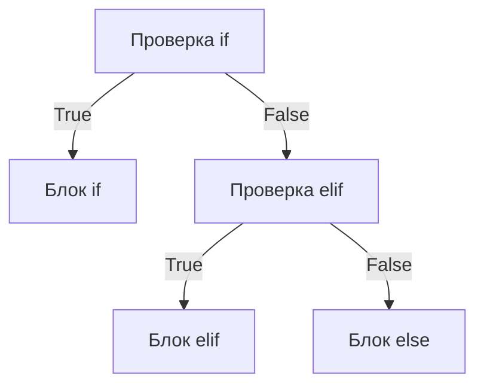

Привет! До сих пор наши программы выполняли команды строго сверху вниз. Но жизнь состоит из выборов: если идёт дождь — берём зонт, иначе — нет. Сегодня мы научим Python принимать такие решения с помощью условного оператора.

## Первый if

Условный оператор `if` проверяет условие и, если оно истинно (`True`), выполняет блок команд:

```python
age = 20
if age >= 18:
    print("Тебе можно голосовать!")
```

Разберём структуру:

- после `if` пишем условие (любое выражение, которое даёт `True` или `False`);
- в конце условия ставим двоеточие `:`;
- команды, которые выполнятся при истинном условии, пишем со следующей строки **с отступом** — обычно 4 пробела.

Если условие ложно, блок пропускается, и программа идёт дальше:

```python
age = 15
if age >= 18:
    print("Тебе можно голосовать!")  # не выполнится
print("Программа завершена")         # выполнится всегда
```

## Отступы — главное правило

В Python отступы не для красоты: именно они показывают, какие строки относятся к блоку. Каждое новое вложение увеличивает отступ. Забудь про отступ — получишь `IndentationError`. Редактор обычно подсказывает: после двоеточия и нажатия Enter курсор сам становится на уровень глубже.

## else: ветка «иначе»

Блок `else` выполняется, когда условие `if` ложно. Получается развилка «либо-либо»:

```python
age = 15
if age >= 18:
    print("Тебе можно голосовать!")
else:
    print("Ты ещё слишком молод.")
```

Веток ровно две: либо та, либо другая — они никогда не выполнятся вместе.

## elif: несколько вариантов

Если вариантов больше двух, на помощь приходит `elif` (сокращение от else if). Он проверяется по очереди: как только одно условие оказалось истинным, остальные пропускаются:

```python
score = 85
if score >= 90:
    print("Отлично!")
elif score >= 75:
    print("Хорошо")
elif score >= 60:
    print("Удовлетворительно")
else:
    print("Плохо")
```

Тут важен порядок: условия проверяются сверху вниз, поэтому первым ставим самое строгое (`>= 90`), потом менее строгие. Если поменять местами — логика сломается. `else` в конце ловит все остальные случаи.

## Вложенные условия

Внутри блока можно писать ещё один `if`:

```python
age = 20
has_ticket = True
if age >= 18:
    if has_ticket:
        print("Проходи!")
    else:
        print("Нужен билет")
```

Старайся не вкладывать слишком глубоко — код становится трудно читать. Часто вложения удаётся заменить логическим оператором `and`:

```python
if age >= 18 and has_ticket:
    print("Проходи!")
```

## Как работает цепочка условий

Схема показывает, почему в цепочке выполняется ровно одна ветка:



## Итог урока

Мы узнали:

- как писать `if`, `elif` и `else`;
- почему отступы так важны в Python;
- что условия проверяются по порядку сверху вниз;
- как вкладывать условия и когда лучше заменить их на `and`.

Теперь закрепим всё практикой.

<!--TASK-->
### Задача 1
Напиши программу, которая спрашивает у пользователя оценку за экзамен (целое число от 0 до 100) и выводит вердикт по правилам:

- 90 и выше — `Отлично`;
- 75–89 — `Хорошо`;
- 60–74 — `Удовлетворительно`;
- меньше 60 — `Плохо`.

Дополнительно: если число вне диапазона 0–100, выведи `Некорректная оценка`. Проверь программу минимум на трёх разных вводах, например 95, 70 и 45.

### Задача 2
Напиши программу, которая спрашивает у пользователя целое число и выводит `Чётное` или `Нечётное` в зависимости от остатка от деления на 2. Используй `if` и `else`. Например, для 46 выведется `Чётное`, для 37 — `Нечётное`. Проверь программу минимум на двух числах, включая отрицательное.

### Задача 3
Напиши программу, которая спрашивает возраст и выводит категорию: 0–6 — `Дошкольник`, 7–17 — `Школьник`, 18–64 — `Взрослый`, от 65 — `Пенсионер`. Используй цепочку `if`/`elif`/`else`. Помни: условия проверяются сверху вниз, поэтому расставь их правильно. Проверь на возрастах 5, 20 и 70.

### Задача 4
Напиши программу контроля входа на концерт. Создай переменные `age = 19` и `has_ticket = False`. Если возраст меньше 18 — выведи `Вход запрещён`. Если возраст хотя бы 18, проверь внутри ещё раз наличие билета: при `True` выведи `Проходи!`, иначе — `Нужен билет`. Попробуй поменять значения переменных и убедись, что вывод меняется правильно.

### Задача 5
Напиши программу проверки формы регистрации. Создай переменные `age = 19`, `password = "qwerty123"`. Условия: возраст от 13 до 100 лет включительно И длина пароля не меньше 8 символов. Если оба условия выполнены — выведи `Регистрация успешна`, иначе — `Проверь данные`. Используй `and` и функцию `len()` для длины пароля.
### Задача 6
Напиши программу, которая спрашивает год (целое число) и определяет, високосный ли он. Правило такое: год високосный, если он делится на 4, но не делится на 100; исключение — годы, которые делятся на 400, они тоже високосные. Используй цепочку `if`/`elif`/`else` и операторы `%`. Проверь программу на 2024, 1900 и 2000: должны получиться строки `2024 — високосный год`, `1900 — не високосный год` и `2000 — високосный год`.

Ожидаемый результат для 1900:

```
1900 — не високосный год
```

### Задача 7
Напиши программу-калькулятор: она спрашивает два целых числа и знак операции (`+`, `-`, `*` или `/`). В зависимости от знака выведи результат в формате `8 / 2 = 4.0`. Для деления добавь проверку: если второе число равно нулю, выведи `Деление на ноль невозможно`. Если введён неизвестный знак, выведи `Неизвестная операция`. Используй `if`/`elif`/`else`, вложенное условие для деления и f-строки.

Ожидаемый результат для чисел 8, 2 и знака `/`:

```
8 / 2 = 4.0
```

<!--/TASK-->

<!--HINT-->
### Подсказка 1
Используй `int(input(...))` для получения числа. Сначала проверь диапазон (внешний `if`), затем внутри — оценки по убыванию через `elif`. Помни, что первым должно идти самое высокое требование.

### Подсказка 2
Чётность проверяется остатком от деления на 2: `number % 2 == 0` — чётное. В `if` поставь именно это условие, а в `else` — всё остальное. Для отрицательных чисел остаток тоже считается корректно.

### Подсказка 3
Начни с самой младшей категории: `if age <= 6`. Затем `elif age <= 17`, потом `elif age <= 64` и финальный `else` для пенсионеров. Порядок важен: проверка идёт сверху вниз, поэтому каждая следующая граница отсекает следующую группу.

### Подсказка 4
Внешний `if age < 18` — запрет. Внутри `else` (или `elif age >= 18`) вложи второй `if has_ticket:` с двумя ветками. Не забудь про отступы: вложенный `if` должен быть глубже внешнего.

### Подсказка 5
Длина пароля — `len(password)`. Диапазон возраста проверяется двойным условием: `(age >= 13) and (age <= 100)`. Объедини оба правила через `and`: `if (age >= 13) and (age <= 100) and len(password) >= 8:`.
### Подсказка 6
Сначала отсеки делимость на 400: `if year % 400 == 0`. Затем проверь делимость на 100: `elif year % 100 == 0`. И только потом — на 4: `elif year % 4 == 0`. Порядок важен: 1900 делится на 4, но не должно считаться високосным, поэтому проверка на 100 идёт раньше.

### Подсказка 7
Считай оба числа через `int(input())`, знак — через обычный `input()`. Дальше цепочка: `if op == "+"`, `elif op == "-"`, `elif op == "*"`, `elif op == "/"`. Внутри ветки деления сначала проверь `b == 0`, а уже в `else` выполняй деление.
<!--/HINT-->

<!--SOLUTION-->
### Разбор 1
Одно из возможных решений:

```python
score = int(input("Введи оценку (0–100): "))

if score < 0 or score > 100:
    print("Некорректная оценка")
elif score >= 90:
    print("Отлично")
elif score >= 75:
    print("Хорошо")
elif score >= 60:
    print("Удовлетворительно")
else:
    print("Плохо")
```

Результат для ввода `95`:

```
Введи оценку (0–100): 95
Отлично
```

Для `70` — `Удовлетворительно`, для `45` — `Плохо`, для `150` — `Некорректная оценка`.

Что здесь происходит? Сначала `int(input())` превращает ввод в число. Первый `if` ловит любое некорректное значение: `score < 0 or score > 100`. Если условие ложно, программа переходит к `elif`. Главный трюк — порядок: если бы мы начали с `score >= 60`, то оценка 95 попала бы в «Удовлетворительно». Поскольку условия проверяются сверху вниз и останавливаются на первом истинном, мы идём от самой высокой границы к низшей. `else` в конце принимает всё, что ниже 60.

Обрати внимание: границы не пересекаются, поэтому любой корректный ввод попадёт ровно в одну ветку.

### Разбор 2
Решение:

```python
number = int(input("Введи целое число: "))

if number % 2 == 0:
    print("Чётное")
else:
    print("Нечётное")
```

Результат для ввода `46`:

```
Введи целое число: 46
Чётное
```

Что здесь происходит? Оператор `%` возвращает остаток от деления на 2. Для чётных чисел остаток всегда равен нулю: `46 % 2 = 0`, поэтому условие `number % 2 == 0` истинно, и печатается `Чётное`. Для нечётных, например 37, остаток равен 1, условие ложно, и выполняется ветка `else` — `Нечётное`. Отрицательные числа ведут себя так же: `-7 % 2 = 1`, значит `-7` — нечётное. Такая проверка чётности встречается в программах повсеместно.

### Разбор 3
Решение:

```python
age = int(input("Сколько тебе лет? "))

if age <= 6:
    print("Дошкольник")
elif age <= 17:
    print("Школьник")
elif age <= 64:
    print("Взрослый")
else:
    print("Пенсионер")
```

Результат для ввода `5`:

```
Сколько тебе лет? 5
Дошкольник
```

Что здесь происходит? Условия проверяются сверху вниз, и первое истинное «побеждает». Если возраст 5, сразу срабатывает `age <= 6`. Возраст 20 не подходит под первые два условия, но подходит под `age <= 64`. Для 70 не подходит ни одно из `elif`, и срабатывает `else` — `Пенсионер`. Ключевой момент — порядок границ: мы идём от меньшего к большему, поэтому каждое следующее условие автоматически отсекает предыдущие группы. Если бы мы начали с `age <= 64`, то все взрослые и школьники попали бы в одну категорию.

### Разбор 4
Решение:

```python
age = 19
has_ticket = False

if age < 18:
    print("Вход запрещён")
else:
    if has_ticket:
        print("Проходи!")
    else:
        print("Нужен билет")
```

Результат:

```
Нужен билет
```

Что здесь происходит? Внешний `if` проверяет минимальный возраст. Возраст 19 не меньше 18, поэтому выполняется блок `else`, и программа попадает во вложенный `if has_ticket:`. Поскольку `has_ticket` — False, печатается `Нужен билет`. Если поменять `has_ticket` на True, выведется `Проходи!`, а если поменять возраст на 15 — сразу `Вход запрещён`, и до проверки билета дело не дойдёт. Обрати внимание на отступы: внутренний `if` стоит на четыре пробела глубже внешнего — иначе Python не поймёт, что это вложенная конструкция.

### Разбор 5
Решение:

```python
age = 19
password = "qwerty123"

if (age >= 13) and (age <= 100) and len(password) >= 8:
    print("Регистрация успешна")
else:
    print("Проверь данные")
```

Результат:

```
Регистрация успешна
```

Что здесь происходит? Условие собирается из трёх частей через `and`: возраст не меньше 13, возраст не больше 100 и длина пароля не меньше 8. `len(password)` возвращает 9 — пароль `"qwerty123"` содержит 9 символов, поэтому последняя проверка истинна. Все три условия выполнены, значит `True and True and True` даёт `True`, и печатается `Регистрация успешна`. Если бы пароль был короче, например `"abc"`, условие стало бы ложным, и программа вывела бы `Проверь данные`. Именно так одна строка с `and` заменяет несколько вложенных `if`.
### Разбор 6
Решение:

```python
year = int(input("Введи год: "))

if year % 400 == 0:
    print(f"{year} — високосный год")
elif year % 100 == 0:
    print(f"{year} — не високосный год")
elif year % 4 == 0:
    print(f"{year} — високосный год")
else:
    print(f"{year} — не високосный год")
```

Результат для 1900:

```
Введи год: 1900
1900 — не високосный год
```

Что здесь происходит? Условия проверяются сверху вниз, и срабатывает первое истинное. Для 2000 первое условие `2000 % 400 == 0` истинно — печатается «високосный», остальные ветки пропускаются. Для 1900 первое условие ложно, зато истинно второе: `1900 % 100 == 0`, поэтому год считается невисокосным, хотя и делится на 4. Для 2024 первые два условия ложны, а `2024 % 4 == 0` истинно — снова високосный. Если бы мы поставили проверку на 4 первой, то 1900 ошибочно попал бы в високосные. Именно поэтому порядок веток в такой задаче — не формальность, а часть алгоритма.

### Разбор 7
Решение:

```python
a = int(input("Первое число: "))
b = int(input("Второе число: "))
op = input("Операция (+ - * /): ")

if op == "+":
    print(f"{a} + {b} = {a + b}")
elif op == "-":
    print(f"{a} - {b} = {a - b}")
elif op == "*":
    print(f"{a} * {b} = {a * b}")
elif op == "/":
    if b == 0:
        print("Деление на ноль невозможно")
    else:
        print(f"{a} / {b} = {a / b}")
else:
    print("Неизвестная операция")
```

Результат для 8, 2 и `/`:

```
8 / 2 = 4.0
```

Что здесь происходит? Программа сначала получает данные, а затем выбирает одну из веток по значению `op`. Сравнение строк чувствительно к регистру и пробелам: `"+"` и `" +"` — разные строки. В ветке деления стоит вложенный `if`: сначала проверяется делитель, и только если он не ноль, выполняется `a / b`. Без этой проверки программа упала бы с `ZeroDivisionError`. Обрати внимание на вывод `4.0`: оператор `/` всегда возвращает дробное число, даже когда делится нацело. Для 5, 3 и `*` получится `5 * 3 = 15` — без точки, потому что умножение целых даёт целое. Ветка `else` ловит любой символ, который не совпал ни с одним из четырёх.
<!--/SOLUTION-->

<!--QUIZ-->
Что выведет следующий код: if 5 > 3: print("да") else: print("нет")?
- да
- нет
- Ничего
* Правильный ответ: да
Условие 5 > 3 истинно, поэтому выполняется блок if.

Что случится, если забыть отступ после if?
- Программа просто пропустит проверку
- Ошибка IndentationError
- Ничего
* Правильный ответ: Ошибка IndentationError
В Python отступы — часть синтаксиса, без них блок не определяется.

Для чего используется elif?
- Для завершения программы
- Для дополнительных проверок после if
- Для объявления переменных
* Правильный ответ: Для дополнительных проверок после if
elif проверяется, если предыдущие условия оказались ложными.

Как объединить два условия так, чтобы оба были обязательны?
- or
- and
- not
* Правильный ответ: and
and возвращает True только когда оба условия истинны.

Сколько веток может выполниться в цепочке if/elif/else?
- Все подряд
- Ровно одна
- Две
* Правильный ответ: Ровно одна
Условия проверяются по очереди, и выполняется только первое истинное.

Что выведет этот код? x = 10; if x > 5: print("больше") else: print("меньше")
- больше
- меньше
- Ничего
* Правильный ответ: больше
Условие x > 5 истинно, поэтому выполняется блок if, а ветка else пропускается.

Какой оператор проверяет, что значения не равны?
- =
- ==
- !=
* Правильный ответ: !=
!= означает «не равно»; == проверяет равенство, а = выполняет присваивание.

Что выведет этот код? n = 1; if n > 10: print("A") elif n > 0: print("B") else: print("C")
- A
- B
- C
* Правильный ответ: B
Первое условие ложно, поэтому проверяется elif: n > 0 истинно, печатается B.
Какой блок выполнится, если все условия if и elif оказались ложными?
- Блок if
- Блок else
- Ни один блок
* Правильный ответ: Блок else
else — это ветка «во всех остальных случаях»; она выполняется, когда ни одно условие не сработало.

Можно ли использовать elif без else?
- Да, цепочка может заканчиваться на elif
- Нет, else обязателен
- Только внутри функции
* Правильный ответ: Да, цепочка может заканчиваться на elif
else не обязателен: если ни одно условие не истинно, просто ничего не выполнится.

Что выведет этот код? x = 5; if x > 3: print("A"); if x > 4: print("B")
- Только A
- A и B
- Только B
* Правильный ответ: A и B
Это два независимых if, а не цепочка if/elif: оба условия истинны, поэтому печатаются обе буквы.

Что выведет этот код? if "": print("да") else: print("нет")
- да
- нет
- Ошибка
* Правильный ответ: нет
Пустая строка в условии считается ложной, поэтому выполняется ветка else.
<!--/QUIZ-->
