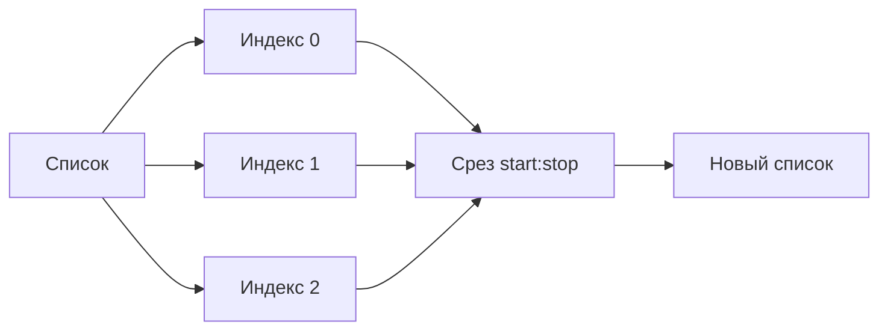

Привет! Один товар можно хранить в переменной, а как быть с целым списком товаров или показателями температуры за неделю? Для таких случаев в Python есть списки — упорядоченные наборы элементов. Это одна из самых полезных структур данных.

## Что такое список

Список — это упорядоченная коллекция значений, которая создаётся квадратными скобками, элементы разделяются запятыми:

```python
cities = ["Москва", "Санкт-Петербург", "Казань"]
grades = [5, 4, 3, 5, 4]
mixed = [1, "текст", True, 3.14]  # элементы могут быть разных типов
```

Элементы могут быть любого типа, а пустой список создаётся так: `empty = []`.

## Индексация

У каждого элемента есть позиция — **индекс**. Первый элемент имеет индекс `0`, второй — `1` и так далее. Обращаться к элементу можно через квадратные скобки:

```python
fruits = ["яблоко", "банан", "апельсин"]
print(fruits[0])   # яблоко
print(fruits[1])   # банан
print(fruits[2])   # апельсин
```

Индексы считаются с нуля — это самая частая причина ошибок новичков. Если взять индекс за пределами списка, получим `IndexError`.

Python умеет считать и с конца: индекс `-1` — последний элемент, `-2` — предпоследний:

```python
print(fruits[-1])   # апельсин
print(fruits[-2])   # банан
```

## Срезы

Срез позволяет взять часть списка: `список[начало:конец]`. При этом элемент с индексом `конец` **не включается**:

```python
numbers = [0, 1, 2, 3, 4, 5]
print(numbers[1:4])    # [1, 2, 3] — индекс 4 не включён
print(numbers[:3])     # [0, 1, 2] — от начала
print(numbers[3:])     # [3, 4, 5] — до конца
print(numbers[:])      # копия всего списка
```

Можно указать и шаг через второе двоеточие: `list[start:stop:step]`.

```python
print(numbers[::2])    # [0, 2, 4] — каждый второй
print(numbers[::-1])   # [5, 4, 3, 2, 1, 0] — разворот!
```

Шаг `-1` идёт с конца — таким способом список разворачивается одной конструкцией.

## Методы списков

Списки умеют менять себя. Основные методы:

- `append(x)` — добавляет `x` в конец;
- `insert(index, x)` — вставляет `x` на позицию `index`;
- `remove(x)` — удаляет первый найденный элемент `x`;
- `pop(index)` — удаляет элемент по индексу (или последний) и возвращает его;
- `sort()` — сортирует список по возрастанию; `reverse()` — разворачивает.

```python
tasks = ["проснуться", "позавтракать"]
tasks.append("почитать")
print(tasks)  # ['проснуться', 'позавтракать', 'почитать']
tasks.insert(1, "умыться")
print(tasks)  # ['проснуться', 'умыться', 'позавтракать', 'почитать']
tasks.remove("проснуться")
print(tasks)  # ['умыться', 'позавтракать', 'почитать']
```

## Полезные функции

Списки отлично работают со встроенными функциями:

```python
grades = [5, 4, 5, 3, 4]
print(len(grades))    # 5 — количество элементов
print(sum(grades))    # 21 — сумма
print(min(grades))    # 3
print(max(grades))    # 5
print(4 in grades)    # True — есть ли элемент
```

Функция `len()` работает с любой коллекцией, `sum()`, `min()`, `max()` — только с числовыми списками, а оператор `in` проверяет наличие элемента.

## Как устроен список

Индексы и срезы удобно представлять наглядно:



## Итог урока

Мы узнали:

- как создавать списки и обращаться к элементам по индексу;
- как вырезать части списка срезами и разворачивать его;
- основные методы: `append`, `insert`, `remove`, `pop`;
- полезные функции `len`, `sum`, `min`, `max` и оператор `in`.

Теперь закрепим всё практикой.

<!--TASK-->
### Задача 1
Создай список чисел `[5, 12, 7, 19, 3]`. Затем:

1. добавь число `8` в конец списка;
2. выведи длину списка;
3. выведи сумму всех элементов;
4. выведи максимальный элемент;
5. выведи список в обратном порядке, используя срез;
6. замени первый элемент на `0` и выведи итоговый список.

Программа должна вывести пять строк: длину, сумму, максимум, развёрнутый список и изменённый список.

### Задача 2
Создай список городов: `["Москва", "Санкт-Петербург", "Казань", "Екатеринбург", "Сочи"]`. Выведи: первый город, последний (используй отрицательный индекс), третий город и предпоследний (тоже отрицательный индекс). Программа должна вывести четыре строки. Перед запуском подумай, какие индексы нужны, и проверь, что они считаются с нуля.

### Задача 3
Создай список `numbers = list(range(10))` (это числа от 0 до 9). Выведи четырьмя срезами: первые три элемента, последние два элемента, каждый второй элемент и весь список в обратном порядке. Дай каждому результату подпись — например, `Первые три: [0, 1, 2]`. Убедись, что конечный индекс в срезе не включается.

### Задача 4
Создай список дел на день: `["проснуться", "позавтракать", "поработать"]`. Затем: добавь `"прогуляться"` в конец методом `append`; вставь `"умыться"` на позицию 1 методом `insert`; удали `"поработать"` методом `remove`; достань последний элемент методом `pop` и сохрани его в переменную, а затем выведи эту переменную и итоговый список целиком.

### Задача 5
У тебя есть список оценок за четверть: `[5, 4, 3, 5, 4, 2, 5]`. Выведи: количество оценок (`len`), их сумму (`sum`), средний балл (сумма, делённая на количество — в формате `4.0`), максимальную и минимальную оценки (`max`, `min`), а также результат проверки `2 in grades`. Всего шесть строк вывода.
### Задача 6
Создай список температур за неделю: `[18, 21, 16, 24, 19]`. Найди минимальную температуру функцией `min()` и её индекс методом `index()`. Затем замени самый холодный день на `0` — то есть присвой новое значение по найденному индексу. Выведи три строки: минимум, его индекс и итоговый список. Убедись, что после замены минимум в списке изменился.

Ожидаемый результат:

```
Минимум: 16
Индекс: 2
Список: [18, 21, 0, 24, 19]
```

### Задача 7
Даны два списка результатов: `first = [12, 45, 7]` и `second = [30, 8, 22]`. Объедини их оператором `+`, сохрани в новую переменную и отсортируй по убыванию методом `sort(reverse=True)`. Выведи весь список и первые три элемента срезом `[:3]` — это будет «топ-3». Затем выведи последний элемент объединённого списка через отрицательный индекс.

Ожидаемый результат:

```
[45, 30, 22, 12, 8, 7]
[45, 30, 22]
7
```

<!--/TASK-->

<!--HINT-->
### Подсказка 1
Используй `append(8)`, `len()`, `sum()`, `max()`. Разворот — срез `[::-1]`. Первый элемент — индекс `0`: `nums[0] = 0`. Проверь, что `sum()` считает после добавления восьмёрки.

### Подсказка 2
Первый элемент — индекс `0`. Последний — `-1`, предпоследний — `-2`. Третий элемент имеет индекс `2` (не забывай: счёт с нуля). Выведи каждый в отдельном `print()`.

### Подсказка 3
Первые три: `numbers[:3]`. Последние два: `numbers[-2:]`. Каждый второй: `numbers[::2]`. Разворот: `numbers[::-1]`. В срезе `[start:stop]` элемент с индексом `stop` не включается.

### Подсказка 4
Применяй методы по очереди: `append("прогуляться")`, `insert(1, "умыться")`, `remove("поработать")`. Метод `pop()` без аргумента удаляет последний элемент и возвращает его: `last = tasks.pop()`. Затем выведи `last` и `tasks`.

### Подсказка 5
Средний балл — это `sum(grades) / len(grades)`. Не забудь, что деление всегда даёт дробное число, поэтому результат будет вида `4.0`. Проверка `2 in grades` вернёт `True`.
### Подсказка 6
Минимум — `min(temps)`, индекс минимума — `temps.index(min(temps))`. Сохрани индекс в переменную: после замены `index()` может найти уже другое значение. Замена выполняется присваиванием: `temps[index] = 0`.

### Подсказка 7
Объединение: `all_results = first + second` — создаётся новый список. Сортировка по убыванию: `all_results.sort(reverse=True)` — метод меняет список на месте. Топ-3 — срез `all_results[:3]`, последний элемент — `all_results[-1]`.
<!--/HINT-->

<!--SOLUTION-->
### Разбор 1
Одно из возможных решений:

```python
numbers = [5, 12, 7, 19, 3]
numbers.append(8)

print(len(numbers))       # 6
print(sum(numbers))       # 54
print(max(numbers))       # 19
print(numbers[::-1])      # [8, 3, 19, 7, 12, 5]

numbers[0] = 0
print(numbers)            # [0, 12, 7, 19, 3, 8]
```

Результат:

```
6
54
19
[8, 3, 19, 7, 12, 5]
[0, 12, 7, 19, 3, 8]
```

Что здесь происходит? `numbers.append(8)` добавляет восьмёрку в конец, и список становится `[5, 12, 7, 19, 3, 8]`. Значит, длина 6, сумма `5+12+7+19+3+8 = 54`, максимум — `19`. Срез `numbers[::-1]` идёт с шагом -1, то есть с конца — получается развёрнутая копия, при этом исходный список не меняется. Наконец, `numbers[0] = 0` перезаписывает элемент с индексом 0 (первый) — так список меняется на месте.

Обрати внимание: `numbers[::-1]` не меняет список, а возвращает новый; а вот `numbers[0] = 0` изменяет исходный список. Эта разница между «вернуть новое» и «изменить само» важна и в других структурах данных.

### Разбор 2
Решение:

```python
cities = ["Москва", "Санкт-Петербург", "Казань", "Екатеринбург", "Сочи"]

print(cities[0])
print(cities[-1])
print(cities[2])
print(cities[-2])
```

Результат:

```
Москва
Сочи
Казань
Екатеринбург
```

Что здесь происходит? Индексы начинаются с нуля: `cities[0]` — первый элемент, `cities[2]` — третий. Отрицательные индексы отсчитываются с конца: `-1` — последний элемент (`Сочи`), `-2` — предпоследний (`Екатеринбург`). Такая двойная нумерация — положительная с начала и отрицательная с конца — позволяет удобно доставать элементы с любого края списка. Если бы мы написали `cities[5]`, Python выдал бы `IndexError`: индекс 5 выходит за пределы списка из пяти элементов.

### Разбор 3
Решение:

```python
numbers = list(range(10))

print("Первые три:", numbers[:3])
print("Последние два:", numbers[-2:])
print("Каждый второй:", numbers[::2])
print("Разворот:", numbers[::-1])
```

Результат:

```
Первые три: [0, 1, 2]
Последние два: [8, 9]
Каждый второй: [0, 2, 4, 6, 8]
Разворот: [9, 8, 7, 6, 5, 4, 3, 2, 1, 0]
```

Что здесь происходит? `numbers[:3]` берёт элементы от начала до индекса 3, не включая его, — получаются `0, 1, 2`. `numbers[-2:]` — последние два элемента. `numbers[::2]` пропускает каждый второй элемент благодаря шагу 2. `numbers[::-1]` идёт с шагом -1, то есть с конца, и разворачивает список. Ключевое правило срезов: элемент с индексом `stop` в результат не входит — поэтому `[:3]` даёт ровно три элемента, а не четыре.

### Разбор 4
Решение:

```python
tasks = ["проснуться", "позавтракать", "поработать"]

tasks.append("прогуляться")
tasks.insert(1, "умыться")
tasks.remove("поработать")

last = tasks.pop()
print(last)
print(tasks)
```

Результат:

```
прогуляться
['проснуться', 'умыться', 'позавтракать']
```

Что здесь происходит? `append` добавляет элемент в конец: список становится `["проснуться", "позавтракать", "поработать", "прогуляться"]`. `insert(1, "умыться")` вставляет «умыться» на позицию 1 — между первым и вторым элементами. `remove` удаляет первое вхождение `"поработать"`. Наконец, `pop()` без аргумента удаляет последний элемент (`"прогуляться"`) и возвращает его — мы сохраняем его в переменную `last` и печатаем. Итоговый список показывает, как методы меняют список на месте, а `pop` ещё и отдаёт удалённое значение.

### Разбор 5
Решение:

```python
grades = [5, 4, 3, 5, 4, 2, 5]

print(len(grades))
print(sum(grades))
print(sum(grades) / len(grades))
print(max(grades))
print(min(grades))
print(2 in grades)
```

Результат:

```
7
28
4.0
5
2
True
```

Что здесь происходит? В списке семь оценок, поэтому `len` даёт 7. Сумма — `5+4+3+5+4+2+5 = 28`. Средний балл — `28 / 7 = 4.0`: деление всегда возвращает дробное число, поэтому даже целый результат показывается с точкой. `max` и `min` находят крайние значения — 5 и 2. Последняя строка: оператор `in` проверяет, есть ли двойка в списке, и возвращает `True`. Такая мини-статистика по списку — типичная задача для анализа данных.
### Разбор 6
Решение:

```python
temps = [18, 21, 16, 24, 19]

minimum = min(temps)
index = temps.index(minimum)

temps[index] = 0

print(f"Минимум: {minimum}")
print(f"Индекс: {index}")
print(f"Список: {temps}")
```

Результат:

```
Минимум: 16
Индекс: 2
Список: [18, 21, 0, 24, 19]
```

Что здесь происходит? `min(temps)` проходит по списку и возвращает самое маленькое значение — 16. Метод `index(16)` ищет первое вхождение этого значения и возвращает его позицию: 16 стоит третьим по счёту, значит индекс 2. Мы сохраняем индекс в переменную, потому что после замены исходное значение исчезнет и повторный `index(16)` уже не найдёт его. Строка `temps[index] = 0` перезаписывает элемент с индексом 2 — список меняется на месте, без создания нового. В итоге выводится `[18, 21, 0, 24, 19]`. Если бы таких температур было несколько, `index` вернул бы только первую — это стоит помнить.

### Разбор 7
Решение:

```python
first = [12, 45, 7]
second = [30, 8, 22]

all_results = first + second
all_results.sort(reverse=True)

print(all_results)
print(all_results[:3])
print(all_results[-1])
```

Результат:

```
[45, 30, 22, 12, 8, 7]
[45, 30, 22]
7
```

Что здесь происходит? Оператор `+` для списков склеивает их в новый список: `[12, 45, 7, 30, 8, 22]`. Исходные списки при этом не меняются — создаётся третий. Метод `sort(reverse=True)` сортирует новый список по убыванию, и он же меняет его на месте, ничего не возвращая. Поэтому писать `all_results = all_results.sort(...)` нельзя: в переменную попадёт `None`. Срез `[:3]` берёт первые три элемента — самый большой, второй и третий по величине. Отрицательный индекс `-1` указывает на последний элемент, то есть на самое маленькое значение 7. Такой набор операций — объединить, отсортировать, взять топ — типичен для таблиц результатов и рейтингов.
<!--/SOLUTION-->

<!--QUIZ-->
Какой индекс у первого элемента списка?
- 1
- 0
- -1
* Правильный ответ: 0
Индексы в Python считаются с нуля.

Что выведет [1, 2, 3][-1]?
- 1
- 3
- Ошибка
* Правильный ответ: 3
Отрицательный индекс -1 указывает на последний элемент.

Что делает метод append()?
- Вставляет элемент в середину списка
- Добавляет элемент в конец
- Удаляет последний элемент
* Правильный ответ: Добавляет элемент в конец
append() всегда добавляет новое значение в конец списка.

Что выведет [0, 1, 2, 3, 4][1:4]?
- [1, 2, 3]
- [1, 2, 3, 4]
- [0, 1, 2, 3]
* Правильный ответ: [1, 2, 3]
В срезе элемент с индексом 4 не включается.

Как получить список в обратном порядке?
- [::-1]
- [::1]
- [-1::-1]
* Правильный ответ: [::-1]
Шаг -1 заставляет срез идти с конца к началу.

Что выведет len([10, 20, 30])?
- 3
- 60
- 30
* Правильный ответ: 3
len() возвращает количество элементов в списке — здесь их три.

Что сделает insert(0, "x") со списком?
- Добавит "x" в конец
- Добавит "x" в начало
- Удалит первый элемент
* Правильный ответ: Добавит "x" в начало
insert(index, x) вставляет элемент на позицию index; индекс 0 — это начало списка.

Что выведет [1, 2, 3] + [4]?
- [1, 2, 3, 4]
- [5, 6, 7]
- Ошибка
* Правильный ответ: [1, 2, 3, 4]
Оператор + для списков склеивает их в один новый список.
Что выведет [10, 20, 30][1:]?
- [10, 20]
- [20, 30]
- [20]
* Правильный ответ: [20, 30]
Срез с начала 1 до конца отбрасывает только первый элемент.

Что делает pop() без аргумента?
- Удаляет первый элемент
- Удаляет и возвращает последний элемент
- Просто возвращает последний элемент, не удаляя его
* Правильный ответ: Удаляет и возвращает последний элемент
pop() без индекса работает с концом списка и отдаёт удалённое значение.

Что выведет print([3, 1, 2].sort())?
- [1, 2, 3]
- None
- 3
* Правильный ответ: None
sort() сортирует список на месте и возвращает None, поэтому печатать его результат бессмысленно.

Что выведет len([[], []])?
- 0
- 2
- Ошибка
* Правильный ответ: 2
len() считает элементы верхнего уровня: в списке два вложенных списка, значит длина 2.
<!--/QUIZ-->
