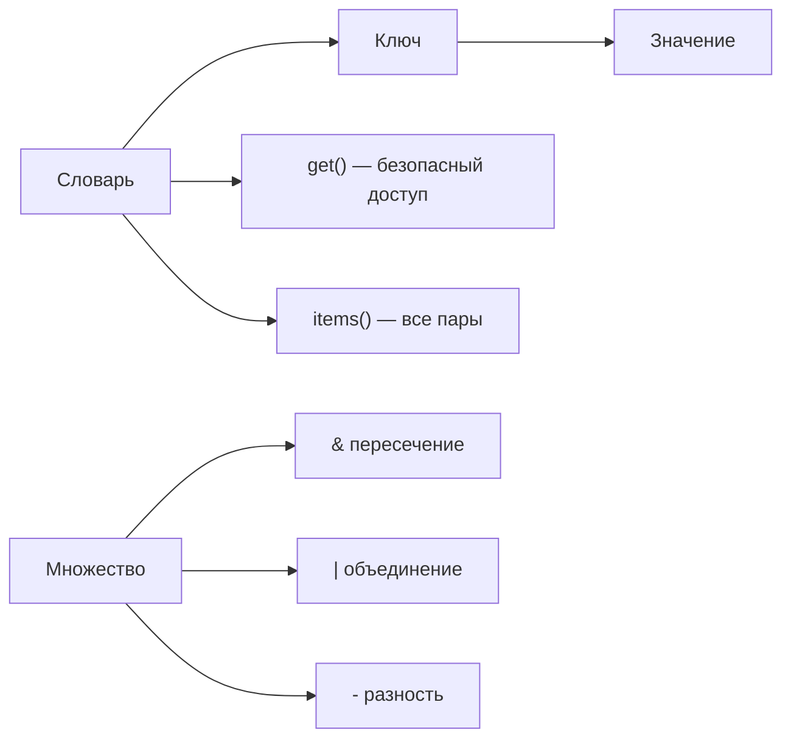

Привет! Числа, строки, булевы значения и списки — это отличные кирпичики. Но сегодня мы познакомимся с двумя структурами, которые делают код выразительнее: словарями (данные «ключ → значение») и множествами (уникальные наборы).

## Что такое словарь

Словарь — это коллекция пар «ключ — значение». Он отлично подходит, когда данные удобно искать по имени. Создаётся словарь фигурными скобками:

```python
student = {
    "name": "Аня",
    "course": 1,
    "average": 4.7,
}
```

Ключом может быть почти любой неизменяемый тип (строка, число, кортеж), а значением — что угодно, хоть список или другой словарь.

## Доступ к значениям

Достать значение можно по ключу в квадратных скобках:

```python
print(student["name"])    # Аня
```

Если ключа нет, возникнет ошибка `KeyError`. Чтобы избежать её, используй метод `get()` — он возвращает `None` (или значение по умолчанию), если ключ отсутствует:

```python
print(student.get("age"))        # None
print(student.get("age", 0))     # 0 — значение по умолчанию
```

## Добавление и изменение

Добавить новую пару или изменить существующую можно простым присваиванием по ключу:

```python
student["city"] = "Москва"   # добавили новую пару
student["average"] = 4.9     # изменили существующую
print(student["city"])       # Москва
```

## Перебор словаря

Метод `items()` возвращает все пары, и их удобно перебирать в цикле `for`:

```python
for key, value in student.items():
    print(f"{key}: {value}")
```

Есть и другие методы: `keys()` — все ключи, `values()` — все значения. Например, `"name" in student` проверит, есть ли ключ.

## Что такое множество

Множество (`set`) — коллекция **уникальных** элементов без порядка. Дубликаты при создании исчезают:

```python
colors = {"красный", "синий", "зелёный", "синий"}
print(colors)  # {'красный', 'зелёный', 'синий'} — дубликат убран
```

Пустое множество создаётся только так: `empty = set()` (потому что `{}` — это пустой словарь).

Множество идеально, когда нужно убрать повторы из списка:

```python
marks = [3, 5, 4, 5, 3, 4, 5]
unique_marks = set(marks)
print(unique_marks)  # {3, 4, 5}
```

## Операции со множествами

У множеств есть мощные операции: `|` — объединение, `&` — пересечение, `-` — разность:

```python
friday = {"Python", "математика", "физкультура"}
monday = {"Python", "рисование", "физкультура"}

print(friday | monday)   # {'Python', 'математика', 'физкультура', 'рисование'}
print(friday & monday)   # {'Python', 'физкультура'}
print(friday - monday)   # {'математика'}
```

Проверить принадлежность можно тоже оператором `in`:

```python
print("Python" in friday)   # True
```

## Словарь и множество рядом

Две структуры решают разные задачи, и на схеме видно, какие операции у них есть:



## Итог урока

Мы узнали:

- как создавать словари и работать с ними: доступ по ключу, `get()`, добавление, `items()`;
- что такое множество и зачем оно нужно;
- как выполнять операции объединения, пересечения и разности;
- как проверять наличие элемента через `in`.

Теперь закрепим всё практикой.

<!--TASK-->
### Задача 1
Создай словарь с данными студента: имя (`Аня`), курс (`1`) и средний балл (`4.7`). Затем:

1. добавь город (`Москва`);
2. повысь средний балл до `4.9`;
3. выведи все пары «ключ — значение» через `items()` в виде `ключ: значение`;
4. создай два множества предметов — занятия в понедельник и пятницу: `{"Python", "математика", "физкультура"}` и `{"Python", "рисование", "физкультура"}`;
5. выведи предметы, которые есть в оба дня (пересечение), и все предметы недели (объединение).

Программа должна вывести четыре строки вида `ключ: значение`, затем два множества.

### Задача 2
Создай словарь с номерами телефонов: `{"Аня": "123-45-67", "Петя": "765-43-21"}`. Выведи номер Ани по ключу. Затем выведи номер Вовы, которого нет в словаре, используя метод `get()` со значением по умолчанию `"номер не найден"`. В конце проверь оператором `in`, есть ли ключ `"Аня"` — и выведи результат проверки.

### Задача 3
Создай словарь товара: `{"name": "Кофе", "price": 450}`. Выведи исходную цену. Затем измени цену на `400`, добавь новый ключ `"stock"` со значением `12` и выведи все пары «ключ — значение» через цикл `for` с методом `items()`. Убедись, что в выводе появилась изменённая цена и новое поле.

### Задача 4
У тебя есть корзина покупок: `basket = {"молоко": 80, "хлеб": 40, "сыр": 250}`. Выведи каждую позицию в формате `молоко — 80 руб.` через цикл по `items()`. Затем посчитай общую стоимость корзины: используй `sum()` вместе с методом `values()`. Последней строкой выведи `Итого: 370 руб.`.

### Задача 5
В магазин за день приходили посетители, их имена записаны с повторами: `["Аня", "Петя", "Аня", "Оля", "Петя", "Игорь"]`. Преврати список во множество функцией `set()` и выведи уникальных посетителей. Затем создай два множества любимых жанров: `anna_fav = {"фантастика", "детектив"}` и `petr_fav = {"детектив", "комедия"}`. Выведи общие жанры (пересечение) и жанры, которые есть только у Ани (разность).
### Задача 6
Дан список слов: `["кот", "пёс", "кот", "птица", "кот", "пёс"]`. Создай пустой словарь `counts` и циклом посчитай, сколько раз встречается каждое слово. Логика такая: если слово уже есть в словаре, увеличь его счётчик на 1, иначе добавь слово со значением 1. Выведи результат в виде трёх строк: `кот: 3`, `пёс: 2`, `птица: 1`. В конце выведи количество уникальных слов через `len(counts)`.

Ожидаемый результат:

```
кот: 3
пёс: 2
птица: 1
Уникальных слов: 3
```

### Задача 7
На двух складах хранится товар. Первый: `sklad_a = {"яблоки": 10, "груши": 5}`, второй: `sklad_b = {"груши": 7, "сливы": 3}`. Объедини их в один словарь `total` так, чтобы количества одинаковых товаров складывались: пройди циклом по `sklad_b.items()` и используй `total.get(name, 0)`. Выведи итоговый словарь и общее количество единиц товара через `sum(total.values())`.

Ожидаемый результат:

```
{'яблоки': 10, 'груши': 12, 'сливы': 3}
Всего единиц: 25
```

<!--/TASK-->

<!--HINT-->
### Подсказка 1
Для вывода пар используй цикл `for key, value in student.items():`. Пересечение — `&`, объединение — `|`. Не забудь проверить, что город и балл действительно изменились.

### Подсказка 2
Номер Ани: `phone_book["Аня"]`. Для Вовы: `phone_book.get("Вова", "номер не найден")`. Проверка ключа: `"Аня" in phone_book` — вернёт `True`.

### Подсказка 3
Измени цену: `product["price"] = 400`. Добавь поле: `product["stock"] = 12`. Затем цикл `for key, value in product.items():` с `print(f"{key}: {value}")`.

### Подсказка 4
Для вывода позиций: `for item, price in basket.items():` и `print(f"{item} — {price} руб.")`. Общая сумма: `sum(basket.values())` — метод `values()` даёт все цены.

### Подсказка 5
Уникальные посетители: `set(visitors)` — дубликаты исчезнут. Общие жанры: `anna_fav & petr_fav`. Разность: `anna_fav - petr_fav` — останется только `{"фантастика"}`.
### Подсказка 6
Начинай с `counts = {}`. В цикле `for word in words:` проверяй `if word in counts:` — если да, выполни `counts[word] += 1`, иначе `counts[word] = 1`. Тот же результат даёт короткая запись `counts[word] = counts.get(word, 0) + 1`.

### Подсказка 7
Начни с копии первого склада: `total = sklad_a.copy()` — иначе изменишь исходный словарь. Затем `for name, count in sklad_b.items(): total[name] = total.get(name, 0) + count`. Сумма значений — `sum(total.values())`.
<!--/HINT-->

<!--SOLUTION-->
### Разбор 1
Одно из возможных решений:

```python
student = {
    "name": "Аня",
    "course": 1,
    "average": 4.7,
}

student["city"] = "Москва"
student["average"] = 4.9

for key, value in student.items():
    print(f"{key}: {value}")

monday = {"Python", "математика", "физкультура"}
friday = {"Python", "рисование", "физкультура"}

print(monday & friday)
print(monday | friday)
```

Результат:

```
name: Аня
course: 1
average: 4.9
city: Москва
{'Python', 'физкультура'}
{'Python', 'математика', 'физкультура', 'рисование'}
```

Что здесь происходит? Изначально в словаре три пары. `student["city"] = "Москва"` добавляет новую пару, а `student["average"] = 4.9` перезаписывает старую. Цикл `for key, value in student.items()` идёт по всем парам и печатает их — обрати внимание на распаковку: две переменные `key` и `value` получают ключ и значение из каждой пары. Далее `monday & friday` оставляет только общие предметы — `Python` и `физкультура`, а `monday | friday` собирает все уникальные предметы обоих дней.

Проверь себя: если бы в `monday` был повторяющийся предмет, множество всё равно сохранило бы его один раз — в этом суть множеств.

### Разбор 2
Решение:

```python
phone_book = {"Аня": "123-45-67", "Петя": "765-43-21"}

print(phone_book["Аня"])
print(phone_book.get("Вова", "номер не найден"))
print("Аня" in phone_book)
```

Результат:

```
123-45-67
номер не найден
True
```

Что здесь происходит? `phone_book["Аня"]` достаёт значение по ключу напрямую. А вот `phone_book["Вова"]` привело бы к ошибке `KeyError` — ключа нет. Поэтому мы используем `get("Вова", "номер не найден")`: метод возвращает значение по ключу, а если ключа нет — второе значение (по умолчанию). Оператор `in` проверяет наличие ключа и возвращает `True`, потому что `"Аня"` в словаре есть. Такая тройка приёмов — доступ, безопасный `get`, проверка `in` — покрывает почти все случаи работы со словарями.

### Разбор 3
Решение:

```python
product = {"name": "Кофе", "price": 450}

print(product["price"])

product["price"] = 400
product["stock"] = 12

for key, value in product.items():
    print(f"{key}: {value}")
```

Результат:

```
450
name: Кофе
price: 400
stock: 12
```

Что здесь происходит? Сначала мы выводим исходную цену. Затем `product["price"] = 400` перезаписывает существующую пару: цена меняется с 450 на 400. Присваивание `product["stock"] = 12` работает точно так же, но ключа `"stock"` ещё нет, поэтому создаётся новая пара. Так один и тот же синтаксис служит и для изменения, и для добавления. Цикл по `items()` выводит все пары, и видно, что словарь теперь содержит четыре поля. Словари часто используются именно как такие «карточки» объектов.

### Разбор 4
Решение:

```python
basket = {"молоко": 80, "хлеб": 40, "сыр": 250}

for item, price in basket.items():
    print(f"{item} — {price} руб.")

total = sum(basket.values())
print(f"Итого: {total} руб.")
```

Результат:

```
молоко — 80 руб.
хлеб — 40 руб.
сыр — 250 руб.
Итого: 370 руб.
```

Что здесь происходит? Цикл по `items()` распаковывает каждую пару в переменные `item` и `price`, и f-строка собирает строку вида `молоко — 80 руб.`. Метод `values()` возвращает все значения словаря — только цены, без названий. `sum()` складывает их: `80 + 40 + 250 = 370`. Такой приём «собрать значения и сложить» — стандартный способ посчитать сумму по словарю. Если бы товаров было сто, код не изменился бы ни на строчку.

### Разбор 5
Решение:

```python
visitors = ["Аня", "Петя", "Аня", "Оля", "Петя", "Игорь"]

print(set(visitors))

anna_fav = {"фантастика", "детектив"}
petr_fav = {"детектив", "комедия"}

print(anna_fav & petr_fav)
print(anna_fav - petr_fav)
```

Результат:

```
{'Аня', 'Игорь', 'Оля', 'Петя'}
{'детектив'}
{'фантастика'}
```

Что здесь происходит? `set(visitors)` превращает список во множество: повторяющиеся имена исчезают, остаются четыре уникальных посетителя. Порядок элементов множества не гарантирован — это нормально, множества не упорядочены. Пересечение `&` оставляет жанры, которые есть у обоих друзей, — только `детектив`. Разность `-` оставляет жанры, которые есть у Ани, но отсутствуют у Пети, — `фантастика`. Множества идеально подходят для таких вопросов «что общего» и «что только у меня».
### Разбор 6
Решение:

```python
words = ["кот", "пёс", "кот", "птица", "кот", "пёс"]
counts = {}

for word in words:
    if word in counts:
        counts[word] += 1
    else:
        counts[word] = 1

for word, count in counts.items():
    print(f"{word}: {count}")

print(f"Уникальных слов: {len(counts)}")
```

Результат:

```
кот: 3
пёс: 2
птица: 1
Уникальных слов: 3
```

Что здесь происходит? Словарь `counts` постепенно накапливает статистику. Когда встречается «кот» впервые, ключа ещё нет, поэтому выполняется ветка `else` и создаётся пара `"кот": 1`. Второй «кот» уже есть в словаре — `word in counts` истинно, и счётчик увеличивается до 2. Так же обрабатываются остальные слова. Обрати внимание: порядок пар в словаре соответствует первому появлению ключа, поэтому «кот» идёт первым. `len(counts)` считает не все слова, а только уникальные ключи — их три. Такой приём называется частотным словарём и лежит в основе анализа текстов, подсчёта голосов и группировки данных.

### Разбор 7
Решение:

```python
sklad_a = {"яблоки": 10, "груши": 5}
sklad_b = {"груши": 7, "сливы": 3}

total = sklad_a.copy()

for name, count in sklad_b.items():
    total[name] = total.get(name, 0) + count

print(total)
print(f"Всего единиц: {sum(total.values())}")
```

Результат:

```
{'яблоки': 10, 'груши': 12, 'сливы': 3}
Всего единиц: 25
```

Что здесь происходит? `copy()` создаёт независимую копию первого склада — без неё мы бы меняли исходный `sklad_a`. Цикл `for name, count in sklad_b.items()` распаковывает каждую пару второго склада. Для «груши» `total.get("груши", 0)` возвращает 5, и после прибавления 7 получается 12. Для «сливы» ключа нет, поэтому `get` возвращает 0, и создаётся новая пара со значением 3. Если бы вместо `get` мы написали `total["сливы"]`, программа упала бы с `KeyError` на первом же новом товаре. `sum(total.values())` складывает 10 + 12 + 3 = 25 — так получается общий объём товара на двух складах.
<!--/SOLUTION-->

<!--QUIZ-->
Что произойдёт при обращении student["age"], если такого ключа в словаре нет?
- Вернётся None
- Ошибка KeyError
- Ошибка TypeError
* Правильный ответ: Ошибка KeyError
Обращение по отсутствующему ключу через скобки вызывает KeyError.

Какой метод возвращает значение по ключу без ошибки, если ключа нет?
- pop()
- get()
- items()
* Правильный ответ: get()
get() возвращает None или значение по умолчанию, если ключ отсутствует.

Как создать пустое множество?
- {}
- set()
- []
* Правильный ответ: set()
{} создаёт пустой словарь, а множество — только через set().

Что выведет print({"a", "b"} & {"b", "c"})?
- {"a", "b", "c"}
- {"b"}
- {"a", "c"}
* Правильный ответ: {"b"}
Оператор & возвращает пересечение — элементы, которые есть в обоих множествах.

Какая структура данных хранит только уникальные элементы?
- Список
- Словарь
- Множество
* Правильный ответ: Множество
Дубликаты при создании множества автоматически исчезают.

Как добавить новую пару в словарь d?
- d.add("ключ", "значение")
- d["ключ"] = "значение"
- d.push("ключ", "значение")
* Правильный ответ: d["ключ"] = "значение"
Присваивание по ключу добавляет новую пару, а если ключ уже есть — меняет значение.

Что выведет {"a", "b"} | {"b", "c"}?
- {"b"}
- {"a", "b", "c"}
- {"a", "c"}
* Правильный ответ: {"a", "b", "c"}
Оператор | — объединение множеств: собираются все уникальные элементы обоих.

Что возвращает метод values() словаря?
- Все ключи
- Все значения
- Пары «ключ — значение»
* Правильный ответ: Все значения
values() возвращает коллекцию значений, keys() — ключей, а items() — пар.
Что вернёт {"a": 1}.get("b")?
- 0
- None
- Ошибка KeyError
* Правильный ответ: None
Если ключа нет и значение по умолчанию не указано, get() возвращает None.

Как получить все ключи словаря?
- values()
- keys()
- items()
* Правильный ответ: keys()
keys() возвращает коллекцию ключей, values() — значений, items() — пар.

Что выведет len({"a", "a", "b"})?
- 3
- 2
- Ошибка
* Правильный ответ: 2
Множество хранит только уникальные элементы, поэтому повтор «a» исчезает.

Можно ли использовать список как ключ словаря?
- Да, любой объект подойдёт
- Нет, ключ должен быть неизменяемым
- Да, но только пустой список
* Правильный ответ: Нет, ключ должен быть неизменяемым
Список можно изменить, поэтому он не может быть ключом; подойдут строка, число или кортеж.
<!--/QUIZ-->
