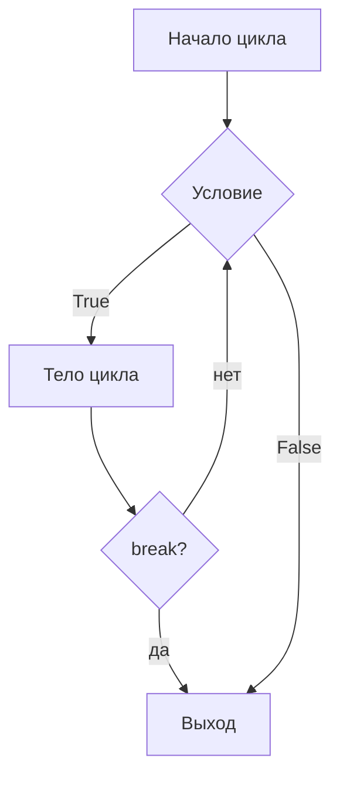

Привет! Сегодня мы научимся заставлять программу повторять действия. Представь: нужно вывести числа от 1 до 100. Писать сто строк с `print()` — плохая идея. Для таких задач в Python есть циклы — конструкции, которые выполняют один и тот же блок кода много раз.

## Цикл for

Цикл `for` «проходится» по коллекции элементов: списку, строке или последовательности чисел. Классический пример — повторить действие N раз с помощью `range()`:

```python
for i in range(5):
    print(i)
```

Результат:

```
0
1
2
3
4
```

Обрати внимание: `range(5)` даёт числа от 0 до 4, то есть последнее число не включается. Это важная особенность Python — диапазон всегда заканчивается «перед» остановочным числом.

Разберём конструкцию: `for i in range(5):` — «для каждого значения i из последовательности». Дальше идёт тело цикла — блок с отступом. Всё, что написано с отступом внутри цикла, повторяется для каждого i.

Цикл `for` умеет ходить и по другим коллекциям:

```python
fruits = ["яблоко", "банан", "вишня"]
for fruit in fruits:
    print("Люблю", fruit)
```

Выведет:

```
Люблю яблоко
Люблю банан
Люблю вишня
```

И по строкам — тогда каждый символ становится отдельным элементом:

```python
for ch in "Python":
    print(ch)
```

## Функция range()

`range()` умеет принимать от одного до трёх аргументов:

- `range(stop)` — числа от 0 до stop − 1;
- `range(start, stop)` — от start до stop − 1;
- `range(start, stop, step)` — с шагом step.

Примеры:

```python
print(list(range(3)))          # [0, 1, 2]
print(list(range(2, 6)))       # [2, 3, 4, 5]
print(list(range(0, 10, 2)))   # [0, 2, 4, 6, 8]
print(list(range(5, 0, -1)))   # [5, 4, 3, 2, 1]
```

Шаг может быть отрицательным — тогда последовательность идёт в обратную сторону. `list()` здесь нужен только для наглядности: раньше мы не видели содержимое `range` без превращения его в список.

## Цикл while

Цикл `while` повторяет блок, пока условие истинно. Он удобен, когда заранее неизвестно, сколько повторений понадобится:

```python
n = 5
while n > 0:
    print(n)
    n = n - 1
print("Поехали!")
```

Результат:

```
5
4
3
2
1
Поехали!
```

Самое важное: внутри цикла обязательно должно меняться условие (здесь — уменьшаться n), иначе цикл станет бесконечным и программа зависнет. Бесконечный цикл `while True:` полезен, например, в играх, но выход из него должен быть предусмотрен.

## break и continue

Иногда нужно вмешаться в ход цикла. Ключевое слово `break` мгновенно прерывает цикл:

```python
for i in range(1, 101):
    if i % 7 == 0:
        print("Первое число, кратное 7:", i)
        break
```

`continue` пропускает текущую итерацию и переходит к следующей:

```python
for i in range(1, 6):
    if i == 3:
        continue
    print(i)
```

Выведет 1, 2, 4, 5 — тройка будет пропущена.

## Вложенные циклы

Циклы можно вкладывать друг в друга. Например, так печатается таблица умножения:

```python
for i in range(1, 4):
    for j in range(1, 4):
        print(i * j, end=" ")
    print()
```

Результат:

```
1 2 3 
2 4 6 
3 6 9 
```

Внутренний цикл полностью отрабатывает для каждого значения внешнего. `end=" "` говорит `print()`, что вместо перевода строки нужно поставить пробел.

## Как работает цикл

Схема показывает путь одной итерации и два способа выйти из цикла:



## Итог урока

Мы узнали:

- цикл `for` обходит коллекции: списки, строки, `range()`;
- `range()` задаёт последовательность чисел с началом, концом и шагом;
- цикл `while` повторяет действия, пока истинно условие;
- `break` прерывает цикл, а `continue` пропускает итерацию;
- циклы можно вкладывать друг в друга.

Теперь закрепим всё на практике.

<!--TASK-->
### Задача 1

Напиши программу, которая считает сумму всех чётных чисел от 2 до 100 включительно и выводит результат на экран. Сделай это двумя способами:

1. Через цикл `for` и функцию `range()` с шагом 2;
2. Через цикл `while`.

Оба способа должны вывести одно и то же число. Запусти программу и убедись, что ответ совпадает с ожидаемым. Подсказка по математике: чётных чисел от 2 до 100 — 50 штук, а сумма каждой пары (2 + 100, 4 + 98, …) равна 102.

Ожидаемый результат:

```
2550
2550
```

### Задача 2

Напиши программу, которая находит первое число, кратное одновременно 3 и 7, среди чисел от 1 до 100. Используй цикл `for` с функцией `range()` и оператор `break`, чтобы остановиться сразу после того, как число найдено. Проверить кратность двум числам сразу можно через логический оператор `and`: `i % 3 == 0 and i % 7 == 0`. Программа должна вывести на экран одно число — ответ.

Ожидаемый результат:

```
21
```

### Задача 3

Напиши программу, которая выводит все числа от 1 до 15 включительно, кроме чисел, кратных 3. Используй цикл `for` с `range(1, 16)` и оператор `continue`, чтобы пропускать ненужные числа. Все числа должны быть напечатаны в одну строку через пробел — для этого используй параметр `end=" "` у функции `print()`. После цикла добавь ещё один `print()` для перевода строки.

Ожидаемый результат:

```
1 2 4 5 7 8 10 11 13 14
```

### Задача 4

Напиши программу, которая считает сумму цифр числа 12345. Используй цикл `while`: на каждом шаге забирай последнюю цифру через остаток от деления на 10 (`number % 10`) и отбрасывай её целочисленным делением на 10 (`number // 10`). Цикл должен продолжаться, пока число не станет равным нулю. Выведи полученную сумму на экран.

Ожидаемый результат:

```
15
```

### Задача 5

Напиши программу, которая выводит треугольник из звёздочек высотой 5 строк, используя вложенные циклы. Внешний цикл отвечает за строки (от 1 до 5), внутренний — за количество звёздочек в строке: в строке с номером i должно быть ровно i звёздочек. Внутренний цикл печатает `"*"` с параметром `end=""`, а после него внешний цикл печатает пустой `print()` для перехода на новую строку.

Ожидаемый результат:

```
*
**
***
****
*****
```
### Задача 6
Напиши программу, которая выводит числа от 1 до 20, но с заменами: если число делится на 3 — печатай `Fizz`, если делится на 5 — `Buzz`, а если делится и на 3, и на 5 — `FizzBuzz`. Остальные числа печатай как есть, каждое с новой строки. Используй цикл `for` с `range(1, 21)` и цепочку `if`/`elif`/`else`. Обрати внимание на порядок условий: проверка «делится и на 3, и на 5» должна идти первой, иначе для 15 сработает ветка `Fizz`.

Ожидаемый результат:

```
1
2
Fizz
4
Buzz
Fizz
7
8
Fizz
Buzz
11
Fizz
13
14
FizzBuzz
16
17
Fizz
19
Buzz
```

### Задача 7
Посчитай факториал числа 6 с помощью цикла `while`. Заведи `n = 6` и `factorial = 1`, затем на каждом шаге умножай `factorial` на `n` и уменьшай `n` на 1, пока `n` больше 1. Выведи результат в формате `6! = 720`. Дополнительно посчитай, сколько умножений выполнилось, и выведи вторую строку `Умножений: 5`.

Ожидаемый результат:

```
6! = 720
Умножений: 5
```

<!--/TASK-->

<!--HINT-->
### Подсказка 1

В первом способе заведи переменную `total = 0`, затем `for i in range(2, 101, 2): total += i`, а `print(total)` поставь уже после цикла. Во втором способе начни с `i = 2` и увеличивай её на 2 внутри цикла, пока `i <= 100`. Проверь, что переменная суммы обновляется внутри цикла, а print стоит после цикла.

### Подсказка 2

Заведи переменную `found = None` до цикла. В цикле `for i in range(1, 101)` проверяй условие `i % 3 == 0 and i % 7 == 0`; как только оно станет истинным, сохрани `found = i` и сразу выполни `break`. После цикла напечатай `found`. Помни: первое число, которое делится и на 3, и на 7, — это 21.

### Подсказка 3

В цикле `for i in range(1, 16)` первой строкой проверяй `if i % 3 == 0: continue`. Оператор `continue` сразу переходит к следующей итерации, поэтому `print(i, end=" ")` будет выполняться только для чисел, не кратных 3. После цикла добавь отдельный `print()` — он переведёт курсор на новую строку.

### Подсказка 4

Заведи `number = 12345` и `total = 0`. В цикле `while number > 0:` прибавляй к `total` значение `number % 10` (последняя цифра), а затем обновляй `number = number // 10` (убирай последнюю цифру). Когда `number` станет нулём, цикл закончится, и можно печатать `total`.

### Подсказка 5

Сначала напиши внешний цикл: `for i in range(1, 6):`. Внутри него — внутренний: `for j in range(i):` с `print("*", end="")`. После внутреннего цикла, но всё ещё внутри внешнего, добавь `print()` — он завершит строку. Обрати внимание: `range(i)` даст ровно i итераций, то есть i звёздочек.
### Подсказка 6
Сначала проверь самое строгое условие: `if i % 3 == 0 and i % 5 == 0`. Затем `elif i % 3 == 0`, потом `elif i % 5 == 0`, иначе — `print(i)`. Если поменять порядок, число 15 попадёт в ветку `Fizz` и никогда не станет `FizzBuzz`.

### Подсказка 7
Начни с `n = 6`, `factorial = 1`, `steps = 0`. В цикле `while n > 1:` выполняй `factorial *= n`, `n -= 1`, `steps += 1`. Когда `n` станет 1, цикл закончится — важно не умножать на 1 лишний раз, иначе счётчик покажет 6.
<!--/HINT-->

<!--SOLUTION-->
### Разбор 1

Одно из возможных решений:

```python
# Способ 1: for + range
total = 0
for i in range(2, 101, 2):
    total += i
print(total)

# Способ 2: while
total = 0
i = 2
while i <= 100:
    total += i
    i += 2
print(total)
```

Результат:

```
2550
2550
```

Что здесь происходит? В первом способе `range(2, 101, 2)` порождает чётные числа от 2 до 100 включительно: 2, 4, 6, …, 100. Переменная `total` накапливает сумму, оператор `+=` означает «прибавить к текущему значению». После окончания цикла `total` равен 2550, и `print(total)` выводит его.

Во втором способе мы сами управляем переменной `i`: начинаем с 2 и на каждой итерации прибавляем 2 (`i += 2`). Условие `while i <= 100` проверяется перед каждым повторением; как только `i` станет 102, цикл завершится. Результат тот же — 2550.

Почему 2550? Чётных чисел от 2 до 100 ровно 50. Разобьём их на пары: (2, 100), (4, 98), … — каждая пара даёт 102, а таких пар 25. 25 × 102 = 2550. Математика и программирование отлично работают вместе!

### Разбор 2

Решение:

```python
found = None
for i in range(1, 101):
    if i % 3 == 0 and i % 7 == 0:
        found = i
        break
print(found)
```

Что здесь происходит? Цикл `for` перебирает числа от 1 до 100 включительно. Для каждого числа мы проверяем два условия сразу: остаток от деления на 3 равен нулю и остаток от деления на 7 равен нулю. Только если оба условия истинны, число подходит. Первым таким числом является 21, потому что 3 и 7 — взаимно простые числа, и их наименьшее общее кратное равно 3 × 7 = 21. Как только условие сработало, мы сохраняем найденное число в переменную `found` и немедленно выходим из цикла оператором `break` — продолжать поиск больше не нужно. Без `break` цикл прошёл бы все сто чисел, и в `found` попало бы последнее подходящее число — 84. Оператор `break` не только экономит время, но и делает намерение программы ясным: нам нужен только первый результат. После цикла `print(found)` выводит число 21.

### Разбор 3

Решение:

```python
for i in range(1, 16):
    if i % 3 == 0:
        continue
    print(i, end=" ")
print()
```

Разберём по шагам. `range(1, 16)` даёт числа от 1 до 15 включительно. Для каждого числа проверяется остаток от деления на 3: если остаток равен нулю, срабатывает `continue` — текущая итерация тут же заканчивается, и `print(i, end=" ")` для этого числа не выполняется. Так пропускаются 3, 6, 9, 12 и 15. Для остальных чисел `print` выводит число и пробел вместо перевода строки (`end=" "`), поэтому все числа оказываются в одной строке. Финальный `print()` без аргументов переводит курсор на новую строку — без него следующий вывод программы склеился бы с нашей строкой. Обрати внимание на разницу с `break`: `break` полностью останавливает цикл, а `continue` лишь пропускает одну итерацию и переходит к следующей.

### Разбор 4

Решение:

```python
number = 12345
total = 0
while number > 0:
    total += number % 10
    number //= 10
print(total)
```

Что здесь происходит? Оператор `%` возвращает остаток от деления, а остаток от деления на 10 — это последняя цифра числа: для 12345 это 5. Мы прибавляем её к `total`. Затем `//` выполняет целочисленное деление, отбрасывая дробную часть: 12345 // 10 = 1234. На каждой итерации число теряет последнюю цифру: 12345 → 1234 → 123 → 12 → 1 → 0. Когда `number` становится нулём, цикл завершается. В `total` накоплена сумма 1 + 2 + 3 + 4 + 5 = 15. Этот приём — «выкусывание» цифр через `% 10` и `// 10` — встречается в огромном количестве задач, например при проверке чисел-палиндромов или при переводе чисел в другую систему счисления.

### Разбор 5

Решение:

```python
for i in range(1, 6):
    for j in range(i):
        print("*", end="")
    print()
```

Как это работает? Внешний цикл берёт `i` от 1 до 5 — это номер строки. Внутренний цикл `range(i)` выполняется ровно `i` раз: для первой строки — один раз, для второй — два и так далее. Каждый проход внутреннего цикла печатает одну звёздочку без перевода строки (`end=""`), поэтому звёздочки складываются в ряд. Когда внутренний цикл заканчивается, внешний вызывает `print()` — он просто переводит курсор на новую строку. Получается 1, 2, 3, 4 и 5 звёздочек на строках. Вложенные циклы полезны везде, где данные имеют табличную структуру: строки и столбцы, координаты точек, карты и таблицы умножения. Главное правило: внутренний цикл полностью отрабатывает для каждого значения внешнего.
### Разбор 6
Решение:

```python
for i in range(1, 21):
    if i % 3 == 0 and i % 5 == 0:
        print("FizzBuzz")
    elif i % 3 == 0:
        print("Fizz")
    elif i % 5 == 0:
        print("Buzz")
    else:
        print(i)
```

Первые строки результата:

```
1
2
Fizz
4
Buzz
Fizz
7
8
Fizz
Buzz
11
Fizz
13
14
FizzBuzz
16
17
Fizz
19
Buzz
```

Что здесь происходит? Цикл перебирает числа от 1 до 20 включительно. Для каждого числа проверяется цепочка условий, и срабатывает только первая истинная ветка. Число 15 делится и на 3, и на 5, поэтому оно должно попасть в `FizzBuzz`; если поставить эту проверку после `elif i % 3 == 0`, до неё дело не дойдёт. Число 9 делится только на 3 — печатается `Fizz`, число 10 — только на 5, значит `Buzz`. Для 7 ни одно условие не истинно, и работает `else` — печатается само число. Задача известна как FizzBuzz и часто встречается на собеседованиях: она проверяет, умеешь ли ты строить цепочки условий и не путаться в порядке проверок.

### Разбор 7
Решение:

```python
n = 6
factorial = 1
steps = 0

while n > 1:
    factorial *= n
    n -= 1
    steps += 1

print(f"6! = {factorial}")
print(f"Умножений: {steps}")
```

Результат:

```
6! = 720
Умножений: 5
```

Что здесь происходит? Факториал 6 — это произведение 6 · 5 · 4 · 3 · 2 · 1. Мы начинаем с `factorial = 1` и последовательно умножаем на 6, 5, 4, 3 и 2. Когда `n` становится равным 1, условие `n > 1` ложно, и цикл останавливается: умножать на 1 бессмысленно, значение не изменится. Поэтому умножений ровно пять, а не шесть, — это и показывает счётчик `steps`. Если бы мы написали условие `n > 0`, цикл сделал бы лишний виток с умножением на 1, и счётчик показал бы 6 при том же результате. Такой цикл с накоплением произведения — близкий родственник цикла с накоплением суммы: меняется только операция.
<!--/SOLUTION-->

<!--QUIZ-->
Сколько раз выполнится тело цикла for i in range(3)?
- 2
- 3
- Ошибка
* Правильный ответ: 3
range(3) порождает числа 0, 1, 2 — всего три итерации.

Что делает оператор break?
- Завершает цикл досрочно
- Пропускает текущую итерацию
- Запускает цикл заново
* Правильный ответ: Завершает цикл досрочно
break немедленно выходит из цикла.

Что выведет print(sum(range(1, 5)))?
- 10
- 15
- 6
* Правильный ответ: 10
sum считает сумму чисел 1 + 2 + 3 + 4 = 10.

Сколько раз выполнится тело цикла while, если до цикла n = 3, а внутри написано n -= 1 и условие n > 0?
- 2
- 3
- 4
* Правильный ответ: 3
n принимает значения 3, 2, 1 — три итерации, а при четвёртой проверке n = 0, и условие ложно.

Что выведет print(list(range(5, 0, -2)))?
- [5, 3, 1]
- [5, 4, 3, 2, 1]
- [4, 2]
* Правильный ответ: [5, 3, 1]
Отрицательный шаг −2 идёт вниз от 5, пропуская каждое второе число: 5, 3, 1.

Что выведет for i in range(3): print(i, end=" ")?
- 0 1 2
- 1 2 3
- 0 1 2 3
* Правильный ответ: 0 1 2
range(3) порождает числа 0, 1, 2 — последнее число не включается.

Что делает оператор continue?
- Завершает цикл полностью
- Пропускает текущую итерацию
- Запускает цикл заново
* Правильный ответ: Пропускает текущую итерацию
continue сразу переходит к следующей итерации, пропуская оставшийся код тела.

Сколько раз выполнится тело цикла while, если до цикла n = 0, а условие n > 0?
- 0 раз
- 1 раз
- Бесконечно
* Правильный ответ: 0 раз
Условие проверяется перед каждой итерацией; оно сразу ложно, поэтому тело не выполнится ни разу.
Что выведет list(range(1, 6))?
- [1, 2, 3, 4, 5]
- [1, 2, 3, 4, 5, 6]
- [0, 1, 2, 3, 4, 5]
* Правильный ответ: [1, 2, 3, 4, 5]
range(1, 6) начинает с 1 и заканчивается перед 6.

Сколько раз выполнится тело цикла for i in range(2, 10, 3)?
- 2
- 3
- 4
* Правильный ответ: 3
range даёт 2, 5 и 8 — три значения, поэтому тело выполнится три раза.

Что делает break внутри вложенного цикла?
- Прерывает оба цикла сразу
- Прерывает только внутренний цикл
- Пропускает одну итерацию
* Правильный ответ: Прерывает только внутренний цикл
break действует на ближайший цикл, в котором он находится.

Что выведет print(sum(range(1, 4)))?
- 6
- 10
- 4
* Правильный ответ: 6
range(1, 4) даёт 1, 2 и 3, а их сумма равна 6.
<!--/QUIZ-->
