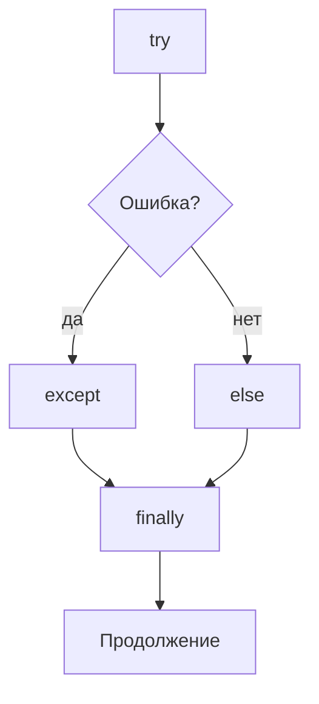

Ошибки в программах неизбежны: пользователь может ввести вместо числа текст, файл может не найтись, сеть — отвалиться. Хорошая программа умеет реагировать на такие ситуации красиво, а не падать. Сегодня мы научимся управлять ошибками.

## Что такое исключения

Когда Python встречает ошибку во время выполнения, он «возбуждает» исключение и останавливает программу. Например:

```python
print(10 / 0)
```

Даст:

```
Traceback (most recent call last):
  ...
ZeroDivisionError: division by zero
```

Информация после Traceback полезна: тип ошибки (`ZeroDivisionError`) и описание. Первые строки Traceback показывают, где именно произошла ошибка — в каком файле и на какой строке. Это как дневник неудачи: по нему можно понять, что пошло не так.

Кроме `ZeroDivisionError` есть десятки других типов: `ValueError` (неверное значение), `TypeError` (неверный тип), `FileNotFoundError` (файл не найден) и другие. Каждый тип — это отдельный класс, и ловить их можно по отдельности.

## Ловим ошибки: try/except

Чтобы программа не падала, опасный участок оборачивают в `try/except`:

```python
try:
    number = int(input("Введи число: "))
    print("Твоё число:", number)
except ValueError:
    print("Это не число!")
```

Если внутри `try` возникает ошибка указанного типа, выполнение перепрыгивает в блок `except`, и программа продолжает работать. Если ошибок нет — блок `except` пропускается.

Блоков `except` может быть несколько — для разных типов ошибок:

```python
try:
    a = int(input("Первое число: "))
    b = int(input("Второе число: "))
    print("Деление:", a / b)
except ValueError:
    print("Нужно вводить числа!")
except ZeroDivisionError:
    print("Делить на ноль нельзя!")
```

Порядок важен: более специфичные типы ставят раньше.

## else и finally

К `try/except` можно добавить ещё два блока:

- `else` — выполняется, если ошибок не было;
- `finally` — выполняется всегда, была ошибка или нет.

```python
try:
    number = int(input("Введи число: "))
except ValueError:
    print("Это не число!")
else:
    print(f"Твоё число: {number}")
finally:
    print("Программа завершила работу")
```

`finally` часто используют для «уборки» — например, закрытия файла или соединения с сетью.

## Бросаем ошибки сами: raise

Иногда нужно самому сообщить об ошибочной ситуации. Для этого служит `raise`:

```python
def set_age(age):
    if age < 0 or age > 150:
        raise ValueError(f"Некорректный возраст: {age}")
    print(f"Возраст установлен: {age}")
```

Теперь вызов `set_age(200)` возбудит `ValueError` с нашим текстом. Это позволяет запретить некорректные значения и сделать поведение функции предсказуемым. Брошенное исключение можно поймать обычным `try/except`:

```python
try:
    set_age(200)
except ValueError as e:
    print("Ошибка:", e)
```

Конструкция `as e` сохраняет объект исключения в переменную `e` — из него можно достать текст ошибки.

## Путь исключения

Схема показывает, какие блоки срабатывают при ошибке и без неё:



## Итог урока

Мы узнали:

- что исключения — это механизм сообщения об ошибках;
- как защищать код блоком `try/except`;
- что блоков `except` может быть несколько;
- зачем нужны `else` и `finally`;
- как бросать собственные ошибки через `raise`.

Теперь закрепим всё практикой.

<!--TASK-->
### Задача 1

Напиши программу, которая просит ввести число и делит 100 на него. Обработай две ошибки:

- если введено не число — выведи `Это не число!`;
- если введён 0 — выведи `Делить на ноль нельзя!`.

В остальных случаях выведи результат деления.

Проверь программу на трёх вводах:

```
Введи число: abc
Это не число!
Введи число: 0
Делить на ноль нельзя!
Введи число: 4
25.0
```

Подсказка: преобразование `int(input())` может дать `ValueError`, а деление — `ZeroDivisionError`. Раздели эти случаи на разные блоки `except`.

### Задача 2

Напиши функцию `set_age(age)`, которая печатает `Возраст установлен: <age>`, если возраст находится в пределах от 0 до 150 включительно, а иначе бросает исключение `ValueError` с сообщением `Некорректный возраст: <age>` (используй `raise` и f-строку). Затем в основной части программы вызови `set_age(25)` и `set_age(200)` — второй вызов оберни в `try/except` с конструкцией `as e`, чтобы поймать исключение и напечатать его текст.

Ожидаемый результат:

```
Возраст установлен: 25
Ошибка: Некорректный возраст: 200
```

### Задача 3

Напиши функцию `divide_safe(a, b)`, которая возвращает результат деления `a` на `b`. Если происходит деление на ноль, функция должна не бросать исключение, а вернуть `None`. Используй `try/except` внутри функции. В основной части вызови `divide_safe(10, 2)` и `divide_safe(10, 0)` и выведи оба результата на экран.

Ожидаемый результат:

```
5.0
None
```

### Задача 4

Напиши программу, которая запрашивает число, возводит его в квадрат и выводит результат. Если введено не число (возникает `ValueError`), выведи `Это не число!`. Печать квадрата помести в блок `else`, а в блоке `finally` печатай `Спасибо за использование программы!`. Проверь программу на двух вводах: `abc` и `4`.

Ожидаемый результат:

```
Введи число: abc
Это не число!
Спасибо за использование программы!
Введи число: 4
Квадрат: 16
Спасибо за использование программы!
```

### Задача 5

Напиши программу, которая запрашивает число и повторяет запрос до тех пор, пока пользователь не введёт корректное число. Используй бесконечный цикл `while True` и конструкцию `try/except`: внутри `try` переводи ввод в `int()`, при успехе прерывай цикл через `break`, при `ValueError` печатай `Это не число, попробуй ещё раз!`. После выхода из цикла выведи `Твоё число: <число>`.

Ожидаемый результат:

```
Введи число: abc
Это не число, попробуй ещё раз!
Введи число: 7
Твоё число: 7
```
### Задача 6
Напиши функцию `safe_int(value)`, которая пытается превратить переданное значение в целое число и возвращает результат, а при ошибке возвращает `None`. Внутри используй `try/except` и лови два типа исключений сразу: `ValueError` (строка не похожа на число) и `TypeError` (значение вообще нельзя преобразовать, например `None`). В основной части вызови функцию для `"42"`, `"abc"` и `None` и выведи три строки: `42`, `None`, `None`.

Ожидаемый результат:

```
42
None
None
```

### Задача 7
Напиши функцию `get_element(collection, key)`, которая возвращает элемент списка по индексу или словаря по ключу. Если индекс вышел за границы (`IndexError`) или ключа нет (`KeyError`), функция должна вернуть строку `Элемент не найден`, а не падать. Проверь её на трёх случаях: список `[10, 20, 30]` с индексом `1`, тот же список с индексом `5` и словарь `{"a": 1}` с ключом `"b"`.

Ожидаемый результат:

```
20
Элемент не найден
Элемент не найден
```

<!--/TASK-->

<!--HINT-->
### Подсказка 1

Оберни всё в `try`. Перевод в число `int(input())` и деление выполняй внутри `try`. В первом блоке `except ValueError` печатай «Это не число!», во втором — `except ZeroDivisionError` печатай «Делить на ноль нельзя!». Печать результата помести в блок `else`, чтобы она не выполнялась при ошибке.

### Подсказка 2

Определи функцию с `raise`: `if age < 0 or age > 150: raise ValueError(f"Некорректный возраст: {age}")`. В основной части оберни вызов `set_age(200)` в `try`, а в `except ValueError as e` напечатай `f"Ошибка: {e}"`. Вызов `set_age(25)` можно оставить без `try` — он ошибку не бросает.

### Подсказка 3

Внутри функции напиши: `try: return a / b` и `except ZeroDivisionError: return None`. Помни: `return` работает и внутри `try` — функция вернёт результат деления сразу, как только он вычислен. Если делитель ноль, сработает `except`, и вернётся `None`.

### Подсказка 4

Структура: `try: number = int(input("Введи число: "))`, затем `except ValueError: print("Это не число!")`, потом `else: print(f"Квадрат: {number ** 2}")` и наконец `finally: print("Спасибо за использование программы!")`. Число переводи в `int` сразу внутри `try` — именно там возникает `ValueError`.

### Подсказка 5

Внутри `while True` напиши: `try: n = int(input("Введи число: ")); break` и `except ValueError: print("Это не число, попробуй ещё раз!")`. После цикла — `print(f"Твоё число: {n}")`. Ввод «abc» даст `ValueError`, и цикл продолжится; «7» — успех, и `break` завершит цикл.
### Подсказка 6
Внутри: `try: return int(value)` и два блока `except`: `except ValueError: return None` и `except TypeError: return None`. Их можно объединить в один: `except (ValueError, TypeError): return None`.

### Подсказка 7
Пиши `try: return collection[key]`, затем `except (IndexError, KeyError): return "Элемент не найден"`. Оба типа ловятся одной конструкцией, потому что реакция на них одинаковая.
<!--/HINT-->

<!--SOLUTION-->
### Разбор 1

Одно из возможных решений:

```python
try:
    number = int(input("Введи число: "))
except ValueError:
    print("Это не число!")
except ZeroDivisionError:
    print("Делить на ноль нельзя!")
else:
    print(100 / number)
```

Но этот вариант не сработает: деление находится в блоке `else`, а `ZeroDivisionError` возникнет именно там, и блок `except` его не поймает. Правильнее так:

```python
try:
    number = int(input("Введи число: "))
    result = 100 / number
except ValueError:
    print("Это не число!")
except ZeroDivisionError:
    print("Делить на ноль нельзя!")
else:
    print(result)
```

Результат проверок:

```
Введи число: abc
Это не число!
Введи число: 0
Делить на ноль нельзя!
Введи число: 4
25.0
```

Что здесь происходит? `int(input())` пытается превратить текст в число. Если введено «abc», возникает `ValueError` — управление переходит в соответствующий блок `except`. Если введён 0, `int()` срабатывает, но вот деление `100 / 0` бросает `ZeroDivisionError` — его ловит второй блок `except`. Если ошибок не было, `result` вычислен, и блок `else` печатает результат.

Обрати внимание: во втором варианте деление находится внутри `try`, поэтому его ошибки тоже перехватываются. Это и есть правильная структура — все потенциально опасные операции должны лежать внутри `try`, а не в `else`.

### Разбор 2

Решение:

```python
def set_age(age):
    if age < 0 or age > 150:
        raise ValueError(f"Некорректный возраст: {age}")
    print(f"Возраст установлен: {age}")

set_age(25)

try:
    set_age(200)
except ValueError as e:
    print(f"Ошибка: {e}")
```

Что здесь происходит? Функция `set_age` сначала проверяет входные данные. Если возраст выходит за допустимые пределы (меньше 0 или больше 150), выполняется `raise ValueError(...)` — Python немедленно возбуждает исключение, и выполнение функции прекращается: строка с `print` не достигается. В сообщение исключения через f-строку подставляется само число, поэтому текст получается информативным: «Некорректный возраст: 200».

Вызов `set_age(25)` проходит проверку — 25 попадает в диапазон, и функция печатает «Возраст установлен: 25». Второй вызов обёрнут в `try/except`. Когда `set_age(200)` бросает `ValueError`, конструкция `as e` сохраняет объект исключения в переменную `e`, и мы печатаем его текст через f-строку. Так `raise` и `try/except` работают в паре: одна часть кода сообщает об ошибке, другая — реагирует на неё.

### Разбор 3

Решение:

```python
def divide_safe(a, b):
    try:
        return a / b
    except ZeroDivisionError:
        return None

print(divide_safe(10, 2))
print(divide_safe(10, 0))
```

Что здесь происходит? Внутри функции `try` пытается выполнить `return a / b`. Если деление успешно, Python вычисляет частное и немедленно возвращает его — для (10, 2) это 5.0 (деление `/` всегда даёт дробное число). Если же `b` равен нулю, возникает `ZeroDivisionError`, и управление переходит в блок `except`, который возвращает `None`.

Такой приём — превращение исключения в обычное возвращаемое значение — делает функцию безопасной для вызова в любом месте: вызывающий код не обязан оборачивать каждый вызов в `try/except`. Вместо этого он может проверить результат: если вернулся `None`, значит, деление было невозможно. Это частный случай более общего паттерна: границы внешнего мира (ввод пользователя, файлы, сеть) — там, где ошибки неизбежны, а внутри программы ты можешь сам решать, как их представлять.

### Разбор 4

Решение:

```python
try:
    number = int(input("Введи число: "))
except ValueError:
    print("Это не число!")
else:
    print(f"Квадрат: {number ** 2}")
finally:
    print("Спасибо за использование программы!")
```

Разберём оба сценария. Первый: пользователь вводит «abc». `int("abc")` бросает `ValueError`, поэтому блок `else` пропускается, и печатается «Это не число!». Второй: пользователь вводит «4». Перевод в число проходит успешно, `try` завершается без исключения, после чего выполняется блок `else` — печатается «Квадрат: 16». Блок `finally` выполняется в обоих случаях — именно поэтому «Спасибо за использование программы!» появляется в выводе дважды.

Ключевая идея: `else` и `finally` решают разные задачи. `else` — это «успешный путь»: код, который должен выполниться только при отсутствии ошибки, не смешиваясь с потенциально опасным кодом внутри `try`. `finally` — это гарантированная уборка, которая не может быть пропущена ни при каких обстоятельствах. Эта четвёрка блоков — стандартный инструмент для построения надёжных программ.

### Разбор 5

Решение:

```python
while True:
    try:
        number = int(input("Введи число: "))
        break
    except ValueError:
        print("Это не число, попробуй ещё раз!")

print(f"Твоё число: {number}")
```

Что здесь происходит? Цикл `while True` — бесконечный, но из него есть выход: оператор `break`. На каждом витке мы пытаемся перевести ввод пользователя в число. Если введено «abc», `int()` бросает `ValueError`, блок `except` печатает сообщение, и цикл делает новый виток — запрос повторяется. Если введено «7», перевод проходит успешно, и сразу после него выполняется `break` — цикл завершается, и управление переходит к финальному `print`.

Обрати внимание на порядок строк внутри `try`: сначала перевод в число, затем `break`. Это важно — если бы `break` стоял до `int()`, цикл завершался бы независимо от корректности ввода. Такой паттерн «запрашивай, пока не получишь корректное значение» — один из самых полезных при работе с пользовательским вводом: программа никогда не упадёт из-за «грязных» данных, а мягко попросит ввести число ещё раз.
### Разбор 6
Решение:

```python
def safe_int(value):
    try:
        return int(value)
    except (ValueError, TypeError):
        return None

print(safe_int("42"))
print(safe_int("abc"))
print(safe_int(None))
```

Результат:

```
42
None
None
```

Что здесь происходит? Функция пытается выполнить `int(value)` внутри `try`. Для строки `"42"` преобразование проходит, и `return` немедленно отдаёт число 42. Для строки `"abc"` `int()` бросает `ValueError` — управление переходит в `except`, который возвращает `None`. Для `None` возникает `TypeError`: этот тип нельзя превратить в число. Оба исключения перечислены в скобках через запятую — так один блок `except` ловит и то, и другое. Если бы мы указали только `ValueError`, вызов с `None` уронил бы программу. Именно поэтому в реальном коде важно думать не только о «неправильном тексте», но и о неверном типе данных: `except (ValueError, TypeError)` закрывает оба случая.

### Разбор 7
Решение:

```python
def get_element(collection, key):
    try:
        return collection[key]
    except (IndexError, KeyError):
        return "Элемент не найден"

print(get_element([10, 20, 30], 1))
print(get_element([10, 20, 30], 5))
print(get_element({"a": 1}, "b"))
```

Результат:

```
20
Элемент не найден
Элемент не найден
```

Что здесь происходит? Одна и та же функция работает и со списком, и со словарём, потому что оба поддерживают доступ по ключу в квадратных скобках. Для списка `[10, 20, 30]` индекс 1 даёт второй элемент — 20. Индекс 5 выходит за границы списка из трёх элементов, поэтому Python бросает `IndexError`; блок `except` перехватывает его и возвращает понятный текст. Для словаря `{"a": 1}` ключа `"b"` нет — возникает `KeyError`, который ловится тем же блоком. Обрати внимание: мы ловим именно эти два типа, а не всё подряд через `except Exception`. Широкий перехват скрыл бы настоящие ошибки — например, опечатку в имени переменной, — и отладить программу стало бы намного сложнее.
<!--/SOLUTION-->

<!--QUIZ-->
Какой тип исключения возникнет при выполнении int("abc")?
- TypeError
- ValueError
- NameError
* Правильный ответ: ValueError
int() не может превратить строку «abc» в число и бросает ValueError — ошибку некорректного значения.

Когда выполняется блок else в конструкции try/except/else?
- Когда произошла ошибка
- Когда ошибок не было
- Всегда
* Правильный ответ: Когда ошибок не было
else выполняется только если try завершился без исключения.

Для чего используется блок finally?
- Для обработки ошибок
- Выполняется всегда, независимо от наличия ошибки
- Только при ошибках
* Правильный ответ: Выполняется всегда, независимо от наличия ошибки
finally удобен для уборки: закрытия файлов, соединений.

Как бросить собственное исключение с сообщением?
- error("текст")
- raise ValueError("текст")
- throw ValueError("текст")
* Правильный ответ: raise ValueError("текст")
Ключевое слово raise возбуждает исключение указанного типа с текстом.

Что выведет эта программа? try: print(10 / 0) except ZeroDivisionError: print("деление на ноль")
- деление на ноль
- Ошибка
- 0.0
* Правильный ответ: деление на ноль
10 / 0 бросает ZeroDivisionError, который ловится блоком except.

Какой тип исключения возникнет при выполнении "abc" + 5?
- ValueError
- TypeError
- NameError
* Правильный ответ: TypeError
Сложение строки и числа недопустимо — это ошибка неверного типа данных.

Что выведет try: print(1 / 2) except ZeroDivisionError: print("ошибка")?
- 0.5
- ошибка
- Ничего
* Правильный ответ: 0.5
Деления на ноль нет, поэтому исключение не возбуждается и блок except пропускается.

Что выведет эта программа, если пользователь введёт 5? try: n = int(input()) except ValueError: print("не число") else: print(n)
- не число
- 5
- Ошибка
* Правильный ответ: 5
Перевод в число прошёл успешно, ошибок не было — поэтому выполняется блок else.
Что произойдёт при выполнении 5 / 0 вне блока try?
- Вернётся 0
- Будет брошено исключение ZeroDivisionError
- Вернётся None
* Правильный ответ: Будет брошено исключение ZeroDivisionError
Деление на ноль недопустимо, и без обработки программа завершится с этим исключением.

Можно ли ловить несколько типов исключений в одном except?
- Нет, только по одному
- Да, если перечислить их в скобках через запятую
- Да, но только ValueError и TypeError
* Правильный ответ: Да, если перечислить их в скобках через запятую
Запись except (ValueError, TypeError): перехватывает оба типа одним блоком.

Выполнится ли блок finally, если внутри try сработал return?
- Нет, return отменяет finally
- Да, finally выполнится перед возвратом
- Только если была ошибка
* Правильный ответ: Да, finally выполнится перед возвратом
finally гарантированно выполняется при выходе из try, в том числе через return.

Какой тип исключения возникает при обращении к несуществующему ключу словаря?
- IndexError
- KeyError
- ValueError
* Правильный ответ: KeyError
Для отсутствующего ключа словарь бросает KeyError; IndexError — это про списки.
<!--/QUIZ-->
