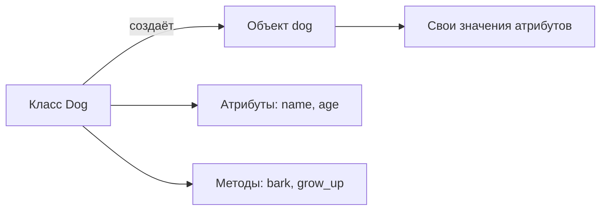

До сих пор мы работали со встроенными типами данных: числами, строками, списками, словарями. Но в реальных программах часто нужно описывать собственные сущности — например, пользователя, банковский счёт или заказ в магазине. Для этого в Python есть объектно-ориентированное программирование (ООП).

## Что такое класс и объект

**Класс** — это чертёж, описание того, какими данными и поведением будет обладать сущность. **Объект** (или экземпляр класса) — это конкретный экземпляр, созданный по этому чертёжу. Класс можно сравнить с рецептом торта: сам рецепт — это класс, а каждый испечённый торт — объект.

Самый простой класс выглядит так:

```python
class Dog:
    pass
```

`pass` означает «пусто». Чтобы создать объект, вызови класс как функцию:

```python
dog = Dog()
print(dog)  # <__main__.Dog object at 0x...>
```

Мы создали первый объект! Правда, он пока пустой — у него нет ни имени, ни действий.

## Атрибуты и метод __init__

Когда объект создаётся, автоматически вызывается специальный метод `__init__` (инициализатор). В нём задают стартовые данные объекта:

```python
class Dog:
    def __init__(self, name, age):
        self.name = name
        self.age = age

dog = Dog("Рекс", 3)
print(dog.name)  # Рекс
print(dog.age)   # 3
```

Разберём, что здесь происходит. Параметр `self` — это ссылка на сам объект. Он всегда идёт первым в методах класса, а Python подставляет его автоматически: когда ты пишешь `Dog("Рекс", 3)`, внутри вызова `__init__` `self` указывает на новый объект. Записи вида `self.name = name` создают атрибуты — переменные, которые живут внутри каждого объекта.

## Методы

Метод — это функция, которая живёт внутри класса и работает с данными объекта:

```python
class Dog:
    def __init__(self, name, age):
        self.name = name
        self.age = age

    def bark(self):
        print(f"{self.name} говорит: Гав-гав!")

    def grow_up(self):
        self.age += 1

dog = Dog("Рекс", 3)
dog.bark()       # Рекс говорит: Гав-гав!
dog.grow_up()
print(dog.age)   # 4
```

Видишь, как методы используют `self`: через него они читают и меняют атрибуты. Метод `grow_up` увеличивает возраст объекта — и это изменение остаётся в памяти.

## Что даёт ООП

ООП помогает группировать данные и функции, которые с ними работают, в одно целое. Это упрощает большие программы: вместо разрозненных переменных и функций у тебя появляются понятные сущности. Например, в интернет-магазине легко представить классы `User`, `Order`, `Product` — у каждого свои данные и поведение.

Ключевые термины, которые стоит запомнить:

- **класс** — описание сущности;
- **объект** — конкретный экземпляр класса;
- **атрибут** — переменная объекта;
- **метод** — функция объекта;
- **self** — ссылка на текущий объект;
- **__init__** — метод, который запускается при создании объекта.

## Как класс связан с объектом

На схеме видно, что класс описывает и данные, и поведение, а каждый объект хранит свои значения атрибутов:



## Итог

Теперь ты умеешь создавать классы, наполнять их атрибутами и методами, а также создавать объекты. Это фундамент для следующих уроков о наследовании и магических методах.

<!--TASK-->
### Задача 1
Создай класс `BankAccount` (банковский счёт). У объекта должны быть:

- атрибут `owner` — имя владельца и атрибут `balance` — баланс (задаются при создании);
- метод `deposit(amount)` — кладёт деньги на счёт;
- метод `withdraw(amount)` — снимает деньги, но не позволяет уйти в минус (если денег не хватает, выводи сообщение и ничего не снимай);
- метод `info()` — выводит строку вида `Владелец: Аня, баланс: 1500 руб.`.

Создай объект, положи на счёт 500, сними 800, а потом попробуй снять ещё 1000. Убедись, что программа выводит `Недостаточно средств` и баланс не становится отрицательным. Ожидаемый результат на экране:

```
Недостаточно средств
Владелец: Аня, баланс: 1200 руб.
```

### Задача 2
Создай класс `Book` (книга). В конструкторе `__init__` принимай три аргумента: `title` (название), `author` (автор) и `year` (год издания), и сохраняй их в атрибуты. Добавь метод `description()`, который печатает строку вида `«Мастер и Маргарита» — Михаил Булгаков (1967 год)`. Затем создай объекты двух разных книг — например, `Book("Мастер и Маргарита", "Михаил Булгаков", 1967)` и `Book("1984", "Джордж Оруэлл", 1949)` — и вызови у каждого `description()`.

Ожидаемый результат — две строки описания, по одной на каждую книгу: сначала книга Булгакова, затем книга Оруэлла.

### Задача 3
Создай класс `Person` (человек). Конструктор принимает `name` и `age`. Добавь метод `birthday()`, который увеличивает возраст на 1 и печатает поздравление: `С днём рождения, <имя>! Тебе <возраст> лет.` Также добавь метод `info()`, который печатает строку вида `Аня, 30 лет`. Создай объект в возрасте 29 лет, вызови `birthday()`, а затем `info()`.

Ожидаемый результат:

```
С днём рождения, Аня! Тебе 30 лет.
Аня, 30 лет.
```

### Задача 4
Создай класс `Rectangle` (прямоугольник). Конструктор принимает `width` (ширину) и `height` (высоту). Добавь методы `area()` и `perimeter()`, которые возвращают площадь (ширина × высота) и периметр (2 × (ширина + высота)). Затем создай прямоугольник 5×8, распечатай площадь и периметр через `print()`.

Ожидаемый результат: `40` и `26` (по одному на строку). Используй `return`, чтобы методы возвращали числа, а печатал — внешний код.

### Задача 5
Создай класс `Student` (студент). Конструктор принимает `name` и список оценок `grades`. Добавь метод `add_grade(grade)`, который добавляет новую оценку в конец списка, и метод `average()`, который возвращает среднее арифметическое оценок, округлённое до одного знака через `round(..., 1)`. Создай студента с оценками [4, 5, 3], добавь оценку 5 и выведи средний балл.

Ожидаемый результат: `4.2` (сумма 17, делённая на 4 оценки).
### Задача 6
Создай класс `Lamp` (настольная лампа). В конструкторе `__init__` заведи атрибут `is_on` со значением `False` — по умолчанию лампа выключена. Добавь два метода: `toggle()`, который переключает состояние на противоположное, и `status()`, который печатает `Лампа включена`, если `is_on` истинно, и `Лампа выключена` в противном случае. Создай объект, выведи его состояние, переключи и выведи снова. Обрати внимание: оба метода работают с одним и тем же объектом, поэтому второй вызов `status()` видит результат работы `toggle()`.

Ожидаемый результат:

```
Лампа выключена
Лампа включена
```

### Задача 7
Создай класс `Parking` (парковка) с ограниченным числом мест. Конструктор принимает `capacity` — вместимость — и создаёт пустой список `cars` для номеров машин. Добавь методы:

- `park(number)` — если свободных мест нет, печатает `Парковка заполнена` и ничего не добавляет; иначе добавляет номер в список и печатает `Машина <номер> припаркована`;
- `leave(number)` — убирает номер из списка и печатает `Машина <номер> уехала`;
- `free_spots()` — возвращает число свободных мест.

Создай парковку на 2 места, припаркуй `A111` и `B222`, попробуй припарковать третью машину `C333`, затем освободи место `A111` и выведи количество свободных мест.

Ожидаемый результат:

```
Машина A111 припаркована
Машина B222 припаркована
Парковка заполнена
Машина A111 уехала
Свободно мест: 1
```
<!--/TASK-->

<!--HINT-->
### Подсказка 1
Для проверки «хватает ли денег» сравни `amount` с `self.balance`. Не забудь: если условие не выполнлось, метод должен завершиться до изменения баланса — используй `return`. Текст в `info()` удобно собрать через f-строку.

### Подсказка 2
В `__init__` присвой `self.title = title`, `self.author = author`, `self.year = year`. В `description()` используй f-строку с фигурными скобками, а кавычки-ёлочки внутри строки просто добавь в текст: `f"«{self.title}» — {self.author} ({self.year} год)"`. Не забудь вызвать метод у обоих объектов.

### Подсказка 3
Метод `birthday()` должен менять состояние объекта: `self.age += 1` увеличивает возраст. Поздравление печатай после увеличения, чтобы показывать новый возраст. В `info()` используй f-строку `f"{self.name}, {self.age} лет."`. Создай объект с возрастом 29 — на момент печати в `birthday()` он уже должен стать 30.

### Подсказка 4
Методы `area()` и `perimeter()` не должны ничего печатать — они возвращают числа через `return`. Площадь: `self.width * self.height`, периметр: `2 * (self.width + self.height)`. Затем снаружи вызови `print(rect.area())` и `print(rect.perimeter())` по очереди.

### Подсказка 5
Среднее арифметическое — это сумма оценок, делённая на их количество: `sum(self.grades) / len(self.grades)`. Округли результат: `round(..., 1)`. Метод `add_grade` использует `self.grades.append(grade)`. Проверь подсчёт вручную: (4 + 5 + 3 + 5) / 4 = 4.25 → после округления 4.2.
### Подсказка 6
Состояние храни в обычном атрибуте: `self.is_on = False` в `__init__`. Переключение — одна строка: `self.is_on = not self.is_on`. В `status()` используй `if self.is_on:` и два `print` в ветках: метод ничего не возвращает, он только печатает сообщение.

### Подсказка 7
В `__init__` сохрани `self.capacity = capacity` и заведи `self.cars = []`. В `park()` сначала проверь `len(self.cars) >= self.capacity`: если места нет, напечатай сообщение и выйди через `return`, чтобы номер не попал в список. Для удаления хватит `self.cars.remove(number)`, а `free_spots()` возвращает `self.capacity - len(self.cars)`.
<!--/HINT-->

<!--SOLUTION-->
### Разбор 1
Одно из возможных решений:

```python
class BankAccount:
    def __init__(self, owner, balance=0):
        self.owner = owner
        self.balance = balance

    def deposit(self, amount):
        self.balance += amount

    def withdraw(self, amount):
        if amount > self.balance:
            print("Недостаточно средств")
            return
        self.balance -= amount

    def info(self):
        print(f"Владелец: {self.owner}, баланс: {self.balance} руб.")

account = BankAccount("Аня", 1500)
account.deposit(500)
account.withdraw(800)
account.withdraw(1000)
account.info()
```

Результат:

```
Недостаточно средств
Владелец: Аня, баланс: 1200 руб.
```

Что здесь происходит? В `__init__` мы принимаем имя владельца и стартовый баланс (по умолчанию 0). Метод `deposit` просто увеличивает `self.balance`. В `withdraw` сначала идёт проверка: если `amount` больше баланса — печатаем сообщение и выходим из метода через `return` (баланс не меняется). Если денег достаточно — вычитаем. В `info()` f-строка подставляет значения атрибутов в текст.

Ситуация с двумя снятиями: `withdraw(800)` снимает 800 (было 2000, стало 1200), а `withdraw(1000)` отклоняется, потому что 1000 > 1200. Благодаря проверке баланс никогда не уходит в минус — это важная бизнес-логика, которая защищает счёт.

### Разбор 2
Решение:

```python
class Book:
    def __init__(self, title, author, year):
        self.title = title
        self.author = author
        self.year = year

    def description(self):
        print(f"«{self.title}» — {self.author} ({self.year} год)")

book1 = Book("Мастер и Маргарита", "Михаил Булгаков", 1967)
book2 = Book("1984", "Джордж Оруэлл", 1949)
book1.description()
book2.description()
```

Результат:

```
«Мастер и Маргарита» — Михаил Булгаков (1967 год)
«1984» — Джордж Оруэлл (1949 год)
```

Конструктор `__init__` принимает три значения и сохраняет их в атрибуты объекта — именно так данные «прилипают» к конкретному экземпляру. Метод `description()` ничего не возвращает, а сразу печатает готовую строку: внутри фигурных скобок f-строки подставляются атрибуты. Обрати внимание на кавычки-ёлочки `« »` — это обычные символы внутри строки, поэтому они спокойно помещаются между двойных кавычек f-строки. Оба объекта живут независимо: у каждого свои `title`, `author`, `year`, поэтому вызовы `description()` дают разные строки. Такой класс удобно переиспользовать — чтобы добавить третью книгу, нужно лишь создать ещё один объект.

### Разбор 3
Решение:

```python
class Person:
    def __init__(self, name, age):
        self.name = name
        self.age = age

    def birthday(self):
        self.age += 1
        print(f"С днём рождения, {self.name}! Тебе {self.age} лет.")

    def info(self):
        print(f"{self.name}, {self.age} лет.")

anya = Person("Аня", 29)
anya.birthday()
anya.info()
```

Результат:

```
С днём рождения, Аня! Тебе 30 лет.
Аня, 30 лет.
```

Ключевая идея этого примера — изменение состояния объекта. Метод `birthday()` сначала увеличивает возраст на единицу (`self.age += 1`) и только потом печатает поздравление, поэтому в тексте появляется уже новое значение — 30. Это важный порядок действий: сначала измени данные, потом читай. Метод `info()` — простой «геттер наоборот»: он не возвращает данные, а сразу их печатает. Оба метода обращаются к одному и тому же объекту через `self`, поэтому изменение, сделанное в `birthday()`, видимо и в `info()`. Если бы мы поменяли порядок и печатали до увеличения, увидели бы 29.

### Разбор 4
Решение:

```python
class Rectangle:
    def __init__(self, width, height):
        self.width = width
        self.height = height

    def area(self):
        return self.width * self.height

    def perimeter(self):
        return 2 * (self.width + self.height)

rect = Rectangle(5, 8)
print(rect.area())
print(rect.perimeter())
```

Результат:

```
40
26
```

Здесь методы не печатают сами — они возвращают числа через `return`. Это важная практика: методы, вычисляющие значения, обычно возвращают результат, а печать оставляют внешнему коду. Так метод можно использовать в любых выражениях, например в `print(rect.area() + 10)`. Конструктор сохраняет ширину и высоту, а формулы площади и периметра читают эти атрибуты. Разделение обязанностей «метод считает — внешний код печатает» делает класс гибким: один и тот же `Rectangle` может использоваться в разных частях программы. Проверка: 5 × 8 = 40, 2 × (5 + 8) = 26 — оба числа совпадают с ожидаемым результатом.

### Разбор 5
Решение:

```python
class Student:
    def __init__(self, name, grades):
        self.name = name
        self.grades = grades

    def add_grade(self, grade):
        self.grades.append(grade)

    def average(self):
        return round(sum(self.grades) / len(self.grades), 1)

student = Student("Иван", [4, 5, 3])
student.add_grade(5)
print(student.average())
```

Результат:

```
4.2
```

Конструктор принимает имя и готовый список оценок — то есть объект создаётся уже с данными. Метод `add_grade` использует встроенный метод списка `append`, чтобы добавить оценку в конец накопленного списка. Метод `average()` вычисляет среднее: `sum(self.grades)` складывает все оценки, `len(self.grades)` считает их количество, а `round(..., 1)` округляет результат до одного знака после запятой. Проверим арифметику: 4 + 5 + 3 + 5 = 17, 17 / 4 = 4.25, а 4.25 округляется до 4.2. Обрати внимание, что порядок действий в проверке важен: сначала добавляем пятую оценку, потом считаем среднее — иначе результат был бы другим (4.0). Класс легко расширить: добавить метод для худшей оценки или вывод списка оценок.
### Разбор 6
Решение:

```python
class Lamp:
    def __init__(self):
        self.is_on = False

    def toggle(self):
        self.is_on = not self.is_on

    def status(self):
        if self.is_on:
            print("Лампа включена")
        else:
            print("Лампа выключена")

lamp = Lamp()
lamp.status()
lamp.toggle()
lamp.status()
```

Результат:

```
Лампа выключена
Лампа включена
```

Здесь важнее всего то, что состояние живёт в объекте, а не в переменной функции. Конструктор создаёт `self.is_on = False`, и с этого момента у каждой лампы есть собственный флаг. Метод `toggle()` не печатает ничего: он только меняет данные, инвертируя булево значение через `not`. Метод `status()` наоборот — только читает состояние и печатает текст, ничего не меняя.

Такое разделение обязанностей полезно: `toggle()` можно вызывать в цикле или из другого метода, не засоряя вывод, а `status()` отвечает лишь за представление. Первый вызов показывает исходное состояние, второй — состояние после переключения. Если создать две лампы, у каждой будет свой `is_on`, и переключение одной не затронет другую, ведь `self` указывает на конкретный объект.

### Разбор 7
Решение:

```python
class Parking:
    def __init__(self, capacity):
        self.capacity = capacity
        self.cars = []

    def park(self, number):
        if len(self.cars) >= self.capacity:
            print("Парковка заполнена")
            return
        self.cars.append(number)
        print(f"Машина {number} припаркована")

    def leave(self, number):
        self.cars.remove(number)
        print(f"Машина {number} уехала")

    def free_spots(self):
        return self.capacity - len(self.cars)

parking = Parking(2)
parking.park("A111")
parking.park("B222")
parking.park("C333")
parking.leave("A111")
print(f"Свободно мест: {parking.free_spots()}")
```

Результат:

```
Машина A111 припаркована
Машина B222 припаркована
Парковка заполнена
Машина A111 уехала
Свободно мест: 1
```

Класс хранит два связанных значения: предел `capacity` и текущий список `cars`. Проверка `len(self.cars) >= self.capacity` стоит до `append`, а `return` обрывает метод — поэтому третья машина не попадает в список, хотя сообщение и печатается. Это тот же приём раннего выхода, что и в `withdraw` из задачи 1: сначала проверяем условие, потом меняем данные.

`free_spots()` ничего не печатает, а возвращает число — его удобно использовать в выражениях. После `leave("A111")` список снова содержит один элемент, поэтому свободных мест два минус один равно одному. Если бы мы вызвали `leave` для машины, которой нет, `list.remove` бросил бы `ValueError` — в реальном коде такую ситуацию стоило бы обработать отдельно.
<!--/SOLUTION-->

<!--QUIZ-->
Для чего нужен параметр self в методах класса?
- Это имя класса
- Это ссылка на текущий объект
- Это тип возвращаемого значения
- Это список всех атрибутов
* Правильный ответ: Это ссылка на текущий объект
Python автоматически подставляет self при вызове метода: через него метод читает и меняет атрибуты конкретного объекта.

Какой метод вызывается автоматически при создании объекта?
- __str__
- __init__
- __len__
- __eq__
* Правильный ответ: __init__
Метод __init__ (инициализатор) запускается сразу после создания объекта и настраивает его стартовые атрибуты.

Что произойдёт при вызове Dog("Рекс", 3), если в классе Dog есть __init__(self, name, age)?
- Ошибка: слишком много аргументов
- Создастся объект с атрибутами name = "Рекс" и age = 3
- Создастся класс Dog
- Вернётся строка "Рекс"
* Правильный ответ: Создастся объект с атрибутами name = "Рекс" и age = 3
Python сам подставит новый объект в self, а "Рекс" и 3 попадут в name и age.

Чем объект отличается от класса?
- Ничем, это синонимы
- Класс — это чертёж, а объект — конкретный экземпляр
- Объект — это чертёж, а класс — экземпляр
- Класс существует только внутри функций
* Правильный ответ: Класс — это чертёж, а объект — конкретный экземпляр
По одному классу можно создать сколько угодно объектов: каждый объект имеет свои значения атрибутов.

Можно ли изменить атрибут объекта снаружи?
- Нет, атрибуты доступны только методам
- Да, например: dog.name = "Шарик"
- Только если атрибут начинается с self
- Только внутри __init__
* Правильный ответ: Да, например: dog.name = "Шарик"
Атрибуты — обычные переменные объекта, и к ним можно обращаться и присваивать новые значения снаружи.
Как создать объект класса Dog?
- Dog.new()
- Dog.create()
- Dog()
- new Dog()
* Правильный ответ: Dog()
Класс вызывается как функция: Dog() создаёт новый экземпляр, у которого есть свои атрибуты.

Что такое атрибут объекта?
- Функция внутри класса
- Переменная, которая живёт внутри каждого объекта
- Имя класса
- Результат вызова метода
* Правильный ответ: Переменная, которая живёт внутри каждого объекта
Атрибуты создаются в __init__ через self.имя = ... и хранят данные конкретного объекта.

Что произойдёт, если в методе класса забыть первый параметр self?
- Метод просто не сработает
- Возникнет ошибка TypeError при вызове
- Python сам добавит self
- Ничего, всё будет работать
* Правильный ответ: Возникнет ошибка TypeError при вызове
Python подставляет объект первым аргументом; если параметра нет, аргументов окажется больше, чем ожидает метод, — TypeError.
Что произойдёт при обращении к атрибуту, который никогда не создавался у объекта?
- Вернётся None
- Возникнет AttributeError
- Python создаст атрибут со значением 0
- Вернётся пустая строка
* Правильный ответ: Возникнет AttributeError
Атрибут появляется только после присваивания; чтение несуществующего имени — это ошибка AttributeError.

Что вернёт метод, который только печатает текст и не содержит return?
- Строку, которую напечатал
- None
- True
- Ошибку
* Правильный ответ: None
Без явного return функция возвращает None: печать на экран не является возвратом значения.

Где хранятся значения атрибутов, созданных через self.name = name?
- В классе, общие для всех объектов
- В конкретном объекте: у каждого экземпляра свои значения
- В модуле, где объявлен класс
- В глобальной переменной name
* Правильный ответ: В конкретном объекте: у каждого экземпляра свои значения
Присваивание через self пишет в данные экземпляра, поэтому два объекта одного класса независимы.

Можно ли объявить класс, у которого пока нет ни одного метода?
- Нет, класс обязан иметь хотя бы __init__
- Да, достаточно тела pass
- Нет, Python не скомпилирует пустой класс
- Да, но только с ключевым словом static
* Правильный ответ: Да, достаточно тела pass
Запись class Dog: pass — корректный класс; методы и атрибуты можно добавить позже.
<!--/QUIZ-->
