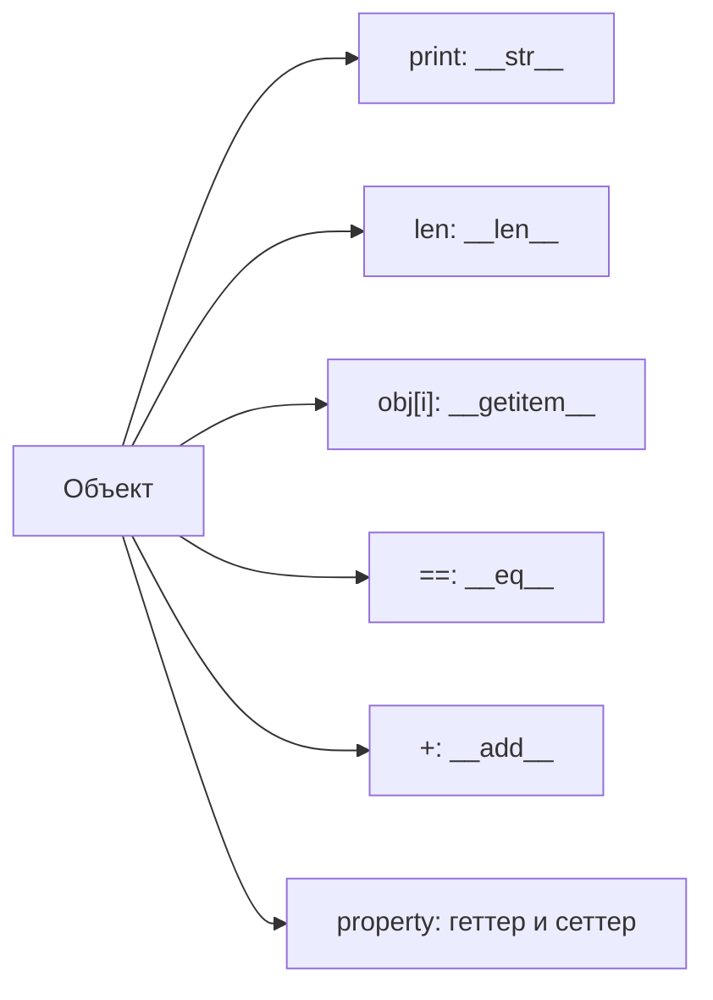

У встроенных объектов Python есть удобное поведение: строку можно складывать, у списка спрашивать длину через `len()`, объекты сравнивать. А можно ли научить этому свои классы? Да — с помощью **магических методов**. Это методы с двойными подчёркиваниями, которые Python вызывает автоматически в определённых ситуациях.

## __str__ и __repr__: строковые представления

Сейчас `print()` от нашего объекта скажет `__main__.Point object at 0x...` — не очень полезно. Исправим это:

```python
class Point:
    def __init__(self, x, y):
        self.x = x
        self.y = y

    def __str__(self):
        return f"Point({self.x}, {self.y})"

p = Point(1, 2)
print(p)          # Point(1, 2) — сработал __str__
print(str(p))     # тоже Point(1, 2)
```

`__str__` вызывается `print()` и `str()`, чтобы получить человекочитаемое описание. Есть ещё `__repr__` — формальное представление, которое показывает IDE и `repr()`:

```python
class Point:
    def __repr__(self):
        return f"Point({self.x}, {self.y})"
```

Хорошая практика: `__repr__` делаем однозначным (по нему можно восстановить объект), а `__str__` — красивым для глаз.

## __len__ и __getitem__: поведение «коллекции»

Если класс хранит набор элементов, можно разрешить `len()` и обращение по индексу:

```python
class ShoppingCart:
    def __init__(self):
        self.items = []

    def add(self, item):
        self.items.append(item)

    def __len__(self):
        return len(self.items)

    def __getitem__(self, index):
        return self.items[index]

cart = ShoppingCart()
cart.add("хлеб")
cart.add("молоко")
print(len(cart))      # 2 — сработал __len__
print(cart[0])        # хлеб — сработал __getitem__
```

Бонус: раз есть `__getitem__`, объект становится итерируемым — по нему можно пройтись циклом `for`.

## Магические методы сравнения и арифметики

Python позволяет перегружать операторы. Например, `==` использует `__eq__`, а `+` — `__add__`:

```python
class Point:
    def __init__(self, x, y):
        self.x = x
        self.y = y

    def __eq__(self, other):
        return self.x == other.x and self.y == other.y

    def __add__(self, other):
        return Point(self.x + other.x, self.y + other.y)

    def __repr__(self):
        return f"Point({self.x}, {self.y})"

p1 = Point(1, 2)
p2 = Point(1, 2)
p3 = p1 + p2
print(p1 == p2)   # True — теперь сравнение осмысленное
print(p3)         # Point(2, 4)
```

Теперь точки можно складывать, как числа! Всего таких методов много: `__sub__`, `__mul__`, `__lt__`, `__hash__` и другие.

## property: контроль доступа к атрибутам

Иногда хочется управлять тем, как читается и записывается атрибут. Классический пример — температура: хранить её лучше в Цельсиях, а давать доступ и в Фаренгейтах. Декоратор `@property` превращает метод в атрибут:

```python
class Temperature:
    def __init__(self, celsius):
        self._celsius = celsius

    @property
    def celsius(self):
        return self._celsius

    @property
    def fahrenheit(self):
        return self._celsius * 9 / 5 + 32

t = Temperature(25)
print(t.celsius)     # 25 — читается как атрибут
print(t.fahrenheit)  # 77.0 — вычисляется на лету
```

Мы назвали атрибут `_celsius` с подчёркиванием — так мы показываем, что это «внутренняя» переменная, и обращаться к ней напрямую не стоит. А `@property`-метод `celsius` отдаёт её наружу. Если нужно разрешить изменение с проверкой, добавляют сеттер:

```python
class Temperature:
    @property
    def celsius(self):
        return self._celsius

    @celsius.setter
    def celsius(self, value):
        if value < -273.15:
            raise ValueError("Температура не может быть ниже абсолютного нуля")
        self._celsius = value

t = Temperature(25)
t.celsius = 30      # ок
# t.celsius = -300  # ValueError!
```

## Схема: что за что отвечает

Каждый магический метод привязывает объект к определённому синтаксису Python:



## Итог

Магические методы встраивают твой класс в синтаксис Python: печать, длина, индексация, сравнение, арифметика. А `property` даёт чистый интерфейс доступа к данным с проверками. Это главные инструменты для создания «полноценных» типов.

<!--TASK-->
### Задача 1
Создай класс `Money`, который хранит сумму в рублях. Реализуй:

- `__init__(self, amount)` — хранит сумму,
- `__str__` — возвращает строку вида `123 руб.`,
- `__eq__` — сравнивает суммы двух объектов `Money`,
- `__add__` — возвращает новый объект `Money` с суммой двух,
- свойство `rubles` с сеттером, который не даёт установить отрицательную сумму (бросай `ValueError`).

Проверь: сложи `Money(100)` и `Money(50)`, сравни `Money(150)` с результатом, попробуй установить отрицательную сумму и поймай ошибку.

### Задача 2
Создай класс `Vector2D` — двумерный вектор. Конструктор принимает `x` и `y`. Реализуй:

- `__repr__` — возвращает строку `Vector2D(3, 4)`;
- `__add__` — возвращает новый `Vector2D` с суммой координат;
- `__eq__` — сравнивает координаты двух векторов;
- метод `length()` — возвращает длину вектора: корень из `x**2 + y**2`, используй `math.sqrt`.

Создай векторы `a = Vector2D(3, 4)` и `b = Vector2D(1, 2)`, сложи их, сравни результат с `Vector2D(4, 6)` и напечатай длину вектора `a`.

Ожидаемый результат:

```
True
5.0
```

### Задача 3
Создай класс `Playlist` (плейлист). Конструктор создаёт пустой внутренний список `self.songs`. Методы:

- `add(song)` — добавляет песню;
- `__len__` — возвращает количество песен;
- `__getitem__(index)` — возвращает песню по индексу;
- `__str__` — возвращает строку `Плейлист: Песня 1, Песня 2` (песни через запятую).

Добавь три песни: `Песня 1`, `Песня 2`, `Песня 3`. Выведи длину, вторую песню и весь плейлист.

Ожидаемый результат:

```
3
Песня 2
Плейлист: Песня 1, Песня 2, Песня 3
```

### Задача 4
Создай класс `Temperature` с внутренним атрибутом `_celsius`. Реализуй:

- свойство `celsius` с геттером и сеттером: сеттер разрешает только значения не ниже -273.15, иначе бросает `ValueError`;
- свойство `fahrenheit` только для чтения: `celsius * 9 / 5 + 32`;
- `__str__` — возвращает строку `25.0°C = 77.0°F`.

Создай температуру 25°C, выведи её через `print`, поменяй на 30°C и снова выведи, затем попробуй установить -300 и поймай `ValueError` (выведи сообщение ошибки).

Ожидаемый результат:

```
25.0°C = 77.0°F
30.0°C = 86.0°F
Температура не может быть ниже абсолютного нуля
```

### Задача 5
Создай класс `Product` (товар). Конструктор принимает `name` и `price`. Реализуй:

- `__repr__` — возвращает `Товар(«Ноутбук», 50000)`;
- `__eq__` — сравнивает названия и цены;
- `__lt__` — сравнивает только цены (это позволит сортировать товары по цене).

Создай список из трёх товаров: `Ноутбук` за 50000, `Мышь` за 1500 и `Монитор` за 20000. Отсортируй его через `sorted()` и выведи названия в порядке возрастания цены (по одному на строку).

Ожидаемый результат: сначала `Мышь`, затем `Монитор`, затем `Ноутбук`.
### Задача 6
Создай класс `Backpack` (рюкзак). Конструктор создаёт пустой список `items`. Добавь метод `put(item)` для добавления вещи, `__len__`, возвращающий количество вещей, и `__contains__`, проверяющий, лежит ли вещь в рюкзаке. Положи `термос`, `карту` и `фонарь`, затем выведи результаты проверок `"карта" in bag` и `"нож" in bag`, а также `len(bag)`.

Ожидаемый результат:

```
True
False
3
```

### Задача 7
Создай класс `Price` (цена). Конструктор принимает `amount`. Реализуй `__mul__`, который принимает количество и возвращает новый `Price` с умноженной суммой, и `__str__`, который возвращает строку `Итого: <сумма> руб.`. Проверь: выведи `Price(100) * 3` и `Price(200) * 3` через `print`. Убедись, что исходные объекты не меняются: `__mul__` создаёт новый объект, как и `__add__` в теории.

Ожидаемый результат:

```
Итого: 300 руб.
Итого: 600 руб.
```
<!--/TASK-->

<!--HINT-->
### Подсказка 1
В `__add__` верни новый `Money(self.amount + other.amount)`. Для свойства используй `@property` и `@rubles.setter` — в сеттере проверь `value < 0`. Чтобы увидеть `ValueError`, запусти код в блоке `try/except` или не перехватывай её вовсе.

### Подсказка 2
`__repr__` — это просто метод, возвращающий строку через `return`, например `f"Vector2D({self.x}, {self.y})"`. В `__add__` создай новый объект `Vector2D(self.x + other.x, self.y + other.y)`. Для `length()` импортируй `math` и используй `math.sqrt(self.x ** 2 + self.y ** 2)`.

### Подсказка 3
Сохраняй песни в `self.songs` через `append`. `__len__` возвращает `len(self.songs)`, а `__getitem__` — `self.songs[index]`. Для `__str__` объедини песни запятой: `", ".join(self.songs)` — не забудь префикс `Плейлист: `.

### Подсказка 4
Храни значение в `self._celsius` — с подчёркиванием, чтобы не путать с публичным свойством. Геттер `celsius` возвращает `self._celsius`, сеттер проверяет `value < -273.15` и бросает `ValueError`. В `__str__` вызови свойства `self.celsius` и `self.fahrenheit`, чтобы строки были свежими.

### Подсказка 5
Сравнение по цене — это `return self.price < other.price`. `sorted(products)` использует `__lt__` для упорядочивания. Для вывода названий пройдись циклом по `sorted(products)` и печатай `product.name`. `__repr__` пригодится для отладки — верни строку с кавычками-ёлочками вокруг названия.
### Подсказка 6
`__contains__` получает `self` и искомый элемент: `def __contains__(self, item): return item in self.items`. `__len__` возвращает `len(self.items)`. После этого оператор `in` и функция `len()` работают с рюкзаком так же, как со списком.

### Подсказка 7
`__mul__` принимает второй операнд: `def __mul__(self, count)`. Верни `Price(self.amount * count)` — новый объект, а не изменение текущего. `__str__` собирает f-строку с префиксом `Итого:` и словом `руб.`
<!--/HINT-->

<!--SOLUTION-->
### Разбор 1
Одно из возможных решений:

```python
class Money:
    def __init__(self, amount):
        self.amount = amount

    def __str__(self):
        return f"{self.amount} руб."

    def __eq__(self, other):
        return self.amount == other.amount

    def __add__(self, other):
        return Money(self.amount + other.amount)

    @property
    def rubles(self):
        return self.amount

    @rubles.setter
    def rubles(self, value):
        if value < 0:
            raise ValueError("Сумма не может быть отрицательной")
        self.amount = value

a = Money(100)
b = Money(50)
total = a + b
print(total)               # 150 руб.
print(total == Money(150)) # True
total.rubles = 200
print(total)               # 200 руб.

try:
    total.rubles = -5
except ValueError as e:
    print(e)               # Сумма не может быть отрицательной
```

Результат:

```
150 руб.
True
200 руб.
Сумма не может быть отрицательной
```

Что здесь происходит? `__str__` делает так, что `print(total)` показывает привычное `150 руб.`. `__eq__` сравнивает внутренние суммы, поэтому `total == Money(150)` даёт `True`. `__add__` создаёт новый объект, не изменяя исходные — это хороший стиль: арифметические операции возвращают новые объекты.

Свойство `rubles` прячет атрибут `amount` за интерфейсом: чтение идёт через геттер, а запись — через сеттер с проверкой. Когда мы пробуем установить `-5`, сеттер бросает `ValueError`, который мы ловим в `try/except` и печатаем сообщение. Так объект не может оказаться в неверном состоянии.

### Разбор 2
Решение:

```python
import math

class Vector2D:
    def __init__(self, x, y):
        self.x = x
        self.y = y

    def __repr__(self):
        return f"Vector2D({self.x}, {self.y})"

    def __add__(self, other):
        return Vector2D(self.x + other.x, self.y + other.y)

    def __eq__(self, other):
        return self.x == other.x and self.y == other.y

    def length(self):
        return math.sqrt(self.x ** 2 + self.y ** 2)

a = Vector2D(3, 4)
b = Vector2D(1, 2)
c = a + b
print(c == Vector2D(4, 6))
print(a.length())
```

Результат:

```
True
5.0
```

Оператор `+` теперь работает с векторами благодаря `__add__`: `a + b` создаёт новый объект с координатами (3+1, 4+2) = (4, 6). Сравнение `==` использует `__eq__`, который поэлементно сверяет координаты — поэтому `True`. Длина вектора считается по теореме Пифагора: sqrt(3² + 4²) = sqrt(25) = 5.0.

`__repr__` делает объект читаемым в консоли и IDE: вместо `<__main__.Vector2D object at ...>` вы увидите `Vector2D(3, 4)`. Обрати внимание, что `__add__` не меняет исходные векторы — он создаёт новый. Это соответствует математической природе векторов и избегает сюрпризов с изменением данных.

### Разбор 3
Решение:

```python
class Playlist:
    def __init__(self):
        self.songs = []

    def add(self, song):
        self.songs.append(song)

    def __len__(self):
        return len(self.songs)

    def __getitem__(self, index):
        return self.songs[index]

    def __str__(self):
        return "Плейлист: " + ", ".join(self.songs)

pl = Playlist()
pl.add("Песня 1")
pl.add("Песня 2")
pl.add("Песня 3")
print(len(pl))
print(pl[1])
print(pl)
```

Результат:

```
3
Песня 2
Плейлист: Песня 1, Песня 2, Песня 3
```

Благодаря магическим методам наш плейлист ведёт себя как встроенная коллекция. `len(pl)` работает, потому что определён `__len__` — он возвращает длину внутреннего списка. `pl[1]` работает благодаря `__getitem__`, который передаёт индекс в список `self.songs`. `print(pl)` использует `__str__`, который собирает читаемую строку: название всех песен через запятую с префиксом.

Кстати, раз реализован `__getitem__`, объект автоматически стал итерируемым — по нему можно пройтись циклом `for song in pl` без отдельного `__iter__`. Это «бонус» поведения коллекции. В реальных проектах так устроены, например, обёртки над списками и таблицами.

### Разбор 4
Решение:

```python
class Temperature:
    def __init__(self, celsius):
        self._celsius = celsius

    @property
    def celsius(self):
        return self._celsius

    @celsius.setter
    def celsius(self, value):
        if value < -273.15:
            raise ValueError("Температура не может быть ниже абсолютного нуля")
        self._celsius = value

    @property
    def fahrenheit(self):
        return self._celsius * 9 / 5 + 32

    def __str__(self):
        return f"{self.celsius}°C = {self.fahrenheit}°F"

t = Temperature(25)
print(t)
t.celsius = 30
print(t)
try:
    t.celsius = -300
except ValueError as e:
    print(e)
```

Результат:

```
25.0°C = 77.0°F
30.0°C = 86.0°F
Температура не может быть ниже абсолютного нуля
```

Свойство `celsius` — это пара методов, притворяющихся обычным атрибутом. Чтение `t.celsius` вызывает геттер, присваивание `t.celsius = 30` — сеттер. Сеттер выполняет валидацию: значение ниже -273.15 (абсолютный ноль) физически невозможно, поэтому бросается `ValueError`. Так объект гарантированно не попадёт в некорректное состояние.

Свойство `fahrenheit` — только для чтения: у него нет сеттера, поэтому `t.fahrenheit = 100` вызовет ошибку. Оно вычисляется на лету: 25 × 9 / 5 + 32 = 77.0. `__str__` собирает обе шкалы в одну строку. Обрати внимание: внутри `__str__` мы обращаемся к свойствам `self.celsius` и `self.fahrenheit`, а не к `self._celsius`, — это правильно, ведь свойства могут содержать логику.

### Разбор 5
Решение:

```python
class Product:
    def __init__(self, name, price):
        self.name = name
        self.price = price

    def __repr__(self):
        return f"Товар(«{self.name}», {self.price})"

    def __eq__(self, other):
        return self.name == other.name and self.price == other.price

    def __lt__(self, other):
        return self.price < other.price

products = [
    Product("Ноутбук", 50000),
    Product("Мышь", 1500),
    Product("Монитор", 20000),
]
for product in sorted(products):
    print(product.name)
```

Результат:

```
Мышь
Монитор
Ноутбук
```

Сортировка работает благодаря `__lt__` — методу, который Python вызывает для оператора `<`. Функция `sorted(products)` сравнивает товары попарно: два товара сравниваются по цене, поэтому в отсортированном списке сначала идут дешёвые, потом дорогие. Никакой отдельной функции-ключа не требуется — логика сравнения живёт внутри класса.

`__eq__` сравнивает и названия, и цены: два товара равны, только если совпадают оба поля. Это позволяет использовать `==` и, например, проверять наличие товара в списке. `__repr__` снова пригодится при отладке. Кстати, если бы мы захотели сортировать по названию, достаточно было бы изменить `__lt__` — интерфейс сортировки при этом не меняется.
### Разбор 6
Решение:

```python
class Backpack:
    def __init__(self):
        self.items = []

    def put(self, item):
        self.items.append(item)

    def __len__(self):
        return len(self.items)

    def __contains__(self, item):
        return item in self.items

bag = Backpack()
bag.put("термос")
bag.put("карта")
bag.put("фонарь")
print("карта" in bag)
print("нож" in bag)
print(len(bag))
```

Результат:

```
True
False
3
```

Рюкзак сам не является списком, но благодаря магическим методам ведёт себя как коллекция. Оператор `in` не ищет готовый метод `contains` — он вызывает `__contains__`, который делегирует проверку внутреннему списку `self.items`. Функция `len()` точно так же обращается к `__len__`, а тот возвращает длину списка.

Такой класс-обёртка удобен, когда нужно ограничить работу с коллекцией своим интерфейсом: внешний код не знает про `self.items` и не может, например, случайно удалить вещь в обход правил. Если бы `__contains__` не был определён, Python попытался бы перебрать объект через `__iter__`, а без него `in` завершился бы `TypeError`.

### Разбор 7
Решение:

```python
class Price:
    def __init__(self, amount):
        self.amount = amount

    def __mul__(self, count):
        return Price(self.amount * count)

    def __str__(self):
        return f"Итого: {self.amount} руб."

print(Price(100) * 3)
print(Price(200) * 3)
```

Результат:

```
Итого: 300 руб.
Итого: 600 руб.
```

Когда Python встречает `Price(100) * 3`, он вызывает `__mul__` левого операнда и передаёт туда `3` как `count`. Метод не меняет `self.amount`, а создаёт новый объект `Price` — так же ведёт себя `__add__` из теории. Это важно: если бы мы написали `self.amount *= count`, то `Price(100) * 3` изменил бы исходную цену, и повторный вызов дал бы 900 вместо 300.

Метод `__str__` отвечает только за представление, поэтому результат печати выглядит по-человечески. Обрати внимание на порядок: `print` получает уже новый объект и вызывает у него `__str__`. Если поменять операнды местами, например `3 * Price(100)`, понадобился бы ещё `__rmul__` — для умножения числа на объект.
<!--/SOLUTION-->

<!--QUIZ-->
Какой метод вызывается при print(obj)?
- __init__
- __str__
- __len__
- __add__
* Правильный ответ: __str__
print() и str() вызывают __str__, чтобы получить человекочитаемое строковое представление объекта.

Для чего нужен __repr__?
- Чтобы задать длину объекта
- Для однозначного формального представления объекта, по которому его можно восстановить
- Чтобы сложить два объекта
- Чтобы проверить равенство
* Правильный ответ: Для однозначного формального представления объекта, по которому его можно восстановить
__repr__ — это представление для разработчика: оно показывает содержимое объекта в консоли и IDE.

Что вернёт len(cart), если в корзине 3 товара и определён __len__?
- Ошибку
- 0
- 3
- None
* Правильный ответ: 3
__len__ возвращает длину внутреннего списка — встроенная функция len() пользуется им.

Что произойдёт при выполнении t.celsius = -300, если сеттер запрещает значения ниже -273.15?
- Значение тихо проигнорируется
- Будет выброшено ValueError
- Температура станет -300
- Python сам округлит до -273.15
* Правильный ответ: Будет выброшено ValueError
Сеттер проверяет значение и бросает исключение — так объект не может оказаться в некорректном состоянии.

Зачем используется декоратор @property?
- Чтобы превратить метод в атрибут с контролем чтения и записи
- Чтобы создать новый класс
- Чтобы задать длину объекта
- Чтобы перегрузить оператор +
* Правильный ответ: Чтобы превратить метод в атрибут с контролем чтения и записи
property позволяет обращаться к методу как к обычному атрибуту, а сеттер добавляет проверки при записи.
Для чего нужен метод __add__?
- Чтобы задать длину объекта
- Чтобы определить поведение оператора + для объектов класса
- Чтобы сравнить два объекта
- Чтобы получить строковое представление
* Правильный ответ: Чтобы определить поведение оператора + для объектов класса
Когда ты пишешь a + b, Python вызывает a.__add__(b).

Для чего применяется __eq__?
- Чтобы задать длину
- Чтобы определить поведение оператора ==
- Чтобы сложить объекты
- Чтобы превратить объект в строку
* Правильный ответ: Чтобы определить поведение оператора ==
__eq__ возвращает True/False и позволяет сравнивать объекты осмысленно.

Зачем внутренний атрибут называют с подчёркивания: _celsius?
- Так его нельзя менять вообще
- Так показывают, что это внутренняя переменная и трогать её напрямую не стоит
- Это обязательное требование Python
- Подчёркивание ускоряет доступ
* Правильный ответ: Так показывают, что это внутренняя переменная и трогать её напрямую не стоит
Подчёркивание — соглашение о приватности: доступ наружу идёт через property.
Какой метод вызывается при обращении к элементу через obj[0]?
- __len__
- __getitem__
- __str__
- __call__
* Правильный ответ: __getitem__
Квадратные скобки — это синтаксис __getitem__, поэтому obj[0] передаёт 0 в этот метод.

Что произойдёт при вызове len(obj), если в классе нет __len__?
- Вернётся 0
- Возникнет TypeError
- Вернётся None
- Python посчитает атрибуты автоматически
* Правильный ответ: Возникнет TypeError
Без __len__ у объекта нет длины; Python сообщает об этом именно TypeError.

Что выведет print(obj), если определён только __repr__, а __str__ нет?
- Адрес объекта вида <object at 0x...>
- Строку, которую возвращает __repr__
- Ошибку
- Пустую строку
* Правильный ответ: Строку, которую возвращает __repr__
Если __str__ не задан, print использует __repr__ как запасной вариант.

Что произойдёт при попытке присвоить значение property, у которого есть только геттер?
- Значение сохранится во внутренний атрибут
- Возникнет AttributeError
- Возникнет ValueError
- Значение проигнорируется
* Правильный ответ: Возникнет AttributeError
Без сеттера свойство доступно только для чтения, и присваивание вызывает AttributeError.
<!--/QUIZ-->
