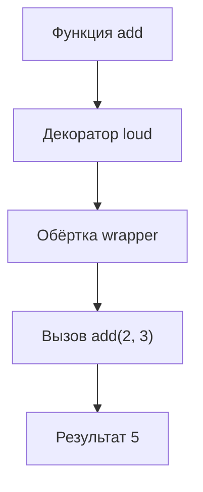

Представь: у тебя есть много функций, и во всех нужно добавить один и тот же код — например, замер времени или логирование. Копировать строки в каждую функцию плохо. В Python эту проблему решают **декораторы** — функции, которые оборачивают другие функции.

## Функции — это объекты

Первый кирпичик понимания: в Python функции можно передавать как значения и возвращать:

```python
def greet(name):
    return f"Привет, {name}!"

def shout(func, name):
    return func(name).upper()

print(shout(greet, "Аня"))  # ПРИВЕТ, АНЯ!
```

Мы передали `greet` в `shout` без скобок — как обычный объект. А ещё можно определить функцию внутри функции и вернуть её:

```python
def make_multiplier(factor):
    def multiply(x):
        return x * factor
    return multiply

double = make_multiplier(2)
print(double(5))  # 10
```

Такая вложенная функция, которая «помнит» переменную `factor`, называется **замыканием**. Именно на этом строится любой декоратор.

## Пишем первый декоратор

Декоратор — это функция, которая принимает функцию и возвращает новую функцию-обёртку:

```python
def loud(func):
    def wrapper(*args, **kwargs):
        result = func(*args, **kwargs)
        print(f"Функция вернула: {result}")
        return result
    return wrapper

@loud
def add(a, b):
    return a + b

print(add(2, 3))
# Функция вернула: 5
# 5
```

Запись `@loud` над функцией — это сахар для `add = loud(add)`. Внутри `wrapper` мы вызываем оригинальную функцию, что-то делаем вокруг неё и возвращаем результат. `*args, **kwargs` позволяют обёртке принимать любые аргументы.

## Зачем это нужно: реальный пример

Типичная задача — замер времени работы функции:

```python
import time

def timer(func):
    def wrapper(*args, **kwargs):
        start = time.perf_counter()
        result = func(*args, **kwargs)
        elapsed = time.perf_counter() - start
        print(f"{func.__name__} заняла {elapsed:.4f} сек")
        return result
    return wrapper

@timer
def slow_sum(n):
    return sum(range(n))

slow_sum(10_000_000)
# slow_sum заняла 0.4031 сек
```

Декоратор не трогает саму функцию — он лишь добавляет вокруг неё действие. Убрать замер просто: удалить строку `@timer`.

## functools.wraps: сохраняем имя и документацию

Есть подвох: обёртка «маскирует» имя функции:

```python
@timer
def slow_sum(n): ...

print(slow_sum.__name__)  # wrapper, а не slow_sum!
```

Чтобы сохранить `__name__` и `__doc__`, используют декоратор `functools.wraps`:

```python
from functools import wraps

def timer(func):
    @wraps(func)
    def wrapper(*args, **kwargs):
        ...
    return wrapper
```

Это считается правилом хорошего тона для своих декораторов.

## Декоратор с аргументами

Иногда хочется настраивать поведение: например, повторять вызов N раз. Тогда нужен «фабрика декораторов» — функция, которая возвращает декоратор:

```python
def repeat(times):
    def decorator(func):
        def wrapper(*args, **kwargs):
            for _ in range(times):
                func(*args, **kwargs)
        return wrapper
    return decorator

@repeat(3)
def say_hi():
    print("Привет!")

say_hi()
# Привет!
# Привет!
# Привет!
```

Здесь `@repeat(3)` — это вызов `repeat(3)`, который возвращает настоящий декоратор `decorator`, и уже он применяется к функции.

## Схема работы декоратора

Декоратор принимает функцию, подменяет её обёрткой и возвращает обёртку под тем же именем:



## Итог

Декораторы — мощнейший инструмент: логирование, тайминги, кэширование, проверка прав доступа — всё это аккуратно оформляется декоратором. Главное — помнить три уровня: функция → обёртка → применение через `@`.

<!--TASK-->
### Задача 1
Напиши декоратор `validate_non_negative`, который проверяет, что все числовые позиционные аргументы функции неотрицательные. Если хотя бы один отрицательный — выводи `Ошибка: аргумент не может быть отрицательным` и возвращай `None` (функция не выполняется). Примени декоратор к функции `sqrt_sum(a, b)`, которая возвращает сумму квадратных корней (используй `math.sqrt`). Убедись, что `sqrt_sum(4, 9)` возвращает 5.0, а `sqrt_sum(4, -9)` выводит ошибку.

### Задача 2
Напиши декоратор `uppercase`, который принимает функцию и возвращает обёртку, превращающую строковый результат функции в верхний регистр (`result.upper()`). Примени его к функции `greet(name)`, возвращающей `Привет, <имя>!` (обрати внимание: на вход передаётся имя в нижнем регистре). Вызови `greet("аня")` и убедись, что вывод — `ПРИВЕТ, АНЯ!`. Не забудь `@wraps(func)`.

### Задача 3
Напиши декоратор с аргументами `repeat(times)`, который повторяет вызов функции `times` раз. Примени `@repeat(3)` к функции `say_hi()`, печатающей `Привет!`. Вызови её и убедись, что на экране три раза появится `Привет!`. Помни: `@repeat(3)` — это вызов фабрики декораторов, а не сам декоратор.

### Задача 4
Напиши декоратор `log_calls`, который перед вызовом функции печатает строку `Вызвана функция <имя> с аргументами (<args>)`, где `<имя>` — настоящее имя функции (используй `func.__name__`), а `<args>` — позиционные аргументы через запятую. Примени его к функции `add(a, b)`, возвращающей сумму. Вызови `add(2, 3)` и проверь, что результат — `5`, а перед ним появилась строка журнала.

Ожидаемый результат:

```
Вызвана функция add с аргументами (2, 3)
5
```

### Задача 5
Напиши декоратор `memoize` — кэширование результатов функции. Внутри обёртки храни словарь `cache`, ключ — кортеж позиционных аргументов, значение — результат. Если результат уже есть в кэше — верни его, не вызывая функцию, и напечатай `Из кэша`. Иначе посчитай результат, сохрани в кэш и верни. Примени к функции `factorial(n)`, которая считает факториал циклом (без рекурсии). Вызови `factorial(5)` дважды — во второй раз должно появиться `Из кэша`.

Ожидаемый результат:

```
120
Из кэша
120
```
### Задача 6
Напиши декоратор `count_calls`, который считает, сколько раз вызвали функцию, и перед каждым вызовом печатает `Вызов № <номер>`. Счётчик заведи в замыкании: переменная должна жить между вызовами, но не быть глобальной. Примени декоратор к функции `ping()`, которая печатает `pong`, и вызови её дважды. Не забудь `@wraps(func)`.

Ожидаемый результат:

```
Вызов № 1
pong
Вызов № 2
pong
```

### Задача 7
Напиши декоратор `positive_result`, который проверяет результат функции: если результат меньше нуля, декоратор бросает `ValueError("Результат отрицательный")`, иначе возвращает результат как есть. Примени его к функции `balance_after(balance, withdraw)`, возвращающей остаток после снятия. Вызови `balance_after(100, 30)` и напечатай результат, затем вызови `balance_after(100, 150)` внутри `try/except ValueError` и напечатай текст ошибки.

Ожидаемый результат:

```
70
Результат отрицательный
```
<!--/TASK-->

<!--HINT-->
### Подсказка 1
Проверку количества делай внутри `wrapper` до вызова `func`. Помни про `@wraps(func)`. Для проверки аргументов пройдись по `args` и проверь тип через `isinstance(arg, (int, float))`, чтобы не обижаться на строки.

### Подсказка 2
Обёртка должна вызвать исходную функцию и применить `.upper()` к результату: `return func(*args, **kwargs).upper()`. Чтобы декоратор был универсальным, принимай `*args, **kwargs`. Не забудь `@wraps(func)` внутри декоратора — тогда `greet.__name__` останется `greet`. Примени декоратор синтаксисом `@uppercase` над функцией.

### Подсказка 3
Структура из трёх уровней: `repeat(times)` возвращает `decorator`, а `decorator(func)` возвращает `wrapper`. Внутри `wrapper` сделай цикл `for _ in range(times)` и вызывай `func(*args, **kwargs)`. Используй запись `@repeat(3)` над функцией.

### Подсказка 4
Собери строку журнала через f-строку. Для аргументов преврати каждый в строку и склей через `", "`: `", ".join(str(arg) for arg in args)`. Печатай журнал ДО вызова функции, потом возвращай `func(*args, **kwargs)`. Не забудь `@wraps(func)`.

### Подсказка 5
Словарь `cache` создай снаружи `wrapper` — внутри функции-декоратора, но вне обёртки, чтобы он жил всё время работы декорированной функции. Проверяй `if args in cache`. В нерекурсивном факториале используй цикл: `result = 1; for i in range(2, n + 1): result *= i`.
### Подсказка 6
Счётчик объяви вне `wrapper`, но внутри декоратора: `count = 0`. Внутри `wrapper` увеличивай его через `nonlocal count` — без этого Python создаст локальную переменную и выдаст ошибку. Номер печатай до вызова `func`.

### Подсказка 7
Внутри `wrapper` сохрани `result = func(*args, **kwargs)`, проверь `if result < 0: raise ValueError(...)` и верни `result`. Сам декоратор ничего не печатает — сообщение об ошибке ловит и печатает вызывающий код.
<!--/HINT-->

<!--SOLUTION-->
### Разбор 1
Одно из возможных решений:

```python
import math
from functools import wraps

def validate_non_negative(func):
    @wraps(func)
    def wrapper(*args, **kwargs):
        for arg in args:
            if isinstance(arg, (int, float)) and arg < 0:
                print("Ошибка: аргумент не может быть отрицательным")
                return None
        return func(*args, **kwargs)
    return wrapper

@validate_non_negative
def sqrt_sum(a, b):
    return math.sqrt(a) + math.sqrt(b)

print(sqrt_sum(4, 9))   # 5.0
sqrt_sum(4, -9)         # Ошибка: аргумент не может быть отрицательным
```

Результат:

```
5.0
Ошибка: аргумент не может быть отрицательным
```

Что здесь происходит? Декоратор `validate_non_negative` принимает функцию и возвращает `wrapper`. Внутри `wrapper` мы сначала проходимся по всем позиционным аргументам. Проверка `isinstance(arg, (int, float))` нужна, чтобы не пытаться сравнивать строки или другие типы. Если найден отрицательный — печатаем сообщение и возвращаем `None`, не вызывая оригинальную функцию. Если всё чисто — вызываем `func(*args, **kwargs)` и возвращаем её результат.

`@wraps(func)` сохраняет настоящее имя и документацию `sqrt_sum`. Без него `sqrt_sum.__name__` был бы `wrapper`, что мешает отладке.

Заметь: декоратор работает и для любых других функций с положительными аргументами — мы ограничили его применение одной функцией, но могли бы использовать на многих. Это и есть сила декораторов: переиспользуемая логика без дублирования кода.

### Разбор 2
Решение:

```python
from functools import wraps

def uppercase(func):
    @wraps(func)
    def wrapper(*args, **kwargs):
        return func(*args, **kwargs).upper()
    return wrapper

@uppercase
def greet(name):
    return f"Привет, {name}!"

print(greet("аня"))
```

Результат:

```
ПРИВЕТ, АНЯ!
```

Декоратор `uppercase` ничего не печатает и не меняет аргументы — он преобразует только результат. Обёртка `wrapper` вызывает исходную функцию `func(*args, **kwargs)` и сразу применяет к возвращённой строке метод `.upper()`. Благодаря `*args, **kwargs` декоратор универсален: его можно навесить на любую функцию, возвращающую строку, независимо от количества и вида аргументов.

`@wraps(func)` сохраняет метаданные: без него `greet.__name__` стал бы `wrapper`, и отладка (а также документация и инструменты вроде help()) сломались бы. Запись `@uppercase` эквивалентна `greet = uppercase(greet)`: Python передаёт исходную функцию в декоратор и заменяет имя на результат. Такой декоратор удобен, например, для форматирования вывода API или подготовки текста к печати.

### Разбор 3
Решение:

```python
def repeat(times):
    def decorator(func):
        def wrapper(*args, **kwargs):
            for _ in range(times):
                func(*args, **kwargs)
        return wrapper
    return decorator

@repeat(3)
def say_hi():
    print("Привет!")

say_hi()
```

Результат:

```
Привет!
Привет!
Привет!
```

Это декоратор с аргументами, поэтому уровней три. Внешняя функция `repeat(times)` принимает параметр настройки и возвращает `decorator` — настоящий декоратор. `decorator(func)` принимает функцию и возвращает `wrapper`. Наконец, `wrapper` при каждом вызове выполняет `func` `times` раз.

Запись `@repeat(3)` — это не применение декоратора напрямую, а вызов `repeat(3)`, который возвращает `decorator`, и уже он применяется к `say_hi`. То есть `@repeat(3)` эквивалентно `say_hi = repeat(3)(say_hi)`.

Параметр `times` «захвачен» замыканием: `wrapper` помнит его, даже когда `repeat` давно завершилась. Меняя аргумент декоратора — `@repeat(5)` — можно менять поведение функции без правки её тела.

### Разбор 4
Решение:

```python
from functools import wraps

def log_calls(func):
    @wraps(func)
    def wrapper(*args, **kwargs):
        args_str = ", ".join(str(arg) for arg in args)
        print(f"Вызвана функция {func.__name__} с аргументами ({args_str})")
        return func(*args, **kwargs)
    return wrapper

@log_calls
def add(a, b):
    return a + b

print(add(2, 3))
```

Результат:

```
Вызвана функция add с аргументами (2, 3)
5
```

Здесь мы логируем факт вызова: имя функции (`func.__name__` — настоящее, благодаря `@wraps`) и позиционные аргументы. Генераторное выражение `str(arg) for arg in args` превращает каждый аргумент в строку, а `", ".join(...)` склеивает их через запятую — получается `"2, 3"`. Журнал печатается до вызова `func(*args, **kwargs)`, затем результат возвращается наружу.

Такой декоратор полезен при отладке: он показывает, какие вызовы происходят и с какими данными, не засоряя тела функций. Обрати внимание на порядок: снаружи сначала печатается журнал, потом `print(add(2, 3))` печатает возвращённый результат 5. Кстати, `wrapper` проигнорировал бы и именованные аргументы, если бы мы захотели их логировать — для этого пришлось бы добавить обработку `kwargs`.

### Разбор 5
Решение:

```python
from functools import wraps

def memoize(func):
    cache = {}
    @wraps(func)
    def wrapper(*args):
        if args in cache:
            print("Из кэша")
            return cache[args]
        result = func(*args)
        cache[args] = result
        return result
    return wrapper

@memoize
def factorial(n):
    result = 1
    for i in range(2, n + 1):
        result *= i
    return result

print(factorial(5))
print(factorial(5))
```

Результат:

```
120
Из кэша
120
```

Словарь `cache` создаётся один раз при применении декоратора и «замыкается» внутри `wrapper`, поэтому живёт между вызовами. Ключом служит кортеж аргументов — `(5,)` — потому что кортеж можно использовать как ключ словаря, в отличие от списка.

При первом вызове `factorial(5)` кэш пуст: считаем факториал циклом (1×2×3×4×5 = 120), сохраняем результат под ключом `(5,)` и возвращаем. При втором вызове проверка `if args in cache` срабатывает: печатаем `Из кэша` и возвращаем готовый результат, не выполняя вычисления. Для короткой функции выигрыша не видно, но если бы `factorial` считалась рекурсивно или медленно, кэш ускорил бы повторные вызовы в разы.

Кстати, если бы мы хотели кэшировать функции с именованными аргументами, пришлось бы включать их в ключ — например, `(args, tuple(sorted(kwargs.items())))`. Наш вариант рассчитан на позиционные аргументы.
### Разбор 6
Решение:

```python
from functools import wraps

def count_calls(func):
    count = 0

    @wraps(func)
    def wrapper(*args, **kwargs):
        nonlocal count
        count += 1
        print(f"Вызов № {count}")
        return func(*args, **kwargs)

    return wrapper

@count_calls
def ping():
    print("pong")

ping()
ping()
```

Результат:

```
Вызов № 1
pong
Вызов № 2
pong
```

Счётчик `count` создаётся один раз, когда декоратор применяется к функции, и замыкается внутри `wrapper`. Без объявления `nonlocal count` строка `count += 1` попыталась бы создать новую локальную переменную и упала бы с `UnboundLocalError`. `nonlocal` говорит Python: «меняй переменную из внешней функции», и тогда значение сохраняется между вызовами.

Порядок строк тоже важен: сначала увеличиваем счётчик и печатаем номер, только потом вызываем `func`. Поэтому первый вызов показывает 1, а не 0. Благодаря `@wraps(func)` у декорированной функции остаётся имя `ping`, хотя фактически вызывается `wrapper`. Такой декоратор удобен для метрик и отладки: он не меняет ни аргументы, ни результат.

### Разбор 7
Решение:

```python
from functools import wraps

def positive_result(func):
    @wraps(func)
    def wrapper(*args, **kwargs):
        result = func(*args, **kwargs)
        if result < 0:
            raise ValueError("Результат отрицательный")
        return result

    return wrapper

@positive_result
def balance_after(balance, withdraw):
    return balance - withdraw

print(balance_after(100, 30))
try:
    balance_after(100, 150)
except ValueError as error:
    print(error)
```

Результат:

```
70
Результат отрицательный
```

Здесь декоратор проверяет не входные данные, а то, что функция вернула. Обёртка сначала вызывает `func(*args, **kwargs)` и сохраняет результат в переменную — иначе проверять было бы нечего. Затем идёт условие `result < 0`, и при нарушении бросается `ValueError`, а при нормальном результате значение уходит наружу без изменений.

Исключение не печатается внутри декоратора намеренно: решение о том, как реагировать на ошибку, принимает вызывающий код. В нашем примере это `try/except`, который печатает текст ошибки и продолжает работу. Если бы мы оставили ошибку необработанной, программа завершилась бы трейсбеком. Такой декоратор удобно вешать на расчёты баланса, скидок или остатков, где отрицательный результат — признак логической ошибки.
<!--/SOLUTION-->

<!--QUIZ-->
Что принимает и возвращает декоратор?
- Принимает число, возвращает строку
- Принимает функцию, возвращает функцию
- Принимает класс, возвращает объект
- Принимает список, возвращает кортеж
* Правильный ответ: Принимает функцию, возвращает функцию
Декоратор оборачивает функцию: принимает её и возвращает новую функцию-обёртку.

Зачем в обёртке нужны *args и **kwargs?
- Чтобы объявить новые параметры функции
- Чтобы передать исходной функции любые аргументы, какие бы ей ни передали
- Чтобы ускорить выполнение
- Чтобы запретить аргументы
* Правильный ответ: Чтобы передать исходной функции любые аргументы, какие бы ей ни передали
Обёртка принимает произвольные аргументы и передаёт их дальше в исходную функцию — так декоратор универсален.

Что делает @wraps(func)?
- Удаляет функцию
- Сохраняет имя и документацию исходной функции в обёртке
- Вызывает функцию при каждом обращении
- Ускоряет работу декоратора
* Правильный ответ: Сохраняет имя и документацию исходной функции в обёртке
Без @wraps имя декорированной функции стало бы "wrapper", что затрудняет отладку.

Как работает запись @repeat(3)?
- Прямое применение декоратора к функции
- Вызов repeat(3), который возвращает декоратор, и он применяется к функции
- Повторный вызов функции 3 раза внутри её тела
- Создание трёх копий функции
* Правильный ответ: Вызов repeat(3), который возвращает декоратор, и он применяется к функции
Это декоратор с аргументами: repeat(3) возвращает настоящий декоратор, который затем применяется к функции.

Зачем вообще нужны декораторы?
- Чтобы заменить функции циклами
- Чтобы переиспользовать обвязку (логирование, тайминги, проверки) без дублирования кода
- Чтобы создавать классы
- Чтобы запретить вызов функции
* Правильный ответ: Чтобы переиспользовать обвязку (логирование, тайминги, проверки) без дублирования кода
Логика оформляется один раз в декораторе и навешивается на любые функции строкой @имя.
Что такое замыкание?
- Функция, которая принимает другую функцию
- Вложенная функция, которая помнит переменные внешней функции
- Способ удалить функцию
- Цикл внутри функции
* Правильный ответ: Вложенная функция, которая помнит переменные внешней функции
Именно на замыканиях строятся декораторы: wrapper помнит func и другие переменные.

Чему эквивалентна запись @loud над функцией add?
- add = loud(add)
- add() = loud
- loud = add(loud)
- add = add(loud)
* Правильный ответ: add = loud(add)
Декоратор — это синтаксический сахар: Python применяет loud к add и присваивает результат имени add.

Зачем в обёртке вызывают func(*args, **kwargs)?
- Чтобы выполнить исходную функцию с теми же аргументами
- Чтобы создать новую функцию
- Чтобы запретить аргументы
- Чтобы узнать имя функции
* Правильный ответ: Чтобы выполнить исходную функцию с теми же аргументами
wrapper принимает аргументы и передаёт их дальше — так декорированная функция работает как раньше.
В каком порядке применяются декораторы, записанные столбиком друг над другом?
- Сверху вниз, как записаны
- Снизу вверх: первым применяется тот, что ближе к функции
- В случайном порядке
- Все одновременно
* Правильный ответ: Снизу вверх: первым применяется тот, что ближе к функции
Запись из двух декораторов читается как f = first(second(f)), поэтому нижний срабатывает первым.

Что вернёт декорированная функция, если wrapper не содержит return?
- Результат исходной функции
- None, даже если исходная функция что-то возвращала
- Ошибку
- Первый аргумент
* Правильный ответ: None, даже если исходная функция что-то возвращала
Без return обёртка возвращает None — результат вызова теряется, хотя сама функция выполнилась.

Зачем в декораторе с аргументами нужен дополнительный внешний уровень?
- Чтобы принять аргументы настройки и вернуть настоящий декоратор
- Чтобы ускорить вызов
- Чтобы сохранить __name__
- Чтобы запретить аргументы функции
* Правильный ответ: Чтобы принять аргументы настройки и вернуть настоящий декоратор
repeat(3) сначала выполняется сама и возвращает decorator, который затем применяется к функции.

Что произойдёт с __doc__ декорированной функции, если не использовать @wraps?
- Сохранится автоматически
- Документация исходной функции будет потеряна
- Появится ошибка синтаксиса
- __doc__ станет пустым списком
* Правильный ответ: Документация исходной функции будет потеряна
Обёртка без @wraps отдаёт свои метаданные, поэтому __name__ и __doc__ исходной функции теряются.
<!--/QUIZ-->
