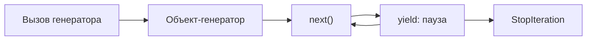

Построй последовательность чисел Фибоначчи до миллиона. Естественно сделать список... но если шагов много, память закончится. Для таких случаев в Python есть **генераторы** — функции, которые выдают значения по одному, не храня их все сразу.

## Функция-генератор и yield

Функция, в которой есть `yield`, превращается в генератор:

```python
def countdown(n):
    while n > 0:
        yield n
        n -= 1

for number in countdown(3):
    print(number)
# 3
# 2
# 1
```

Как это работает? Когда Python встречает `yield`, он приостанавливает выполнение функции, «замораживая» все её локальные переменные, и возвращает значение. При следующем обращении выполнение продолжается со следующей строки. Никакого списка в памяти нет — числа производятся на лету.

## Генераторы отличаются от обычных функций

Вызов функции-генератора не выполняет её тело, а создаёт объект-генератор:

```python
def gen():
    print("Старт!")
    yield 1

g = gen()        # ничего не вывелось!
print(next(g))   # Старт!\n1
```

Значит, генератор можно передавать в другие части программы, а запускать — когда нужно. Первое значение получается через `next()`; если значений больше нет, `next()` бросит `StopIteration`.

## Зачем это нужно: экономия памяти

Классический пример — работа с огромной последовательностью:

```python
def squares(n):
    for i in range(n):
        yield i * i

gen = squares(10_000_000)
print(next(gen))  # 0
print(next(gen))  # 1
```

Список из десяти миллионов квадратов занял бы сотни мегабайт. Генератор занимает единицы байт — он помнит только текущее состояние.

Ещё удобство: генераторы можно комбинировать. Например, взять первые пять чётных квадратов:

```python
def even_squares(n):
    for i in range(n):
        sq = i * i
        if sq % 2 == 0:
            yield sq

evens = even_squares(100)
first_five = [next(evens) for _ in range(5)]
print(first_five)  # [0, 4, 16, 36, 64]
```

## Выражения-генераторы

Иногда не нужно писать отдельную функцию — существует краткий синтаксис, похожий на списковое включение, но в круглых скобках:

```python
nums = (x * x for x in range(10))
print(nums)        # <generator object ...>
print(sum(nums))   # 285 — сумма квадратов от 0 до 9
```

Обрати внимание: это не кортеж! Скобки создают генератор. Он «ленивый»: элементы вычисляются только тогда, когда нужны. Поэтому `sum(nums)` проходит по генератору один раз.

## Чтение файлов построчно

Практический пример: чтение большого файла. Список всех строк займёт много памяти, а генератор обрабатывает файл построчно:

```python
def read_lines(path):
    with open(path, encoding="utf-8") as f:
        for line in f:
            yield line.strip()
```

Файл открывается, а при каждом `yield` отдаётся следующая строка. Если строк миллион — в памяти никогда не окажется больше одной.

## Схема жизненного цикла генератора

Генератор не считает всё сразу: он выдаёт значение, замирает и продолжает только по запросу:



## Итог

Генераторы дают ленивые вычисления: значения производятся по требованию, память экономится, код часто оказывается проще. `yield` ставит выполнение на паузу, `next()` — возобновляет. Дальше мы познакомимся с итераторами — более низкоуровневым механизмом, на котором генераторы основаны.

<!--TASK-->
### Задача 1
Напиши функцию-генератор `fibonacci(limit)`, которая выдаёт числа Фибоначчи, пока они меньше `limit`. Числа начинаются с 0 и 1, каждое следующее — сумма двух предыдущих. Проверь: распечатай все числа из `fibonacci(100)`. Ожидаемый результат: `0 1 1 2 3 5 8 13 21 34 55 89` (по одному на строку или через пробел).

### Задача 2
Напиши функцию-генератор `even_numbers(limit)`, которая выдаёт все чётные числа от 0 до `limit` включительно. Проверь: собери результат в список через `list(even_numbers(10))` и выведи его.

Ожидаемый результат:

```
[0, 2, 4, 6, 8, 10]
```

### Задача 3
Напиши функцию-генератор `squares_gen(n)`, которая выдаёт квадраты чисел от 0 до `n - 1` включительно. Затем посчитай сумму квадратов первых 10 чисел с помощью встроенной функции `sum(squares_gen(10))` и выведи её.

Ожидаемый результат: `285` (это 0² + 1² + ... + 9²).

### Задача 4
Напиши функцию-генератор `char_by_char(text)`, которая выдаёт символы строки по одному. Проверь: пройдись циклом по `char_by_char("Python")` и собери буквы в список через `list(...)`, затем выведи его.

Ожидаемый результат:

```
['P', 'y', 't', 'h', 'o', 'n']
```

### Задача 5
Используй выражение-генератор для подсчёта суммы кубов нечётных чисел от 1 до 9 включительно. Подсказка: диапазон нечётных чисел — `range(1, 10, 2)`, а возведение в куб — `x ** 3`. Выведи полученную сумму.

Ожидаемый результат: `1225` (1³ + 3³ + 5³ + 7³ + 9³).
### Задача 6
Напиши функцию-генератор `unique(items)`, которая выдаёт элементы по одному, пропуская повторы: каждое значение должно встретиться в выводе только один раз, порядок — как в исходном списке. Заведи внутри генератора множество `seen` и проверяй вхождение перед `yield`. Проверь на списке `[1, 2, 1, 3, 2, 4]`, собери результат через `list(...)` и выведи.

Ожидаемый результат:

```
[1, 2, 3, 4]
```

### Задача 7
Напиши функцию-генератор `running_sum(numbers)`, которая выдаёт накопительную сумму: первое значение — первый элемент, второе — сумма первых двух, и так далее. Заведи переменную `total = 0` и прибавляй к ней каждый элемент перед `yield`. Проверь на списке `[1, 2, 3, 4]`: пройдись циклом и выведи каждое значение на отдельной строке.

Ожидаемый результат:

```
1
3
6
10
```
<!--/TASK-->

<!--HINT-->
### Подсказка 1
Заведи две переменные `a, b = 0, 1` и в цикле `while a < limit` делай `yield a`, затем обновляй пару: `a, b = b, a + b`. Не забудь, что функция с `yield` — генератор, она не должна ничего возвращать через `return` со значением.

### Подсказка 2
Чётные числа — это диапазон с шагом 2: `range(0, limit + 1, 2)`. Почему `limit + 1`? Потому что `range` не включает правую границу, а нам нужно включить само число 10. В цикле отдавай каждое число через `yield`. Функция `list()` соберёт все значения в список.

### Подсказка 3
В функции `squares_gen(n)` пройдись `for i in range(n)` и отдай `yield i * i`. Сумма считается встроенной функцией `sum(...)`, которая сама перебирает генератор до конца. Ожидаемый результат можно проверить вручную: сумма квадратов 0..9 равна 285.

### Подсказка 4
Цикл `for ch in text` перебирает символы строки по одному — внутри делай `yield ch`. Затем `list(char_by_char("Python"))` соберёт символы в список. Обрати внимание: строка — итерируемый объект, поэтому цикл по ней работает без всяких индексов.

### Подсказка 5
Выражение-генератор записывается в круглых скобках: `(x ** 3 for x in range(1, 10, 2))`. Это не кортеж, а генератор. Передай его в `sum(...)` — она просуммирует все кубы. Проверь вручную: 1 + 27 + 125 + 343 + 729 = 1225.
### Подсказка 6
Заведи `seen = set()` до цикла. Для каждого элемента проверяй `if item not in seen:` — тогда добавь его в множество (`seen.add(item)`) и отдай через `yield`. Элементы, которые уже встречались, просто пропускаются.

### Подсказка 7
`total` объяви до цикла и обновляй на каждом шаге: `total += number`, а затем `yield total`. Генератор запоминает значение `total` между выдачами, поэтому каждая следующая сумма нарастает.
<!--/HINT-->

<!--SOLUTION-->
### Разбор 1
Одно из возможных решений:

```python
def fibonacci(limit):
    a, b = 0, 1
    while a < limit:
        yield a
        a, b = b, a + b

for number in fibonacci(100):
    print(number, end=" ")
# 0 1 1 2 3 5 8 13 21 34 55 89
```

Результат:

```
0 1 1 2 3 5 8 13 21 34 55 89
```

Что здесь происходит? Переменные `a` и `b` хранят два текущих числа ряда. В цикле `while a < limit` мы отдаём `a` через `yield` — выполнение приостанавливается, и цикл `for` печатает число. Когда `for` запрашивает следующее значение, выполнение продолжается со строки `a, b = b, a + b`. Эта строка одновременно обновляет обе переменные: старое `b` становится новым `a`, а новое `b` — суммой. Именно поэтому пары чисел сдвигаются корректно.

Цикл завершается, когда `a` становится не меньше `limit`. Заметь: 144 не попадёт в вывод, так как 144 ≥ 100 — условие проверяется перед выдачей.

Преимущество генератора здесь очевидно: мы могли бы попросить `fibonacci(10**12)` и всё равно держать в памяти лишь две переменные. Список же взорвал бы память. Наконец, обрати внимание: `yield` нельзя заменить на `return` с числом — `return` в генераторе лишь завершает его (бросает `StopIteration`).

### Разбор 2
Решение:

```python
def even_numbers(limit):
    for n in range(0, limit + 1, 2):
        yield n

print(list(even_numbers(10)))
```

Результат:

```
[0, 2, 4, 6, 8, 10]
```

Встроенная функция `range(0, limit + 1, 2)` уже умеет порождать чётные числа: старт 0, шаг 2, верхняя граница не включается. Чтобы включить само число 10, мы указываем `limit + 1`. Так `range(0, 11, 2)` даст 0, 2, 4, 6, 8, 10 — ровно то, что нужно.

Функция `even_numbers` оборачивает этот диапазон в генератор: каждая итерация цикла отдаёт очередное число через `yield`. Затем `list(even_numbers(10))` собирает все значения в обычный список. На самом деле здесь генератор можно было бы вообще не писать — `list(range(0, 11, 2))` дал бы тот же результат. Но если бы мы захотели, скажем, выдавать только чётные числа, делящиеся на 4, условие `if n % 4 == 0` вставилось бы в цикл без изменения внешнего кода.

### Разбор 3
Решение:

```python
def squares_gen(n):
    for i in range(n):
        yield i * i

print(sum(squares_gen(10)))
```

Результат:

```
285
```

Генератор `squares_gen` выдаёт квадраты по одному: для каждого `i` от 0 до 9 отдаётся `i * i`. Квадраты не хранятся в памяти — они вычисляются на лету.

Встроенная функция `sum(...)` принимает итерируемый объект и складывает все его значения. Она работает и с генераторами: перебирает их до `StopIteration` и суммирует результаты. Проверим формулу: 0 + 1 + 4 + 9 + 16 + 25 + 36 + 49 + 64 + 81 = 285. Всё сходится.

Обрати внимание на ленивость: `sum` «тянет» из генератора ровно столько значений, сколько нужно до конца, — вычисления происходят именно в момент запроса. Если бы квадратов были миллионы, память всё равно осталась бы постоянной, а `sum(range(10_000_000))` со списком квадратов потребовала бы сотни мегабайт.

### Разбор 4
Решение:

```python
def char_by_char(text):
    for ch in text:
        yield ch

print(list(char_by_char("Python")))
```

Результат:

```
['P', 'y', 't', 'h', 'o', 'n']
```

Строка — это итерируемый объект, поэтому цикл `for ch in text` перебирает её символы по одному, не требуя индексов. Каждый символ отдаётся наружу через `yield`. Функция `list(char_by_char("Python"))` собирает все символы в список — получается список из шести отдельных букв.

Приятный бонус такой функции: её можно использовать в любом месте, где нужны итерируемые объекты, — например, `"".join(char_by_char("Python"))` соберёт строку обратно, а `for ch in char_by_char("Python")` пройдёт по буквам. Это простой пример того, как генератор делает код чище: вместо ручного управления индексами и накопления результата ты просто описываешь правило генерации значений.

### Разбор 5
Решение:

```python
cubes = (x ** 3 for x in range(1, 10, 2))
print(sum(cubes))
```

Результат:

```
1225
```

Выражение-генератор записывается в круглых скобках — это синтаксический сахар, заменяющий отдельную функцию. `range(1, 10, 2)` даёт нечётные числа: 1, 3, 5, 7, 9. Для каждого из них вычисляется куб `x ** 3`. Поток значений: 1, 27, 125, 343, 729.

`sum(cubes)` перебирает генератор и складывает: 1 + 27 + 125 + 343 + 729 = 1225. Важно: `cubes` — это не кортеж (в круглых скобках без запятых), а именно генератор. После `sum()` он исчерпан — повторный `sum(cubes)` даст 0, потому что значения уже закончились. Это особенность одноразовости генераторов. Выражения-генераторы особенно удобны, когда нужно передать вычисление внутрь функции: можно даже не сохранять его в переменную, а написать `sum(x ** 3 for x in range(1, 10, 2))` прямо в аргументе.
### Разбор 6
Решение:

```python
def unique(items):
    seen = set()
    for item in items:
        if item in seen:
            continue
        seen.add(item)
        yield item

print(list(unique([1, 2, 1, 3, 2, 4])))
```

Результат:

```
[1, 2, 3, 4]
```

Множество `seen` создаётся один раз при запуске генератора и живёт всё время перебора — это его внутреннее состояние, а не глобальная переменная. Проверка `if item in seen` отсеивает повторы, а `seen.add(item)` фиксирует уже выданные значения. Благодая этому первое вхождение попадает в результат, а все последующие пропускаются.

Множество выбрано не случайно: проверка `in` для него в среднем быстрее, чем для списка, особенно на длинных последовательностях. Важно и то, что функция ничего никуда не записывает целиком: при бесконечном источнике и ограниченном наборе различных значений память тоже останется ограниченной. Такой генератор удобно вставлять в цепочки других генераторов.

### Разбор 7
Решение:

```python
def running_sum(numbers):
    total = 0
    for number in numbers:
        total += number
        yield total

for value in running_sum([1, 2, 3, 4]):
    print(value)
```

Результат:

```
1
3
6
10
```

Переменная `total` живёт в кадре генератора и не сбрасывается между выдачами. При каждом запросе очередного значения цикл берёт следующий элемент, прибавляет его к накопленной сумме и отдаёт новое значение через `yield`; выполнение замирает ровно после этой строки. Поэтому следующий шаг начинает с уже обновлённого `total`.

Если бы мы написали `total = 0` внутри цикла, каждая сумма была бы равна одному элементу. Обратите внимание, что возвращать список не нужно: потребитель сам решает, что делать со значениями — напечатать, сложить или сохранить в файл. На списке из четырёх элементов получаются суммы 1, 1+2=3, 3+3=6 и 6+4=10. Тот же приём лежит в основе подсчёта нарастающих итогов в отчётах и потоковой обработки логов.
<!--/SOLUTION-->

<!--QUIZ-->
Что делает ключевое слово yield?
- Завершает функцию
- Приостанавливает выполнение функции, возвращает значение и запоминает состояние
- Возвращает список всех значений
- Печатает значение на экран
* Правильный ответ: Приостанавливает выполнение функции, возвращает значение и запоминает состояние
При следующем обращении выполнение продолжается со строки после yield — локальные переменные сохраняются.

Что создаёт вызов функции-генератора?
- Она тут же выполняется и возвращает результат
- Создаётся объект-генератор, тело функции не выполняется до первого next()
- Создаётся список значений
- Возвращается None
* Правильный ответ: Создаётся объект-генератор, тело функции не выполняется до первого next()
Вызов лишь создаёт генератор; код внутри начинает выполняться только при первом обращении к next() или в цикле for.

Что произойдёт, когда значения генератора закончатся?
- Вернётся None
- next() бросит StopIteration
- Генератор начнёт сначала
- Возникнет SyntaxError
* Правильный ответ: next() бросит StopIteration
StopIteration — сигнал о том, что значений больше нет; цикл for воспринимает его как команду завершиться.

Почему генератор лучше списка из 10 миллионов элементов?
- Генератор быстрее считает
- Генератор занимает значительно меньше памяти, так как хранит только текущее состояние
- Генератор нельзя перебирать
- Список не хранится в памяти
* Правильный ответ: Генератор занимает значительно меньше памяти, так как хранит только текущее состояние
Значения производятся по одному и не хранятся все сразу — список же занял бы сотни мегабайт.

Что вернёт выражение (x for x in range(3))?
- Кортеж (0, 1, 2)
- Список [0, 1, 2]
- Объект-генератор
- Число 3
* Правильный ответ: Объект-генератор
Круглые скобки с циклом создают генератор, а не кортеж: элементы вычисляются лениво, по требованию.
Сколько раз можно пройтись по одному и тому же генератору?
- Сколько угодно раз
- Один раз: после исчерпания генератор пуст
- Ровно два раза
- До бесконечности
* Правильный ответ: Один раз: после исчерпания генератор пуст
Значения производятся на лету и не сохраняются — повторный проход ничего не даст.

В чём главное отличие yield от return в функции?
- Разницы нет
- yield приостанавливает функцию и сохраняет состояние, а return завершает её
- return может встречаться многократно
- yield запрещён в функциях
* Правильный ответ: yield приостанавливает функцию и сохраняет состояние, а return завершает её
После yield выполнение продолжится при следующем обращении; return полностью завершает функцию.

Можно ли использовать return со значением в функции-генераторе?
- Нет, будет SyntaxError
- Да, но он лишь завершает генератор, а значение не выдаётся в цикле
- Да, и тогда оно тоже отдаётся через yield
- Можно только в начале функции
* Правильный ответ: Да, но он лишь завершает генератор, а значение не выдаётся в цикле
return в генераторе останавливает его; значение попадает в StopIteration.value, но в обычном переборе не видно.
Является ли генератор итератором?
- Нет, это обычная функция
- Да, у него есть __iter__ и __next__
- Нет, его можно только один раз напечатать
- Да, но только после list()
* Правильный ответ: Да, у него есть __iter__ и __next__
Генератор реализует протокол итератора, поэтому его можно передавать всюду, где ждут итератор.

Как вручную получить следующее значение генератора?
- gen.next()
- next(gen)
- gen()
- gen[0]
* Правильный ответ: next(gen)
Встроенная функция next() вызывает __next__ и при исчерпании бросает StopIteration.

Что произойдёт со значениями, которые так и не запросили из генератора?
- Они будут вычислены заранее
- Они не будут вычислены: вычисление происходит только по запросу
- Они сохранятся в список
- Будет ошибка
* Правильный ответ: Они не будут вычислены: вычисление происходит только по запросу
В этом и состоит ленивость: работа выполняется только для тех значений, которые действительно понадобились.

Что вернёт выражение sum(x * x for x in range(4))?
- 14
- 9
- 16
- 6
* Правильный ответ: 14
Квадраты 0, 1, 4, 9 в сумме дают 14; выражение-генератор не создаёт список.
<!--/QUIZ-->
