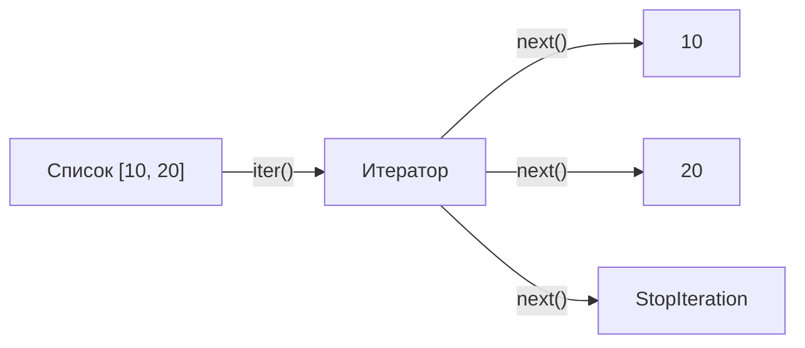

Мы постоянно пишем `for x in something` — по спискам, строккам, словарям. Но что на самом деле происходит под капотом цикла `for`? Ответ кроется в двух понятиях: **итерируемый объект** и **итератор**.

## Итерируемый объект vs итератор

**Итерируемый объект** (iterable) — это объект, по которому можно пройтись: список, строка, словарь, множество, диапазон. У него есть метод `__iter__()`, который возвращает **итератор**.

**Итератор** — это объект, который выдаёт значения по одному. У него есть метод `__next__()`, возвращающий следующее значение, а когда значения закончились — бросает исключение `StopIteration`.

Цикл `for` — это просто сахар:

```python
my_list = [10, 20, 30]
iterator = iter(my_list)      # вызов __iter__
print(next(iterator))         # 10 — вызов __next__
print(next(iterator))         # 20
print(next(iterator))         # 30
# print(next(iterator))       # StopIteration!
```

Функция `iter()` запрашивает итератор, а `next()` двигает его вперёд. Ровно то же делает `for`:

```python
for item in my_list:
    print(item)
# эквивалентно:
iterator = iter(my_list)
while True:
    try:
        item = next(iterator)
    except StopIteration:
        break
    print(item)
```

Отличие важно: список — итерируемый объект, но не итератор. По списку можно ходить сколько угодно раз, а итератор одноразовый — когда он исчерпан, он пуст.

## Свой класс-итератор

Теперь напишем собственный итератор. Классическая задача — обратный отсчёт. Для этого классу нужны `__iter__` (возвращает сам себя) и `__next__` (выдаёт следующее значение):

```python
class Countdown:
    def __init__(self, start):
        self.current = start

    def __iter__(self):
        return self

    def __next__(self):
        if self.current <= 0:
            raise StopIteration
        value = self.current
        self.current -= 1
        return value

for number in Countdown(3):
    print(number)
# 3
# 2
# 1
```

Когда `self.current` достигает 0, мы бросаем `StopIteration` — и цикл `for` завершается. Такой класс можно использовать в `list(Countdown(3))` — получится `[3, 2, 1]`.

## Бесконечный итератор

Иногда нужно «бесконечное» источник чисел, который можно остановить извне:

```python
class Counter:
    def __init__(self):
        self.n = 0

    def __iter__(self):
        return self

    def __next__(self):
        self.n += 1
        return self.n

counter = Counter()
for _ in range(5):
    print(next(counter))
# 1 2 3 4 5
```

Такой итератор никогда не бросает `StopIteration`, поэтому `for` без прерывания не завершится. Это удобно для потоковой обработки, где количество элементов заранее неизвестно.

## Итераторы в стандартной библиотеке

Многие встроенные функции работают с итераторами: `map`, `filter`, `zip`, `enumerate`. Например:

```python
numbers = [1, 2, 3]
squares = map(lambda x: x * x, numbers)
print(next(squares))  # 1
print(list(squares))  # [4, 9]
```

А модуль `itertools` содержит готовые итераторы: `islice`, `cycle`, `chain`, `count` и другие. Их можно соединять, как конструктор.

## Генераторы — это упрощённые итераторы

Напомним: генератор (урок 5) — это итератор, создаваемый функцией с `yield`. Проще писать генератор, чем класс с `__next__`, но иногда нужен именно класс — например, когда нужно хранить дополнительное состояние между вызовами, которое не умещается в локальные переменные.

## Схема: как for получает значения

Цикл `for` — это повторяющиеся вызовы `iter()` и `next()`, пока не придёт `StopIteration`:



## Итог

`for` — это обёртка над `iter()` и `next()`. Итерируемый объект производит итераторы, итератор выдаёт значения и исчерпывается. Зная этот механизм, ты можешь делать свои объекты итерируемыми — а значит, работать с ними в `for`, `list()`, `sum()` и других местах, где ждут итератор.

<!--TASK-->
### Задача 1
Создай класс `EvenNumbers`, который перебирает чётные числа от 0 до `limit` включительно. Конструктор принимает `limit`. Реализуй `__iter__` и `__next__`. Проверь работу циклом `for` и собери результат в список через `list(EvenNumbers(10))` — должно получиться `[0, 2, 4, 6, 8, 10]`. Обрати внимание: когда числа закончатся, `__next__` должен бросить `StopIteration` — без этого цикл `for` не завершится.

### Задача 2
Создай класс-итератор `FibonacciIterator`, который выдаёт числа Фибоначчи (0, 1, 1, 2, 3, 5, ...), пока они меньше `limit`. Конструктор принимает `limit`. В `__iter__` возвращай `self`, в `__next__` бросай `StopIteration`, когда следующее число станет не меньше `limit`. Проверь: собери `list(FibonacciIterator(20))` и выведи.

Ожидаемый результат:

```
[0, 1, 1, 2, 3, 5, 8, 13]
```

### Задача 3
Создай класс-итератор `Letters`, принимающий строку в конструкторе и выдающий её символы по одному. Реализуй `__iter__` и `__next__` (с `StopIteration` в конце). Собери все буквы слова "Python" через `list(Letters("Python"))` и выведи.

Ожидаемый результат:

```
['P', 'y', 't', 'h', 'o', 'n']
```

### Задача 4
Создай класс-итератор `SquaresIterator`, который выдаёт квадраты чисел от 1 до `n` включительно. Конструктор принимает `n`. Реализуй `__iter__` и `__next__`. Собери `list(SquaresIterator(5))` и выведи.

Ожидаемый результат:

```
[1, 4, 9, 16, 25]
```

### Задача 5
Создай класс-итератор `CyclicIterator`, который бесконечно перебирает элементы переданного списка по кругу. В `__next__` возвращай очередной элемент, а когда список закончился — начинай сначала. Проверь: выведи первые 6 значений из `CyclicIterator([1, 2, 3])` (по одному на строку).

Ожидаемый результат:

```
1
2
3
1
2
3
```
### Задача 6
Создай класс-итератор `ReverseWords`, который принимает строку и выдаёт её слова в обратном порядке. Разбей строку на слова через `split()` в конструкторе и храни список; в `__next__` двигайся по нему с конца к началу, а когда слова закончатся — бросай `StopIteration`. Проверь: собери `list(ReverseWords("я учу python"))` и выведи список.

Ожидаемый результат:

```
['python', 'учу', 'я']
```

### Задача 7
Создай класс-итератор `StepRange(start, stop, step)`, который работает как `range`, но не включает правую границу: выдаёт числа от `start`, прибавляя `step`, пока значение меньше `stop`. Реализуй `__iter__` и `__next__` с `StopIteration` в конце и учти отрицательный шаг. Проверь: выведи `list(StepRange(1, 10, 3))` и `list(StepRange(5, 0, -2))`.

Ожидаемый результат:

```
[1, 4, 7]
[5, 3, 1]
```
<!--/TASK-->

<!--HINT-->
### Подсказка 1
В `__init__` заведи `self.current = 0`. В `__next__`, если `self.current > self.limit` — бросай `StopIteration`. Иначе сохрани текущее значение, увеличи `self.current` на 2 и верни сохранённое.

### Подсказка 2
В `__init__` заведи `self.a = 0` и `self.b = 1` (два текущих числа ряда). В `__next__` сначала проверь: если `self.a >= self.limit` — бросай `StopIteration`. Иначе сохрани `self.a`, обнови пару `self.a, self.b = self.b, self.a + self.b` и верни сохранённое.

### Подсказка 3
В `__init__` сохрани строку в `self.text` и заведи `self.index = 0`. В `__next__` проверь `if self.index >= len(self.text)`, — и бросай `StopIteration`. Иначе возьми символ `self.text[self.index]`, увеличь `self.index` на 1 и верни символ.

### Подсказка 4
В `__init__` сохрани `self.n` и заведи `self.current = 1`. В `__next__` проверь `if self.current > self.n` — бросай `StopIteration`. Иначе вычисли `value = self.current ** 2`, увеличь `self.current` и верни `value`.

### Подсказка 5
Такой итератор В не бросает `StopIteration` — он крутится бесконечно. В `__init__` сохрани список и `self.index = 0`. В `__next__` возьми элемент `self.items[self.index]`, затем сдвинься по кругу: `self.index = (self.index + 1) % len(self.items)`. Проверяй циклом `for _ in range(6)`, а не `list(...)` — иначе цикл не завершится.
### Подсказка 6
В `__init__` сохрани `self.words = text.split()` и поставь `self.index = len(self.words) - 1`. В `__next__` проверяй `if self.index < 0: raise StopIteration`, затем бери `self.words[self.index]`, уменьшай индекс и возвращай слово.

### Подсказка 7
Храни `self.current = start`. Условие окончания зависит от знака шага: при положительном `step` — `self.current >= self.stop`, при отрицательном — `self.current <= self.stop`. Не забудь сохранить значение до прибавления шага.
<!--/HINT-->

<!--SOLUTION-->
### Разбор 1
Одно из возможных решений:

```python
class EvenNumbers:
    def __init__(self, limit):
        self.limit = limit
        self.current = 0

    def __iter__(self):
        return self

    def __next__(self):
        if self.current > self.limit:
            raise StopIteration
        value = self.current
        self.current += 2
        return value

for num in EvenNumbers(10):
    print(num, end=" ")
print()
print(list(EvenNumbers(10)))
```

Результат:

```
0 2 4 6 8 10
[0, 2, 4, 6, 8, 10]
```

Что здесь происходит? В `__init__` мы запоминаем верхнюю границу и ставим счётчик на 0. `__iter__` возвращает `self` — так Python понимает, что объект сам является итератором. В `__next__` первым делом проверяется условие окончания: если текущее число больше лимита, бросаем `StopIteration`. Именно это исключение цикл `for` воспринимает как сигнал «значения закончились» и завершается.

Затем мы сохраняем текущее значение в `value`, увеличиваем счётчик на 2 и возвращаем `value`. Поэтому последовательность получается 0, 2, 4... — каждое следующее число на 2 больше предыдущего. Условие `> self.limit` (не `>=`) гарантирует, что само число 10 попадёт в результат, ведь оно равно лимиту, а не превышает его.

Функция `list()` работает с любым итератором: она собирает все значения, пока не получит `StopIteration`, — поэтому `list(EvenNumbers(10))` даёт ожидаемый список.

### Разбор 2
Решение:

```python
class FibonacciIterator:
    def __init__(self, limit):
        self.limit = limit
        self.a = 0
        self.b = 1

    def __iter__(self):
        return self

    def __next__(self):
        if self.a >= self.limit:
            raise StopIteration
        value = self.a
        self.a, self.b = self.b, self.a + self.b
        return value

print(list(FibonacciIterator(20)))
```

Результат:

```
[0, 1, 1, 2, 3, 5, 8, 13]
```

Класс хранит два числа ряда — `self.a` и `self.b` — во внутреннем состоянии, между вызовами `__next__`. В начале они равны 0 и 1. Каждый вызов `__next__` сначала проверяет условие окончания: если `self.a` достигло лимита, бросаем `StopIteration`. Затем сохраняем текущее `self.a` в `value`, обновляем пару (`a` становится старым `b`, а `b` — суммой) и возвращаем сохранённое значение.

Проследим первые шаги: выдать 0 (пара стала 1, 1), выдать 1 (пара 1, 2), выдать 1 (пара 2, 3), выдать 2, 3, 5, 8, 13. После этого `self.a` становится 21, а 21 ≥ 20 — условие срабатывает, `StopIteration` завершает перебор. Обрати внимание: 21 не попадает в результат, потому что проверка идёт перед выдачей.

### Разбор 3
Решение:

```python
class Letters:
    def __init__(self, text):
        self.text = text
        self.index = 0

    def __iter__(self):
        return self

    def __next__(self):
        if self.index >= len(self.text):
            raise StopIteration
        value = self.text[self.index]
        self.index += 1
        return value

print(list(Letters("Python")))
```

Результат:

```
['P', 'y', 't', 'h', 'o', 'n']
```

Итератор хранит строку и текущую позицию `self.index`. В `__next__` первым делом проверяется: не вышли ли мы за конец строки (`self.index >= len(self.text)`). Если вышли — бросаем `StopIteration`, и перебор завершается. Иначе берём символ на текущей позиции (`self.text[self.index]`), сдвигаем позицию на 1 и возвращаем символ.

По сути это ручная реализация того, как Python сам перебирает строки: каждая строка — итерируемый объект, а механизм `iter()`/`next()` стоит за любым циклом `for ch in "Python"`. Наш класс делает ровно то же самое, но наглядно показывает состояние: позиция хранится как атрибут, а не как локальная переменная. Такой класс легко расширить — например, вернуть только буквы или символы с чётными индексами.

### Разбор 4
Решение:

```python
class SquaresIterator:
    def __init__(self, n):
        self.n = n
        self.current = 1

    def __iter__(self):
        return self

    def __next__(self):
        if self.current > self.n:
            raise StopIteration
        value = self.current ** 2
        self.current += 1
        return value

print(list(SquaresIterator(5)))
```

Результат:

```
[1, 4, 9, 16, 25]
```

Счётчик `self.current` начинается с 1, а не с 0, потому что квадраты нужны чисел от 1 до `n` включительно. Условие окончания `self.current > self.n` проверяется до вычислений: когда счётчик превышает лимит, бросаем `StopIteration`. Каждый шаг: берём `self.current`, возводим в квадрат (`self.current ** 2`), увеличиваем счётчик и возвращаем квадрат. Параллельно счётчик автоматически движется к границе: после 1 идёт 2, затем 3, 4 и 5. При `current = 6` условие `6 > 5` истинно — перебор завершается.

Результат совпадает с квадратами 1, 2, 3, 4, 5: 1, 4, 9, 16, 25. Кстати, этот же результат можно получить проще — `(x * x for x in range(1, 6))` — но класс наглядно показывает устройство итератора: явное состояние и явное условие окончания.

### Разбор 5
Решение:

```python
class CyclicIterator:
    def __init__(self, items):
        self.items = items
        self.index = 0

    def __iter__(self):
        return self

    def __next__(self):
        value = self.items[self.index]
        self.index = (self.index + 1) % len(self.items)
        return value

cyclic = CyclicIterator([1, 2, 3])
for _ in range(6):
    print(next(cyclic))
```

Результат:

```
1
2
3
1
2
3
```

Главное отличие этого итератора: он никогда не бросает `StopIteration`. В `__next__` нет проверки окончания — вместо неё индекс возвращается в начало, когда доходит до конца списка. В этом помогает оператор взятия остатка: `(self.index + 1) % len(self.items)` — при `index = 2` (последний элемент) остаток от деления 3 на 3 равен 0, и мы снова попадаем на первый элемент. Так и получается бесконечный цикл: 1, 2, 3, 1, 2, 3...

Именно поэтому проверять такой итератор нужно осторожно: `list(cyclic)` никогда не завершится. Мы берём ровно первые 6 значений через `for _ in range(6)`. Бесконечные итераторы полезны в потоковой обработке: периодические задачи, балансировка нагрузки, игровые циклы — везде, где количество «витков» заранее неизвестно и управляется извне.
### Разбор 6
Решение:

```python
class ReverseWords:
    def __init__(self, text):
        self.words = text.split()
        self.index = len(self.words) - 1

    def __iter__(self):
        return self

    def __next__(self):
        if self.index < 0:
            raise StopIteration
        word = self.words[self.index]
        self.index -= 1
        return word

print(list(ReverseWords("я учу python")))
```

Результат:

```
['python', 'учу', 'я']
```

Вся логика перебора держится на одном атрибуте — `self.index`. В конструкторе он указывает на последнее слово, а каждый вызов `__next__` уменьшает его на единицу. Как только индекс становится отрицательным, бросается `StopIteration` — это единственный сигнал, который понимает `list()` и цикл `for`.

Порядок строк внутри `__next__` важен: сначала проверка на конец, потом чтение слова, потом изменение индекса. Если уменьшить индекс до чтения, первое слово потеряется, а последний вызов вернёт `-1`-й элемент. Тот же итератор можно использовать в `for` и в `sum` не получится — слова нельзя складывать, но `list`, `tuple` и `" ".join` работают.

### Разбор 7
Решение:

```python
class StepRange:
    def __init__(self, start, stop, step):
        self.current = start
        self.stop = stop
        self.step = step

    def __iter__(self):
        return self

    def __next__(self):
        if self.step > 0 and self.current >= self.stop:
            raise StopIteration
        if self.step < 0 and self.current <= self.stop:
            raise StopIteration
        value = self.current
        self.current += self.step
        return value

print(list(StepRange(1, 10, 3)))
print(list(StepRange(5, 0, -2)))
```

Результат:

```
[1, 4, 7]
[5, 3, 1]
```

Этот итератор повторяет поведение `range`, но показывает, как оно устроено внутри. Условие окончания зависит от знака шага: при положительном шаге перебор идёт вверх и останавливается, когда `current` догнал `stop`, а при отрицательном — вниз. Одна проверка на оба случая не сработает: `0 >= 10` ложно, но `0 <= 10` истинно.

Правую границу мы не включаем — как и `range`, проверка стоит до выдачи. Для `StepRange(1, 10, 3)` получаются 1, 4, 7; число 10 не выдаётся, потому что `10 >= 10`. Здесь нет цикла внутри `__next__`: каждое значение вычисляется и запоминается по шагам, и позиция живёт в атрибуте между вызовами.
<!--/SOLUTION-->

<!--QUIZ-->
Чем итерируемый объект отличается от итератора?
- Это одно и то же
- Итерируемый объект имеет __iter__ и порождает итераторы; итератор одноразовый, выдаёт значения через __next__
- Итератор можно перебирать сколько угодно раз
- Итерируемый объект — это всегда число
* Правильный ответ: Итерируемый объект имеет __iter__ и порождает итераторы; итератор одноразовый, выдаёт значения через __next__
Список итерируем, но сам итератором не является: iter(список) создаёт новый итератор для перебора.

Что делает функция iter(my_list)?
- Возвращает длину списка
- Возвращает итератор для перебора списка
- Сортирует список
- Превращает список в кортеж
* Правильный ответ: Возвращает итератор для перебора списка
iter() вызывает __iter__ и возвращает итератор, который затем двигается функцией next().

Что выбрасывает итератор, когда значения закончились?
- KeyError
- StopIteration
- ValueError
- Ничего, возвращает None
* Правильный ответ: StopIteration
StopIteration — сигнал окончания перебора; цикл for ловит его и завершается.

Что вернёт list(EvenNumbers(4)) при реализации из урока?
- [0, 1, 2, 3, 4]
- [0, 2, 4]
- [2, 4]
- [0, 2]
* Правильный ответ: [0, 2, 4]
Итератор выдаёт чётные числа от 0 до лимита включительно: 0, 2, 4 — затем бросает StopIteration.

Чем генератор отличается от класса-итератора?
- Ничем, это одно и то же
- Генератор пишется короче (функция с yield), класс даёт явное хранимое состояние и полный контроль
- Генератор нельзя перебирать
- Класс нельзя использовать в цикле for
* Правильный ответ: Генератор пишется короче (функция с yield), класс даёт явное хранимое состояние и полный контроль
Оба реализуют механизм итератора; выбор зависит от сложности состояния между вызовами.
Что должен вернуть метод __iter__?
- Список всех значений
- Итератор для перебора объекта
- Число элементов
- Саму строку
* Правильный ответ: Итератор для перебора объекта
__iter__ возвращает итератор (часто self), который затем используется в цикле for.

Сколько раз можно перебрать один и тот же итератор?
- Сколько угодно раз
- Один раз: исчерпавшись, итератор пуст
- Пока не закончится память
- Два раза
* Правильный ответ: Один раз: исчерпавшись, итератор пуст
Итератор движется только вперёд; после StopIteration значения закончились навсегда.

Что делает метод __next__?
- Возвращает следующее значение, а когда они закончились — бросает StopIteration
- Возвращает весь список сразу
- Перезапускает перебор
- Печатает значение
* Правильный ответ: Возвращает следующее значение, а когда они закончились — бросает StopIteration
Это сердце итератора: именно его вызывает next() и цикл for.
Что произойдёт с циклом for, если __next__ никогда не бросает StopIteration?
- Цикл завершится после одного прохода
- Цикл будет перебирать значения бесконечно
- Возникнет SyntaxError
- list() вернёт пустой список
* Правильный ответ: Цикл будет перебирать значения бесконечно
StopIteration — единственный сигнал окончания; без него for и list() не остановятся.

Что вернёт iter() от объекта, который уже является итератором?
- Новый список
- Обычно сам этот объект
- Всегда StopIteration
- None
* Правильный ответ: Обычно сам этот объект
Поэтому __iter__ в классе-итераторе и пишут как return self: объект итерируем и сам себя обслуживает.

Зачем классу-итератору хранить позицию в атрибуте, а не в локальной переменной?
- Чтобы состояние сохранялось между вызовами __next__
- Чтобы ускорить цикл в два раза
- Чтобы обойти проверку типов
- Чтобы избежать StopIteration
* Правильный ответ: Чтобы состояние сохранялось между вызовами __next__
Локальные переменные __next__ исчезают после возврата, а атрибут живёт вместе с объектом.

Что делает list() с итератором?
- Возвращает первый элемент
- Перебирает его до StopIteration и собирает значения в список
- Вызывает len() и создаёт пустой список
- Сохраняет сам итератор в список
* Правильный ответ: Перебирает его до StopIteration и собирает значения в список
list() — обычный потребитель протокола: вызывает next() в цикле, пока не получит StopIteration.
<!--/QUIZ-->
