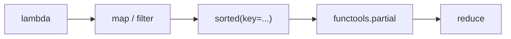

В этом уроке мы познакомимся с элементами функционального стиля: анонимными функциями `lambda` и встроенными функциями `map`, `filter`, `sorted`. С ними многие преобразования данных записываются короче и читабельнее, чем с циклами.

## Анонимные функции lambda

`lambda` — это маленькая функция без имени, которая состоит из одного выражения. В общем виде она выглядит так: `lambda аргументы: выражение`. Например:

```python
square = lambda x: x * x
print(square(5))  # 25
```

Обычная функция `def` тут ничем не хуже, но `lambda` удобно передавать прямо в другую функцию как аргумент, не заводя для неё отдельное имя. Внутри `lambda` нельзя использовать `return` — значение выражения становится результатом автоматически.

## map(): применяем функцию к каждому элементу

```python
numbers = [1, 2, 3, 4, 5]
squares = list(map(lambda x: x * x, numbers))
print(squares)  # [1, 4, 9, 16, 25]
```

`map()` «прокидывает» каждый элемент из списка через функцию. Важно: `map` возвращает ленивый итератор, поэтому чтобы увидеть результат, оборачиваем его в `list()`.

## filter(): отбираем элементы по условию

```python
numbers = [1, 2, 3, 4, 5, 6]
evens = list(filter(lambda x: x % 2 == 0, numbers))
print(evens)  # [2, 4, 6]
```

`filter()` оставляет только те элементы, для которых функция вернула `True`.

## sorted(): сортировка с ключом

`sorted()` возвращает новый отсортированный список, не меняя исходный. Параметр `key` задаёт функцию, по результату которой сравниваются элементы:

```python
people = [("Аня", 25), ("Боря", 19), ("Витя", 30)]
by_age = sorted(people, key=lambda person: person[1])
print(by_age)  # [("Боря", 19), ("Аня", 25), ("Витя", 30)]
```

Если нужен обратный порядок — добавь `reverse=True`.

## Комбинируем функции

Эти функции отлично работают вместе: например, оставить только чётные числа, возвести их в квадрат и отсортировать по убыванию:

```python
nums = [3, 1, 4, 1, 5, 9, 2, 6]
result = sorted(map(lambda x: x * x, filter(lambda x: x % 2 == 0, nums)), reverse=True)
print(result)  # [36, 16, 4]
```

Читать такие цепочки можно справа налево: сначала фильтруем, потом преобразуем, потом сортируем.



## Итог урока

Мы узнали:

- `lambda` — короткая анонимная функция из одного выражения;
- `map()` — применить функцию к каждому элементу;
- `filter()` — отобрать элементы по условию;
- `sorted()` — отсортировать с ключом `key` и флагом `reverse`;
- эти функции легко выстраивать в цепочки.

Закрепим практикой.

<!--TASK-->
### Задача 1
Дан список товаров, где каждый товар — кортеж из названия и цены:

```python
products = [
    ("кофе", 450),
    ("чай", 250),
    ("молоко", 89),
    ("сыр", 520),
]
```

Напиши программу, которая с помощью `filter`, `map` и `sorted` (без циклов для обработки; цикл допустим только для печати):

1. оставит только товары дешевле 300 рублей;
2. отсортирует их по цене по возрастанию;
3. превратит каждый в строку вида `"молоко — 89 ₽"`;
4. выведет получившиеся строки по одной на экран.

Ожидаемый вывод:

```
молоко — 89 ₽
чай — 250 ₽
```

### Задача 2
Дан список чисел от 1 до 10 включительно:

```python
numbers = [1, 2, 3, 4, 5, 6, 7, 8, 9, 10]
```

Напиши программу, которая с помощью `filter` оставит только нечётные числа, с помощью `map` возведёт их в квадрат, а затем выведет получившийся список. Обработку сделай без явных циклов (цикл допустим только для печати). Ожидаемый вывод:

```
[1, 9, 25, 49, 81]
```

### Задача 3
Дан список слов:

```python
words = ["кот", "собака", "я", "тигр", "лошадь"]
```

Напиши программу, которая отсортирует слова по длине — от короткого к длинному — с помощью `sorted` и параметра `key=len`, и выведет результат. Добавь комментарий: почему слова одинаковой длины остаются в исходном порядке. Ожидаемый вывод:

```
['я', 'кот', 'тигр', 'собака', 'лошадь']
```

### Задача 4
Дан словарь цен:

```python
prices = {"кофе": 450, "чай": 250, "молоко": 89}
```

Напиши программу, которая с помощью `map` поднимет каждую цену на 10% (округлив до целого через `round`) и соберёт новый словарь. Выведи его. Подсказка: метод `.items()` даёт пары «ключ — значение», а `dict()` может собрать словарь из списка пар. Ожидаемый вывод:

```
{'кофе': 495, 'чай': 275, 'молоко': 98}
```

### Задача 5
Дан список учеников с оценками — кортежи «имя, балл»:

```python
students = [
    ("Аня", 4.5),
    ("Боря", 3.8),
    ("Витя", 5.0),
    ("Галя", 4.2),
]
```

Напиши программу, которая:

1. оставит только учеников с баллом не ниже 4.0 (через `filter`);
2. отсортирует их по баллу по убыванию (через `sorted` и `reverse=True`);
3. превратит каждый кортеж в строку вида `"Аня: 4.5"` (через `map`);
4. выведет строки по одной на экран.

Ожидаемый вывод:

```
Витя: 5.0
Аня: 4.5
Галя: 4.2
```
### Задача 6 — partial с фиксированными аргументами
Используй `functools.partial` чтобы создать `power2 = partial(pow, exp=2)`, затем вычисли `power2(5)` и `power2(7)`. Ожидаемый вывод: `25` и `49`. Объясни, чем partial отличается от lambda.
### Задача 7 — reduce и свёртка
Напиши `from functools import reduce` и вычисли произведение всех чисел списка `[1, 2, 3, 4, 5]` через `reduce(lambda a, b: a * b, numbers)`. Реализуй то же циклом и сравни. Ожидаемый результат: `120` в обоих случаях.

<!--/TASK-->

<!--HINT-->
### Подсказка 1
Выстрой цепочку: сначала `filter` по цене, потом `sorted` с `key=lambda item: item[1]`, потом `map` для форматирования строки. Не забудь завернуть результат `map` в `for`-цикл для печати или в `list()` — иначе увидишь объект-итератор.

### Подсказка 2
Сначала отбери нечётные: `filter(lambda x: x % 2 == 1, numbers)`. Затем передай результат прямо в `map(lambda x: x * x, ...)`. Осталось обернуть всё в `list()` и напечатать.

### Подсказка 3
`sorted(words, key=len)` — функция `len` и есть ключ. Чтобы ответить на вопрос о равных длинах, вспомни: `sorted` — устойчивая (stable) сортировка, она сохраняет порядок равных элементов.

### Подсказка 4
Работай с парами: `map(lambda pair: (pair[0], round(pair[1] * 1.1)), prices.items())`. Это даст список пар, а `dict(...)` превратит его в словарь. Иди по шагам: сначала выведи результат `map` списком, потом склей в словарь.

### Подсказка 5
Двигайся слева направо: `filter` по второму элементу кортежа (`s[1] >= 4.0`), затем `sorted` с `key=lambda s: s[1]` и `reverse=True`, затем `map`, который форматирует строку через f-строку. Не забудь порядок аргументов: `sorted(..., key=..., reverse=True)`.
### Подсказка 6
`partial(func, exp=2)` возвращает новую функцию с частью аргументов зафиксированной. Вызов `power2(5)` = pow(5, exp=2).
### Подсказка 7
`reduce(f, seq)` последовательно применяет f к накопителю и следующему элементу: (1·2)·3·4·5.

<!--/HINT-->

<!--SOLUTION-->
### Разбор 1
Одно из возможных решений:

```python
products = [
    ("кофе", 450),
    ("чай", 250),
    ("молоко", 89),
    ("сыр", 520),
]

# Шаг 1: оставляем только товары дешевле 300 ₽
cheap = filter(lambda item: item[1] < 300, products)

# Шаг 2: сортируем по цене по возрастанию
cheap_sorted = sorted(cheap, key=lambda item: item[1])

# Шаг 3: превращаем каждый товар в строку
lines = map(lambda item: f"{item[0]} — {item[1]} ₽", cheap_sorted)

# Шаг 4: выводим построчно
for line in lines:
    print(line)
```

Что здесь происходит? `filter(lambda item: item[1] < 300, products)` оставляет только те кортежи, у которых цена меньше 300: останутся `("чай", 250)` и `("молоко", 89)`. Затем `sorted(cheap, key=lambda item: item[1])` упорядочивает их по второму элементу кортежа (по цене): сначала молоко (89), потом чай (250). Дальше `map` превращает каждый кортеж в красивую строку с помощью f-строки. Наконец, цикл `for` печатает строки по очереди. Результат:

```
молоко — 89 ₽
чай — 250 ₽
```

Обрати внимание: `map` возвращает ленивый итератор, поэтому мы его сразу перебираем в цикле — ничего не потеряется, а память экономится.

### Разбор 2
Решение:

```python
numbers = [1, 2, 3, 4, 5, 6, 7, 8, 9, 10]

odd = filter(lambda x: x % 2 == 1, numbers)
squares = map(lambda x: x * x, odd)
print(list(squares))
```

Разберём по шагам. `filter(lambda x: x % 2 == 1, numbers)` применяет к каждому числу проверку `x % 2 == 1`: остаток от деления на 2 равен 1 для нечётных чисел. Так отбираются 1, 3, 5, 7, 9. Дальше `map(lambda x: x * x, odd)` берёт каждый отобранный элемент и применяет к нему функцию `x * x`. Число передаётся в лямбду как `x`, возвращается квадрат. Наконец `list(squares)` материализует ленивый итератор в обычный список, чтобы его можно было напечатать.

Вывод:

```
[1, 9, 25, 49, 81]
```

Обрати внимание: мы не писали ни одного цикла для обработки — цепочка `filter` → `map` сделала всё сама, а код стал короче и нагляднее.

### Разбор 3
Решение:

```python
words = ["кот", "собака", "я", "тигр", "лошадь"]

sorted_words = sorted(words, key=len)
print(sorted_words)
# sorted — устойчивая сортировка: слова равной длины
# остаются в исходном порядке (собака раньше лошади).
```

Как это работает? `sorted(words, key=len)` для каждого слова вычисляет его длину функцией `len` и сравнивает слова именно по этой длине, а не лексикографически. Длины: «кот» — 3, «собака» — 6, «я» — 1, «тигр» — 4, «лошадь» — 6. По возрастанию: 1 («я»), 3 («кот»), 4 («тигр»), 6 («собака» и «лошадь»). Так как `sorted` — устойчивая сортировка, два слова одинаковой длины (6) сохраняют свой исходный порядок: «собака» идёт раньше «лошади». Именно поэтому в выводе «собака» стоит перед «лошадью».

Вывод:

```
['я', 'кот', 'тигр', 'собака', 'лошадь']
```

Запомни: параметр `key` принимает любую функцию — не только `len`, но и `lambda`, и методы объектов.

### Разбор 4
Решение:

```python
prices = {"кофе": 450, "чай": 250, "молоко": 89}

raised = dict(
    map(lambda pair: (pair[0], round(pair[1] * 1.1)), prices.items())
)
print(raised)
```

Шаг за шагом. `prices.items()` возвращает пары «ключ — значение»: `("кофе", 450)`, `("чай", 250)`, `("молоко", 89)`. `map` применяет к каждой паре лямбду: она берёт первый элемент пары (название) как есть, а цену умножает на 1.1 и округляет через `round`. Получается список пар: `("кофе", 495)`, `("чай", 275)`, `("молоко", 98)` — обрати внимание, что `round(97.9)` даёт 98. Наконец, `dict(...)` собирает из этих пар новый словарь. Лямбда принимает один аргумент `pair` — целый кортеж, поэтому индексы `[0]` и `[1]` достают из него нужные части.

Вывод:

```
{'кофе': 495, 'чай': 275, 'молоко': 98}
```

Такой приём «map над словарём» удобен для массового пересчёта значений: налоги, скидки, курсы валют.

### Разбор 5
Решение:

```python
students = [
    ("Аня", 4.5),
    ("Боря", 3.8),
    ("Витя", 5.0),
    ("Галя", 4.2),
]

boosted = filter(lambda s: s[1] >= 4.0, students)
sorted_by_score = sorted(boosted, key=lambda s: s[1], reverse=True)
lines = map(lambda s: f"{s[0]}: {s[1]}", sorted_by_score)

for line in lines:
    print(line)
```

Что происходит? Сначала `filter` отсеивает учеников с баллом ниже 4.0: «Боря» с 3.8 выбывает, остаются трое. Затем `sorted` с `key=lambda s: s[1]` сравнивает кортежи по второму элементу (баллу), а `reverse=True` разворачивает порядок — от максимального к минимальному: Витя (5.0), Аня (4.5), Галя (4.2). Дальше `map` превращает каждый оставшийся кортеж в строку вида `"Витя: 5.0"` через f-строку. И в конце цикл `for` печатает строки по одной.

Вывод:

```
Витя: 5.0
Аня: 4.5
Галя: 4.2
```

Обрати внимание, как читается цепочка: фильтруем → сортируем → форматируем → печатаем. Каждый шаг — отдельная функция, и код остаётся прозрачным.
### Разбор 6
```python
from functools import partial

power2 = partial(pow, exp=2)
print(power2(5))
print(power2(7))
```
Вывод: 25 и 49. partial создаёт функцию «на лету» без полноценного def и удобнее lambda при многократном использовании.
### Разбор 7
```python
from functools import reduce

numbers = [1, 2, 3, 4, 5]
print(reduce(lambda a, b: a * b, numbers))

acc = 1
for n in numbers:
    acc *= n
print(acc)
```
Вывод: 120 и 120. reduce сворачивает последовательность в одно значение; цикл делает то же самое явно.

<!--/SOLUTION-->

<!--QUIZ-->
Что вернёт map(lambda x: x * 2, [1, 2, 3]) без оборачивания в list()?
- список [2, 4, 6]
- итератор
- число 2
- None
* Правильный ответ: итератор
map возвращает ленивый итератор; чтобы получить список, его нужно обернуть в list().

Какой список вернёт list(filter(lambda x: x > 2, [1, 2, 3, 4]))?
- [1, 2]
- [3, 4]
- [1, 2, 3, 4]
- [4]
* Правильный ответ: [3, 4]
filter оставляет только элементы, для которых лямбда вернула True, то есть 3 и 4.

Что выведет print(sorted([3, 1, 2], reverse=True))?
- [1, 2, 3]
- [3, 2, 1]
- [3, 1, 2]
- [2, 1, 3]
* Правильный ответ: [3, 2, 1]
reverse=True разворачивает сортировку по убыванию.

Сколько аргументов может принимать lambda-функция?
- только один
- только два
- сколько угодно
- ни одного
* Правильный ответ: сколько угодно
lambda принимает любое число аргументов, но содержит ровно одно выражение.

Что выведет print((lambda a, b: a + b)(2, 3))?
- 23
- 5
- 6
- ошибку
* Правильный ответ: 5
Лямбда принимает 2 и 3 и возвращает их сумму — 5.

Что выведет print(list(filter(lambda x: False, [1, 2, 3])))?
- [1, 2, 3]
- [False]
- []
- None
* Правильный ответ: []
Если условие всегда ложно, filter оставляет пустой список.
Что вернёт list(map(str, [1, 2]))?
- [1, 2]
- ['1', '2']
- [('1',), ('2',)]
- Ошибка
* Правильный ответ: ['1', '2']
map применяет str к каждому элементу, превращая числа в строки.

Что выведет print(sorted([(1, "б"), (2, "а")], key=lambda p: p[1]))?
- [(1, 'б'), (2, 'а')]
- [(2, 'а'), (1, 'б')]
- [(1, 'а'), (2, 'б')]
- Ошибка
* Правильный ответ: [(2, 'а'), (1, 'б')]
Ключ сортировки — второй элемент кортежа: 'а' < 'б'.
Что делает functools.partial?
- Фиксирует часть аргументов функции, создавая новую
- Меняет аргументы на месте
- Запускает функцию
- Кэширует результат
* Правильный ответ: Фиксирует часть аргументов функции, создавая новую
partial полезен, когда нужна функция с готовыми параметрами.

Что возвращает reduce?
- Одно свёрнутое значение
- Список
- Итератор
- Кортеж
* Правильный ответ: Одно свёрнутое значение
reduce последовательно комбинирует элементы.

В чём отличие lambda от обычной функции?
- Безымянная функция для простых выражений
- Она быстрее
- Она не может принимать аргументы
- Она обязана быть в map
* Правильный ответ: Безымянная функция для простых выражений
lambda хороша для коротких одноразовых ключей и функций.

Что вернёт filter(lambda x: x > 2, [1,2,3,4])?
- [3, 4]
- [1, 2]
- Все элементы
- Пустой список
* Правильный ответ: [3, 4]
filter оставляет только элементы, для которых предикат истинен.

# 
<!--/QUIZ-->
