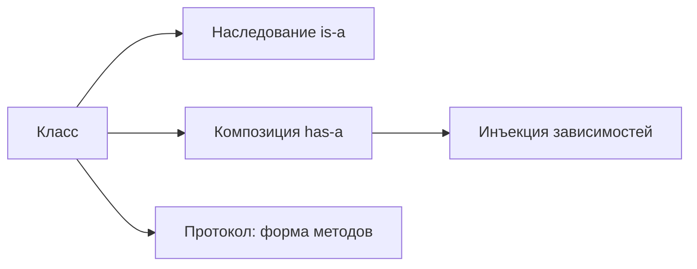

Наследование — мощный механизм, но частое создание глубоких иерархий делает код хрупким: изменение родителя ломает потомков. В этом уроке разберём альтернативы: композицию, абстрактные базовые классы и протоколы (PEP 544).

## Почему наследование не всегда лучший выбор

Наследование создаёт связь «является» (is-a). Но многие зависимости на самом деле «использует» (has-a). Классический пример: `Car(Engine)` — автомобиль не является двигателем, он его содержит. Если моделировать всё через наследование, получаются иерархии, из которых трудно вычленять детали.

Ещё одна проблема — «хрупкий базовый класс»: изменение родителя может незаметно сломать потомков. Композиция же (класс хранит объект другого класса) даёт гибкость: зависимости можно подменять.

## Абстрактные базовые классы (abc)

Модуль `abc` позволяет описать контракт класса: методы, которые обязаны реализовать наследники.

```python
from abc import ABC, abstractmethod

class Payment(ABC):
    @abstractmethod
    def pay(self, amount: int) -> str:
        """Выполнить платёж."""

class CardPayment(Payment):
    def pay(self, amount: int) -> str:
        return f"Карта: {amount}"

# Payment() — нельзя создать: абстрактный класс
```

Если наследник не реализует `pay`, создать его тоже не получится — это проверяется при инстанцировании.

## Протоколы: структурная типизация

`typing.Protocol` описывает поведение без наследования: любой объект с нужными методами автоматически удовлетворяет протоколу. Это сильнее напоминает утиную типизацию Python.

```python
from typing import Protocol

class Payable(Protocol):
    def pay(self, amount: int) -> str: ...

class Wallet:
    def pay(self, amount: int) -> str:
        return f"Кошелёк: {amount}"

def charge(p: Payable, amount: int) -> str:
    return p.pay(amount)

print(charge(Wallet(), 100))  # Кошелёк: 100
```

`Wallet` не наследует `Payable`, но структурно ему соответствует.

## Композиция на практике

Композиция — это «сборка из частей»:

```python
class Engine:
    def start(self) -> str:
        return "Двигатель запущен"

class Car:
    def __init__(self, engine: Engine):
        self._engine = engine
    def start(self) -> str:
        return self._engine.start()
```

Зависимость передаётся через конструктор — это позволяет тестировать компоненты отдельно, подставляя замены (например, mock-двигатель).

## Инъекция зависимостей

Передача зависимостей снаружи (через конструктор или параметры) называется инъекцией зависимостей (DI). Она делает код тестируемым: в тестах можно дать фейковую реализацию.

## Когда использовать что

- Наследование — для «является» и переиспользования общего поведения (например, исключения, модели).
- Абстрактные классы — когда нужен жёсткий контракт и общая реализация.
- Протоколы — когда важна форма (методы), а не происхождение.
- Композиция — для гибкой сборки и уменьшения связанности.

## Итог урока

Мы увидели ограничения наследования и три альтернативы: абстрактные классы, протоколы и композицию. Для гибкой архитектуры чаще выбирают композицию + протоколы: код легче тестировать и развивать.




<!--TASK-->
### Задача 1 — Абстрактный класс фигуры
Создай `Shape(ABC)` с абстрактным методом `area() -> float` и конкретным методом `describe()`, который возвращает строку «Фигура с площадью {area()}». Реализуй `Square` и `Circle`. Проверь, что создание экземпляра Shape невозможно (TypeError).

### Задача 2 — Протокол для чтения
Опиши `Protocol` с именем `Reader` и методом `read() -> str`. Напиши функции `process(r: Reader) -> str`, которая возвращает `r.read().upper()`. Создай класс `FileReader` без наследования от Reader и убедись, что `process(FileReader())` работает.

### Задача 3 — Композиция вместо множественного наследования
Создай классы `Flyable` (метод `fly()`) и `Swimmable` (метод `swim()`) как обычные классы с реализацией. Собери класс `Duck`, который содержит экземпляры обоих и делегирует вызовы. Покажи, как это читается лучше, чем множественное наследование.

### Задача 4 — Инъекция зависимостей
Напиши класс `Report` с методом `generate()`, который пишет в переданный writer (объект с методом write). Создай `ConsoleWriter` и `FileWriter`; покажи, что один и тот же отчёт можно вывести в консоль и в файл без изменения класса.

### Задача 5 — Валидация через протокол
Создай Protocol `Validator` с `validate(value) -> bool`. Напиши функцию `is_ok(v: Validator, value) -> bool`. Реализуй `PositiveValidator` и `LengthValidator` (для строк, длина ≥ 5). Проверь на числах и строках.

### Задача 6 — Репозиторий с DI
Напиши класс `UserService`, который принимает repository (Protocol с get_by_id) в конструкторе. Создай `MemoryRepository` и `DummyRepository`, возвращающий заглушку. Покажи, что сервис не знает о деталях хранения.

### Задача 7 — Смешанный пример: уведомления
Создай Protocol `Notifier` (метод notify(message)). Реализуй EmailNotifier и SMSNotifier. Напиши класс `AlertService`, который принимает список notifier-ов и рассылает сообщение каждому. Проверь, что можно добавить третий notifier без изменения сервиса.
<!--/TASK-->

<!--HINT-->
### Подсказка 1
Абстрактный метод: `@abstractmethod def area(self): ...`. Класс с любым абстрактным методом нельзя инстанцировать.

### Подсказка 2
Протокол объявляется как обычный класс с `(Protocol)`; методы могут содержать `...`. Структурное соответствие проверяется автоматически.

### Подсказка 3
Простое делегирование: `self.flyer.fly()` внутри метода fly() класса Duck.

### Подсказка 4
Конструктор принимает writer: `def __init__(self, writer)`; генерация вызывает `self.writer.write(...)`.

### Подсказка 5
Проверка: `bool` от результата validate. Валидаторы — обычные классы с методом validate.

### Подсказка 6
Описывай репозиторий протоколом, чтобы DummyRepository структурно подходил.

### Подсказка 7
Храни список notifier-ов в конструкторе; метод notify_all перебирает их.
<!--/HINT-->

<!--SOLUTION-->
### Разбор 1
```python
from abc import ABC, abstractmethod
import math

class Shape(ABC):
    @abstractmethod
    def area(self) -> float:
        ...

    def describe(self) -> str:
        return f"Фигура с площадью {self.area():.2f}"

class Square(Shape):
    def __init__(self, side: float):
        self.side = side
    def area(self) -> float:
        return self.side ** 2

class Circle(Shape):
    def __init__(self, radius: float):
        self.radius = radius
    def area(self) -> float:
        return math.pi * self.radius ** 2

# Shape() -> TypeError: абстрактный класс
print(Square(4).describe())
```
Вывод: «Фигура с площадью 16.00». ABC гарантирует обязательную реализацию area().

### Разбор 2
```python
from typing import Protocol

class Reader(Protocol):
    def read(self) -> str: ...

def process(r: Reader) -> str:
    return r.read().upper()

class FileReader:
    def read(self) -> str:
        return "hello"

print(process(FileReader()))
```
Вывод: HELLO. FileReader не наследует Reader, но структурно подходит — протоколы проверяют форму, не происхождение.

### Разбор 3
```python
class Flyable:
    def fly(self) -> str:
        return "лечу"

class Swimmable:
    def swim(self) -> str:
        return "плыву"

class Duck:
    def __init__(self):
        self._flyer = Flyable()
        self._swimmer = Swimmable()
    def fly(self) -> str:
        return self._flyer.fly()
    def swim(self) -> str:
        return self._swimmer.swim()

d = Duck()
print(d.fly(), d.swim())
```
Композиция читается явно: утки имеют двигатель и плаванье как независимые части.

### Разбор 4
```python
class Report:
    def __init__(self, writer):
        self._writer = writer
    def generate(self) -> None:
        self._writer.write("Годовой отчёт")

class ConsoleWriter:
    def write(self, text) -> None:
        print(text)

class FileWriter:
    def __init__(self, path):
        self.path = path
    def write(self, text) -> None:
        with open(self.path, "w", encoding="utf-8") as f:
            f.write(text)

Report(ConsoleWriter()).generate()
Report(FileWriter("report.txt")).generate()
```
Один класс отчёта работает с любым писателем — инъекция зависимости делает его независимым от конкретного вывода.

### Разбор 5
```python
from typing import Protocol

class Validator(Protocol):
    def validate(self, value) -> bool: ...

class PositiveValidator:
    def validate(self, value) -> bool:
        return isinstance(value, (int, float)) and value > 0

class LengthValidator:
    def __init__(self, min_len: int = 5):
        self.min_len = min_len
    def validate(self, value) -> bool:
        return isinstance(value, str) and len(value) >= self.min_len

def is_ok(v: Validator, value) -> bool:
    return v.validate(value)

print(is_ok(PositiveValidator(), 10))
print(is_ok(LengthValidator(), "abcd"))
```
Вывод: True, False. Протокол позволяет комбинировать проверки без общего базового класса.

### Разбор 6
```python
from typing import Protocol

class Repository(Protocol):
    def get_by_id(self, user_id: int): ...

class MemoryRepository:
    def __init__(self):
        self._data = {1: "Аня", 2: "Борис"}
    def get_by_id(self, user_id: int):
        return self._data.get(user_id)

class DummyRepository:
    def get_by_id(self, user_id: int):
        return "заглушка"

class UserService:
    def __init__(self, repo: Repository):
        self._repo = repo
    def get_name(self, user_id: int) -> str:
        user = self._repo.get_by_id(user_id)
        return user if user else "не найден"

print(UserService(MemoryRepository()).get_name(1))
print(UserService(DummyRepository()).get_name(5))
```
Вывод: Аня, заглушка. Сервис зависит от протокола, а не от конкретного хранилища.

### Разбор 7
```python
from typing import Protocol

class Notifier(Protocol):
    def notify(self, message: str) -> None: ...

class EmailNotifier:
    def notify(self, message: str) -> None:
        print(f"Email: {message}")

class SMSNotifier:
    def notify(self, message: str) -> None:
        print(f"SMS: {message}")

class AlertService:
    def __init__(self, notifiers):
        self._notifiers = notifiers
    def notify_all(self, message: str) -> None:
        for n in self._notifiers:
            n.notify(message)

AlertService([EmailNotifier(), SMSNotifier()]).notify_all("Важно!")
```
Вывод: две строки. Добавление нового канала не требует изменения сервиса.
<!--/SOLUTION-->

<!--QUIZ-->
Что запрещает абстрактный класс?
- Создание экземпляров, если не реализованы абстрактные методы
- Наследование
- Переопределение методов
- Импорт
* Правильный ответ: Создание экземпляров, если не реализованы абстрактные методы
ABC служит контрактом.

Что такое структурная типизация?
- Соответствие по форме методов, а не по наследованию
- Проверка по имени класса
- Обязательное наследование
- Строгая типизация
* Правильный ответ: Соответствие по форме методов, а не по наследованию
Протоколы проверяют наличие методов.

Что такое композиция?
- Хранение объектов других классов внутри класса
- Множественное наследование
- Копирование кода
- Удаление классов
* Правильный ответ: Хранение объектов других классов внутри класса
has-a вместо is-a.

Зачем нужна инъекция зависимостей?
- Чтобы подменять компоненты при тестировании
- Чтобы запретить импорт
- Чтобы ускорить код
- Чтобы скрыть классы
* Правильный ответ: Чтобы подменять компоненты при тестировании
Зависимости передаются снаружи.

Что из этого — протокол (PEP 544)?
- typing.Protocol
- abc.ABC
- dataclass
- Generic
* Правильный ответ: typing.Protocol
Он описывает структурный контракт.

Когда композиция лучше наследования?
- Когда связь «использует», а не «является»
- Всегда
- Никогда
- Только для исключений
* Правильный ответ: Когда связь «использует», а не «является»
Композиция снижает связанность.

Как проверить, что класс абстрактный?
- Попытаться создать экземпляр
- Вызвать type()
- Посмотреть на MRO
- Вызвать len()
* Правильный ответ: Попытаться создать экземпляр
TypeError при инстанцировании.

Можно ли удовлетворить Protocol без наследования?
- Да, достаточно нужных методов
- Нет, только через наследование
- Только с декоратором
- Только через ABC
* Правильный ответ: Да, достаточно нужных методов
Структурная типизация — по форме.

Что делает @abstractmethod?
- Помечает метод обязательным для реализации
- Удаляет метод
- Делает метод статическим
- Запрещает наследование
* Правильный ответ: Помечает метод обязательным для реализации
Наследник обязан его реализовать.

Что выведет print(charge(Wallet(), 100)) из примера с Protocol?
- Кошелёк: 100
- Ошибку
- None
- 100
* Правильный ответ: Кошелёк: 100
Wallet удовлетворяет протоколу Payable.

Что такое «хрупкий базовый класс»?
- Изменение родителя ломает потомков
- Класс с одним методом
- Невозможность наследования
- Класс без абстракций
* Правильный ответ: Изменение родителя ломает потомков
Глубокая иерархия усиливает связанность.
Что из перечисленного снижает связанность кода?
- Композиция и протоколы
- Глубокое наследование
- Глобальные переменные
- Статические методы
* Правильный ответ: Композиция и протоколы
Зависимости передаются снаружи, классы не знают чужих деталей.

Зачем нужен DummyRepository в примере?
- Для тестирования без реального хранилища
- Для ускорения продакшена
- Для удаления данных
- Для сортировки
* Правильный ответ: Для тестирования без реального хранилища
Заглушка изолирует сервис.


<!--/QUIZ-->
