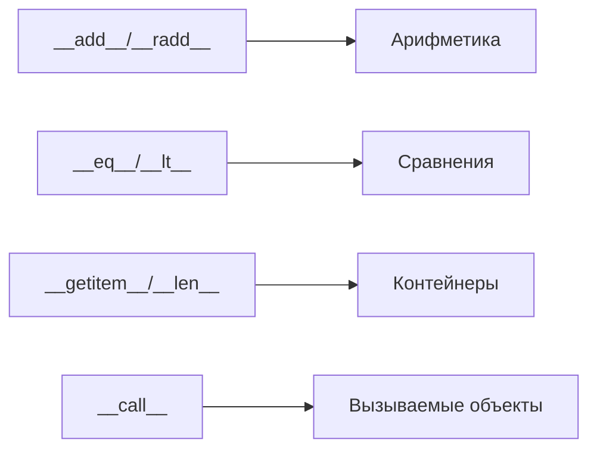

Магические (dunder) методы позволяют нашим классам вести себя как встроенные типы: складываться, сравниваться, индексироваться, вызываться. В этом уроке пройдёмся по самым важным группам — от арифметики до копирования.

## Арифметика: __add__, __radd__, __iadd__

Метод `__add__` вызывается при `a + b`, `__radd__` — при `b + a` (когда левый операнд не знает, как складывать), `__iadd__` — при `a += b`.

```python
class Money:
    def __init__(self, amount):
        self.amount = amount

    def __add__(self, other):
        if isinstance(other, Money):
            return Money(self.amount + other.amount)
        return NotImplemented

    def __radd__(self, other):
        return self.__add__(other)

    def __str__(self):
        return f"{self.amount} руб."

print(Money(10) + Money(5))       # 15 руб.
print(sum([Money(1), Money(2)]))  # 3 руб. — нужен __radd__
```

Вернуть `NotImplemented` — правильный способ сказать «я не умею складывать с этим типом»; Python попробует обратную операцию.

## Сравнения и хеширование

`__eq__` и `__lt__` достаточно для большинства сравнений (остальные Python выводит). Если мы определяем `__eq__`, обязательно определить и `__hash__` (иначе объект станет нехешируемым).

```python
class Vector:
    def __init__(self, x, y):
        self.x, self.y = x, y

    def __eq__(self, other):
        return (self.x, self.y) == (other.x, other.y)

    def __lt__(self, other):
        return (self.x, self.y) < (other.x, other.y)

    def __hash__(self):
        return hash((self.x, self.y))
```

## Индексация и итерация

`__getitem__`, `__setitem__`, `__len__`, `__iter__` делают объект похожим на контейнер.

## Вызов объекта: __call__

`__call__` позволяет вызывать экземпляр как функцию — удобно для «фабрик» и декораторов с состоянием.

## Контекстные менеджеры

`__enter__` / `__exit__` мы уже видели. Напомним главное: `__exit__` обязан корректно закрывать ресурс.

## Копирование: __copy__ и __deepcopy__

Модуль `copy` использует эти методы для кастомного копирования. По умолчанию `copy.copy` — поверхностное копирование, `copy.deepcopy` — рекурсивное.

## Подписка и другие

`__getattr__` вызывается, когда обычный поиск атрибута не удался; `__setattr__` — при присваивании. Они дают контроль над доступом.

## Итог урока

Dunder-методы делают класс «гражданином первого класса»: арифметика, сравнения, контейнеры, вызовы и контекст работают как у встроенных типов. Главное правило — возвращать `NotImplemented` для чужих типов и не забывать про `__hash__` рядом с `__eq__`.




<!--TASK-->
### Задача 1 — Вектор с арифметикой
Создай класс Vector с x, y и методами `__add__`, `__sub__`, `__mul__` (скаляр), `__abs__` (длина = sqrt(x²+y²)). Проверь сложение, вычитание, умножение на число и abs.

### Задача 2 — Сравнения и сортировка
Добавь Vector методы `__eq__` и `__lt__`. Создай список из четырёх векторов и отсортируй его через sorted(). Выведи отсортированный список как кортежи.

### Задача 3 — Хешируемый вектор
Определи `__hash__` и проверь, что Vector можно положить в set и использовать как ключ словаря. Покажи, что равные векторы дают один ключ.

### Задача 4 — Контейнер: обёртка над списком
Создай класс SmartList с методами `__getitem__`, `__setitem__`, `__len__`, `__repr__`. Проверь чтение, запись, len и repr.

### Задача 5 — Счётчик вызовов через __call__
Создай класс CallCounter: `__call__(func)` возвращает обёртку, которая считает вызовы функции, а затем — свойство count. Проверь: вызови функцию 3 раза и выведи count.

### Задача 6 — Копирование векторов
Реализуй `__copy__` и `__deepcopy__` для Vector. Проверь, что deepcopy создаёт независимый объект и что изменение копии не влияет на оригинал.

### Задача 7 — Умный атрибут
Создай класс Temperature с `__setattr__`: допускай значения от -273.15; иначе бросай ValueError. Также добавь `__getattr__` для отсутствующих атрибутов, возвращающий None.
<!--/TASK-->

<!--HINT-->
### Подсказка 1
Импортируй math. В __mul__ проверь, что other — число (isinstance), иначе NotImplemented.

### Подсказка 2
__lt__ сравнивай по кортежу (x, y). sorted() использует __lt__.

### Подсказка 3
`hash((self.x, self.y))` — хеш кортежа. Равные кортежи → равные хеши.

### Подсказка 4
Храни внутренний список self._items; делегируй методы.

### Подсказка 5
В __call__ оберни func: def wrapper(*args, **kwargs): self.count += 1; return func(*args, **kwargs).

### Подсказка 6
__copy__ возвращает Vector(self.x, self.y). __deepcopy__ — то же самое (поля неизменяемы).

### Подсказка 7
Проверяй значение до setattr; для неизвестных атрибутов возвращай None.
<!--/HINT-->

<!--SOLUTION-->
### Разбор 1
```python
import math

class Vector:
    def __init__(self, x, y):
        self.x, self.y = x, y

    def __add__(self, other):
        return Vector(self.x + other.x, self.y + other.y)

    def __sub__(self, other):
        return Vector(self.x - other.x, self.y - other.y)

    def __mul__(self, scalar):
        if isinstance(scalar, (int, float)):
            return Vector(self.x * scalar, self.y * scalar)
        return NotImplemented

    def __abs__(self):
        return math.hypot(self.x, self.y)

    def __repr__(self):
        return f"Vector({self.x}, {self.y})"

v1 = Vector(1, 2); v2 = Vector(3, 4)
print(v1 + v2)   # Vector(4, 6)
print(v1 * 2)    # Vector(2, 4)
print(abs(v1))   # 2.236...
```
NotImplemented для чужих типов позволяет Python попробовать обратную операцию.

### Разбор 2
```python
class Vector:
    # ... предыдущие методы ...
    def __eq__(self, other):
        return (self.x, self.y) == (other.x, other.y)

    def __lt__(self, other):
        return (self.x, self.y) < (other.x, other.y)

vecs = [Vector(3, 1), Vector(1, 1), Vector(2, 2), Vector(0, 5)]
print([tuple(v.__dict__.values()) for v in sorted(vecs)])
```
Вывод: [(0, 5), (1, 1), (2, 2), (3, 1)] по лексикографическому порядку кортежей.

### Разбор 3
```python
class Vector:
    # ...
    def __hash__(self):
        return hash((self.x, self.y))

s = {Vector(1, 1), Vector(1, 1), Vector(2, 3)}
print(len(s))  # 2
```
Равные векторы дают один и тот же хеш, поэтому в множестве не дублируются.

### Разбор 4
```python
class SmartList:
    def __init__(self, items=None):
        self._items = list(items or [])
    def __getitem__(self, index):
        return self._items[index]
    def __setitem__(self, index, value):
        self._items[index] = value
    def __len__(self):
        return len(self._items)
    def __repr__(self):
        return repr(self._items)

sl = SmartList([1, 2, 3])
sl[0] = 10
print(sl[0], len(sl), sl)  # 10 3 [10, 2, 3]
```
Контейнерное поведение даёт привычный синтаксис.

### Разбор 5
```python
class CallCounter:
    def __init__(self):
        self.count = 0
    def __call__(self, func):
        def wrapper(*args, **kwargs):
            self.count += 1
            return func(*args, **kwargs)
        return wrapper

cc = CallCounter()

@cc
def hello():
    return "hi"

hello(); hello(); hello()
print(cc.count)  # 3
```
__call__ делает объект вызываемым — удобно для декораторов с состоянием.

### Разбор 6
```python
import copy

class Vector:
    # ...
    def __copy__(self):
        return Vector(self.x, self.y)

    def __deepcopy__(self, memo):
        return Vector(self.x, self.y)

v = Vector(1, 2)
w = copy.deepcopy(v)
w.x = 100
print(v.x)  # 1 — оригинал не изменился
```
Кастомное копирование полезно для объектов с «тяжёлыми» внутренностями.

### Разбор 7
```python
class Temperature:
    def __setattr__(self, name, value):
        if name == "celsius" and value < -273.15:
            raise ValueError("Ниже абсолютного нуля")
        super().__setattr__(name, value)

    def __getattr__(self, name):
        return None

t = Temperature()
t.celsius = 25
print(t.celsius)    # 25
print(t.humidity)   # None
# t.celsius = -300  # ValueError
```
__setattr__ даёт контроль над присваиванием, __getattr__ — путь для отсутствующих атрибутов.
<!--/SOLUTION-->

<!--QUIZ-->
Какой метод вызывается при a + b?
- __add__
- __radd__
- __sum__
- __plus__
* Правильный ответ: __add__
Метод левого операнда.

Что вернуть, если тип не поддерживается?
- NotImplemented
- None
- False
- 0
* Правильный ответ: NotImplemented
Python попробует __radd__ или сообщит об ошибке.

Зачем определять __hash__, если есть __eq__?
- Чтобы объект оставался хешируемым
- Чтобы ускорить сравнение
- Чтобы запретить set
- Не нужно
* Правильный ответ: Чтобы объект оставался хешируемым
Переопределение __eq__ без __hash__ делает объект нехешируемым.

Что делает __call__?
- Делает экземпляр вызываемым как функцию
- Создаёт поток
- Вызывает __init__
- Возвращает класс
* Правильный ответ: Делает экземпляр вызываемым как функцию
v(args) запускает __call__.

Что делает __deepcopy__?
- Рекурсивно копирует объект
- Копирует ссылки
- Удаляет объект
- Сравнивает объекты
* Правильный ответ: Рекурсивно копирует объект
Вложенные объекты копируются независимо.

Что делает __getattr__?
- Вызывается при отсутствии атрибута
- Всегда вызывается при чтении
- Удаляет атрибуты
- Запрещает доступ
* Правильный ответ: Вызывается при отсутствии атрибута
Если обычный поиск не удался.

Какой метод отвечает за a += b?
- __iadd__
- __add__
- __inc__
- __plus__
* Правильный ответ: __iadd__
Изменение на месте (если реализовано).

Что вернёт abs(v), если определён __abs__?
- Модуль вектора
- Кортеж
- Строку
- Ничего
* Правильный ответ: Модуль вектора
__abs__ вызывается функцией abs().

Как сделать контейнер с len()?
- Реализовать __len__
- Реализовать __iter__
- Реализовать __getitem__
- Ничего
* Правильный ответ: Реализовать __len__
len(obj) требует __len__.

Почему нельзя забывать __hash__ рядом с __eq__?
- Нарушается контракт словарей и множеств
- Ускоряется код
- Запрещается наследование
- Ничего страшного
* Правильный ответ: Нарушается контракт словарей и множеств
Словарь использует __hash__ для поиска.
Как заставить объект вести себя как функцию?
- Реализовать __call__
- Реализовать __init__
- Наследовать от function
- Использовать декоратор
* Правильный ответ: Реализовать __call__
Вызов экземпляра срабатывает.

Что делает __getitem__?
- Позволяет обращение по индексу/ключу
- Создаёт элемент
- Удаляет элемент
- Сравнивает
* Правильный ответ: Позволяет обращение по индексу/ключу
obj[idx] вызывает __getitem__(idx).


<!--/QUIZ-->
