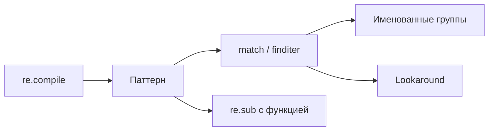

Модуль `re` — стандартный инструмент Python для работы с текстом по шаблону. В этом уроке разберём запас приёмов, которых не хватает новичкам: продвинутые группы, просмотр вперёд/назад, флаги, эффективная замена и производительность.

## Именованные группы

```python
import re
m = re.search(r"(?P<year>\d{4})-(?P<month>\d{2})", "2026-11")
print(m.group("year"), m.group("month"))
```

## Lookahead и lookbehind

- `(?=...)` — впереди есть паттерн;
- `(?!...)` — впереди нет;
- `(?<=...)` — позади есть;
- `(?<!...)` — позади нет.

```python
re.findall(r"\d+(?= руб)", "цена 100 руб, 200 долл")  # ['100']
```

## Флаги

`re.IGNORECASE`, `re.MULTILINE`, `re.DOTALL` (точка с переносами), `re.VERBOSE` (читаемый паттерн с комментариями).

## Замена с функцией

```python
re.sub(r"\d+", lambda m: str(int(m.group()) * 2), "10 и 20")  # '20 и 40'
```

## Компиляция

`re.compile` переиспользует паттерн и упрощает код:

```python
pattern = re.compile(r"\b\w{4}\b")
```

## Производительность

- Компилируйте один раз;
- избегайте катастрофического отката (вложенные квантификаторы);
- при массовой обработке используйте `finditer` вместо `findall`, если памяти мало.

## Итог урока

Regex-мастерство — работа с текстом на уровне профессионала: точные извлечения, валидация и замена без ручной возни.




## Когда регулярки — лучший выбор

Регулярные выражения идеальны для строгих форматов: номера телефонов, email, даты, коды заказов, теги в логах. Они превращают десятки строк ручных проверок в один компактный паттерн.

Однако для парсинга вложенных структур (HTML, JSON) регулярки не подходят — там нужны настоящие парсеры. Всегда задавайте себе вопрос: «Это регулярный язык или нет?». Если строка имеет рекурсивную структуру — регекс не поможет.

Для массовой обработки больших файлов не забывайте про `finditer`, который не строит весь список в памяти. А для отладки сложных паттернов используйте онлайн-тестеры: они подсвечивают совпадения и показывают группы.


<!--TASK-->
### Задача 1 — Именованные группы
Из строки «Иван 25 лет, Анна 30 лет» извлеки пары (имя, возраст) с именованными группами. Выведи словари.

### Задача 2 — Lookahead
Найди все числа, перед которыми идёт «руб» (например, «5 руб, 10 долл, 7 руб» → 5, 7).

### Задача 3 — Lookbehind
Найди числа, после которых идёт «%» через (?<=...) или наоборот, и объясни разницу.

### Задача 4 — Флаги
Примени re.MULTILINE: найди строки, начинающиеся с «TODO» в многострочном тексте. Покажи результат.

### Задача 5 — re.VERBOSE
Напиши сложный паттерн (дата с разделителями) в VERBOSE-режиме с комментариями. Проверь на трёх датах.

### Задача 6 — Замена функцией
Удвой все числа в строке через re.sub с lambda. Покажи вход и выход.

### Задача 7 — Компиляция и поиск
Скомпилируй паттерн email и найди все email в тексте через finditer (выведи start/end каждого).
<!--/TASK-->

<!--HINT-->
### Подсказка 1
r"(?P<name>\w+) (?P<age>\d+) лет" — потом m.group("name").

### Подсказка 2
r"\d+(?= руб)" — числа перед « руб».

### Подсказка 3
r"(?<=руб )\d+" — числа после «руб ».

### Подсказка 4
r"^TODO.*" с flags=re.MULTILINE.

### Подсказка 5
re.compile(r""" (?P<d>\d{2}) (?P<sep>[-/]) (?P<m>\d{2}) ... """, re.VERBOSE).

### Подсказка 6
re.sub(r"\d+", lambda m: str(int(m.group()) * 2), text).

### Подсказка 7
re.compile(r"\b[\w.-]+@[\w.-]+\.\w+\b"); .finditer(text).
<!--/HINT-->

<!--SOLUTION-->
### Разбор 1
```python
import re

text = "Иван 25 лет, Анна 30 лет"
pattern = re.compile(r"(?P<name>\w+) (?P<age>\d+) лет")
for m in pattern.finditer(text):
    print(m.groupdict())
```
Вывод: {'name': 'Иван', 'age': '25'} и {'name': 'Анна', 'age': '30'}.

### Разбор 2
```python
text = "5 руб, 10 долл, 7 руб"
print(re.findall(r"\d+(?= руб)", text))  # ['5', '7']
```
Lookahead не включает « руб» в совпадение.

### Разбор 3
```python
text = "руб 5, долл 10"
print(re.findall(r"(?<=руб )\d+", text))  # ['5']
```
Lookbehind проверяет, что перед числом стоит «руб ».

### Разбор 4
```python
text = "TODO: починить\nобычная строка\nTODO: проверить"
print(re.findall(r"^TODO.*", text, flags=re.MULTILINE))
```
MULTILINE позволяет ^/$ работать по строкам.

### Разбор 5
```python
pattern = re.compile(r"""
    (?P<day>\d{2})   # день
    [-/]             # разделитель
    (?P<month>\d{2}) # месяц
    [-/]
    (?P<year>\d{4})  # год
""", re.VERBOSE)

for d in ("25-01-2026", "01/12/2025", "31.12.2024"):
    m = pattern.search(d)
    print(m.groupdict() if m else None)
```
VERBOSE позволяет читаемый паттерн с комментариями.

### Разбор 6
```python
text = "10 и 20"
print(re.sub(r"\d+", lambda m: str(int(m.group()) * 2), text))  # '20 и 40'
```
Функция получает match и возвращает замену.

### Разбор 7
```python
pattern = re.compile(r"\b[\w.-]+@[\w.-]+\.\w+\b")
for m in pattern.finditer("Контакты: a@test.ru и b@example.org"):
    print(m.group(), m.start(), m.end())
```
finditer отдаёт объекты match с позициями.
<!--/SOLUTION-->

<!--QUIZ-->
Как назвать группу?
- (?P<имя>...)
- (?<имя>...)
- (имя:...)
- (?P=имя)
* Правильный ответ: (?P<имя>...)
Обращение через m.group("имя").

Что такое lookahead?
- Проверка, что дальше идёт паттерн, без захвата
- Захват группы
- Флаг
- Замена
* Правильный ответ: Проверка, что дальше идёт паттерн, без захвата
(?=...) не входит в результат.

Что делает re.MULTILINE?
- Позволяет ^ и $ работать по строкам
- Игнорирует регистр
- Точка включает переносы
- Ничего
* Правильный ответ: Позволяет ^ и $ работать по строкам
Границы строк.

Что делает re.VERBOSE?
- Позволяет комментарии и пробелы в паттерне
- Ускоряет
- Включает юникод
- Отключает группы
* Правильный ответ: Позволяет комментарии и пробелы в паттерне
Читаемость сложных паттернов.

Можно ли передать функцию в re.sub?
- Да, она получает match и возвращает замену
- Нет
- Только строку
- Только число
* Правильный ответ: Да, она получает match и возвращает замену
Гибкая подстановка.

Что делает re.compile?
- Компилирует паттерн в объект для переиспользования
- Находит совпадение
- Заменяет
- Удаляет
* Правильный ответ: Компилирует паттерн в объект для переиспользования
Ускоряет и упрощает код.

Что такое катастрофический откат?
- Экспоненциальная деградация из-за вложенных квантификаторов
- Ошибка памяти
- Исключение
- Быстрый возврат
* Правильный ответ: Экспоненциальная деградация из-за вложенных квантификаторов
Пример: (a+)+.

Как искать без создания большого списка?
- Через finditer
- Через findall
- Через split
- Через sub
* Правильный ответ: Через finditer
Итератор объектов match.

Что делает (?<=...)?
- Проверяет текст перед совпадением
- Впереди
- Захват
- Именование
* Правильный ответ: Проверяет текст перед совпадением
Lookbehind.

Какой флаг игнорирует регистр?
- re.IGNORECASE
- re.MULTILINE
- re.DOTALL
- re.VERBOSE
* Правильный ответ: re.IGNORECASE
Сравнение без учёта регистра.
Как найти все вхождения с позициями?
- Через finditer
- Через match
- Через split
- Через sub
* Правильный ответ: Через finditer
Каждый объект match знает start() и end().

Что делает ре.IO?? (если встречается)
- Константа не существует — путаница с re.IGNORECASE
- Включает байты
- Ускоряет
- Заменяет
* Правильный ответ: Константа не существует — путаница с re.IGNORECASE
Правильное имя — re.IGNORECASE.


<!--/QUIZ-->
