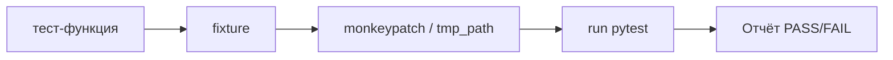

Ты наверняка знаком с ситуацией: дописал функцию, всё работает — а через неделю после правки что-то сломалось. Автоматические тесты решают эту проблему: они запускаются за секунды и сразу говорят, какая функция ведёт себя не так. В Python стандарт де-факто — фреймворк `pytest`. Его нужно установить: `pip install pytest`.

## Как устроен тест

Тест — это обычная функция, имя которой начинается с `test_`. Внутри — проверки через `assert`:

```python
def add(a, b):
    return a + b

def test_add():
    assert add(2, 3) == 5
```

Если `assert` вернёт `False`, pytest сообщит, какой тест упал и с какими значениями. Запуск — из терминала:

```bash
python -m pytest
```

pytest сам найдёт все файлы вида `test_*.py` и функции `test_*` в текущей папке.

## Полезные флаги

```bash
python -m pytest -v                    # подробный вывод по каждому тесту
python -m pytest test_discount.py       # только конкретный файл
python -m pytest -k "discount"          # тесты, в имени которых есть слово
python -m pytest --maxfail=1            # остановиться после первой ошибки
```

## Параметризация

Если нужно проверить функцию на многих наборах данных, не пиши десять почти одинаковых функций — используй `@pytest.mark.parametrize`:

```python
import pytest

@pytest.mark.parametrize("a,b,expected", [
    (2, 3, 5),
    (-1, 1, 0),
    (0, 0, 0),
])
def test_add_parametrized(a, b, expected):
    assert add(a, b) == expected
```

pytest выполнит этот тест трижды — по одному разу на каждый набор аргументов.

## Проверка исключений

Если функция должна бросать исключение, ожидай его через `pytest.raises`:

```python
def divide(a, b):
    if b == 0:
        raise ValueError("деление на ноль")
    return a / b

def test_divide_by_zero():
    with pytest.raises(ValueError):
        divide(10, 0)
```

Тест пройдёт, только если внутри блока `with` действительно возникнет `ValueError`.

## Фикстуры

Фикстура (fixture) — это подготовка данных, которой пользуются несколько тестов. Она помечается `@pytest.fixture` и передаётся тесту как аргумент:

```python
@pytest.fixture
def numbers():
    return [3, 1, 2]

def test_sorted(numbers):
    assert sorted(numbers) == [1, 2, 3]
```

Фикстуры можно складывать в общий файл `conftest.py`, чтобы ими пользовались все тесты проекта.



## Итог урока

Мы узнали, как писать тесты на pytest: функции `test_*`, проверки `assert`, параметризация, `pytest.raises` для исключений и фикстуры для подготовки данных. Теперь напишем тесты для настоящей функции.

<!--TASK-->
### Задача 1
Напиши функцию `calc_discount(price, discount)`, которая возвращает цену со скидкой по формуле `price * (1 - discount / 100)`. Правила: если `price` отрицательная — `ValueError`; если `discount` не в диапазоне от 0 до 100 — `ValueError`.

Создай файл `test_discount.py` с тестами:

1. Параметризованный тест для обычных случаев: `(200, 10, 180.0)`, `(100, 0, 100.0)`, `(50, 100, 0.0)`, `(80, 25, 60.0)`;
2. Тест: скидка 150 вызывает `ValueError`;
3. Тест: отрицательная цена вызывает `ValueError`.

Запусти `python -m pytest test_discount.py -v` и добейся, чтобы все тесты прошли.

Ожидаемый результат: pytest сообщает о 6 пройденных тестах (4 параметризованных + 2 на ошибки) без единой ошибки.

### Задача 2
Напиши функцию `is_palindrome(s)`, которая возвращает `True`, если строка читается одинаково слева направо и справа налево, игнорируя регистр и пробелы. Пустая строка считается палиндромом.

Создай файл `test_palindrome.py` с параметризованным тестом для случаев: `("", True)`, `("а", True)`, `("казак", True)`, `("А роза упала на лапу Азора", True)`, `("питон", False)`, `("abc", False)`.

Ожидаемый результат: `python -m pytest test_palindrome.py -v` показывает 6 пройденных тестов.

### Задача 3
Напиши функцию `parse_int(text)`, которая возвращает целое число из строки, а если преобразовать нельзя — бросает `ValueError` с сообщением, содержащим слово `не число`.

Создай файл `test_parse_int.py`:

1. Тест: `parse_int("42") == 42`;
2. Тест: `parse_int("-7") == -7`;
3. Тест: `parse_int("abc")` бросает `ValueError`;
4. Тест: сообщение ошибки содержит слово `не число` (используй `match="не число"` в `pytest.raises`).

Ожидаемый результат: 4 пройденных теста, в том числе проверка текста сообщения об ошибке.

### Задача 4
Напиши фикстуру `numbers`, которая возвращает список `[3, 1, 2]`, и два теста в файле `test_fixture.py`:

1. `test_sorted` — проверяет, что `sorted(numbers) == [1, 2, 3]`;
2. `test_sum` — проверяет, что `sum(numbers) == 6`.

Фикстуру оформь через `@pytest.fixture`. Ожидаемый результат: 2 пройденных теста, причём оба используют одни и те же подготовленные данные.

### Задача 5
Вынеси фикстуру в общий файл `conftest.py`:

1. В `conftest.py` определи фикстуру `sample_text`, возвращающую строку `"питон код питон"`;
2. Создай два файла тестов: `test_text_stats.py` и `test_text_length.py`;
3. В первом — тест, что слово `питон` встречается в `sample_text` ровно 2 раза (`sample_text.split().count("питон") == 2`);
4. Во втором — тест, что длина `sample_text` равна 14 символов.

Ожидаемый результат: `python -m pytest` находит фикстуру из `conftest.py` и прогоняет оба теста.
### Задача 6 — Фикстура tmp_path
Напиши тест, который создаёт во временной папке `tmp_path` файл `data.txt`, записывает строку, читает её и проверяет содержимое. Используй фикстуру `tmp_path` pytest. Ожидаемый результат: тест проходит; файл не остаётся после прогона.
### Задача 7 — monkeypatch для замены функции
Напиши функцию `get_weather()` (возвращает строку), и тест, который через `monkeypatch.setattr` подменяет её на заглушку, возвращающую `"sunny"`. Проверь, что основной код использует подменённое значение. Ожидаемый результат: тест зелёный, оригинальная функция не вызывалась.

<!--/TASK-->

<!--HINT-->
### Подсказка 1
Для параметризации используй `@pytest.mark.parametrize("price,discount,expected", [...])`. Для проверки ошибок — `with pytest.raises(ValueError): calc_discount(...)`. Обрати внимание на тип результата: деление в Python возвращает `float`, поэтому сравнивай со значениями вроде `180.0`.

### Подсказка 2
Перед сравнением приводи строку к нижнему регистру через `s.lower()` и удаляй пробелы через `s.replace(" ", "")`. Параметризуй по кортежам `(text, expected)`: `@pytest.mark.parametrize("text,expected", [...])`. В теле теста пиши `assert is_palindrome(text) == expected`.

### Подсказка 3
Реализуй `parse_int` через `int(text)` внутри `try/except ValueError` и поднимай своё `ValueError("не число: " + text)`. Для проверки текста ошибки используй `with pytest.raises(ValueError, match="не число")`.

### Подсказка 4
Фикстура — это функция с декоратором `@pytest.fixture`, возвращающая данные; имя фикстуры передаётся тесту как параметр. Так `def test_sorted(numbers)` получит список из фикстуры. Фикстура выполняется заново для каждого теста, но это не проблема — данные одни и те же.

### Подсказка 5
`conftest.py` — обычный файл рядом с тестами; pytest автоматически находит фикстуры в нём, импортировать ничего не нужно. Создай его в той же папке, что и `test_*.py`, и убери фикстуру из тестовых файлов. Проверь запуском `python -m pytest` из этой папки.
### Подсказка 6
`tmp_path` — встроенная фикстура: `pathlib.Path`. Пиши `(tmp_path / "data.txt").write_text(...)`, читай обратно.
### Подсказка 7
`monkeypatch.setattr(module, "get_weather", lambda: "sunny")` — после этого вызов внутри тестируемого кода вернёт "sunny".

<!--/HINT-->

<!--SOLUTION-->
### Разбор 1
Функция в файле `discount.py`:

```python
def calc_discount(price, discount):
    if price < 0:
        raise ValueError("Цена не может быть отрицательной")
    if not 0 <= discount <= 100:
        raise ValueError("Скидка должна быть от 0 до 100")
    return price * (1 - discount / 100)
```

Тесты в файле `test_discount.py`:

```python
import pytest
from discount import calc_discount

@pytest.mark.parametrize("price,discount,expected", [
    (200, 10, 180.0),
    (100, 0, 100.0),
    (50, 100, 0.0),
    (80, 25, 60.0),
])
def test_calc_discount(price, discount, expected):
    assert calc_discount(price, discount) == expected

def test_discount_too_large():
    with pytest.raises(ValueError):
        calc_discount(100, 150)

def test_negative_price():
    with pytest.raises(ValueError):
        calc_discount(-50, 10)
```

Запуск и результат:

```bash
python -m pytest test_discount.py -v
```

```
============================= test session starts ==============================
collected 6 items

test_discount.py::test_calc_discount[200-10-180.0] PASSED              [ 16%]
test_discount.py::test_calc_discount[100-0-100.0] PASSED               [ 33%]
test_discount.py::test_calc_discount[50-100-0.0] PASSED                [ 50%]
test_discount.py::test_calc_discount[80-25-60.0] PASSED                [ 66%]
test_discount.py::test_calc_discount_too_large PASSED                  [ 83%]
test_discount.py::test_calc_discount_negative_price PASSED             [100%]

============================== 6 passed in 0.03s ===============================
```

Разбор шагов. Функция `calc_discount` сначала валидирует входные данные: отрицательная цена и скидка вне диапазона [0, 100] бросают `ValueError`. В тестах сначала идёт параметризованная проверка: один тест превращается в четыре, каждый прогоняется со своим набором значений — это заметно сокращает дублирование кода. Затем два отдельных теста проверяют исключения: `pytest.raises(ValueError)` «ловит» ожидаемую ошибку, и если её нет — тест падает. Обрати внимание на число `180.0` с точкой: деление в Python всегда даёт `float`, поэтому сравнение с целым `180` тоже прошло бы, но для ясности тесты используют явные дробные значения. Когда все 6 тестов зелёные, можно спокойно рефакторить функцию — pytest сразу заметит любую регрессию.

### Разбор 2
Функция в файле `palindrome.py`:

```python
def is_palindrome(s):
    cleaned = s.lower().replace(" ", "")
    return cleaned == cleaned[::-1]
```

Тесты в файле `test_palindrome.py`:

```python
import pytest
from palindrome import is_palindrome

@pytest.mark.parametrize("text,expected", [
    ("", True),
    ("а", True),
    ("казак", True),
    ("А роза упала на лапу Азора", True),
    ("питон", False),
    ("abc", False),
])
def test_is_palindrome(text, expected):
    assert is_palindrome(text) == expected
```

Результат: `6 passed`.

Разбор шагов. Функция приводит строку к нижнему регистру и убирает все пробелы, поэтому палиндром с пробелами и большими буквами распознаётся корректно. Сравнение `cleaned == cleaned[::-1]` использует срез с шагом −1, который разворачивает строку задом наперёд. В тестах параметризация задаёт пары «строка → ожидаемый результат», и pytest порождает по одному тесту на каждую пару. Обрати внимание на граничные случаи: пустая строка и строка из одного символа — оба считаются палиндромами, и это зафиксировано отдельными строками параметров. Такой подход к тестированию — покрывать не только «нормальные» значения, но и границы (пустые данные, минимальные размеры) — позволяет поймать ошибки, которые всплывают в самых неожиданных местах.

### Разбор 3
Функция в файле `parse_int.py`:

```python
def parse_int(text):
    try:
        return int(text)
    except ValueError:
        raise ValueError(f"не число: {text}")
```

Тесты в файле `test_parse_int.py`:

```python
import pytest
from parse_int import parse_int

def test_parse_positive():
    assert parse_int("42") == 42

def test_parse_negative():
    assert parse_int("-7") == -7

def test_parse_invalid():
    with pytest.raises(ValueError):
        parse_int("abc")

def test_error_message():
    with pytest.raises(ValueError, match="не число"):
        parse_int("abc")
```

Результат: `4 passed`.

Разбор шагов. `parse_int` пытается преобразовать строку через `int(text)`; если это невозможно, `int` бросает свой `ValueError`, и мы перехватываем его, чтобы поднять собственное исключение с понятным сообщением, содержащим слово «не число». Это важно: пользовательский текст ошибки не должен быть «голым» сообщением интерпретатора. В тестах мы проверяем оба успешных пути — положительное и отрицательное число — и оба ошибочных. `pytest.raises(ValueError, match="не число")` требует не просто наличия исключения, но и того, что его текст совпадает с регулярным выражением `не число`. Если бы мы забыли сформировать сообщение, этот тест упал бы. Так проверяется и тип ошибки, и её содержимое — полезный паттерн для любого API, которое сообщает о некорректных входных данных.

### Разбор 4
Файл `test_fixture.py`:

```python
import pytest

@pytest.fixture
def numbers():
    return [3, 1, 2]

def test_sorted(numbers):
    assert sorted(numbers) == [1, 2, 3]

def test_sum(numbers):
    assert sum(numbers) == 6
```

Результат: `2 passed`.

Разбор шагов. Фикстура — это функция с декоратором `@pytest.fixture`, которая готовит данные. Имя фикстуры `numbers` совпадает с именем параметра в тестах, поэтому pytest понимает: прежде чем выполнить каждый тест, нужно вызвать эту функцию и передать её результат в тест. Важное свойство: фикстура выполняется заново для каждого теста — то есть каждый тест работает со «свежей» копией данных, и изменения в одном тесте не влияют на другой. Здесь фикстура возвращает простой список, но в реальности это может быть подключение к базе, временная папка или настроенный клиент API. Такой общий код подготовки перестаёт дублироваться, а тесты становятся выразительными: в параметрах видна только зависимость, а не механика подготовки.

### Разбор 5
Файл `conftest.py`:

```python
import pytest

@pytest.fixture
def sample_text():
    return "питон код питон"
```

Файл `test_text_stats.py`:

```python
from conftest import sample_text  # импорт не нужен, но pytest сам найдёт фикстуру

def test_word_count(sample_text):
    assert sample_text.split().count("питон") == 2
```

Файл `test_text_length.py`:

```python
def test_length(sample_text):
    assert len(sample_text) == 14
```

Результат: `2 passed`.

Разбор шагов. `conftest.py` — специальный файл: pytest автоматически обнаруживает в нём фикстуры и подставляет их в тесты соседних файлов, поэтому импортировать фикстуру вручную не требуется (в примере импорт показан для наглядности, но обычно его нет). Фикстура `sample_text` теперь доступна обоим файлам тестов, и оба используют одни и те же данные. Строка `"питон код питон"` содержит 14 символов — это зафиксировано тестом длины, а тест частоты проверяет, что слово «питон» встречается ровно дважды. Такая структура — стандарт для проектов: `conftest.py` в корне тестов держит общие фикстуры, а конкретные тесты раскладываются по тематическим файлам. Если позже понадобится изменить тестовые данные, правка будет в одном месте.
### Разбор 6
```python
def test_write_read(tmp_path):
    f = tmp_path / "data.txt"
    f.write_text("привет", encoding="utf-8")
    assert f.read_text(encoding="utf-8") == "привет"
    assert f.exists()
```
Каждый тест получает собственную временную папку; после прогона она автоматически очищается.
### Разбор 7
```python
# app.py
def get_weather():
    return "rainy"

def report():
    return f"Погода: {get_weather()}"

# test_app.py
def test_report_with_fake(monkeypatch):
    import app
    monkeypatch.setattr(app, "get_weather", lambda: "sunny")
    assert app.report() == "Погода: sunny"
```
monkeypatch подменяет атрибут на время теста и восстанавливает оригинал после. Это позволяет тестировать без реальных сетевых вызовов.

<!--/SOLUTION-->

<!--QUIZ-->
Как pytest находит тесты в папке?
- Только файлы, импортированные в главный модуль
- Файлы вида test_*.py и функции вида test_* в них
- Любые функции, возвращающие True
- Только функции с декоратором @test
* Правильный ответ: Файлы вида test_*.py и функции вида test_* в них
pytest автоматически собирает тесты по соглашению об именах.

Что делает декоратор @pytest.mark.parametrize?
- Отмечает тест как медленный
- Прогоняет один тест с несколькими наборами аргументов
- Пропускает тест
- Запускает тест несколько раз подряд
* Правильный ответ: Прогоняет один тест с несколькими наборами аргументов
Каждый набор параметров превращается в отдельный тест.

Как проверить, что функция бросает исключение?
- try/except внутри теста
- with pytest.raises(ValueError):
- assert raises(ValueError)
- pytest.exceptions(ValueError)
* Правильный ответ: with pytest.raises(ValueError):
Контекстный менеджер pytest.raises ловит ожидаемое исключение; если его нет — тест падает.

Что такое фикстура в pytest?
- Файл с конфигурацией тестов
- Функция подготовки данных, помеченная @pytest.fixture и передаваемая тесту как аргумент
- Модуль с тестами
- Декоратор для пропуска тестов
* Правильный ответ: Функция подготовки данных, помеченная @pytest.fixture и передаваемая тесту как аргумент
Фикстуры устраняют дублирование подготовки данных между тестами.

Что делает флаг -k "discount" при запуске pytest?
- Игнорирует тесты со словом discount
- Запускает только тесты, в имени которых есть discount
- Ускоряет тесты
- Подробно выводит результаты
* Правильный ответ: Запускает только тесты, в имени которых есть discount
Флаг -k фильтрует тесты по подстроке в имени.

Что делает флаг --maxfail=1?
- Останавливает запуск после первой упавшей проверки
- Ограничивает число тестов в файле
- Пропускает первый тест
- Выводит максимум одну ошибку на тест
* Правильный ответ: Останавливает запуск после первой упавшей проверки
Это удобно при отладке: не нужно ждать прогона всех тестов.

Что делает флаг -s при запуске pytest?
- Показывает print() и стандартный вывод тестов
- Пропускает все медленные тесты
- Останавливает прогон после первой ошибки
- Не собирает тесты из файлов test_*.py
* Правильный ответ: Показывает print() и стандартный вывод тестов
По умолчанию pytest перехватывает stdout; -s (--capture=no) отключает перехват, и вывод виден сразу.

Как пропустить тест при выполнении условия?
- @pytest.mark.skipif(условие, reason="причина")
- @pytest.mark.ignore(условие)
- @pytest.mark.passif(условие)
- return None в начале функции
* Правильный ответ: @pytest.mark.skipif(условие, reason="причина")
skipif помечает тест: если условие истинно, он будет пропущен с указанной причиной, а не упадёт.
Что такое фикстура tmp_path?
- Временная папка, уникальная для каждого теста
- Постоянная папка проекта
- Диск
- Объект Path в репозитории
* Правильный ответ: Временная папка, уникальная для каждого теста
pytest создаёт её автоматически и убирает после теста.

Что делает monkeypatch.setattr?
- Временно заменяет атрибут/функцию в модуле
- Запускает тест несколько раз
- Меняет формат отчёта
- Выключает pytest
* Правильный ответ: Временно заменяет атрибут/функцию в модуле
После теста оригинал восстанавливается.

Как запустить все тесты в папке?
- pytest
- python test.py
- pytest --only
- run tests
* Правильный ответ: pytest
pytest собирает тест-функции и запускает их.

Зачем нужны фикстуры?
- Чтобы подготавливать окружение (данные, файлы, моки)
- Чтобы ускорить код
- Чтобы сортировать тесты
- Чтобы писать меньше кода в продакшене
* Правильный ответ: Чтобы подготавливать окружение
Фикстуры инкапсулируют настройку и очистку.

# 
<!--/QUIZ-->
