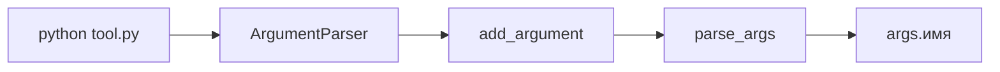

Многие программы запускаются из терминала и принимают аргументы: `python script.py data.txt --verbose`. Разбор этих аргументов — целая наука: нужно поддерживать и позиционные значения, и флаги, и значения по умолчанию, и понятные сообщения об ошибках. Всё это умеет модуль `argparse` из стандартной библиотеки.

## Простейший парсер

`ArgumentParser` описывает, какие аргументы принимает программа, а `parse_args()` разбирает команду из `sys.argv`:

```python
import argparse

parser = argparse.ArgumentParser(description="Считает сумму чисел")
parser.add_argument("numbers", type=float, nargs="+", help="числа для сложения")
parser.add_argument("--verbose", action="store_true", help="подробный вывод")
args = parser.parse_args()

total = sum(args.numbers)
if args.verbose:
    print(f"Сумма чисел {args.numbers} равна {total}")
else:
    print(total)
```

Запуск:

```bash
python sum_cli.py 1 2.5 3
python sum_cli.py 1 2.5 3 --verbose
```

Что здесь произошло? `numbers` — позиционный аргумент: он обязателен и берётся из позиции в команде. `nargs="+"` означает «одно или несколько значений». `--verbose` — флаг: `action="store_true"` делает его булевым, `True`, если флаг передан, иначе `False`.

## Типы и значения по умолчанию

`argparse` сам преобразует строки в нужные типы и проверяет их:

```python
parser.add_argument("-n", "--top", type=int, default=10, help="сколько слов показать")
parser.add_argument("--format", choices=["text", "csv"], default="text", help="формат вывода")
```

Если `type=int` не сможет преобразовать значение, парсер сам напечатает ошибку и завершит программу с кодом 2. `choices` ограничивает допустимые значения, `default` задаёт значение по умолчанию, если флаг не передан.

## Подкоманды

Сложные утилиты (как `git commit`, `pip install`) имеют подкоманды. Их делают через `add_subparsers`:

```python
subparsers = parser.add_subparsers(dest="command", required=True)

add_parser = subparsers.add_parser("add", help="сложить числа")
add_parser.add_argument("numbers", nargs="+", type=float)

mul_parser = subparsers.add_parser("mul", help="умножить числа")
mul_parser.add_argument("numbers", nargs="+", type=float)
```

Теперь `python calc.py add 1 2 3` и `python calc.py mul 2 4` — две разные подкоманды с собственными аргументами.

## Помощь и ошибки

Парсер автоматически генерирует справку: `python script.py --help` покажет описание всех аргументов. Для собственных ошибок есть `parser.error("сообщение")` — он печатает сообщение, подсказку использования и завершает программу.



## Итог урока

Мы разобрали argparse: позиционные аргументы, флаги, типы, `default`, `choices`, подкоманды и автоматическую справку. Теперь соберём настоящую CLI-утилиту.

<!--TASK-->
### Задача 1
Создай CLI-утилиту `words.py` для анализа текстового файла:

1. Позиционный аргумент `path` — путь к текстовому файлу;
2. Флаг `-n` / `--top` (по умолчанию 10) — сколько самых частых слов показать;
3. Флаг `--no-stopwords` — убрать из подсчёта служебные слова (предлоги и союзы: «и», «в», «на», «с», «по», «для», «что», «это», «как», «не»);
4. Если файла не существует — программа печатает понятное сообщение об ошибке и завершается с ненулевым кодом;
5. Вывод: каждая строка вида `слово: количество`, отсортировано по убыванию частоты.

Создай тестовый файл `text.txt` с 20–30 словами и проверь утилиту с разными флагами.

Ожидаемый результат: `python words.py text.txt` печатает топ-10 слов; `python words.py text.txt -n 3 --no-stopwords` — топ-3 без служебных слов.

### Задача 2
Создай утилиту `sum_cli.py` для сложения чисел:

1. Позиционный аргумент `numbers` с `nargs="+"` и `type=float`;
2. Флаг `--round` (`action="store_true"`) — округлить результат до целого;
3. Вывод: сумма чисел; при `--round` — целое число.

Ожидаемый результат: `python sum_cli.py 1 2.5 3` печатает `6.5`; `python sum_cli.py 1 2.5 3 --round` — `6`.

### Задача 3
Создай утилиту `greeter.py` — программу приветствия:

1. Позиционный аргумент `name` — имя пользователя;
2. Флаг `--greeting` со значением по умолчанию `Привет`; 3. Флаг `--upper` (`action="store_true"`) — вывести приветствие в верхнем регистре;
4. Вывод: `Привет, Аня!` или, с `--upper`, `ПРИВЕТ, АНЯ!`.

Ожидаемый результат: `python greeter.py Аня` печатает `Привет, Аня!`; `python greeter.py Аня --greeting Здравствуй --upper` — `ЗДРАВСТВУЙ, АНЯ!`.

### Задача 4
Создай утилиту `choose.py`, которая выводит данные в выбранном формате:

1. Аргумент `--format` с `choices=["text", "json"]` и значением по умолчанию `text`;
2. В режиме `text` — вывод строки `Данные: [1, 2, 3]`;
3. В режиме `json` — вывод строки `{"data": [1, 2, 3]}`;
4. Если передано неподдерживаемое значение — парсер сам напечатает ошибку и завершится с ненулевым кодом.

Ожидаемый результат: `python choose.py --format json` печатает JSON-строку; `python choose.py --format xml` завершается с кодом 2 и сообщением об ошибке.

### Задача 5
Создай утилиту `calc_sub.py` с подкомандами:

1. Подкоманда `add` — принимает `numbers` (`nargs="+"`, `type=float`) и печатает сумму;
2. Подкоманда `mul` — принимает `numbers` и печатает произведение;
3. Если подкоманда не указана — парсер завершается с ошибкой (сделай `required=True`).

Ожидаемый результат: `python calc_sub.py add 1 2 3` печатает `6.0`; `python calc_sub.py mul 2 4` — `8.0`; запуск без подкоманды — сообщение об ошибке.
### Задача 6 — Флаги и значения по умолчанию
Сделай CLI-утилиту: `python tool.py --name Имя --verbose --times N` (по умолчанию times=1). Программа печатает приветствие N раз, а при --verbose добавляет время запуска. Ожидаемый результат: корректный разбор аргументов и вывод. Опиши, зачем нужны значения по умолчанию.
### Задача 7 — Подкоманды
Расширь утилиту: подкоманды `hello` и `calc` (calc принимает два числа и операцию: add/sub). Ожидаемый результат: `python tool.py calc add 4 7` выводит 11. Опиши, как add_subparsers организует подкоманды.

<!--/TASK-->

<!--HINT-->
### Подсказка 1
Объяви `parser.add_argument("path")`, `parser.add_argument("-n", "--top", type=int, default=10)`, `parser.add_argument("--no-stopwords", action="store_true")`. Проверяй существование файла через `Path(args.path).exists()` и прерывай парсер через `parser.error(...)`. Считай частоту через `Counter` из `collections` и выводи через `most_common(args.top)`.

### Подсказка 2
`parser.add_argument("numbers", nargs="+", type=float)` соберёт все числа в список `args.numbers`. Сумму считай через `sum(args.numbers)`. Для округления используй `round(total)` — он возвращает целое число, когда передан один аргумент.

### Подсказка 3
Для аргумента со значением используй `parser.add_argument("--greeting", default="Привет")`; для флага — `parser.add_argument("--upper", action="store_true")`. Внутри проверяй `if args.upper:` и применяй `.upper()` к готовой строке.

### Подсказка 4
`choices=["text", "json"]` автоматически отвергает любые другие значения: argparse сам напечатает ошибку и завершит программу с кодом 2. Внутри просто проверяй `if args.format == "json":` и печатай нужную строку.

### Подсказка 5
Создай `subparsers = parser.add_subparsers(dest="command", required=True)`, затем `add_parser = subparsers.add_parser("add")` и добавь ему `numbers`. В конце проверяй `args.command` и вызывай соответствующую операцию. Не забудь `required=True`, иначе запуск без подкоманды не будет ошибкой.
### Подсказка 6
`parser.add_argument("--verbose", action="store_true")` — флаг без значения. `default` задаёт значение по умолчанию.
### Подсказка 7
`sub = parser.add_subparsers(dest="command")`; для каждой подкоманды — свой subparser с аргументами.

<!--/HINT-->

<!--SOLUTION-->
### Разбор 1
Одно из возможных решений:

```python
import argparse
import re
from collections import Counter
from pathlib import Path

STOPWORDS = {
    "и", "в", "на", "с", "по", "для", "что", "это",
    "как", "не", "а", "но", "или", "из", "к", "у", "о", "от",
}

parser = argparse.ArgumentParser(description="Топ самых частых слов в файле")
parser.add_argument("path", help="путь к текстовому файлу")
parser.add_argument("-n", "--top", type=int, default=10,
                    help="сколько слов показать (по умолчанию 10)")
parser.add_argument("--no-stopwords", action="store_true",
                    help="убрать служебные слова")
args = parser.parse_args()

file_path = Path(args.path)
if not file_path.exists():
    parser.error(f"Файл не найден: {args.path}")

text = file_path.read_text(encoding="utf-8")
words = re.findall(r"[а-яёa-z]+", text.lower())

if args.no_stopwords:
    words = [w for w in words if w not in STOPWORDS]

for word, count in Counter(words).most_common(args.top):
    print(f"{word}: {count}")
```

Примеры запуска:

```bash
$ python words.py text.txt
и: 4
в: 3
питон: 3
код: 2
...

$ python words.py text.txt -n 3 --no-stopwords
питон: 3
код: 2
язык: 2

$ python words.py no_such_file.txt
usage: words.py [-h] [-n TOP] [--no-stopwords] path
words.py: error: Файл не найден: no_such_file.txt
```

Разбор шагов. Сначала `ArgumentParser` описывает интерфейс: обязательный путь, опциональный `-n/--top` с типом `int` и значением по умолчанию 10, и флаг `--no-stopwords` с `action="store_true"`. `parse_args()` собирает всё в объект `args`, и дальше мы обращаемся к нему как к обычным атрибутам. Существование файла проверяется до чтения: `parser.error` печатает подсказку использования и завершает программу с ненулевым кодом (2) — это стандартное поведение CLI-утилит. Слова извлекаются регулярным выражением, приводятся к нижнему регистру, а при `--no-stopwords` отфильтровываются через множество стоп-слов. Наконец, `Counter(words).most_common(args.top)` сразу даёт отсортированный топ — цикл печатает пары «слово: количество». Обрати внимание, как `-h/--help` тоже работает бесплатно: argparse сам генерирует справку.

### Разбор 2
Одно из возможных решений:

```python
import argparse

parser = argparse.ArgumentParser(description="Складывает числа")
parser.add_argument("numbers", nargs="+", type=float, help="числа для сложения")
parser.add_argument("--round", action="store_true", help="округлить до целого")
args = parser.parse_args()

total = sum(args.numbers)

if args.round:
    print(round(total))
else:
    print(total)
```

Примеры запуска:

```bash
$ python sum_cli.py 1 2.5 3
6.5
$ python sum_cli.py 1 2.5 3 --round
6
$ python sum_cli.py
usage: sum_cli.py [-h] [--round] numbers [numbers ...]
sum_cli.py: error: the following arguments are required: numbers
```

Разбор шагов. `nargs="+"` сообщает парсеру, что позиционный аргумент должен встретиться хотя бы один раз, поэтому запуск без чисел завершается понятной ошибкой от самого argparse. `type=float` преобразует строки в числа на этапе разбора: если пользователь введёт `abc`, парсер сам напечатает ошибку и завершит программу с кодом 2. Сумма считается через встроенную функцию `sum`, которая принимает список чисел. Флаг `--round` с `action="store_true"` даёт булево значение: `True`, если флаг передан, `False` в противном случае. `round(total)` с одним аргументом возвращает целое число, поэтому вывод в режиме `--round` — без десятичной точки. Такой минимальный пример демонстрирует, сколько валидации argparse делает за нас.

### Разбор 3
Одно из возможных решений:

```python
import argparse

parser = argparse.ArgumentParser(description="Приветствие")
parser.add_argument("name", help="имя пользователя")
parser.add_argument("--greeting", default="Привет", help="слово приветствия")
parser.add_argument("--upper", action="store_true", help="верхний регистр")
args = parser.parse_args()

message = f"{args.greeting}, {args.name}!"

if args.upper:
    message = message.upper()

print(message)
```

Примеры запуска:

```bash
$ python greeter.py Аня
Привет, Аня!
$ python greeter.py Аня --greeting Здравствуй --upper
ЗДРАВСТВУЙ, АНЯ!
```

Разбор шагов. Позиционный аргумент `name` обязателен — без него argparse выдаст ошибку. `--greeting` принимает значение и имеет `default="Привет"`: если пользователь не передал флаг, в `args.greeting` окажется строка по умолчанию. Флаг `--upper` работает как переключатель: `action="store_true"` даёт `True`, когда флаг присутствует в команде. Сообщение собирается в f-строке, а `upper()` преобразует всю строку в верхний регистр только при необходимости. Заметь, как легко комбинируются флаги: `--greeting` меняет слово, `--upper` — регистр, и они независимы. Такой паттерн — «позиционный аргумент + опциональные флаги с дефолтами» — встречается в огромном числе реальных утилит.

### Разбор 4
Одно из возможных решений:

```python
import argparse

parser = argparse.ArgumentParser(description="Вывод данных в формате")
parser.add_argument("--format", choices=["text", "json"], default="text",
                    help="формат вывода: text или json")
args = parser.parse_args()

data = [1, 2, 3]

if args.format == "json":
    print(f'{{"data": {data}}}')
else:
    print(f"Данные: {data}")
```

Примеры запуска:

```bash
$ python choose.py --format json
{"data": [1, 2, 3]}
$ python choose.py --format text
Данные: [1, 2, 3]
$ python choose.py --format xml
usage: choose.py [-h] [--format {text,json}]
choose.py: error: argument --format: invalid choice: 'xml' (choose from 'text', 'json')
```

Разбор шагов. `choices=["text", "json"]` — встроенная валидация: argparse проверяет переданное значение и, если оно не входит в список, сам печатает ошибку с перечнем допустимых вариантов и завершает программу с кодом 2. Внутри программы остаётся только ветвление по `args.format`. Значение по умолчанию `"text"` срабатывает, когда флаг не передан вовсе. В выводе JSON обрати внимание на двойные фигурные скобки в f-строке: `{{` и `}}` экранируются, чтобы оставить в результате именно фигурные скобки. Такой аргумент `--format` — стандарт для утилит, которые умеют отдавать результаты и человеку, и другим программам.

### Разбор 5
Одно из возможных решений:

```python
import argparse
from functools import reduce

parser = argparse.ArgumentParser(description="Калькулятор с подкомандами")
subparsers = parser.add_subparsers(dest="command", required=True)

add_parser = subparsers.add_parser("add", help="сложить числа")
add_parser.add_argument("numbers", nargs="+", type=float)

mul_parser = subparsers.add_parser("mul", help="умножить числа")
mul_parser.add_argument("numbers", nargs="+", type=float)

args = parser.parse_args()

if args.command == "add":
    print(sum(args.numbers))
else:
    print(reduce(lambda a, b: a * b, args.numbers))
```

Примеры запуска:

```bash
$ python calc_sub.py add 1 2 3
6.0
$ python calc_sub.py mul 2 4
8.0
$ python calc_sub.py
usage: calc_sub.py [-h] {add,mul} ...
calc_sub.py: error: the following arguments are required: command
```

Разбор шагов. `add_subparsers(dest="command", required=True)` создаёт точку ветвления: подкоманды `add` и `mul` — фактически отдельные мини-парсеры со своими аргументами. `dest="command"` сохраняет имя выбранной подкоманды в `args.command`, а `required=True` делает её обязательной — без неё программа завершается ошибкой. Каждая подкоманда имеет собственный позиционный аргумент `numbers` с `nargs="+"` и `type=float`. После разбора мы ветвимся по `args.command`: для `add` подходит встроенная `sum`, а для `mul` — `reduce` с умножением, который сворачивает список чисел в одно произведение. Такая структура повторяет устройство реальных инструментов — `git`, `pip`, `uv`: одна программа, много подкоманд, у каждой свои опции.
### Разбор 6
```python
import argparse
import time

parser = argparse.ArgumentParser()
parser.add_argument("--name", default="мир")
parser.add_argument("--verbose", action="store_true")
parser.add_argument("--times", type=int, default=1)
args = parser.parse_args()

for _ in range(args.times):
    print(f"Привет, {args.name}!")
if args.verbose:
    print("Время:", time.ctime())
```
default упрощает запуск без аргументов; store_true превращает присутствие флага в True.
### Разбор 7
```python
import argparse

parser = argparse.ArgumentParser()
sub = parser.add_subparsers(dest="command")

hello = sub.add_parser("hello")
hello.add_argument("--name", default="мир")

calc = sub.add_parser("calc")
calc.add_argument("op", choices=["add", "sub"])
calc.add_argument("a", type=int)
calc.add_argument("b", type=int)

args = parser.parse_args()
if args.command == "hello":
    print(f"Привет, {args.name}!")
elif args.command == "calc":
    print(args.a + args.b if args.op == "add" else args.a - args.b)
```
Каждая подкоманда — отдельный мини-парсер; dest="command" хранит выбранную.

<!--/SOLUTION-->

<!--QUIZ-->
Что означает nargs="+" у позиционного аргумента?
- Ровно один аргумент
- Одно или несколько значений
- Необязательный аргумент
- Несколько значений, но не больше трёх
* Правильный ответ: Одно или несколько значений
nargs="+" требует хотя бы одно значение и собирает их в список.

Что делает action="store_true" у аргумента?
- Сохраняет строку в переменную
- Делает аргумент булевым: True, если флаг передан
- Умножает значение на True
- Выводит подсказку
* Правильный ответ: Делает аргумент булевым: True, если флаг передан
Флаг с store_true не принимает значения, а лишь включает/выключает признак.

Что произойдёт, если передать --format xml при choices=["text", "json"]?
- Программа просто проигнорирует значение
- argparse напечатает ошибку и завершит программу с ненулевым кодом
- Значение xml будет автоматически заменено на text
- Программа продолжит работу с xml
* Правильный ответ: argparse напечатает ошибку и завершит программу с ненулевым кодом
Валидация choices встроена в argparse: недопустимое значение приводит к ошибке с кодом 2.

Для чего используется parser.error("сообщение")?
- Чтобы записать ошибку в лог
- Чтобы напечатать сообщение, подсказку использования и завершить программу
- Чтобы вернуть None из parse_args
- Чтобы задать кодировку вывода
* Правильный ответ: Чтобы напечатать сообщение, подсказку использования и завершить программу
parser.error — стандартный способ сообщить о собственной ошибке валидации.

Как сделать подкоманду обязательной в argparse?
- Добавить required=True в add_subparsers
- Добавить default="add" в add_subparsers
- Это невозможно: подкоманды всегда необязательны
- Добавить nargs="+" в add_subparsers
* Правильный ответ: Добавить required=True в add_subparsers
С required=True запуск без подкоманды завершается ошибкой.

Что хранится в args.command после вызова python calc.py add 1 2?
- Список чисел [1, 2]
- Строка "add"
- Сумма чисел
- Объект парсера
* Правильный ответ: Строка "add"
Благодаря dest="command" имя выбранной подкоманды попадает в атрибут args.command.

Что произойдёт при запуске python prog.py --help?
- argparse напечатает справку по аргументам и завершит программу
- Будет запрошен ввод пользователя
- Запустится основной код программы
- Программа завершится с ошибкой
* Правильный ответ: argparse напечатает справку по аргументам и завершит программу
--help автоматически генерируется argparse: он выводит описание всех аргументов и выходит с кодом 0.

Как задать значение по умолчанию для аргумента?
- default="значение"
- fallback="значение"
- preset="значение"
- initial="значение"
* Правильный ответ: default="значение"
Если пользователь не передал аргумент, argparse подставит значение из default в args.
Что делает action="store_true"?
- Превращает флаг в логическое True, если он передан
- Хранит строку
- Считает вхождения
- Отключает аргумент
* Правильный ответ: Превращает флаг в логическое True, если он передан
Присутствие флага → True; отсутствие → False.

Что такое подкоманды?
- Отдельные наборы аргументов внутри одной программы
- Ветки в коде
- Псевдонимы
- Несколько программ
* Правильный ответ: Отдельные наборы аргументов внутри одной программы
add_subparsers позволяет как у git: одну программу с режимами.

Как ограничить допустимые значения аргумента?
- choices=[...]
- default=...
- type=...
- required=True
* Правильный ответ: choices=[...]
При передаче другого значения argparse выдаст ошибку.

Зачем нужен default?
- Чтобы задать значение при отсутствии аргумента
- Чтобы запретить его
- Чтобы увеличить точность
- Чтобы сделать аргумент обязательным
* Правильный ответ: Чтобы задать значение при отсутствии аргумента
default делает CLI удобным: необязательные параметры.

# 
<!--/QUIZ-->
