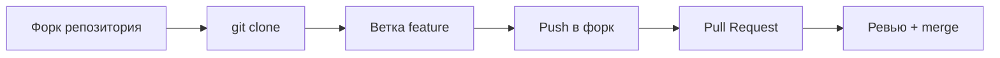

В предыдущем уроке ты научился работать с Git в одиночку: коммиты, ветки, публикация проекта на GitHub. Но настоящая сила Git и GitHub раскрывается в командной работе. Именно здесь появляются понятия, вокруг которых строится вся индустрия: **форки**, **pull request**, **код-ревью**, **issues** и **релизы**. Этот урок посвящён этим процессам.

## Два способа участвовать в проекте

Представь, что ты хочешь что-то изменить в чужом репозитории. Есть два пути.

**Путь 1: collaborator (сотрудник).** Владелец репозитория добавляет тебя в Collaborators — и ты получаешь право пушить прямо в его репозиторий. Так обычно работают в одной команде над общим проектом. Права дают на конкретный репозиторий, а не глобально.

**Путь 2: форк (fork).** Если прав нет (а у чужого репозитория их почти наверняка нет) — ты делаешь **форк**: GitHub создаёт копию репозитория на твоём аккаунте. Дальше ты клонируешь эту копию, работаешь в ней сколько угодно, а изменения в оригинальный проект предлагаешь через pull request. Форк — основа модели open source: любой может предложить правку в любой публичный проект.

## Рабочий процесс с ветками

В команде основная ветка — `main` — обычно защищена: пушить в неё напрямую нельзя или не принято. Работа идёт в отдельных ветках по циклу:

1. Обнови локальную `main`: `git switch main && git pull`;
2. Создай ветку фичи: `git switch -c feature/add-login`;
3. Внеси изменения, закоммить их;
4. Запушь ветку: `git push -u origin feature/add-login`;
5. Открой pull request на GitHub;
6. Получи ревью, внеси правки;
7. Слей ветку в `main` и удали её.

Имена веток принято делать осмысленными: `feature/...` для новой функциональности, `fix/...` для исправлений, `docs/...` для документации.

## Pull request

Pull request (PR) — это предложение слить изменения из одной ветки в другую. На GitHub открываешь PR: указываешь, откуда (`compare` — твоя ветка) и куда (`base` — обычно `main`), пишешь заголовок и описание: что сделано, как проверить, ссылка на связанный issue. Пока PR открыт, его можно обсуждать и дополнять новыми коммитами. Если работа ещё не готова, открывай **draft PR** — он явно помечается как черновой.

## Код-ревью

Код-ревью — это проверка изменений другим человеком до слияния. Ревьюер смотрит diff, оставляет **комментарии** прямо у строк кода, может потребовать правки (статус *request changes*) или одобрить (*approve*). Ревью ловит баги, упрощает код и прокачивает всю команду: автор получает свежий взгляд, ревьюер — понимание кодовой базы.

Как правильно реагировать на ревью:

- отвечай на каждый комментарий — согласен или нет и почему;
- вноси правки новыми коммитами в ту же ветку и пуши их — PR обновится автоматически;
- не используй `git push --force` в общей ветке PR — из-за этого коллеги теряют контекст; обычный `git push` поверх новых коммитов ничем не хуже.

После одобрения ветку можно слить. GitHub предлагает три вида слияния: *Create a merge commit* (сохраняет всю историю), *Squash and merge* (сжимает все коммиты ветки в один), *Rebase and merge* (переписывает историю линейно).

## Issues

Issue — это запись на GitHub о баге, задаче или идее. Issues используют как список дел и трекер проблем: с заголовком, описанием, метками (labels), исполнителем и приоритетом. Главная магия — связь с PR: если в описании или коммите PR написать `Fixes #12` (или `Closes #12`), то после слияния issue закроется автоматически. Если просто упомянуть `#12`, issue останется открытым, но между ними появится связь.

## Releases и теги

Релиз — это зафиксированная, готовая к использованию версия кода. Технически релиз опирается на **тег** — именованную метку на конкретном коммите. Создай тег и запушь его:

```bash
git tag v1.0.0
git push origin v1.0.0
```

Затем на GitHub открой страницу *Releases* и создай release для этого тега: напиши название, описание изменений, можно приложить собранные артефакты. Версии принято нумеровать по семантическому версионированию: `major.minor.patch` — `v2.5.1` означает: вторая мажорная версия, пятая минорная, первое исправление.

## Синхронизация форка

Проблема форка в том, что он живёт своей жизнью: пока ты работаешь, оригинальный проект уходит вперёд. Чтобы не отставать, добавь оригинал как удалённый репозиторий `upstream`:

```bash
git remote add upstream https://github.com/владелец/проект.git
git fetch upstream
git switch main
git merge upstream/main
git push
```

Теперь твоя `main` снова актуальна, и новые ветки можно делать от свежей базы.



## Итог урока

Мы разобрали каркас командной работы: форки и collaborator'ы, цикл веток, pull request, код-ревью, issues с автозакрытием, релизы с тегами и синхронизацию форка. Теперь закрепим это на практике.

<!--TASK-->
### Задача 1
Подготовь форк и настрой удалённые репозитории:

1. Выбери любой учебный/публичный репозиторий на GitHub (можно свой из прошлого урока) и нажми кнопку **Fork** — на твоём аккаунте появится копия;
2. Клонируй **свой** форк на компьютер;
3. Добавь оригинальный репозиторий как `upstream`;
4. Выполни `git remote -v` и убедись, что видны оба удалённых репозитория.

Ожидаемый результат: `git remote -v` показывает два remote — `origin` (ссылается на твой форк) и `upstream` (ссылается на оригинал).

### Задача 2
Сделай первый pull request:

1. Создай ветку `feature/add-greeting` от актуальной `main`;
2. Внеси изменение (например, добавь функцию приветствия в `main.py`), закоммить его;
3. Запушь ветку: `git push -u origin feature/add-greeting`;
4. На GitHub увидишь предложение открыть PR — открой его: `base` — `main`, `compare` — твоя ветка;
5. Напиши заголовок и описание, затем создай PR.

Ожидаемый результат: на GitHub появился открытый PR, в котором видны твои изменения (diff), заголовок и описание.

### Задача 3
Свяжи issue с pull request:

1. На GitHub создай issue с заголовком «Добавить вывод версии программы»;
2. Запомни его номер (например, #7);
3. Создай ветку `fix/issue-7`, добавь в программу вывод версии, закоммить с сообщением `Fixes #7`;
4. Открой PR из этой ветки в `main` и в описании тоже напиши `Fixes #7`;
5. Слей PR (можно через кнопку *Merge pull request*).

Ожидаемый результат: после слияния PR issue автоматически закрылся — проверь это на странице issue (статус *Closed*).

### Задача 4
Проведи цикл код-ревью над своим PR:

1. Открой PR из задачи 2 (или создай новый — например, `feature/add-version-print`);
2. Оставь сам себе комментарий у конкретной строки кода (нажми на строку в diff и напиши замечание);
3. Исправь код по замечанию, закоммить и запушь в ту же ветку;
4. Ответь на свой комментарий в обсуждении PR;
5. Посмотри, что обновлённый коммит появился в PR автоматически.

Ожидаемый результат: PR содержит несколько коммитов, в обсуждении есть твой комментарий и ответ, а diff показывает итоговое исправление.

### Задача 5
Создай релиз с тегом и синхронизируй форк:

1. Убедись, что все изменения в `main` закоммичены и запушены;
2. Создай и запушь тег: `git tag v0.1.0` и `git push origin v0.1.0`;
3. На GitHub открой *Releases* → *Draft a new release*, выбери тег `v0.1.0`, напиши название и описание изменений, опубликуй релиз;
4. Если ты работал в форке — синхронизируй его с оригиналом: `git fetch upstream`, `git merge upstream/main`, `git push`.

Ожидаемый результат: на странице Release появился релиз `v0.1.0` с описанием, а локальная `main` синхронизирована с `upstream`.

### Задача 6 — Pull Request через gh CLI
Создай ветку feature, внеси изменение, запушь её в форк и создай PR командой `gh pr create --title "..." --body "..."`. Ожидаемый результат: ссылка на созданный PR. Опиши шаги, которые gh автоматизирует.
### Задача 7 — Ревью и комментарии
На чужом PR (или на своём) оставь ревью-комментарий через `gh pr review --comment "..."`. Затем почини замечание, испытай push в ту же ветку и перезапроси ревью `gh pr review --approve` (если прав. Ожидаемый результат: цепочка ревью в PR.

<!--/TASK-->

<!--HINT-->
### Подсказка 1
Кнопка **Fork** находится в правом верхнем углу страницы репозитория. После клонирования своего форка команда `git remote add upstream https://github.com/<владелец>/<проект>.git` добавляет оригинал. Проверить можно командой `git remote -v` — должно быть две строки `fetch` и две `push`.

### Подсказка 2
Перед созданием ветки обязательно обнови `main`: `git switch main && git pull`. Ветку создавай так: `git switch -c feature/add-greeting`. Чтобы GitHub предложил открыть PR, ветка должна быть запушена: `git push -u origin feature/add-greeting`.

### Подсказка 3
Ключевая магия — текст `Fixes #N` в описании PR или в сообщении коммита. Он работает только при слиянии PR в основную ветку. Номер issue пишется с символом `#` без пробела перед ним. Если текст `Fixes #7` находится в основном описании PR, issue закроется автоматически после merge.

### Подсказка 4
Чтобы оставить комментарий у строки, в PR открой вкладку **Files changed**, нажми на номер строки слева и введи замечание. После исправления и пуша `git push` (без `--force`) PR обновится сам. Ответ в обсуждении пишется во вкладке **Conversation**.

### Подсказка 5
Тег создаётся и пушится отдельно от веток: `git tag v0.1.0` помечает текущий коммит, `git push origin v0.1.0` отправляет тег. Для синхронизации форка: `git fetch upstream` забирает новые ветки и коммиты оригинала, `git merge upstream/main` вливает их в твою `main`, `git push` отправляет результат на GitHub.

### Подсказка 6
`gh pr create` запрашивает заголовок и тело. Перед этим: `git checkout -b feature`, `git commit`, `git push -u origin feature`.
### Подсказка 7
`gh pr review --comment` добавляет комментарий; после исправлений — `gh pr review --approve` или повторный комментарий.

<!--/HINT-->

<!--SOLUTION-->
### Разбор 1
Команды:

```bash
# форк создаётся кнопкой Fork на GitHub
git clone https://github.com/<твой-логин>/<проект>.git
cd <проект>
git remote add upstream https://github.com/<владелец>/<проект>.git
git remote -v
```

Результат:

```text
origin    https://github.com/<твой-логин>/<проект>.git (fetch)
origin    https://github.com/<твой-логин>/<проект>.git (push)
upstream  https://github.com/<владелец>/<проект>.git (fetch)
upstream  https://github.com/<владелец>/<проект>.git (push)
```

Разбор шагов. Кнопка **Fork** создаёт на твоём аккаунте полную копию репозитория, но связь с оригиналом не сохраняется автоматически — её настраивают вручную. `git clone` копирует твой форк локально, и по умолчанию локальный репозиторий знает только про `origin` (твой форк). Команда `git remote add upstream ...` добавляет второй удалённый репозиторий с именем `upstream` — это оригинальный проект. Проверка через `git remote -v` показывает оба. С этого момента у тебя есть две «точки связи»: `origin` — куда ты пушишь, и `upstream` — откуда забираешь чужие изменения. Такая схема — стандарт для форков.

### Разбор 2
Команды:

```bash
git switch main
git pull
git switch -c feature/add-greeting
# вносим изменения в main.py: добавляем функцию приветствия
git add .
git commit -m "Добавлено приветствие"
git push -u origin feature/add-greeting
```

Разбор шагов. Сначала обновляем локальную `main` (`git pull` подтягивает свежие изменения с GitHub), затем создаём ветку `feature/add-greeting` и переключаемся на неё. После коммита `git push -u origin feature/add-greeting` отправляет ветку на GitHub и запоминает связь ветка-remote, чтобы дальше хватало просто `git push`. На странице репозитория появится жёлтый баннер с предложением открыть pull request. В PR важны три вещи: цель (`base` — `main`), источник (`compare` — твоя ветка) и описание. Хорошее описание объясняет, что сделано и как проверить, — это сильно облегчает ревью. Пока PR не слит, ты можешь продолжать коммитить в ветку — PR будет обновляться автоматически.

### Разбор 3
Шаги:

1. На GitHub: Issues → New issue → заголовок «Добавить вывод версии программы» → создай. Номер появится автоматически, например, #7.
2. Локально:

```bash
git switch main
git pull
git switch -c fix/issue-7
# добавляем в программу вывод версии, например: print("Версия 0.1.0")
git add .
git commit -m "Fixes #7: добавлен вывод версии"
git push -u origin fix/issue-7
```

3. Открой PR из `fix/issue-7` в `main`, в описании снова напиши `Fixes #7`, создай PR, нажми *Merge pull request*.

Разбор шагов. Ключевой механизм — ключевое слово `Fixes` с номером issue: при слиянии PR GitHub автоматически закрывает связанный issue. Это работает и в тексте коммита, и в описании PR. Зачем это нужно? Во-первых, issue перестаёт «висеть» открытым, хотя задача давно решена. Во-вторых, в обсуждении issue появляется ссылка на коммит и PR, который его закрыл, — историю можно проследить. Если нужно просто связать, но не закрывать — используй `Refs #7` или просто `#7`. Обрати внимание: имя ветки `fix/issue-7` повторяет номер issue — это удобная практика, но не обязательное правило.

### Разбор 4
Шаги:

1. Открой свой PR, перейди во вкладку **Files changed**;
2. Нажми на номер строки слева от строки кода — появится поле для комментария; напиши, например: «Лучше вынести версию в константу»;
3. Локально внеси правку в ту же ветку:

```bash
git switch feature/add-version-print
# правим файл, например: VERSION = "0.1.0"
git add .
git commit -m "Версия вынесена в константу"
git push
```

4. Во вкладке **Conversation** ответь на свой комментарий: «Готово, исправил».

Разбор шагов. Это репетиция настоящего ревью, только в роли ревьюера — ты сам. Дифф-комментарии крепятся к конкретной строке, поэтому их легко обсуждать точечно. После `git push` PR обновляется автоматически: новые коммиты появляются в diff, а обсуждение сохраняется. Ответ на комментарий — важная часть культуры ревью: даже короткое «Готово, исправил» показывает, что замечание учтено. Обрати внимание, что мы использовали обычный `git push`, а не `git push --force`: принудительный push в ветке с открытым PR опасен, так как переписывает историю и ломает контекст обсуждения. Если ревьюер попросил «поправить» — просто добавь новый коммит.

### Разбор 5
Команды:

```bash
git switch main
git pull
git tag v0.1.0
git push origin v0.1.0
git fetch upstream
git merge upstream/main
git push
```

Разбор шагов. `git tag v0.1.0` помечает текущий коммит меткой `v0.1.0` — теперь на этот коммит можно ссылаться по имени. Важно: `git push` по умолчанию не отправляет теги, поэтому нужен явный `git push origin v0.1.0`. На GitHub в разделе *Releases* создаём релиз для этого тега: название (например, «Версия 0.1.0»), описание изменений, опционально артефакты. Релизы дают пользователям точку отсчёта: можно скачать конкретную версию и обсуждать баги применительно к ней. Затем синхронизация форка: `git fetch upstream` забирает коммиты оригинала (но не меняет рабочие файлы), `git merge upstream/main` вливает их в локальную `main`, а `git push` отправляет результат в твой форк. Теперь форк актуален и готов к новым веткам.

### Разбор 6
```bash
git checkout -b feature/readme
echo "дополнение" >> README.md
git add README.md && git commit -m "Дополнить README"
git push -u origin feature/readme
gh pr create --title "README: дополнение" --body "Описание изменений"
```
gh автоматизирует создание PR через API: открывает форму, заполняет данные и печатает ссылку. Вручную это делается через сайт GitHub.
### Разбор 7
```bash
gh pr review --comment "Предлагаю добавить пример использования"
# после исправлений:
gh pr review --approve
```
Ревью — обязательная часть коллаборации: комментарии к строкам, аппрув или запрос изменений. `gh` позволяет делать это из терминала.

<!--/SOLUTION-->

<!--QUIZ-->
Что такое форк?
- Копия репозитория на твоём аккаунте GitHub
- Локальная копия репозитория на компьютере
- Ветка проекта на GitHub
- Запись о задаче в репозитории
* Правильный ответ: Копия репозитория на твоём аккаунте GitHub
Форк создаётся кнопкой Fork и позволяет работать с чужим репозиторием без прав на запись.

Зачем добавляют удалённый репозиторий upstream?
- Чтобы пушить в оригинальный репозиторий
- Чтобы синхронизировать форк с оригиналом
- Чтобы удалить свой форк
- Чтобы создавать ветки
* Правильный ответ: Чтобы синхронизировать форк с оригиналом
git fetch upstream и git merge upstream/main позволяют забирать новые изменения из оригинального проекта.

Какая команда создаёт ветку и сразу переключается на неё?
- git branch -c feature
- git switch -c feature
- git new feature
- git create feature
* Правильный ответ: git switch -c feature
Современный синтаксис: git switch с флагом -c создаёт ветку и переключается на неё.

Что произойдёт, если в описании PR написать Fixes #12?
- Откроется новый issue номер 12
- После слияния PR issue #12 закроется автоматически
- Ничего, текст проигнорируется
- PR не сможет открыться
* Правильный ответ: После слияния PR issue #12 закроется автоматически
Ключевое слово Fixes с номером issue связывает PR и issue: при merge issue закрывается.

Что не статус approve в код-ревью?
- Ревьюер требует правок
- Ревьюер одобрил изменения и разрешил слияние
- Ревьюер закрыл PR
- Ревьюер удалил ветку
* Правильный ответ: Ревьюер одобрил изменения и разрешил слияние
Approve — одобрение; request changes — требование правок; комментарии можно оставлять без смены статуса.

Для чего нужен тег в Git?
- Чтобы пометить конкретный коммит, например для релиза
- Чтобы создать новую ветку
- Чтобы удалить коммит
- Чтобы переименовать репозиторий
* Правильный ответ: Чтобы пометить конкретный коммит, например для релиза
git tag v1.0.0 помечает коммит, а git push origin v1.0.0 отправляет тег на GitHub — на его основе создаются релизы.

Что означает статус Request changes в код-ревью?
- Ревьюер просит внести правки перед слиянием
- Ревьюер одобрил PR
- PR автоматически закрыт
- Ревьюер сделал форк проекта
* Правильный ответ: Ревьюер просит внести правки перед слиянием
Request changes означает: пока правки не внесены, PR нельзя сливать; после исправлений можно запросить повторный ревью.

Какая команда скачивает изменения с удалённого репозитория и сразу вливает их в текущую ветку?
- git pull
- git fetch
- git clone
- git diff
* Правильный ответ: git pull
git pull — это git fetch плюс git merge: сначала забирает новые коммиты, затем вливает их в текущую ветку.
Что такое форк?
- Копия репозитория в вашем аккаунте
- Ветка
- Клон на диске
- PR
* Правильный ответ: Копия репозитория в вашем аккаунте
Форк позволяет предлагать изменения в чужой проект.

Что делает `gh pr create`?
- Создаёт Pull Request через API GitHub
- Создаёт репозиторий
- Удаляет ветку
- Мержит ветки
* Правильный ответ: Создаёт Pull Request через API GitHub
Команда связывает ветку с PR и печатает ссылку.

Что такое code review?
- Проверка изменений другим разработчиком перед слиянием
- Автозапуск тестов
- Форматирование кода
- Документация
* Правильный ответ: Проверка изменений другим разработчиком перед слиянием
Ревью находит ошибки и улучшает качество.

Как попросить аппрув повторно после исправлений?
- gh pr review --approve
- gh pr close
- gh pr reopen
- gh pr merge
* Правильный ответ: gh pr review --approve
После исправлений ревьюер аппрувит PR.

# 
<!--/QUIZ-->
