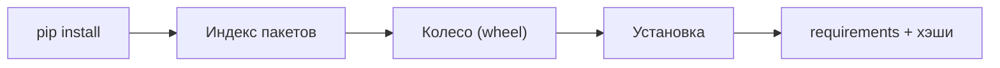

Ты уже умеешь ставить пакеты командой `pip install`, но pip — это гораздо больше, чем «скачать и положить». Он умеет замораживать точные версии зависимостей, ставить пакеты прямо из Git-репозиториев, собирать wheel-файлы, проверять целостность окружения и работать через зеркала. В этом уроке разберёмся, как использовать эти возможности по-настоящему.

## Установка, обновление и удаление

Базовая тройка команд выглядит так:

```bash
pip install requests          # установить
pip install --upgrade requests  # обновить до последней версии
pip uninstall requests        # удалить
```

Ключевая особенность pip — он умеет сам разрешать зависимости. Если ты ставишь `requests`, pip скачает и установит его зависимости (`urllib3`, `charset-normalizer`, `idna`, `certifi`) автоматически. Версию можно задать явно:

```bash
pip install "requests==2.32.0"     # точная версия
pip install "requests>=2.31,<3"    # диапазон
pip install "requests~=2.31"       # совместимая версия (>=2.31, <3.0)
```

Проверить, что установилось и какой версии, помогает `pip list` — он показывает все пакеты окружения.

## pip freeze и requirements.txt

`pip freeze` выдаёт список всех установленных пакетов с точными версиями:

```bash
pip freeze
# requests==2.32.0
# urllib3==2.2.2
```

Этот вывод сохраняют в файл `requirements.txt` — он становится «рецептом» окружения:

```bash
pip freeze > requirements.txt
```

На другом компьютере или в CI воспроизводят окружение одной командой:

```bash
pip install -r requirements.txt
```

`requirements.txt` умеет больше, чем просто список точных версий. В нём допустимы те же спецификаторы, что в `pip install`:

```text
requests>=2.31,<3
pytest==8.3.2
black~=24.8
```

А ещё файл может включать другие файлы и даже ссылки на git-репозитории:

```text
-r base-requirements.txt
git+https://github.com/psf/requests.git@v2.32.0
-e .
```

Строка `-e .` означает editable-установку текущего проекта — о ней ниже.

## Установка из разных источников

pip не ограничен PyPI (Python Package Index). Пакет можно поставить:

- из Git: `pip install "git+https://github.com/psf/requests.git@2.32.0"`;
- из локальной папки: `pip install ./my-package`;
- из wheel-файла: `pip install ./requests-2.32.0-py3-none-any.whl`.

Если нужно ставить пакеты не с официального PyPI, а из собственного индекса или зеркала, используется флаг `--index-url`:

```bash
pip install -i https://mirror.example.com/pypi/simple requests
```

Флаг `--extra-index-url` добавляет дополнительный индекс, не заменяя основной:

```bash
pip install --extra-index-url https://my-team.dev/simple internal-tool
```

Зеркала удобно зафиксировать надолго: для этого служит переменная окружения `PIP_INDEX_URL` или конфигурационный файл `pip.conf` (на Windows — `%APPDATA%\pip\pip.ini`). Пример конфига:

```ini
[global]
index-url = https://mirror.example.com/pypi/simple
trusted-host = mirror.example.com
```

## Editable-установка: -e

Во время разработки пакета его хочется видеть в окружении, но так, чтобы правки в исходниках сразу подхватывались без переустановки. Для этого существует editable-режим:

```bash
pip install -e .
```

Эта команда создаёт в окружении ссылку на папку проекта, а не копию файлов. Импортируешь `import mypkg` — и Python видит текущий код из папки. Меняешь исходники — поведение программы меняется мгновенно. Именно так устроена разработка почти любого Python-проекта: `pip install -e .` в dev-окружении.

## Wheel-файлы

Wheel (`.whl`) — это готовый к установке архив пакета: файлы уже скомпилированы и разложены по правильным папкам, поэтому установка занимает секунды. Формат названия несёт информацию: `requests-2.32.0-py3-none-any.whl` означает «версия 2.32.0, для Python 3, без расширений на C, работает на любой платформе».

Скачать пакет в виде wheel без установки можно так:

```bash
pip download requests --no-deps -d wheels/
```

Теперь файл `wheels/requests-2.32.0-py3-none-any.whl` можно перенести на другую машину и установить офлайн:

```bash
pip install wheels/requests-2.32.0-py3-none-any.whl
```

Собрать wheel из собственного проекта помогает `pip wheel`:

```bash
pip wheel . -w dist/
```

## pipx: CLI-утилиты в изоляции

Утилиты вроде `black`, `ruff`, `httpie` или `poetry` — это тоже Python-пакеты. Ставить их глобально через `pip install` — плохая идея: их зависимости могут конфликтовать с системными и с зависимостями твоих проектов. Инструмент **pipx** решает эту проблему: он ставит каждую утилиту в отдельное виртуальное окружение, а команду делает доступной глобально.

```bash
pip install pipx
pipx install black
black --version
```

Если запустить инструмент нужно один раз, без установки:

```bash
pipx run ruff check main.py
```

pipx — это «pip для приложений»: приложения изолированы друг от друга и не трогают твои проекты.

## Конфликты и pip check

Если два пакета требуют несовместимые версии одной зависимости, pip при установке выбросит ошибку `ResolutionImpossible` — и не установит ничего. Такой конфликт решают, уточняя версии:

```bash
pip install "requests==2.32.0" "urllib3<2"
```

Но конфликт может появиться и позже, уже в установленном окружении. Проверить его помогает `pip check`:

```bash
pip check
# No broken requirements found.
```

Если что-то сломано, pip перечислит, какой пакет требует какую версию и что реально установлено. Это первая команда диагностики «всё работало, а теперь нет».



## Итог

pip — это не просто «установщик», а инструмент воспроизводимости: `pip freeze` фиксирует окружение, `requirements.txt` описывает его, wheel-файлы позволяют ставить офлайн, зеркала ускоряют загрузку, `-e` ускоряет разработку, `pipx` изолирует утилиты, а `pip check` находит конфликты. Закрепим всё на практике.

<!--TASK-->
### Задача 1
Создай виртуальное окружение и установи в него пакет с контролем версии:

1. Создай окружение: `python -m venv venv` и активируй его (на Windows `.venv\Scripts\activate` или `venv\Scripts\activate`, на Linux/macOS `source venv/bin/activate`);
2. Установи `requests` с диапазоном версии: `pip install "requests>=2.31,<3"`;
3. Выведи установленную версию: `pip show requests | head -n 2` (на Windows `pip show requests` и посмотри строку Version);
4. Обнови пакет до последней версии: `pip install --upgrade requests`;
5. Удали его и убедись, что `pip list` больше его не показывает.

Ожидаемый результат: на шаге 3 ты видишь версию из диапазона 2.31–3.0, на шаге 5 `pip list` не содержит `requests`, при этом ошибок нет.

### Задача 2
Зафиксируй состояние окружения в `requirements.txt` и воспроизведи его в новом окружении:

1. В активированном окружении (из задачи 1 или новом) установи два пакета: `pip install requests` и `pip install pytest`;
2. Создай файл `requirements.txt` командой `pip freeze > requirements.txt`;
3. Открой файл — убедись, что в нём перечислены все установленные пакеты с точными версиями (не только requests и pytest, но и их зависимости);
4. Создай второе окружение (`python -m venv venv2`), активируй его и установи всё из файла: `pip install -r requirements.txt`;
5. Проверь, что в `venv2` те же версии: `pip freeze` в обоих окружениях должен совпасть построчно.

Ожидаемый результат: в `venv2` установлены ровно те же версии всех пакетов, что в первом окружении; вызовы `pip freeze` дают одинаковый вывод.

### Задача 3
Установи пакет из локальной папки в editable-режиме:

1. Создай папку `mypkg` с файлом `pyproject.toml`, где у проекта `name = "mypkg"`, `version = "0.1.0"`, и модулем `mypkg.py` с функцией `def hello(): return "hello from mypkg"`;
2. Из папки проекта (не из `mypkg`) выполни `pip install -e ./mypkg`;
3. Запусти проверку: `python -c "from mypkg import hello; print(hello())"` — должна вывестись строка `hello from mypkg`;
4. Измени функцию `hello()` так, чтобы она возвращала `"hello v2"`, и запусти проверку снова без переустановки;
5. Убедись, что `pip list` показывает `mypkg 0.1.0`.

Ожидаемый результат: после изменения исходников вывод `hello()` меняется без повторной установки — значит, окружение ссылается на живую папку проекта.

### Задача 4
Скачай wheel-файл, изучи его и установи офлайн:

1. Создай папку `wheels` и скачай туда `requests` без зависимостей: `pip download requests --no-deps -d wheels/`;
2. Посмотри содержимое папки: `ls wheels/` (на Windows `dir wheels`) — там должен лежать файл `requests-<версия>-py3-none-any.whl`;
3. Разбери название файла: версия, тег Python, тег ABI, платформа;
4. Установи пакет из файла: `pip install wheels/requests-*.whl` (на Windows укажи имя файла целиком);
5. Проверь импорт: `python -c "import requests; print(requests.__version__)"`.

Ожидаемый результат: `requests` установлен без обращения к сети (pip не скачивает ничего нового), импорт работает, версия совпадает с той, что в имени файла.

### Задача 5
Проверь окружение на конфликты и поставь CLI-утилиту через pipx:

1. Выполни `pip check` — убедись, что конфликтов нет (вывод `No broken requirements found.`);
2. Чтобы увидеть конфликт вживую, установи заведомо несовместимые версии: `pip install "urllib3==1.26.0"` и затем `pip install "requests==2.32.0"` — pip либо откажется, либо установит, и тогда `pip check` покажет проблему;
3. Верни `urllib3` на совместимую версию (`pip install -U urllib3`) и добейся чистого `pip check`;
4. Установи pipx: `pip install pipx`;
5. Поставь через pipx утилиту `httpie`: `pipx install httpie`, запусти `http --version` и убедись, что `pip list` не содержит `httpie`.

Ожидаемый результат: `pip check` в финале выводит `No broken requirements found.`; `http --version` работает, но в `pip list` утилиты нет — pipx поставил её в отдельное окружение.

### Задача 6 — Проверка целостности через хэши
Сгенерируй requirements.txt с хэшами: `pip download --dest wheels -r requirements.txt` затем `pip hash wheels/*.whl` и собери файл с строками `--hash=...`. Ожидаемый результат: requirements.txt с хэшами. Опиши, как хэши защищают от подмены пакетов.
### Задача 7 — Установка из локальной папки колес
Скачай пакеты в папку `wheels/` и установи их в изолированное окружение без обращения к сети: `pip install --no-index --find-links wheels -r requirements.txt`. Ожидаемый результат: установка проходит офлайн. Опиши, для чего это нужно.

<!--/TASK-->

<!--HINT-->
### Подсказка 1
Убедись, что в командной строке после активации команда `python` указывает на окружение: в Windows в начале строки появится `(venv)`. Для проверки версии `pip show requests` выводит строку `Version: 2.32.x` — этого достаточно. Удаление подтверждается вопросом `Proceed (y/n)?` — отвечай `y`.

### Подсказка 2
`pip freeze` выводит и пакеты, которые ты ставил явно, и их зависимости — это нормально. Если второй `pip freeze` отличается от первого, сравни строки: разница почти всегда в точных версиях. Проверить, что файл читается, можно так: `pip install -r requirements.txt` не должен ничего переустанавливать, если окружение уже совпадает.

### Подсказка 3
Минимальный `pyproject.toml`:

```toml
[build-system]
requires = ["setuptools"]
build-backend = "setuptools.build_meta"

[project]
name = "mypkg"
version = "0.1.0"
```

Файл модуля `mypkg.py` должен лежать рядом с `pyproject.toml` в папке `mypkg`. Команда `pip install -e ./mypkg` выполняется из родительской папки, где лежат и `venv`, и `mypkg`.

### Подсказка 4
Если `pip download` не скачал файл, проверь, что папка `wheels` существует и что ты в активированном окружении. Имя файла вида `requests-2.32.0-py3-none-any.whl`: `2.32.0` — версия, `py3` — Python 3, `none` — нет C-расширений, `any` — любая платформа. Для установки на Windows скопируй полное имя файла из вывода `dir wheels`.

### Подсказка 5
`urllib3==1.26.0` несовместим с `requests==2.32.0` (тому нужен urllib3 >= 1.26.5, < 3). Если pip откажется ставить — это и есть демонстрация разрешения конфликта, переходи к шагу 3. `pipx install httpie` создаёт отдельное окружение в `~/.local/pipx` (на Windows — `%LOCALAPPDATA%\pipx`), поэтому в `pip list` утилиты нет.

### Подсказка 6
`pip hash <файл>` выводит строку вида `--hash=sha256:...`. Её добавляют к строке пакета в requirements.txt.
### Подсказка 7
`--no-index` запрещает обращение к PyPI; `--find-links wheels` указывает локальный источник. Перед этим `pip download -d wheels <package>`.

<!--/HINT-->

<!--SOLUTION-->
### Разбор 1
Команды:

```bash
python -m venv venv
# Windows:
venv\Scripts\activate
# Linux / macOS:
source venv/bin/activate
pip install "requests>=2.31,<3"
pip show requests
pip install --upgrade requests
pip uninstall requests
pip list
```

Разбор шагов. `python -m venv venv` создаёт изолированное окружение — теперь установки не затронут системный Python. Диапазон `>=2.31,<3` говорит pip: «дай последнюю версию из этого диапазона», поэтому установится, например, 2.32.0. `pip show requests` показывает метаданные пакета, строка `Version:` — то, что нам нужно. `pip install --upgrade requests` обновляет пакет до последней доступной версии (если уже стоит свежая — pip сообщит `Requirement already satisfied`). `pip uninstall requests` удаляет пакет; pip спросит подтверждение. Финальный `pip list` не должен содержать requests. Всё это работает локально, внутри venv, поэтому шаги безопасны для системы.

### Разбор 2
Команды:

```bash
pip install requests pytest
pip freeze > requirements.txt
type requirements.txt          # Windows
cat requirements.txt           # Linux / macOS
python -m venv venv2
venv2\Scripts\activate         # Windows
source venv2/bin/activate       # Linux / macOS
pip install -r requirements.txt
pip freeze
```

Разбор шагов. `pip freeze > requirements.txt` перенаправляет вывод в файл: там окажутся все пакеты с точными версиями, включая транзитивные зависимости (urllib3, charset-normalizer, iniconfig и т. д.). Это и есть «моментальный снимок» окружения. Во втором окружении `pip install -r requirements.txt` читает файл и ставит ровно те версии — так воспроизводят окружение на CI и у коллег. Совпадение вывода `pip freeze` в обоих окружениях доказывает воспроизводимость. Обрати внимание: `pip freeze` включает и сам pip в некоторых версиях — это нормально, такие строки тоже переносятся. Если бы мы записали просто `pip install requests`, версии могли бы разойтись со временем; именно точная фиксация спасает от проблемы «у меня работает».

### Разбор 3
Файлы и команды:

```toml
# mypkg/pyproject.toml
[build-system]
requires = ["setuptools"]
build-backend = "setuptools.build_meta"

[project]
name = "mypkg"
version = "0.1.0"
```

```python
# mypkg/mypkg.py
def hello():
    return "hello from mypkg"
```

```bash
pip install -e ./mypkg
python -c "from mypkg import hello; print(hello())"
# hello from mypkg
# меняем hello() → "hello v2"
python -c "from mypkg import hello; print(hello())"
# hello v2
pip list | findstr mypkg    # Windows
pip list | grep mypkg       # Linux / macOS
```

Разбор шагов. Editable-установка (`-e`) создаёт в окружении ссылку на папку `mypkg` вместо копии файлов. Проверка импортом показывает, что пакет виден. Затем мы меняем исходник без переустановки — и вывод становится `hello v2`: изменения подхватываются мгновенно, потому что Python читает код прямо из папки проекта. Такой режим используют при разработке: ты правишь код, и тесты сразу видят новые версии. В `pip list` пакет появляется как `mypkg 0.1.0`, хотя в окружении нет его файлов — только метаданные и ссылка.

### Разбор 4
Команды:

```bash
mkdir wheels
pip download requests --no-deps -d wheels/
dir wheels                     # Windows: requests-2.32.0-py3-none-any.whl
pip install wheels/requests-2.32.0-py3-none-any.whl
python -c "import requests; print(requests.__version__)"
```

Разбор шагов. `pip download` скачивает пакет, но не устанавливает его. Флаг `--no-deps` убирает зависимости — нам нужен только сам requests. Wheel-файл — это zip-архив с готовой к установке структурой. Имя `requests-2.32.0-py3-none-any.whl` читается так: `2.32.0` — версия, `py3` — совместим с Python 3, `none` — нет ABI-зависимостей (чистый Python), `any` — платформонезависимый. Установка из локального файла не обращается к сети — это способ развернуть пакеты на изолированной машине. Импорт и вывод версии подтверждают, что пакет рабочий. Если пакет содержит C-расширения, в имени появятся теги платформы, например `cp311-win_amd64` — и установить его на другой ОС не получится.

### Разбор 5
Команды:

```bash
pip check
# No broken requirements found.
pip install "urllib3==1.26.0"
pip install "requests==2.32.0"
pip check
pip install --upgrade urllib3
pip check
pip install pipx
pipx install httpie
http --version
pip list
```

Разбор шагов. `pip check` сверяет метаданные установленных пакетов: каждый пакет требует определённые версии зависимостей, и pip проверяет, что всё сходится. После установки `urllib3==1.26.0` и `requests==2.32.0` появляется конфликт: requests требует urllib3 `>=1.26.5,<3`, а установлен 1.26.0. `pip check` перечислит обе версии, и станет ясно, кто кому противоречит. Такие несовместимости возникают, когда пакеты обновляют по отдельности. Решение — привести зависимость к совместимой версии (`pip install --upgrade urllib3`) и снова прогнать `pip check`. Далее `pipx install httpie` ставит утилиту (`httpie` — HTTP-клиент для терминала) в собственное окружение и кладёт её команду в PATH. В `pip list` её нет — значит, зависимости утилиты не конфликтуют с проектом. Это правильный паттерн для любых CLI-инструментов.

### Разбор 6
```bash
pip download --dest wheels -r requirements.txt
pip hash wheels/requests-2.31.0-py3-none-any.whl
# --hash=sha256:...
```
В requirements.txt строка пакета дополняется `--hash=...`, pip проверяет контрольную сумму перед установкой. Это защищает от подмены пакета в процессе получения.
### Разбор 7
```bash
python -m venv .venv
.venv/Scripts/activate        # Windows
pip install --no-index --find-links wheels -r requirements.txt
```
Всё ставится из локальной папки, без интернета. Так собирают образы в закрытых сетях или кэшируют зависимости для CI.

<!--/SOLUTION-->

<!--QUIZ-->
Что делает команда pip freeze?
- Удаляет все установленные пакеты
- Выводит список установленных пакетов с точными версиями
- Замораживает окружение, запрещая установку новых пакетов
- Показывает только те пакеты, которые не имеют зависимостей
* Правильный ответ: Выводит список установленных пакетов с точными версиями
pip freeze выводит имена и точные версии всех пакетов окружения — основу для requirements.txt.

Какой файл описывает зависимости проекта и позволяет воспроизвести окружение?
- README.md
- requirements.txt
- setup.cfg
- .gitignore
* Правильный ответ: requirements.txt
pip install -r requirements.txt воспроизводит окружение по файлу: обычно это вывод pip freeze.

Что делает « pip install -e ./mypkg?
- Устанавливает пакет в системный Python
- Создаёт ссылку на папку проекта: правки в коде видны без переустановки
- Распаковывает wheel-файл в текущую папку
- Удаляет пакет из окружения
* Правильный ответ: Создаёт ссылку на папку проекта: правки в коде видны без переустановки
Editable-режим (`-e`) связывает окружение с живой папкой исходников.

Что означает имя файла requests-2.32.0-py3-none-any.whl?
- Версия 2.32.0, чистый Python, работает на любой платформе
- Пакет собран только для Linux
- Файл содержит исходный код, который нужно компилировать
- Версия 2.32.0, требует Python 3.32
* Правильный ответ: Версия 2.32.0, чистый Python, работает на любой платформе
Теги wheel: версия, совместимость с Python (py3), ABI (none — без C-расширений) и платформа (any).

Зачем нужен pipx?
- Чтобы ускорять загрузку пакетов с PyPI
- Чтобы ставить CLI-утилиты в отдельные изолированные окружения
- Чтобы собирать wheel-файлы из исходников
- Чтобы управлять несколькими версиями Python
* Правильный ответ: Чтобы ставить CLI-утилиты в отдельные изолированные окружения
pipx изолирует каждую утилиту, чтобы её зависимости не конфликтовали с проектами.

Что выведет pip check, если конфликтов нет?
- Список всех установленных пакетов
- No broken requirements found.
- Ошибку о необходимости обновить pip
- Пустую строку
* Правильный ответ: No broken requirements found.
Эта фраза — сигнал, что окружение целостно и всё согласовано.

Как установить пакет из альтернативного индекса (зеркала)?
- pip install --mirror requests
- pip install -i https://mirror.example.com/pypi/simple requests
- pip install --index requests
- pip install -s https://mirror.example.com requests
* Правильный ответ: pip install -i https://mirror.example.com/pypi/simple requests
Флаг -i (--index-url) указывает pip, откуда брать пакеты вместо PyPI.

Что делает pip uninstall requests?
- Удаляет пакет requests из окружения
- Удаляет все зависимости проекта
- Обновляет requests до последней версии
- Выводит информацию о пакете
* Правильный ответ: Удаляет пакет requests из окружения
pip uninstall удаляет пакет и его файлы, но не трогает зависимости, если их не указали отдельно.

Какая команда показывает подробную информацию об установленном пакете?
- pip show requests
- pip info requests
- pip describe requests
- pip details requests
* Правильный ответ: pip show requests
pip show выводит версию, лицензию, зависимости, ссылки на сайт и место установки пакета.
Что делает `pip install --no-index --find-links wheels`?
- Устанавливает только из локальной папки wheels
- Проверяет PyPI
- Скачивает в wheels
- Удаляет пакеты
* Правильный ответ: Устанавливает только из локальной папки wheels
Источник — локальная папка, а не PyPI.

Зачем добавлять --hash в requirements?
- Для проверки целостности скачанного пакета
- Для ускорения
- Для сортировки
- Для логов
* Правильный ответ: Для проверки целостности скачанного пакета
pip сверяет контрольную сумму до установки.

Что такое wheel?
- Готовый формат упаковки Python-пакета
- Установщик
- Репозиторий
- Виртуальное окружение
* Правильный ответ: Готовый формат упаковки Python-пакета
wheel — бинарный/архивный формат, который pip устанавливает быстро.

Что делает pip download?
- Скачивает пакеты без установки
- Устанавливает пакеты
- Удаляет пакеты
- Обновляет pip
* Правильный ответ: Скачивает пакеты без установки
Удобно для офлайн-установок и кэширования.

# 
<!--/QUIZ-->
