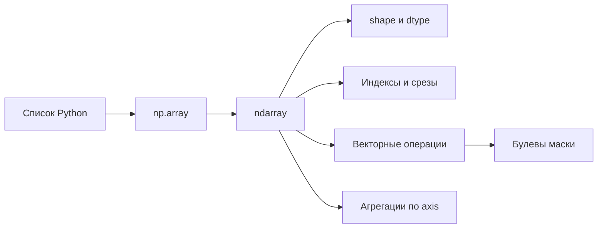

Привет! Начинаем модуль «Анализ данных». Первая библиотека, с которой мы познакомимся, — NumPy. Это фундамент всего курса: на ней построены Pandas и Matplotlib, поэтому без уверенного владения массивами дальше будет трудно. В этом уроке ты научишься создавать массивы разных форм, обращаться к их элементам и выполнять быстрые математические операции над целыми наборами данных.

## Что такое NumPy

NumPy (от Numerical Python) — это библиотека для работы с многомерными массивами. Её основной тип данных — `ndarray` (n-dimensional array, «n-мерный массив»). Чем он лучше обычного списка Python?

- массив хранит все элементы одного типа, поэтому занимает меньше памяти;
- операции выполняются сразу над всеми элементами — это называется **векторизацией**;
- такие операции работают в десятки раз быстрее, чем циклы `for`.

Создадим первый массив:

```python
import numpy as np

a = np.array([1, 2, 3, 4, 5])
print(a)        # [1 2 3 4 5]
print(a.dtype)  # int64
```

Если в списке встречаются разные типы, NumPy сам приведёт все значения к одному:

```python
b = np.array([1, 2, 3.5])
print(b.dtype)  # float64
```

## Форма массива

Массивы бывают не только одномерными, но и двумерными, трёхмерными и так далее. Форму показывает атрибут `shape` — кортеж размерностей по каждой оси:

```python
m = np.array([[1, 2], [3, 4]])
print(m.shape)   # (2, 2)
print(m.ndim)    # 2
print(m.size)    # 4
```

Часто нужны заранее заполненные массивы. Для этого есть `np.zeros`, `np.ones`, `np.arange` и `np.linspace`:

```python
print(np.zeros((2, 3)))           # матрица 2×3 из нулей
print(np.arange(0, 10, 2))        # [0 2 4 6 8]
print(np.linspace(0, 1, 5))       # [0.   0.25 0.5  0.75 1.  ]
```

## Индексация и срезы

К элементам массива обращаются через квадратные скобки, как в списках. Для двумерных массивов указывается пара индексов — строка и столбец. Работают отрицательные индексы и срезы:

```python
arr = np.array([10, 20, 30, 40, 50])
print(arr[0])       # 10
print(arr[-1])      # 50
print(arr[1:4])     # [20 30 40]

m = np.array([[1, 2, 3], [4, 5, 6]])
print(m[1, 2])      # 6
print(m[:, 1])      # [2 5] — вся вторая колонка
```

## Векторные операции

Главное преимущество NumPy — векторизация: операция применяется сразу ко всем элементам без цикла. Код выглядит как обычная математика:

```python
x = np.array([1, 2, 3])
y = np.array([10, 20, 30])

print(x + 5)        # [6 7 8]
print(x * 2)        # [2 4 6]
print(x + y)        # [11 22 33]
print(np.sqrt(x))   # корень из каждого элемента
print(x > 2)        # [False False  True] — булев массив
```

Сравнение возвращает булев массив. Его используют как **маску**: `x[x > 2]` вернёт только те элементы, для которых условие истинно.

## Агрегации

Для сводных статистик есть готовые функции: `sum`, `mean`, `max`, `min`, `std`, `median`. Параметр `axis` говорит, вдоль какой оси считать:

```python
data = np.array([
    [1, 2, 3, 4],
    [5, 6, 7, 8],
    [9, 10, 11, 12],
])
print(data.mean())        # 6.5 — среднее по всем элементам
print(data.mean(axis=0))  # среднее по каждой колонке
print(data.mean(axis=1))  # среднее по каждой строке
```

Большинство реальных задач анализа данных сводится к «посчитай статистику по столбцу» или «отфильтруй строки по условию». NumPy делает это быстро и коротко.

## Практический пример

Применим всё сразу — посчитаем статистику по недельным температурам:

```python
temps = np.array([18.5, 21.0, 19.2, 23.4, 25.1, 22.8, 20.3])
print(f"Средняя: {temps.mean():.2f}")
print(f"Минимум: {temps.min()}, максимум: {temps.max()}")
warm = temps > 20
print(f"Тёплых дней: {warm.sum()}")
```

Формат `:.2f` округляет число до двух знаков после запятой.

## Как устроена работа с массивом

Схема ниже собирает всё, о чём мы говорили, в один маршрут: от обычного списка до готовой статистики.



## Итог урока

Мы узнали:

- как создавать массивы и определять их форму;
- как обращаться к элементам и делать срезы;
- как выполнять векторные операции без циклов;
- как фильтровать данные с помощью булевых масок;
- как считать сводные статистики.

Теперь закрепим всё практикой.

<!--TASK-->
### Задача 1
У тебя есть массив с дневными температурами за неделю:

```python
temps = np.array([18.5, 21.0, 19.2, 23.4, 25.1, 22.8, 20.3])
```

Напиши программу, которая:

1. выводит среднюю температуру за неделю (округляя до двух знаков);
2. выводит максимальную и минимальную температуру;
3. считает, сколько дней было теплее 20 градусов;
4. выводит температуры, округлённые до целых (через `np.round`).

Ожидаемый вывод:

```
Средняя температура: 21.47
Максимум: 25.1, минимум: 18.5
Дней теплее 20°: 5
Округлённые температуры: [18. 21. 19. 23. 25. 23. 20.]
```

Код должен запускаться без изменений и давать именно такой результат.

### Задача 2
Создай двумерный массив из чисел от 1 до 9 с помощью `np.arange(1, 10).reshape(3, 3)`. Напиши программу, которая:

1. выводит сам массив;
2. выводит его форму через атрибут `shape`;
3. выводит элемент, стоящий во второй строке и третьем столбце;
4. выводит весь второй столбец (через срез `[:, 1]`);
5. выводит сумму всех элементов;
6. выводит сумму по каждому столбцу через `sum(axis=0)`.

Ожидаемый вывод:

```
Массив:
[[1 2 3]
 [4 5 6]
 [7 8 9]]
Форма: (3, 3)
Элемент [1, 2]: 6
Второй столбец: [2 5 8]
Сумма всех элементов: 45
Сумма по столбцам: [12 15 18]
```

### Задача 3
У тебя есть массив цен на акции за неделю:

```python
prices = np.array([101.5, 103.2, 98.7, 105.0, 99.9, 102.4, 104.8])
```

Напиши программу, которая:

1. выводит среднюю цену, округлённую до двух знаков;
2. считает, сколько дней цена была выше средней (используй булеву маску и `sum()`);
3. выводит только цены ниже 100 через маску `prices[prices < 100]`;
4. выводит максимальную цену.

Ожидаемый вывод:

```
Средняя цена: 102.21
Дней выше среднего: 4
Цены ниже 100: [98.7 99.9]
Максимальная цена: 105.0
```

### Задача 4
В классе хранятся баллы четырёх студентов за три предмета:

```python
scores = np.array([
    [85, 90, 78],
    [72, 88, 91],
    [95, 80, 75],
    [60, 70, 82],
])
```

Напиши программу, которая:

1. выводит средний балл каждого студента (параметр `axis=1`), округлённый до двух знаков;
2. выводит средний балл по каждому предмету (параметр `axis=0`);
3. выводит номер студента с лучшим средним баллом через `np.argmax`.

Ожидаемый вывод:

```
Средний балл студентов: [84.33 83.67 83.33 70.67]
Средний балл по предметам: [78.  82.  81.5]
Лучший студент: 0
```

### Задача 5
Создай массив из 11 равномерно распределённых точек от 0 до 10:

```python
data = np.linspace(0, 10, 11)
```

Напиши программу, которая:

1. выводит минимум, максимум и размах (максимум минус минимум);
2. нормализует данные по формуле `(data - data.min()) / (data.max() - data.min())`;
3. выводит первые три значения нормализованного массива;
4. выводит среднее и стандартное отклонение исходного массива.

Ожидаемый вывод:

```
Минимум: 0.0, максимум: 10.0, размах: 10.0
Первые три нормализованных значения: [0.  0.1 0.2]
Среднее: 5.0, стандартное отклонение: 3.1622776601683795
```

### Задача 6
Есть массив осадков за неделю (в миллиметрах):

```python
rain = np.array([12.4, 0.0, 5.8, 21.3, 0.0, 7.6, 15.1])
```

Напиши программу, которая:

1. находит индексы дней без дождя через `np.where(rain == 0)[0]` и выводит их списком;
2. выводит все значения осадков, отсортированные по убыванию (`np.sort` и срез `[::-1]`);
3. считает суммарные осадки за неделю;
4. считает долю дождливых дней в процентах (день с дождём — тот, где значение больше нуля) и округляет её до одного знака.

Ожидаемый вывод:

```
Дни без дождя: [1, 4]
Осадки по убыванию: [21.3, 15.1, 12.4, 7.6, 5.8, 0.0, 0.0]
Сумма осадков: 62.2
Доля дождливых дней: 71.4%
```

### Задача 7
Дана матрица наблюдений: три объекта, три признака.

```python
m = np.array([
    [10, 20, 30],
    [12, 18, 33],
    [8, 22, 27],
])
```

Напиши программу, которая:

1. выводит среднее по каждому столбцу (`axis=0`) списком;
2. центрирует матрицу: вычитает из каждой строки вектор средних — `m - m.mean(axis=0)` — и выводит результат списком списков;
3. выводит сумму по столбцам уже центрированной матрицы (она должна быть нулевой);
4. выводит максимальное абсолютное отклонение через `np.abs(centered).max()`.

Для вывода массивов используй `.tolist()`, чтобы числа печатались через запятую.

Ожидаемый вывод:

```
Среднее по столбцам: [10.0, 20.0, 30.0]
Центрированная матрица: [[0.0, 0.0, 0.0], [2.0, -2.0, 3.0], [-2.0, 2.0, -3.0]]
Сумма по столбцам: [0.0, 0.0, 0.0]
Максимальное отклонение: 3.0
```

<!--/TASK-->

<!--HINT-->
### Подсказка 1
Используй методы `mean()`, `max()`, `min()` массива. Количество тёплых дней посчитай через булеву маску: `(temps > 20).sum()`. Округление — `np.round(temps)`. Среднюю температуру форматируй как `f"{temps.mean():.2f}"`.

### Подсказка 2
`np.arange(1, 10)` создаёт массив от 1 до 9, а `.reshape(3, 3)` превращает его в матрицу 3×3. Для элемента используй `a[1, 2]` (строка, столбец), для столбца — `a[:, 1]`. Суммы: `a.sum()` и `a.sum(axis=0)`.

### Подсказка 3
Сохрани среднее в переменную `mean_price = prices.mean()`. Сравнение `prices > mean_price` даст булев массив: `.sum()` посчитает истинные значения. Цены ниже 100 выбери маской `prices[prices < 100]`.

### Подсказка 4
Среднее по строкам — `scores.mean(axis=1)`, по столбцам — `scores.mean(axis=0)`. Округли через `np.round(student_means, 2)`. `np.argmax(student_means)` вернёт индекс максимального элемента.

### Подсказка 5
`np.linspace(0, 10, 11)` уже создаёт массив из 11 точек. Нормализация: вычти минимальное значение и подели на размах. Для первых трёх значений используй срез `normalized[:3]`, для статистики — `data.mean()` и `data.std()`.

### Подсказка 6
`np.where(rain == 0)` возвращает кортеж массивов, поэтому бери первый элемент `[0]` — это индексы. Отсортируй по возрастанию через `np.sort(rain)`, а обратный порядок получи срезом `[::-1]`. Долю дождливых дней считай как `(rain > 0).mean() * 100` и форматируй через `:.1f`. Список индексов печатай через `.tolist()`.

### Подсказка 7
Средние по столбцам — `m.mean(axis=0)`, это вектор длиной 3. Вычитание `m - m.mean(axis=0)` работает благодаря broadcasting: форма `(3, 3)` минус форма `(3,)` — NumPy «растягивает» вектор на все строки. Сумма столбцов центрированной матрицы равна нулю с точностью до плавающей точки. Абсолютные значения — `np.abs(centered)`.

<!--/HINT-->

<!--SOLUTION-->
### Разбор 1
Полное решение:

```python
import numpy as np

temps = np.array([18.5, 21.0, 19.2, 23.4, 25.1, 22.8, 20.3])

print(f"Средняя температура: {temps.mean():.2f}")
print(f"Максимум: {temps.max()}, минимум: {temps.min()}")
warm_days = (temps > 20).sum()
print(f"Дней теплее 20°: {warm_days}")
print(f"Округлённые температуры: {np.round(temps)}")
```

Разберём по шагам. `temps.mean()` вычисляет среднее арифметическое всех семи значений: 150,3 ÷ 7 = 21,4714… Формат `:.2f` оставляет две цифры после запятой — поэтому в выводе 21.47. Методы `max()` и `min()` возвращают наибольшее и наименьшее значения соответственно.

Выражение `temps > 20` возвращает булев массив `[False  True False  True  True  True  True]`, а `sum()` по булевому массиву считает количество истинных значений — их пять, так как ниже 20° лежат только 18.5 и 19.2. Наконец, `np.round(temps)` округляет каждое значение до ближайшего целого: например, 19.2 → 19.0, а 22.8 → 23.0. Так четырьмя строками кода мы решили задачу, на которую в чистом Python ушли бы десятки строк с циклами и условиями, — в этом и есть сила NumPy.

### Разбор 2
Полное решение:

```python
import numpy as np

a = np.arange(1, 10).reshape(3, 3)

print("Массив:")
print(a)
print("Форма:", a.shape)
print("Элемент [1, 2]:", a[1, 2])
print("Второй столбец:", a[:, 1])
print("Сумма всех элементов:", a.sum())
print("Сумма по столбцам:", a.sum(axis=0))
```

Разберём по шагам. `np.arange(1, 10)` создаёт одномерный массив `[1 2 ... 9]`, а метод `.reshape(3, 3)` перестраивает его в матрицу из трёх строк и трёх столбцов — общее число элементов (9) должно совпадать с произведением размерностей, иначе NumPy выбросит ошибку. `a.shape` возвращает кортеж `(3, 3)`.

Индексация двумерного массива использует два индекса через запятую: `a[1, 2]` — вторая строка, третий столбец, то есть 6. Срез `a[:, 1]` означает «все строки, столбец 1» — получается вектор `[2 5 8]`. `a.sum()` складывает все 9 элементов (сумма 1..9 равна 45), а `a.sum(axis=0)` суммирует вдоль строк, то есть по каждому столбцу: 1+4+7=12, 2+5+8=15, 3+6+9=18. Такой паттерн — «строка и столбец через запятую, срез с двоеточием, агрегация по оси» — встречается в анализе данных постоянно.

### Разбор 3
Полное решение:

```python
import numpy as np

prices = np.array([101.5, 103.2, 98.7, 105.0, 99.9, 102.4, 104.8])

mean_price = prices.mean()
print(f"Средняя цена: {mean_price:.2f}")
print(f"Дней выше среднего: {(prices > mean_price).sum()}")
print(f"Цены ниже 100: {prices[prices < 100]}")
print(f"Максимальная цена: {prices.max()}")
```

Разберём по шагам. Сначала мы сохраняем среднее в переменную `mean_price`, чтобы не считать его несколько раз: сумма всех цен 715,5 ÷ 7 = 102,2142… → 102.21. Затем `prices > mean_price` создаёт булев массив: `True` там, где цена выше средней. Таких значений четыре — 103.2, 105.0, 102.4 и 104.8, поэтому `.sum()` вернёт 4.

Маска `prices[prices < 100]` отбирает элементы по условию: остаются только 98.7 и 99.9. Обрати внимание на важную особенность: при сравнении массивов NumPy использует «векторное» И/ИЛИ (`&` и `|`), а не слова `and`/`or` — это частая ошибка новичков. Наконец, `prices.max()` возвращает 105.0. Такой код — готовый шаблон для фильтрации и анализа любых числовых рядов: от цен акций до температуры.

### Разбор 4
Полное решение:

```python
import numpy as np

scores = np.array([
    [85, 90, 78],
    [72, 88, 91],
    [95, 80, 75],
    [60, 70, 82],
])

student_means = scores.mean(axis=1)
subject_means = scores.mean(axis=0)
best = np.argmax(student_means)

print("Средний балл студентов:", np.round(student_means, 2))
print("Средний балл по предметам:", subject_means)
print("Лучший студент:", best)
```

Разберём по шагам. Параметр `axis=1` в `scores.mean(axis=1)` означает «двигаться вдоль строк»: мы усредняем три оценки каждого студента и получаем четыре числа — 84,33, 83,67, 83,33 и 70,67. `np.round(student_means, 2)` округляет их до двух знаков. Параметр `axis=0`, наоборот, усредняет вдоль столбцов: по каждому предмету получается среднее 78,0, 82,0 и 81,5.

`np.argmax(student_means)` возвращает индекс максимального элемента массива — у студента 0 средний балл 84,33, что выше остальных, поэтому ответ 0. Обрати внимание: `argmax` даёт позицию, а не значение; если нужно само значение, бери `student_means[best]`. Такой приём — «посчитать средние по оси, найти лучший индекс» — лежит в основе множества рейтингов и сравнений.

### Разбор 5
Полное решение:

```python
import numpy as np

data = np.linspace(0, 10, 11)

print(f"Минимум: {data.min()}, максимум: {data.max()}, размах: {data.max() - data.min()}")

normalized = (data - data.min()) / (data.max() - data.min())
print("Первые три нормализованных значения:", normalized[:3])

print(f"Среднее: {data.mean()}, стандартное отклонение: {data.std()}")
```

Разберём по шагам. `np.linspace(0, 10, 11)` создаёт 11 равномерно распределённых точек от 0 до 10 включительно: 0.0, 1.0, …, 10.0. Минимум — 0.0, максимум — 10.0, размах — 10.0.

Нормализация приводится данные к отрезку [0, 1]: вычитаем минимум (чтобы начало было в 0) и делим на размах (чтобы всё уместилось в единицу). Первые три значения нормализованного массива — 0.0, 0.1 и 0.2: точка 1.0 из 10.0 даёт 0.1. Среднее арифметическое симметричного ряда 0..10 равно 5.0, а стандартное отклонение — корень из средней суммы квадратов отклонений: √10 ≈ 3.16227766… Нормализация — стандартный шаг перед подачей данных в алгоритмы машинного обучения: она приводит признаки разных масштабов к общему виду.

### Разбор 6
Полное решение:

```python
import numpy as np

rain = np.array([12.4, 0.0, 5.8, 21.3, 0.0, 7.6, 15.1])

dry = np.where(rain == 0)[0]
print("Дни без дождя:", dry.tolist())

print("Осадки по убыванию:", np.sort(rain)[::-1].tolist())
print("Сумма осадков:", round(rain.sum(), 1))

share = (rain > 0).mean() * 100
print(f"Доля дождливых дней: {share:.1f}%")
```

Разберём по шагам. `np.where(rain == 0)` — это «векторный if»: он возвращает кортеж, в котором на первой позиции лежат индексы элементов, удовлетворяющих условию. Поэтому `[0]` обязательно: без него мы получили бы кортеж из одного массива и напечатали бы `(array([1, 4]),)`. Метод `.tolist()` превращает массив NumPy в обычный список Python, и тогда `print` выдаёт аккуратные `[1, 4]` вместо `[1 4]`.

`np.sort(rain)` возвращает новый отсортированный по возрастанию массив, а срез `[::-1]` разворачивает его — получаем порядок по убыванию. Важно: `np.sort` не меняет исходный массив, в отличие от метода `rain.sort()`, который сортирует на месте. Сумма всех семи значений даёт 62.2; `round(..., 1)` убирает возможный хвост плавающей точки вроде 62.199999. Наконец, `(rain > 0).mean()` — приём, который стоит запомнить: среднее булева массива равно доле истинных значений, потому что `True` считается единицей, а `False` — нулём. Умножаем на 100 и получаем 71.4%.

### Разбор 7
Полное решение:

```python
import numpy as np

m = np.array([
    [10, 20, 30],
    [12, 18, 33],
    [8, 22, 27],
])

col_means = m.mean(axis=0)
print("Среднее по столбцам:", col_means.tolist())

centered = m - col_means
print("Центрированная матрица:", centered.tolist())

print("Сумма по столбцам:", centered.sum(axis=0).tolist())
print("Максимальное отклонение:", np.abs(centered).max())
```

Разберём по шагам. Средние по столбцам считаются как (10+12+8)/3 = 10, (20+18+22)/3 = 20 и (30+33+27)/3 = 30 — получился вектор `[10. 20. 30.]`. Здесь работает **broadcasting**: операнды разной формы, `(3, 3)` и `(3,)`, NumPy мысленно растягивает вектор по строкам, поэтому каждая строка теряет свои средние по соответствующему признаку. Без broadcasting пришлось бы писать цикл по строкам или вручную повторять вектор через `np.tile`.

Результат центрирования — `[[0, 0, 0], [2, -2, 3], [-2, 2, -3]]`: каждая строка теперь описывает отклонение объекта от «среднего объекта». Сумма по столбцам такого центрированного массива обязана быть нулевой — это математическое свойство среднего, и оно служит хорошей самопроверкой кода: если получилось не ноль, значит ось перепутана. Последний шаг — `np.abs(centered).max()` — берёт модули всех отклонений и находит наибольшее, здесь 3.0. Центрирование (и следующая за ним нормализация) — обязательный шаг перед методами, чувствительными к масштабу: PCA, k-means, линейными моделями с регуляризацией.

<!--/SOLUTION-->

<!--QUIZ-->
Какой атрибут показывает форму массива?
- size
- shape
- dtype
* Правильный ответ: shape
shape возвращает кортеж размерностей по каждой оси; size — общее число элементов, dtype — тип данных.

Что вернёт выражение arr[arr > 2]?
- Булев массив
- Только элементы, для которых условие истинно
- Ошибку
* Правильный ответ: Только элементы, для которых условие истинно
`arr > 2` создаёт булеву маску, а квадратные скобки отбирают по ней только подходящие элементы.

Чем np.arange(0, 10, 2) отличается от встроенного range?
- Ничем, это одно и то же
- np.arange возвращает массив NumPy, а range — объект-диапазон Python
- np.arange не поддерживает шаг
* Правильный ответ: np.arange возвращает массив NumPy, а range — объект-диапазон Python
range экономит память и работает только в циклах, а np.arange сразу создаёт массив, над которым можно выполнять векторные операции.

Что делает параметр axis=0 в data.mean(axis=0)?
- Считает среднее по всем элементам
- Считает среднее вдоль строк — по каждой колонке
- Удаляет нулевую строку
* Правильный ответ: Считает среднее вдоль строк — по каждой колонке
axis=0 объединяет значения в каждом столбце (движение сверху вниз), а axis=1 — в каждой строке (движение слева направо).

Что такое векторизация?
- Выполнение операции сразу над всеми элементами массива без явного цикла
- Разбиение массива на несколько потоков
- Автоматическое округление чисел
* Правильный ответ: Выполнение операции сразу над всеми элементами массива без явного цикла
Векторные операции исполняются в оптимизированном коде и работают в десятки раз быстрее циклов Python.

Что вернёт np.zeros((2, 3))?
- Список из шести нулей
- Двумерный массив 2×3, заполненный нулями
- Кортеж (0, 0)
* Правильный ответ: Двумерный массив 2×3, заполненный нулями
Функция принимает кортеж формы и создаёт массив нужной размерности, заполненный нулями.

Что вернёт срез m[:, 1] для двумерного массива m?
- Вторую строку массива
- Весь второй столбец
- Ошибку
* Правильный ответ: Весь второй столбец
Двоеточие перед запятой означает «все строки», а 1 — индекс столбца, поэтому срез возвращает все значения второго столбца.

Что вернёт выражение np.array([1, 2, 3]) * 2?
- Список Python [2, 4, 6]
- Массив NumPy [2 4 6]
- Ошибку умножения
* Правильный ответ: Массив NumPy [2 4 6]
Умножение на число применятся ко всем элементам векторизованно и возвращает новый массив NumPy, а не список.

Что создаёт np.linspace(0, 1, 5)?
- Пять чисел от 0 до 1 включительно, равномерно распределённых
- Пять случайных чисел от 0 до 1
- Числа 0, 1, 2, 3, 4
* Правильный ответ: Пять чисел от 0 до 1 включительно, равномерно распределённых
linspace задаёт не шаг, а количество точек, и всегда включает оба конца отрезка: [0. 0.25 0.5 0.75 1.].

Что произойдёт при выполнении np.arange(1, 10).reshape(3, 4)?
- Получится матрица 3×4
- NumPy выбросит ValueError: нельзя изменить размер массива
- Массив автоматически дополнится нулями
* Правильный ответ: NumPy выбросит ValueError: нельзя изменить размер массива
В массиве 9 элементов, а форма 3×4 требует 12 — reshape не меняет число элементов и в таком случае выбрасывает ошибку.

Что возвращает np.argmax(arr)?
- Максимальное значение массива
- Индекс максимального элемента
- Отсортированный массив
* Правильный ответ: Индекс максимального элемента
argmax даёт позицию, а не значение: чтобы получить само значение, нужно arr[np.argmax(arr)].

Что такое broadcasting в NumPy?
- Автоматическое приведение массивов разной формы к совместимой при операциях
- Рассылка массива по сети
- Копирование массива в память
* Правильный ответ: Автоматическое приведение массивов разной формы к совместимой при операциях
NumPy мысленно растягивает меньший массив, поэтому матрицу 3×3 можно сложить с вектором длиной 3 без циклов.

<!--/QUIZ-->
