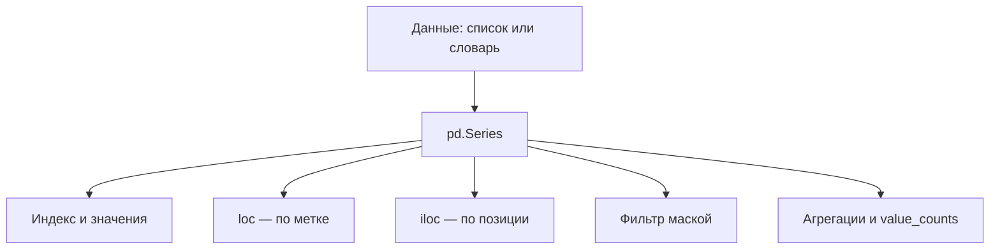

Привет! Мы продолжаем модуль «Анализ данных». NumPy даёт нам быстрые массивы, но для анализа данных хочется большего: чтобы у чисел были подписи, чтобы легко было фильтровать строки и считать статистику. Это умеет библиотека Pandas — самая популярная библиотека Python для работы с табличными данными.

## Что такое Series

В Pandas две основные структуры: **Series** (одномерная таблица) и **DataFrame** (двумерная таблица). В этом уроке мы разберём Series — она похожа на колонку таблицы, у которой есть собственные подписи — **индекс**.

Создадим первую Series:

```python
import pandas as pd

s = pd.Series([10, 20, 30])
print(s)
```

Вывод:

```
0    10
1    20
2    30
dtype: int64
```

Слева — индекс, справа — значения. По умолчанию индекс — это числа от 0 до n-1, но его можно задать свой:

```python
sales = pd.Series([120, 95, 110], index=["пн", "вт", "ср"])
print(sales)
```

Ещё удобнее создавать Series из словаря: ключи автоматически становятся индексом.

```python
sales = pd.Series({"пн": 120, "вт": 95, "ср": 110})
```

Такая запись читается естественно: «понедельник — 120 продаж».

## Доступ к элементам

У Series есть два способа обратиться к элементу. `loc` — по метке индекса, `iloc` — по числовой позиции:

```python
print(sales["вт"])     # 95 — то же, что sales.loc["вт"]
print(sales.iloc[1])   # 95 — элемент на позиции 1
print(sales[1:3])      # срез по позициям
```

Важно понимать разницу: `loc` работает с именем, `iloc` — с номером. Если индекс не числовой, `iloc` всё равно обратится по позиции.

## Операции и фильтрация

Series поддерживает векторные операции и сравнения, как массивы NumPy:

```python
print(sales * 1.1)            # увеличили каждое значение на 10%
print(sales[sales > 100])     # только дни, где продажи выше 100
```

Сравнение даёт булев Series, а передача его в квадратные скобки оставляет только те строки, где условие истинно. Это и есть фильтрация.

## Методы агрегации

У Series есть встроенные методы статистики: `mean`, `sum`, `max`, `min`, `std`, `describe`. Особенно полезны `idxmax` и `idxmin` — они возвращают **метку индекса** с максимальным или минимальным значением:

```python
print(sales.sum())        # общая сумма продаж
print(sales.mean())       # средние продажи в день
print(sales.idxmax())     # день с максимумом
print(sales.describe())   # сводная статистика
```

## value_counts и sort_values

Для категориальных данных незаменим `value_counts` — он считает частоты уникальных значений:

```python
colors = pd.Series(["красный", "синий", "красный", "зелёный", "красный"])
print(colors.value_counts())
```

А `sort_values` сортирует значения. Например, чтобы увидеть дни с наибольшими продажами первыми:

```python
print(sales.sort_values(ascending=False))
```

## Как устроена Series

Схема собирает основные способы работы с рядом в один маршрут.



## Итог урока

Мы научились:

- создавать Series из списков и словарей;
- обращаться к элементам через `loc` и `iloc`;
- фильтровать значения по условию;
- считать статистику и находить день с максимумом;
- считать частоты значений и сортировать ряды.

Теперь потренируемся на реальных данных.

<!--TASK-->
### Задача 1
В кафе записали продажи за неделю:

```python
sales = pd.Series({
    "пн": 120, "вт": 95, "ср": 110,
    "чт": 130, "пт": 175, "сб": 200, "вс": 180,
})
```

Напиши программу, которая:

1. выводит всю серию;
2. выводит день с максимальными продажами и саму сумму продаж в этот день (используй `idxmax`);
3. выводит только дни, где продажи выше 120;
4. выводит общую сумму за неделю и средние продажи в день, округлённые до двух знаков.

Ожидаемый вывод:

```
пн    120
вт     95
ср    110
чт    130
пт    175
сб    200
вс    180
dtype: int64
День с максимальными продажами: сб (200)
Дни с продажами выше 120:
чт    130
пт    175
сб    200
вс    180
dtype: int64
Итого за неделю: 1010, в среднем: 144.29
```

### Задача 2
У тебя есть выручка кафе по месяцам:

```python
revenue = pd.Series({
    "Январь": 120000, "Февраль": 135000, "Март": 142000,
    "Апрель": 128000,
})
```

Напиши программу, которая:

1. выводит выручку, отсортированную по убыванию через `sort_values(ascending=False)`;
2. выводит два лучших месяца через `head(2)`;
3. выводит месяц с максимальной выручкой через `idxmax()`.

Ожидаемый вывод:

```
Отсортировано по убыванию:
Март      142000
Февраль   135000
Апрель    128000
Январь    120000
dtype: int64
Два лучших месяца:
Март      142000
Февраль   135000
dtype: int64
Месяц с максимумом: Март
```

### Задача 3
У тебя есть Series с количеством дней в месяцах:

```python
months = pd.Series([31, 28, 31, 30, 31], index=["янв", "фев", "мар", "апр", "май"])
```

Напиши программу, которая:

1. выводит число дней в марте через `loc["мар"]`;
2. выводит первый и последний месяц через `iloc[0]` и `iloc[-1]`;
3. выводит январь и май одной выборкой через `loc[["янв", "май"]]`;
4. проверяет, есть ли «июн» в индексе (оператор `in`), и выводит результат.

Ожидаемый вывод:

```
Дней в марте: 31
Первый месяц: 31
Последний месяц: 31
Январь и май:
янв    31
май    31
dtype: int64
Есть ли июнь в индексе: False
```

### Задача 4
В кафе записан список заказов за день:

```python
orders = pd.Series(["кофе", "чай", "кофе", "сок", "кофе", "чай", "кофе", "сок", "чай", "лимонад"])
```

Напиши программу, которая:

1. выводит частоты каждого напитка через `value_counts()`;
2. выводит самый частый напиток через `idxmax()` и его количество через `max()`.

Ожидаемый вывод:

```
Частоты заказов:
кофе       4
чай        3
сок        2
лимонад    1
dtype: int64
Самый частый заказ: кофе (4)
```

### Задача 5
В спортзале записали вес участников в килограммах:

```python
weights = pd.Series({"Аня": 58.5, "Боря": 74.2, "Витя": 81.0, "Галя": 63.7})
```

Напиши программу, которая:

1. переводит вес в фунты (умножь на 2.20462) и округляет до одного знака через метод `round(1)`;
2. выводит средний вес в килограммах, округлённый до двух знаков;
3. выводит через запятую имена участников с весом выше 70 кг (используй маску и `index`).

Ожидаемый вывод:

```
Вес в фунтах:
Аня     129.0
Боря    163.6
Витя    178.6
Галя    140.4
dtype: float64
Средний вес: 69.35
Вес более 70 кг: Боря, Витя
```

### Задача 6
Есть Series с числом посетителей сайта по дням:

```python
visitors = pd.Series({"пн": 120, "вт": 150, "ср": 90, "чт": 210, "пт": 180})
```

Напиши программу, которая:

1. выводит нарастающий итог за неделю через `cumsum()` списком;
2. выводит дневной прирост через `diff()`, заменив первый `NaN` нулём, и приводит его к целым (`fillna(0).astype(int)`);
3. находит день с максимальным приростом через `idxmax()` и выводит его вместе со значением;
4. считает, какую долю от всех посетителей дал этот день, в процентах с одним знаком.

Ожидаемый вывод:

```
Нарастающий итог: [120, 270, 360, 570, 750]
Прирост: [0, 30, -60, 120, -30]
Лучший прирост: чт (+120)
Доля этого дня: 28.0%
```

### Задача 7
Дан список email-адресов клиентов:

```python
emails = pd.Series([
    "ivan@mail.ru", "petr@gmail.com", "olga@mail.ru", "max@yandex.ru",
])
```

Напиши программу, которая:

1. выводит длину каждого адреса через `emails.str.len()` списком;
2. достаёт домены через `emails.str.split("@").str[1]` и выводит частоты доменов словарём (`value_counts().to_dict()`);
3. считает долю адресов на `mail.ru` в процентах с одним знаком;
4. считает, сколько адресов начинаются с буквы `i`, через `emails.str.startswith("i").sum()`.

Ожидаемый вывод:

```
Длины адресов: [12, 14, 12, 14]
Домены: {'mail.ru': 2, 'gmail.com': 1, 'yandex.ru': 1}
Доля mail.ru: 50.0%
Адресов на i: 1
```

<!--/TASK-->

<!--HINT-->
### Подсказка 1
Используй `sales.idxmax()` — она вернёт метку дня, а не число. Чтобы получить сумму продаж в этот день, подставь метку в `sales.loc[...]`. Для фильтрации сравни `sales` с 120 и передай результат в квадратные скобки. Среднее форматируй через `f"{sales.mean():.2f}"`.

### Подсказка 2
`sort_values(ascending=False)` вернёт новую серию — сохрани её в переменную. `head(2)` берёт первые две строки уже отсортированной серии. `idxmax()` возвращает метку индекса максимального значения.

### Подсказка 3
Для выбора по метке используй `loc`, по позиции — `iloc`. Список меток передаётся в `loc` как список: `loc[["янв", "май"]]`. Проверка наличия метки: `"июн" in months.index`.

### Подсказка 4
`orders.value_counts()` считает частоты и сортирует по убыванию. Индекс результата — это сами напитки, поэтому `idxmax()` вернёт название самого частого напитка, а `max()` — его количество.

### Подсказка 5
К серии применяй арифметику сразу: `weights * 2.20462` — новый Series, у него вызови `.round(1)`. Для фильтрации используй `weights[weights > 70]`, а имена получи через `[...].index` и соедини через `", ".join(...)`.

### Подсказка 6
`visitors.cumsum()` возвращает новый ряд с накопленной суммой. `visitors.diff()` считает разность с предыдущим элементом, поэтому первый элемент — `NaN`: замени его через `fillna(0)` и приведи к целым `astype(int)`. Максимум разностей ищи на всём ряду `visitors.diff()` (без fillna) — `idxmax()` и так проигнорирует `NaN`. Долю считай как `visitors["чт"] / visitors.sum() * 100`.

### Подсказка 7
Аксессор `.str` даёт векторные строковые методы для всей Series сразу. `emails.str.split("@")` возвращает список частей в каждой строке, а `.str[1]` берёт вторую часть — домен. Частоты — `value_counts()`, словарь — `.to_dict()`. Доля считается как `(domains == "mail.ru").mean() * 100`: среднее булева ряда равно доле истинных значений.

<!--/HINT-->

<!--SOLUTION-->
### Разбор 1
Полное решение:

```python
import pandas as pd

sales = pd.Series({
    "пн": 120, "вт": 95, "ср": 110,
    "чт": 130, "пт": 175, "сб": 200, "вс": 180,
})

print(sales)

best_day = sales.idxmax()
best_value = sales.loc[best_day]
print(f"День с максимальными продажами: {best_day} ({best_value})")

print("Дни с продажами выше 120:")
print(sales[sales > 120])

week_total = sales.sum()
week_mean = sales.mean()
print(f"Итого за неделю: {week_total}, в среднем: {week_mean:.2f}")
```

Разберём решение по шагам. Сначала мы создаём Series из словаря: ключи становятся индексом, значения — данными. Затем `idxmax()` находит метку индекса с максимальным значением. Важно, что это именно метка («сб»), а не позиция, поэтому и получить значение нужно через `sales.loc[best_day]` — иначе `iloc` взял бы шестой по счёту элемент, что тоже дало бы 200, но в общем случае совпадение не гарантировано.

Фильтрация `sales[sales > 120]` работает так: сравнение порождает булев Series, а передача его в квадратные скобки оставляет только строки, где условие истинно. В результате остаются четверг, пятница, суббота и воскресенье. Наконец, `sum()` и `mean()` считают сумму и среднее по всем значениям, а формат `:.2f` округляет вывод: 144,2857… превращается в 144.29.

Такая комбинация методов покрывает большинство повседневных задач анализа: найти максимум, отфильтровать данные и подсчитать сводные показатели.

### Разбор 2
Полное решение:

```python
import pandas as pd

revenue = pd.Series({
    "Январь": 120000, "Февраль": 135000, "Март": 142000,
    "Апрель": 128000,
})

sorted_revenue = revenue.sort_values(ascending=False)
print("Отсортировано по убыванию:")
print(sorted_revenue)

print("Два лучших месяца:")
print(sorted_revenue.head(2))

print("Месяц с максимумом:", revenue.idxmax())
```

Разберём по шагам. `sort_values(ascending=False)` возвращает новую серию, отсортированную по значениям от больших к меньшим: март (142000), февраль (135000), апрель (128000), январь (120000). Важно: исходная серия `revenue` при этом не меняется — Pandas почти всегда возвращает новую копию, а не изменяет оригинал. Поэтому мы сохраняем результат в `sorted_revenue`.

`head(2)` берёт первые две строки отсортированной серии — это и есть два лучших месяца. Метод `idxmax()` применяется уже к исходной серии и возвращает метку индекса максимального значения: «Март». Обрати внимание: если бы максимальных значений было несколько, `idxmax()` вернул бы первое из них. Такой приём удобно использовать, чтобы быстро назвать «лучший месяц», «лучший день» или «лучший офис» по любому числовому ряду.

### Разбор 3
Полное решение:

```python
import pandas as pd

months = pd.Series([31, 28, 31, 30, 31], index=["янв", "фев", "мар", "апр", "май"])

print("Дней в марте:", months.loc["мар"])
print("Первый месяц:", months.iloc[0])
print("Последний месяц:", months.iloc[-1])
print("Январь и май:")
print(months.loc[["янв", "май"]])
print("Есть ли июнь в индексе:", "июн" in months.index)
```

Разберём по шагам. `months.loc["мар"]` обращается к элементу по метке индекса и возвращает 31. `iloc` работает с числовыми позициями независимо от того, какие метки стоят в индексе: `iloc[0]` — первый элемент (январь, 31), `iloc[-1]` — последний (май, 31), отрицательные индексы отсчитываются с конца.

`loc[["янв", "май"]]` принимает список меток и возвращает новую серию из двух элементов — это удобно, когда нужна целая подвыборка, а не один элемент. Наконец, оператор `"июн" in months.index` проверяет наличие метки в индексе и возвращает `False`, так как «июн» в нашей серии нет. Такой проверкой стоит пользоваться перед `loc`, чтобы избежать ошибки `KeyError`.

### Разбор 4
Полное решение:

```python
import pandas as pd

orders = pd.Series(["кофе", "чай", "кофе", "сок", "кофе", "чай", "кофе", "сок", "чай", "лимонад"])

counts = orders.value_counts()
print("Частоты заказов:")
print(counts)

most_common = counts.idxmax()
print(f"Самый частый заказ: {most_common} ({counts.max()})")
```

Разберём по шагам. `orders.value_counts()` считает, сколько раз встречается каждое уникальное значение, и возвращает новую серию: индекс — это сами напитки, а значения — их частоты. По умолчанию результат отсортирован по убыванию частоты: кофе (4), чай (3), сок (2), лимонад (1). Именно поэтому `head()` на таком результате сразу покажет самые частые значения.

Затем мы работаем с результатом как с обычной серией: `counts.idxmax()` возвращает метку индекса с максимальным значением — «кофе», а `counts.max()` — само максимальное значение 4. Обрати внимание: `max()` тут применён к частотам, а не к исходному списку заказов. Такой приём «посчитать частоты, найти самый частый элемент» — основа анализа категориальных данных: логи, теги, города, товары.

### Разбор 5
Полное решение:

```python
import pandas as pd

weights = pd.Series({"Аня": 58.5, "Боря": 74.2, "Витя": 81.0, "Галя": 63.7})

pounds = (weights * 2.20462).round(1)
print("Вес в фунтах:")
print(pounds)

print(f"Средний вес: {weights.mean():.2f}")

heavy = weights[weights > 70]
print("Вес более 70 кг:", ", ".join(heavy.index))
```

Разберём по шагам. `weights * 2.20462` умножает каждое значение серии на коэффициент — векторизация работает точно так же, как в NumPy, без циклов. Метод `.round(1)` округляет все значения до одного знака: 58.5 × 2.20462 = 128.97… → 129.0, 74.2 × 2.20462 = 163.58… → 163.6 и так далее.

`weights.mean()` считает среднее арифметическое: (58.5 + 74.2 + 81.0 + 63.7) ÷ 4 = 69.35. Маска `weights[weights > 70]` оставляет только участников тяжелее 70 кг — Борю и Витю. У отфильтрованной серии мы берём `index` — это метки оставшихся элементов, то есть имена, — и соединяем их через запятую функцией `", ".join(...)`. Так мы вытащили из данных не только числа, но и связанные с ними подписи, что и есть главное отличие Pandas от чистого NumPy.

### Разбор 6
Полное решение:

```python
import pandas as pd

visitors = pd.Series({"пн": 120, "вт": 150, "ср": 90, "чт": 210, "пт": 180})

print("Нарастающий итог:", visitors.cumsum().tolist())

growth = visitors.diff()
print("Прирост:", growth.fillna(0).astype(int).tolist())

best = growth.idxmax()
print(f"Лучший прирост: {best} (+{int(growth.max())})")

share = visitors["чт"] / visitors.sum() * 100
print(f"Доля этого дня: {share:.1f}%")
```

Разберём по шагам. `cumsum()` накапливает сумму по порядку индекса: 120, затем 120+150=270, 270+90=360, 360+210=570 и 750 в конце. Это стандартный способ построить «бегущий итог» для отчёта или графика накопленных продаж. Метод `diff()` считает разность текущего элемента с предыдущим: 150−120=30, 90−150=−60, 210−90=120, 180−210=−30. У первого элемента предыдущего нет, поэтому там появляется `NaN` — его мы заменяем нулём и приводим ряд к целым, чтобы вывод был чище.

Важный момент: для поиска лучшего дня мы работаем с исходным `growth`, а не с заполненной копией — `idxmax()` сам пропускает `NaN` и никогда не выберет первый день по умолчанию. Получаем «чт» и +120. Последний шаг — доля дня в общем трафике: 210 ÷ 750 × 100 = 28.0%. Формат `:.1f` даёт ровно один знак. Связка «накопленная сумма + прирост» — базовый инструмент анализа временных рядов.

### Разбор 7
Полное решение:

```python
import pandas as pd

emails = pd.Series([
    "ivan@mail.ru", "petr@gmail.com", "olga@mail.ru", "max@yandex.ru",
])

print("Длины адресов:", emails.str.len().tolist())

domains = emails.str.split("@").str[1]
counts = domains.value_counts()
print("Домены:", counts.to_dict())

share = (domains == "mail.ru").mean() * 100
print(f"Доля mail.ru: {share:.1f}%")

print("Адресов на i:", emails.str.startswith("i").sum())
```

Разберём по шагам. Аксессор `.str` — это «векторизация для строк»: методы вроде `len`, `split`, `contains`, `lower` применяются сразу ко всем элементам ряда, а на месте пропусков аккуратно возвращается `NaN`. `emails.str.split("@")` даёт ряд списков, а повторный `.str[1]` берёт из каждого списка вторую часть — так мы одним движением получаем колонку доменов без единого цикла.

`value_counts()` на доменах считает частоты: два адреса на mail.ru и по одному на gmail.com и yandex.ru. `to_dict()` превращает результат в обычный словарь — удобно, когда нужен предсказуемый однострочный вывод. Доля считается через среднее булева ряда: `(domains == "mail.ru")` даёт `True/False`, а `mean()` превращает их в доли 1 и 0, умножаем на 100 и получаем 50.0%. Аналогично `startswith("i").sum()` складывает единицы и даёт 1 — начинается только «ivan». Такие цепочки `.str`-методов — типовой способ разобрать текстовый столбец на признаки перед анализом.

<!--/SOLUTION-->

<!--QUIZ-->
Что такое Series в Pandas?
- Двумерная таблица со строками и столбцами
- Одномерная структура данных с индексом
- Встроенный тип Python
* Правильный ответ: Одномерная структура данных с индексом
Series похожа на колонку таблицы: слева индекс, справа значения. Двумерная таблица называется DataFrame.

Чем loc отличается от iloc?
- loc работает по меткам индекса, iloc — по числовым позициям
- loc работает только с числами, iloc — со строками
- Это синонимы
* Правильный ответ: loc работает по меткам индекса, iloc — по числовым позициям
loc выбирает элементы по именам, iloc — по позициям, независимо от того, какие метки стоят в индексе.

Что вернёт выражение sales[sales > 100]?
- Среднее значение продаж
- Только дни, где продажи выше 100
- Ошибку
* Правильный ответ: Только дни, где продажи выше 100
Сравнение создаёт булев Series, а передача его в квадратные скобки оставляет только строки, где условие истинно.

Что возвращает метод idxmax()?
- Максимальное значение
- Метку индекса с максимальным значением
- Номер строки с максимумом
* Правильный ответ: Метку индекса с максимальным значением
idxmax возвращает именно метку (например, «сб»), а не число; само значение получается через loc[метка].

Что делает value_counts()?
- Сортирует значения по возрастанию
- Считает частоты уникальных значений
- Удаляет дубликаты
* Правильный ответ: Считает частоты уникальных значений
value_counts возвращает серию, где индекс — уникальные значения, а значения — сколько раз каждое встретилось.

Как создать Series из словаря?
- pd.Series({"пн": 120, "вт": 95})
- pd.Series(["пн", 120, "вт", 95])
- pd.DataFrame({"пн": 120})
* Правильный ответ: pd.Series({"пн": 120, "вт": 95})
Ключи словаря автоматически становятся индексом серии, а значения — данными.

Что сделает sales.sort_values(ascending=False)?
- Отсортирует значения по убыванию
- Отсортирует индекс по алфавиту
- Удалит дубликаты
* Правильный ответ: Отсортирует значения по убыванию
sort_values возвращает новую серию, отсортированную по значениям; ascending=False задаёт порядок от больших к меньшим, а исходная серия при этом не меняется.

Что возвращает sales.describe()?
- Сводную статистику: count, mean, std, min, квартили и max
- Первые пять значений серии
- Только среднее значение
* Правильный ответ: Сводную статистику: count, mean, std, min, квартили и max
describe одной командой считает основные числовые характеристики ряда — удобно для быстрого осмотра данных.

Что вернёт s.iloc[-1]?
- Последний элемент по позиции
- Элемент с меткой -1
- Ошибку, отрицательные позиции запрещены
* Правильный ответ: Последний элемент по позиции
iloc работает с числовыми позициями, а отрицательные значения отсчитываются с конца, как в списках Python.

Как посчитать количество пропусков в Series?
- s.isna().sum()
- s.sum()
- s.count()
* Правильный ответ: s.isna().sum()
isna возвращает булев ряд, где True отмечает пропуск; сумма таких True и есть число пропусков.

Чем sort_index отличается от sort_values?
- sort_index сортирует по меткам индекса, sort_values — по значениям
- sort_index удаляет индекс
- Это одно и то же
* Правильный ответ: sort_index сортирует по меткам индекса, sort_values — по значениям
Если нужен порядок по названиям дней или месяцев — это sort_index; если по величине показателя — sort_values.

Что делает s.astype(float)?
- Возвращает новую серию с типом float
- Округляет значения до целых
- Меняет индекс на числа
* Правильный ответ: Возвращает новую серию с типом float
astype приводит тип данных значений и, как почти все операции Pandas, возвращает новый объект, не меняя исходный.

<!--/QUIZ-->
