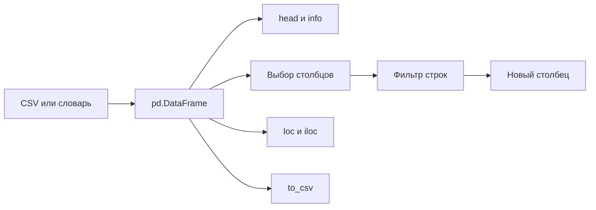

Привет! Мы уже умеем работать с одномерной Series. Но настоящие данные — это таблицы: много строк и много столбцов. Для них в Pandas существует **DataFrame** — двумерная структура, где каждая колонка является Series. Сегодня мы научимся создавать таблицы, выбирать из них данные и читать файлы.

## Что такое DataFrame

DataFrame — это таблица со строками и столбцами. У неё есть индекс строк и имена столбцов. Представь таблицу в Excel — вот это и есть DataFrame.

Создадим таблицу студентов из словаря, где каждый ключ — это имя столбца:

```python
import pandas as pd

students = pd.DataFrame({
    "имя": ["Аня", "Боря", "Витя"],
    "балл": [85, 92, 78],
    "город": ["Москва", "Казань", "Москва"],
})
print(students)
```

Вывод:

```
    имя  балл     город
0  Аня    85  Москва
1  Боря    92  Казань
2  Витя    78  Москва
```

Каждая колонка — это Series, поэтому к ней можно применять всё, что мы выучили в прошлом уроке:

```python
print(students["балл"].mean())   # 85.0
```

## Знакомство с таблицей

Для быстрого осмотра есть удобные методы:

```python
print(students.head(2))    # первые 2 строки
print(students.tail(2))    # последние 2 строки
print(students.shape)      # (3, 3) — строки и столбцы
print(students.info())     # типы данных и непропущенные значения
print(students.describe()) # статистика по числовым столбцам
```

`info()` особенно полезен: он сразу показывает, есть ли пропуски и какого типа каждая колонка.

## Выбор столбцов

Одна колонка выбирается через квадратные скобки со строкой — получается Series:

```python
print(students["имя"])       # Series
print(students[["имя", "балл"]])  # DataFrame из двух столбцов
```

Обрати внимание: список внутри скобок возвращает именно DataFrame, а не Series.

## Фильтрация строк

Строки фильтруются так же, как в Series, — по условию на столбец:

```python
print(students[students["балл"] > 80])
```

Булев Series, получившийся из сравнения, отбирает только строки, где балл выше 80. Это Аня и Боря.

## loc и iloc

Для точной выборки по меткам и позициям используются `loc` и `iloc`:

```python
print(students.iloc[0])            # первая строка (Series)
print(students.loc[1, "имя"])      # "Боря" — строка 1, столбец "имя"
print(students.iloc[1:, :2])       # строки с 1-й, столбцы до 2-го
```

В `loc` порядок такой: сначала строки, потом столбцы.

## Добавление столбцов

Новый столбец добавляется простым присваиванием:

```python
students["статус"] = ["отлично", "отлично", "хорошо"]
students["удвоенный балл"] = students["балл"] * 2
```

## Чтение данных из файлов

Чаще всего данные приходят не из словаря, а из файлов. Самый популярный формат — CSV (comma-separated values). Читается он одной функцией:

```python
df = pd.read_csv("data.csv")
print(df.head())
```

Внутри курса удобно тренироваться без файлов: можно «скормить» DataFrame строку CSV через `io.StringIO`:

```python
import io

csv_text = """имя,балл,город
Аня,85,Москва
Боря,92,Казань
Витя,78,Москва
"""
df = pd.read_csv(io.StringIO(csv_text))
```

Это полностью рабочая техника: Pandas не отличает такой источник от файла. Сохранить таблицу обратно можно через `df.to_csv("result.csv", index=False)`.

## Как устроена работа с таблицей

Схема показывает путь от источника данных до готового результата.



## Итог урока

Мы научились:

- создавать DataFrame из словаря;
- осматривать таблицу через `head`, `info`, `describe`;
- выбирать столбцы и фильтровать строки;
- работать с `loc` и `iloc`;
- добавлять новые столбцы;
- читать CSV-файлы.

Теперь закрепим всё практикой.

<!--TASK-->
### Задача 1
У тебя есть данные о сотрудниках в виде CSV-текста:

```python
import io
import pandas as pd

csv_text = """имя,отдел,зарплата
Иван,ИТ,85000
Мария,HR,65000
Пётр,ИТ,90000
Ольга,Финансы,78000
Сергей,ИТ,72000
"""
```

Напиши программу, которая:

1. читает DataFrame из `csv_text` через `io.StringIO`;
2. выводит первые две строки таблицы;
3. выводит среднюю зарплату по всем сотрудникам;
4. выводит сотрудников с зарплатой выше 70 000;
5. добавляет столбец `бонус` — 10% от зарплаты, округлённые до целых, и выводит всю таблицу.

Ожидаемый вывод:

```
Первые две строки:
    имя отдел  зарплата
0  Иван   ИТ      85000
1 Мария  HR      65000
Средняя зарплата: 78000.0
Сотрудники с зарплатой выше 70000:
      имя  отдел  зарплата
0    Иван    ИТ      85000
2   Пётр    ИТ      90000
3  Ольга  Финансы    78000
4 Сергей    ИТ      72000
С бонусом:
      имя  отдел  зарплата   бонус
0    Иван    ИТ      85000   8500.0
1   Мария    HR      65000   6500.0
2   Пётр    ИТ      90000   9000.0
3  Ольга  Финансы    78000   7800.0
4 Сергей    ИТ      72000   7200.0
```

### Задача 2
Создай DataFrame с товарами магазина:

```python
products = pd.DataFrame({
    "товар": ["Кофе", "Чай", "Сок", "Печенье"],
    "цена": [250, 150, 120, 180],
    "количество": [2, 5, 3, 1],
})
```

Напиши программу, которая:

1. добавляет столбец `стоимость` как произведение цены на количество;
2. выводит заказы дороже 400 рублей;
3. сортирует их по стоимости по убыванию:
4. выводит товар с максимальной стоимостью через `idxmax()`.

Ожидаемый вывод:

```
Заказы дороже 400 руб.:
  товар  цена  количество  стоимость
1  Чай   150           5        750
0  Кофе  250           2        500
Самый дорогой заказ: Чай (750)
```

### Задача 3
У тебя есть таблица студентов:

```python
students = pd.DataFrame({
    "имя": ["Аня", "Боря", "Витя", "Галя"],
    "балл": [85, 92, 78, 88],
    "город": ["Москва", "Казань", "Москва", "СПб"],
})
```

Напиши программу, которая:

1. выводит первую строку через `iloc[0]`;
2. выводит имя студента под индексом 2 через `loc[2, "имя"]`;
3. выводит строки с 1-й по 2-ю и столбцы до второго через `iloc[1:3, :2]`;
4. выводит только имена и баллы студентов с баллом выше 85.

Ожидаемый вывод:

```
Первая строка:
имя      Аня
балл     85
город    Москва
Name: 0, dtype: object
Студент под индексом 2: Витя
Строки 1-2, столбцы до 2-го:
    имя  балл
1  Боря    92
2  Витя    78
Студенты с баллом выше 85:
    имя  балл
1  Боря    92
3  Галя    88
```

### Задача 4
Данные пришли в CSV с разделителем «точка с запятой»:

```python
import io
import pandas as pd

csv_text = """товар;цена;скидка
Кофе;250;0.1
Чай;150;0.05
Сок;120;0.0
"""
```

Напиши программу, которая:

1. читает DataFrame через `pd.read_csv(io.StringIO(csv_text), sep=";")`;
2. выводит таблицу и типы данных (`dtypes`);
3. добавляет столбец `цена_со_скидкой` = цена × (1 − скидка), округлённый до двух знаков, и выводит его.

Ожидаемый вывод:

```
    товар   цена  скидка
0  Кофе    250    0.10
1  Чай     150    0.05
2  Сок     120    0.00
Типы данных:
товар     object
цена       int64
скидка    float64
dtype: object
Цена со скидкой:
0    225.0
1    142.5
2    120.0
dtype: float64
```

### Задача 5
У тебя есть данные о сотрудниках:

```python
import numpy as np
import pandas as pd

employees = pd.DataFrame({
    "имя": ["Иван", "Мария", "Пётр", "Ольга"],
    "отдел": ["ИТ", "HR", "ИТ", "Финансы"],
    "зарплата": [85000, 65000, 90000, 78000],
})
```

Напиши программу, которая:

1. выводит размер таблицы через `shape`;
2. выводит среднюю зарплату по каждому отделу через `groupby`;
3. добавляет столбец `бонус`: 10% от зарплаты для отдела «ИТ» и 5% для остальных (используй `np.where`);
4. выводит имена и бонусы всех сотрудников.

Ожидаемый вывод:

```
Размер таблицы: (4, 3)
Средняя зарплата по отделам:
отдел
HR          65000.0
ИТ          87500.0
Финансы     78000.0
Name: зарплата, dtype: float64
Бонусы:
     имя     бонус
0   Иван   8500.0
1  Мария   3250.0
2  Пётр   9000.0
3  Ольга  3900.0
```

### Задача 6
Есть таблица заказов интернет-магазина:

```python
orders = pd.DataFrame({
    "город": ["Москва", "Казань", "Москва", "СПб", "Казань", "Москва"],
    "сумма": [5000, 3000, 7000, 2000, 4500, 6000],
})
```

Напиши программу, которая:

1. считает суммарную выручку по каждому городу через `groupby("город")["сумма"].sum()` и выводит результат словарём;
2. считает число заказов в каждом городе через `groupby("город").size()` и тоже выводит словарём;
3. считает средний чек по городам, округляя до одного знака, и выводит словарём;
4. выводит город с максимальной суммарной выручкой через `idxmax()`.

Для перевода результата в словарь используй `.to_dict()`.

Ожидаемый вывод:

```
Сумма по городам: {'Казань': 7500, 'Москва': 18000, 'СПб': 2000}
Заказов по городам: {'Казань': 2, 'Москва': 3, 'СПб': 1}
Средний чек: {'Казань': 3750.0, 'Москва': 6000.0, 'СПб': 2000.0}
Лучший город: Москва
```

### Задача 7
Данные пришли из CSV, и в них есть пропуски:

```python
import io
import pandas as pd

csv_text = """товар,цена,количество
Кофе,250,10
Чай,,5
Сок,120,
Печенье,180,8
"""
df = pd.read_csv(io.StringIO(csv_text))
```

Напиши программу, которая:

1. выводит число пропусков по каждому столбцу через `df.isna().sum().to_dict()`;
2. считает, сколько строк содержат хотя бы один пропуск (`df.isna().any(axis=1).sum()`);
3. выводит среднюю цену по непустым значениям с двумя знаками (Pandas пропускает `NaN` автоматически);
4. заменяет все пропуски нулями через `df.fillna(0)` и выводит столбец выручки `цена * количество` списком.

Ожидаемый вывод:

```
Пропуски по столбцам: {'товар': 0, 'цена': 1, 'количество': 1}
Строк с пропусками: 2
Средняя цена без пропусков: 183.33
Выручка после заполнения: [2500, 0, 0, 1440]
```

<!--/TASK-->

<!--HINT-->
### Подсказка 1
Читай данные так: `df = pd.read_csv(io.StringIO(csv_text))`. Для первых строк используй `df.head(2)`. Среднее по столбцу — `df["зарплата"].mean()`. Фильтрация — `df[df["зарплата"] > 70000]`. Новый столбец: `df["бонус"] = (df["зарплата"] * 0.1).round(0)`.

### Подсказка 2
Столбец `стоимость` добавь присваиванием: `products["стоимость"] = products["цена"] * products["количество"]`. Затем отфильтруй `products[products["стоимость"] > 400]` и отсортируй через `sort_values("стоимость", ascending=False)`.

### Подсказка 3
`iloc[0]` вернёт первую строку как Series, `loc[2, "имя"]` — одно значение. Срез `iloc[1:3, :2]` — строки с 1-й по 2-ю и первые два столбца. Фильтр с двумя столбцами: `students.loc[students["балл"] > 85, ["имя", "балл"]]`.

### Подсказка 4
Не забудь параметр `sep=";"` в `read_csv`. Типы данных смотри через `df.dtypes`. Новый столбец: `df["цена_со_скидкой"] = (df["цена"] * (1 - df["скидка"])).round(2)`.

### Подсказка 5
`employees.shape` вернёт кортеж. Группировка: `employees.groupby("отдел")["зарплата"].mean()`. Для бонуса используй `np.where(employees["отдел"] == "ИТ", 0.1, 0.05)` и умножь на зарплату. Выведи `employees[["имя", "бонус"]]`.

### Подсказка 6
Группировка возвращает Series с индексом из значений столбца: `orders.groupby("город")["сумма"].sum()`. Для количества используй `groupby("город").size()`. Средний чек — `groupby("город")["сумма"].mean().round(1)`. `.to_dict()` даёт предсказуемый однострочный вывод. Максимум ищи через `.idxmax()` на сумме.

### Подсказка 7
`df.isna()` возвращает таблицу из `True/False`, `.sum()` считает `True` по столбцам, а `axis=1` в `any` — по строкам. `df["цена"].mean()` по умолчанию игнорирует `NaN`, поэтому даёт среднее трёх чисел. `df.fillna(0)` возвращает новую таблицу; сохрани её в переменную и уже там считай `цена * количество`, а результат выведи через `.tolist()`.

<!--/HINT-->

<!--SOLUTION-->
### Разбор 1
Полное решение:

```python
import io
import pandas as pd

csv_text = """имя,отдел,зарплата
Иван,ИТ,85000
Мария,HR,65000
Пётр,ИТ,90000
Ольга,Финансы,78000
Сергей,ИТ,72000
"""

df = pd.read_csv(io.StringIO(csv_text))

print("Первые две строки:")
print(df.head(2))

print(f"Средняя зарплата: {df['зарплата'].mean()}")

print("Сотрудники с зарплатой выше 70000:")
print(df[df["зарплата"] > 70000])

df["бонус"] = (df["зарплата"] * 0.1).round(0)
print("С бонусом:")
print(df)
```

Разберём по шагам. `pd.read_csv(io.StringIO(csv_text))` превращает строку с CSV в полноценный DataFrame: первая строка текста становится именами столбцов, остальные — данными. `df.head(2)` показывает первые две строки для быстрого осмотра.

`df["зарплата"].mean()` берёт столбец как Series и считает среднее: (85000 + 65000 + 90000 + 78000 + 72000) ÷ 5 = 78000. Фильтрация `df[df["зарплата"] > 70000]` оставляет только строки, где значение столбца больше 70 000, — Мария с 65 000 отсеивается.

Наконец, `df["бонус"] = (df["зарплата"] * 0.1).round(0)` создаёт новый столбец: каждая зарплата умножается на 0.1 (10%), а `.round(0)` округляет до целых. Так мы получили таблицу с четырьмя столбцами и наглядно увидели, как легко Pandas позволяет добавлять производные данные. Именно так выглядит типичный первый шаг анализа: прочитать файл, осмотреть данные, отфильтровать и обогатить таблицу.

### Разбор 2
Полное решение:

```python
import pandas as pd

products = pd.DataFrame({
    "товар": ["Кофе", "Чай", "Сок", "Печенье"],
    "цена": [250, 150, 120, 180],
    "количество": [2, 5, 3, 1],
})

products["стоимость"] = products["цена"] * products["количество"]

expensive = products[products["стоимость"] > 400]
sorted_expensive = expensive.sort_values("стоимость", ascending=False)
print("Заказы дороже 400 руб.:")
print(sorted_expensive)

best = sorted_expensive["стоимость"].idxmax()
print(f"Самый дорогой заказ: {sorted_expensive.loc[best, 'товар']} ({sorted_expensive.loc[best, 'стоимость']})")
```

Разберём по шагам. `products["стоимость"] = products["цена"] * products["количество"]` добавляет новый столбец: для каждой строки цена умножается на количество, в результате кофе даёт 500, чай — 750, сок — 360, печенье — 180.

Фильтрация `products[products["стоимость"] > 400]` оставляет только кофе и чай — у сока и печенья стоимость ниже. Метод `sort_values("стоимость", ascending=False)` сортирует оставшиеся строки по стоимости по убыванию, поэтому первым идёт чай (750), затем кофе (500).

`idxmax()` возвращает индекс строки с максимальной стоимостью в отсортированной таблице — это 1. По этому индексу через `loc` мы достаём и название товара («Чай»), и его стоимость (750). Так добавляется новый производный столбец, фильтруется и сортируется таблица и находится «победитель» — три самых частых действия в любом отчётном анализе.

### Разбор 3
Полное решение:

```python
import pandas as pd

students = pd.DataFrame({
    "имя": ["Аня", "Боря", "Витя", "Галя"],
    "балл": [85, 92, 78, 88],
    "город": ["Москва", "Казань", "Москва", "СПб"],
})

print("Первая строка:")
print(students.iloc[0])

print("Студент под индексом 2:", students.loc[2, "имя"])

print("Строки 1-2, столбцы до 2-го:")
print(students.iloc[1:3, :2])

print("Студенты с баллом выше 85:")
print(students.loc[students["балл"] > 85, ["имя", "балл"]])
```

Разберём по шагам. `students.iloc[0]` возвращает первую строку как Series: индекс серии — это имена столбцов, а значения — данные строки. `students.loc[2, "имя"]` обращается по метке строки 2 и столбцу «имя» и возвращает «Витя».

`students.iloc[1:3, :2]` — комбинированный срез: строки с 1-й по 2-ю (третья не входит), столбцы от начала до второго (имя и балл). На выходе — маленький DataFrame с Борей и Витей.

Наконец, `students.loc[students["балл"] > 85, ["имя", "балл"]]` объединяет фильтрацию строк и выбор столбцов: сначала булев Series отбирает строки, где балл выше 85 (Боря и Галя), затем список столбцов ограничивает вывод только именем и баллом. В `loc` первый аргумент — всегда строки (маска или срез), второй — столбцы.

### Разбор 4
Полное решение:

```python
import io
import pandas as pd

csv_text = """товар;цена;скидка
Кофе;250;0.1
Чай;150;0.05
Сок;120;0.0
"""

df = pd.read_csv(io.StringIO(csv_text), sep=";")

print(df)
print("Типы данных:")
print(df.dtypes)

df["цена_со_скидкой"] = (df["цена"] * (1 - df["скидка"])).round(2)
print("Цена со скидкой:")
print(df["цена_со_скидкой"])
```

Разберём по шагам. Параметр `sep=";"` говорит Pandas, что столбцы в файле разделяются не запятой, а точкой с запятой — без него вся строка попала бы в один столбец. `df.dtypes` показывает тип каждого столбца: `товар` — текст (object), `цена` — целые числа (int64), `скидка` — вещественные (float64).

Новый столбец `цена_со_скидкой` считается векторизованно: `df["цена"] * (1 - df["скидка"])` умножает каждую цену на соответствующий коэффициент. Для кофе: 250 × 0.9 = 225.0, для чая: 150 × 0.95 = 142.5, для сока: 120 × 1.0 = 120.0. `.round(2)` подстраховывает от ошибок плавающей точки. Пустой пропуск между выводами — это просто перевод строки в `print()`, чтобы вывод читался так же, как в ожидаемом результате.

### Разбор 5
Полное решение:

```python
import numpy as np
import pandas as pd

employees = pd.DataFrame({
    "имя": ["Иван", "Мария", "Пётр", "Ольга"],
    "отдел": ["ИТ", "HR", "ИТ", "Финансы"],
    "зарплата": [85000, 65000, 90000, 78000],
})

print("Размер таблицы:", employees.shape)

print("Средняя зарплата по отделам:")
print(employees.groupby("отдел")["зарплата"].mean())

employees["бонус"] = np.where(employees["отдел"] == "ИТ", 0.1, 0.05) * employees["зарплата"]
print("Бонусы:")
print(employees[["имя", "бонус"]])
```

Разберём по шагам. `employees.shape` возвращает кортеж `(4, 3)` — четыре строки и три столбца. `groupby("отдел")["зарплата"].mean()` разбивает таблицу на группы по отделу и считает среднюю зарплату в каждой: HR — 65000, ИТ — (85000 + 90000) ÷ 2 = 87500, Финансы — 78000. Результат — DataFrame с индексом из отделов.

`np.where(...employees["отдел"] == "ИТ", 0.1, 0.05)` возвращает массив коэффициентов: 0.1 для строк с отделом «ИТ» и 0.05 для остальных. Умножение на `employees["зарплата"]` даёт бонусы: Иван — 8500, Мария — 3250, Пётр — 9000, Ольга — 3900. `employees[["имя", "бонус"]]` выбирает только нужные столбцы для вывода. Так `np.where` позволяет применять разные правила к разным группам строк одной операцией.

### Разбор 6
Полное решение:

```python
import pandas as pd

orders = pd.DataFrame({
    "город": ["Москва", "Казань", "Москва", "СПб", "Казань", "Москва"],
    "сумма": [5000, 3000, 7000, 2000, 4500, 6000],
})

totals = orders.groupby("город")["сумма"].sum()
print("Сумма по городам:", totals.to_dict())

print("Заказов по городам:", orders.groupby("город").size().to_dict())

avg = orders.groupby("город")["сумма"].mean().round(1)
print("Средний чек:", avg.to_dict())

print("Лучший город:", totals.idxmax())
```

Разберём по шагам. `groupby("город")` разбивает строки на группы по значению столбца — получается по группе на город. Дальше `["сумма"].sum()` складывает значения внутри каждой группы: Казань 3000+4500=7500, Москва 5000+7000+6000=18000, СПб 2000. Результат — Series, где индекс — это названия городов, а значения — суммы.

`size()` считает количество строк в группе (включая строки с пропусками, в отличие от `count()`), поэтому даёт 2, 3 и 1. `mean()` усредняет внутри группы, а `.round(1)` убирает длинный хвост: 7500÷2=3750.0, 18000÷3=6000.0. Метод `.to_dict()` превращает Series в словарь — так вывод не зависит от ширины столбцов и легко проверяется. Наконец, `idxmax()` возвращает метку максимального значения — «Москва». Цепочка «groupby → агрегация → idxmax» закрывает большую часть аналитических вопросов вида «кто больше всех».

### Разбор 7
Полное решение:

```python
import io
import pandas as pd

csv_text = """товар,цена,количество
Кофе,250,10
Чай,,5
Сок,120,
Печенье,180,8
"""
df = pd.read_csv(io.StringIO(csv_text))

print("Пропуски по столбцам:", df.isna().sum().to_dict())
print("Строк с пропусками:", df.isna().any(axis=1).sum())
print(f"Средняя цена без пропусков: {df['цена'].mean():.2f}")

filled = df.fillna(0)
revenue = filled["цена"] * filled["количество"]
print("Выручка после заполнения:", revenue.tolist())
```

Разберём по шагам. При чтении CSV пустая ячейка автоматически становится `NaN` — для числовых столбцов это float. `df.isna()` даёт таблицу из булевых значений, `.sum()` по столбцам считает количество `True`: в «цене» один пропуск, в «количестве» тоже один, а в текстовом «товаре» — ноль. `df.isna().any(axis=1)` отвечает на другой вопрос — «есть ли в строке хоть один пропуск»: `axis=1` сворачивает столбцы в одну строку, и таких строк две (чай и сок).

`df["цена"].mean()` по умолчанию работает с параметром `skipna=True`, то есть игнорирует пропуски: (250+120+180)÷3 = 183.33. Если бы пропуск считался нулём, средняя была бы совсем другой — поэтому важно понимать это поведение. `df.fillna(0)` возвращает новую таблицу с заменёнными пропусками; дальше выручка считается векторизованно: 250×10, 0×5, 120×0 и 180×8. Такой порядок действий — сначала посмотреть, где пропуски, потом решить, чем их заменить — стандартный первый шаг любого анализа реальных данных.

<!--/SOLUTION-->

<!--QUIZ-->
Что вернёт выражение students["имя"]?
- DataFrame
- Series
- Список
* Правильный ответ: Series
Одна колонка — это Series. Чтобы получить DataFrame, нужно передать список столбцов: students[["имя", "балл"]].

Чем loc отличается от iloc в DataFrame?
- loc работает по меткам строк и именам столбцов, iloc — по числовым позициям
- loc работает только с CSV-файлами
- Это синонимы
* Правильный ответ: loc работает по меткам строк и именам столбцов, iloc — по числовым позициям
Например, students.loc[2, "имя"] выбирает по метке и имени, а students.iloc[1:, :2] — по позициям.

Что делает df.head(2)?
- Выводит последние две строки
- Выводит первые две строки
- Выводит среднее по первым двум строкам
* Правильный ответ: Выводит первые две строки
head показывает начало таблицы для быстрого осмотра; tail — конец.

Как прочитать CSV из строки без создания файла?
- pd.read_csv("файл.csv")
- pd.read_csv(io.StringIO(csv_text))
- pd.DataFrame(csv_text)
* Правильный ответ: pd.read_csv(io.StringIO(csv_text))
io.StringIO оборачивает строку в файлоподобный объект, который read_csv принимает так же, как настоящий файл.

Как добавить новый столбец в DataFrame?
- Через присваивание: df["новый"] = df["старый"] * 2
- Через метод append
- Через функцию add_column
* Правильный ответ: Через присваивание: df["новый"] = df["старый"] * 2
Присваивание по новому имени столбца создаёт его, причём значение может быть вычислено из других столбцов.

Что делает параметр sep=";" в pd.read_csv?
- Указывает разделитель столбцов
- Указывает кодировку
- Задаёт число строк
* Правильный ответ: Указывает разделитель столбцов
По умолчанию разделитель — запятая; для других разделителей (например, точка с запятой) его нужно передать явно.

Что показывает df.info()?
- Типы данных и число непропущенных значений каждого столбца
- Только имена столбцов
- Средние значения по столбцам
* Правильный ответ: Типы данных и число непропущенных значений каждого столбца
info выводит структуру таблицы: типы столбцов, занимаемую память и сколько в каждом столбце непустых значений — удобно для поиска пропусков.

Что возвращает students.shape?
- (3, 3) — число строк и столбцов
- 9
- Список имён столбцов
* Правильный ответ: (3, 3) — число строк и столбцов
shape возвращает кортеж (число строк, число столбцов), и его используют, чтобы быстро оценить размер таблицы.

Что вернёт df[["имя", "балл"]]?
- Series из двух значений
- DataFrame из двух столбцов
- Список имён
* Правильный ответ: DataFrame из двух столбцов
Список внутри квадратных скобок всегда даёт DataFrame, даже если в нём один столбец.

Что считает df.groupby("отдел")["зарплата"].mean()?
- Среднюю зарплату по каждому отделу
- Общую среднюю зарплату
- Число сотрудников в отделах
* Правильный ответ: Среднюю зарплату по каждому отделу
groupby разбивает строки на группы, после чего агрегация применяется внутри каждой группы отдельно.

Что сделает df.sort_values("цена", ascending=False)?
- Отсортирует строки по цене от большей к меньшей
- Отсортирует столбцы по алфавиту
- Оставит только максимальную цену
* Правильный ответ: Отсортирует строки по цене от большей к меньшей
sort_values возвращает новую таблицу, упорядоченную по указанному столбцу; ascending=False задаёт обратный порядок.

Что вернёт df.columns?
- Index с именами столбцов
- Число столбцов
- Первую строку таблицы
* Правильный ответ: Index с именами столбцов
columns — это индекс имён столбцов; его можно превратить в список через list(df.columns).

<!--/QUIZ-->
