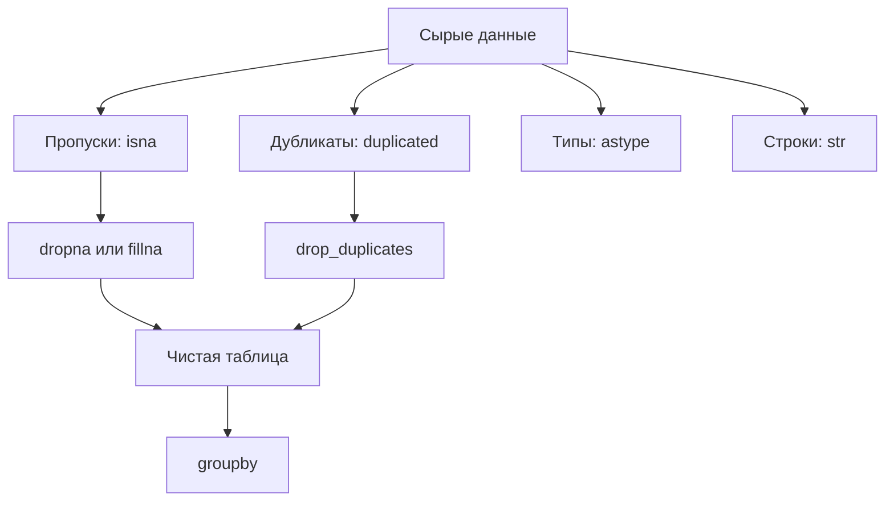

Привет! В реальной жизни данные почти никогда не бывают идеальными: где-то не заполнены ячейки, где-то повторяются строки, где-то перепутаны типы. Работа с такими «грязными» данными занимает львиную долю времени любого аналитика. В этом уроке мы научимся находить проблемы и чинить их средствами Pandas.

## Почему данные «грязные»

Чаще всего встречаются четыре проблемы:

- **пропуски** (NaN) — отсутствующие значения в ячейках;
- **дубликаты** — полностью или частично повторяющиеся строки;
- **неверные типы** — например, числа, записанные строками;
- **выбросы** — значения, сильно выбивающиеся из общего ряда.

Начнём с пропусков.

## Обнаружение пропусков

Функции `isna()` и `notna()` работают как маски и помечают каждую ячейку. Обычно считают пропуски по столбцам:

```python
import pandas as pd

df = pd.DataFrame({
    "имя": ["Аня", "Боря", None],
    "балл": [85, None, 78],
})
print(df.isna())
print(df.isna().sum())  # сколько пропусков в каждом столбце
```

## Стратегии работы с пропусками

Есть два принципиально разных подхода.

**1. Удалить строки с пропусками** — `dropna()`:

```python
print(df.dropna())
```

Это оправдано, когда пропусков мало и строк достаточно много.

**2. Заполнить пропуски** — `fillna()`. Значение может быть константой, статистикой по столбцу или соседним значением:

```python
print(df["балл"].fillna(0))              # константа
print(df["балл"].fillna(df["балл"].mean()))  # среднее
print(df["балл"].fillna(method="ffill")) # предыдущее значение
```

Для числовых столбцов чаще всего используют медиану — она устойчива к выбросам. `method="ffill"` переносит предыдущее значение вниз, `method="bfill"` — следующее вверх; это удобно для временных рядов.

## Дубликаты

Проверить наличие дубликатов можно через `duplicated()`, а убрать — через `drop_duplicates()`:

```python
df = pd.DataFrame({"товар": ["Кофе", "Кофе", "Чай"], "цена": [250, 250, 150]})
print(df.duplicated())   # [False  True False]
print(df.drop_duplicates())
```

По умолчанию удаляются строки, одинаковые во всех столбцах. Параметр `subset` позволяет проверять только по части столбцов: `df.drop_duplicates(subset=["товар"])`.

## Приведение типов

Иногда числа оказываются строками — например, при чтении из CSV с лишними символами. Проверить типы можно через `df.dtypes`, а исправить — через `astype`:

```python
df["балл"] = df["балл"].astype(float)
```

Для дат есть отдельная функция `pd.to_datetime(df["дата"])` — она превращает строки в настоящий тип даты, с которым можно сравнивать и сортировать.

## Очистка строк

В текстовых данных часто встречаются лишние пробелы и разный регистр. Помогают строковые методы Series:

```python
s = pd.Series(["  Москва ", "казань", "MOSCOW"])
print(s.str.strip())      # убирает пробелы по краям
print(s.str.lower())      # приводит к нижнему регистру
print(s.str.replace("казань", "Казань"))
```

## Выбросы

Простой способ найти выбросы — сравнить значения с квантилями. Обычно берут границы 25% и 75% и считают межквантильный размах (IQR):

```python
q1, q3 = df["балл"].quantile([0.25, 0.75])
iqr = q3 - q1
lower, upper = q1 - 1.5 * iqr, q3 + 1.5 * iqr
outliers = df[(df["балл"] < lower) | (df["балл"] > upper)]
```

## Агрегация по группам

После очистки данные обычно агрегируют. Метод `groupby` разбивает DataFrame на группы по значению столбца, а затем применяет к каждой группе функцию:

```python
df = pd.DataFrame({
    "товар": ["Кофе", "Чай", "Кофе"],
    "выручка": [500, 150, 1000],
})
print(df.groupby("товар")["выручка"].mean())
```

Получится средняя выручка по каждому товару. Можно применять и несколько функций сразу через `.agg(["mean", "sum"])`.

## Маршрут очистки данных

Все шаги урока удобно держать перед глазами одной схемой.



## Итог урока

Мы научились:

- обнаруживать пропуски и выбирать стратегию их устранения;
- удалять дубликаты;
- приводить типы данных;
- чистить строки;
- находить выбросы;
- агрегировать данные по группам.

Теперь соберём всё вместе в одной задаче.

<!--TASK-->
### Задача 1
В кафе записали заказы, но данные «грязные»:

```python
import io
import pandas as pd

csv_text = """дата,товар,количество,цена
2024-01-05,Кофе,2,250
2024-01-05,Кофе,2,250
2024-01-06,Чай,,150
2024-01-07,Круассан,3,
2024-01-08,Сэндвич,1,320
2024-01-09,Кофе,4,250
"""
```

Напиши программу, которая:

1. читает DataFrame из `csv_text` через `io.StringIO`;
2. выводит количество пропусков в каждой колонке;
3. удаляет дубликаты;
4. заполняет пропуски: в столбце `количество` — медианой, в столбце `цена` — средним;
5. добавляет столбец `выручка = количество × цена` и выводит среднюю выручку по каждому товару.

Ожидаемый вывод:

```
Пропуски по колонкам:
дата          0
товар         0
количество    1
цена          1
dtype: int64
Очищенная таблица:
        дата         товар  количество    цена
0  2024-01-05        Кофе         2.0  250.0
2  2024-01-06        Чай         2.0  150.0
3  2024-01-07   Круассан         3.0  242.5
4  2024-01-08   Сэндвич         1.0  320.0
5  2024-01-09        Кофе         4.0  250.0
Средняя выручка по товарам:
товар
Круассан    727.5
Кофе        750.0
Сэндвич    320.0
Чай        300.0
Name: выручка, dtype: float64
```

### Задача 2
У тебя есть список контактов с пропущенными данными:

```python
import pandas as pd

contacts = pd.DataFrame({
    "имя": ["Аня", "Боря", "Витя"],
    "телефон": ["+7-900-111", None, "+7-900-222"],
    "email": [None, "boris@mail.ru", None],
})
```

Напиши программу, которая:

1. выводит матрицу пропусков через `isna()`;
2. заполняет пропуски в телефоне строкой «нет телефона», а в email — строкой «нет email»;
3. выводит заполненную таблицу;
4. считает, сколько строк заполнено полностью (через `notna().all(axis=1).sum()`).

Ожидаемый вывод:

```
Матрица пропусков:
    имя  телефон  email
0  False    True   True
1  False    True  False
2  False   False   True
Заполненная таблица:
    имя    телефон          email
0  Аня   +7-900-111      нет email
1  Боря  нет телефона    boris@mail.ru
2  Витя  +7-900-222      нет email
Полностью заполненных строк: 0
```

### Задача 3
В базе клиентов есть строки с одинаковыми email:

```python
import pandas as pd

clients = pd.DataFrame({
    "email": ["a@mail.ru", "b@mail.ru", "a@mail.ru", "c@mail.ru"],
    "город": ["Москва", "Казань", "СПб", "Сочи"],
})
```

Напиши программу, которая:

1. выводит результат `duplicated(subset=["email"])` — какие строки повторяют почту других строк;
2. удаляет дубликаты по столбцу `email` с параметром `keep="first"` и выводит результат;
3. удаляет дубликаты с параметром `keep="last"` и выводит результат.

Ожидаемый вывод:

```
Дубликаты по email:
0    False
1    False
2     True
3    False
dtype: bool
После удаления (keep='first'):
        email   город
0  a@mail.ru  Москва
1  b@mail.ru  Казань
3  c@mail.ru  Сочи
После удаления (keep='last'):
        email   город
1  b@mail.ru  Казань
2  a@mail.ru  СПб
3  c@mail.ru  Сочи
```

### Задача 4
Цены пришли строками с лишними символами, даты — тоже строками:

```python
import pandas as pd

prices = pd.Series(["1 500 ₽", "2 300 ₽", "980 ₽"])
dates = pd.Series(["2024-01-05", "2024-02-14", "2024-03-20"])
```

Напиши программу, которая:

1. очищает строки цен: убирает пробелы и символ «₽» через `str.replace`, затем приводит столбцу `astype(float)`;
2. преобразует даты через `pd.to_datetime`;
3. собирает всё в DataFrame с столбцами `цена` и `дата`;
4. выводит типы данных и номера месяцев покупок (`дата.dt.month`).

Ожидаемый вывод:

```
Очищенные цены:
0    1500.0
1    2300.0
2     980.0
dtype: float64
Типы данных:
цена      float64
дата      datetime64[ns]
dtype: object
Месяц покупки:
0    1
1    2
2    3
dtype: int32
```

### Задача 5
У тебя есть зарплаты сотрудников, среди которых затесался выброс:

```python
import pandas as pd

salaries = pd.Series([45000, 48000, 52000, 47000, 49000, 51000, 46000, 150000, 49500])
```

Напиши программу, которая:

1. считает квантили 25% и 75% через `quantile([0.25, 0.75])`;
2. считает IQR и границы `lower` и `upper` по формуле `q1 - 1.5 * iqr` и `q3 + 1.5 * iqr`;
3. выводит границы;
4. выводит количество выбросов и сами значения-выбросы.

Ожидаемый вывод:

```
Границы: нижняя 41000.0, верхняя 57000.0
Выбросов найдено: 1
Значения-выбросы:
7    150000
dtype: int64
```

### Задача 6
В таблице продаж по городам есть пропуски, и заполнять их общим средним было бы неправильно — города слишком разные:

```python
sales = pd.DataFrame({
    "город": ["Москва", "Москва", "Казань", "Казань", "СПб"],
    "выручка": [1000, None, 800, 600, None],
})
```

Напиши программу, которая:

1. выводит число пропусков в столбце `выручка`;
2. заполняет пропуски средним **по своему городу** через `sales.groupby("город")["выручка"].transform("mean")` и выводит результат списком;
3. проверяет, что пропусков больше не осталось;
4. считает итоговую выручку по городам и выводит её словарём.

Ожидаемый вывод:

```
Пропусков до: 1
Заполнено по среднему в городе: [1000.0, 1000.0, 800.0, 600.0, 500.0]
Пропусков после: 0
Итог по городам: {'Казань': 1400.0, 'Москва': 2000.0, 'СПб': 500.0}
```

### Задача 7
В базе городов один и тот же город записан по-разному:

```python
cities = pd.Series(["Москва", "москва", "МОСКВА", "Казань", "казань", "СПб"])
```

Напиши программу, которая:

1. выводит число уникальных значений до очистки через `nunique()`;
2. приводит все строки к нижнему регистру (`str.lower()`) и заменяет их каноническими названиями через `map({"москва": "Москва", "казань": "Казань", "спб": "СПб"})`;
3. выводит нормализованный ряд списком и число уникальных значений после очистки;
4. выводит частоты городов словарём через `value_counts().to_dict()`.

Ожидаемый вывод:

```
Уникальных до очистки: 6
После нормализации: ['Москва', 'Москва', 'Москва', 'Казань', 'Казань', 'СПб']
Уникальных после: 3
Частоты: {'Москва': 3, 'Казань': 2, 'СПб': 1}
```

<!--/TASK-->

<!--HINT-->
### Подсказка 1
Пропуски считай через `df.isna().sum()`. Дубликаты убирай через `df.drop_duplicates()`. Медиану и среднее бери из самих столбцов: `df["количество"].median()` и `df["цена"].mean()`. После заполнения добавь `df["выручка"] = df["количество"] * df["цена"]` и сгруппируй через `df.groupby("товар")["выручка"].mean()`.

### Подсказка 2
`contacts.isna()` вернёт таблицу из True/False — передай её прямо в `print`. Заполнение: `contacts["телефон"] = contacts["телефон"].fillna("нет телефона")` и то же для email. Для подсчёта полных строк используй `contacts.notna().all(axis=1).sum()`.

### Подсказка 3
`df.duplicated()` помечает дубликаты (второе и последующие вхождения). Для удаления по одному столбцу передай `subset=["email"]`. Параметр `keep` решает, какое вхождение оставить: `"first"` — первое, `"last"` — последнее.

### Подсказка 4
Очистка строк: `prices.str.replace(" ", "").str.replace("₽", "")` — обрати внимание, что `str.replace` применяется к строковым методам серии. Затем `astype(float)`. Даты: `pd.to_datetime(dates)`, а месяц — через `.dt.month`.

### Подсказка 5
`salaries.quantile([0.25, 0.75])` вернёт Series с двумя значениями — сохрани их в переменные `q1` и `q3`. Границы считай по формуле IQR. Выбросы: `salaries[(salaries < lower) | (salaries > upper)]`.

### Подсказка 6
`transform("mean")` возвращает ряд той же длины, что и исходный, где каждому городу подставлено его среднее — именно поэтому его можно передать в `fillna`. Сохрани результат в столбец: `sales["выручка"] = sales["выручка"].fillna(...)`. После заполнения проверь `isna().sum()`. Итог по городам — `groupby("город")["выручка"].sum().to_dict()`.

### Подсказка 7
Сначала `cities.str.lower()`, затем `.map({...})`: словарь сопоставляет старое значение новому, а всё, чего нет в словаре, станет `NaN` — проверь, что все варианты учтены. `nunique()` считает число уникальных значений, `value_counts().to_dict()` — частоты. Списком ряд выводится через `.tolist()`.

<!--/HINT-->

<!--SOLUTION-->
### Разбор 1
Полное решение:

```python
import io
import pandas as pd

csv_text = """дата,товар,количество,цена
2024-01-05,Кофе,2,250
2024-01-05,Кофе,2,250
2024-01-06,Чай,,150
2024-01-07,Круассан,3,
2024-01-08,Сэндвич,1,320
2024-01-09,Кофе,4,250
"""

df = pd.read_csv(io.StringIO(csv_text))

print("Пропуски по колонкам:")
print(df.isna().sum())

df = df.drop_duplicates()

df["количество"] = df["количество"].fillna(df["количество"].median())
df["цена"] = df["цена"].fillna(df["цена"].mean())

print("Очищенная таблица:")
print(df)

df["выручка"] = df["количество"] * df["цена"]
print("Средняя выручка по товарам:")
print(df.groupby("товар")["выручка"].mean())
```

Разберём по шагам. `df.isna().sum()` считает пропуски в каждом столбце: их по одному в `количество` и `цена`. `drop_duplicates()` удаляет вторую строку с кофе — она полностью повторяет первую.

Затем мы заполняем пропуски. Медиана по столбцу `количество` (значения 2, 2, 3, 1, 4) равна 2.0, поэтому пропуск у чая становится 2.0. Среднее по `цена` — (250 + 150 + 320 + 250) ÷ 4 = 242.5, и именно им заполняется пустая цена круассана. Обрати внимание: после заполнения столбцы стали вещественными, потому что в них появились нецелые числа.

Дальше мы добавляем `выручка` как произведение двух столбцов, а `groupby("товар")["выручка"].mean()` группирует строки по названию товара и считает среднее в каждой группе. Кофе встречается дважды: (250 × 2 + 250 × 4) ÷ 2 = 750. Так за несколько строк кода мы прошли полный цикл: прочитали данные, нашли проблемы, починили их и получили готовый аналитический результат.

### Разбор 2
Полное решение:

```python
import pandas as pd

contacts = pd.DataFrame({
    "имя": ["Аня", "Боря", "Витя"],
    "телефон": ["+7-900-111", None, "+7-900-222"],
    "email": [None, "boris@mail.ru", None],
})

print("Матрица пропусков:")
print(contacts.isna())

contacts["телефон"] = contacts["телефон"].fillna("нет телефона")
contacts["email"] = contacts["email"].fillna("нет email")

print("Заполненная таблица:")
print(contacts)

complete = contacts.notna().all(axis=1).sum()
print("Полностью заполненных строк:", complete)
```

Разберём по шагам. `contacts.isna()` возвращает таблицу того же размера из булевых значений: `True` стоит там, где значение пропущено. По матрице видно, что у Ани нет телефона и email, у Бори нет телефона, у Вити нет email.

Заполнение идёт по столбцам: `contacts["телефон"].fillna("нет телефона")` возвращает новую серию, где пропуски заменены на строку, а мы сохраняем её обратно в столбец. `fillna` по умолчанию не меняет исходные данные — поэтому присваивание обязательно.

Строка `contacts.notna().all(axis=1).sum()` работает так: `notna()` инвертирует маску пропусков, `all(axis=1)` проверяет для каждой строки, что все столбцы заполнены, а `sum()` считает количество таких строк. У нас их ноль, потому что у каждого контакта не хватает хотя бы одного поля. Такой подсчёт — стандартный способ оценить «качество» базы данных.

### Разбор 3
Полное решение:

```python
import pandas as pd

clients = pd.DataFrame({
    "email": ["a@mail.ru", "b@mail.ru", "a@mail.ru", "c@mail.ru"],
    "город": ["Москва", "Казань", "СПб", "Сочи"],
})

print("Дубликаты по email:")
print(clients.duplicated(subset=["email"]))

print("После удаления (keep='first'):")
print(clients.drop_duplicates(subset=["email"], keep="first"))

print("После удаления (keep='last'):")
print(clients.drop_duplicates(subset=["email"], keep="last"))
```

Разберём по шагам. `duplicated(subset=["email"])` проверяет только столбец email: строка 2 повторяет почту строки 0, поэтому помечена `True`. `drop_duplicates(subset=["email"], keep="first")` оставляет первое вхождение каждой почты и удаляет второе: остаются Москва, Казань и Сочи. С `keep="last"` остаётся последнее вхождение: для a@mail.ru это строка с городом СПб. Так выбирается, какие строки считаются «оригиналами», а какие — мусором: для заказов обычно берется первое вхождение, для журналов изменений — последнее.

### Разбор 4
Полное решение:

```python
import pandas as pd

prices = pd.Series(["1 500 ₽", "2 300 ₽", "980 ₽"])
dates = pd.Series(["2024-01-05", "2024-02-14", "2024-03-20"])

clean_prices = prices.str.replace(" ", "").str.replace("₽", "").astype(float)
print("Очищенные цены:")
print(clean_prices)

clean_dates = pd.to_datetime(dates)
df = pd.DataFrame({"цена": clean_prices, "дата": clean_dates})

print("Типы данных:")
print(df.dtypes)

print("Месяц покупки:")
print(df["дата"].dt.month)
```

Разберём по шагам. `prices.str.replace(" ", "")` удаляет пробелы из каждой строки, `.str.replace("₽", "")` — символ рубля: «1 500 ₽» превращается в «1500». Цепочка строковых методов применяется ко всей серии сразу. `astype(float)` приводит очищенные строки к числам с плавающей точкой.

`pd.to_datetime(dates)` преобразует строки с датами в тип `datetime64[ns]` — с ним можно сравнивать, сортировать и извлекать компоненты. В DataFrame типы показывают результат: `цена` — float64, `дата` — datetime64[ns]. Наконец, `.dt.month` — это специальный доступ к компонентам даты: он возвращает номер месяца для каждой даты (1, 2, 3). Такой же приём работает с `.dt.year`, `.dt.day`, `.dt.dayofweek` — это незаменимо при работе с временными рядами.

### Разбор 5
Полное решение:

```python
import pandas as pd

salaries = pd.Series([45000, 48000, 52000, 47000, 49000, 51000, 46000, 150000, 49500])

q1, q3 = salaries.quantile([0.25, 0.75])
iqr = q3 - q1
lower = q1 - 1.5 * iqr
upper = q3 + 1.5 * iqr

print(f"Границы: нижняя {lower}, верхняя {upper}")

outliers = salaries[(salaries < lower) | (salaries > upper)]
print("Выбросов найдено:", len(outliers))
print("Значения-выбросы:")
print(outliers)
```

Разберём по шагам. `salaries.quantile([0.25, 0.75])` возвращает Series из двух значений: 25-й процентиль (q1 = 47000) и 75-й (q3 = 51000). Межквантильный размах IQR = q3 − q1 = 4000.

По правилу Тьюки границы считаются так: нижняя = q1 − 1.5 × IQR = 41000, верхняя = q3 + 1.5 × IQR = 57000. Значения за пределами считаются выбросами. В нашем ряду только один такой — 150000 (это, скорее всего, зарплата директора, которую не стоило мешать с обычными). Маска `(salaries < lower) | (salaries > upper)` использует «|» (vectorное ИЛИ), а не слово `or` — это обязательное условие работы с массивами. Такой метод позволяет находить аномалии в любых числовых столбцах до того, как они исказят средние и модели.

### Разбор 6
Полное решение:

```python
import pandas as pd

sales = pd.DataFrame({
    "город": ["Москва", "Москва", "Казань", "Казань", "СПб"],
    "выручка": [1000, None, 800, 600, None],
})

print("Пропусков до:", sales["выручка"].isna().sum())

group_mean = sales.groupby("город")["выручка"].transform("mean")
sales["выручка"] = sales["выручка"].fillna(group_mean)
print("Заполнено по среднему в городе:", sales["выручка"].tolist())

print("Пропусков после:", sales["выручка"].isna().sum())
print("Итог по городам:", sales.groupby("город")["выручка"].sum().to_dict())
```

Разберём по шагам. Здесь ключевую роль играет `transform`, а не `agg`: `agg` свернула бы каждую группу до одного числа, а `transform` возвращает результат **той же длины, что и исходные данные**, подставляя каждому городу его собственное среднее. Москва имеет значения 1000 и `NaN` — среднее по группе считается по непустым и равно 1000; у Казани (800 и 600) — 700, но там и пропусков нет; у СПб единственное значение 500, и именно им заполняется пропуск.

Порядок важен: `fillna` получает ряд той же длины, поэтому значения выравниваются по индексу, а не по порядку. Если бы мы использовали общее среднее (2333 ÷ 3 ≈ 777), то исказили бы данные: у СПб типичная выручка 500, а не 777. После заполнения проверка `isna().sum()` даёт 0 — хорошая привычка, потому что `transform` оставляет `NaN` в группе, где вообще нет значений (тогда нужен второй `fillna`). Финальная агрегация `sum()` показывает: Москва 2000, Казань 1400, СПб 500. Такой приём — «заполнить пропуск статистикой своей группы» — стандартный шаг подготовки данных перед моделированием.

### Разбор 7
Полное решение:

```python
import pandas as pd

cities = pd.Series(["Москва", "москва", "МОСКВА", "Казань", "казань", "СПб"])

print("Уникальных до очистки:", cities.nunique())

normalized = cities.str.lower().map({"москва": "Москва", "казань": "Казань", "спб": "СПб"})
print("После нормализации:", normalized.tolist())
print("Уникальных после:", normalized.nunique())
print("Частоты:", normalized.value_counts().to_dict())
```

Разберём по шагам. `nunique()` показывает 6 уникальных значений — хотя реальных городов три, из-за разного регистра и сокращений Pandas видит шесть разных строк. Это типичная проблема: без нормализации группировка развалит Москву на три отдельные группы, и любой отчёт будет неверным.

Два шага решают проблему. `str.lower()` приводит все варианты к одному регистру: «Москва», «москва», «МОСКВА» становятся «москва». Затем `map(словарь)` заменяет каждое значение по словарю на каноническое написание. Важно: `map` возвращает `NaN` для значений, которых нет в словаре, — поэтому перед применением стоит проверить`.unique()`, чтобы не потерять данные молча. Итог: `nunique()` равен 3, а `value_counts()` показывает Москву (3), Казань (2) и СПб (1). Нормализация категорий — обязательный шаг перед `groupby`, `merge` и обучением моделей: любая модель воспримет «Москва» и «москва» как два разных города.

<!--/SOLUTION-->

<!--QUIZ-->
Что вернёт df.isna().sum()?
- Таблицу из True/False
- Количество пропусков в каждом столбце
- Сумму всех значений
* Правильный ответ: Количество пропусков в каждом столбце
isna() помечает пропуски, а sum() складывает булевы значения по столбцам, давая количество NaN в каждом.

Чем медиана лучше среднего для заполнения пропусков?
- Она быстрее считается
- Она устойчива к выбросам
- Она всегда целое число
* Правильный ответ: Она устойчива к выбросам
Одно аномальное значение сильно сдвигает среднее, но почти не влияет на медиану, поэтому она надёжнее заполняет пропуски.

Что делает drop_duplicates(subset=["товар"])?
- Удаляет строки с одинаковым товаром, проверяя только столбец товар
- Удаляет столбец товар
- Удаляет все строки с пропусками
* Правильный ответ: Удаляет строки с одинаковым товаром, проверяя только столбец товар
Без subset сравниваются все столбцы; с subset — только указанные, что полезно, когда остальные поля могут отличаться.

Что делает pd.to_datetime(df["дата"])?
- Превращает строки с датами в тип datetime
- Округляет даты
- Удаляет даты
* Правильный ответ: Превращает строки с датами в тип datetime
После преобразования можно извлекать год, месяц, день и сравнивать даты между собой.

Что такое IQR?
- Межквантильный размах: разница между 75-м и 25-м процентилями
- Среднее арифметическое
- Стандартное отклонение
* Правильный ответ: Межквантильный размах: разница между 75-м и 25-м процентилями
IQR описывает «средние» 50% данных и используется для поиска выбросов: границы считаются как q1 − 1.5·IQR и q3 + 1.5·IQR.

Почему для объединения условий в маске используют |, а не or?
- or не работает с массивами
- Потому что | быстрее
- Это одно и то же
* Правильный ответ: or не работает с массивами
Слово or ожидает одиночное True/False, а | поэлементно применяется к массивам, что и нужно для объединения масок.

Что делает fillna(method="ffill")?
- Переносит предыдущее значение в ячейку с пропуском
- Заполняет пропуски пробелами
- Удаляет строки с пропусками
* Правильный ответ: Переносит предыдущее значение в ячейку с пропуском
ffill (forward fill) заполняет пропуск ближайшим значением сверху, а bfill — снизу; это удобно для временных рядов.

Что возвращает df.duplicated()?
- Булев Series с True у повторяющихся строк
- Список удалённых строк
- Число дубликатов
* Правильный ответ: Булев Series с True у повторяющихся строк
duplicated помечает каждую строку: True стоит у повторений (второго и последующих вхождений), False — у уникальных.

Что делает df.dropna()?
- Удаляет строки, где есть хотя бы один пропуск
- Заменяет пропуски нулями
- Удаляет все столбцы
* Правильный ответ: Удаляет строки, где есть хотя бы один пропуск
По умолчанию проверяются все столбцы; параметры how="all" и subset позволяют смягчить правило.

Что вернёт s.nunique()?
- Число уникальных значений
- Число пропусков
- Сумму значений
* Правильный ответ: Число уникальных значений
nunique полезна для оценки «грязности» категориального столбца: до и после нормализации значения сильно различаются.

Что делает s.astype(str)?
- Приводит все значения к строковому типу
- Удаляет пробелы
- Переводит строки в нижний регистр
* Правильный ответ: Приводит все значения к строковому типу
astype меняет тип данных; для строк часто применяют вместе с .str.strip() или .str.lower().

Что делает groupby("товар")["выручка"].agg(["mean", "sum"])?
- Считает сразу среднее и сумму по каждой группе
- Считает только среднее
- Объединяет две таблицы
* Правильный ответ: Считает сразу среднее и сумму по каждой группе
Список функций в agg возвращает таблицу, где для каждой группы посчитаны все указанные агрегаты.

<!--/QUIZ-->
