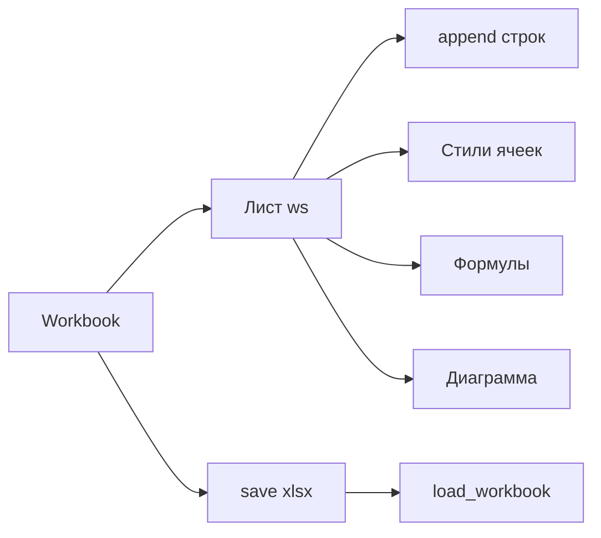

Привет! Даже в эпоху баз данных огромное количество отчётов живёт в Excel. Уметь формировать `.xlsx`-файлы программно — навык, который экономит часы ручной работы. Библиотека openpyxl позволяет создавать, читать и оформлять книги Excel целиком из Python.

## Установка и первая книга

Установка: `pip install openpyxl`. Создаём книгу:

```python
from openpyxl import Workbook

wb = Workbook()
ws = wb.active          # первый лист по умолчанию
ws.title = "Продажи"
ws["A1"] = "Месяц"
ws["B1"] = "Сумма"

wb.save("sales.xlsx")
```

Лист работает как таблица: доступ к ячейкам — по координатам `ws["A1"]` или через метод `ws.cell(row=1, column=2, value="Сумма")`.

## Заполнение строками

Метод `append` добавляет строку в конец листа:

```python
rows = [
    ("Январь", 120000),
    ("Февраль", 135000),
    ("Март", 142000),
]
for r in rows:
    ws.append(r)
```

При этом автоматически увеличивается `ws.max_row` — число строк с данными.

## Чтение книги

`load_workbook` открывает существующий файл:

```python
from openpyxl import load_workbook

wb2 = load_workbook("sales.xlsx")
ws2 = wb2.active
for row in ws2.iter_rows(values_only=True):
    print(row)
```

`iter_rows(values_only=True)` отдаёт кортежи значений — это удобно для pandas: `pd.DataFrame(ws2.values)`.

Важный нюанс: openpyxl **не вычисляет формулы**. Он хранит текст формулы; чтобы получить вычисленное значение, нужно сначала открыть файл в Excel, а затем читать его с `data_only=True`.

## Оформление

Стили берутся из `openpyxl.styles`: шрифт, заливка, выравнивание:

```python
from openpyxl.styles import Font, PatternFill, Alignment

header_font = Font(bold=True, color="FFFFFF")
header_fill = PatternFill(start_color="4472C4", end_color="4472C4", fill_type="solid")
for cell in ws[1]:
    cell.font = header_font
    cell.fill = header_fill
    cell.alignment = Alignment(horizontal="center")
```

`ws[1]` — первая строка листа как набор ячеек.

## Формулы

Ячейке можно присвоить строку с формулой:

```python
ws["D1"] = "Итого"
ws["D2"] = "=SUM(B2:B13)"
```

Формула будет вычислена самим Excel при открытии файла.

## Диаграммы

openpyxl умеет добавлять в книгу настоящие диаграммы Excel:

```python
from openpyxl.chart import BarChart, Reference

chart = BarChart()
chart.title = "Продажи по месяцам"
data = Reference(ws, min_col=2, min_row=1, max_row=ws.max_row)
chart.add_data(data, titles_from_data=True)
ws.add_chart(chart, "E5")

wb.save("sales.xlsx")
```

`Reference` описывает диапазон ячеек, `titles_from_data=True` говорит, что заголовок серии находится в первой строке диапазона.

## Как устроена работа с книгой

Схема показывает связь объектов openpyxl.



## Итог урока

Мы научились:

- создавать книги и листы, записывать данные по ячейкам и строкам;
- читать существующие файлы через `iter_rows`;
- оформлять шапки таблиц;
- применять формулы;
- добавлять диаграммы.

Теперь соберём отчёт целиком.

<!--TASK-->
### Задача 1
Напиши программу, которая создаёт файл `sales_report.xlsx` с листом «Продажи» и:

1. заголовками `Месяц` и `Сумма` — жирный белый шрифт, синяя заливка;
2. данными за 12 месяцев (массив пар месяц-сумма на твой выбор);
3. строкой `Итого` с формулой `=SUM(B2:B13)`;
4. столбчатой диаграммой продаж по месяцам, размещённой с ячейки `E5`;
5. сохраняет книгу и выводит `Отчёт сохранён в sales_report.xlsx`.

Потом открой файл в Excel и убедись, что формула считается, а диаграмма видна. Ожидаемый результат: файл появляется в рабочей папке, в консоли — указанное сообщение.

### Задача 2
Напиши программу, которая:

1. создаёт книгу с листом «Данные» и заполняет его тремя строками через `append` (заголовок + два города);
2. сохраняет книгу в `read_demo.xlsx`;
3. переоткрывает её через `load_workbook`;
4. выводит все строки через `iter_rows(values_only=True)` и число строк через `max_row`.

Ожидаемый вывод:

```
('Город', 'Продажи')
('Москва', 1000)
('Казань', 800)
Строк с данными: 3
```

### Задача 3
Напиши программу, которая:

1. создаёт лист «Склад» с шапкой `Товар | Остаток | Цена` и тремя строками данных;
2. оформляет шапку: жирный белый шрифт, красная заливка, центрирование;
3. задаёт ширину столбца A в 12 пунктов через `column_dimensions["A"].width = 12`;
4. закрепляет шапку через `freeze_panes = "A2"`;
5. сохраняет книгу в `warehouse.xlsx` и выводит `Таблица оформлена и сохранена в warehouse.xlsx`.

### Задача 4
Напиши программу, которая:

1. создаёт лист с расходами: заголовок `Расход | Сумма`, три строки данных;
2. добавляет строку `Итого` с формулой `=SUM(B2:B4)`;
3. сохраняет книгу в `expenses.xlsx`;
4. выводит значение ячейки `B5` (openpyxl вернёт текст формулы, а не результат).

Ожидаемый вывод:

```
Формула записана: =SUM(B2:B4)
```

### Задача 5
Напиши программу, которая:

1. создаёт лист с продажами по месяцам (4 месяца);
2. добавляет линейную диаграмму `LineChart` по данным столбца B;
3. размещает её с ячейки `D5`;
4. сохраняет книгу в `trend.xlsx` и выводит `Линейная диаграмма добавлена: trend.xlsx`.

### Задача 6
До сих пор мы работали с одним листом. Собери книгу из трёх листов:

1. лист «Январь» (он же активный, переименуй его) с шапкой `Товар | Сумма` и строками `Кофе 12000`, `Чай 8000`;
2. лист «Февраль» через `wb.create_sheet("Февраль")` с такими же шапкой и строками `Кофе 15000`, `Чай 9000`;
3. лист «Итог», где `A1` — текст «Общая сумма», а `B1` — формула `=Январь!B2+Январь!B3+Февраль!B2+Февраль!B3`;
4. сохрани книгу в `monthly.xlsx` и выведи имена листов, число строк на листе «Январь» и текст формулы из `B1` листа «Итог».

Ожидаемый вывод:

```
Листы книги: ['Январь', 'Февраль', 'Итог']
Строк на листе «Январь»: 3
Формула на листе «Итог»: =Январь!B2+Январь!B3+Февраль!B2+Февраль!B3
Файл сохранён: monthly.xlsx
```

### Задача 7
Сначала создай файл `stock.xlsx` с шапкой `Товар | Количество | Цена` и четырьмя строками: Кофе 10 шт по 250, Чай 5 шт по 150, Сок 8 шт по 120, Печенье 3 шт по 180. Сохрани его.

Затем открой файл заново и напиши программу, которая:

1. читает строки без шапки через `iter_rows(min_row=2, values_only=True)`;
2. считает количество строк с данными и общую стоимость (`количество × цена`, сумма по всем товарам);
3. находит товар с максимальной стоимостью;
4. выводит среднюю цену товара с одним знаком.

Ожидаемый вывод:

```
Строк данных: 4
Общая стоимость: 4750
Самый дорогой товар: Кофе (2500)
Средняя цена: 175.0
```

<!--/TASK-->

<!--HINT-->
### Подсказка 1
Используй `ws.append` для строк данных, а итог добавь так: `ws.append(["Итого", "=SUM(B2:B13)"])`. Стили применяй к ячейкам первой строки через цикл по `ws[1]`. Диаграмма: `data = Reference(ws, min_col=2, min_row=1, max_row=13)` и `add_chart(chart, "E5")`.

### Подсказка 2
Создай книгу, заполни лист через `ws.append([...])` и сохрани. Затем `wb2 = load_workbook("read_demo.xlsx")`, `ws2 = wb2.active`. Чтение: `for row in ws2.iter_rows(values_only=True): print(row)`. Число строк — `ws2.max_row`.

### Подсказка 3
Шапку оформляй циклом по `ws[1]`: каждой ячейке задай `font`, `fill` и `alignment`. `PatternFill` создаётся с `fill_type="solid"`. Ширина столбца — `ws.column_dimensions["A"].width = 12`, закрепление — `ws.freeze_panes = "A2"`.

### Подсказка 4
Формула записывается как обычная строка: `ws.append(["Итого", "=SUM(B2:B4)"])`. После сохранения снова открой файл и прочитай `ws["B5"].value` — там будет текст формулы, потому что openpyxl не вычисляет формулы.

### Подсказка 5
Для `LineChart` импортируй `from openpyxl.chart import LineChart, Reference`. Данные: `data = Reference(ws, min_col=2, min_row=1, max_row=5)`, затем `chart.add_data(data, titles_from_data=True)` и `ws.add_chart(chart, "D5")`.

### Подсказка 6
Активный лист переименовывается через `ws.title = "Январь"`, а новые создаются методом `wb.create_sheet("Имя")`. `wb.sheetnames` — список имён в порядке листов. Формула со ссылкой на другой лист — обычная строка: `=Январь!B2`. Читать её нужно после сохранения и повторного `load_workbook`, иначе увидишь то же, что записал.

### Подсказка 7
`iter_rows(min_row=2, values_only=True)` пропускает шапку. Собери список троек и считай по нему: `total = sum(qty * price for _, qty, price in data)`. Максимум ищи через `max(data, key=lambda r: r[1] * r[2])`. Средняя цена — `sum(r[2] for r in data) / len(data)`, формат `:.1f`.

<!--/HINT-->

<!--SOLUTION-->
### Разбор 1
Полное решение:

```python
from openpyxl import Workbook
from openpyxl.styles import Font, PatternFill, Alignment
from openpyxl.chart import BarChart, Reference

wb = Workbook()
ws = wb.active
ws.title = "Продажи"

ws.append(["Месяц", "Сумма"])
months = [
    ("Январь", 120000), ("Февраль", 135000), ("Март", 142000),
    ("Апрель", 128000), ("Май", 155000), ("Июнь", 160000),
    ("Июль", 172000), ("Август", 180000), ("Сентябрь", 165000),
    ("Октябрь", 158000), ("Ноябрь", 170000), ("Декабрь", 210000),
]
for m in months:
    ws.append(m)

ws.append(["Итого", "=SUM(B2:B13)"])

header_font = Font(bold=True, color="FFFFFF")
header_fill = PatternFill(start_color="4472C4", end_color="4472C4", fill_type="solid")
for cell in ws[1]:
    cell.font = header_font
    cell.fill = header_fill
    cell.alignment = Alignment(horizontal="center")

chart = BarChart()
chart.title = "Продажи по месяцам"
data = Reference(ws, min_col=2, min_row=1, max_row=13)
chart.add_data(data, titles_from_data=True)
ws.add_chart(chart, "E5")

wb.save("sales_report.xlsx")
print("Отчёт сохранён в sales_report.xlsx")
```

Разбираем по шагам. `wb.active` даёт первый лист книги, `title` переименовывает его в «Продажи». `append` добавляет строки по порядку: сначала шапка, потом 12 месяцев, потом итоговая строка с формулой `=SUM(B2:B13)` — она суммирует данные с января по декабрь.

Цикл по `ws[1]` проходит по ячейкам первой строки: каждой задаём жирный белый шрифт (`Font`), синюю заливку (`PatternFill` с `fill_type="solid"`) и горизонтальное центрирование (`Alignment`).

`BarChart` создаёт диаграмму; `Reference(ws, min_col=2, min_row=1, max_row=13)` описывает диапазон B1:B13 — значения продаж. `add_data(..., titles_from_data=True)` сообщает, что первая строка диапазона — заголовок серии (Сумма). `add_chart(chart, "E5")` размещает диаграмму на листе, начиная с ячейки E5.

Формула `=SUM(B2:B13)` будет вычислена самим Excel, когда ты откроешь файл, — именно поэтому в задаче стоит проверить результат в Excel, а не в Python: openpyxl хранит формулу как текст, но не вычисляет её. Такой код — основа автоматической генерации отчётов: запустил скрипт — получил готовый файл для коллег.

### Разбор 2
Полное решение:

```python
from openpyxl import Workbook, load_workbook

wb = Workbook()
ws = wb.active
ws.title = "Данные"

ws.append(["Город", "Продажи"])
ws.append(["Москва", 1000])
ws.append(["Казань", 800])
wb.save("read_demo.xlsx")

wb2 = load_workbook("read_demo.xlsx")
ws2 = wb2.active

for row in ws2.iter_rows(values_only=True):
    print(row)

print("Строк с данными:", ws2.max_row)
```

Разберём по шагам. Сначала мы создаём книгу и заполняем лист: шапка «Город | Продажи» и две строки данных. Метод `append` каждый раз добавляет следующую свободную строку, поэтому порядок строк сохраняется. `wb.save("read_demo.xlsx")` записывает книгу на диск.

Затем `load_workbook("read_demo.xlsx")` открывает файл заново — так мы проверяем, что всё записалось корректно. `ws2.iter_rows(values_only=True)` возвращает итератор по строкам, где каждая строка — кортеж значений без объектов ячеек. Именно поэтому в выводе мы видим `('Город', 'Продажи')`, а не объекты ячеек.

`ws2.max_row` показывает количество строк с данными — 3. Такой цикл чтения — универсальный способ вытащить данные из любого файла Excel: совмести его с `pd.DataFrame(ws2.values)`, и получишь готовую таблицу pandas.

### Разбор 3
Полное решение:

```python
from openpyxl import Workbook
from openpyxl.styles import Font, PatternFill, Alignment

wb = Workbook()
ws = wb.active
ws.title = "Склад"

ws.append(["Товар", "Остаток", "Цена"])
for r in [("Кофе", 120, 250), ("Чай", 55, 150), ("Сок", 30, 120)]:
    ws.append(r)

header_font = Font(bold=True, color="FFFFFF")
header_fill = PatternFill(start_color="C00000", end_color="C00000", fill_type="solid")
for cell in ws[1]:
    cell.font = header_font
    cell.fill = header_fill
    cell.alignment = Alignment(horizontal="center")

ws.column_dimensions["A"].width = 12
ws.freeze_panes = "A2"

wb.save("warehouse.xlsx")
print("Таблица оформлена и сохранена в warehouse.xlsx")
```

Разберём по шагам. Лист «Склад» заполняется шапкой и тремя товарами через `append`. Затем цикл по `ws[1]` — первой строке — оформляет шапку: жирный белый шрифт, красная заливка (`start_color="C00000"` с `fill_type="solid"`) и центрирование.

`ws.column_dimensions["A"].width = 12` задаёт ширину столбца A — в Excel длинные названия товаров не будут обрезаться. `ws.freeze_panes = "A2"` закрепляет область выше и левее ячейки A2, то есть первую строку: при прокрутке больших таблиц шапка всегда останется на экране. Это незаменимая вещь для отчётов с десятками тысяч строк.

Так выглядит «дизайн» таблицы в коде: шрифты, заливки, ширины столбцов и закрепление областей. Сочетание этих приёмов превращает простой дамп данных в аккуратный офисный отчёт.

### Разбор 4
Полное решение:

```python
from openpyxl import Workbook, load_workbook

wb = Workbook()
ws = wb.active

ws.append(["Расход", "Сумма"])
ws.append(["Аренда", 30000])
ws.append(["Зарплата", 120000])
ws.append(["Маркетинг", 20000])
ws.append(["Итого", "=SUM(B2:B4)"])

wb.save("expenses.xlsx")

wb2 = load_workbook("expenses.xlsx")
ws2 = wb2.active
print("Формула записана:", ws2["B5"].value)
```

Разберём по шагам. Данные о расходах записываются так же, как обычно, а итоговая строка получает **строку** с формулой: `"=SUM(B2:B4)"`. openpyxl не знает, как считать формулы, поэтому просто сохраняет её как текст.

После сохранения мы открываем файл заново и читаем `ws2["B5"].value` — и видим ровно тот же текст `=SUM(B2:B4)`, а не число 170000. Это ключевая особенность openpyxl: формулы хранятся в текстовом виде, а вычисляет их сам Excel при открытии файла.

Если нужно прочитать вычисленное значение в Python, придётся сначала открыть файл в Excel (чтобы тот пересчитал формулы и сохранил результаты), а затем читать его с параметром `data_only=True` — тогда вместо формулы вернётся последнее вычисленное значение. Это ограничение стоит помнить при автоматической обработке отчётов.

### Разбор 5
Полное решение:

```python
from openpyxl import Workbook
from openpyxl.chart import LineChart, Reference

wb = Workbook()
ws = wb.active

ws.append(["Месяц", "Продажи"])
for m in [("Январь", 120), ("Февраль", 135), ("Март", 142), ("Апрель", 128)]:
    ws.append(m)

chart = LineChart()
chart.title = "Динамика продаж"
chart.style = 13
data = Reference(ws, min_col=2, min_row=1, max_row=5)
chart.add_data(data, titles_from_data=True)
ws.add_chart(chart, "D5")

wb.save("trend.xlsx")
print("Линейная диаграмма добавлена: trend.xlsx")
```

Разберём по шагам. `LineChart` — класс для линейных диаграмм, как `BarChart` — для столбчатых. `chart.title` задаёт заголовок диаграммы, а `chart.style = 13` выбирает один из встроенных стилей оформления Excel.

`Reference(ws, min_col=2, min_row=1, max_row=5)` описывает диапазон B1:B5: заголовок серии («Продажи») и четыре значения. `chart.add_data(data, titles_from_data=True)` объясняет, что первая строка диапазона — это название серии, а не данные. `ws.add_chart(chart, "D5")` размещает диаграмму на листе, начиная с ячейки D5.

После сохранения файл `trend.xlsx` открывается в Excel с настоящей интерактивной диаграммой — её можно двигать, менять размер и форматировать стандартными средствами. Так Excel автоматизируется целиком: данные, оформление, формулы и диаграммы — всё создаётся из Python.

### Разбор 6
Полное решение:

```python
from openpyxl import Workbook

wb = Workbook()
jan = wb.active
jan.title = "Январь"
jan.append(["Товар", "Сумма"])
jan.append(["Кофе", 12000])
jan.append(["Чай", 8000])

feb = wb.create_sheet("Февраль")
feb.append(["Товар", "Сумма"])
feb.append(["Кофе", 15000])
feb.append(["Чай", 9000])

total = wb.create_sheet("Итог")
total["A1"] = "Общая сумма"
total["B1"] = "=Январь!B2+Январь!B3+Февраль!B2+Февраль!B3"

wb.save("monthly.xlsx")

print("Листы книги:", wb.sheetnames)
print("Строк на листе «Январь»:", jan.max_row)
print("Формула на листе «Итог»:", total["B1"].value)
print("Файл сохранён: monthly.xlsx")
```

Разберём по шагам. `Workbook()` создаёт книгу с одним листом, который доступен через `wb.active`; `title` переименовывает его. Метод `create_sheet("Февраль")` добавляет второй лист и возвращает его — дальше мы работаем с ним так же, как с первым. Порядок листов в `wb.sheetnames` совпадает с порядком создания: Январь, Февраль, Итог.

Формула со ссылками на другие листы записывается обычной строкой: имя листа, восклицательный знак, адрес ячейки. Excel сам сложит четыре значения и покажет 44000 при открытии файла. Важно понимать: `total["B1"].value` вернёт именно текст формулы, а не результат, — openpyxl не умеет вычислять. Поэтому в выводе мы видим формулу, и это ожидаемо, а не ошибка.

`jan.max_row` равен 3 — шапка плюс две строки данных. Обрати внимание на ловушку: `max_row` считается по последней непустой строке на **этом** листе, а не по всей книге, поэтому у каждого листа он свой. Такая структура «отдельный лист на период + сводный лист с формулами» — самая распространённая схема ручных и автоматических отчётов в Excel.

### Разбор 7
Полное решение:

```python
from openpyxl import Workbook, load_workbook

wb = Workbook()
ws = wb.active
ws.title = "Склад"
ws.append(["Товар", "Количество", "Цена"])
for row in [("Кофе", 10, 250), ("Чай", 5, 150), ("Сок", 8, 120), ("Печенье", 3, 180)]:
    ws.append(row)
wb.save("stock.xlsx")

wb2 = load_workbook("stock.xlsx")
ws2 = wb2.active

data = list(ws2.iter_rows(min_row=2, values_only=True))
print("Строк данных:", len(data))

total = sum(qty * price for _, qty, price in data)
print("Общая стоимость:", total)

best = max(data, key=lambda r: r[1] * r[2])
print(f"Самый дорогой товар: {best[0]} ({best[1] * best[2]})")

avg_price = sum(r[2] for r in data) / len(data)
print(f"Средняя цена: {avg_price:.1f}")
```

Разберём по шагам. `iter_rows(min_row=2, values_only=True)` начинает чтение со второй строки — так шапка не попадает в расчёты, что избавляет от проверок «а не заголовок ли это». `values_only=True` отдаёт кортежи значений, а `list(...)` материализует итератор, чтобы его можно было пройти несколько раз (иначе второй цикл увидел бы пустоту — типичная ошибка с генераторами).

Дальше обычная обработка: генераторное выражение `sum(qty * price for ...)` считает общую стоимость 10×250 + 5×150 + 8×120 + 3×180 = 4750. `max(data, key=...)` выбирает строку с максимальным значением ключа-функции — это Кофе с 2500. Обрати внимание: `max` по умолчанию сравнил бы кортежи лексикографически, то есть по названию товара, а не по стоимости — поэтому `key` обязателен.

Средняя цена (250 + 150 + 120 + 180) ÷ 4 = 175.0 — это средняя цена **товара**, а не средневзвешенная по количеству; средневзвешенная считалась бы как `total / sum(qty)`. Такое разделение «чтение → список кортежей → агрегация» — универсальный мост между Excel и анализом данных: дальше эти же данные можно сразу отдать в `pd.DataFrame(data, columns=[...])`.

<!--/SOLUTION-->

<!--QUIZ-->
Для чего нужен метод ws.append(...)?
- Чтобы добавить новую строку в конец листа
- Чтобы удалить строку
- Чтобы вычислить сумму столбца
* Правильный ответ: Чтобы добавить новую строку в конец листа
append записывает переданный список значений в следующую свободную строку, увеличивая max_row.

Как прочитать все строки листа как кортежи значений?
- Через цикл for row in ws.iter_rows(values_only=True)
- Через ws.read()
- Через ws.values_only
* Правильный ответ: Через цикл for row in ws.iter_rows(values_only=True)
iter_rows со флагом values_only=True отдаёт значения без объектов ячеек.

Посчитает ли openpyxl формулу =SUM(B2:B13) при сохранении?
- Да, всегда
- Нет, openpyxl хранит формулу как текст; значение вычисляет Excel при открытии
- Да, если вызвать wb.calculate()
* Правильный ответ: Нет, openpyxl хранит формулу как текст; значение вычисляет Excel при открытии
Чтобы прочитать вычисленные значения в Python, нужно сначала открыть файл в Excel, а затем читать его с data_only=True.

Какой объект описывает диапазон ячеек для диаграммы?
- Worksheet
- Reference
- Cell
* Правильный ответ: Reference
Reference(ws, min_col=..., min_row=..., max_row=...) описывает прямоугольный диапазон, который используется в методе add_data.

Что делает ws.freeze_panes = "A2"?
- Закрепляет область выше и левее A2, чтобы шапка оставалась на экране при прокрутке
- Удаляет строку 2
- Объединяет ячейки A1 и A2
* Правильный ответ: Закрепляет область выше и левее A2, чтобы шапка оставалась на экране при прокрутке
Закрепление областей — стандартный приём для больших таблиц с шапкой.

Как задать ширину столбца A?
- ws.column_dimensions["A"].width = 12
- ws["A"].width = 12
- ws.set_width("A", 12)
* Правильный ответ: ws.column_dimensions["A"].width = 12
Ширина столбца задаётся через объект column_dimensions по букве столбца.

Как обратиться к ячейке B2?
- ws["B2"]
- ws.cell(row=2, column=2)
- Оба способа верны
* Правильный ответ: Оба способа верны
Координатный синтаксис ws["B2"] и метод ws.cell(row=2, column=2) эквивалентны; второй удобен в циклах.

Что возвращает ws.max_row?
- Номер последней строки с данными
- Максимальную ширину строки
- Список всех строк
* Правильный ответ: Номер последней строки с данными
max_row хранит номер последней использованной строки — его применяют, например, чтобы задать диапазон для диаграммы или формулы.

Как создать новый лист в книге?
- wb.create_sheet("Имя")
- wb.new_sheet("Имя")
- ws.append("Имя")
* Правильный ответ: wb.create_sheet("Имя")
create_sheet добавляет лист в конец книги и возвращает его; переименовать активный лист можно через ws.title.

Что вернёт wb.sheetnames?
- Список имён всех листов книги
- Имя активного листа
- Число листов
* Правильный ответ: Список имён всех листов книги
Это список строк в порядке листов; число листов — len(wb.sheetnames).

Зачем нужен load_workbook("file.xlsx", data_only=True)?
- Чтобы получить вычисленные значения вместо текста формул
- Чтобы открыть книгу только для чтения
- Чтобы удалить формулы
* Правильный ответ: Чтобы получить вычисленные значения вместо текста формул
Значения берутся из кеша, сохранённого Excel; если файл ни разу не открывали в Excel, в ячейках с формулами будет None.

Как задать ячейке денежный формат?
- cell.number_format = "#,##0 ₽"
- cell.format = "money"
- cell.style = "currency"
* Правильный ответ: cell.number_format = "#,##0 ₽"
number_format принимает строку формата Excel: разделители разрядов, знаки после запятой, символы валют.

<!--/QUIZ-->
