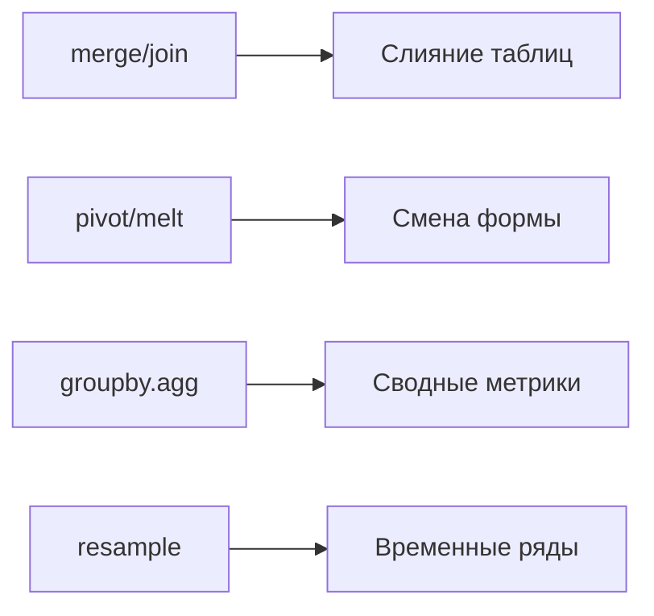

На этом уроке выйдем за пределы базовых DataFrame: разберём слияние таблиц, перестройку «широкое ↔ длинное», эффективные агрегации и работу с датами.

## Слияние: merge и join

`pd.merge(left, right, on="key")` — аналог SQL JOIN. Варианты: how="inner" (по умолчанию), "left", "right", "outer".

```python
import pandas as pd

orders = pd.DataFrame({"order_id": [1, 2, 3], "user_id": [10, 11, 10]})
users = pd.DataFrame({"user_id": [10, 11, 12], "name": ["Аня", "Борис", "Вика"]})
print(pd.merge(orders, users, on="user_id", how="left"))
```

## concat: вертикальное и горизонтальное соединение

`pd.concat([df1, df2], ignore_index=True)` склеивает строки; `axis=1` — столбцы.

## pivot и melt

- `pivot(index, columns, values)` — «широкая» таблица.
- `melt` — «длинная» (tidy) форма.

## groupby с несколькими агрегациями

```python
df.groupby("category")["price"].agg(["count", "mean", "sum", "max"])
```

Настраиваемые функции — через `.agg(...)` с именованными функциями.

## apply: почему осторожно

`df.apply(func, axis=1)` проходит по строкам, но работает медленно. Для векторных операций предпочитайте встроенные методы.

## Временные ряды

`pd.to_datetime` + установка индекса, `resample("M")` — агрегация по месяцам, `shift()` — лаги.

## Память и большие данные

- Читайте только нужные колонки: `pd.read_csv(path, usecols=[...])`.
- `df.info(memory_usage="deep")` — оценка памяти.
- Для очень больших данных — чанкинг (chunksize).

## Итог урока

Мы научились соединять таблицы, менять их форму и группировать; это ядро реального анализа данных.




## Практические рекомендации

Работая с таблицами, всегда проверяйте результат слияния: `merged.shape` и `merged.isna().sum()` покажут, образовались ли дыры после join. Для группировок внимательно выбирайте тип агрегации — `count` игнорирует NaN, а `sum` для пустой группы возвращает 0. Если данных много, используйте `usecols`, `dtype` (например, задание str для кодов) и `chunksize` для построчного чтения. Перед resample убедитесь, что индекс имеет тип datetime — это избавит от неожиданных ошибок.


<!--TASK-->
### Задача 1 — Один-ко-многим
Создай orders (order_id, product_id, qty) и products (product_id, name, price). Объедини их через merge и пересчитай выручку по заказу: qty * price. Выведи DataFrame с колонками order_id, name, revenue.

### Задача 2 — Левое и полное слияние
Создай таблицы A (id, x) и B (id, y) с неполным пересечением. Покажи результаты merge how="left" и how="outer". Убедись, что в outer появляются NaN.

### Задача 3 — pivot по категориям
Дан DataFrame продаж: date, product, revenue. Сделай таблицу, где строки — даты, столбцы — продукты, значения — выручка (pivot). Затем верни исходную форму через melt.

### Задача 4 — groupby с несколькими метриками
Для DataFrame продаж с колонками category, price, qty вычисли для каждой категории count, mean(price) и суммарную выручку (qty*price через agg с lambda). Выведи результат.

### Задача 5 — Агрегация без apply
Дан DataFrame с колонками a, b. Добавь колонку ratio = a / b без использования apply (векторно). Затем добавь колонку sign (положительное/отрицательное) через numpy.where.

### Задача 6 — Временной ряд
Создай серию из 30 дат с шагом в день и случайными значениями. Установи даты индексом, пересэмплируй по неделям (W) с суммой, выведи первые три недельные суммы.

### Задача 7 — Чтение с фильтрацией колонок
Запиши DataFrame в CSV, а затем прочитай его, оставив только нужные колонки через usecols, и покажи df.info() — оценка памяти. Убедись, что неиспользуемые колонки не загружаются.
<!--/TASK-->

<!--HINT-->
### Подсказка 1
merge с on="product_id"; затем df.assign(revenue=df["qty"] * df["price"]).

### Подсказка 2
how="left" сохраняет все строки A; how="outer" — все строки обеих.

### Подсказка 3
pd.pivot(df, index="date", columns="product", values="revenue"); melt с id_vars=["date"].

### Подсказка 4
df.groupby("category").agg(count=("qty", "count"), avg_price=("price", "mean"), revenue=("qty", lambda s: (s * df.loc[s.index, "price"]).sum())).

### Подсказка 5
Векторное деление: df["a"] / df["b"]; numpy.where(df["a"] >= 0, "pos", "neg").

### Подсказка 6
pd.date_range(start="2026-01-01", periods=30, freq="D"); series.resample("W").sum().

### Подсказка 7
df.to_csv("data.csv", index=False); pd.read_csv("data.csv", usecols=["a", "b"]).
<!--/HINT-->

<!--SOLUTION-->
### Разбор 1
```python
import pandas as pd

orders = pd.DataFrame({"order_id": [1, 1, 2], "product_id": [10, 20, 10], "qty": [2, 1, 3]})
products = pd.DataFrame({"product_id": [10, 20], "name": ["Книга", "Ручка"], "price": [500, 50]})

merged = pd.merge(orders, products, on="product_id")
merged["revenue"] = merged["qty"] * merged["price"]
print(merged[["order_id", "name", "revenue"]])
```
Вывод: три строки с выручкой (1000, 50, 1500). merge расширяет таблицу данными продуктов.

### Разбор 2
```python
A = pd.DataFrame({"id": [1, 2, 3], "x": [10, 20, 30]})
B = pd.DataFrame({"id": [2, 3, 4], "y": [200, 300, 400]})

print(pd.merge(A, B, on="id", how="left"))
print(pd.merge(A, B, on="id", how="outer"))
```
Left сохраняет id 1,2,3 (y для 1 — NaN); outer добавляет id 4 (x — NaN).

### Разбор 3
```python
sales = pd.DataFrame({
    "date": ["2026-01-01", "2026-01-01", "2026-01-02"],
    "product": ["A", "B", "A"],
    "revenue": [100, 200, 150],
})
wide = sales.pivot(index="date", columns="product", values="revenue")
print(wide)
long = wide.reset_index().melt(id_vars="date", var_name="product", value_name="revenue")
print(long.dropna())
```
pivot строит «широкую» матрицу; melt возвращает tidy-форму.

### Разбор 4
```python
sales = pd.DataFrame({
    "category": ["a", "a", "b"],
    "price": [10, 20, 30],
    "qty": [1, 2, 3],
})
result = sales.groupby("category").agg(
    count=("qty", "count"),
    avg_price=("price", "mean"),
    revenue=("qty", lambda s: (s * sales.loc[s.index, "price"]).sum()),
)
print(result)
```
agg позволяет задать несколько метрик с именами; lambda использует индексы исходной группы.

### Разбор 5
```python
import numpy as np
df = pd.DataFrame({"a": [4, -2, 9], "b": [2, 2, 3]})
df["ratio"] = df["a"] / df["b"]
df["sign"] = np.where(df["a"] >= 0, "pos", "neg")
print(df)
```
Векторные операции не требуют apply и работают быстро.

### Разбор 6
```python
import pandas as pd
import numpy as np

idx = pd.date_range(start="2026-01-01", periods=30, freq="D")
s = pd.Series(np.random.randint(1, 100, 30), index=idx)
weekly = s.resample("W").sum()
print(weekly.head(3))
```
resample агрегирует по периодам; head(3) показывает первые три недели.

### Разбор 7
```python
df = pd.DataFrame({"a": [1, 2], "b": [3, 4], "c": [5, 6]})
df.to_csv("data.csv", index=False)
small = pd.read_csv("data.csv", usecols=["a", "b"])
print(small.info(memory_usage="deep"))
```
usecols не загружает лишние колонки — экономит память на больших файлах.
<!--/SOLUTION-->

<!--QUIZ-->
Что делает pd.merge по умолчанию?
- Inner join по ключу
- Outer join
- Left join
- Right join
* Правильный ответ: Inner join по ключу
Остаются только совпадающие ключи.

Как сделать полное объединение строк?
- pd.concat([df1, df2], ignore_index=True)
- pd.merge(...)
- df.append
- df.combine
* Правильный ответ: pd.concat([df1, df2], ignore_index=True)
concat склеивает по оси столбцов по умолчанию.

Что делает pivot?
- Строит «широкую» таблицу
- Плавит в «длинную»
- Сортирует
- Группирует
* Правильный ответ: Строит «широкую» таблицу
Столбцы становятся категориями.

Что делает melt?
- Приводит к «длинной» (tidy) форме
- Делает «широкую»
- Удаляет дубликаты
- Считает среднее
* Правильный ответ: Приводит к «длинной» (tidy) форме
Колонки становятся строками.

Чем опасен df.apply?
- Медленным построчным обходом
- Всегда возвращает None
- Изменяет оригинал
- Запрещён в pandas
* Правильный ответ: Медленным построчным обходом
Векторные операции предпочтительнее.

Что делает resample("W")?
- Агрегирует по неделям
- Сортирует по убыванию
- Удаляет выходные
- Группирует по категориям
* Правильный ответ: Агрегирует по неделям
Окно периода для временного ряда.

Как уменьшить память при чтении CSV?
- usecols для нужных колонок
- Менять database
- Удалять файл
- Нельзя
* Правильный ответ: usecols для нужных колонок
Загружаются только выбранные колонки.

Что возвращает groupby().agg(...)?
- DataFrame со сводными метриками
- Список
- Серию без индекса
- Кортеж
* Правильный ответ: DataFrame со сводными метриками
Каждая именованная метрика — колонка.

Как посчитать выручку без apply?
- df["qty"] * df["price"]
- df.apply(calc)
- map
- sum
* Правильный ответ: df["qty"] * df["price"]
Векторное умножение колонок.

Какой join оставляет NaN для отсутствующих ключей?
- Outer и left
- Inner
- Никакой
- Cross
* Правильный ответ: Outer и left
Отсутствующие значения заполняются NaN.
Как проверить дыры после merge?
- merged.isna().sum()
- merged.count()
- merged.shape
- merged.head()
* Правильный ответ: merged.isna().sum()
Сумма NaN по колонкам покажет пропуски.

Что делает chunksize при чтении?
- Читает файл порциями
- Сжимает CSV
- Удаляет строки
- Сортирует файл
* Правильный ответ: Читает файл порциями
Экономит память на больших данных.


<!--/QUIZ-->
