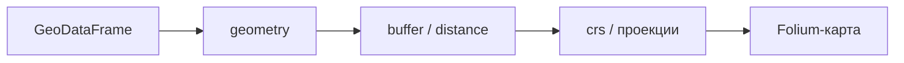

Геоданные — координаты, адреса, регионы. GeoPandas добавляет геометрию в DataFrame, а Folium строит интерактивные карты.

## Что такое GeoDataFrame

Это DataFrame с колонкой geometry (точки, линии, полигоны). Для работы нужна библиотека geopandas.

```python
import geopandas as gpd
from shapely.geometry import Point

df = gpd.GeoDataFrame(
    {"city": ["Москва", "СПб"], "pop": [12, 5]},
    geometry=[Point(37.6, 55.7), Point(30.3, 59.9)],
    crs="EPSG:4326",
)
```

## Создание карты

Folium умеет рисовать маркеры и слой:

```python
import folium

m = folium.Map(location=[55.75, 37.61], zoom_start=10)
folium.Marker([55.75, 37.61], popup="Москва").add_to(m)
m.save("map.html")
```

## Геометрические операции

- `.buffer(distance)` — создать буфер вокруг точек;
- `.distance()` — расстояние; `.centroid` — центроид.

## Проекции и crs

EPSG:4326 — широта/долгота; для метрических расчётов используют проекции вроде EPSG:3857.

## Итог урока

GeoPandas и Folium позволяют анализировать и показывать геоданные: от точек до полноценных карт.




## Практическое применение

Геоданные встречаются в логистике (маршруты), ритейле (торговые зоны) и аналитике недвижимости. GeoPandas позволяет считать плотность точек, объединять данные по регионам и строить буферы вокруг объектов. Folium удобен для быстрых интерактивных отчётов, которые открываются в браузере без бэкенда. Геоанализ становится обычной частью работы дата-инженеров и аналитиков.


Ещё один важный приём — пространственное соединение: `sjoin` связывает точки с полигонами (например, какие города попадают в регионы). Это позволяет агрегировать статистику по территориям без ручных проверок координат. Также пригодится функция `explore()` из GeoPandas, которая быстро строит интерактивную карту прямо из фрейма.


<!--TASK-->
### Задача 1 — GeoDataFrame точек
Создай GeoDataFrame из трёх городов (название, население, Point). Выведи df с geometry и подтверди, что тип — Point.

### Задача 2 — Загрузка из файла
Скачай (или создай) небольшой GeoJSON, загрузи через gpd.read_file и покажи первые 3 строки.

### Задача 3 — Буфер вокруг точек
Построй вокруг координат буфер 0.5 градуса через .buffer(0.5) и выведи тип геометрии результирующего буфера.

### Задача 4 — Расстояния
Для двух точек вычисли расстояние в градусах через .distance(). Опиши, почему для километров нужна проекция.

### Задача 5 — Проекция
Перепроецируй фрейм в EPSG:3857 и пересчитай расстояние той же пары точек; убедись, что значения изменились.

### Задача 6 — Простая карта Folium
Создай карту с центром в Москве, добавь три маркера с popup и сохрани в map.html. Проверь, что файл появился.

### Задача 7 — Карта из GeoDataFrame
Добавь на Folium-карту точки из GeoDataFrame (цикл по строкам) и сохрани результат. Напиши комментарий, как добавить слой HeatMap.
<!--/TASK-->

<!--HINT-->
### Подсказка 1
from shapely.geometry import Point; crs="EPSG:4326".

### Подсказка 2
gpd.read_file("file.geojson") — поддерживает многие форматы.

### Подсказка 3
df.geometry.buffer(0.5) возвращает Polygon.

### Подсказка 4
df.geometry.iloc[0].distance(df.geometry.iloc[1]).

### Подсказка 5
df.to_crs("EPSG:3857") — метры.

### Подсказка 6
folium.Map(location=[...], zoom_start=10); Marker([lat, lon], popup="...").add_to(m); m.save("map.html").

### Подсказка 7
Цикл по df.itertuples() добавляет маркеры по каждой строке.
<!--/HINT-->

<!--SOLUTION-->
### Разбор 1
```python
import geopandas as gpd
from shapely.geometry import Point

df = gpd.GeoDataFrame(
    {"city": ["Москва", "СПб", "Казань"],
     "pop": [12, 5, 1.2]},
    geometry=[Point(37.6, 55.7), Point(30.3, 59.9), Point(49.1, 55.8)],
    crs="EPSG:4326",
)
print(df.geom_type)
```
Все геометрии — Point.

### Разбор 2
```python
import geopandas as gpd
df = gpd.read_file("cities.geojson")
print(df.head(3))
```
read_file автоматически определяет геометрию и crs.

### Разбор 3
```python
buffers = df.geometry.buffer(0.5)
print(buffers.geom_type)
```
Результат — Polygon вокруг каждой точки.

### Разбор 4
```python
d = df.geometry.iloc[0].distance(df.geometry.iloc[1])
print(d)
```
Расстояние в градусах географической СК — для метрики нужна проекция.

### Разбор 5
```python
df_metric = df.to_crs("EPSG:3857")
d2 = df_metric.geometry.iloc[0].distance(df_metric.geometry.iloc[1])
print(d2)  # метры
```
Числа сильно отличаются — это ожидаемо из-за единиц.

### Разбор 6
```python
import folium
m = folium.Map(location=[55.75, 37.61], zoom_start=8)
folium.Marker([55.75, 37.61], popup="Москва").add_to(m)
folium.Marker([59.93, 30.36], popup="СПб").add_to(m)
m.save("map.html")
```
Файл map.html откроется в браузере.

### Разбор 7
```python
m = folium.Map(location=[55.75, 37.61], zoom_start=6)
for row in df.itertuples():
    folium.Marker([row.geometry.y, row.geometry.x], popup=row.city).add_to(m)
m.save("cities_map.html")
```
Для HeatMap нужен folium.plugins.HeatMap со списком координат.
<!--/SOLUTION-->

<!--QUIZ-->
Что добавляет GeoPandas к DataFrame?
- Колонку geometry
- Скорость
- Цвета
- Индексы
* Правильный ответ: Колонку geometry
Геометрические объекты в отдельной колонке.

Какой формат координат в EPSG:4326?
- Широта/долгота в градусах
- Метры
- Пиксели
- Доли
* Правильный ответ: Широта/долгота в градусах
Географическая СК.

Что делает buffer(dist)?
- Строит область вокруг геометрии
- Удаляет геометрию
- Меняет проекцию
- Сортирует
* Правильный ответ: Строит область вокруг геометрии
Результат — буферная зона (Polygon).

Что создаёт Folium?
- Интерактивные HTML-карты
- SVG-картинки
- GeoJSON
- Кластеры прямо
* Правильный ответ: Интерактивные HTML-карты
Карта открывается в браузере.

Как добавить маркер?
- folium.Marker([lat, lon], popup="...").add_to(m)
- m.add_marker()
- folium.add_point()
- m.new_marker()
* Правильный ответ: folium.Marker([lat, lon], popup="...").add_to(m)
Маркер привязывается к карте.

Зачем перепроецировать в EPSG:3857?
- Для метрических расчётов в метрах
- Для красоты
- Для ускорения
- Для формата GeoJSON
* Правильный ответ: Для метрических расчётов в метрах
Проекция Меркатора даёт метры.

Что возвращает df.geometry.distance(other)?
- Число (расстояние)
- Список
- Геометрию
- Карту
* Правильный ответ: Число (расстояние)
В единицах текущей СК.

Как прочитать GeoJSON?
- gpd.read_file("...geojson")
- pd.read_csv
- geo.read
- pdf.open
* Правильный ответ: gpd.read_file("...geojson")
GeoPandas поддерживает GeoJSON.

Что такое centroид?
- Центр масс геометрии
- Крайняя точка
- Площадь
- Периметр
* Правильный ответ: Центр масс геометрии
Точка-«среднее» геометрии.

Как сохранить карту?
- m.save("map.html")
- m.to_csv()
- m.write_png()
- m.dump()
* Правильный ответ: m.save("map.html")
Сохраняется HTML-файл.
Как узнать геометрию фрейма?
- df.geom_type
- df.shape
- df.geometry
- df.dtypes
* Правильный ответ: df.geom_type
Типы геометрий колонки.

Что делает to_crs?
- Перепроецирует систему координат
- Сортирует
- Смотрит центроид
- Удаляет поля
* Правильный ответ: Перепроецирует систему координат
Смена проекции.


<!--/QUIZ-->
