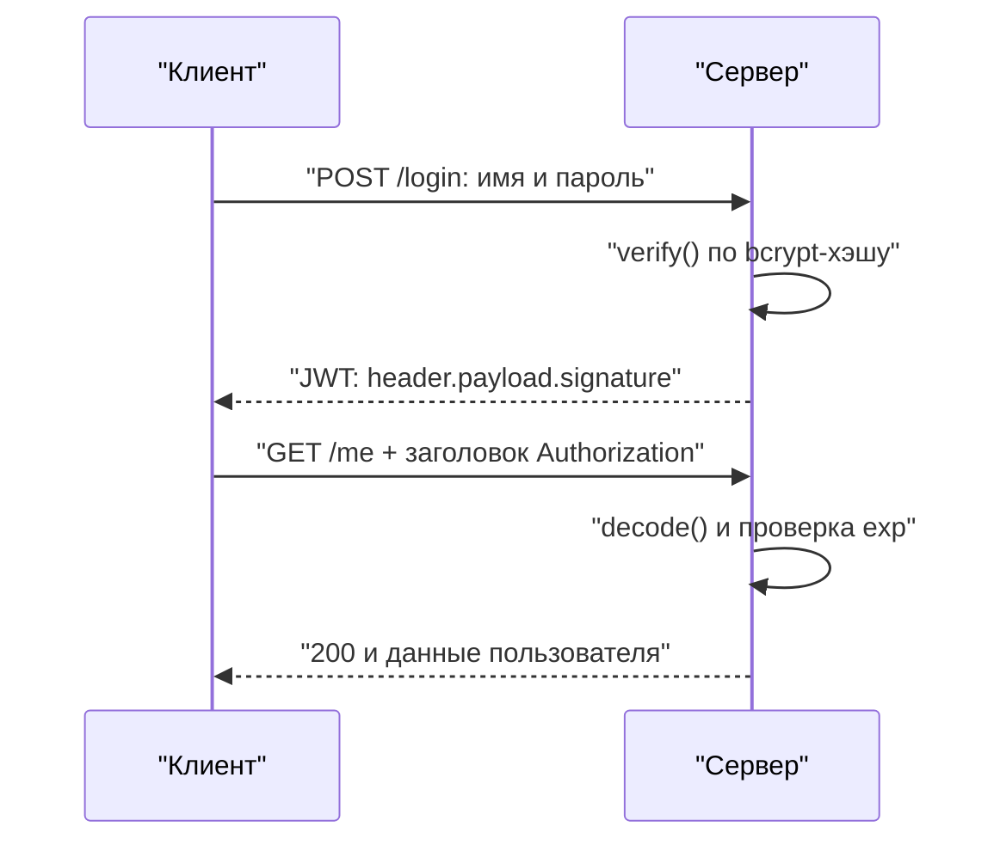

Любой сайт с пользователями должен решать три задачи: **регистрация** (создать аккаунт), **аутентификация** (проверить, что ты — это ты) и **авторизация** (решить, что тебе можно делать). В этом уроке мы соберём полноценную авторизацию через JWT-токены на FastAPI, научимся безопасно хранить пароли и поймём, почему «хранить пароли открытым текстом» — катастрофа.

## Почему нельзя хранить пароли открыто

Представь, что база данных утекла. Если пароли лежат в ней открытым текстом — злоумышленник получит доступ ко всем аккаунтам, и часто не только в твоём сервисе: люди склонны использовать один пароль везде. Поэтому пароль никогда не хранится «как есть» — из него делают **хэш**.

Хэш — это одностороннее преобразование: из пароля получается строка фиксированной длины, а обратно восстановить пароль нельзя. При входе мы снова хэшируем введённый пароль и сравниваем с сохранённым хэшем. Для хэширования паролей используется специальный алгоритм — **bcrypt**, медленный и с «солью» (случайной добавкой), чтобы одинаковые пароли давали разные хэши.

Работать с bcrypt удобно через библиотеку `passlib`:

```bash
pip install passlib[bcrypt] pyjwt
```

```python
from passlib.context import CryptContext

pwd_context = CryptContext(schemes=["bcrypt"], deprecated="auto")

hash = pwd_context.hash("супер-пароль")
print(hash)  # $2b$12$... — хэш с солью
print(pwd_context.verify("супер-пароль", hash))  # True
print(pwd_context.verify("неверный", hash))       # False
```

`hash()` создаёт хэш, `verify()` проверяет, совпадает ли пароль с хэшем. Никогда не сравнивай пароли напрямую!

## Что такое JWT

JWT (JSON Web Token) — это компактный токен, который состоит из трёх частей, разделённых точками:

```
header.payload.signature
```

- **header** — метаданные: алгоритм подписи (`HS256`) и тип токена;
- **payload** — полезная нагрузка: `sub` (идентификатор пользователя), `exp` (срок действия) и любые другие данные;
- **signature** — подпись: результат хэширования первых двух частей вместе с секретным ключом.

Подпись — самое главное: её нельзя подделать без секретного ключа. Значит, если токен пришёл с сервера и подпись сошлась, данным в payload можно верить. «Декодировать» токен может любой, но «подписать» новый — только тот, кто знает секрет.

В Python с JWT работают через библиотеку `pyjwt`:

```python
import jwt
from datetime import datetime, timedelta, timezone

SECRET_KEY = "очень-секретный-ключ"


def create_token(user_id: int) -> str:
    payload = {
        "sub": str(user_id),
        "exp": datetime.now(timezone.utc) + timedelta(hours=2),
    }
    return jwt.encode(payload, SECRET_KEY, algorithm="HS256")


def read_token(token: str) -> int:
    payload = jwt.decode(token, SECRET_KEY, algorithms=["HS256"])
    return int(payload["sub"])
```


`jwt.encode` создаёт токен, `jwt.decode` проверяет подпись и срок действия. Если токен просрочен или подпись неверна — поднимется исключение `jwt.ExpiredSignatureError` или `jwt.InvalidTokenError`.

## Авторизация в FastAPI

Соберём всё вместе. Сначала — модель пользователя и хэширование при регистрации:

```python
from fastapi import FastAPI, Depends, HTTPException
from fastapi.security import OAuth2PasswordBearer
from pydantic import BaseModel
from sqlalchemy import create_engine
from sqlalchemy.orm import DeclarativeBase, Mapped, mapped_column, sessionmaker

app = FastAPI()
pwd_context = CryptContext(schemes=["bcrypt"], deprecated="auto")
oauth2_scheme = OAuth2PasswordBearer(tokenUrl="/login")

class Base(DeclarativeBase):
    pass

class User(Base):
    __tablename__ = "users"

    id: Mapped[int] = mapped_column(primary_key=True)
    username: Mapped[str] = mapped_column(unique=True)
    password_hash: Mapped[str] = mapped_column()
```

Функция-зависимость `get_current_user` извлекает токен из заголовка `Authorization`, расшифровывает его и ищет пользователя:

```python
def get_current_user(token: str = Depends(oauth2_scheme)) -> User:
    try:
        user_id = read_token(token)
    except jwt.PyJWTError:
        raise HTTPException(status_code=401, detail="Неверный или просроченный токен")

    user = session.get(User, user_id)
    if user is None:
        raise HTTPException(status_code=401, detail="Пользователь не найден")
    return user
```

Обрати внимание: зависимость `oauth2_scheme` сама вытащит токен из заголовка `Authorization=[redacted] Теперь защитим эндпоинт:

```python
@app.get("/me")
def me(user: User = Depends(get_current_user)):
    return {"username": user.username}
```

Кто не передаст токен (или передаст плохой) — получит `401 Unauthorized` вместо данных.

## Как выглядит полный цикл

1. Регистрация: клиент присылает имя и пароль → сервер создаёт хэш и сохраняет пользователя.
2. Вход: клиент присылает имя и пароль → сервер проверяет `pwd_context.verify(...)` → при успехе возвращает JWT-токен.
3. Клиент кладёт токен в заголовок `Authorization`.
4. Защищённые эндпоинты проверяют токен через зависимость `get_current_user`.
5. Когда токен истекает — клиент логинится заново (или использует refresh-токен).

## Правила безопасности

- Держи `SECRET_KEY` в переменных окружения, а не в коде!
- Ставь `exp` — токен без срока действия опасен.
- Длину пароля — минимум 8 символов, лучше больше.
- Отдавай данные только по HTTPS, чтобы токен не улетел по сети.
- Не клади в payload секретные данные (пароль, данные карты) — payload читается всеми.

## Весь цикл входа на одной схеме

Соберём разрозненные шаги в единую картину: что происходит от ввода пароля до защищённого запроса.



Ключевой момент: пароль сверяется с хэшем только на входе, а дальше клиент доказывает право на запрос подписанным токеном — сервер каждый раз проверяет подпись и срок, но пароль больше не нужен.

## Итог урока

Мы разобрались, почему пароли хэшируют (bcrypt + соль), что такое JWT и как устроена его подпись, как создать и проверить токен через `pyjwt`, и как с помощью зависимостей FastAPI защитить эндпоинты. Теперь твой сервис может отличать «своих» от «чужих».

<!--TASK-->
### Задача 1
Допиши приложение `auth.py` на FastAPI: добавь два эндпоинта.

1. `POST /register` — принимает `username` и `password` (JSON), хэширует пароль через `CryptContext` и сохраняет пользователя в сессию. Если имя уже занято — верни `400 Bad Request`.
2. `POST /login` — принимает `username` и `password`, проверяет пароль через `pwd_context.verify(...)`. Если всё верно — создаёт JWT-токен (срок — 1 час) и возвращает `{"access_token": "..."}`. Если пароль неверный — `401`.

Проверь через docs (`/docs`): зарегистрируйся, залогинься, затем открой `GET /me` с полученным токеном — должен вернуться `{"username": ...}`.

### Задача 2
Создай скрипт `passwords.py`. Сконфигурируй `CryptContext(schemes=["bcrypt"], deprecated="auto")`. Вычисли хэш для пароля `"мой-пароль-123"` два раза и выведи оба хэша. Затем проверь `verify()` для верного пароля и для неверного (`"неверный"`). Выведи результаты проверок. Запусти скрипт и опиши ожидаемый вывод. Объясни в комментарии, почему два хэша одного и того же пароля разные.

### Задача 3
Создай скрипт `tokens.py`. Напиши `create_token(user_id)` с payload `{"sub": str(user_id), "exp": datetime.now(timezone.utc) + timedelta(hours=1)}` и `read_token(token)`, который декодирует токен. Проведи четыре эксперимента: 1) создай и прочитай валидный токен — выведи `sub`; 2) возьми валидный токен, раздели по точкам, замени среднюю часть (payload) на `base64url` от `{"sub": "999", "exp": ...}` без переподписи и попробуй прочитать — оберни в try/except и выведи класс исключения; 3) создай токен с `exp` в прошлом и попробуй прочитать — выведи класс исключения; 4) создай токен без поля `exp` и попробуй прочитать — выведи результат. Запусти и опиши ожидаемые результаты.

### Задача 4
Доработай приложение `auth.py` из задачи 1: в эндпоинте `POST /register` запрети пароли короче 8 символов. Если длина пароля меньше 8 — верни `HTTPException(status_code=400, detail="Пароль слишком короткий")` до создания пользователя и хэширования. Если имя занято — по-прежнему верни 400 с detail «Имя уже занято». Проверь через `/docs`: попробуй зарегистрироваться с паролем `"123"` (ожидай 400) и с паролем `"длинный-пароль"` (ожидай успех). Опиши, как изменился код.

### Задача 5
Доработай вспомогательные функции из задачи 3: сделай так, чтобы `SECRET_KEY` читался из переменной окружения: `os.environ.get("SECRET_KEY", "dev-secret")`. Затем добавь в `create_token` обязательное поле `exp` (срок 1 час) и убедись, что токен без `exp` (созданный через отдельную функцию `create_token_no_exp`) декодируется без ошибки. Объясни в комментарии, почему токен без `exp` опасен. Запусти скрипт и опиши результаты.
### Задача 6
Создай скрипт `refresh_flow.py` и опиши в нём работу пары токенов. Напиши `create_token(user_id, token_type, lifetime_seconds)`: в payload кладутся `sub` (строка), `type` (переданный тип) и `exp` (сейчас + `lifetime_seconds`). На её основе сделай `create_access_token(user_id)` — тип `access`, срок 15 минут, и `create_refresh_token(user_id)` — тип `refresh`, срок 7 дней. Функция `refresh_access_token(token)` декодирует токен, проверяет, что `payload.get("type") == "refresh"`, иначе поднимает `ValueError("Нужен refresh-токен")`, и возвращает новый access-токен для того же `sub`. В основном блоке: 1) выпусти пару для пользователя 42, обменяй refresh на новый access и выведи `1) Новый access для sub=42`; 2) попробуй передать в обмен сам access-токен — поймай `ValueError` и выведи его текст во второй строке; 3) выпусти refresh с `lifetime_seconds=-1` и попробуй обменять — выведи класс исключения. Запусти скрипт и сверь вывод с ожидаемым.

### Задача 7
Создай скрипт `roles.py`, который различает аутентификацию и авторизацию. Пользователи хранятся в словаре без базы: `{1: {"username": "anya", "role": "user"}, 2: {"username": "admin", "role": "admin"}}`. Напиши `create_token(user_id)` (срок 1 час, `sub`) и `get_current_user(token)`, который декодирует токен, находит пользователя по id из `sub` и поднимает `HTTPException(status_code=401, detail="Неверный токен")` при ошибке `jwt.PyJWTError` или отсутствии пользователя. Затем `get_current_admin(token)`: вызывает `get_current_user`, и если роль не `admin`, поднимает `HTTPException(status_code=403, detail="Недостаточно прав")`. Покажи, что эндпоинт объявляется как `def admin_stats(user=Depends(get_current_admin))`. В основном блоке: выпусти токен для админа и для обычного пользователя, вызови `get_current_admin` с обоими и напечатай либо `Админ: admin`, либо `403 Недостаточно прав`, поймав `HTTPException`. Запусти скрипт и опиши вывод.
<!--/TASK-->

<!--HINT-->
### Подсказка 1
Для проверки занятости имени используй `session.scalars(select(User).where(User.username == username)).first()`. В `POST /register` валидируй входящие данные через Pydantic-модель (например, `UserIn`). В `POST /login` не забудь обработать случай неверного пароля — `raise HTTPException(status_code=401, detail="Неверное имя или пароль")`. Токен создавай функцией `create_token(user.id)`.

### Подсказка 2
Даже одинаковые пароли дают разные хэши, потому что bcrypt добавляет случайную соль. `pwd_context.hash(...)` создаёт хэш, `pwd_context.verify(plain, hash)` возвращает True/False. Ожидаемый вывод: два разных хэша, затем True и False.

### Подсказка 3
`jwt.decode` кидает `jwt.InvalidSignatureError` при подделке и `jwt.ExpiredSignatureError` при просрочке — оба наследуются от `jwt.PyJWTError`. Для эксперимента 2 используй `base64.urlsafe_b64encode(json.dumps(payload).encode()).rstrip(b"=")` при сборке токена. В эксперименте 4 убедись: без `exp` токен валиден — поэтому `exp` обязателен.

### Подсказка 4
Добавь проверку перед хэшированием: `if len(data.password) < 8: raise HTTPException(status_code=400, detail="Пароль слишком короткий")`. Порядок проверок: сначала длина пароля, затем занятость имени. В ответе на успешную регистрацию верни `{"username": ...}`.

### Подсказка 5
`import os`; `SECRET_KEY = os.environ.get("SECRET_KEY", "dev-secret")`. Отсутствие `exp` означает, что токен никогда не истекает: если токен украдут, он будет работать вечно. Проверь: `read_token` должен отклонять только токены с неверной подписью или просроченные.
### Подсказка 6
Поле `type` — обычное поле payload, добавь его рядом с `sub` и `exp`: `{"sub": str(user_id), "type": token_type, "exp": ...}`. Проверку типа делай после `jwt.decode`, но внутри `try`: `if payload.get("type") != "refresh": raise ValueError("Нужен refresh-токен")`. Просроченный refresh лови отдельно: `jwt.ExpiredSignatureError` наследуется от `jwt.PyJWTError`, поэтому порядок `except` важен. `ValueError` не перехватывай блоком `except jwt.PyJWTError` — это разные иерархии.

### Подсказка 7
`get_current_admin` — обычная зависимость, которая зависит от другой: `def get_current_admin(token: str = Depends(oauth2_scheme))` или, для нашего скрипта, просто принимает токен строкой и внутри вызывает `get_current_user(token)`. Разница кодов важна: 401 — «я не знаю, кто ты», 403 — «я знаю, кто ты, но тебе нельзя». `HTTPException` из FastAPI хранит `status_code` и `detail`, поэтому в `except HTTPException as exc` печатай именно их.
<!--/HINT-->

<!--SOLUTION-->
### Разбор 1
Одно из возможных решений:

```python
from fastapi import FastAPI, Depends, HTTPException
from fastapi.security import OAuth2PasswordBearer
from pydantic import BaseModel
from sqlalchemy import create_engine, select
from sqlalchemy.orm import DeclarativeBase, Mapped, mapped_column, sessionmaker
from passlib.context import CryptContext
import jwt
from datetime import datetime, timedelta, timezone

SECRET_KEY = "мой-секретный-ключ"
pwd_context = CryptContext(schemes=["bcrypt"], deprecated="auto")
oauth2_scheme = OAuth2PasswordBearer(tokenUrl="/login")

app = FastAPI()
engine = create_engine("sqlite:///auth.db")
Session = sessionmaker(bind=engine)
session = Session()

class Base(DeclarativeBase):
    pass

class User(Base):
    __tablename__ = "users"
    id: Mapped[int] = mapped_column(primary_key=True)
    username: Mapped[str] = mapped_column(unique=True)
    password_hash: Mapped[str] = mapped_column()

Base.metadata.create_all(engine)

class UserIn(BaseModel):
    username: str
    password: str

def create_token(user_id: int) -> str:
    payload = {
        "sub": str(user_id),
        "exp": datetime.now(timezone.utc) + timedelta(hours=1),
    }
    return jwt.encode(payload, SECRET_KEY, algorithm="HS256")

def get_current_user(token: str = Depends(oauth2_scheme)) -> User:
    try:
        payload = jwt.decode(token, SECRET_KEY, algorithms=["HS256"])
        user_id = int(payload["sub"])
    except jwt.PyJWTError:
        raise HTTPException(status_code=401, detail="Неверный или просроченный токен")
    user = session.get(User, user_id)
    if user is None:
        raise HTTPException(status_code=401, detail="Пользователь не найден")
    return user

@app.post("/register")
def register(data: UserIn):
    if session.scalars(select(User).where(User.username == data.username)).first():
        raise HTTPException(status_code=400, detail="Имя уже занято")
    user = User(username=data.username, password_hash=pwd_context.hash(data.password))
    session.add(user)
    session.commit()
    return {"username": user.username}

@app.post("/login")
def login(data: UserIn):
    user = session.scalars(select(User).where(User.username == data.username)).first()
    if user is None or not pwd_context.verify(data.password, user.password_hash):
        raise HTTPException(status_code=401, detail="Неверное имя или пароль")
    return {"access_token": create_token(user.id)}

@app.get("/me")
def me(user: User = Depends(get_current_user)):
    return {"username": user.username}
```

Разбор. В `/register` мы сначала проверяем, не занято ли имя, — иначе при попытке вставить дубликат база бросит ошибку. Пароль хэшируется сразу при создании объекта `User` — в базе лежит только хэш. В `/login` `pwd_context.verify` сравнивает введённый пароль с хэшем из базы; при несовпадении — `401`. Токен создаётся с `sub` = id пользователя и `exp` = сейчас + 1 час. Зависимость `get_current_user` декодирует токен и находит пользователя; если токен просрочен или подделан — `jwt.PyJWTError` перехватывается и отдаётся `401`. В итоге `/me` отдаёт данные только при валидном токене.

### Разбор 2
Полный код `passwords.py`:

```python
from passlib.context import CryptContext

pwd_context = CryptContext(schemes=["bcrypt"], deprecated="auto")

password = "мой-пароль-123"

hash1 = pwd_context.hash(password)
hash2 = pwd_context.hash(password)

print("Хэш 1:", hash1)
print("Хэш 2:", hash2)
print("Хэши совпадают?", hash1 == hash2)

print("Верный пароль:", pwd_context.verify(password, hash1))
print("Неверный пароль:", pwd_context.verify("неверный", hash1))
```

Ожидаемый вывод (хэши будут другими при каждом запуске):

```
Хэш 1: $2b$12$...abc...
Хэш 2: $2b$12$...xyz...
Хэши совпадают? False
Верный пароль: True
Неверный пароль: False
```

Разбор: bcrypt при каждом вызове `hash()` генерирует случайную соль и добавляет её к паролю перед хэшированием. Поэтому один и тот же пароль даёт разные строки — в выводе хэши отличаются. Это защита от атак по словарям и радужным таблицам: заранее заготовленные хэши популярных паролей не совпадут с нашими. `verify()` повторяет процедуру с солью из сохранённого хэша и сравнивает результат: для верного пароля возвращается True, для неверного — False. Никогда не сравнивай пароли как строки: сравнивай только хэши через `verify()`.

### Разбор 3
Полный код `tokens.py`:

```python
import base64
import json
import jwt
from datetime import datetime, timedelta, timezone

SECRET_KEY = "секрет"

def create_token(user_id: int, with_exp: bool = True) -> str:
    payload = {"sub": str(user_id)}
    if with_exp:
        payload["exp"] = datetime.now(timezone.utc) + timedelta(hours=1)
    return jwt.encode(payload, SECRET_KEY, algorithm="HS256")

def read_token(token: str):
    return jwt.decode(token, SECRET_KEY, algorithms=["HS256"])

# 1. Валидный токен
good = create_token(42)
print("1) sub =", read_token(good)["sub"])

# 2. Подделанный payload без переподписи
parts = good.split(".")
fake_payload = {"sub": "999", "exp": datetime.now(timezone.utc) + timedelta(hours=1)}
fake_payload_b64 = base64.urlsafe_b64encode(
    json.dumps(fake_payload).encode()
).rstrip(b"=").decode()
fake_token = parts[0] + "." + fake_payload_b64 + "." + parts[2]
try:
    read_token(fake_token)
except jwt.PyJWTError as e:
    print("2) Класс исключения:", type(e).__name__)

# 3. Просроченный токен
old = {"sub": "1", "exp": datetime.now(timezone.utc) - timedelta(seconds=10)}
old_token = jwt.encode(old, SECRET_KEY, algorithm="HS256")
try:
    read_token(old_token)
except jwt.PyJWTError as e:
    print("3) Класс исключения:", type(e).__name__)

# 4. Токен без exp
no_exp = create_token(7, with_exp=False)
try:
    print("4) Без exp читается: sub =", read_token(no_exp)["sub"])
except jwt.PyJWTError:
    print("4) Отклонён")
```

Ожидаемый вывод:

```
1) sub = 42
2) Класс исключения: InvalidSignatureError
3) Класс исключения: ExpiredSignatureError
4) Без exp читается: sub = 7
```

Разбор: эксперимент 1 показывает, что валидный токен декодируется и `sub` сохраняется. В эксперименте 2 мы вручную меняем среднюю часть токена (payload), но не пересчитываем подпись — `jwt.decode` замечает несовпадение и бросает `InvalidSignatureError`: подпись считается от header + payload + секрет, поэтому любое изменение данных ломает её. Эксперимент 3: `exp` в прошлом → `ExpiredSignatureError`. Эксперимент 4 — главный вывод: токен без `exp` читается без ошибок, то есть никогда не истекает. Именно поэтому `exp` обязателен: украденный токен без срока действия останется валидным навсегда.

### Разбор 4
Доработанное приложение `auth.py` — изменились только функция `register` и модель входа:

```python
class UserIn(BaseModel):
    username: str
    password: str

@app.post("/register")
def register(data: UserIn):
    if len(data.password) < 8:
        raise HTTPException(status_code=400, detail="Пароль слишком короткий")
    if session.scalars(select(User).where(User.username == data.username)).first():
        raise HTTPException(status_code=400, detail="Имя уже занято")
    user = User(username=data.username, password_hash=pwd_context.hash(data.password))
    session.add(user)
    session.commit()
    return {"username": user.username}
```

Разбор: первая проверка — длина пароля. Она стоит до обращения к базе и до хэширования: короткий пароль отвергается сразу, не тратя ресурсы на bcrypt (он намеренно медленный). Порядок проверок важен: если сначала проверять занятость имени, то при коротком пароле и занятом имени пользователь получит не ту ошибку. После проверок создаётся пользователь с хэшем пароля. Проверка через `/docs`: `{"username": "anya", "password": "123"}` → 400 с detail «Пароль слишком короткий»; `{"username": "anya", "password": "длинный-пароль"}` → успех. Такая валидация — минимум безопасности; в реальном проекте добавили бы ещё требования к сложности.

### Разбор 5
Полный код `tokens_env.py`:

```python
import os
import jwt
from datetime import datetime, timedelta, timezone

SECRET_KEY = os.environ.get("SECRET_KEY", "dev-secret")

def create_token(user_id: int, with_exp: bool = True) -> str:
    payload = {"sub": str(user_id)}
    if with_exp:
        payload["exp"] = datetime.now(timezone.utc) + timedelta(hours=1)
    return jwt.encode(payload, SECRET_KEY, algorithm="HS256")

def create_token_no_exp(user_id: int) -> str:
    return create_token(user_id, with_exp=False)

def read_token(token: str):
    return jwt.decode(token, SECRET_KEY, algorithms=["HS256"])

# Проверка: токен без exp читается без ошибок
no_exp = create_token_no_exp(1)
try:
    payload = read_token(no_exp)
    print("Токен без exp прочитан, sub =", payload["sub"])
except jwt.PyJWTError:
    print("Отклонён")

# Проверка: обычный токен с exp тоже читается
good = create_token(2)
print("Токен с exp прочитан, sub =", read_token(good)["sub"])
```

Разбор: ключ больше не зашит в коде — он читается из переменной окружения с запасным вариантом для разработки. Это правило безопасности: если код попадёт в публичный репозиторий, секрет не утечёт. Эксперимент повторяет вывод задачи 3: токен без `exp` читается без ошибок — срок его действия бесконечен. Поэтому в `create_token` поле `exp` обязательно, а `create_token_no_exp` существует только для демонстрации угрозы. В реальном приложении такие вспомогательные функции не должны попадать в продакшен-код.
### Разбор 6
Полный код `refresh_flow.py`:

```python
import jwt
from datetime import datetime, timedelta, timezone

SECRET_KEY = "dev-secret"

def create_token(user_id: int, token_type: str, lifetime_seconds: int) -> str:
    payload = {
        "sub": str(user_id),
        "type": token_type,
        "exp": datetime.now(timezone.utc) + timedelta(seconds=lifetime_seconds),
    }
    return jwt.encode(payload, SECRET_KEY, algorithm="HS256")

def create_access_token(user_id: int) -> str:
    return create_token(user_id, "access", 15 * 60)

def create_refresh_token(user_id: int) -> str:
    return create_token(user_id, "refresh", 7 * 24 * 60 * 60)

def refresh_access_token(token: str) -> str:
    payload = jwt.decode(token, SECRET_KEY, algorithms=["HS256"])
    if payload.get("type") != "refresh":
        raise ValueError("Нужен refresh-токен")
    return create_access_token(int(payload["sub"]))

access = create_access_token(42)
refresh = create_refresh_token(42)

new_access = refresh_access_token(refresh)
print(f"1) Новый access для sub={jwt.decode(new_access, SECRET_KEY, algorithms=['HS256'])['sub']}")

try:
    refresh_access_token(access)
except ValueError as exc:
    print(f"2) {exc}")

expired = create_token(42, "refresh", -1)
try:
    refresh_access_token(expired)
except jwt.ExpiredSignatureError as exc:
    print(f"3) {type(exc).__name__}")
```

Ожидаемый вывод:

```
1) Новый access для sub=42
2) Нужен refresh-токен
3) ExpiredSignatureError
```

Разбор: одна фабрика `create_token` с параметрами типа и срока убирает дублирование — access и refresh отличаются только этими двумя значениями. Поле `type` решает важную задачу: без него клиент мог бы прислать короткоживущий access-токен на эндпоинт `/refresh` и получить новый, то есть продлевать сессию бесконечно, даже если refresh украден или отозван. Проверка `payload.get("type") != "refresh"` закрывает эту дыру и поднимает `ValueError` — это ошибка логики, а не JWT, поэтому и класс другой. Третий сценарий показывает, что `jwt.decode` сам проверяет `exp`: до нашей проверки типа дело даже не доходит. В реальном сервисе refresh-токен ещё и хранят в базе с отметкой об отзыве, чтобы иметь возможность принудительно завершить сессию.

### Разбор 7
Полный код `roles.py`:

```python
import jwt
from fastapi import Depends, HTTPException
from datetime import datetime, timedelta, timezone

SECRET_KEY = "dev-secret"

USERS = {
    1: {"username": "anya", "role": "user"},
    2: {"username": "admin", "role": "admin"},
}

def create_token(user_id: int) -> str:
    payload = {
        "sub": str(user_id),
        "exp": datetime.now(timezone.utc) + timedelta(hours=1),
    }
    return jwt.encode(payload, SECRET_KEY, algorithm="HS256")

def get_current_user(token: str) -> dict:
    try:
        payload = jwt.decode(token, SECRET_KEY, algorithms=["HS256"])
    except jwt.PyJWTError:
        raise HTTPException(status_code=401, detail="Неверный токен")
    user = USERS.get(int(payload["sub"]))
    if user is None:
        raise HTTPException(status_code=401, detail="Неверный токен")
    return user

def get_current_admin(token: str) -> dict:
    user = get_current_user(token)
    if user["role"] != "admin":
        raise HTTPException(status_code=403, detail="Недостаточно прав")
    return user

# в приложении это выглядело бы так:
# @app.get("/admin/stats")
# def admin_stats(user: dict = Depends(get_current_admin)): ...

admin_token = create_token(2)
user_token = create_token(1)

admin = get_current_admin(admin_token)
print(f"Админ: {admin['username']}")

try:
    get_current_admin(user_token)
except HTTPException as exc:
    print(f"{exc.status_code} {exc.detail}")
```

Ожидаемый вывод:

```
Админ: admin
403 Недостаточно прав
```

Разбор: здесь наглядно видны две разные проверки. `get_current_user` отвечает за аутентификацию: он подтверждает, что токен подлинный и такой пользователь существует, и при неудаче отдаёт 401. `get_current_admin` отвечает за авторизацию: пользователь уже опознан, но ему не хватает прав, и это 403 — клиенту бессмысленно логиниться заново, его токен валиден, просто роль не та. Разделение на две зависимости даёт гибкость: `/me` цепляет только первую, а административные эндпоинты — вторую, и проверка роли не дублируется в каждом обработчике. Такой же приём используют для проверки владельца ресурса (например, «можно ли редактировать именно этот пост») — зависимость получает текущего пользователя и решает, пускать ли дальше.
<!--/SOLUTION-->

<!--QUIZ-->
Почему пароли не хранят в базе открытым текстом?
- Открытый текст занимает больше места
- При утечке базы злоумышленник получит доступ к аккаунтам пользователей
- Открытые пароли замедляют запросы
- Так требует браузер
* Правильный ответ: При утечке базы злоумышленник получит доступ к аккаунтам пользователей
Хэширование превращает пароль в одностороннюю строку: даже при утечке восстановить исходный пароль практически невозможно.

Что такое соль (salt) в bcrypt?
- Секретный ключ для подписи JWT
- Случайная добавка, из-за которой одинаковые пароли дают разные хэши
- Обязательный цифровой сертификат
- Имя пользователя
* Правильный ответ: Случайная добавка, из-за которой одинаковые пароли дают разные хэши
Соль делает хэши уникальными: два одинаковых пароля у разных пользователей будут храниться по-разному, что защищает от атак по словарям.

Из каких частей состоит JWT?
- Логин, пароль, адрес
- Header, payload, signature
- Название, версия, дата
- Ключ, значение, тип
* Правильный ответ: Header, payload, signature
Header описывает алгоритм, payload содержит данные (sub, exp), а signature защищает токен от подделки.

Что произойдёт, если кто-то изменит payload у подписанного JWT?
- Подпись перестанет совпадать, и jwt.decode отклонит токен
- Ничего, токен останется валидным
- Сервер перезапустится
- Пользователь разлогинится автоматически
* Правильный ответ: Подпись перестанет совпадать, и jwt.decode отклонит токен
Подпись считается от первых двух частей вместе с секретным ключом: любое изменение payload ломает подпись, и проверка не пройдёт.

Какой статус-код уместен, когда пользователь передал неверный токен?
- 200 OK
- 401 Unauthorized
- 500 Internal Server Error
- 404 Not Found
* Правильный ответ: 401 Unauthorized
401 означает «не аутентифицирован»: токен отсутствует, просрочен или подделан.

В каком заголовке клиент передаёт JWT-токен?
- Cookie
- Authorization
- User-Agent
- Content-Type
* Правильный ответ: Authorization
Обычно токен отправляют как "Authorization: Bearer <token>"; в FastAPI это делает OAuth2PasswordBearer.

Как проверить, что введённый пароль соответствует хэшу из базы?
- Прямым сравнением строк
- pwd_context.verify(password, hash)
- pwd_context.compare(password, hash)
- jwt.decode(password, hash)
* Правильный ответ: pwd_context.verify(password, hash)
verify() повторяет хэширование с солью из сохранённого хэша и сравнивает результат — сравнивать пароли как строки нельзя.

Почему в payload JWT нельзя класть пароль?
- Он слишком длинный
- Payload читается всеми без секретного ключа
- FastAPI запрещает это
- Пароль не помещается в токен
* Правильный ответ: Payload читается всеми без секретного ключа
Подпись защищает токен от подделки, но содержимое payload декодирует любой — поэтому секретные данные туда класть нельзя.
Что проверяет jwt.decode помимо подписи?
- Срок действия exp
- Размер токена
- Скорость сети
- Наличие пароля в payload
* Правильный ответ: Срок действия exp
Просроченный токен отклоняется с ExpiredSignatureError, даже если подпись верна.

Зачем access-токену делают короткий срок жизни?
- Чтобы ограничить ущерб, если токен украдут
- Чтобы сервер меньше работал
- Чтобы токен поместился в заголовок
- Чтобы база не росла
* Правильный ответ: Чтобы ограничить ущерб, если токен украдут
Даже украденный access-токен действует недолго, а продление сессии требует refresh-токена, который хранится надёжнее.

Чем 403 Forbidden отличается от 401 Unauthorized?
- 401 — пользователь не опознан, 403 — опознан, но прав недостаточно
- Это одно и то же
- 403 — сервер сломался
- 401 — нет такой страницы
* Правильный ответ: 401 — пользователь не опознан, 403 — опознан, но прав недостаточно
Клиенту с 401 стоит логиниться заново, а с 403 — нет: его токен валиден, просто роль не позволяет.

Где правильно хранить SECRET_KEY?
- В переменных окружения, а не в коде
- Прямо в файле с приложением
- В HTML-странице
- В payload токена
* Правильный ответ: В переменных окружения, а не в коде
Код попадает в репозитории и логи: секрет, зашитый в него, считается скомпрометированным.
<!--/QUIZ-->
