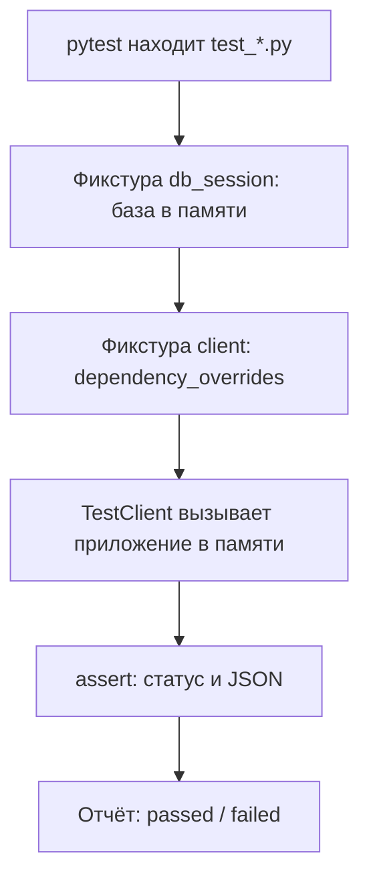

Код, который не протестирован, — это код, который скорее всего сломается. Особенно это касается веб-приложений: один неверный параметр, одна сессия без `commit()` — и пользователь видит 500-ю ошибку. В этом уроке мы научимся писать автотесты для FastAPI-приложений с помощью **pytest** — стандарта де-факто для тестирования в Python.

## Почему pytest

pytest умеет всё, что нужно для тестов веб-приложений:

- простое обнаружение тестов: функции, начинающиеся с `test_`, в файлах `test_*.py`;
- **фикстуры** (fixtures) — функции, которые готовят окружение (базу, клиента) и автоматически подставляются в тесты;
- `monkeypatch` — замена любых объектов на лету;
- удобные ассерты и подробные отчёты о падениях.

Установим:

```bash
pip install pytest httpx
```

(`httpx` нужен для `TestClient` — он заменяет реальный HTTP-запрос, вызывая приложение прямо в памяти.)

## Первый тест

Допустим, у нас есть приложение `calc.py`:

```python
from fastapi import FastAPI

app = FastAPI()

@app.get("/add")
def add(a: int, b: int):
    return {"result": a + b}
```

Тест для него — `test_calc.py`:

```python
from fastapi.testclient import TestClient
from calc import app

client = TestClient(app)

def test_add():
    response = client.get("/add", params={"a": 2, "b": 3})
    assert response.status_code == 200
    assert response.json() == {"result": 5}
```

`TestClient` ведёт себя как настоящий HTTP-клиент: у него есть `get`, `post`, `put`, `delete`, а в ответе — `status_code`, `json()`, `text` и так далее. При этом никакой сети не нужно — сервер не запускается.

## Ошибки тоже надо тестировать

Хороший тест проверяет не только успешные сценарии, но и ошибки:

```python
def test_add_missing_param():
    response = client.get("/add", params={"a": 2})
    assert response.status_code == 422  # валидация FastAPI
```

Если приложение должно возвращать `401` без токена, `404` для несуществующего объекта — напиши тест и на это. Именно такие тесты ловят регрессии: ты поправил одно, а сломал другое.

## Фикстуры: готовим окружение

Фикстура — это функция, помеченная `@pytest.fixture`. Она выполняется до теста, а её результат передаётся в тест аргументом:

```python
import pytest
from fastapi.testclient import TestClient
from sqlalchemy import create_engine
from sqlalchemy.orm import sessionmaker
from myapp import app, Base, get_session

@pytest.fixture
def db_session():
    engine = create_engine("sqlite:///:memory:")
    Base.metadata.create_all(engine)
    Session = sessionmaker(bind=engine)
    session = Session()
    yield session  # тест работает с этой сессией
    session.close()
```

Обрати внимание на `yield` — это фикстура-генератор: код до `yield` выполняется до теста, код после — после. Так можно создавать чистую базу для каждого теста — а это главное правило: **тесты не должны зависеть друг от друга**.

Если приложение использует глобальную сессию, её можно подменить через `app.dependency_overrides`:

```python
@pytest.fixture
def client(db_session):
    def override_get_session():
        return db_session
    app.dependency_overrides[get_session] = override_get_session
    yield TestClient(app)
    app.dependency_overrides.clear()
```

Так каждый тест получает свежую базу, не трогая реальную.

## Моки: заменяем внешние сервисы

Часто код обращается к внешним сервисам — платежным системам, почте, APIs. В тестах их не вызывают, а **подменяют** (mock). Самый простой способ — `monkeypatch`:

```python
def send_email(to: str, text: str):
    # реальная отправка письма — в тестах не вызываем
    ...

def test_order_email(monkeypatch):
    sent = []

    def fake_send_email(to, text):
        sent.append((to, text))

    monkeypatch.setattr("app.send_email", fake_send_email)
    ...
```

Теперь тест проверяет не то, что письмо реально улетело, а то, что функция отправки была вызвана с правильными аргументами.

## Параметризация: один тест — много случаев

`@pytest.mark.parametrize` запускает тест с разными наборами данных:

```python
import pytest

@pytest.mark.parametrize("a,b,expected", [
    (2, 3, 5),
    (-1, 1, 0),
    (0, 0, 0),
])
def test_add_params(a, b, expected):
    response = client.get("/add", params={"a": a, "b": b})
    assert response.json() == {"result": expected}
```

Один тест покрывает три случая. Если какой-то кейс упадёт — pytest покажет, с какими параметрами.

## Сколько тестов нужно

Хороший ориентир — покрыть главные сценарии каждого эндпоинта: успешный ответ, ошибки валидации, отсутствие доступа, пустые данные. Тесты — это ещё и документация: читая их, новый разработчик понимает, как должно вести себя приложение.

## Как устроен один прогон pytest

Соберём схему, которая объясняет, почему тесты вообще изолированы друг от друга.



Каждый тест получает свежую фикстуру: база создаётся заново, подмена зависимости ставится и снимается вокруг одного теста — поэтому порядок запуска не важен.

## Итог урока

Мы узнали, как устроен pytest (тесты, фикстуры, параметризация), как тестировать FastAPI через `TestClient` без запуска сервера, как изолировать тесты от базы и подменять внешние сервисы через `monkeypatch`.

<!--TASK-->
### Задача 1
Напиши файл `test_math.py` для приложения из `calc.py` (эндпоинты `GET /add` и `GET /sqrt`). Требования:

1. `GET /add` с `a=4, b=6` возвращает `{"result": 10}`.
2. `GET /add` без параметра `a` возвращает `422`.
3. Функция `sqrt` в приложении: `math.sqrt(x)`, эндпоинт `GET /sqrt` с параметром `x`. Для `x=9` ожидай `{"result": 3.0}`; для `x=-1` — `400` с сообщением об ошибке (`{"detail": "x должен быть неотрицательным"}`).
4. Используй параметризацию для `add` минимум с двумя парами чисел.

Запусти `pytest test_math.py -v` и убедись, что все тесты зелёные.

### Задача 2
Создай приложение `tasks_app.py`: FastAPI + SQLAlchemy, модель `Task` (id, title), функция-зависимость `get_session`, эндпоинты `POST /tasks` (принимает JSON `{"title": ...}`, создаёт запись, возвращает 201 и `{"id": ..., "title": ...}`) и `GET /tasks` (возвращает список всех задач). Затем напиши `test_tasks.py`: фикстуру `db_session` (движок `sqlite:///:memory:`, `Base.metadata.create_all`, `yield` сессии, закрытие), фикстуру `client`, которая подменяет `get_session` через `app.dependency_overrides`, и два теста: первый создаёт задачу и проверяет ответ 201 и появление её в `GET /tasks`; второй проверяет, что в свежей базе `GET /tasks` возвращает пустой список. Запусти `pytest test_tasks.py -v` — все тесты должны быть зелёными, причём порядок их выполнения не должен влиять на результат.

### Задача 3
Допиши в `tasks_app.py` функцию `send_welcome_email(email)`, которая печатает `Письмо для <email>: добро пожаловать!`, и вызови её внутри `POST /users` (прими JSON `{"email": ...}`, верни 201). Напиши тест `test_welcome_email.py`: через `monkeypatch.setattr("tasks_app.send_welcome_email", fake)` подмени отправку на заглушку, которая записывает вызовы в список. Сделай `POST /users` и проверь, что заглушка была вызвана ровно один раз и с тем же адресом. Затем временно убери подмену и убедись, что тест упал бы (реальная отправка) — верни подмену назад. Запусти `pytest test_welcome_email.py -v`.

### Задача 4
Создай `test_sqrt_edges.py` для приложения из `calc.py` (эндпоинт `GET /sqrt` с параметром `x`, возвращает `{"result": math.sqrt(x)}`, а для `x < 0` — 400 с detail «x должен быть неотрицательным»). Используй `@pytest.mark.parametrize` с парами `(x, expected_status)` для значений: `-1` → 400, `-0.5` → 400, `0` → 200, `9` → 200, `2.25` → 200. Для успешных случаев дополнительно проверяй `response.json()`. Запусти `pytest test_sqrt_edges.py -v` и убедись, что все 5 кейсов зелёные.

### Задача 5
Напиши `test_tasks_crud.py` для приложения `tasks_app.py`: один тест, который последовательно проверяет: 1) `POST /tasks` с `{"title": "Купить молоко"}` → 201; 2) `GET /tasks/{id}` → 200 и тот же title; 3) `GET /tasks/999` → 404; 4) `DELETE /tasks/{id}` → 204; 5) `GET /tasks/{id}` после удаления → 404. Используй фикстуры из задачи 2 (или продублируй их). Запусти `pytest test_tasks_crud.py -v`.
### Задача 6
Создай приложение `secure_app.py` и тесты к нему. В приложении: `SECRET_KEY = "test-secret"`, словарь пользователей `{"1": {"username": "anya"}}`, зависимость `get_current_user`, которая через `OAuth2PasswordBearer(tokenUrl="/login")` берёт токен, декодирует его (`jwt.decode` с `algorithms=["HS256"]`) и возвращает пользователя, а при `jwt.PyJWTError` или неизвестном `sub` отдаёт `401`; эндпоинт `GET /me`, возвращающий `{"username": ...}`. В `test_auth.py` напиши три теста: запрос без заголовка `Authorization` → `401`; запрос с валидным токеном, собранным прямо в тесте через `jwt.encode` (срок +1 час) → `200` и `{"username": "anya"}`; запрос с токеном, подписанным чужим ключом `"чужой-секрет"` → `401`. Запусти `pytest test_auth.py -v` и убедись, что все три теста зелёные.

### Задача 7
Создай приложение `notify_app.py`: множество `registered` на уровне модуля, функция `send_welcome_email(email)`, которая печатает `Письмо для <email>`, и `POST /users` с телом `{"email": ...}`: при повторе адреса — `409` с detail «Уже зарегистрирован», иначе адрес добавляется в `registered`, вызывается `send_welcome_email` и возвращается `201`. В `test_notify.py` используй `unittest.mock.Mock`: подмени функцию через `monkeypatch.setattr("notify_app.send_welcome_email", mock)` и проверь `mock.call_count == 1` и `mock.assert_called_once_with(...)`; вторым тестом проверь, что повторный POST даёт `409`, а `call_count` остаётся равным 1. Добавь `autouse`-фикстуру, очищающую `notify_app.registered` перед каждым тестом. Запусти `pytest test_notify.py -v` и опиши вывод.
<!--/TASK-->

<!--HINT-->
### Подсказка 1
Создай `TestClient(app)` один раз на уровне модуля. Эндпоинт `/sqrt` проверяй так: `assert response.status_code == 400` и `assert response.json()["detail"] == "x должен быть неотрицательным"`. Для параметризации импортируй `pytest` и повесь `@pytest.mark.parametrize("a,b,expected", [...])` — аргументы теста должны совпадать с именами из декоратора.

### Подсказка 2
Фикстура с `yield` — генератор: до `yield` подготовка базы, после — уборка. Подмена зависимости: `app.dependency_overrides[get_session] = override`, где `override` — генератор, отдающий `db_session`; после теста — `app.dependency_overrides.clear()`. Память `:memory:` даёт новую пустую базу для каждого теста — это и обеспечивает изоляцию.

### Подсказка 3
Функция должна быть импортируемой по пути модуля: `monkeypatch.setattr("tasks_app.send_welcome_email", fake)`. Заглушка: `sent = []`; `def fake(email): sent.append(email)`. Проверка: `assert sent == ["anya@example.com"]`. monkeypatch сам восстановит оригинал после теста.

### Подсказка 4
Декоратор: `@pytest.mark.parametrize("x, expected_status", [(-1, 400), ...])`. Для 200 проверяй и статус, и тело: для 9 — `{"result": 3.0}`. Помни: `math.sqrt(0)` → 0.0, `math.sqrt(2.25)` → 1.5.

### Подсказка 5
Для GET/DELETE по id бери id из предыдущего ответа: `created = response.json()["id"]`. DELETE возвращает 204 — тело пустое. После удаления выборка по id должна давать 404: обрабатывай это в приложении через `HTTPException(status_code=404)`.
### Подсказка 6
Токен в тесте собирай так же, как в приложении: `jwt.encode({"sub": "1", "exp": datetime.now(timezone.utc) + timedelta(hours=1)}, SECRET_KEY, algorithm="HS256")`. Заголовок передавай словарём: `client.get("/me", headers={"Authorization": f"Bearer {token}"})`. Для проверки «чужой подписи» подставь другой секрет — получишь `InvalidSignatureError`, который приложение превратит в `401`. Отдельный тест на отсутствие токена не передаёт заголовок вообще — `OAuth2PasswordBearer` сам вернёт `401`.

### Подсказка 7
`Mock` из `unittest.mock` записывает вызовы: `mock.call_count`, `mock.assert_called_once_with("anya@example.com")`, `mock.call_args_list`. Подмена работает, если приложение обращается к функции как к глобальному имени модуля — `monkeypatch.setattr("notify_app.send_welcome_email", mock)` меняет именно его. `autouse`-фикстура выполняется для каждого теста: `@pytest.fixture(autouse=True)` и внутри `notify_app.registered.clear()`.
<!--/HINT-->

<!--SOLUTION-->
### Разбор 1
Одно из возможных решений (приложение `calc.py` с `/sqrt`):

```python
from fastapi import FastAPI, HTTPException
import math

app = FastAPI()

@app.get("/add")
def add(a: int, b: int):
    return {"result": a + b}

@app.get("/sqrt")
def sqrt(x: float):
    if x < 0:
        raise HTTPException(status_code=400, detail="x должен быть неотрицательным")
    return {"result": math.sqrt(x)}
```

Тесты `test_math.py`:

```python
import pytest
from fastapi.testclient import TestClient
from calc import app

client = TestClient(app)

@pytest.mark.parametrize("a,b,expected", [
    (4, 6, 10),
    (0, 0, 0),
    (-2, 5, 3),
])
def test_add(a, b, expected):
    response = client.get("/add", params={"a": a, "b": b})
    assert response.status_code == 200
    assert response.json() == {"result": expected}

def test_add_missing_param():
    response = client.get("/add", params={"b": 6})
    assert response.status_code == 422

def test_sqrt_ok():
    response = client.get("/sqrt", params={"x": 9})
    assert response.status_code == 200
    assert response.json() == {"result": 3.0}

def test_sqrt_negative():
    response = client.get("/sqrt", params={"x": -1})
    assert response.status_code == 400
    assert response.json() == {"detail": "x должен быть неотрицательным"}
```

Запуск: `pytest test_math.py -v`.

Разбор. `TestClient` создаётся один раз — он не хранит состояние между тестами, это безопасно. Параметризация даёт три проверки `/add` одним тестом: pytest сам перезапустит его с каждой парой. `test_add_missing_param` проверяет валидацию FastAPI — без `a` (это обязательный `int`) придёт `422`. В `test_sqrt_negative` мы проверяем именно JSON-тело ошибки: `assert response.json() == {"detail": ...}` — если бы текст сообщения отличался, тест бы упал, и это поймало бы случайную правку текста ошибки.

### Разбор 2
Приложение `tasks_app.py`:

```python
from fastapi import FastAPI, Depends
from pydantic import BaseModel
from sqlalchemy import create_engine, select
from sqlalchemy.orm import DeclarativeBase, Mapped, mapped_column, sessionmaker

engine = create_engine("sqlite:///tasks.db")
Session = sessionmaker(bind=engine)

class Base(DeclarativeBase):
    pass

class Task(Base):
    __tablename__ = "tasks"
    id: Mapped[int] = mapped_column(primary_key=True)
    title: Mapped[str] = mapped_column()

Base.metadata.create_all(engine)

def get_session():
    session = Session()
    try:
        yield session
    finally:
        session.close()

app = FastAPI()

class TaskIn(BaseModel):
    title: str

@app.post("/tasks", status_code=201)
def create_task(data: TaskIn, session=Depends(get_session)):
    task = Task(title=data.title)
    session.add(task)
    session.commit()
    return {"id": task.id, "title": task.title}

@app.get("/tasks")
def list_tasks(session=Depends(get_session)):
    tasks = session.scalars(select(Task)).all()
    return [{"id": t.id, "title": t.title} for t in tasks]
```

Тесты `test_tasks.py`:

```python
import pytest
from fastapi.testclient import TestClient
from sqlalchemy import create_engine
from sqlalchemy.orm import sessionmaker
from tasks_app import app, Base, get_session

@pytest.fixture
def db_session():
    engine = create_engine("sqlite:///:memory:")
    Base.metadata.create_all(engine)
    Session = sessionmaker(bind=engine)
    session = Session()
    yield session
    session.close()

@pytest.fixture
def client(db_session):
    def override_get_session():
        yield db_session
    app.dependency_overrides[get_session] = override_get_session
    with TestClient(app) as c:
        yield c
    app.dependency_overrides.clear()

def test_create_task(client):
    response = client.post("/tasks", json={"title": "Купить молоко"})
    assert response.status_code == 201
    body = response.json()
    assert body["title"] == "Купить молоко"
    assert "id" in body
    assert client.get("/tasks").json() == [body]

def test_list_empty_in_fresh_db(client):
    assert client.get("/tasks").json() == []
```

Разбор: `db_session` создаёт базу в памяти (`:memory:`) — она существует, пока открыто соединение, и для каждого теста создаётся заново. `client` подменяет зависимость `get_session` через `app.dependency_overrides`: приложение внутри теста пользуется нашей тестовой сессией, а не реальной базой. Тест `test_list_empty_in_fresh_db` специально проверяет пустой список — если бы тесты делили базу, после первого теста там лежала бы задача, и этот тест упал бы. В конце фикстура `clear()` снимает подмену, чтобы подмена не протекла в другие тесты.

### Разбор 3
Дополнение к `tasks_app.py`:

```python
def send_welcome_email(email: str):
    print(f"Письмо для {email}: добро пожаловать!")

class UserIn(BaseModel):
    email: str

@app.post("/users", status_code=201)
def create_user(data: UserIn):
    send_welcome_email(data.email)
    return {"email": data.email}
```

Тест `test_welcome_email.py`:

```python
import pytest
from fastapi.testclient import TestClient
from tasks_app import app

@pytest.fixture
def client():
    with TestClient(app) as c:
        yield c

def test_welcome_email(monkeypatch, client):
    sent = []

    def fake(email):
        sent.append(email)

    monkeypatch.setattr("tasks_app.send_welcome_email", fake)

    response = client.post("/users", json={"email": "anya@example.com"})
    assert response.status_code == 201
    assert sent == ["anya@example.com"]
```

Разбор: мы не хотим, чтобы тест реально отправлял письма (это медленно, а в тестовой среде почтового сервера может просто не быть). `monkeypatch.setattr("tasks_app.send_welcome_email", fake)` заменяет функцию в модуле приложения на заглушку: она не отправляет ничего, а просто записывает аргумент в список `sent`. После вызова эндпоинта мы проверяем, что заглушка вызвана ровно с тем адресом, который прислали в JSON. Если убрать подмену, тест вызвал бы реальную функцию — она лишь печатает, но в реальном приложении это была бы настоящая отправка, которую в тестах выполнять нельзя. `monkeypatch` автоматически вернёт оригинал после теста.

### Разбор 4
Полный код `test_sqrt_edges.py`:

```python
import pytest
from fastapi.testclient import TestClient
from calc import app

client = TestClient(app)

@pytest.mark.parametrize("x, expected_status", [
    (-1, 400),
    (-0.5, 400),
    (0, 200),
    (9, 200),
    (2.25, 200),
])
def test_sqrt_edges(x, expected_status):
    response = client.get("/sqrt", params={"x": x})
    assert response.status_code == expected_status
    if expected_status == 200:
        assert response.json() == {"result": x ** 0.5}
```

Разбор: параметризация превращает один тест в пять независимых запусков — pytest прогонит `test_sqrt_edges` для каждой пары `(x, expected_status)` и в отчёте покажет, какая именно пара упала. Отрицательные значения должны давать 400: это проверяет ветку `if x < 0` в приложении. Для успешных случаев мы сверяем и статус, и точное значение: `0 ** 0.5` → 0.0, `9 ** 0.5` → 3.0, `2.25 ** 0.5` → 1.5. Сравнение с `x ** 0.5` вместо захардкоженных чисел делает тест устойчивым к правкам, но при желании можно записать ожидания явно.

### Разбор 5
Тест `test_tasks_crud.py`:

```python
import pytest
from fastapi.testclient import TestClient
from sqlalchemy import create_engine
from sqlalchemy.orm import sessionmaker
from tasks_app import app, Base, get_session

@pytest.fixture
def db_session():
    engine = create_engine("sqlite:///:memory:")
    Base.metadata.create_all(engine)
    Session = sessionmaker(bind=engine)
    session = Session()
    yield session
    session.close()

@pytest.fixture
def client(db_session):
    def override_get_session():
        yield db_session
    app.dependency_overrides[get_session] = override_get_session
    with TestClient(app) as c:
        yield c
    app.dependency_overrides.clear()

def test_crud_cycle(client):
    response = client.post("/tasks", json={"title": "Купить молоко"})
    assert response.status_code == 201
    task = response.json()
    task_id = task["id"]

    response = client.get(f"/tasks/{task_id}")
    assert response.status_code == 200
    assert response.json() == task

    assert client.get("/tasks/999").status_code == 404
    assert client.delete(f"/tasks/{task_id}").status_code == 204
    assert client.get(f"/tasks/{task_id}").status_code == 404
```

В приложение `tasks_app.py` нужно добавить два эндпоинта:

```python
from fastapi import HTTPException

@app.get("/tasks/{task_id}")
def get_task(task_id: int, session=Depends(get_session)):
    task = session.get(Task, task_id)
    if task is None:
        raise HTTPException(status_code=404, detail="Задача не найдена")
    return {"id": task.id, "title": task.title}

@app.delete("/tasks/{task_id}", status_code=204)
def delete_task(task_id: int, session=Depends(get_session)):
    task = session.get(Task, task_id)
    if task is None:
        raise HTTPException(status_code=404, detail="Задача не найдена")
    session.delete(task)
    session.commit()
```

Разбор: тест проверяет весь жизненный цикл записи: создание (201 и корректное тело), чтение по id (200 и тот же объект), обработку несуществующего id (404), удаление (204 — пустое тело) и повторное чтение после удаления (снова 404). В приложении `session.get(Task, task_id)` возвращает None для отсутствующей записи, и мы отдаём 404. Число 999 выбрано заведомо несуществующим — id выдаютя автоматически и вряд ли дойдут до 999 в тесте. Такой интеграционный тест связывает все операции CRUD и защищает от регрессий при рефакторинге.
### Разбор 6
Приложение `secure_app.py`:

```python
import jwt
from fastapi import FastAPI, Depends, HTTPException
from fastapi.security import OAuth2PasswordBearer
from datetime import datetime, timedelta, timezone

app = FastAPI()
SECRET_KEY = "test-secret"
oauth2_scheme = OAuth2PasswordBearer(tokenUrl="/login")

USERS = {"1": {"username": "anya"}}

def get_current_user(token: str = Depends(oauth2_scheme)) -> dict:
    try:
        payload = jwt.decode(token, SECRET_KEY, algorithms=["HS256"])
    except jwt.PyJWTError:
        raise HTTPException(status_code=401, detail="Неверный токен")
    user = USERS.get(payload["sub"])
    if user is None:
        raise HTTPException(status_code=401, detail="Неверный токен")
    return user

@app.get("/me")
def me(user: dict = Depends(get_current_user)):
    return user
```

Тесты `test_auth.py`:

```python
import jwt
import pytest
from datetime import datetime, timedelta, timezone
from fastapi.testclient import TestClient
from secure_app import app, SECRET_KEY

client = TestClient(app)

def make_token(sub="1", secret=SECRET_KEY):
    return jwt.encode(
        {"sub": sub, "exp": datetime.now(timezone.utc) + timedelta(hours=1)},
        secret,
        algorithm="HS256",
    )

def test_me_without_token():
    assert client.get("/me").status_code == 401

def test_me_with_valid_token():
    response = client.get("/me", headers={"Authorization": f"Bearer {make_token()}"})
    assert response.status_code == 200
    assert response.json() == {"username": "anya"}

def test_me_with_foreign_signature():
    token = make_token(secret="чужой-секрет")
    response = client.get("/me", headers={"Authorization": f"Bearer {token}"})
    assert response.status_code == 401
```

Результат `pytest test_auth.py -v`:

```
test_auth.py::test_me_without_token PASSED
test_auth.py::test_me_with_valid_token PASSED
test_auth.py::test_me_with_foreign_signature PASSED
3 passed
```

Разбор: мы тестируем не «внутренности» зависимости, а поведение границы приложения — то, что видит клиент. Три теста закрывают три состояния: токена нет (401 от `OAuth2PasswordBearer`), токен валиден (200 и данные), токен подписан не нашим ключом (401 от перехвата `PyJWTError`). Токен собирается прямо в тесте, а не запросом на `/login`: тест остаётся быстрым и проверяет ровно охрану эндпоинта, а не работу логина. Если завтра кто-то поменяет код ошибки с 401 на 403 или начнёт пропускать токены с чужой подписью, упадут именно эти тесты — это и есть защита от регрессий в безопасности.

### Разбор 7
Приложение `notify_app.py`:

```python
from fastapi import FastAPI, HTTPException
from pydantic import BaseModel

app = FastAPI()
registered: set[str] = set()

def send_welcome_email(email: str):
    print(f"Письмо для {email}")

class UserIn(BaseModel):
    email: str

@app.post("/users", status_code=201)
def create_user(data: UserIn):
    if data.email in registered:
        raise HTTPException(status_code=409, detail="Уже зарегистрирован")
    registered.add(data.email)
    send_welcome_email(data.email)
    return {"email": data.email}
```

Тесты `test_notify.py`:

```python
import pytest
from unittest.mock import Mock
from fastapi.testclient import TestClient
import notify_app
from notify_app import app

client = TestClient(app)

@pytest.fixture(autouse=True)
def clean_registry():
    notify_app.registered.clear()
    yield

def test_email_sent_once(monkeypatch):
    mock = Mock()
    monkeypatch.setattr("notify_app.send_welcome_email", mock)

    response = client.post("/users", json={"email": "anya@example.com"})

    assert response.status_code == 201
    assert mock.call_count == 1
    mock.assert_called_once_with("anya@example.com")

def test_duplicate_not_sent_twice(monkeypatch):
    mock = Mock()
    monkeypatch.setattr("notify_app.send_welcome_email", mock)

    client.post("/users", json={"email": "anya@example.com"})
    response = client.post("/users", json={"email": "anya@example.com"})

    assert response.status_code == 409
    assert mock.call_count == 1
```

Результат `pytest test_notify.py -v`:

```
test_notify.py::test_email_sent_once PASSED
test_notify.py::test_duplicate_not_sent_twice PASSED
2 passed
```

Разбор: `Mock` — это объект-«шпион»: он ничего не делает, но записывает каждый вызов вместе с аргументами. `assert_called_once_with` — более строгая проверка, чем `call_count == 1`: она сверяет и количество, и аргументы, поэтому поймает случай, когда письмо ушло не тому адресу. Второй тест важен бизнес-логикой: при повторной регистрации письмо не должно уходить второй раз, и `call_count == 1` доказывает это без реальной почты. `autouse`-фикстура очищает глобальное множество `registered`: без неё второй тест упал бы с 409 уже на первом запросе, потому что первый тест оставил там адрес. Это тот самый принцип из урока — тесты не должны зависеть друг от друга и от порядка запуска.
<!--/SOLUTION-->

<!--QUIZ-->
Что делает TestClient из fastapi.testclient?
- Запускает реальный веб-сервер
- Вызывает приложение в памяти, имитируя HTTP-запросы
- Отправляет запросы в интернет
- Компилирует приложение
* Правильный ответ: Вызывает приложение в памяти, имитируя HTTP-запросы
TestClient не поднимает сервер и не ходит по сети: он напрямую дергает ASGI-приложение, поэтому тесты быстрые и изолированные.

Зачем в фикстуре используется yield?
- Чтобы вернуть несколько значений сразу
- Чтобы код после yield выполнился после теста (очистка)
- Чтобы остановить тест
- Чтобы сделать фикстуру асинхронной
* Правильный ответ: Чтобы код после yield выполнился после теста (очистка)
Фикстура-генератор: до yield — подготовка, после yield — уборка, которая выполняется даже при падении теста.

Как подменить внешний сервис в тесте без реальных вызовов?
- Переписать код приложения
- Использовать monkeypatch.setattr, подставив фейковую функцию
- Отключить интернет
- Создать второй сервер
* Правильный ответ: Использовать monkeypatch.setattr, подставив фейковую функцию
monkeypatch заменяет атрибут (например, функцию отправки почты) на заглушку, которая записывает вызовы и возвращает нужные значения.

Что произойдёт, если передать в /add только один параметр?
- Тест упадёт с ошибкой ассерта
- FastAPI вернёт 422 — и тест должен это проверять
- Сервер упадёт с 500
- Python вернёт None
* Правильный ответ: FastAPI вернёт 422 — и тест должен это проверять
Отсутствие обязательного параметра — ошибка валидации Pydantic, поэтому ответ 422 Unprocessable Entity, и хороший тест это фиксирует.

Зачем нужна параметризация @pytest.mark.parametrize?
- Чтобы запустить один тест с разными наборами данных
- Чтобы ускорить тесты
- Чтобы пропустить тест
- Чтобы запустить тесты параллельно
* Правильный ответ: Чтобы запустить один тест с разными наборами данных
pytest сам прогонит тест для каждой пары аргументов, а в отчёте покажет, какие именно данные упали.

Как pytest обнаруживает тесты?
- По именам функций, начинающимся с test_, в файлах test_*.py
- По любым функциям в проекте
- Только по классам
- По комментариям
* Правильный ответ: По именам функций, начинающимся с test_, в файлах test_*.py
pytest сканирует модули test_*.py и запускает все функции, имена которых начинаются с test_.

Что такое мок (mock) в тестировании?
- Тест, который всегда проходит
- Подмена внешнего сервиса или функции на заглушку
- Быстрый тест
- Ошибка в приложении
* Правильный ответ: Подмена внешнего сервиса или функции на заглушку
Мок позволяет проверить вызов функции с нужными аргументами, не обращаясь к реальному внешнему сервису.

Что такое фикстура (fixture) в pytest?
- Функция, которая готовит окружение и подставляется в тесты автоматически
- Специальный тип теста
- Вид ассерта
- Скрипт запуска pytest
* Правильный ответ: Функция, которая готовит окружение и подставляется в тесты автоматически
Фикстуры, например db_session или client, описывают подготовку и уборку окружения один раз и переиспользуются в тестах.
Почему тесты не должны зависеть от порядка выполнения?
- Потому что pytest может запускать их по одному или в другом порядке, и результат станет непредсказуемым
- Потому что так требует PEP 8
- Потому что иначе они медленнее
- Потому что TestClient не работает с упорядоченными тестами
* Правильный ответ: Потому что pytest может запускать их по одному или в другом порядке, и результат станет непредсказуемым
Общее состояние (база, список, файл) должно готовиться фикстурой для каждого теста — иначе «зелёный» прогон превращается в лотерею.

Зачем после теста вызывать app.dependency_overrides.clear()?
- Чтобы подмена зависимости не протекла в следующие тесты
- Чтобы ускорить приложение
- Чтобы закрыть базу
- Чтобы сбросить кэш браузера
* Правильный ответ: Чтобы подмена зависимости не протекла в следующие тесты
Если не снять подмену, следующие тесты будут получать чужую тестовую сессию и вести себя странно.

Что проверяет конструкция with pytest.raises(httpx.HTTPStatusError)?
- Что код внутри блока поднимает именно это исключение
- Что код вернул True
- Что сервер доступен
- Что тест пропущен
* Правильный ответ: Что код внутри блока поднимает именно это исключение
Если исключение не возникнет (или будет другого типа), pytest пометит тест как упавший.

Зачем в тесте проверять не только статус-код ошибки, но и тело ответа (поле detail)?
- Чтобы зафиксировать контракт: какой именно текст и структуру получает клиент
- Чтобы тест работал быстрее
- Чтобы не нужен был assert
- Чтобы обойти валидацию
* Правильный ответ: Чтобы зафиксировать контракт: какой именно текст и структуру получает клиент
Случайная правка сообщения об ошибке — тоже регрессия: клиенты и тесты могут от него зависеть.
<!--/QUIZ-->
