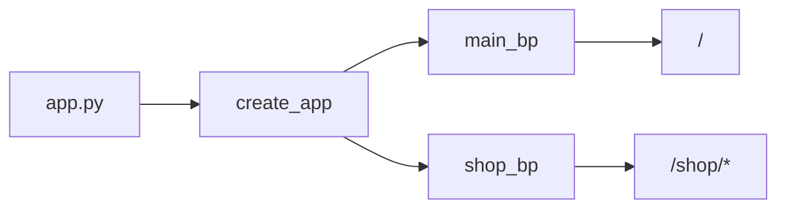

Когда Flask-приложение растёт, держать всё в одном `app.py` становится тяжело. Blueprints позволяют разбить приложение на модули: каждый blueprint отвечает за свою область (auth, shop, admin...).

## Что такое Blueprint

Blueprint — «чертёж» под-приложения: маршруты, шаблоны, статика. Он регистрируется в основном приложении:

```python
from flask import Blueprint

auth_bp = Blueprint("auth", __name__, url_prefix="/auth")

@auth_bp.route("/login")
def login():
    return "Вход"
```

## Регистрация

```python
app.register_blueprint(auth_bp)
```

URL станет `/auth/login`. Имя блюпринта (`auth`) используется в `url_for("auth.login")`.

## Фабрика приложений

Функция `create_app()` создаёт приложение, подключает расширения и регистрирует блюпринты. Это позволяет создавать несколько экземпляров (например, для тестов) с разными конфигами.

```python
def create_app(config=None):
    app = Flask(__name__)
    if config:
        app.config.update(config)
    from blueprints.auth import auth_bp
    app.register_blueprint(auth_bp)
    return app
```

## Куда что класть

Типичная структура:

```
app/
  __init__.py       # create_app
  blueprints/
    auth.py
    shop.py
  templates/
  static/
  models.py
```

## Передача данных между блюпринтами

Общие модели и вспомогательные функции выносятся в корень пакета; блюпринты их импортируют.

## Обработка ошибок в блюпринтах

Можно определить `@auth_bp.errorhandler(404)` — он перехватит ошибки в пределах блюпринта.

## Итог урока

Blueprints — стандартный способ масштабировать Flask: приложение становится модульным, тестируемым и понятным.




## Практические рекомендации

Разрабатывая приложение, держите в голове разделение ответственности: blueprints отвечают за маршруты, фабрика — за сборку, а модели и утилиты — за данные. Хорошая структура упрощает написание тестов: можно создать несколько экземпляров через `create_app({...})` и проверять маршруты каждого. Кроме того, `url_for` в шаблонах всегда используйте через имя блюпринта — это защищает от «сломанных» ссылок при переименовании эндпоинтов.


<!--TASK-->
### Задача 1 — Первый Blueprint
Создай приложение с блюпринтом `main_bp` (url_prefix="") и маршрутом `/` возвращающим «Главная». Зарегистрируй blueprint и проверь, что GET / отвечает 200.

### Задача 2 — url_prefix
Создай блюпринт `shop_bp` с url_prefix="/shop" и маршрутом `/items`, возвращающим список товаров (обычный список строк). Убедись, что GET /shop/items отвечает 200.

### Задача 3 — url_for с блюпринтом
В шаблоне или через redirect используй `url_for("shop.items")` после POST-запроса. Реализуй POST /shop/items, добавляющий товар в глобальный список и перенаправляющий на GET.

### Задача 4 — Структура пакета
Раздели код: `app/__init__.py` с create_app, `app/blueprints/main.py` и `app/blueprints/shop.py`. Покажи содержимое всех трёх файлов.

### Задача 5 — Конфигурируемая фабрика
Сделай create_app(config): при DEBUG=True добавь маршрут /debug, отдающий «debug on». Проверь два экземпляра с разными конфигами.

### Задача 6 — Обработчики ошибок в блюпринте
В shop_bp добавь errorhandler(404), возвращающий «Товар не найден» с кодом 404. Проверь запрос к несуществующему товару.

### Задача 7 — Публикация статики
Положи в `app/static/style.css` простое правило, подключи его в шаблоне через `url_for('static', filename='style.css')` и убедись, что стиль подгружается (checked по 200 для /static/style.css).
<!--/TASK-->

<!--HINT-->
### Подсказка 1
Blueprint("main", __name__); app.register_blueprint(main_bp). Проверка: тестовый клиент.

### Подсказка 2
url_prefix="/shop" добавляется ко всем маршрутам блюпринта.

### Подсказка 3
Внутри blueprint-функции redirect(url_for("shop.items")) — имя blueprint + имя эндпоинта.

### Подсказка 4
Отдельные файлы; в __init__.py только create_app и регистрация.

### Подсказка 5
app.config.update(config); в create_app можно добавить маршруты по условию.

### Подсказка 6
@shop_bp.errorhandler(404) — функция, возвращающая (text, 404).

### Подсказка 7
static — отдельная папка; url_for('static', filename='css/style.css').
<!--/HINT-->

<!--SOLUTION-->
### Разбор 1
```python
from flask import Flask, Blueprint

main_bp = Blueprint("main", __name__)

@main_bp.route("/")
def index():
    return "Главная"

app = Flask(__name__)
app.register_blueprint(main_bp)
```
Тестовый клиент: `app.test_client().get("/")` → 200.

### Разбор 2
```python
shop_bp = Blueprint("shop", __name__, url_prefix="/shop")

@shop_bp.route("/items")
def items():
    return "Товары"
```
Полный путь — /shop/items.

### Разбор 3
```python
from flask import redirect, url_for, request

items_list = []

@shop_bp.route("/items", methods=["GET", "POST"])
def items():
    if request.method == "POST":
        items_list.append(request.form["title"])
        return redirect(url_for("shop.items"))
    return str(items_list)
```
url_for("shop.items") собирает URL по имени блюпринта и эндпоинта.

### Разбор 4
```python
# app/__init__.py
from flask import Flask
from .blueprints.main import main_bp
from .blueprints.shop import shop_bp

def create_app():
    app = Flask(__name__)
    app.register_blueprint(main_bp)
    app.register_blueprint(shop_bp)
    return app
```
```python
# app/blueprints/main.py
from flask import Blueprint
main_bp = Blueprint("main", __name__)

@main_bp.route("/")
def index():
    return "Главная"
```
```python
# app/blueprints/shop.py
from flask import Blueprint
shop_bp = Blueprint("shop", __name__, url_prefix="/shop")

@shop_bp.route("/items")
def items():
    return "Товары"
```
Пакет разбит на ясные модули.

### Разбор 5
```python
def create_app(config=None):
    app = Flask(__name__)
    if config:
        app.config.update(config)
    if app.config.get("DEBUG"):
        @app.route("/debug")
        def debug():
            return "debug on"
    return app

app1 = create_app({"DEBUG": True})
app2 = create_app({"DEBUG": False})
```
Каждый экземпляр имеет свою конфигурацию.

### Разбор 6
```python
@shop_bp.errorhandler(404)
def not_found(e):
    return "Товар не найден", 404
```
Запрос к /shop/items/999 → 404 с нашим текстом.

### Разбор 7
```css
/* app/static/style.css */
body { color: blue; }
```
```html
<link rel="stylesheet" href="{{ url_for('static', filename='style.css') }}">
```
GET /static/style.css → 200, правило применяется.
<!--/SOLUTION-->

<!--QUIZ-->
Что такое Blueprint?
- Модуль для группировки маршрутов и шаблонов
- Модель базы данных
- Тема оформления
- Плагин
* Правильный ответ: Модуль для группировки маршрутов и шаблонов
Blueprint регистрируется в приложении.

Как задать префикс URL у блюпринта?
- url_prefix="/shop"
- prefix="shop"
- route_prefix
- path="/shop"
* Правильный ответ: url_prefix="/shop"
Все маршруты получат этот префикс.

Как обратиться к маршруту блюпринта в url_for?
- url_for("shop.items")
- url_for("items")
- url_for("/shop/items")
- url_for("main.items")
* Правильный ответ: url_for("shop.items")
Имя = имя блюпринта + имя эндпоинта.

Зачем нужна фабрика create_app?
- Для создания приложения с настраиваемой конфигурацией
- Это обязательно для Flask
- Для статики
- Для моделей
* Правильный ответ: Для создания приложения с настраиваемой конфигурацией
Удобно для тестов и разных сред.

Что вернёт app.test_client().get("/")?
- Response с кодом статуса
- None
- Строку без статуса
- Исключение
* Правильный ответ: Response с кодом статуса
Тестовый клиент эмулирует запросы.

Как задать errorhandler в блюпринте?
- @shop_bp.errorhandler(404)
- @app.errorhandler(404)
- @shop_bp.route(404)
- нет
* Правильный ответ: @shop_bp.errorhandler(404)
Он перехватит ошибки в пределах блюпринта.

Что делает register_blueprint?
- Подключает блюпринт к приложению
- Создаёт приложение
- Удаляет блюпринт
- Проверяет шаблоны
* Правильный ответ: Подключает блюпринт к приложению
После этого маршруты доступны.

Можно ли иметь несколько блюпринтов?
- Да
- Нет
- Только один
- Только для авторизации
* Правильный ответ: Да
Это и есть цель модульности.
Что произойдёт при переименовании эндпоинта?
- url_for сломается, если имя не обновлено
- Ничего
- Изменится база
- Маршрут исчезнет навсегда
* Правильный ответ: url_for сломается, если имя не обновлено
Генерируйте URL через url_for, а не вручную.

Что тестируется в первую очередь в UI?
- Обработчики кнопок и состояния
- Цвета
- Шрифты
- Иконки
* Правильный ответ: Обработчики кнопок и состояния
Логика реагирования на события.


Какова роль __init__.py в пакете app?
- Отмечает каталог как пакет и содержит create_app
- Хранит данные
- Запрещает импорт
- Создаёт БД
* Правильный ответ: Отмечает каталог как пакет и содержит create_app
Из него импортируются блюпринты.

Чем опасны маршруты в одном файле?
- Ростом сложности и конфликтами
- Скоростью
- Безопасностью
- Ничем
* Правильный ответ: Ростом сложности и конфликтами
Модульность облегчает поддержку.


<!--/QUIZ-->
