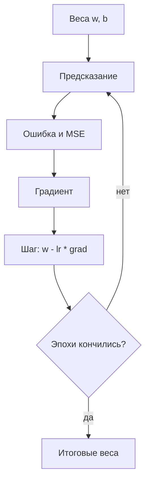

Нормальное уравнение даёт точное решение за одну операцию, но у него есть ограничения: при большом числе признаков обращение матрицы дорого, а иногда данных так много, что они не помещаются в память целиком. Градиентный спуск — универсальный итерационный метод: он двигается к минимуму функции потерь маленькими шагами и работает даже там, где закрытой формулы нет вовсе — например, для нейросетей.

## Градиент

Функция потерь зависит от весов — например, MSE от w и b. Производная показывает, как быстро меняется функция при изменении аргумента. Градиент — это вектор частных производных по всем параметрам; он указывает направление наибольшего роста функции. Чтобы убывать, надо идти в противоположную сторону — минус градиента. Шаг в этом направлении тем меньше, чем меньше скорость обучения (learning rate), которую мы выбираем заранее.

## Как взять градиент MSE

Пусть модель предсказывает `y_pred = w·x + b`, а ошибка — это разность `y_pred - y`. Квадратичная ошибка на одном примере — `(y_pred - y)²`. Её производная по w равна `2·(y_pred - y)·x`, а по b — `2·(y_pred - y)`. Для всей выборки берём среднее этих величин. Получаются простые формулы, которые легко записать через операции над массивами NumPy.

## Алгоритм

Повторяем: (1) считаем предсказания и ошибку; (2) считаем градиент по формулам выше; (3) сдвигаем каждый параметр против градиента: `w ← w - lr·grad_w`, `b ← b - lr·grad_b`. Один проход по всем данным называется эпохой. Если всё правильно, MSE падает с каждой эпохой и стабилизируется около минимума.

```python
import numpy as np

rng = np.random.default_rng(0)
x = rng.uniform(-3, 3, 200)
y = 1.5 * x + 0.8 + rng.normal(0, 0.5, 200)  # истина: w=1.5, b=0.8

w, b = 0.0, 0.0
lr = 0.1
epochs = 500

for epoch in range(epochs):
    y_pred = w * x + b
    error = y_pred - y

    grad_w = 2 * (error * x).mean()
    grad_b = 2 * error.mean()

    w -= lr * grad_w
    b -= lr * grad_b

    if epoch in (0, 99, 499):
        mse = (error ** 2).mean()
        print(f"epoch={epoch:3d}  mse={mse:.4f}  w={w:.4f}  b={b:.4f}")
```

Запусти код и посмотри на вывод: с каждой эпохой MSE уменьшается, а w и b приближаются к истинным 1.5 и 0.8.

## Полный, стохастический и мини-батч

В полном батче градиент считаем по всей выборке сразу — точно, но тяжело. В стохастическом — по одному случайному примеру: дёшево, но шумно. Компромисс — мини-батч: градиент по небольшой случайной порции данных (обычно 16–256 примеров). Так обучают почти все современные модели, включая нейросети.

## Выбор скорости обучения

Learning rate — самый важный гиперпараметр. Если он слишком мал, обучение идёт медленно; если слишком велик, шаги перескакивают минимум, и потеря может расти. Хорошая практика — запускать несколько экспериментов с lr = 0.01, 0.1, 0.5 и смотреть на график потерь; удобно печатать значение MSE раз в несколько эпох.

## Цикл градиентного спуска

Схема показывает, как повторяются шаги обучения.



## Итог урока

Мы научились находить минимум функции потерь итерационно: считаем градиент, делаем маленький шаг против него, повторяем. Теперь мы знаем, как обучать линейную модель без готовой формулы, — а это ровно тот механизм, который дальше будет обучать нейросети.

<!--TASK-->
### Задача 1
Напиши вариацию градиентного спуска на мини-батчах: перед каждой эпохой перемешивай индексы, дели данные на порции по 32 примера и делай шаг обновления после каждой порции. Обучи 100 эпох со скоростью обучения 0.05 и выведи MSE каждые 20 эпох. Ожидаемый результат: пять строк, в которых потеря монотонно убывает примерно с 7 до 0.25, а итоговые w и b близки к 1.5 и 0.8.

```python
import numpy as np

rng = np.random.default_rng(0)
x = rng.uniform(-3, 3, 200)
y = 1.5 * x + 0.8 + rng.normal(0, 0.5, 200)
```

### Задача 2
Реализуй полный градиентный спуск по всей выборке: стартуй с w = b = 0, возьми lr = 0.1 и 500 эпох. Сохраняй MSE каждой эпохи в список `history` и выведи первые пять значений, а затем значение на последней эпохе. Ожидаемый результат: первые значения около 7.5–7.7, последнее — около 0.25, а итоговые w и b близки к 1.5 и 0.8.

### Задача 3
Исследуй скорость обучения. Для lr из списка `[0.01, 0.1, 0.5]` обучи полный батч-спуск на 200 эпох и выведи MSE на последней эпохе каждого эксперимента, печатая и значение lr. Ожидаемый результат: lr = 0.1 даёт MSE около 0.25; lr = 0.01 — заметно больше, потому что обучение не успевает сойтись; lr = 0.5 — потеря не убывает или даже растёт, потому что шаги слишком велики.

### Задача 4
Реализуй стохастический градиентный спуск: на каждом шаге выбирай один случайный пример (индекс через `rng.integers(0, n)` или `rng.permutation`), считай градиент только по нему и сразу обновляй w и b. Обучи 100 эпох (в каждой эпохе — 200 шагов, по числу примеров) с lr = 0.01 и выведи MSE каждые 20 эпох. Ожидаемый результат: потеря убывает, но колеблется сильнее, чем у полного батча, а итоговый MSE — около 0.25–0.35.

### Задача 5
Сравни три варианта спуска: полный батч, стохастический и мини-батч с порцией 32. Обучи каждый на 200 эпох с lr = 0.05 и выведи итоговый MSE каждого метода в одной строке. Ожидаемый результат: все три значения рядом с 0.25, причём наименее стабильный — стохастический. Так ты наглядно увидишь компромисс между точностью градиента и стоимостью шага.
### Задача 6
Разберём один шаг спуска вручную, чтобы увидеть все числа. Данные идеально линейны:

```python
import numpy as np

x = np.array([1.0, 2.0, 3.0])
y = np.array([2.0, 4.0, 6.0])
w, b = 0.0, 0.0
lr = 0.1
```

Напиши программу, которая:

1. считает предсказания и ошибку `error = w * x + b - y`;
2. считает градиенты `grad_w = 2 * (error * x).mean()` и `grad_b = 2 * error.mean()` и выводит их с четырьмя знаками;
3. делает один шаг `w -= lr * grad_w` и `b -= lr * grad_b` и выводит новые значения;
4. считает MSE после шага и выводит её с четырьмя знаками.

Ожидаемый вывод:

```
grad_w = -18.6667, grad_b = -8.0000
w = 1.8667, b = 0.8000
MSE после шага: 0.2963
```

### Задача 7
Научись диагностировать обучение по истории потерь. Вот три кривые MSE по эпохам:

```python
history_a = [7.5, 5.2, 3.1, 1.4, 0.6, 0.3, 0.26, 0.25]
history_b = [7.5, 7.4, 7.35, 7.3, 7.28, 7.27, 7.26, 7.25]
history_c = [7.5, 9.1, 12.4, 18.0, 27.5, 41.0, 62.0, 95.0]
```

Напиши программу, которая:

1. для каждой истории выводит стартовое значение, финальное и изменение (финал минус старт);
2. выводит вердикт: `сходится`, если потеря упала более чем в три раза; `слишком маленький lr`, если упала, но меньше чем на 10%; `слишком большой lr`, если выросла;
3. выводит все три вердикта в формате `Вердикт A: ...`.

Ожидаемый вывод:

```
A: старт 7.5, финиш 0.25, изменение -7.25
B: старт 7.5, финиш 7.25, изменение -0.25
C: старт 7.5, финиш 95.0, изменение 87.5
Вердикт A: сходится
Вердикт B: слишком маленький lr
Вердикт C: слишком большой lr
```

<!--/TASK-->

<!--HINT-->
### Подсказка 1
Перемешанные индексы даёт `rng.permutation(n)`. Нарезай их на порции: `for start in range(0, n, batch_size): batch_idx = idx[start:start + batch_size]`. Градиенты считай только по порции `x[batch_idx]`, `y[batch_idx]`, а параметры сдвигай сразу после каждой порции.

### Подсказка 2
В полном батче формулы простейшие: `grad_w = 2 * ((w * x + b - y) * x).mean()`, `grad_b = 2 * (w * x + b - y).mean()`. После каждого обновления добавляй текущий MSE в `history.append(mse)`, а в конце печатай `history[:5]` и `history[-1]`.

### Подсказка 3
Оберни цикл обучения в ещё один цикл: `for lr in (0.01, 0.1, 0.5):` — внутри создавай заново w и b и запускай обучение. Печатай f-строкой: `f"lr={lr} mse={mse:.4f}"`. При lr = 0.5 потеря может начать расти с первых же эпох.

### Подсказка 4
На каждом шаге выбирай `i = rng.integers(0, n)` и считай градиенты по одному примеру: `grad_w = 2 * (y_pred_i - y[i]) * x[i]`. Один проход по всем n примерам — это и есть эпоха: сделай вложенный цикл `for epoch in range(100): for _ in range(n):` и обновляй параметры внутри.

### Подсказка 5
Собери три функции: `gd_full(x, y, lr, epochs)`, `gd_sgd(...)` и `gd_minibatch(...)`, каждая возвращает итоговые (w, b, mse). Печатай результат рядом с именем метода. Главное — одинаковая длина обучения (200 эпох) и одинаковая lr для честного сравнения.
### Подсказка 6
При нулевых весах `y_pred` — это массив нулей, поэтому `error = -y`. Считай градиенты ровно по формулам из теории — без цикла. После обновления пересчитай предсказания с новыми `w` и `b` и только затем MSE: если считать MSE по старым предсказаниям, получится 9.33 вместо 0.2963.

### Подсказка 7
Изменение — `history[-1] - history[0]`. Порог «упала более чем в три раза» — `history[-1] * 3 < history[0]`. Порог «упала меньше чем на 10%» — `abs(change) < history[0] * 0.1`. Сначала проверяй рост (`change > 0`), иначе расходящаяся кривая может попасть в неверную ветку.

<!--/HINT-->

<!--SOLUTION-->
### Разбор 1
Полное решение:

```python
import numpy as np

rng = np.random.default_rng(0)
x = rng.uniform(-3, 3, 200)
y = 1.5 * x + 0.8 + rng.normal(0, 0.5, 200)

w, b = 0.0, 0.0
lr, batch_size, epochs = 0.05, 32, 100
n = len(x)

for epoch in range(epochs):
    idx = rng.permutation(n)
    for start in range(0, n, batch_size):
        batch_idx = idx[start:start + batch_size]
        xb, yb = x[batch_idx], y[batch_idx]

        y_pred = w * xb + b
        error = y_pred - yb

        grad_w = 2 * (error * xb).mean()
        grad_b = 2 * error.mean()

        w -= lr * grad_w
        b -= lr * grad_b

    if epoch % 20 == 0:
        mse = ((w * x + b - y) ** 2).mean()
        print(f"epoch={epoch:3d}  mse={mse:.4f}  w={w:.4f}  b={b:.4f}")

print("Итог: w = %.4f, b = %.4f" % (w, b))
```

Перед каждой эпохой мы перемешиваем индексы — благодаря этому порядок батчей меняется, и обучение не «привыкает» к фиксированной последовательности. Внутренний цикл нарезает перемешанные индексы на порции по 32: последняя порция может быть короче, и это нормально. Внутри порции всё как в полном батче: считаем предсказания, ошибку и две производные, а затем обновляем w и b. Важно, что шаг делается после каждой порции, а не после эпохи — поэтому за эпоху параметры обновляются несколько раз. MSE для печати мы считаем по всей выборке, чтобы видеть общий прогресс, а не шум отдельного батча. Что мы видим в выводе? На первой эпохе MSE около 7 — модель ещё ничего не знает. К двадцатой эпохе потеря падает до долей единицы, а к сотой стабилизируется около 0.25 — это дисперсия шума в данных, ниже которой спуститься невозможно. Итоговые w ≈ 1.5 и b ≈ 0.8 совпадают с истинными коэффициентами. Сравни с полным батчем из теории: мини-батч добирается до тех же значений, но каждый шаг дешевле, и при очень больших данных это единственный практический вариант.

### Разбор 2
Решение:

```python
import numpy as np

rng = np.random.default_rng(0)
x = rng.uniform(-3, 3, 200)
y = 1.5 * x + 0.8 + rng.normal(0, 0.5, 200)

w, b = 0.0, 0.0
lr, epochs = 0.1, 500
history = []

for epoch in range(epochs):
    y_pred = w * x + b
    error = y_pred - y
    mse = (error ** 2).mean()
    history.append(mse)

    grad_w = 2 * (error * x).mean()
    grad_b = 2 * error.mean()
    w -= lr * grad_w
    b -= lr * grad_b

print("Первые пять MSE:", np.round(history[:5], 4))
print("Последнее MSE:", round(history[-1], 4))
print("w = %.4f, b = %.4f" % (w, b))
```

Здесь градиент считается по всей выборке: каждая эпоха — один шаг обновления. Список `history` хранит MSE на каждой эпохе, поэтому мы можем посмотреть на ранний этап обучения (значения около 7.5–7.7 — это ошибка модели с нулевыми весами) и на финал (около 0.25 — уровень шума в данных). Обрати внимание: обновление параметров происходит после подсчёта MSE, поэтому номер эпохи соответствует состоянию модели до шага. Из вывода видно, что полный батч сходится плавно и без колебаний: каждый шаг использует всю информацию. Цена этого — стоимость шага: для 200 примеров она невелика, но при миллионах примеров такой расчёт не поместится в память. Именно поэтому нужны мини-батчи из задачи 1.

### Разбор 3
Решение:

```python
import numpy as np

rng = np.random.default_rng(0)
x = rng.uniform(-3, 3, 200)
y = 1.5 * x + 0.8 + rng.normal(0, 0.5, 200)

for lr in (0.01, 0.1, 0.5):
    w, b = 0.0, 0.0
    for epoch in range(200):
        y_pred = w * x + b
        error = y_pred - y
        grad_w = 2 * (error * x).mean()
        grad_b = 2 * error.mean()
        w -= lr * grad_w
        b -= lr * grad_b
    mse = ((w * x + b - y) ** 2).mean()
    print(f"lr={lr}  mse={mse:.4f}")
```

При lr = 0.01 шаги в десять раз меньше, чем при 0.1, и за 200 эпох модель не успевает дойти до минимума: итоговый MSE заметно больше 0.25. При lr = 0.1 спуск сходится к 0.25 — оптимальное поведение. При lr = 0.5 шаги настолько велики, что параметры перескакивают минимум и уходят в сторону: потеря не убывает, а колеблется или растёт, и итоговый MSE может оказаться даже больше начального. Этот эксперимент демонстрирует правило: слишком малая lr — медленно, слишком большая — расходится. На практике lr подбирают, перебирая значения по степеням десяти (0.001, 0.01, 0.1, 1) и следя за кривой потерь.

### Разбор 4
Решение:

```python
import numpy as np

rng = np.random.default_rng(0)
x = rng.uniform(-3, 3, 200)
y = 1.5 * x + 0.8 + rng.normal(0, 0.5, 200)

w, b = 0.0, 0.0
lr, epochs, n = 0.01, 100, len(x)

for epoch in range(epochs):
    for _ in range(n):
        i = rng.integers(0, n)
        y_pred = w * x[i] + b
        error = y_pred - y[i]
        w -= lr * 2 * error * x[i]
        b -= lr * 2 * error
    if epoch % 20 == 0:
        mse = ((w * x + b - y) ** 2).mean()
        print(f"epoch={epoch:3d}  mse={mse:.4f}")

print("Итог: w = %.4f, b = %.4f" % (w, b))
```

Каждый шаг использует один случайно выбранный пример, и градиент получается оценкой настоящего градиента с большим шумом. Поэтому траектория MSE заметно «дрожит»: между эпохами значения скачут, хотя общий тренд — вниз. Шум стохастического градиента — не только недостаток: именно он помогает выходить из мелких локальных минимумов. Итоговый MSE около 0.25–0.35 — чуть хуже, чем у полного батча, зато каждый шаг стоит одну операцию, и метод работает даже тогда, когда вся выборка в память не помещается. Обрати внимание: из-за случайности запуск с другим seed даст другую траекторию, но похожий итог.

### Разбор 5
Решение:

```python
import numpy as np

rng = np.random.default_rng(0)
x = rng.uniform(-3, 3, 200)
y = 1.5 * x + 0.8 + rng.normal(0, 0.5, 200)

def gd_full(x, y, lr=0.05, epochs=200):
    w = b = 0.0
    for _ in range(epochs):
        err = w * x + b - y
        w -= lr * 2 * (err * x).mean()
        b -= lr * 2 * err.mean()
    return w, b, ((w * x + b - y) ** 2).mean()

def gd_sgd(x, y, lr=0.05, epochs=200):
    w = b = 0.0
    n = len(x)
    for _ in range(epochs):
        for _ in range(n):
            i = rng.integers(0, n)
            err = w * x[i] + b - y[i]
            w -= lr * 2 * err * x[i]
            b -= lr * 2 * err
    return w, b, ((w * x + b - y) ** 2).mean()

def gd_minibatch(x, y, lr=0.05, epochs=200, batch_size=32):
    w = b = 0.0
    n = len(x)
    for _ in range(epochs):
        idx = rng.permutation(n)
        for start in range(0, n, batch_size):
            bi = idx[start:start + batch_size]
            err = w * x[bi] + b - y[bi]
            w -= lr * 2 * (err * x[bi]).mean()
            b -= lr * 2 * err.mean()
    return w, b, ((w * x + b - y) ** 2).mean()

for name, fn in [("full", gd_full), ("sgd", gd_sgd), ("minibatch", gd_minibatch)]:
    w, b, mse = fn(x, y)
    print(f"{name}: mse={mse:.4f}  w={w:.4f}  b={b:.4f}")
```

Мы вынесли три варианта в функции с одинаковым интерфейсом — так их легко сравнить. При одинаковых lr и числе эпох все три метода дают итоговый MSE около 0.25, но поведение разное: полный батч — гладкая сходимость, но дорогой шаг; SGD — дешёвый шаг, но шумная траектория; мини-батч — компромисс, который на практике и используется. Сравнение честное, потому что число эпох и lr совпадают. Заметь: внутри `gd_sgd` мы используем один и тот же `rng`, поэтому эксперимент воспроизводим; если сбросить seed, результаты слегка изменятся, но картина останется той же.
### Разбор 6
Полное решение:

```python
import numpy as np

x = np.array([1.0, 2.0, 3.0])
y = np.array([2.0, 4.0, 6.0])
w, b = 0.0, 0.0
lr = 0.1

error = w * x + b - y
grad_w = 2 * (error * x).mean()
grad_b = 2 * error.mean()
print(f"grad_w = {grad_w:.4f}, grad_b = {grad_b:.4f}")

w -= lr * grad_w
b -= lr * grad_b
print(f"w = {w:.4f}, b = {b:.4f}")

mse = ((w * x + b - y) ** 2).mean()
print(f"MSE после шага: {mse:.4f}")
```

Разберём по шагам. Стартуем с нулевых весов: модель предсказывает нули, ошибка `error = -y = [-2, -4, -6]`. Градиент по весу — `2 × mean(error × x)`: произведения равны [−2, −8, −18], их сумма −28, среднее −9.333, значит `grad_w = −18.667`. Градиент по сдвигу — `2 × mean(error) = −8`.

Знак минус у градиента означает: чтобы уменьшить потерю, нужно **увеличивать** w и b. Так и происходит — мы вычитаем отрицательный градиент и получаем w = 1.867, b = 0.8. Заметь, что оба параметра сразу прыгнули в сторону истинных значений (2 и 0), но не попали в них точно: шаг ограничен скоростью обучения 0.1.

MSE после шага считаем **по новым** весам: предсказания [2.667, 4.533, 6.4], ошибки [0.667, 0.533, 0.4], среднее квадратов 0.2963. До шага MSE была 9.333 — потеря упала в 31 раз за один шаг. Повторяя эту процедуру, мы за несколько итераций дойдём почти до нуля: данные идеально линейны, шума нет. Именно поэтому такой пример удобен для отладки — видно каждое число, и ошибку в формуле градиента сразу заметно по странным значениям.

### Разбор 7
Полное решение:

```python
histories = {
    "A": [7.5, 5.2, 3.1, 1.4, 0.6, 0.3, 0.26, 0.25],
    "B": [7.5, 7.4, 7.35, 7.3, 7.28, 7.27, 7.26, 7.25],
    "C": [7.5, 9.1, 12.4, 18.0, 27.5, 41.0, 62.0, 95.0],
}

for name, h in histories.items():
    change = h[-1] - h[0]
    print(f"{name}: старт {h[0]}, финиш {h[-1]}, изменение {change}")

for name, h in histories.items():
    change = h[-1] - h[0]
    if change > 0:
        verdict = "слишком большой lr"
    elif h[-1] * 3 < h[0]:
        verdict = "сходится"
    else:
        verdict = "слишком маленький lr"
    print(f"Вердикт {name}: {verdict}")
```

Разберём по шагам. Кривая A — учебник сходимости: 7.5 → 0.25, потеря уменьшилась в 30 раз, модель нашла минимум. Кривая B убывает, но еле-еле: 7.5 → 7.25, чуть больше 3% за восемь эпох. Это классический признак слишком маленького learning rate — шаги настолько короткие, что обучение практически стоит на месте. Кривая C растёт: 7.5 → 95, каждый шаг перескакивает минимум и уводит параметры дальше — скорость обучения слишком велика, и процесс расходится.

Порядок проверок в `if` важен. Сначала отсекаем рост: если потеря выросла, никакие другие условия уже не имеют смысла. Затем проверяем сильное падение (`h[-1] * 3 < h[0]` — финал более чем втрое меньше старта). Всё остальное — убывание, но слабое — относим к маленькому lr. Если переставить ветки местами, кривая C могла бы ошибочно попасть в «сходится».

Практический вывод: смотри не на одно число, а на форму кривой. Здоровое обучение — быстрое падение и выход на плато у уровня шума. Плато высоко и падение медленное — увеличь lr. Рост или пила с увеличением амплитуды — уменьшай lr. Именно поэтому в реальных проектах логируют потерю каждую эпоху, а не только в конце.

<!--/SOLUTION-->

<!--QUIZ-->
Что такое градиент функции потерь?
- Значение функции в точке минимума
- Вектор частных производных по всем параметрам
- Число эпох
- Размер батча
* Правильный ответ: Вектор частных производных по всем параметрам
Он указывает направление наибольшего роста функции.

Как правильно обновлять параметры?
- w = w + lr * grad
- w = w - lr * grad
- w = lr * grad
- w = grad / lr
* Правильный ответ: w = w - lr * grad
Чтобы убывать, идём против направления градиента.

Что такое эпоха?
- Один шаг обновления
- Полный проход по всем обучающим данным
- Одна порция данных
- Десять шагов
* Правильный ответ: Полный проход по всем обучающим данным
В мини-батче эпоха состоит из нескольких шагов обновления.

Чем стохастический спуск отличается от полного?
- Градиент считается по одному случайному примеру
- Он всегда точнее
- Он не требует скорости обучения
- Он не использует градиент
* Правильный ответ: Градиент считается по одному случайному примеру
Это шумно, но дёшево; на практике чаще используют мини-батч.

Что случится при слишком большой скорости обучения?
- Обучение ускорится и станет точнее
- Шаги перескочат минимум, и потеря может начать расти
- Ничего не изменится
- Градиент обнулится
* Правильный ответ: Шаги перескочат минимум, и потеря может начать расти
Поэтому lr подбирают экспериментально.

Зачем перемешивать данные перед каждой эпохой в мини-батче?
- Чтобы ускорить вычисления
- Чтобы порядок батчей не влиял на обучение
- Чтобы размер батча стал меньше
- Чтобы избежать переобучения
* Правильный ответ: Чтобы порядок батчей не влиял на обучение
Перемешивание убирает систематическую последовательность примеров.

Зачем в градиентном спуске нужна скорость обучения (learning rate)?
- Она задаёт размер шага обновления параметров
- Она определяет число данных
- Она выбирает функцию потерь
- Без неё градиент нельзя посчитать
* Правильный ответ: Она задаёт размер шага обновления параметров
Слишком малая lr замедляет обучение, слишком большая — заставляет шаги перескакивать минимум.

Почему мини-батч — самый популярный вариант градиентного спуска?
- Он сочетает дешевизну шага с устойчивой оценкой градиента
- Он всегда точнее полного батча
- Он не требует скорости обучения
- Он работает без перемешивания
* Правильный ответ: Он сочетает дешевизну шага с устойчивой оценкой градиента
Порция из 16–256 примеров даёт хорошую оценку градиента дешевле, чем вся выборка.
Что означает растущая кривая потерь при обучении?
- Слишком большая скорость обучения: шаги перескакивают минимум
- Слишком маленькая скорость обучения
- Модель переобучилась
- Данных слишком много
* Правильный ответ: Слишком большая скорость обучения: шаги перескакивают минимум
Если потеря растёт от эпохи к эпохе, первое действие — уменьшить lr в 10 раз и повторить.

Что такое мини-батч?
- Небольшая случайная порция данных (обычно 16–256 примеров)
- Вся выборка целиком
- Один случайный пример
- Одна эпоха
* Правильный ответ: Небольшая случайная порция данных (обычно 16–256 примеров)
Мини-батч даёт устойчивую оценку градиента при умеренной стоимости шага.

Почему MSE не опускается ниже примерно 0.25 в примерах урока?
- В данные добавлен шум с дисперсией 0.25, который модель не может объяснить
- Модель недостаточно большая
- Скорость обучения слишком мала
- Это ошибка округления
* Правильный ответ: В данные добавлен шум с дисперсией 0.25, который модель не может объяснить
Шум — неустранимая часть разброса; идеальная модель всё равно оставит его в ошибке.

Зачем в формулах градиента стоит .mean()?
- Чтобы усреднить вклад всех примеров батча и получить градиент функции потерь
- Чтобы округлить значения
- Чтобы ускорить обучение
- Чтобы избежать деления на ноль
* Правильный ответ: Чтобы усреднить вклад всех примеров батча и получить градиент функции потерь
MSE определена как среднее по примерам, поэтому и её производная усредняется по батчу.

<!--/QUIZ-->
