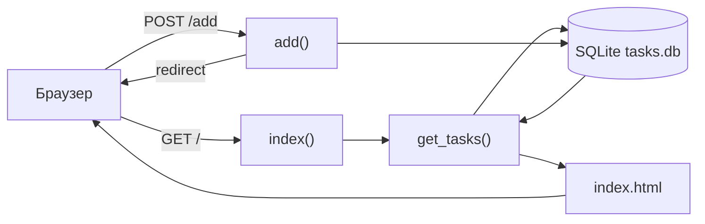

Привет! Этот проект — твой первый настоящий веб-сайт. Мы напишем простой ToDo-менеджер: страницу со списком задач, форму добавления, кнопки «Выполнено» и «Удалить». Все данные будут храниться в базе SQLite.

## О проекте

Стек проекта: Flask (веб-фреймворк), Jinja2 (шаблоны — идут вместе с Flask) и SQLite (база данных, встроена в Python). Приложение работает так:

- на главной странице виден список задач;
- через форму добавляется новая задача;
- кнопка «✓» помечает задачу выполненной;
- кнопка «✕» удаляет задачу;
- все изменения сохраняются в файле базы данных.

## План сборки

1. Подготовить окружение и установить Flask.
2. Создать каркас приложения с главной страницей.
3. Подключить SQLite и таблицу задач.
4. Научиться показывать список задач через шаблон.
5. Добавить форму и маршрут для новых задач.
6. Добавить пометку «выполнено» и удаление.
7. Запустить и протестировать.

## Шаг 1. Окружение и установка

Создай папку `todo_app`, внутри неё виртуальное окружение и установи Flask:

```bash
mkdir todo_app
cd todo_app
python -m venv venv
venv\Scripts\activate      # Windows
source venv/bin/activate   # macOS/Linux
pip install flask
```

Виртуальное окружение изолирует зависимости проекта от остальной системы.

## Шаг 2. Каркас приложения

Создай файл `app.py`:

```python
from flask import Flask, render_template

app = Flask(__name__)


@app.route("/")
def index():
    return render_template("index.html", tasks=[])
```

`@app.route("/")` связывает адрес `/` с функцией `index()`. `render_template` подставляет данные в шаблон.

## Шаг 3. База данных

SQLite — это один файл. Работать с ним можно через встроенный модуль `sqlite3`. Создадим вспомогательные функции для работы с таблицей задач:

```python
import sqlite3

DB = "tasks.db"


def init_db():
    con = sqlite3.connect(DB)
    con.execute(
        "CREATE TABLE IF NOT EXISTS tasks ("
        "id INTEGER PRIMARY KEY AUTOINCREMENT,"
        "title TEXT NOT NULL,"
        "done INTEGER DEFAULT 0)"
    )
    con.commit()
    con.close()


def get_tasks():
    con = sqlite3.connect(DB)
    rows = con.execute("SELECT id, title, done FROM tasks ORDER BY id").fetchall()
    con.close()
    return [{"id": r[0], "title": r[1], "done": bool(r[2])} for r in rows]
```

Таблица `tasks` содержит три поля: `id`, `title` (текст задачи) и `done` (0 или 1). `get_tasks()` читает все строки и превращает их в список словарей — так удобнее работать в шаблоне.

## Шаг 4. Шаблоны Jinja2

Шаблоны живут в папке `templates/`. Создай `templates/base.html` — общую рамку, и `templates/index.html` — содержимое главной страницы. В шаблонах используется синтаксис Jinja2: `{{ переменная }}` — вывод, `` — цикл.

```html
<!doctype html>
<html>
<head><meta charset="utf-8"><title>ToDo</title></head>
<body>
  <h1>Мои задачи</h1>
  <ul>
    
      <li>
        <s>{{ task.title }}</s>{{ task.title }}
      </li>
    
  </ul>
</body>
</html>
```

## Шаг 5. Форма добавления

В HTML-форме метод `post` отправляет данные на сервер. Добавим форму в `index.html`:

```html
<form method="post" action="/add">
  <input type="text" name="title" placeholder="Новая задача" required>
  <button type="submit">Добавить</button>
</form>
```

А в `app.py` — маршрут, который принимает POST-запрос:

```python
from flask import request, redirect, url_for

@app.route("/add", methods=["POST"])
def add():
    title = request.form["title"].strip()
    if title:
        con = sqlite3.connect(DB)
        con.execute("INSERT INTO tasks (title) VALUES (?)", (title,))
        con.commit()
        con.close()
    return redirect(url_for("index"))
```

`request.form["title"]` — значение поля с именем `title`. `redirect(url_for("index"))` возвращает пользователя на главную. Знак `?` в SQL — это плейсхолдер: библиотека сама подставит значение безопасно, без инъекций.

## Шаг 6. Выполнение и удаление

Добавим два маршрута. Первый помечает задачу выполненной, второй удаляет её:

```python
@app.route("/done/<int:task_id>")
def done(task_id):
    con = sqlite3.connect(DB)
    con.execute("UPDATE tasks SET done = 1 WHERE id = ?", (task_id,))
    con.commit()
    con.close()
    return redirect(url_for("index"))

@app.route("/delete/<int:task_id>")
def delete(task_id):
    con = sqlite3.connect(DB)
    con.execute("DELETE FROM tasks WHERE id = ?", (task_id,))
    con.commit()
    con.close()
    return redirect(url_for("index"))
```

Конвертер `<int:task_id>` превращает кусок URL в целое число. В шаблоне рядом с каждой задачей размести ссылки на эти адреса.

## Шаг 7. Запуск

Перед первым запуском вызови `init_db()`, затем:

```bash
python app.py
```

Открой http://127.0.0.1:5000 — приложение работает.

## Схема: путь запроса

Прежде чем добавлять новые страницы, полезно увидеть, как Flask обрабатывает один запрос. Каждый маршрут — это точка входа, за которой стоит обращение к базе и рендер шаблона.



Обрати внимание на два разных типа ответа: index возвращает готовый HTML, а add — редирект. Браузер после редиректа сам делает новый GET-запрос, поэтому после добавления задачи страница перерисовывается с новыми данными.

## Итог урока

Мы научились:

- создавать приложение Flask и маршруты;
- подключать SQLite и выполнять запросы;
- использовать шаблоны Jinja2 с циклами и условиями;
- принимать данные форм и делать редирект.

Теперь усовершенствуем проект.

<!--TASK-->
### Задача 1
Создай папку todo_app и внутри неё виртуальное окружение (python -m venv venv), активируй его и установи Flask командой pip install flask. Затем создай файл app.py: приложение Flask с маршрутом "/", который возвращает render_template("index.html", tasks=[]). Создай папку templates и шаблон index.html с заголовком «Мои задачи» и пустым списком. Ожидаемый результат: при запуске python app.py страница http://127.0.0.1:5000 показывает заголовок и пустой список.

### Задача 2
Добавь в app.py работу с SQLite: модуль sqlite3, константу DB = "tasks.db", функцию init_db(), которая создаёт таблицу tasks (id INTEGER PRIMARY KEY AUTOINCREMENT, title TEXT NOT NULL, done INTEGER DEFAULT 0), и функцию get_tasks(), возвращающую список словарей. Вызови init_db() при старте и добавь пару задач вручную через sqlite3 или прямо в коде. В шаблоне выведи список через цикл . Ожидаемый результат: записи из базы отображаются на главной странице.

### Задача 3
Добавь в index.html форму: поле input с name="title" и placeholder, кнопку «Добавить», method="post", action="/add". В app.py создай маршрут "/add" с methods=["POST"]: читай request.form["title"], очищай от пробелов через strip() и, если строка не пустая, вставляй запись в таблицу через INSERT с плейсхолдером "?". После добавления верни пользователя на главную через redirect(url_for("index")). Ожидаемый результат: задача из формы появляется в списке на главной странице.

### Задача 4
Добавь два маршрута: "/done/<int:task_id>" — выполняет UPDATE tasks SET done = 1 WHERE id = ?, и "/delete/<int:task_id>" — выполняет DELETE FROM tasks WHERE id = ?, после чего оба делают редирект на главную. В шаблоне рядом с каждой задачей размести ссылки «✓» и «✕» на эти адреса, а выполненные задачи выводи зачёркнутыми через тег <s> внутри условия . Ожидаемый результат: клик по «✓» зачёркивает задачу, клик по «✕» удаляет её.

### Задача 5
Добавь фильтр по статусу: в шаблоне три ссылки — «Все» (?filter=), «Активные» (?filter=active), «Выполненные» (?filter=done). В функции index() читай request.args.get("filter") и передавай в get_tasks(filter_by), где в зависимости от значения добавляй WHERE done = 0 или WHERE done = 1. Добавь счётчик «Осталось: N» и ссылку «↺» рядом с выполненными задачами — маршрут "/undo/<int:task_id>", меняющий done обратно на 0. Ожидаемый результат: ссылки фильтруют список, счётчик обновляется.
### Задача 6
Добавь редактирование задачи — то, чего не хватает любому списку дел. Создай маршрут "/edit/<int:task_id>" с methods=["GET", "POST"]: на GET читай задачу из базы и отдавай шаблон edit.html, на POST бери новое название из request.form["title"], делай UPDATE tasks SET title = ? WHERE id = ? и возвращай redirect на главную. В шаблоне поле должно быть предзаполнено старым названием через value="{{ task.title }}", а action можно не писать — тогда форма уйдёт на тот же адрес. Если задачи с таким id нет, верни строку «Задача не найдена» с кодом 404. Добавь в index.html рядом с каждой задачей ссылку «Редактировать». Ожидаемый результат: переход по ссылке открывает форму с текущим текстом, после сохранения — главная страница с новым названием, а для несуществующего id — 404.

### Задача 7
Добавь к приложению маленькое JSON API, чтобы задачами могли пользоваться другие программы и скрипты. Создай маршрут "/api/tasks", который возвращает jsonify(get_tasks()), и маршрут "/api/stats", который отдаёт словарь с тремя полями: total (всего задач), active (невыполненные) и done (выполненные). Подключи jsonify из flask. Сервер запусти в одном окне терминала, а в другом проверь ответы командой curl. Ожидаемый вывод: для трёх задач, из которых одна выполнена, curl http://127.0.0.1:5000/api/stats печатает {"active":2,"done":1,"total":3}, а /api/tasks — JSON-массив объектов с ключами id, title, done.

<!--/TASK-->

<!--HINT-->
### Подсказка 1
Команда активации зависит от ОС: venv\Scripts\activate на Windows и source venv/bin/activate на macOS/Linux. Не забудь импортировать from flask import Flask, render_template и вызвать app.run() в конце файла, например внутри if __name__ == "__main__".

### Подсказка 2
Каждая функция базы открывает своё соединение и закрывает его. После изменений обязательно вызывай con.commit(), иначе они не сохранятся. В запросах используй плейсхолдер "?" и передавай значения кортежем. get_tasks() превращает строки в словари: {"id": r[0], "title": r[1], "done": bool(r[2])}.

### Подсказка 3
request.form["title"] возвращает строку из поля формы. Метод strip() убирает пробелы по краям — так пустая строка из одних пробелов не создаст задачу. Проверяй if title: перед вставкой. redirect и url_for импортируются из flask, а url_for("index") строит адрес по имени функции-обработчика.

### Подсказка 4
Конвертер <int:task_id> сам превращает сегмент URL в целое число и передаёт его в функцию. В шаблоне строй ссылки как href="/done/{{ task.id }}" и href="/delete/{{ task.id }}". Колонка done хранит 0 или 1, поэтому в условии используй , а в словаре из get_tasks() уже лежит bool.

### Подсказка 5
request.args.get("filter") без параметра в адресе вернёт None — значит, фильтр не задан. WHERE-условия строй только из захардкоженных строк ("done = 0", "done = 1"), никогда не подставляй туда ввод пользователя. Счётчик remaining посчитай через sum(1 for t in tasks if not t["done"]) и передай в шаблон.
### Подсказка 6
Один маршрут обслуживает два сценария: проверяй request.method == "POST" в начале функции. Соединение открывай один раз: con = sqlite3.connect(DB), затем либо UPDATE + commit + close и redirect, либо SELECT + fetchone + close и render_template. fetchone() вернёт None, если строки нет — это и есть повод для ответа с кодом 404. В шаблоне формы достаточно method="post" без action: браузер отправит данные на текущий URL.

### Подсказка 7
jsonify автоматически превращает словарь или список в JSON и ставит заголовок Content-Type: application/json. Переиспользуй уже готовую get_tasks() — она возвращает список словарей, так что /api/tasks — это одна строка. Для статистики пройди по списку и посчитай выполненные через sum(1 for task in tasks if task["done"]), а активные получи вычитанием из len(tasks).

<!--/HINT-->

<!--SOLUTION-->
### Разбор 1
Каркас приложения:

```python
from flask import Flask, render_template

app = Flask(__name__)


@app.route("/")
def index():
    return render_template("index.html", tasks=[])


if __name__ == "__main__":
    app.run(debug=True)
```

Шаблон `templates/index.html`:

```html
<!doctype html>
<html>
<head><meta charset="utf-8"><title>ToDo</title></head>
<body>
  <h1>Мои задачи</h1>
  <ul></ul>
</body>
</html>
```

Виртуальное окружение создаётся командой python -m venv venv внутри папки проекта: оно изолирует установленные пакеты от системных, чтобы зависимости разных проектов не конфликтовали. После активации pip install flask ставит фреймворк только в это окружение. Flask(__name__) создаёт объект приложения, а декоратор @app.route("/") связывает корневой адрес с функцией index(). Внутри index() вызывается render_template("index.html", tasks=[]): Flask ищет шаблон в папке templates и подставляет данные. Сейчас список пуст, поэтому <ul> будет пустым. Блок if __name__ == "__main__" запускает встроенный сервер только при прямом запуске скрипта — при импорте app.py сервер не стартует.

### Разбор 2
Добавляем базу данных:

```python
import sqlite3

DB = "tasks.db"


def init_db():
    con = sqlite3.connect(DB)
    con.execute(
        "CREATE TABLE IF NOT EXISTS tasks ("
        "id INTEGER PRIMARY KEY AUTOINCREMENT,"
        "title TEXT NOT NULL,"
        "done INTEGER DEFAULT 0)"
    )
    con.commit()
    con.close()


def get_tasks():
    con = sqlite3.connect(DB)
    rows = con.execute("SELECT id, title, done FROM tasks ORDER BY id").fetchall()
    con.close()
    return [{"id": r[0], "title": r[1], "done": bool(r[2])} for r in rows]
```

SQLite хранит всю базу в одном файле tasks.db. sqlite3.connect(DB) открывает соединение; CREATE TABLE IF NOT EXISTS создаёт таблицу, только если её ещё нет. Поле id автоинкрементируется, title обязателен, а done по умолчанию 0. Так как это запись, нужен con.commit() — без него изменение не сохранится. get_tasks() читает все строки и превращает их в список словарей: bool(r[2]) переводит 0/1 в False/True для удобства в шаблоне. Для ручной вставки добавь:

```python
con = sqlite3.connect(DB)
con.execute("INSERT INTO tasks (title) VALUES (?)", ("Купить молоко",))
con.commit()
con.close()
```

А в index.html выведи задачи циклом:  <li>{{ task.title }}</li> .

### Разбор 3
Добавляем форму и маршрут добавления. В `templates/index.html`:

```html
<form method="post" action="/add">
  <input type="text" name="title" placeholder="Новая задача" required>
  <button type="submit">Добавить</button>
</form>
```

В `app.py`:

```python
from flask import request, redirect, url_for

@app.route("/add", methods=["POST"])
def add():
    title = request.form["title"].strip()
    if title:
        con = sqlite3.connect(DB)
        con.execute("INSERT INTO tasks (title) VALUES (?)", (title,))
        con.commit()
        con.close()
    return redirect(url_for("index"))
```

Когда пользователь нажимает «Добавить», браузер отправляет POST-запрос на адрес /add. Декоратор с methods=["POST"] говорит Flask принимать на этом маршруте только POST — GET-запросы будут отклонены. request.form["title"] извлекает значение поля формы с именем title. Метод strip() убирает пробелы по краям: строка из одних пробелов станет пустой, и условие if title: не даст создать безымянную задачу. Вставка выполняется с плейсхолдером "?" — sqlite3 сам экранирует значение, что исключает SQL-инъекции. В конце redirect(url_for("index")) отправляет браузеру перенаправление на главную страницу, где обновлённый список уже покажет новую задачу.

### Разбор 4
Добавляем выполнение и удаление:

```python
@app.route("/done/<int:task_id>")
def done(task_id):
    con = sqlite3.connect(DB)
    con.execute("UPDATE tasks SET done = 1 WHERE id = ?", (task_id,))
    con.commit()
    con.close()
    return redirect(url_for("index"))


@app.route("/delete/<int:task_id>")
def delete(task_id):
    con = sqlite3.connect(DB)
    con.execute("DELETE FROM tasks WHERE id = ?", (task_id,))
    con.commit()
    con.close()
    return redirect(url_for("index"))
```

В шаблоне каждая задача получает ссылки:

```html
<li>
  <s>{{ task.title }}</s>{{ task.title }}
  <a href="/done/{{ task.id }}">✓</a>
  <a href="/delete/{{ task.id }}">✕</a>
</li>
```

Конвертер <int:task_id> в маршруте заставляет Flask превращать сегмент URL в целое число и передавать его в функцию параметром task_id — если в адресе окажется не число, Flask вернёт ошибку 404, а не упадёт с исключением. Маршрут done выполняет UPDATE: меняет done на 1 только у строки с нужным id. Маршрут delete выполняет DELETE и убирает строку из таблицы. В шаблоне условие  проверяет флаг: выполненные задачи оборачиваются в тег <s> (зачёркивание), а ссылки «✓» и «✕» ведут на соответствующие обработчики. Оба маршрута в конце делают редирект, чтобы список на главной обновился.

### Разбор 5
Полное приложение `app.py`:

```python
from flask import Flask, render_template, request, redirect, url_for
import sqlite3

app = Flask(__name__)
DB = "tasks.db"


def init_db():
    con = sqlite3.connect(DB)
    con.execute(
        "CREATE TABLE IF NOT EXISTS tasks ("
        "id INTEGER PRIMARY KEY AUTOINCREMENT,"
        "title TEXT NOT NULL,"
        "done INTEGER DEFAULT 0)"
    )
    con.commit()
    con.close()


def get_tasks(filter_by=None):
    query = "SELECT id, title, done FROM tasks"
    if filter_by == "active":
        query += " WHERE done = 0"
    elif filter_by == "done":
        query += " WHERE done = 1"
    query += " ORDER BY id"
    con = sqlite3.connect(DB)
    rows = con.execute(query).fetchall()
    con.close()
    return [{"id": r[0], "title": r[1], "done": bool(r[2])} for r in rows]


@app.route("/")
def index():
    filter_by = request.args.get("filter")
    tasks = get_tasks(filter_by)
    remaining = sum(1 for t in tasks if not t["done"])
    return render_template("index.html", tasks=tasks, remaining=remaining,
                           filter_by=filter_by)


@app.route("/add", methods=["POST"])
def add():
    title = request.form["title"].strip()
    if title:
        con = sqlite3.connect(DB)
        con.execute("INSERT INTO tasks (title) VALUES (?)", (title,))
        con.commit()
        con.close()
    return redirect(url_for("index"))


@app.route("/done/<int:task_id>")
def done(task_id):
    con = sqlite3.connect(DB)
    con.execute("UPDATE tasks SET done = 1 WHERE id = ?", (task_id,))
    con.commit()
    con.close()
    return redirect(url_for("index"))


@app.route("/undo/<int:task_id>")
def undo(task_id):
    con = sqlite3.connect(DB)
    con.execute("UPDATE tasks SET done = 0 WHERE id = ?", (task_id,))
    con.commit()
    con.close()
    return redirect(url_for("index"))


@app.route("/delete/<int:task_id>")
def delete(task_id):
    con = sqlite3.connect(DB)
    con.execute("DELETE FROM tasks WHERE id = ?", (task_id,))
    con.commit()
    con.close()
    return redirect(url_for("index"))


if __name__ == "__main__":
    init_db()
    app.run(debug=True)
```

Шаблон `templates/index.html`:

```html
<!doctype html>
<html>
<head><meta charset="utf-8"><title>ToDo</title></head>
<body>
  <h1>Мои задачи</h1>
  <p>
    <a href="/?filter=">Все</a> |
    <a href="/?filter=active">Активные</a> |
    <a href="/?filter=done">Выполненные</a>
  </p>
  <p>Осталось: {{ remaining }}</p>
  <form method="post" action="/add">
    <input type="text" name="title" placeholder="Новая задача" required>
    <button type="submit">Добавить</button>
  </form>
  <ul>
    
      <li>
        <s>{{ task.title }}</s>{{ task.title }}
        <a href="/done/{{ task.id }}">✓</a>
        <a href="/undo/{{ task.id }}">↺</a>
        <a href="/delete/{{ task.id }}">✕</a>
      </li>
    
  </ul>
</body>
</html>
```

Функция get_tasks(filter_by) — единая точка чтения для всех случаев: параметр приходит из строки запроса, и от него зависит SQL-запрос. Ветки строятся только из захардкоженных строк, поэтому риска инъекций нет. В index() дополнительно считается remaining — сколько задач осталось невыполненными; он попадает в шаблон через render_template. Маршрут /undo/<int:task_id> симметричен /done/..., отличие только в значении done. В шаблоне ссылки с task.id ведут на соответствующие обработчики. Проверь: добавь несколько задач, выполни одну, переключи фильтры — списки меняются, счётчик «Осталось» уменьшается.
### Разбор 6
Маршрут редактирования и шаблон формы:

```python
@app.route("/edit/<int:task_id>", methods=["GET", "POST"])
def edit(task_id):
    con = sqlite3.connect(DB)

    if request.method == "POST":
        title = request.form["title"].strip()
        if title:
            con.execute("UPDATE tasks SET title = ? WHERE id = ?", (title, task_id))
            con.commit()
        con.close()
        return redirect(url_for("index"))

    row = con.execute("SELECT id, title FROM tasks WHERE id = ?", (task_id,)).fetchone()
    con.close()
    if row is None:
        return "Задача не найдена", 404

    return render_template("edit.html", task={"id": row[0], "title": row[1]})
```

```html
<!-- templates/edit.html -->
<form method="post">
  <input type="text" name="title" value="{{ task.title }}" required>
  <button type="submit">Сохранить</button>
</form>
```

Один маршрут с двумя методами — обычная практика Flask: GET показывает форму, POST сохраняет изменения. Ветвление начинается сразу после соединения, потому что оба сценария работают с одной и той же задачей. Обрати внимание на порядок: при POST мы не читаем строку вообще — браузер уже прислал новое название, и лишний SELECT был бы бесполезен. После UPDATE обязателен commit(), иначе изменения останутся в транзакции и пропадут при закрытии соединения. Проверка `if title:` защищает от пустого названия, а ответ `"Задача не найдена", 404` — это кортеж из текста и кода состояния: Flask принимает такую форму и сам формирует ответ. В шаблоне value="{{ task.title }}" подставляет текущее название в поле, поэтому пользователь правит текст, а не вводит его заново; Jinja2 экранирует кавычки, так что название с апострофом не сломает разметку. Пустой action означает «отправить на тот же URL», и это ровно то, что нам нужно.

### Разбор 7
JSON-эндпоинты поверх готовых функций:

```python
from flask import jsonify


@app.route("/api/tasks")
def api_tasks():
    return jsonify(get_tasks())


@app.route("/api/stats")
def api_stats():
    tasks = get_tasks()
    done = sum(1 for task in tasks if task["done"])
    return jsonify({"total": len(tasks), "active": len(tasks) - done, "done": done})
```

```bash
curl http://127.0.0.1:5000/api/stats
# {"active":2,"done":1,"total":3}

curl http://127.0.0.1:5000/api/tasks
# [{"done":false,"id":1,"title":"Купить хлеб"}, ...]
```

Главная идея — переиспользование: get_tasks() уже возвращает список словарей, а jsonify умеет сериализовать списки и словари без дополнительных преобразований, поэтому /api/tasks — буквально одна строка. Функция jsonify не только кодирует данные, но и ставит заголовок Content-Type: application/json, так что клиент понимает формат ответа без догадок. Для статистики мы не пишем отдельный SQL-запрос: данных всего несколько строк, и посчитать их в Python проще и надёжнее. Выражение sum(1 for task in tasks if task["done"]) — генераторное выражение: оно не создаёт промежуточный список, а просто считает единицы. Ключ active вычисляется как len(tasks) - done, чтобы не проходить по списку второй раз и не получить расхождение, если в базе окажутся некорректные значения done. По умолчанию Flask сортирует ключи JSON по алфавиту, поэтому в ответе порядок active, done, total — это не ошибка, а поведение сериализатора; клиенту порядок ключей всё равно не важен.

<!--/SOLUTION-->

<!--QUIZ-->
Зачем нужно виртуальное окружение?
- Чтобы ускорить работу компьютера
- Чтобы изолировать зависимости проекта от остальной системы
- Чтобы создать базу данных
- Чтобы компилировать код
* Правильный ответ: Чтобы изолировать зависимости проекта от остальной системы
Виртуальное окружение хранит пакеты проекта отдельно: разные проекты могут использовать разные версии библиотек без конфликтов.

Что делает декоратор @app.route("/add", methods=["POST"])?
- Создаёт новую таблицу в базе
- Связывает адрес /add с функцией и разрешает только POST-запросы
- Включает режим отладки
- Отправляет письмо пользователю
* Правильный ответ: Связывает адрес /add с функцией и разрешает только POST-запросы
Декоратор регистрирует маршрут: при обращении к /add методом POST Flask вызовет декорированную функцию.

Почему при вставке данных используют "?" вместо склеивания строк?
- Так короче писать
- Это защита от SQL-инъекций: значение экранируется
- Иначе база не сохранит данные
- Такой синтаксис нужен только для чисел
* Правильный ответ: Это защита от SQL-инъекций: значение экранируется
Плейсхолдер "?" передаёт значение отдельно от запроса, и библиотека безопасно подставляет его, не давая «склеить» вредоносный SQL.

Что возвращает request.form["title"]?
- Список всех полей формы
- Строку из поля формы с именем title
- Число полей в форме
- HTML-код формы
* Правильный ответ: Строку из поля формы с именем title
request.form собирает данные, отправленные формой методом POST, и обращение по ключу возвращает значение соответствующего поля.

Что делает redirect(url_for("index"))?
- Перезапускает сервер
- Отправляет браузеру перенаправление на главную страницу
- Печатает содержимое корзины
- Открывает панель администрирования
* Правильный ответ: Отправляет браузеру перенаправление на главную страницу
url_for("index") строит адрес по имени функции-обработчика, а redirect возвращает ответ с HTTP-кодом 302, по которому браузер переходит на этот адрес.

Что делает конвертер <int:task_id> в маршруте?
- Включает шифрование URL
- Превращает сегмент URL в целое число перед передачей в функцию
- Создаёт задачу с указанным номером
- Ограничивает число запросов
* Правильный ответ: Превращает сегмент URL в целое число перед передачей в функцию
Flask преобразует часть адреса по указанному типу и передаёт готовое значение параметром, а при нечисловом значении вернёт 404.

Какой синтаксис Jinja2 выводит значение переменной?
- 
- {{ переменная }}
- $переменная
- <variable>
* Правильный ответ: {{ переменная }}
Двойные фигурные скобки — это вывод значения в Jinja2, а  используются для конструкций (циклы, условия).

Зачем нужна функция init_db() и где она вызывается?
- Она создаёт таблицу задач, и её вызывают при старте приложения
- Она удаляет старую базу
- Она добавляет задачи в список
- Она запускает веб-сервер
* Правильный ответ: Она создаёт таблицу задач, и её вызывают при старте приложения
CREATE TABLE IF NOT EXISTS безопасен: повторный вызов не сломает уже существующую таблицу.
Что вернёт сервер, если открыть в браузере адрес /add, а маршрут объявлен только с methods=["POST"]?
- 200 и пустую страницу
- 404 Not Found
- 405 Method Not Allowed
- 500 Internal Server Error
* Правильный ответ: 405 Method Not Allowed
Flask сам проверяет метод запроса: адрес существует, но GET для него не разрешён — это и есть код 405.

Что делает return "Задача не найдена", 404 в функции-обработчике?
- Возвращает текст и код состояния 404
- Вызывает исключение и роняет приложение
- Перенаправляет на страницу ошибки
- Возвращает только код 404 без тела
* Правильный ответ: Возвращает текст и код состояния 404
Flask принимает кортеж (тело, код): тело уходит в ответ, а код сообщает клиенту, что ресурс не найден.

Зачем нужен jsonify() в маршруте API?
- Чтобы превратить данные в JSON-ответ с заголовком application/json
- Чтобы отрендерить HTML-шаблон
- Чтобы сохранить данные в SQLite
- Чтобы проверить форму на CSRF
* Правильный ответ: Чтобы превратить данные в JSON-ответ с заголовком application/json
jsonify сериализует словари и списки и сам выставляет Content-Type, поэтому клиент получает корректный JSON без ручной сборки строк.

Куда уйдёт запрос, если в форме указано только <form method="post"> без action?
- На главную страницу сайта
- На тот же URL, на котором открыта страница
- В никуда, форма не отправится
- На адрес /add
* Правильный ответ: На тот же URL, на котором открыта страница
Поэтому форма редактирования работает без явного action: она живёт на /edit/<id> и туда же отправляет данные.

<!--/QUIZ-->
