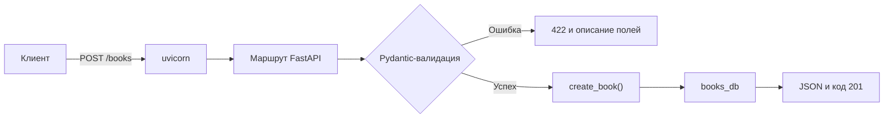

Привет! В этом проекте мы окунёмся в мир бэкенда: напишем настоящий API-сервис на FastAPI. API — это интерфейс, через который программы общаются друг с другом. Наш сервис будет управлять коллекцией книг: добавлять, искать, изменять и удалять записи.

## О проекте

Мы создадим REST API, где каждый ресурс — книга — адресуется через URL:

- `GET /books` — список всех книг;
- `POST /books` — добавить книгу;
- `GET /books/{id}` — одна книга по id;
- `PUT /books/{id}` — обновить книгу;
- `DELETE /books/{id}` — удалить книгу.

Клиент (браузер, скрипт или другая программа) шлёт HTTP-запросы и получает JSON-ответы. FastAPI сам валидирует данные, строит схему и генерирует документацию.

## План сборки

1. Установить FastAPI и uvicorn.
2. Описать модель книги через Pydantic.
3. Создать хранилище данных.
4. Реализовать маршруты CRUD.
5. Добавить поиск и валидацию.
6. Запустить сервер и проверить документацию.

## Шаг 1. Установка

```bash
pip install fastapi uvicorn
```

FastAPI — сам фреймворк, а uvicorn — сервер, который запускает приложение.

## Шаг 2. Модель Pydantic

Pydantic описывает структуру данных. Создадим модель книги:

```python
from pydantic import BaseModel, Field

class Book(BaseModel):
    title: str
    author: str
    year: int = Field(ge=1455, le=2026)
    isbn: str
```

`BaseModel` — базовая модель Pydantic. Аннотации типов (`str`, `int`) задают обязательные поля, а `Field(ge=1455, le=2026)` добавляет ограничения: год должен лежать между 1455 (первая печатная книга) и текущим годом. Если данные не пройдут проверку, FastAPI сам вернёт клиенту ошибку 422.

## Шаг 3. Хранилище

Для простоты храним книги в памяти — в списке словарей. В реальном проекте здесь была бы база данных:

```python
books_db = []
next_id = 1
```

## Шаг 4. Маршруты CRUD

Начнём с получения списка и добавления:

```python
from fastapi import FastAPI, HTTPException, status

app = FastAPI(title="Book Service")


@app.get("/books")
def list_books():
    return books_db


@app.post("/books", status_code=status.HTTP_201_CREATED)
def create_book(book: Book):
    global next_id
    new_book = book.model_dump()
    new_book["id"] = next_id
    next_id += 1
    books_db.append(new_book)
    return new_book
```

FastAPI сам понимает, что параметр `book: Book` надо взять из тела запроса, проверить и превратить в объект `Book`. `model_dump()` — метод Pydantic, который возвращает обычный словарь. `status_code=201` — правильный код ответа для создания ресурса.

Дальше — получение одной книги, обновление и удаление:

```python
def find_book(book_id: int):
    for book in books_db:
        if book["id"] == book_id:
            return book
    raise HTTPException(status_code=404, detail="Книга не найдена")


@app.get("/books/{book_id}")
def get_book(book_id: int):
    return find_book(book_id)


@app.put("/books/{book_id}")
def update_book(book_id: int, book: Book):
    old = find_book(book_id)
    old.update(book.model_dump())
    return old


@app.delete("/books/{book_id}", status_code=status.HTTP_204_NO_CONTENT)
def delete_book(book_id: int):
    book = find_book(book_id)
    books_db.remove(book)
```

`find_book` — вспомогательная функция: либо возвращает книгу, либо бросает `HTTPException` с кодом 404. `HTTPException` — стандартный способ сообщить об ошибке в FastAPI.

## Шаг 5. Поиск и валидация

Добавим параметр запроса для поиска по названию:

```python
@app.get("/books")
def list_books(search: str | None = None):
    if search is None:
        return books_db
    found = [b for b in books_db if search.lower() in b["title"].lower()]
    return found
```

`str | None = None` — необязательный query-параметр. Теперь запрос `GET /books?search=python` вернёт только подходящие книги.

## Шаг 6. Запуск

```bash
uvicorn main:app --reload
```

Сервер поднимется на http://127.0.0.1:8000, а документация будет доступна по адресу http://127.0.0.1:8000/docs — это одна из главных фишек FastAPI. Там можно вручную отправлять запросы и смотреть ответы.

## Схема: путь запроса через FastAPI

Одна из главных идей FastAPI — валидация стоит до твоего кода. Схема показывает, где именно отсекаются неверные данные и почему обработчик получает уже готовый объект Book.



Если год вне диапазона или не хватает поля, до create_book() дело не доходит — клиент сразу получает 422 с указанием проблемного поля. Именно поэтому в обработчике можно спокойно работать с book.title и book.year.

## Итог урока

Мы узнали:

- что такое REST API и какие бывают методы;
- как описывать данные моделями Pydantic;
- как создавать маршруты и обрабатывать ошибки;
- как работают query-параметры и автодокументация.

<!--TASK-->
### Задача 1
Установи fastapi и uvicorn через pip. Создай файл main.py: опиши модель Book на базе Pydantic (поля title, author, year с ограничениями через Field(ge=1455, le=2026), isbn) и приложение FastAPI с эндпоинтом GET /books, который пока возвращает пустой список. Запусти сервер командой uvicorn main:app --reload и открой документацию по адресу http://127.0.0.1:8000/docs. Ожидаемый результат: сервер стартует, а GET /books возвращает [] в Swagger UI.

### Задача 2
Реализуй добавление книги: эндпоинт POST /books со status_code=status.HTTP_201_CREATED. Храни книги в списке словарей books_db, а id присваивай через переменную next_id (не забудь про global). Возвращай созданную книгу с полем id. Ожидаемый результат: POST с валидным JSON создаёт запись, возвращает её с id и кодом 201, а GET /books показывает этот список.

### Задача 3
Реализуй три эндпоинта: GET /books/{book_id} — вернуть книгу по id, PUT /books/{book_id} — обновить поля книги через old.update(book.model_dump()), DELETE /books/{book_id} — удалить книгу из списка. Напиши вспомогательную функцию find_book(book_id), которая либо возвращает книгу, либо поднимает HTTPException(status_code=404, detail="Книга не найдена"). Ожидаемый результат: обращение к несуществующему id даёт 404, а PUT и DELETE работают корректно.

### Задача 4
Добавь параметр поиска в GET /books: измени сигнатуру на list_books(search: str | None = None), и если search задан — возвращай только книги, в названии которых встречается искомая подстрока без учёта регистра (используй lower()). Ожидаемый результат: запрос GET /books?search=python возвращает только подходящие книги, а без параметра — все.

### Задача 5
Добавь две функции: при POST проверяй, нет ли уже книги с таким же isbn (используй any(...)); если есть — подними HTTPException(status_code=409, detail="Книга с таким ISBN уже существует"). Добавь эндпоинт GET /books/{book_id}/stats, возвращающий {"title": ..., "words_in_title": N}, где N — количество слов в названии. Ожидаемый результат: повторный POST с тем же ISBN даёт код 409, а /books/1/stats возвращает статистику.
### Задача 6
Добавь в список книг пагинацию — без неё API отдаёт весь каталог сразу. Измени GET /books: добавь параметры skip: int = 0 и limit: int = Query(10, ge=1, le=100), сохранив уже существующий поиск. Ответ должен стать объектом с двумя полями: total — сколько книг подошло под фильтр, items — срез found[skip:skip + limit]. Импортируй Query из fastapi. Проверь три запроса: /books?skip=0&limit=2, /books?skip=2&limit=2 и /books?limit=0. Ожидаемый результат: первые два возвращают {"total": N, "items": [...]} с разными книгами в items, а третий — 422, потому что limit меньше ge=1. Убедись, что поиск и пагинация работают вместе: /books?search=python&limit=1.

### Задача 7
Напиши автотесты для API через TestClient — так проверяют эндпоинты без запуска uvicorn и без реальной сети. Установи pytest и httpx, создай файл test_main.py: импортируй app из main и создай client = TestClient(app). Напиши три теста: создание книги возвращает 201 и поле id в ответе; запрос несуществующей книги даёт 404; книга с годом 1800 отклоняется с кодом 422. Запусти pytest -q. Ожидаемый вывод: три точки и строка «3 passed» в конце; если хотя бы один assert не сходится, pytest покажет имя теста и строку с ошибкой.

<!--/TASK-->

<!--HINT-->
### Подсказка 1
Установка выполняется командой pip install fastapi uvicorn. Запуск uvicorn main:app --reload означает: файл main.py, объект app внутри него, флаг --reload перезапускает сервер при изменении кода. Модель Pydantic — это класс, наследующий BaseModel, с аннотациями типов полей.

### Подсказка 2
Метод model_dump() возвращает обычный словарь с данными модели. Добавь в него ключ id и положи словарь в books_db. Чтобы менять next_id внутри функции, объяви global next_id в начале. Код 201 задаётся аргументом status_code декоратора.

### Подсказка 3
find_book(book_id) перебирает books_db и сравнивает book["id"] с book_id; если ничего не найдено — raise HTTPException(status_code=404, detail="Книга не найдена"). Для PUT используй old.update(book.model_dump()), для DELETE — books_db.remove(book). HTTPException импортируется из fastapi.

### Подсказка 4
Параметр с дефолтным значением None автоматически становится необязательным query-параметром. Проверяй поиск так: search.lower() in b["title"].lower() — это делает сравнение без учёта регистра. Не забудь обработать случай search is None.

### Подсказка 5
Для проверки дублей используй генератор: any(b["isbn"] == book.isbn for b in books_db). Количество слов в названии считай через len(book["title"].split()). Путь /books/{book_id}/stats не конфликтует с /books/{book_id}: у них разное число сегментов.
### Подсказка 6
Query нужен для ограничений на query-параметры: limit: int = Query(10, ge=1, le=100). Сначала отфильтруй по search, а пагинацию применяй к уже отфильтрованному списку — иначе total будет считаться по всему каталогу. Срез found[skip:skip + limit] безопасен: если skip больше длины списка, вернётся пустой список, а не ошибка. Не забудь, что total считается до среза.

### Подсказка 7
TestClient берёт приложение напрямую, поэтому сервер запускать не нужно. Тело запроса передавай через json=..., а не data=...: так FastAPI получит объект, а не форму. Код ответа читай из response.status_code, тело — из response.json(). Для проверки валидации достаточно одного поля с недопустимым значением, остальные должны быть корректными, иначе 422 придёт по другой причине.

<!--/HINT-->

<!--SOLUTION-->
### Разбор 1
Начальная версия `main.py`:

```python
from fastapi import FastAPI
from pydantic import BaseModel, Field

app = FastAPI(title="Book Service")


class Book(BaseModel):
    title: str
    author: str
    year: int = Field(ge=1455, le=2026)
    isbn: str


@app.get("/books")
def list_books():
    return []
```

FastAPI — это фреймворк, а uvicorn — ASGI-сервер, который исполняет приложение. Команда uvicorn main:app --reload говорит: возьми из файла main.py объект app и запусти его; флаг --reload перезапускает сервер при каждом сохранении файла — удобно при разработке. Модель Book наследует BaseModel: Pydantic использует аннотации типов, чтобы знать, какие поля обязательны и какого они типа. Поле year дополнительно ограничено через Field(ge=1455, le=2026): год книги не может быть раньше 1455 (первая печатная книга) и позже 2026. Если клиент пришлёт год вне диапазона, FastAPI сам вернёт ответ с кодом 422 и описанием ошибки. Эндпоинт GET /books объявлен декоратором @app.get; сейчас он возвращает пустой список — это заглушка, которую мы наполним дальше. Документация откроется по /docs, там же удобно тестировать запросы.

### Разбор 2
Добавляем создание книги:

```python
from fastapi import FastAPI, status
from pydantic import BaseModel, Field

app = FastAPI(title="Book Service")

books_db = []
next_id = 1


class Book(BaseModel):
    title: str
    author: str
    year: int = Field(ge=1455, le=2026)
    isbn: str


@app.get("/books")
def list_books():
    return books_db


@app.post("/books", status_code=status.HTTP_201_CREATED)
def create_book(book: Book):
    global next_id
    new_book = book.model_dump()
    new_book["id"] = next_id
    next_id += 1
    books_db.append(new_book)
    return new_book
```

Когда клиент отправляет POST на /books с JSON в теле, FastAPI видит аннотацию book: Book, валидирует входящие данные по модели и передаёт в функцию готовый объект Book. Если данные некорректны (например, нет title или год вне диапазона), FastAPI сам вернёт 422 — писать проверки вручную не нужно. Метод model_dump() превращает модель в обычный словарь; мы добавляем в него ключ id и кладём в books_db. Переменная next_id — глобальная, поэтому внутри функции нужна строка global next_id, иначе Python посчитает её локальной и бросит ошибку. Код ответа 201 (Created) задаётся через status_code в декораторе — это семантически верный ответ для успешного создания ресурса. Теперь добавленная книга видна и в GET /books.

### Разбор 3
Добавляем получение, обновление и удаление:

```python
from fastapi import FastAPI, HTTPException, status

...

def find_book(book_id: int):
    for book in books_db:
        if book["id"] == book_id:
            return book
    raise HTTPException(status_code=404, detail="Книга не найдена")


@app.get("/books/{book_id}")
def get_book(book_id: int):
    return find_book(book_id)


@app.put("/books/{book_id}")
def update_book(book_id: int, book: Book):
    old = find_book(book_id)
    old.update(book.model_dump())
    return old


@app.delete("/books/{book_id}", status_code=status.HTTP_204_NO_CONTENT)
def delete_book(book_id: int):
    book = find_book(book_id)
    books_db.remove(book)
```

Вспомогательная функция find_book централизует поиск: она перебирает список, а если книга с таким id не найдена, поднимает HTTPException с кодом 404 и текстом «Книга не найдена». FastAPI перехватывает это исключение и превращает его в JSON-ответ с соответствующим HTTP-статусом. GET /books/{book_id} просто возвращает результат find_book. PUT обновляет: find_book находит старый словарь, а old.update(book.model_dump()) заменяет его поля новыми значениями из тела запроса — при этом id не меняется, ведь его нет в модели. DELETE находит книгу и убирает её из списка через remove; код 204 означает «Успешно, без содержимого» — это стандарт для удаления.

### Разбор 4
Добавляем поиск:

```python
@app.get("/books")
def list_books(search: str | None = None):
    if search is None:
        return books_db
    return [b for b in books_db if search.lower() in b["title"].lower()]
```

Параметр функции с дефолтным значением None автоматически становится необязательным query-параметром: клиент может обратиться к /books без параметров или с ?search=python. Когда search не задан, функция возвращает весь список. Если параметр есть, мы строим новый список через генератор списка: для каждой книги b проверяется, входит ли искомая подстрока в название. Метод lower() применяется и к запросу, и к названию, поэтому поиск не зависит от регистра: «PYTHON», «Python» и «python» дадут одинаковый результат. Такой поиск — подстрочный, то есть вернёт и книги, в названии которых подстрока встречается не с начала слова. Проверь в /docs: GET /books?search=python вернёт только подходящие книги.

### Разбор 5
Полное решение `main.py`:

```python
from fastapi import FastAPI, HTTPException, status
from pydantic import BaseModel, Field

app = FastAPI(title="Book Service")

books_db = []
next_id = 1


class Book(BaseModel):
    title: str
    author: str
    year: int = Field(ge=1455, le=2026)
    isbn: str


def find_book(book_id: int):
    for book in books_db:
        if book["id"] == book_id:
            return book
    raise HTTPException(status_code=404, detail="Книга не найдена")


@app.get("/books")
def list_books(search: str | None = None):
    if search is None:
        return books_db
    return [b for b in books_db if search.lower() in b["title"].lower()]


@app.post("/books", status_code=status.HTTP_201_CREATED)
def create_book(book: Book):
    global next_id
    if any(b["isbn"] == book.isbn for b in books_db):
        raise HTTPException(status_code=409, detail="Книга с таким ISBN уже существует")
    new_book = book.model_dump()
    new_book["id"] = next_id
    next_id += 1
    books_db.append(new_book)
    return new_book


@app.get("/books/{book_id}")
def get_book(book_id: int):
    return find_book(book_id)


@app.get("/books/{book_id}/stats")
def book_stats(book_id: int):
    book = find_book(book_id)
    return {"title": book["title"], "words_in_title": len(book["title"].split())}


@app.put("/books/{book_id}")
def update_book(book_id: int, book: Book):
    old = find_book(book_id)
    old.update(book.model_dump())
    return old


@app.delete("/books/{book_id}", status_code=status.HTTP_204_NO_CONTENT)
def delete_book(book_id: int):
    book = find_book(book_id)
    books_db.remove(book)
```

Проверка дублей: any(b["isbn"] == book.isbn for b in books_db) проходит по всем книгам и возвращает True, если хотя бы одна имеет такой же ISBN. Если да — поднимаем HTTPException с кодом 409 (Conflict) и понятным сообщением; это правильный семантический код для конфликта с существующим ресурсом. Эндпоинт /books/{book_id}/stats переиспользует find_book и считает количество слов: book["title"].split() делит название по пробелам, а len() даёт число элементов. Обрати внимание: путь с двумя сегментами не конфликтует с /books/{book_id} — FastAPI различает маршруты по числу сегментов. Запуск: uvicorn main:app --reload; в /docs удобно проверить каждый эндпоинт и увидеть коды ответов.
### Разбор 6
Пагинация без потери поиска:

```python
from fastapi import FastAPI, HTTPException, Query, status


@app.get("/books")
def list_books(
    search: str | None = None,
    skip: int = 0,
    limit: int = Query(10, ge=1, le=100),
):
    found = books_db
    if search is not None:
        found = [b for b in books_db if search.lower() in b["title"].lower()]
    return {"total": len(found), "items": found[skip:skip + limit]}
```

```bash
curl "http://127.0.0.1:8000/books?skip=0&limit=2"
# {"total":5,"items":[{...},{...}]}
curl "http://127.0.0.1:8000/books?limit=0"
# 422: limit must be greater than or equal to 1
```

Ключевой момент — порядок операций: сначала фильтр по search, потом total, и только потом срез. Если посчитать total по books_db, клиент получит число всех книг и будет листать несуществующие страницы. Срез found[skip:skip + limit] в Python не бросает исключений: при skip за пределами списка вернётся [], что для API вполне корректный ответ с пустой страницей. Query(10, ge=1, le=100) делает limit не просто числом, а валидируемым параметром: значение 0 или 1000 отсекается до вызова функции, и клиент получает 422 с текстом ограничения. Такой верхний предел защищает сервер от запроса на миллион записей. Обрати внимание, что skip оставлен без ограничений: отрицательное значение даст странный срез, но для учебного API это допустимо, а в реальном проекте его тоже обернули бы в Query(0, ge=0).

### Разбор 7
Тесты через TestClient:

```python
# test_main.py
from fastapi.testclient import TestClient

from main import app

client = TestClient(app)

BOOK = {"title": "Python Cookbook", "author": "David Beazley", "year": 2013, "isbn": "978-1"}


def test_create_book():
    response = client.post("/books", json=BOOK)
    assert response.status_code == 201
    assert "id" in response.json()


def test_book_not_found():
    response = client.get("/books/99999")
    assert response.status_code == 404
    assert response.json()["detail"] == "Книга не найдена"


def test_year_validation():
    bad = {**BOOK, "year": 1800}
    response = client.post("/books", json=bad)
    assert response.status_code == 422
```

```bash
pip install pytest httpx
pytest -q
# ...
# 3 passed in 0.42s
```

TestClient — это обёртка над приложением ASGI: он вызывает app напрямую, в том же процессе, без uvicorn и без сокетов, поэтому тесты работают за миллисекунды и не требуют свободного порта. Параметр json=BOOK сериализует словарь и ставит Content-Type: application/json — именно так FastAPI понимает, что пришло тело для Pydantic-модели; с data=... ушла бы форма и вернулся бы 422. Первый тест проверяет не только код 201, но и наличие id: без него клиент не смог бы потом обратиться к книге. Второй тест ловит сразу два контракта — код 404 и текст detail, поэтому переименование сообщения в find_book сломает тест, и это правильно: текст видят клиенты. Третий тест собирает словарь через {**BOOK, "year": 1800}: остальные поля остаются валидными, значит 422 вызван именно годом, а не пропущенным полем. Если запустить pytest без -q, он покажет по строке на каждый тест; с -q — только итог.

<!--/SOLUTION-->

<!--QUIZ-->
Какой пакет запускает FastAPI-приложение как сервер?
- Flask
- uvicorn
- sqlite3
- requests
* Правильный ответ: uvicorn
FastAPI — фреймворк, а uvicorn — ASGI-сервер, который исполняет приложение: uvicorn main:app --reload.

Что описывает класс, унаследованный от BaseModel в Pydantic?
- Схему базы данных
- Модель данных с типами полей и валидацией
- Конфигурацию сервера
- HTTP-заголовки
* Правильный ответ: Модель данных с типами полей и валидацией
Pydantic использует аннотации типов: поля становятся обязательными, а данные проверяются при создании объекта.

Какой код ответа возвращается при успешном создании ресурса?
- 200
- 201
- 404
- 500
* Правильный ответ: 201
201 Created означает, что ресурс успешно создан; для остальных успешных операций используется 200.

Что произойдёт, если передать год 1800 при ограничении Field(ge=1455, le=2026)?
- Книга создастся без проверки
- FastAPI вернёт ошибку 422 с описанием
- Сервер завершится с ошибкой
- Год автоматически исправится на 2026
* Правильный ответ: FastAPI вернёт ошибку 422 с описанием
Валидация Pydantic не пропустит значение вне диапазона, и FastAPI превратит это в ответ 422 Validation Error.

Что делает HTTPException(status_code=404, detail="...")?
- Логирует ошибку в консоль
- Останавливает обработку и возвращает клиенту JSON с кодом 404
- Перезапускает приложение
- Игнорирует запрос
* Правильный ответ: Останавливает обработку и возвращает клиенту JSON с кодом 404
FastAPI перехватывает HTTPException и превращает его в ответ с указанным статусом и текстом detail.

Что возвращает метод model_dump() модели Pydantic?
- Тензор данных
- Обычный словарь с данными модели
- Строку JSON
- Список имён полей
* Правильный ответ: Обычный словарь с данными модели
model_dump() превращает объект модели в стандартный словарь Python, который удобно хранить и изменять.

Какой метод HTTP используется для полного обновления книги?
- GET
- PUT
- DELETE
- POST
* Правильный ответ: PUT
PUT заменяет ресурс целиком новыми данными; в нашем проекте он обновляет поля книги.

Что такое query-параметр в FastAPI?
- Необязательный параметр в строке запроса, например ?search=python
- Параметр в теле запроса
- Первая часть URL
- Заголовок ответа
* Правильный ответ: Необязательный параметр в строке запроса, например ?search=python
Параметры функции с дефолтным значением автоматически становятся query-параметрами.
Что вернёт GET /books?limit=0, если параметр объявлен как limit: int = Query(10, ge=1, le=100)?
- Пустой список
- 422 с описанием нарушения ограничения
- Все книги без ограничения
- 500 Internal Server Error
* Правильный ответ: 422 с описанием нарушения ограничения
Валидация выполняется до вызова функции: значение ниже ge=1 не проходит, и клиент получает 422 с указанием параметра.

При пяти книгах в каталоге что вернёт GET /books?skip=2&limit=2?
- total 5 и две книги — третью и четвёртую
- total 2 и две первые книги
- total 5 и две первые книги
- total 3 и три оставшиеся книги
* Правильный ответ: total 5 и две книги — третью и четвёртую
total считается до среза и показывает размер всей выборки, а items — только запрошенную страницу.

Зачем в тестах использовать TestClient вместо запуска uvicorn?
- Чтобы проверять эндпоинты без реального сервера, порта и сети
- Чтобы ускорить работу самого приложения в продакшене
- Чтобы автоматически генерировать документацию
- Чтобы заменить Pydantic-валидацию
* Правильный ответ: Чтобы проверять эндпоинты без реального сервера, порта и сети
TestClient вызывает ASGI-приложение напрямую в том же процессе, поэтому тесты быстрые и не зависят от занятого порта.

Как запросить вторую страницу каталога по 10 книг?
- GET /books?page=2
- GET /books?skip=10&limit=10
- GET /books?offset=2&limit=10
- GET /books/2
* Правильный ответ: GET /books?skip=10&limit=10
skip — это количество пропущенных записей, поэтому вторая страница начинается с одиннадцатой книги.

<!--/QUIZ-->
