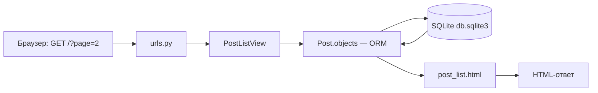

Привет! Django — самый мощный веб-фреймворк Python: он уже включает админку, базу данных, систему форм и защиту. В этом проекте мы соберём на нём блог: сайт, где автор публикует статьи, а читатели их просматривают.

## О проекте

Архитектура Django называется MVT: Model (модель — данные), View (представление — логика), Template (шаблон — разметка). Наш блог будет иметь:

- модель `Post` — статья (заголовок, текст, дата);
- админку, где можно управлять статьями;
- главную страницу со списком статей;
- страницу отдельной статьи;
- форму добавления новой статьи.

## План сборки

1. Создать проект и приложение.
2. Описать модель `Post` и сделать миграции.
3. Зарегистрировать модель в админке.
4. Создать представления и маршруты.
5. Написать шаблоны.
6. Добавить форму создания статьи.
7. Запустить сервер и проверить.

## Шаг 1. Проект и приложение

```bash
pip install django
django-admin startproject blog_project
cd blog_project
python manage.py startapp posts
```

Появится папка проекта `blog_project` и приложение `posts`. Приложение — это модуль со своей моделью, представлениями и шаблонами. Добавим `posts` в `INSTALLED_APPS` в `blog_project/settings.py`:

```python
INSTALLED_APPS = [
    "django.contrib.admin",
    "django.contrib.auth",
    "django.contrib.contenttypes",
    "django.contrib.sessions",
    "django.contrib.messages",
    "django.contrib.staticfiles",
    "posts",
]
```

## Шаг 2. Модель Post

Откроем `posts/models.py` и опишем модель:

```python
from django.db import models

class Post(models.Model):
    title = models.CharField(max_length=200)
    body = models.TextField()
    created_at = models.DateTimeField(auto_now_add=True)

    def __str__(self):
        return self.title
```

`CharField` — короткая строка, `TextField` — длинный текст, `DateTimeField(auto_now_add=True)` — дата создания, проставляется автоматически. Теперь создадим таблицу в базе:

```bash
python manage.py makemigrations posts
python manage.py migrate
```

`makemigrations` готовит изменения, `migrate` применяет их к базе (по умолчанию это SQLite-файл).

## Шаг 3. Админка

Зарегистрируем модель в `posts/admin.py`:

```python
from django.contrib import admin
from .models import Post

admin.site.register(Post)
```

Создадим суперпользователя и запустим сервер:

```bash
python manage.py createsuperuser
python manage.py runserver
```

Зайди на http://127.0.0.1:8000/admin/, войди и добавь пару статей — они появятся в базе.

## Шаг 4. Представления и маршруты

Используем классово-базовые представления: `ListView` для списка и `DetailView` для одной статьи. В `posts/views.py`:

```python
from django.views.generic import ListView, DetailView
from .models import Post

class PostListView(ListView):
    model = Post
    template_name = "posts/post_list.html"
    context_object_name = "posts"
    ordering = ["-created_at"]

class PostDetailView(DetailView):
    model = Post
    template_name = "posts/post_detail.html"
```

Создадим `posts/urls.py`:

```python
from django.urls import path
from . import views

urlpatterns = [
    path("", views.PostListView.as_view(), name="post_list"),
    path("post/<int:pk>/", views.PostDetailView.as_view(), name="post_detail"),
]
```

И подключим его в главном `blog_project/urls.py`:

```python
from django.contrib import admin
from django.urls import path, include

urlpatterns = [
    path("admin/", admin.site.urls),
    path("", include("posts.urls")),
]
```

## Шаг 5. Шаблоны

Создай папку `posts/templates/posts/` и файлы `post_list.html` и `post_detail.html`:

```html
<!doctype html>
<html>
<head><meta charset="utf-8"><title>Мой блог</title></head>
<body>
  <h1>Мой блог</h1>
  
    <h2><a href="">{{ post.title }}</a></h2>
    <p>{{ post.created_at|date:"d.m.Y" }}</p>
  
    <p>Статей пока нет.</p>
  
</body>
</html>
```

Тег `` генерирует ссылку по имени маршрута — это надёжнее, чем писать URL руками.

## Шаг 6. Форма создания статьи

Создадим форму на основе модели (`posts/forms.py`):

```python
from django import forms
from .models import Post

class PostForm(forms.ModelForm):
    class Meta:
        model = Post
        fields = ["title", "body"]
```

Представление-создание и маршрут:

```python
from django.views.generic import CreateView
from django.urls import reverse_lazy
from .forms import PostForm

class PostCreateView(CreateView):
    model = Post
    form_class = PostForm
    template_name = "posts/post_form.html"
    success_url = reverse_lazy("post_list")
```

```python
path("new/", views.PostCreateView.as_view(), name="post_create"),
```

Шаблон `post_form.html` с формой:

```html
<form method="post">
  
  {{ form.as_p }}
  <button type="submit">Опубликовать</button>
</form>
```

`` — обязательная защита от подделки запросов, встроенная в Django.

## Схема: как Django собирает страницу

Django часто называют MVT-фреймворком: модель, представление, шаблон. Схема показывает, кто за что отвечает при открытии списка статей.



Представление не пишет SQL руками: оно просит объекты у менеджера Post.objects, ORM строит запрос, а шаблон только раскладывает готовый список по HTML.

## Итог урока

Мы научились:

- создавать проект и приложение Django;
- описывать модели и выполнять миграции;
- пользоваться админкой;
- строить представления на классах;
- создавать формы и шаблоны.

<!--TASK-->
### Задача 1
Создай проект blog_project и приложение posts командами django-admin startproject и python manage.py startapp. Добавь "posts" в INSTALLED_APPS в файле settings.py. Опиши модель Post: title CharField max_length=200, body TextField, created_at DateTimeField auto_now_add=True, а также метод __str__, возвращающий заголовок. Затем выполни python manage.py makemigrations posts и python manage.py migrate. Ожидаемый результат: обе команды проходят без ошибок, и в базе появляется таблица с записями блога.

### Задача 2
Зарегистрируй модель Post в posts/admin.py через admin.site.register(Post). Создай суперпользователя командой python manage.py createsuperuser (придумай логин, пароль и email) и запусти сервер python manage.py runserver. Войди в админку по адресу http://127.0.0.1:8000/admin/ и добавь две-три статьи. Ожидаемый результат: статьи создаются в админке и сохраняются в базе данных, их видно в списке админки.

### Задача 3
Создай представления: PostListView (ListView, model = Post, template_name = "posts/post_list.html", context_object_name = "posts", ordering = ["-created_at"]) и PostDetailView (DetailView) в posts/views.py. Создай posts/urls.py с маршрутами "" (post_list) и "post/<int:pk>/" (post_detail) и подключи его в главном urls.py через include. Напиши шаблоны posts/templates/posts/post_list.html (список со ссылками через ) и post_detail.html. Ожидаемый результат: главная страница показывает статьи, клик по заголовку открывает статью целиком.

### Задача 4
Создай форму PostForm на основе модели: в posts/forms.py класс, наследующий forms.ModelForm, с Meta.model = Post и Meta.fields = ["title", "body"]. Добавь представление PostCreateView (CreateView) с form_class = PostForm, шаблоном "posts/post_form.html" и success_url = reverse_lazy("post_list"). Добавь маршрут "new/" с именем post_create и шаблон формы: тег , {{ form.as_p }} и кнопку «Опубликовать». Ожидаемый результат: форма на странице /new/ публикует статью и перенаправляет на список.

### Задача 5
Добавь модель Category (name CharField, slug SlugField unique=True), связь ForeignKey в Post: on_delete=models.CASCADE, related_name="posts", null=True, blank=True. Выполни миграции и зарегистрируй Category в админке. Добавь представление PostsByCategoryView (ListView с переопределённым get_queryset, фильтрующим по category_slug из self.kwargs через get_object_or_404) и маршрут "category/<slug:category_slug>/" с именем posts_by_category. В шаблоне списка выводи название категории со ссылкой. Ожидаемый результат: страница категории показывает только её статьи.
### Задача 6
Добавь в список статей постраничную навигацию: когда записей станет много, одна длинная страница неудобна. В PostListView задай paginate_by = 2, а в шаблон post_list.html добавь блок навигации: ссылку «Назад» при page_obj.has_previous, текст «Страница N из M» через page_obj.number и page_obj.paginator.num_pages и ссылку «Вперёд» при page_obj.has_next. Адрес страницы передавай query-параметром: ?page={{ page_obj.next_page_number }}. Создай через админку пять статей и проверь /?page=1, /?page=2 и /?page=3. Ожидаемый результат: на каждой странице ровно по две статьи в порядке убывания даты, на первой странице нет ссылки «Назад», на последней — «Вперёд», а «Страница 3 из 3» соответствует действительности.

### Задача 7
Добавь поиск по заголовкам статей. Переопредели get_queryset в PostListView: возьми queryset = super().get_queryset(), прочитай строку запроса через self.request.GET.get("q", "").strip() и, если она не пустая, отфильтруй записи через filter(title__icontains=query). Переопредели get_context_data, чтобы передать в шаблон query и сохранить текст в поле после отправки. В шаблоне добавь форму с method="get", полем input name="q" и кнопкой «Найти», а ссылки пагинации построй так, чтобы они не теряли q. Ожидаемый результат: запрос /?q=python показывает только статьи, в заголовке которых есть «Python» в любом регистре, а сочетание /?q=python&page=2 листает уже отфильтрованный список.

<!--/TASK-->

<!--HINT-->
### Подсказка 1
После startapp проверь, что "posts" добавлено в INSTALLED_APPS, иначе Django не увидит приложение. Поле created_at с auto_now_add=True заполняется автоматически при создании записи. Муграции выполняются строго двумя командами подряд: makemigrations, затем migrate.

### Подсказка 2
Команда createsuperuser задаст вопросы о логине, email и пароле. Админка доступна по адресу /admin/ после запуска runserver, вход — под суперпользователем. Если модель не зарегистрирована в admin.py, её не будет в админке.

### Подсказка 3
В шаблонах Django папка должна называться posts/templates/posts/, чтобы имя "posts/post_list.html" находилось. context_object_name = "posts" переопределяет имя переменной списка в шаблоне. Тег  строит ссылку по имени маршрута.

### Подсказка 4
reverse_lazy нужен вместо reverse, потому что при импорте модуля URL-адреса ещё не загружены.  обязателен в любой POST-форме Django, иначе Django вернёт ошибку 403. Ссылку на страницу создания добавь в шаблон списка через .

### Подсказка 5
В get_queryset бери категорию так: get_object_or_404(Category, slug=self.kwargs["category_slug"]) и возвращай category.posts.all().order_by("-created_at"). После добавления поля category обязательно выполни makemigrations и migrate. В шаблоне используй , чтобы не выводить ссылку для статей без категории.
### Подсказка 6
Пагинация в ListView включается одной строкой: paginate_by = 2. Django сам нарежет queryset и положит в контекст page_obj — его и используй в шаблоне вместо ручного среза. У page_obj есть методы has_previous(), has_next(), previous_page_number(), next_page_number() и атрибуты number и paginator.num_pages. Не забывай: page_obj доступен только при включённой пагинации.

### Подсказка 7
super().get_queryset() возвращает QuerySet с учётом ordering — отталкивайся от него, а не от Post.objects. Метод lookups __icontains ищет подстроку без учёта регистра, в отличие от __contains. В шаблоне форма поиска должна быть с method="get", иначе параметр не попадёт в URL. В ссылках пагинации добавь &q={{ query }}, иначе переход на вторую страницу потеряет фильтр.

<!--/HINT-->

<!--SOLUTION-->
### Разбор 1
Создание проекта и модели:

```bash
pip install django
django-admin startproject blog_project
cd blog_project
python manage.py startapp posts
```

В `blog_project/settings.py` добавь `"posts"` в `INSTALLED_APPS`. В `posts/models.py`:

```python
from django.db import models

class Post(models.Model):
    title = models.CharField(max_length=200)
    body = models.TextField()
    created_at = models.DateTimeField(auto_now_add=True)

    def __str__(self):
        return self.title
```

django-admin startproject создаёт папку проекта с настройками и файлом manage.py, а startapp — приложение posts. Django-приложение — это самостоятельный модуль: модель, представления, шаблоны и миграции лежат в нём. Модель Post наследует models.Model, что превращает класс в таблицу базы данных. CharField(max_length=200) — строка с ограничением длины, TextField — длинный текст, DateTimeField(auto_now_add=True) автоматически проставляет время создания в момент первого сохранения, поэтому его не нужно передавать вручную. Метод __str__ определяет, как объект будет отображаться в админке и консоли. После описания модели выполни makemigrations posts — Django создаст файл миграции с описанием изменения схемы, а затем migrate применит его к базе (по умолчанию SQLite-файл).

### Разбор 2
Подключение админки:

```python
from django.contrib import admin
from .models import Post

admin.site.register(Post)
```

Команды: python manage.py createsuperuser, затем python manage.py runserver. Админка — это встроенный интерфейс Django для управления данными. Регистрация модели в admin.py делает её доступной в админке: можно просматривать, создавать, редактировать и удалять записи без написания кода. Суперпользователь — учетная запись с полными правами; создаётся интерактивно, пароль при вводе не отображается (это нормально). После запуска runserver админка доступна по адресу http://127.0.0.1:8000/admin/. Добавь через неё две-три статьи: они попадут в таблицу блога, и мы увидим их на страницах сайта. Созданные записи упорядочены админкой по дате создания.

### Разбор 3
Представления и маршруты:

```python
from django.views.generic import ListView, DetailView
from .models import Post

class PostListView(ListView):
    model = Post
    template_name = "posts/post_list.html"
    context_object_name = "posts"
    ordering = ["-created_at"]

class PostDetailView(DetailView):
    model = Post
    template_name = "posts/post_detail.html"
```

`posts/urls.py`:

```python
from django.urls import path
from . import views

urlpatterns = [
    path("", views.PostListView.as_view(), name="post_list"),
    path("post/<int:pk>/", views.PostDetailView.as_view(), name="post_detail"),
]
```

`blog_project/urls.py`:

```python
from django.contrib import admin
from django.urls import path, include

urlpatterns = [
    path("admin/", admin.site.urls),
    path("", include("posts.urls")),
]
```

Шаблоны `posts/templates/posts/post_list.html` и `post_detail.html`:

```html
<!doctype html>
<html>
<head><meta charset="utf-8"><title>Мой блог</title></head>
<body>
  <h1>Мой блог</h1>
  
    <h2><a href="">{{ post.title }}</a></h2>
    <p>{{ post.created_at|date:"d.m.Y" }}</p>
  
    <p>Статей пока нет.</p>
  
</body>
</html>
```

Классовые представления экономят код: ListView сам достаёт все объекты модели и передаёт их в шаблон. Атрибут ordering = ["-created_at"] сортирует статьи от новых к старым. DetailView работает с одной записью: он берёт pk из URL, находит объект и кладёт его в шаблон под именем object. Маршруты подключаются через include в главном urls.py. Тег  генерирует URL по имени маршрута, а не хардкодит его, — если адрес поменяется, ссылки обновятся автоматически.

### Разбор 4
Форма создания статьи. `posts/forms.py`:

```python
from django import forms
from .models import Post

class PostForm(forms.ModelForm):
    class Meta:
        model = Post
        fields = ["title", "body"]
```

`posts/views.py` (дополнение):

```python
from django.views.generic import CreateView
from django.urls import reverse_lazy
from .forms import PostForm

class PostCreateView(CreateView):
    model = Post
    form_class = PostForm
    template_name = "posts/post_form.html"
    success_url = reverse_lazy("post_list")
```

`posts/urls.py` (дополнение):

```python
path("new/", views.PostCreateView.as_view(), name="post_create"),
```

Шаблон `post_form.html`:

```html
<form method="post">
  
  {{ form.as_p }}
  <button type="submit">Опубликовать</button>
</form>
```

ModelForm автоматически строит форму из полей модели: для title и body создадутся соответствующие поля ввода. CreateView обрабатывает две ситуации: GET — показывает пустую форму, POST — валидирует данные и сохраняет модель. success_url = reverse_lazy("post_list") задаёт адрес, куда пользователь попадёт после успешного сохранения; reverse_lazy используется потому, что при импорте модуля URLconf ещё не загружена, и обычный reverse бросил бы ошибку. Тег  обязателен для POST-форм Django: без него запрос будет отклонён с ошибкой 403. {{ form.as_p }} выводит все поля формы, обёрнутые в абзацы.

### Разбор 5
Полное решение с категориями. `posts/models.py`:

```python
from django.db import models

class Category(models.Model):
    name = models.CharField(max_length=100)
    slug = models.SlugField(unique=True)

    def __str__(self):
        return self.name

class Post(models.Model):
    title = models.CharField(max_length=200)
    body = models.TextField()
    category = models.ForeignKey(
        Category, on_delete=models.CASCADE,
        related_name="posts", null=True, blank=True
    )
    created_at = models.DateTimeField(auto_now_add=True)

    def __str__(self):
        return self.title
```

Команды:

```bash
python manage.py makemigrations posts
python manage.py migrate
```

`posts/admin.py`:

```python
from django.contrib import admin
from .models import Post, Category

admin.site.register(Post)
admin.site.register(Category)
```

`posts/views.py`:

```python
from django.shortcuts import get_object_or_404
from django.views.generic import ListView, DetailView, CreateView
from django.urls import reverse_lazy
from .models import Post, Category
from .forms import PostForm

class PostListView(ListView):
    model = Post
    template_name = "posts/post_list.html"
    context_object_name = "posts"
    ordering = ["-created_at"]

class PostDetailView(DetailView):
    model = Post
    template_name = "posts/post_detail.html"

class PostCreateView(CreateView):
    model = Post
    form_class = PostForm
    template_name = "posts/post_form.html"
    success_url = reverse_lazy("post_list")

class PostsByCategoryView(ListView):
    model = Post
    template_name = "posts/post_list.html"
    context_object_name = "posts"

    def get_queryset(self):
        category = get_object_or_404(Category, slug=self.kwargs["category_slug"])
        return category.posts.all().order_by("-created_at")
```

`posts/urls.py`:

```python
from django.urls import path
from . import views

urlpatterns = [
    path("", views.PostListView.as_view(), name="post_list"),
    path("post/<int:pk>/", views.PostDetailView.as_view(), name="post_detail"),
    path("new/", views.PostCreateView.as_view(), name="post_create"),
    path("category/<slug:category_slug>/",
         views.PostsByCategoryView.as_view(), name="posts_by_category"),
]
```

Обновлённый `templates/posts/post_list.html`:

```html
<!doctype html>
<html>
<head><meta charset="utf-8"><title>Мой блог</title></head>
<body>
  <h1>Мой блог</h1>
  <p><a href="">Новая статья</a></p>
  
    <h2><a href="">{{ post.title }}</a></h2>
    
      <p>Категория: <a href="">{{ post.category.name }}</a></p>
    
    <p>{{ post.created_at|date:"d.m.Y" }}</p>
    <p>{{ post.body|truncatewords:30 }}</p>
  
    <p>Статей пока нет.</p>
  
</body>
</html>
```

Модель Category получила slug для красивых и уникальных URL. ForeignKey с related_name="posts" создаёт связь «один ко многим»: у каждой статьи одна категория, а у категории — много статей, доступных через category.posts.all(). PostsByCategoryView переопределяет get_queryset: берёт категорию по слагу из URL через self.kwargs["category_slug"] и возвращает только её статьи. get_object_or_404 вместо get вернёт страницу 404, если категория не найдена. В шаблоне блок  защищает от статей без категории. После изменения моделей миграции обязательны, иначе Django будет ругаться на отсутствие таблицы.
### Разбор 6
Включаем пагинацию в представлении и шаблоне:

```python
class PostListView(ListView):
    model = Post
    template_name = "posts/post_list.html"
    context_object_name = "posts"
    ordering = ["-created_at"]
    paginate_by = 2
```

```html

  <h2><a href="">{{ post.title }}</a></h2>



  <a href="?page={{ page_obj.previous_page_number }}">Назад</a>

<span>Страница {{ page_obj.number }} из {{ page_obj.paginator.num_pages }}</span>

  <a href="?page={{ page_obj.next_page_number }}">Вперёд</a>

```

paginate_by — это не косметика, а изменение самого запроса: Django добавляет LIMIT и OFFSET, поэтому из базы приходит только нужная порция записей, а не весь блог. В контекст автоматически попадает page_obj — объект Page из django.core.paginator; в нём есть и сам срез (итерируемый, его удобно передать в for), и ссылка на paginator с общим числом страниц. Методы has_previous() и has_next() избавляют от ручных проверок вида page_obj.number > 1 и не дают отрисовать ссылку на несуществующую страницу. Если запросить ?page=99, ListView вернёт 404 — это встроенное поведение, и оно правильное: такой страницы нет. Обрати внимание, что context_object_name = "posts" остался: в шаблоне мы по-прежнему пишем for post in posts, а page_obj — отдельная переменная, которую добавляет пагинатор.

### Разбор 7
Поиск по заголовку без потери пагинации:

```python
class PostListView(ListView):
    model = Post
    template_name = "posts/post_list.html"
    context_object_name = "posts"
    ordering = ["-created_at"]
    paginate_by = 2

    def get_queryset(self):
        queryset = super().get_queryset()
        query = self.request.GET.get("q", "").strip()
        if query:
            queryset = queryset.filter(title__icontains=query)
        return queryset

    def get_context_data(self, **kwargs):
        context = super().get_context_data(**kwargs)
        context["query"] = self.request.GET.get("q", "").strip()
        return context
```

```html
<form method="get">
  <input type="text" name="q" value="{{ query }}" placeholder="Поиск по заголовку">
  <button type="submit">Найти</button>
</form>
```

Переопределение get_queryset — штатная точка расширения ListView: всё остальное (сортировка, пагинация, контекст) продолжает работать. Мы вызываем super().get_queryset(), чтобы получить базовый QuerySet с ordering из класса, и только потом сужаем его фильтром. Lookup title__icontains превращается в SQL с оператором LIKE и приводит обе стороны к нижнему регистру, поэтому «python», «Python» и «PYTHON» находят одно и то же; у __contains регистр важен, и на SQLite это часто ловушка. Пустая строка после strip() означает «фильтра нет» — важно не отфильтровать всё по пустому шаблону. Вторая часть — get_context_data: без неё поле поиска после отправки очистится, потому что шаблон не знает, что искал пользователь. Форма с method="get" отправляет ?q=... в URL, а не в тело запроса: ссылку можно сохранить в закладки и передать коллеге. Ссылки пагинации должны выглядеть как ?q={{ query }}&page={{ page_obj.next_page_number }}, иначе переход на вторую страницу потеряет фильтр и покажет весь блог.

<!--/SOLUTION-->

<!--QUIZ-->
Какая команда создаёт файлы миграций по изменениям моделей?
- python manage.py migrate
- python manage.py makemigrations
- python manage.py startapp
- python manage.py createsuperuser
* Правильный ответ: python manage.py makemigrations
makemigrations готовит файл миграции с описанием изменения схемы, а migrate применяет его к базе.

Что означает параметр max_length=200 в CharField?
- Максимальное число записей в таблице
- Максимальную длину строки в символах
- Число символов в пароле админки
- Размер шрифта в шаблоне
* Правильный ответ: Максимальную длину строки в символах
CharField хранит короткую строку, и max_length ограничивает её длину на уровне базы данных и валидации.

Что делает тег ?
- Выводит текст статьи
- Генерирует URL по имени маршрута, подставляя pk поста
- Создаёт новую статью
- Подключает CSS-файл
* Правильный ответ: Генерирует URL по имени маршрута, подставляя pk поста
Тег строит адрес по имени маршрута — если URL изменится, ссылки обновятся автоматически.

Зачем в форму добавляют ?
- Для красивого оформления
- Это защита от CSRF-подделки запросов, встроенная в Django
- Чтобы форма отправлялась быстрее
- Для шифрования пароля
* Правильный ответ: Это защита от CSRF-подделки запросов, встроенная в Django
Без CSRF-токена Django отклонит POST-запрос формы с ошибкой 403.

Что делает auto_now_add=True у DateTimeField?
- Автоматически проставляет время создания при первом сохранении
- Обновляет время при каждом изменении записи
- Делает поле необязательным
- Хранит только дату без времени
* Правильный ответ: Автоматически проставляет время создания при первом сохранении
auto_now_add=True устанавливает значение один раз, при создании объекта, и больше его не меняет.

Какой класс представления Django показывает одну конкретную запись модели?
- ListView
- DetailView
- CreateView
- DeleteView
* Правильный ответ: DetailView
DetailView сам находит объект по pk из URL и передаёт его в шаблон, а ListView показывает список записей.

Что делает ListView в Django?
- Показывает список записей модели и передаёт его в шаблон
- Показывает одну запись
- Создаёт новую запись
- Удаляет запись
* Правильный ответ: Показывает список записей модели и передаёт его в шаблон
ListView сам получает все объекты модели и кладёт их в контекст шаблона.

Для чего нужны миграции в Django?
- Чтобы переносить изменения моделей в схему базы данных
- Чтобы создать суперпользователя
- Чтобы запустить сервер
- Чтобы установить библиотеки
* Правильный ответ: Чтобы переносить изменения моделей в схему базы данных
makemigrations готовит описание изменений, а migrate применяет его к базе.
Что делает paginate_by = 2 в ListView?
- Показывает только две последние записи
- Разбивает список на страницы по две записи и кладёт page_obj в контекст
- Сортирует записи по два поля
- Ограничивает количество полей в форме
* Правильный ответ: Разбивает список на страницы по две записи и кладёт page_obj в контекст
ListView добавляет к запросу LIMIT и OFFSET, а в шаблон передаёт объект Page с методами has_next() и number.

Где в шаблоне доступен объект текущей страницы?
- В переменной posts
- В page_obj
- В request.page
- В paginator.object
* Правильный ответ: В page_obj
page_obj появляется в контексте автоматически, когда включён paginate_by; через него получают номер страницы и ссылки на соседние.

Чем lookup title__icontains отличается от title__contains?
- Ищет только точное совпадение
- Ищет подстроку без учёта регистра
- Ищет по всем полям модели
- Работает только с числами
* Правильный ответ: Ищет подстроку без учёта регистра
Буква i означает insensitive: «Python» и «python» найдутся одинаково, что для поиска по заголовкам важнее скорости.

Почему форму поиска отправляют методом GET?
- Параметр попадает в URL, и ссылкой можно поделиться
- GET быстрее POST
- POST не поддерживает input
- GET автоматически сохраняет данные в базу
* Правильный ответ: Параметр попадает в URL, и ссылкой можно поделиться
Кроме того, GET не меняет данные на сервере, поэтому поиск логично делать именно им.

<!--/QUIZ-->
