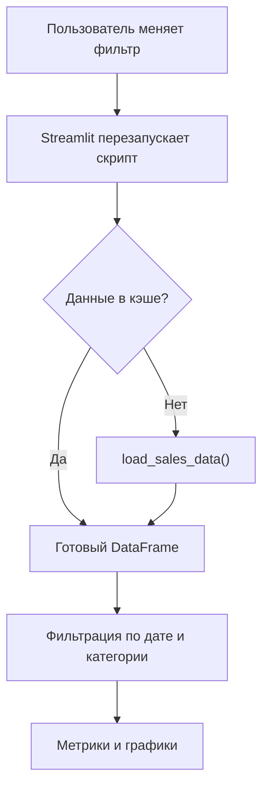

Привет! Streamlit — библиотека, которая превращает Python-скрипт в веб-приложение за минуты: не нужно писать HTML, CSS и JavaScript. В этом проекте мы построим дашборд продаж, который будет пересчитываться при движении ползунков и выборе фильтров.

## О проекте

Представь, что у небольшого магазина есть таблица продаж: дата, товар, категория, сумма. Мы сделаем страницу, где:

- вверху — ключевые метрики (общая выручка, число продаж, средний чек);
- ниже — линейный график выручки по дням;
- ещё ниже — фильтры: диапазон дат и выбор категории.

Любое изменение фильтра мгновенно перестраивает весь дашборд.

## План сборки

1. Установить Streamlit, Pandas и NumPy.
2. Сгенерировать данные о продажах.
3. Вывести таблицу и метрики.
4. Нарисовать графики.
5. Добавить виджеты-фильтры.
6. Добавить кэширование данных.
7. Запустить приложение.

## Шаг 1. Установка

```bash
pip install streamlit pandas numpy
```

## Шаг 2. Данные

Создадим демонстрационные данные за 90 дней — три категории товаров:

```python
import streamlit as st
import pandas as pd
import numpy as np

np.random.seed(42)
dates = pd.date_range(end=pd.Timestamp.today().normalize(), periods=90)
categories = ["Электроника", "Одежда", "Книги"]

rows = []
for d in dates:
    for cat in categories:
        n = np.random.randint(1, 6)
        for _ in range(n):
            rows.append({
                "date": d,
                "category": cat,
                "amount": round(np.random.uniform(500, 15000), 2),
            })

df = pd.DataFrame(rows)
```

`pd.date_range` создаёт последовательность дат, `np.random` — случайные числа, `pd.DataFrame` собирает всё в таблицу. `seed(42)` делает данные воспроизводимыми.

## Шаг 3. Метрики

`st.metric` показывает значение с подписью:

```python
total = df["amount"].sum()
orders = len(df)
avg = df["amount"].mean()

st.metric("Выручка", f"{total:,.0f} ₽")
st.metric("Продаж", orders)
st.metric("Средний чек", f"{avg:,.0f} ₽")
```

## Шаг 4. Графики

Streamlit понимает DataFrame напрямую:

```python
daily = df.groupby("date")["amount"].sum()
st.line_chart(daily)

by_cat = df.groupby("category")["amount"].sum()
st.bar_chart(by_cat)
```

`groupby` группирует строки, `line_chart` и `bar_chart` строят графики без единой строки JavaScript-кода.

## Шаг 5. Виджеты-фильтры

Добавим выбор диапазона дат и категории:

```python
min_date, max_date = df["date"].min(), df["date"].max()
start, end = st.date_input("Период", value=(min_date, max_date))
category = st.selectbox("Категория", ["Все"] + sorted(df["category"].unique()))
```

Теперь отфильтруем данные:

```python
mask = (df["date"] >= pd.Timestamp(start)) & (df["date"] <= pd.Timestamp(end))
filtered = df[mask]
if category != "Все":
    filtered = filtered[filtered["category"] == category]
```

После этого метрики и графики строятся по `filtered` — так фильтры влияют на весь дашборд.

## Шаг 6. Кэширование

Генерация данных занимает время. Обернём её в функцию с `@st.cache_data` — Streamlit сохранит результат и не будет пересчитывать при каждом действии:

```python
@st.cache_data
def load_sales_data():
    ...  # весь код генерации
    return df
```

## Шаг 7. Запуск

```bash
streamlit run app.py
```

Откроется браузер с приложением. Когда меняешь фильтр, Streamlit перезапускает скрипт сверху вниз, но кэшированные функции не выполняются заново.

## Схема: цикл перезапуска Streamlit

Главное отличие Streamlit от обычного скрипта — скрипт выполняется заново при каждом действии пользователя. Схема объясняет, зачем в таком цикле нужен кэш.



Без @st.cache_data генерация данных выполнялась бы при каждом клике, и дашборд заметно тормозил бы. С декоратором тяжёлая функция вызывается один раз, а дальше берётся готовый результат.

## Итог урока

Мы научились:

- генерировать данные с Pandas и NumPy;
- показывать метрики и графики;
- создавать виджеты и фильтровать данные;
- кэшировать вычисления.

<!--TASK-->
### Задача 1
Установи streamlit, pandas, numpy и matplotlib через pip. Создай файл app.py: сгенерируй данные о продажах — np.random.seed(42), 90 дат через pd.date_range(end=pd.Timestamp.today().normalize(), periods=90), три категории «Электроника», «Одежда», «Книги», суммы от 500 до 15000 и 1–5 покупок в день на категорию. Собери всё в DataFrame df и выведи его через st.dataframe(df). Ожидаемый результат: команда streamlit run app.py открывает страницу с таблицей продаж.

### Задача 2
Добавь секцию метрик над таблицей: st.metric("Выручка", f"{total:,.0f} ₽"), st.metric("Продаж", orders) и st.metric("Средний чек", f"{avg:,.0f} ₽"), где total = df["amount"].sum(), orders = len(df), avg = df["amount"].mean(). Ожидаемый результат: вверху страницы три подписанные метрики с корректными значениями, рассчитанными по всем данным.

### Задача 3
Добавь два графика после метрик: линейный — выручка по дням через df.groupby("date")["amount"].sum() и st.line_chart(daily); столбчатый — выручка по категориям через groupby("category") и st.bar_chart(by_cat). Ожидаемый результат: под метриками появляются два графика, по которым видна динамика продаж и вклад каждой категории.

### Задача 4
Добавь виджеты-фильтры: st.date_input("Период", value=(min_date, max_date)) и st.selectbox("Категория", ["Все"] + sorted(df["category"].unique())). Построй маску mask = (df["date"] >= pd.Timestamp(start)) & (df["date"] <= pd.Timestamp(end)), отфильтруй DataFrame, а затем, если выбрана не «Все», отфильтруй ещё и по категории. Переведи метрики и графики на использование filtered. Ожидаемый результат: изменение фильтров перестраивает весь дашборд.

### Задача 5
Оберни генерацию данных в функцию load_sales_data() с декоратором @st.cache_data, возвращающую df. Добавь четвёртую метрику «Макс. покупка», гистограмму распределения сумм (fig, ax = plt.subplots(); ax.hist(filtered["amount"], bins=20); st.pyplot(fig)) и таблицу топ-5 самых дорогих продаж через filtered.nlargest(5, "amount") и st.dataframe. Добавь защиту от пустых данных: если filtered.empty — выведи st.warning("Нет данных за выбранный период.") и вызови st.stop(). Ожидаемый результат: полный дашборд с кэшем, четырьмя метриками, гистограммой и таблицей топ-5.
### Задача 6
Добавь в дашборд выгрузку отфильтрованных данных в CSV — чтобы результат можно было открыть в Excel и отправить коллегам. После таблицы (или после графиков) получи CSV-строку: csv = filtered.to_csv(index=False).encode("utf-8"), затем вызови st.download_button("Скачать CSV", data=csv, file_name="sales.csv", mime="text/csv") и добавь st.caption(f"Строк в выгрузке: {len(filtered)}") — подпись должна меняться вместе с фильтрами. Проверь, что в файле только отфильтрованные строки, а не весь исходный DataFrame. Ожидаемый результат: под таблицей появляется кнопка «Скачать CSV» и подпись «Строк в выгрузке: 412» (число зависит от выбранного периода), а скачанный файл открывается в Excel с колонками date, category, amount.

### Задача 7
Перестрой макет дашборда: фильтры убери в боковую панель, а графики разложи по вкладкам. В блоке with st.sidebar: помести st.header("Фильтры"), st.date_input и st.multiselect("Категории", sorted(df["category"].unique()), default=sorted(df["category"].unique())); фильтруй строки через filtered["category"].isin(chosen). Дальше создай две вкладки: tab1, tab2 = st.tabs(["Динамика", "Топ-5"]); в первой оставь st.line_chart по дням, во второй покажи пять самых крупных покупок через filtered.nlargest(5, "amount")[["date", "category", "amount"]] и st.dataframe. Ожидаемый результат: слева панель с фильтрами, справа две вкладки; снятая в multiselect категория исчезает из обоих графиков, а в «Топ-5» первая строка — самая большая сумма.

<!--/TASK-->

<!--HINT-->
### Подсказка 1
np.random.seed(42) делает случайные числа воспроизводимыми — у всех будут одинаковые данные. pd.date_range(end=pd.Timestamp.today().normalize(), periods=90) даёт 90 дат, заканчиваясь сегодняшним днём. Для сумм используй np.random.uniform(500, 15000), для числа покупок в день на категорию — np.random.randint(1, 6).

### Подсказка 2
st.metric принимает два аргумента: подпись и значение. Форматирование суммы: f"{total:,.0f} ₽" — разделители тысяч и ноль знаков после запятой. Не забудь, что mean() и sum() вызываются на колонке amount, то есть df["amount"].mean().

### Подсказка 3
groupby возвращает объект с колонкой amount; выборка ["amount"].sum() превращает его в серию с индексами-датами или категориями. Именно серии st.line_chart и st.bar_chart принимают напрямую. Проверь имена переменных: daily и by_cat.

### Подсказка 4
st.date_input с value=(min_date, max_date) возвращает кортеж из двух дат — распакуй его в start, end. Даты из DataFrame сравнимай с pd.Timestamp(start), а не с обычной строкой. Объединяй условия через & и не забывай скобки вокруг каждого сравнения.

### Подсказка 5
Декоратор @st.cache_data ставь над функцией, которая возвращает df. Для гистограммы нужен import matplotlib.pyplot as plt: сначала plt.subplots(), затем ax.hist(filtered["amount"], bins=20), затем st.pyplot(fig). nlargest(5, "amount") возвращает пять самых больших строк по сумме.
### Подсказка 6
download_button принимает уже готовые байты, поэтому сначала получи строку и закодируй её: filtered.to_csv(index=False).encode("utf-8"). Параметр index=False убирает служебный столбец с номерами строк, а mime="text/csv" подсказывает браузеру тип файла. Кнопка возвращает True в тот момент, когда пользователь нажал на неё, — для простой выгрузки это значение можно не сохранять. Считай len(filtered) после всех фильтров.

### Подсказка 7
Всё, что вызвано внутри with st.sidebar:, уезжает в левую панель, включая виджеты и заголовки. st.multiselect возвращает список выбранных значений, поэтому фильтр удобно писать через .isin(chosen), а не через ==. st.tabs возвращает кортеж контекстов: открывай их через with tab1: и with tab2:. nlargest(5, "amount") уже сортирует по убыванию, поэтому дополнительная сортировка не нужна.

<!--/HINT-->

<!--SOLUTION-->
### Разбор 1
Первая версия `app.py`:

```python
import streamlit as st
import pandas as pd
import numpy as np

np.random.seed(42)
dates = pd.date_range(end=pd.Timestamp.today().normalize(), periods=90)
categories = ["Электроника", "Одежда", "Книги"]

rows = []
for d in dates:
    for cat in categories:
        n = np.random.randint(1, 6)
        for _ in range(n):
            rows.append({
                "date": d,
                "category": cat,
                "amount": round(np.random.uniform(500, 15000), 2),
            })

df = pd.DataFrame(rows)

st.dataframe(df)
```

np.random.seed(42) фиксирует генератор случайных чисел, поэтому данные воспроизводимы: каждый запуск даёт одну и ту же таблицу — удобно для отладки. pd.date_range(end=pd.Timestamp.today().normalize(), periods=90) создаёт 90 последовательных дат, заканчиваясь сегодняшним днём. Двойной цикл перебирает даты и категории, а внутренний цикл добавляет от одной до пяти покупок (np.random.randint(1, 6)) на каждую пару. Сумма покупки — случайное число от 500 до 15000, округлённое до копеек. pd.DataFrame(rows) собирает список словарей в таблицу с колонками date, category, amount. st.dataframe(df) рендерит её в браузере как сортируемую таблицу. Запуск: streamlit run app.py; Streamlit сам откроет вкладку браузера.

### Разбор 2
Добавляем метрики:

```python
total = df["amount"].sum()
orders = len(df)
avg = df["amount"].mean()

st.metric("Выручка", f"{total:,.0f} ₽")
st.metric("Продаж", orders)
st.metric("Средний чек", f"{avg:,.0f} ₽")
```

st.metric — это готовый компонент Streamlit: подпись сверху, крупное значение под ней. total считает сумму всех продаж через метод sum() колонки amount. orders — число строк таблицы через len(df); каждая строка — одна покупка, поэтому это количество продаж. avg — средняя сумма покупки через mean(). Формат f"{total:,.0f} ₽" вставляет разделители тысяч запятыми и обрезает дробную часть, а суффикс ₽ добавляет валюту. Метрики размещаются одна под другой; в финальной версии мы расставим их в колонки через st.columns. Обрати внимание: сейчас метрики считаются по всему df, но уже в задаче 4 мы переведём их на отфильтрованные данные.

### Разбор 3
Добавляем графики:

```python
daily = df.groupby("date")["amount"].sum()
st.line_chart(daily)

by_cat = df.groupby("category")["amount"].sum()
st.bar_chart(by_cat)
```

groupby("date") группирует строки таблицы по датам: для каждой даты остаются все покупки этого дня. Затем ["amount"].sum() суммирует суммы внутри каждой группы, и получается серия: индекс — дата, значение — выручка дня. Такая серия идеально подходит для st.line_chart: Streamlit строит линейный график, где ось X — даты, ось Y — суммы. Аналогично groupby("category") группирует по категориям и считает суммарную выручку каждой; st.bar_chart рисует столбцы. Ни HTML, ни JavaScript писать не нужно — Streamlit делает всю визуализацию сам. Графики появятся под метриками в порядке вызова. Проверь, что при добавлении графиков приложение перезапустилось без ошибок.

### Разбор 4
Добавляем фильтры:

```python
min_date, max_date = df["date"].min(), df["date"].max()
start, end = st.date_input("Период", value=(min_date, max_date))
category = st.selectbox("Категория", ["Все"] + sorted(df["category"].unique()))

mask = (df["date"] >= pd.Timestamp(start)) & (df["date"] <= pd.Timestamp(end))
filtered = df[mask]
if category != "Все":
    filtered = filtered[filtered["category"] == category]
```

st.date_input создаёт виджет выбора дат. Когда value передаётся кортежем из двух дат, виджет превращается в диапазон и возвращает кортеж, который мы распаковываем в start и end. st.selectbox — выпадающий список; его варианты — «Все» и все уникальные категории из данных. Далее строится логическая маска: сравнение дат с pd.Timestamp(start) и pd.Timestamp(end) даёт булевы серии, объединённые через &. Скобки вокруг сравнений обязательны — иначе приоритет операторов сломает условие. df[mask] оставляет только строки, попадающие в диапазон. Если выбрана конкретная категория, дополнительно фильтруем по ней. После этого все метрики и графики должны вычисляться от filtered: замени df на filtered в соответствующих местах — так фильтры станут управлять всем дашбордом.

### Разбор 5
Полное решение `app.py`:

```python
import streamlit as st
import pandas as pd
import numpy as np
import matplotlib.pyplot as plt


@st.cache_data
def load_sales_data():
    np.random.seed(42)
    dates = pd.date_range(end=pd.Timestamp.today().normalize(), periods=90)
    categories = ["Электроника", "Одежда", "Книги"]
    rows = []
    for d in dates:
        for cat in categories:
            n = np.random.randint(1, 6)
            for _ in range(n):
                rows.append({
                    "date": d,
                    "category": cat,
                    "amount": round(np.random.uniform(500, 15000), 2),
                })
    return pd.DataFrame(rows)


st.title("Дашборд продаж")

df = load_sales_data()

min_date, max_date = df["date"].min(), df["date"].max()
start, end = st.date_input("Период", value=(min_date, max_date))
category = st.selectbox("Категория", ["Все"] + sorted(df["category"].unique()))

mask = (df["date"] >= pd.Timestamp(start)) & (df["date"] <= pd.Timestamp(end))
filtered = df[mask]
if category != "Все":
    filtered = filtered[filtered["category"] == category]

if filtered.empty:
    st.warning("Нет данных за выбранный период.")
    st.stop()

col1, col2, col3, col4 = st.columns(4)
col1.metric("Выручка", f"{filtered['amount'].sum():,.0f} ₽")
col2.metric("Продаж", len(filtered))
col3.metric("Средний чек", f"{filtered['amount'].mean():,.0f} ₽")
col4.metric("Макс. покупка", f"{filtered['amount'].max():,.0f} ₽")

st.subheader("Динамика выручки")
daily = filtered.groupby("date")["amount"].sum()
st.line_chart(daily)

st.subheader("Распределение сумм покупок")
fig, ax = plt.subplots()
ax.hist(filtered["amount"], bins=20, color="#4C72B0")
ax.set_xlabel("Сумма, ₽")
ax.set_ylabel("Число покупок")
st.pyplot(fig)

st.subheader("Топ-5 самых дорогих продаж")
st.dataframe(filtered.nlargest(5, "amount"))
```

Декоратор @st.cache_data кэширует результат функции: генерация данных выполняется один раз, а при каждом перезапуске скрипта (например, при движении ползунка) результат берётся из кэша — это заметно ускоряет отклик. После фильтрации проверяется filtered.empty: если данных нет, st.warning показывает предупреждение, а st.stop() прерывает выполнение скрипта, не давая ошибкам в mean() на пустой таблице уронить приложение. st.columns(4) разбивает область на четыре колонки, и каждая метрика попадает в свою. Гистограмма строится обычным matplotlib: plt.subplots() создаёт фигуру, ax.hist(filtered["amount"], bins=20) распределяет суммы по 20 корзинам, а st.pyplot(fig) отображает фигуру в приложении. Наконец, filtered.nlargest(5, "amount") возвращает пять строк с наибольшими суммами, и st.dataframe показывает их как сортируемую таблицу.
### Разбор 6
Кнопка выгрузки и подпись с количеством строк:

```python
csv = filtered.to_csv(index=False).encode("utf-8")
st.download_button(
    "Скачать CSV",
    data=csv,
    file_name="sales.csv",
    mime="text/csv",
)
st.caption(f"Строк в выгрузке: {len(filtered)}")
```

```text
Скачать CSV
Строк в выгрузке: 412
```

download_button — не форма и не серверный маршрут: Streamlit кладёт байты в браузер, и файл сохраняется без повторного запроса к приложению. Поэтому данные надо подготовить заранее, обычным Python-кодом. Метод to_csv(index=False) возвращает строку CSV без первого столбца с индексами — именно он в Excel выглядит как лишняя колонка с числами. Кодировка utf-8 обязательна: без encode() получится str, а download_button ждёт bytes. Параметр mime="text/csv" помогает браузеру понять тип файла и предложить правильное имя. Подпись st.caption с len(filtered) — хорошая проверка: если число не меняется при смене периода, значит фильтр применяется после выгрузки или не применяется вовсе. В реальном дашборде в имя файла часто добавляют даты: file_name=f"sales_{start}_{end}.csv", чтобы выгрузки не перезаписывали друг друга.

### Разбор 7
Боковая панель, мультивыбор и вкладки:

```python
with st.sidebar:
    st.header("Фильтры")
    start, end = st.date_input("Период", value=(min_date, max_date))
    chosen = st.multiselect(
        "Категории",
        sorted(df["category"].unique()),
        default=sorted(df["category"].unique()),
    )

mask = (df["date"] >= pd.Timestamp(start)) & (df["date"] <= pd.Timestamp(end))
filtered = df[mask]
filtered = filtered[filtered["category"].isin(chosen)]

tab1, tab2 = st.tabs(["Динамика", "Топ-5"])

with tab1:
    st.line_chart(filtered.groupby("date")["amount"].sum())

with tab2:
    top = filtered.nlargest(5, "amount")[["date", "category", "amount"]]
    st.dataframe(top, use_container_width=True)
```

Контекстный менеджер with st.sidebar: — это просто область макета: всё, что внутри, рисуется в левой колонке, а не в основном потоке. Удобно, что фильтры не надо переставлять вручную: достаточно обернуть существующие виджеты. st.multiselect возвращает список выбранных значений, и пустой список — легитимное состояние: тогда после .isin(chosen) останется ноль строк, и графики покажут пустоту. Если это нежелательно, добавь проверку if not chosen: st.warning("Выберите хотя бы одну категорию") и st.stop(). Вкладки st.tabs создаются один раз и возвращают кортеж контекстов; внутри каждой вкладки выполняется свой код, но данные общие — поэтому фильтрация остаётся выше, до разветвления. nlargest(5, "amount") — это не сортировка всего фрейма, а выборка пятёрки: для больших данных она работает заметно быстрее, чем sort_values(...).head(5). use_container_width=True растягивает таблицу на всю ширину вкладки, иначе она сжимается до ширины колонок.

<!--/SOLUTION-->

<!--QUIZ-->
Что делает @st.cache_data?
- Ускоряет интернет-соединение
- Кэширует результат функции и не пересчитывает его при каждом перезапуске скрипта
- Сохраняет данные в базу SQLite
- Закрывает приложение после первого запуска
* Правильный ответ: Кэширует результат функции и не пересчитывает его при каждом перезапуске скрипта
Streamlit перезапускает скрипт при каждом действии пользователя; кэш позволяет переиспользовать дорогие вычисления.

Какой виджет Streamlit позволяет выбрать диапазон дат?
- st.selectbox
- st.date_input
- st.slider
- st.text_input
* Правильный ответ: st.date_input
Если передать value=(min_date, max_date), виджет превращается в выбор диапазона и возвращает кортеж из двух дат.

Как вернуть пять наибольших строк по колонке amount?
- filtered.head(5)
- filtered.nlargest(5, "amount")
- filtered.sort_values("amount")
- filtered.max()
* Правильный ответ: filtered.nlargest(5, "amount")
nlargest(N, column) возвращает N строк с наибольшими значениями указанной колонки.

Зачем вызывают st.stop() после st.warning()?
- Чтобы перезапустить сервер
- Чтобы остановить выполнение скрипта при отсутствии данных
- Чтобы очистить кэш
- Чтобы закрыть браузер
* Правильный ответ: Чтобы остановить выполнение скрипта при отсутствии данных
При пустой таблице вычисление среднего и максимума приведёт к ошибке, поэтому скрипт корректно прерывается.

Что получается в результате df.groupby("date")["amount"].sum()?
- Таблица со всеми строками
- Серия с суммами продаж по каждому дню
- Число уникальных дат
- Список категорий
* Правильный ответ: Серия с суммами продаж по каждому дню
groupby группирует строки по датам, а sum() складывает суммы внутри каждой группы — индекс серии это даты.

Что делает st.columns(4)?
- Создаёт таблицу из четырёх колонок
- Разбивает область макета на четыре колонки для размещения элементов
- Добавляет четыре строки данных
- Включает отображение четырёх знаков после запятой
* Правильный ответ: Разбивает область макета на четыре колонки для размещения элементов
st.columns возвращает список объектов-колонок, в каждый из которых можно добавлять любые элементы Streamlit.

Почему Streamlit перезапускает скрипт при каждом действии пользователя?
- Чтобы каждое изменение фильтра мгновенно перестроило весь дашборд
- Чтобы проверить код на ошибки
- Чтобы очистить память
- Потому что иначе интерфейс не работает
* Правильный ответ: Чтобы каждое изменение фильтра мгновенно перестроило весь дашборд
Весь скрипт выполняется сверху вниз, поэтому интерфейс всегда соответствует данным; кэш защищает дорогие вычисления.

Что делает groupby("category")["amount"].sum()?
- Группирует продажи по категориям и считает сумму amount в каждой группе
- Сортирует продажи по сумме
- Удаляет дубликаты
- Переименовывает колонки
* Правильный ответ: Группирует продажи по категориям и считает сумму amount в каждой группе
Результат — серия с индексами-категориями и суммарной выручкой каждой.
Что вернёт st.download_button в момент, когда пользователь нажал на неё?
- Скачанный файл в виде строки
- True
- None всегда
- Путь к файлу на сервере
* Правильный ответ: True
Кнопка возвращает True на том запуске скрипта, когда по ней кликнули; для простой выгрузки это значение можно игнорировать.

Зачем передавать index=False в to_csv()?
- Чтобы убрать служебный столбец с номерами строк
- Чтобы сжать файл
- Чтобы отсортировать строки
- Чтобы перевести данные в JSON
* Правильный ответ: Чтобы убрать служебный столбец с номерами строк
Без этого в Excel появится лишняя колонка с индексами DataFrame, которой не было в данных.

Что возвращает st.multiselect?
- Строку с выбранным значением
- Список выбранных значений
- Булево значение
- DataFrame
* Правильный ответ: Список выбранных значений
Поэтому фильтр по нескольким категориям удобно писать через filtered["category"].isin(chosen).

Где окажутся виджеты, вызванные внутри with st.sidebar:?
- В основной области под графиками
- В левой боковой панели
- В новом окне браузера
- Внутри первой вкладки
* Правильный ответ: В левой боковой панели
Контекст with задаёт область макета: всё внутри уезжает в sidebar, не меняя порядок вызовов в основном коде.

<!--/QUIZ-->
