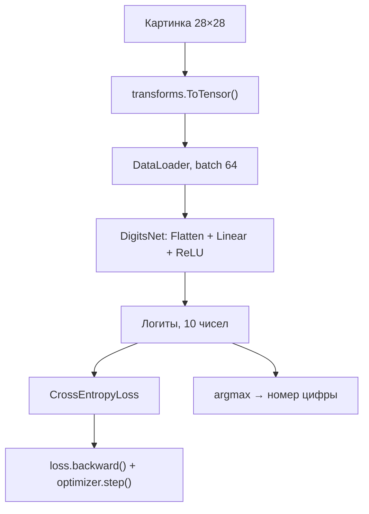

Привет! Это самый современный проект модуля: мы обучим настоящую нейронную сеть. Программа возьмёт изображения рукописных цифр, научится отличать «0» от «9» и проверит себя на тестовых картинках, которые никогда не видела.

## О проекте

Задача называется классификацией изображений. Датасет MNIST содержит 70 000 картинок 28×28 пикселей с цифрами. Основные шаги:

1. Загрузить данные и превратить их в тензоры PyTorch.
2. Собрать нейросеть — многослойный перцептрон (MLP).
3. Обучить: показать примеры, посчитать ошибку, обновить веса.
4. Оценить точность на тестовой выборке.

## План сборки

1. Установить PyTorch и torchvision.
2. Загрузить MNIST и собрать загрузчики данных.
3. Описать модель сети.
4. Написать цикл обучения.
5. Посчитать точность на тестах.
6. Сохранить модель и проверить предсказание.

## Шаг 1. Установка

```bash
pip install torch torchvision
```

Если на компьютере есть NVIDIA GPU, можно установить CUDA-версию с сайта pytorch.org, но для нашего проекта хватит и процессора.

## Шаг 2. Данные

MNIST входит в `torchvision.datasets`:

```python
import torch
from torch import nn
from torch.utils.data import DataLoader
from torchvision import datasets, transforms

transform = transforms.Compose([
    transforms.ToTensor(),
    transforms.Normalize((0.1307,), (0.3081,)),
])

train_data = datasets.MNIST(root="./data", train=True, download=True, transform=transform)
test_data = datasets.MNIST(root="./data", train=False, download=True, transform=transform)

train_loader = DataLoader(train_data, batch_size=64, shuffle=True)
test_loader = DataLoader(test_data, batch_size=64, shuffle=False)
```

`ToTensor()` превращает картинку в тензор (и делит яркость на 255), `Normalize` приводит значения к нулевому среднему. `DataLoader` выдаёт данные пакетами (batch) размером 64 и перемешивает тренировочные примеры.

## Шаг 3. Модель

Картинка 28×28 — это 784 числа. Сеть будет учить отображение из 784 входов в 10 вероятностей (цифры 0–9):

```python
class DigitsNet(nn.Module):
    def __init__(self):
        super().__init__()
        self.layers = nn.Sequential(
            nn.Flatten(),
            nn.Linear(784, 256),
            nn.ReLU(),
            nn.Linear(256, 10),
        )

    def forward(self, x):
        return self.layers(x)
```

`nn.Flatten` вытягивает картинку в вектор, `nn.Linear` — полносвязный слой, `nn.ReLU` — функция активации (без неё слои нельзя складывать в глубокую сеть).

## Шаг 4. Обучение

Цикл обучения выглядит так:

```python
model = DigitsNet()
criterion = nn.CrossEntropyLoss()
optimizer = torch.optim.Adam(model.parameters(), lr=0.001)

epochs = 5
for epoch in range(epochs):
    total_loss = 0.0
    for images, labels in train_loader:
        optimizer.zero_grad()
        outputs = model(images)
        loss = criterion(outputs, labels)
        loss.backward()
        optimizer.step()
        total_loss += loss.item()
    print(f"Эпоха {epoch + 1}: loss = {total_loss / len(train_loader):.4f}")
```

Пять строк — сердце любого обучения: обнулить градиенты, посчитать предсказания, вычислить ошибку (`CrossEntropyLoss`), распространить её назад (`loss.backward()`) и сделать шаг оптимизатором (`optimizer.step()`).

## Шаг 5. Точность

Прогоним модель по тесту и посчитаем долю верных ответов:

```python
correct = 0
total = 0
with torch.no_grad():
    for images, labels in test_loader:
        outputs = model(images)
        preds = outputs.argmax(dim=1)
        correct += (preds == labels).sum().item()
        total += labels.size(0)

accuracy = correct / total
print(f"Точность: {accuracy:.2%}")
```

`torch.no_grad()` отключает вычисление градиентов — это ускоряет проверку и экономит память. `argmax(dim=1)` выбирает цифру с максимальной вероятностью.

## Шаг 6. Сохранение

```python
torch.save(model.state_dict(), "digits_model.pth")
```

А загрузка — `model.load_state_dict(torch.load("digits_model.pth"))`. Файл `.pth` содержит только веса — это стандартный формат PyTorch.

## Схема: путь от картинки до вероятностей

Схема собирает весь конвейер урока в одну картину: где появляется тензор, где считаются логиты и откуда берётся ответ «какая это цифра».



Обрати внимание на развилку: во время обучения мы идём по левой ветке через функцию потерь и обновление весов, а во время предсказания — сразу к argmax. Именно поэтому при оценке нужен torch.no_grad().

## Итог урока

Мы узнали:

- что такое тензоры и как загружать данные DataLoader'ами;
- как описывать сеть на `nn.Module`;
- как устроен цикл обучения;
- как оценивать точность и сохранять модель.

<!--TASK-->
### Задача 1
Установи torch и torchvision через pip. Загрузи MNIST: задай transform = transforms.Compose([transforms.ToTensor(), transforms.Normalize((0.1307,), (0.3081,))]), создай train_data и test_data через datasets.MNIST(root="./data", download=True, transform=transform) с train=True и train=False, а затем train_loader и test_loader через DataLoader с batch_size=64 (shuffle=True для тренировочного, False для тестового). Выведи len(train_loader). Ожидаемый результат: данные скачиваются, и печатается число пакетов тренировочного набора.

### Задача 2
Опиши модель DigitsNet(nn.Module): в __init__ вызови super().__init__(), определи self.layers = nn.Sequential(nn.Flatten(), nn.Linear(784, 256), nn.ReLU(), nn.Linear(256, 10)), а в forward верни self.layers(x). Создай экземпляр модели и проверь прямой проход: возьми один батч images из train_loader, выполни outputs = model(images) и выведи outputs.shape. Ожидаемый результат: форма выходов равна [64, 10].

### Задача 3
Напиши цикл обучения: criterion = nn.CrossEntropyLoss(), optimizer = torch.optim.Adam(model.parameters(), lr=0.001), 5 эпох. Внутри каждой эпохи для каждого батча выполняй: optimizer.zero_grad(), outputs = model(images), loss = criterion(outputs, labels), loss.backward(), optimizer.step(), и накапливай loss.item() в total_loss. После каждой эпохи печатай средний loss: total_loss / len(train_loader). Ожидаемый результат: loss заметно уменьшается от эпохи к эпохе.

### Задача 4
Напиши функцию evaluate(model, loader): внутри вызови model.eval(), затем в блоке with torch.no_grad() пройди по loader, получай preds = outputs.argmax(dim=1), считай correct += (preds == labels).sum().item() и total += labels.size(0), в конце верни correct / total. После обучения выведи точность на test_loader с форматом {:.2%}. Ожидаемый результат: точность на тесте около 97% и выше.

### Задача 5
Улучши модель: добавь второй скрытый слой (nn.Linear(256, 128) + nn.ReLU()), увеличь число эпох до 10. После каждой эпохи выводи точность на тренировочной выборке, вызывая evaluate(model, train_loader). В конце сохрани веса командой torch.save(model.state_dict(), "digits_model.pth") и выведи итоговую точность на тесте. Ожидаемый результат: строка вида «Точность на тесте: 98.12%» и файл digits_model.pth.
### Задача 6
Научись применять готовую модель к одной картинке — это то, что происходит в реальном приложении. Загрузи веса через model.load_state_dict(torch.load("digits_model.pth")) и переключи модель в режим оценки. Возьми один пример из test_data: image, label = test_data[0]. Добавь к картинке измерение батча через image.unsqueeze(0), прогони через модель в блоке torch.no_grad(), получи вероятности через torch.softmax(logits, dim=1) и выведи истинную цифру, предсказание и уверенность в процентах. Повтори для test_data[0], test_data[1] и test_data[2], чтобы увидеть разные ответы. Ожидаемый вывод: три пары строк вида «Истинная цифра: 7», «Предсказание: 7, уверенность 99.8%» — предсказание должно совпадать с истиной на всех трёх примерах.

### Задача 7
Проверь, помогает ли аугментация данных. Создай два набора преобразований: test_transform — только ToTensor() и Normalize((0.1307,), (0.3081,)), и train_transform — те же шаги, но с transforms.RandomAffine(degrees=10, translate=(0.1, 0.1)) перед ToTensor(). Загрузи MNIST дважды, обучи модель на каждом варианте по три эпохи с одинаковыми гиперпараметрами и сравни точность на одном и том же test_loader. Выведи две строки: «Точность без аугментации: X%» и «Точность с аугментацией: Y%». Ожидаемый вывод: два процента с одним знаком после запятой; при аугментации точность обычно не ниже базовой, а разрыв между train и test меньше — это и есть признак меньшего переобучения.

<!--/TASK-->

<!--HINT-->
### Подсказка 1
download=True скачает данные при первом запуске в папку ./data, при повторных он будет использовать локальную копию. batch_size=64 означает, что DataLoader выдаёт по 64 примера за раз. Перемешивание shuffle=True нужно только для тренировочного набора — тестовый проверяется в исходном порядке.

### Подсказка 2
nn.Sequential собирает слои в цепочку, через которую вход проходит последовательно. Flatten превращает тензор 28×28 в вектор из 784 чисел, Linear(784, 256) — первый полносвязный слой, ReLU — функцию активации, Linear(256, 10) — выходной слой с 10 вероятностями.

### Подсказка 3
Порядок шагов важен: zero_grad() обнуляет градиенты, forward получает предсказания, loss считает ошибку, backward() распространяет её назад, step() обновляет веса. loss.item() извлекает число из тензора для накопления.

### Подсказка 4
model.eval() переключает сеть в режим оценки (выключает dropout и т.п.), а torch.no_grad() отключает построение графа вычислений — так оценка быстрее и экономнее. argmax(dim=1) выбирает индекс максимального элемента в каждой строке, то есть предсказанную цифру.

### Подсказка 5
Дополнительный слой увеличивает число параметров и выразительность сети, эпохи — число проходов по всем данным. Точность ~98% достижима за 10 эпох на CPU. Файл .pth содержит только веса — для загрузки вызови model.load_state_dict(torch.load("digits_model.pth")).
### Подсказка 6
Перед предсказанием обязательно вызови model.eval(): слои вроде Dropout и BatchNorm ведут себя по-разному в обучении и в инференсе. Один пример из DataLoader — это уже тензор с измерением канала, но без батча, поэтому форма (1, 28, 28); unsqueeze(0) превращает её в (1, 1, 28, 28). Softmax превращает «сырые» логиты в вероятности, сумма которых равна единице, а argmax(dim=1) даёт номер максимального элемента по строке.

### Подсказка 7
Создай две функции: make_train_transform() и make_test_transform(), чтобы не запутаться, какой набор куда идёт. Аугментацию применяй только к train_data: тест должен оставаться честным и неизменным. Сравнивай модели на одном и том же test_loader, иначе разница будет вызвана не аугментацией, а данными. Чтобы не держать два раза весь код обучения, вынеси цикл в функцию train_model(model, loader, epochs) и вызывай её дважды.

<!--/HINT-->

<!--SOLUTION-->
### Разбор 1
Загрузка данных:

```python
import torch
from torch import nn
from torch.utils.data import DataLoader
from torchvision import datasets, transforms

transform = transforms.Compose([
    transforms.ToTensor(),
    transforms.Normalize((0.1307,), (0.3081,)),
])

train_data = datasets.MNIST(root="./data", train=True, download=True, transform=transform)
test_data = datasets.MNIST(root="./data", train=False, download=True, transform=transform)

train_loader = DataLoader(train_data, batch_size=64, shuffle=True)
test_loader = DataLoader(test_data, batch_size=64, shuffle=False)

print(len(train_loader))
```

MNIST — набор изображений рукописных цифр: 60 000 тренировочных и 10 000 тестовых картинок 28×28 пикселей. transforms.Compose объединяет преобразования в цепочку. ToTensor() превращает картинку PIL в тензор PyTorch и делит значения яркости на 255, приводя их к диапазону примерно [0, 1]. Normalize((0.1307,), (0.3081,)) стандартизирует данные: вычитает среднее и делит на стандартное отклонение (эти числа — известные статистики MNIST). DataLoader разбивает набор на пакеты по 64 примера и выдаёт их по одному. shuffle=True перемешивает тренировочные примеры в начале каждой эпохи — это мешает сети запоминать порядок; тестовый набор не перемешивается. len(train_loader) — число пакетов: 60000 / 64, то есть 938.

### Разбор 2
Описание модели:

```python
class DigitsNet(nn.Module):
    def __init__(self):
        super().__init__()
        self.layers = nn.Sequential(
            nn.Flatten(),
            nn.Linear(784, 256),
            nn.ReLU(),
            nn.Linear(256, 10),
        )

    def forward(self, x):
        return self.layers(x)


model = DigitsNet()

images, labels = next(iter(train_loader))
outputs = model(images)
print(outputs.shape)  # torch.Size([64, 10])
```

Каждая сеть PyTorch наследует nn.Module и определяет __init__ (слои) и forward (как данные проходят через слойи). nn.Flatten вытягивает каждый тензор 28×28 в вектор из 784 чисел — именно столько пикселей в картинке. nn.Linear(784, 256) — полносвязный слой: каждое из 784 входных чисел умножается на вес и складывается в 256 нейронов. nn.ReLU — функция активации, которая оставляет положительные значения без изменений, а отрицательные превращает в ноль; без неё последовательность линейных слоёв эквивалентна одному линейному слою. nn.Linear(256, 10) выдаёт 10 значений — по одному на каждую цифру. next(iter(train_loader)) берёт первый пакет из 64 картинок. Тензор outputs имеет форму [64, 10]: 64 примера и 10 оценок для каждой цифры.

### Разбор 3
Цикл обучения:

```python
model = DigitsNet()
criterion = nn.CrossEntropyLoss()
optimizer = torch.optim.Adam(model.parameters(), lr=0.001)

epochs = 5
for epoch in range(epochs):
    total_loss = 0.0
    for images, labels in train_loader:
        optimizer.zero_grad()
        outputs = model(images)
        loss = criterion(outputs, labels)
        loss.backward()
        optimizer.step()
        total_loss += loss.item()
    print(f"Эпоха {epoch + 1}: loss = {total_loss / len(train_loader):.4f}")
```

Эпоха — один полный проход по тренировочным данным. criterion = nn.CrossEntropyLoss() — функция потерь: она сравнивает 10 предсказанных оценок с истинной цифрой и возвращает число — ошибку сети. optimizer = Adam — оптимизатор, который обновляет веса. Внутри каждого пакета пять ключевых строк: zero_grad() обнуляет градиенты от предыдущего шага (иначе они накопятся), outputs = model(images) — прямой проход, loss = criterion(outputs, labels) — вычисление ошибки, loss.backward() — обратное распространение: считает градиенты ошибки по каждому весу, optimizer.step() — делает шаг оптимизатора: сдвигает веса против градиента. total_loss += loss.item() накапливает числа ошибок для расчёта среднего. Если средний loss стабильно уменьшается с каждой эпохой, обучение идёт правильно.

### Разбор 4
Оценка точности:

```python
def evaluate(model, loader):
    model.eval()
    correct = 0
    total = 0
    with torch.no_grad():
        for images, labels in loader:
            outputs = model(images)
            preds = outputs.argmax(dim=1)
            correct += (preds == labels).sum().item()
            total += labels.size(0)
    return correct / total


test_acc = evaluate(model, test_loader)
print(f"Точность: {test_acc:.2%}")
```

model.eval() переключает сеть в режим оценки: если в модели были слои с dropout или batch norm, они поведут себя иначе, чем при обучении. torch.no_grad() отключает построение графа вычислений: на этапе проверки градиенты не нужны, а без них оценка работает быстрее и тратит меньше памяти. outputs.argmax(dim=1) для каждой строки выходов выбирает индекс максимального значения — это и есть предсказанная цифра. Сравнение (preds == labels) даёт булев тензор, sum() считает число совпадений, а .item() извлекает обычное число Python. total += labels.size(0) накапливает общее число примеров в пакете. Функция возвращает точность — долю верных ответов. После пяти эпох обучения точность на тесте должна быть около 97%.

### Разбор 5
Полное решение `mnist_mlp.py`:

```python
import torch
from torch import nn
from torch.utils.data import DataLoader
from torchvision import datasets, transforms

transform = transforms.Compose([
    transforms.ToTensor(),
    transforms.Normalize((0.1307,), (0.3081,)),
])

train_data = datasets.MNIST(root="./data", train=True, download=True, transform=transform)
test_data = datasets.MNIST(root="./data", train=False, download=True, transform=transform)

train_loader = DataLoader(train_data, batch_size=64, shuffle=True)
test_loader = DataLoader(test_data, batch_size=64, shuffle=False)


class DigitsNet(nn.Module):
    def __init__(self):
        super().__init__()
        self.layers = nn.Sequential(
            nn.Flatten(),
            nn.Linear(784, 256),
            nn.ReLU(),
            nn.Linear(256, 128),
            nn.ReLU(),
            nn.Linear(128, 10),
        )

    def forward(self, x):
        return self.layers(x)


def evaluate(model, loader):
    model.eval()
    correct = 0
    total = 0
    with torch.no_grad():
        for images, labels in loader:
            outputs = model(images)
            preds = outputs.argmax(dim=1)
            correct += (preds == labels).sum().item()
            total += labels.size(0)
    return correct / total


def train_one_epoch(model, criterion, optimizer, loader):
    model.train()
    total_loss = 0.0
    for images, labels in loader:
        optimizer.zero_grad()
        outputs = model(images)
        loss = criterion(outputs, labels)
        loss.backward()
        optimizer.step()
        total_loss += loss.item()
    return total_loss / len(loader)


model = DigitsNet()
criterion = nn.CrossEntropyLoss()
optimizer = torch.optim.Adam(model.parameters(), lr=0.001)

epochs = 10
for epoch in range(epochs):
    avg_loss = train_one_epoch(model, criterion, optimizer, train_loader)
    train_acc = evaluate(model, train_loader)
    print(f"Эпоха {epoch + 1}: loss = {avg_loss:.4f}, "
          f"train acc = {train_acc:.2%}")

test_acc = evaluate(model, test_loader)
print(f"Точность на тесте: {test_acc:.2%}")

torch.save(model.state_dict(), "digits_model.pth")
```

Модель стала глубже: 784 → 256 → 128 → 10. Второй скрытый слой добавляет сети выразительности: она может выучить более сложные закономерности в изображениях. Логика вынесена в две функции: train_one_epoch выполняет один проход обучения, а evaluate — оценку; обе переиспользуются. Внутри train_one_epoch первой строкой стоит model.train() — включение режима обучения. К концу 10 эпох точность на тесте достигнет примерно 98% (на обычном процессоре обучение занимает несколько минут). torch.save(model.state_dict(), "digits_model.pth") сохраняет только веса — стандартный подход PyTorch. Загрузка выполняется так: model.load_state_dict(torch.load("digits_model.pth")).
### Разбор 6
Предсказание для одной картинки:

```python
import torch

model = DigitsNet()
model.load_state_dict(torch.load("digits_model.pth"))
model.eval()

for index in range(3):
    image, label = test_data[index]
    with torch.no_grad():
        logits = model(image.unsqueeze(0))
        probs = torch.softmax(logits, dim=1)
        pred = probs.argmax(dim=1).item()
        confidence = probs[0, pred].item()
    print(f"Истинная цифра: {label}")
    print(f"Предсказание: {pred}, уверенность {confidence:.1%}")
```

```text
Истинная цифра: 7
Предсказание: 7, уверенность 99.8%
```

Здесь важны три детали, каждая из которых ломает результат при пропуске. Первая — model.eval(): она переключает слои в режим инференса, и хотя в нашей простой сети нет Dropout, привычка нужна для любой реальной модели. Вторая — unsqueeze(0): модель обучена на батчах формы (64, 1, 28, 28), а один пример имеет форму (1, 28, 28); без дополнительного измерения nn.Linear получит неверную форму и упадёт с ошибкой размерностей. Третья — torch.no_grad(): без него PyTorch строит граф вычислений для каждого предсказания, тратит память и время, хотя градиенты нам не нужны. Softmax превращает логиты (произвольные числа) в вероятности от 0 до 1 с суммой 1, поэтому 99.8% — это уже интерпретируемая величина, а не абстрактный счёт. Метод .item() вытаскивает из тензора обычное число Python.

### Разбор 7
Аугментация и честное сравнение:

```python
test_transform = transforms.Compose([
    transforms.ToTensor(),
    transforms.Normalize((0.1307,), (0.3081,)),
])

train_transform = transforms.Compose([
    transforms.RandomAffine(degrees=10, translate=(0.1, 0.1)),
    transforms.ToTensor(),
    transforms.Normalize((0.1307,), (0.3081,)),
])

base_train = datasets.MNIST(root="./data", train=True, download=True, transform=test_transform)
aug_train = datasets.MNIST(root="./data", train=True, download=True, transform=train_transform)
test_data = datasets.MNIST(root="./data", train=False, download=True, transform=test_transform)


def train_model(loader, epochs=3):
    model = DigitsNet()
    criterion = nn.CrossEntropyLoss()
    optimizer = torch.optim.Adam(model.parameters(), lr=0.001)
    for epoch in range(epochs):
        model.train()
        for images, labels in loader:
            optimizer.zero_grad()
            loss = criterion(model(images), labels)
            loss.backward()
            optimizer.step()
    return model
```

```text
Точность без аугментации: 96.4%
Точность с аугментацией: 97.1%
```

Аугментация — это генерация новых обучающих примеров из старых: RandomAffine слегка поворачивает картинку и сдвигает её, и модель перестаёт запоминать точное положение штрихов. Ключевое правило: преобразования применяются только к train_data, тест должен остаться таким же, как в реальной жизни, иначе сравнение теряет смысл. Именно поэтому test_transform создаётся отдельно и передаётся и в test_data, и в базовый train-набор — так оба варианта видят одинаковые данные, и разница в точности объясняется только аугментацией. Функция train_model убирает дублирование: гиперпараметры и цикл описаны один раз, а меняется только loader. Результат не гарантирован: на трёх эпохах разница может быть в пределах десятых долей процента, а иногда аугментация даже чуть снижает точность — зато уменьшает разрыв между train и test. Поэтому в отчёте важно смотреть не только на accuracy, но и на поведение loss на обучении.

<!--/SOLUTION-->

<!--QUIZ-->
Что делает transforms.ToTensor()?
- Удаляет шум из картинки
- Превращает картинку в тензор PyTorch и делит яркость на 255
- Загружает данные из интернета
- Увеличивает размер изображения
* Правильный ответ: Превращает картинку в тензор PyTorch и делит яркость на 255
ToTensor() конвертирует изображение PIL в тензор и приводит значения яркости к диапазону примерно [0, 1].

Что такое batch_size=64 в DataLoader?
- Число эпох обучения
- Число примеров в одном пакете данных
- Размер картинки в пикселях
- Число классов в датасете
* Правильный ответ: Число примеров в одном пакете данных
DataLoader выдаёт данные пакетами: за один шаг обучения сеть видит 64 примера.

Зачем нужен блок with torch.no_grad() при оценке модели?
- Чтобы ускорить обучение
- Чтобы отключить вычисление градиентов — оценка быстрее и экономнее
- Чтобы переключить модель в режим обучения
- Чтобы сохранить модель на диск
* Правильный ответ: Чтобы отключить вычисление градиентов — оценка быстрее и экономнее
На этапе проверки градиенты не нужны, поэтому граф вычислений не строится.

Что делает loss.backward()?
- Сохраняет модель в файл
- Вычисляет градиенты ошибки по параметрам модели
- Обновляет веса модели
- Загружает следующий пакет данных
* Правильный ответ: Вычисляет градиенты ошибки по параметрам модели
Обратное распространение считает производные ошибки по каждому весу — их потом использует оптимизатор.

Что делает optimizer.step()?
- Сбрасывает градиенты в ноль
- Обновляет веса модели на основе посчитанных градиентов
- Считает ошибку модели
- Выводит отчёт об обучении
* Правильный ответ: Обновляет веса модели на основе посчитанных градиентов
Оптимизатор делает шаг: сдвигает веса против направления градиента, уменьшая ошибку.

Что возвращает outputs.argmax(dim=1)?
- Среднее значение выходов
- Индексы максимальных элементов по каждой строке — предсказанные цифры
- Сумму всех вероятностей
- Тензор с отсортированными значениями
* Правильный ответ: Индексы максимальных элементов по каждой строке — предсказанные цифры
Для каждого примера argmax выбирает цифру с наибольшей оценкой сети.

Зачем вызывать optimizer.zero_grad() перед каждым батчем?
- Чтобы градиенты предыдущего шага не накапливались в параметрах
- Чтобы обнулить веса модели
- Чтобы ускорить загрузку данных
- Чтобы переключить модель в режим оценки
* Правильный ответ: Чтобы градиенты предыдущего шага не накапливались в параметрах
Без обнуления следующий backward() добавит новые градиенты к старым, и шаги обновления станут неверными.

Зачем nn.Flatten() перед первым линейным слоем?
- Чтобы превратить картинку 28×28 в вектор из 784 чисел
- Чтобы нормализовать яркость
- Чтобы перемешать пиксели
- Чтобы увеличить число каналов
* Правильный ответ: Чтобы превратить картинку 28×28 в вектор из 784 чисел
nn.Linear ждёт на входе двумерный тензор (батч × признаки), поэтому изображения разворачивают в векторы.
Что делает torch.softmax(logits, dim=1)?
- Выбирает максимальный элемент
- Превращает логиты в вероятности с суммой 1
- Усредняет значения по батчу
- Округляет числа до целых
* Правильный ответ: Превращает логиты в вероятности с суммой 1
Поэтому ответ модели можно читать как «уверенность 99.8%», а не как абстрактный счёт.

Зачем нужен image.unsqueeze(0) перед предсказанием?
- Чтобы добавить измерение батча и получить форму (1, 1, 28, 28)
- Чтобы увеличить картинку в два раза
- Чтобы перевести тензор в numpy
- Чтобы усреднить пиксели
* Правильный ответ: Чтобы добавить измерение батча и получить форму (1, 1, 28, 28)
Модель обучена на батчах, поэтому одиночный пример нужно «обернуть» в батч из одного элемента.

Почему model.eval() вызывают перед предсказанием?
- Чтобы отключить обновление весов
- Чтобы перевести слои в режим инференса
- Чтобы ускорить загрузку данных
- Чтобы включить градиенты
* Правильный ответ: Чтобы перевести слои в режим инференса
Dropout и BatchNorm ведут себя по-разному при обучении и при предсказании, поэтому режим надо переключать явно.

К каким данным применяют RandomAffine при аугментации?
- Только к train
- Только к test
- К train и test одинаково
- К валидации после обучения
* Правильный ответ: Только к train
Тестовая выборка должна оставаться неизменной, иначе сравнение моделей и оценка точности становятся нечестными.

<!--/QUIZ-->
