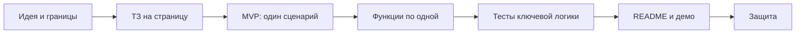

Привет! Это финал курса. Ты уже собрал шесть проектов — от игры до нейросети. Теперь пора сделать свой собственный проект: от идеи до работающей программы. Эта работа покажет, что ты действительно научился программировать, а не просто повторял примеры.

## Как выбрать идею

Хороший учебный проект отвечает трём критериям:

- **Интересен тебе.** Ты будешь проводить с ним часы — иди за своим любопытством.
- **Реализуем за неделю.** Один доведённый до конца проект лучше трёх брошенных. Если идея огромная — вырезай половину функций.
- **Использует изученное.** Проект должен задействовать хотя бы часть арсенала: функции, файлы или базу данных, сторонние библиотеки.

## План работы

1. **ТЗ.** Опиши в 3–5 предложениях, что делает программа и кто ею пользуется.
2. **Декомпозиция.** Разбей на небольшие задачи, каждую — в отдельную функцию или модуль.
3. **Каркас.** Сначала минимум: программа запускается и делает одну простую вещь правильно.
4. **Рост.** Добавляй функции по одной, запуская программу после каждой.
5. **Проверка.** Протестируй крайние случаи: пустой файл, неверный ввод, повторный запуск.
6. **README.** Напиши инструкцию: как установить и запустить.

## Критерии оценки

Работа проверяется по чек-листу:

- программа запускается без ошибок;
- минимум три содержательные функции;
- данные читаются из файла или базы данных;
- неверный ввод пользователя не роняет программу;
- код разбит на функции с понятными именами, есть комментарии к сложным местам;
- есть файл README.md с инструкцией;
- код оформлен в одном файле или в аккуратной папке.

## Советы

- **Пиши постепенно.** Никто не пишет большую программу одним куском. Десять маленьких запусков лучше одного большого.
- **Читай ошибки до конца.** Ошибка — это подсказка, где именно проблема.
- **Не боись переписывать.** Удалить неудачную функцию и написать заново — нормально.
- **Используй `if __name__ == "__main__"`.** Так код можно и запускать, и импортировать.

## Схема: путь проекта от идеи до защиты

Схема напоминает порядок этапов. Самая частая ошибка на финальной работе — прыгнуть сразу к «функциям» и только в конце вспомнить про README и тесты.



Каждый этап заканчивается маленьким запуском: MVP — одной работающей командой, этап функций — тремя проверенными сценариями, этап тестов — зелёным pytest. Так к защите не остаётся неожиданностей.

## Защита работы

Подготовься рассказать: что делает программа, как она устроена, какие трудности были и как ты их решил. Защита — это не экзамен, а разговор о проделанной работе.

<!--TASK-->
### Задача 1
Выбери идею проекта из предложенных (трекер расходов, менеджер заметок, личная библиотека) или предложи свою. Напиши техническое задание на 3–5 предложений: что делает программа, кто ею пользуется, какие данные принимает на вход, какой результат выдаёт, какие 3–5 главных функций будут в коде. Ожидаемый результат: короткий текст ТЗ в отдельном файле (например, plan.md) или в начале описания проекта.

### Задача 2
Составь план работы из 5–7 пунктов: разбей проект на маленькие задачи и для каждой укажи, в какую функцию или модуль она превратится. Определи минимальную версию продукта (MVP) — самую простую вещь, которую программа должна делать правильно уже на первом запуске (например, сохранить одну запись). Ожидаемый результат: список задач с именами будущих функций и выделенный MVP.

### Задача 3
Реализуй каркас: программа должна запускаться без ошибок и выполнять одну простую функцию правильно — твой MVP. Используй if __name__ == "__main__" для точки входа. Проверь запуск командой python имя_файла.py. Ожидаемый результат: рабочая минимальная версия, которая стартует и делает хотя бы одну операцию корректно.

### Задача 4
Добавляй функции по одной, запуская программу после каждой, — в итоге их должно быть не менее трёх. Данные должны читаться из файла или базы данных (sqlite3 или json). Добавь обработку ошибок ввода: неверные числа, пустые строки и неизвестные команды не должны ронять программу. Протестируй крайние случаи: пустой файл, повторный запуск, отрицательные значения. Ожидаемый результат: полная программа, устойчивая к неверному вводу.

### Задача 5
Напиши файл README.md: название проекта, краткое описание, как установить и запустить, список команд или функций. Подготовь краткое описание для защиты: что делает программа, как разделён код, какие трудности возникли и как ты их решил. Ожидаемый результат: README.md и готовность рассказать о проекте на защите.
### Задача 6
Покрой автотестами ключевую функцию своего проекта — ту, в которой легче всего ошибиться (подсчёт итога, парсинг суммы, фильтрация записей). Установи pytest, создай файл test_project.py рядом с основным модулем и напиши три теста: успешный сценарий с конкретными числами, граничный случай (ноль или отрицательное значение) и проверку ожидаемого исключения через pytest.raises. Запусти pytest -q из папки проекта. Ожидаемый вывод: три точки и строка «3 passed in 0.01s»; специально сломай одну функцию — например, поменяй знак в сумме — и убедись, что pytest покажет имя упавшего теста, файл и строку с assert, а после возврата правильной логики снова станет зелёным.

### Задача 7
Подготовь демонстрацию для защиты: скрипт demo.py, который прогоняет три главных сценария проекта без ручного ввода и печатает короткий отчёт. Сценарии: добавление двух записей, подсчёт итога и попытка добавить некорректные данные с перехватом ValueError. Каждый шаг сопровождай понятной строкой, чтобы зритель видел, что происходит. Ожидаемый вывод: «Добавлено записей: 2», «Итого: 1150 ₽», «Ожидаемая ошибка: Сумма должна быть больше нуля»; дополнительно запиши в README раздел «Демонстрация» с командой python demo.py и этими тремя строками, чтобы проверяющий мог повторить сценарий сам.

<!--/TASK-->

<!--HINT-->
### Подсказка 1
Выбирай идею, которая интересна именно тебе и реализуема за неделю. ТЗ пиши до кода: в нём должны быть ответы на вопросы «что делает программа?» и «кто ею пользуется?». Если идея слишком объёмная — сокращай функциональность до минимума.

### Подсказка 2
Самая частая ошибка — пытаться сделать «всё сразу». Разбей работу на маленькие шаги, каждый шаг — одна функция. MVP — это самая простая версия, которую можно запустить и проверить: например, для трекера расходов это команда add, сохраняющая одну запись в базу.

### Подсказка 3
Начни с крошечного рабочего кода: подключи sqlite3 (или json), напиши init_db() и одну функцию добавления, а в главной части вызов. if __name__ == "__main__" позволит и запускать скрипт, и импортировать его функции. Проверяй запуск после каждого добавленного блока.

### Подсказка 4
Добавляй функции по одной: добавление, вывод списка, баланс, статистика по категориям. Самые рискованные места — преобразование ввода в число: оберни его в try/except и проверяй отрицательные значения. Пустой файл базы не должен ломать вывод: используй SUM(amount) с проверкой на None.

### Подсказка 5
README.md — это Markdown-файл: название, описание, примеры запуска в блоках ```bash. Для защиты структурируй рассказ: что делает программа, как разделён код (данные/логика/интерфейс), какие трудности были и как ты их решил.
### Подсказка 6
Тестируй поведение, а не реализацию: проверяй, что функция вернула и что лежит в списке после вызова, а не сколько раз выполнился цикл. Для исключений используй with pytest.raises(ValueError): — без этой конструкции тест упадёт, потому что исключение выйдет наружу. Имя файла должно начинаться с test_, а функции — с test_, иначе pytest их не найдёт. Запускай pytest из корня проекта, чтобы импорт модуля работал без правки sys.path.

### Подсказка 7
Демо-скрипт не должен зависеть от input(): все данные задай в коде, чтобы защита не сломалась из-за опечатки. Оберни рискованный вызов в try/except ValueError и напечатай текст ошибки — так ты покажешь обработку ошибок, а не падение. Каждый print делай самодостаточным: проверяющий читает вывод, а не твой код. Если проект хранит данные в файле, создавай для демо отдельный файл demo_data.json, чтобы не затереть основные записи.

<!--/HINT-->

<!--SOLUTION-->
### Разбор 1
Пример ТЗ для трекера расходов:

«Трекер расходов — консольная программа для учёта личных финансов. Пользователь — один человек, который ведёт ежедневные записи о тратах. Программа принимает из командной строки команды: add (добавить расход с суммой и категорией), list (показать все записи), balance (показать общий баланс), categories (показать суммы по категориям). Данные хранятся в базе SQLite и сохраняются между запусками. Главные функции: add_expense, list_expenses, balance, by_category, parse_amount.»

Хорошее ТЗ отвечает на пять вопросов: что делает программа, кто ею пользуется, что на входе, что на выходе, какие функции будут в коде. Текст короткий — 3–5 предложений — но из него уже понятна каркас будущей программы. Именно из ТЗ рождается декомпозиция на шаге 2: каждая фраза о функциональности превращается в отдельную функцию. Если идея большая, на этом этапе режь функциональность: MVP — это минимум, который уже полезен.

### Разбор 2
Пример плана работы (7 пунктов):

1. ТЗ: описано в задаче 1.
2. **MVP:** init_db() + add_expense() — программа запускается и добавляет одну запись в SQLite.
3. list_expenses() — вывод всех записей в читаемом виде.
4. balance() — сумма всех расходов через SUM(amount).
5. by_category() — группировка сумм по категориям через GROUP BY.
6. parse_amount() — надёжное преобразование ввода в число с проверкой отрицательных значений.
7. main() — разбор команд из sys.argv и обработка ошибок ввода.

MVP выделен отдельным пунктом: это самая простая версия, которую можно запустить и убедиться, что фундамент работает. Каждый следующий пункт — маленький шаг, который добавляется и проверяется отдельно. Обрати внимание на логику выбора: сначала хранение, потом чтение, потом агрегация, потом защита от ошибок. Такая очерёдность позволяет всегда иметь работающую программу, а не «полуфабрикат».

### Разбор 3
Минимальная версия (MVP):

```python
import sqlite3
import sys

DB = "expenses.db"


def init_db():
    con = sqlite3.connect(DB)
    con.execute(
        "CREATE TABLE IF NOT EXISTS expenses ("
        "id INTEGER PRIMARY KEY AUTOINCREMENT,"
        "amount REAL NOT NULL,"
        "category TEXT NOT NULL,"
        "created_at TEXT NOT NULL)"
    )
    con.commit()
    con.close()


def add_expense(amount, category):
    con = sqlite3.connect(DB)
    con.execute(
        "INSERT INTO expenses (amount, category, created_at) "
        "VALUES (?, ?, datetime('now'))",
        (amount, category),
    )
    con.commit()
    con.close()


if __name__ == "__main__":
    init_db()
    add_expense(float(sys.argv[1]), sys.argv[2])
    print("Добавлено")
```

Каркас минимален, но уже самодостаточен: программа запускается, создаёт таблицу и записывает расход. init_db() выполняется при каждом запуске, но CREATE TABLE IF NOT EXISTS не ломает существующую базу. add_expense использует параметризованный запрос с плейсхолдерами — защита от SQL-инъекций. Точка входа if __name__ == "__main__" позволяет и запускать скрипт, и импортировать его функции в других программах. Запуск: python expenses.py 3500 Еда. Это и есть проверяемый фундамент, на который дальше лягут остальные функции.

### Разбор 4
Полная версия `expenses.py`:

```python
import sqlite3
import sys
from datetime import datetime

DB = "expenses.db"


def init_db():
    con = sqlite3.connect(DB)
    con.execute(
        "CREATE TABLE IF NOT EXISTS expenses ("
        "id INTEGER PRIMARY KEY AUTOINCREMENT,"
        "amount REAL NOT NULL,"
        "category TEXT NOT NULL,"
        "note TEXT DEFAULT '',"
        "created_at TEXT NOT NULL)"
    )
    con.commit()
    con.close()


def add_expense(amount, category, note=""):
    con = sqlite3.connect(DB)
    con.execute(
        "INSERT INTO expenses (amount, category, note, created_at) "
        "VALUES (?, ?, ?, ?)",
        (amount, category, note, datetime.now().isoformat(timespec="minutes")),
    )
    con.commit()
    con.close()


def list_expenses():
    con = sqlite3.connect(DB)
    rows = con.execute(
        "SELECT id, amount, category, note, created_at FROM expenses "
        "ORDER BY created_at DESC"
    ).fetchall()
    con.close()
    return rows


def balance():
    con = sqlite3.connect(DB)
    total = con.execute("SELECT SUM(amount) FROM expenses").fetchone()[0]
    con.close()
    return total or 0.0


def by_category():
    con = sqlite3.connect(DB)
    rows = con.execute(
        "SELECT category, SUM(amount) FROM expenses GROUP BY category "
        "ORDER BY SUM(amount) DESC"
    ).fetchall()
    con.close()
    return rows


def parse_amount(text):
    try:
        value = float(text.replace(",", "."))
    except ValueError:
        raise ValueError(f"«{text}» — это не число")
    if value < 0:
        raise ValueError("Сумма не может быть отрицательной")
    return value


def main():
    if len(sys.argv) < 2:
        print("Использование: python expenses.py [add | list | balance | categories]")
        return

    command = sys.argv[1]

    if command == "add":
        try:
            amount = parse_amount(sys.argv[2])
            category = sys.argv[3]
            note = sys.argv[4] if len(sys.argv) > 4 else ""
        except IndexError:
            print("Использование: python expenses.py add <сумма> <категория> [заметка]")
            return
        except ValueError as exc:
            print(f"Ошибка: {exc}")
            return
        add_expense(amount, category, note)
        print(f"Добавлено: {amount:.2f}₽ ({category})")

    elif command == "list":
        for row in list_expenses():
            print(f"#{row[0]} {row[4]}: {row[1]:.2f}₽ [{row[2]}] {row[3]}")

    elif command == "balance":
        print(f"Баланс: {balance():.2f}₽")

    elif command == "categories":
        for category, total in by_category():
            print(f"{category}: {total:.2f}₽")

    else:
        print(f"Неизвестная команда: {command}")


if __name__ == "__main__":
    init_db()
    main()
```

Логика разбита на шесть маленьких функций, каждую легко проверить отдельно. Функции базы открывают соединение и закрывают его. balance() обрабатывает случай пустой таблицы: SUM(amount) вернёт None, и выражение `total or 0.0` превратит его в ноль — пустой файл не ломает программу. parse_amount переводит строку в число (принимая и запятую как разделитель) и проверяет отрицательные значения. main() ловит ValueError (неверное число) и IndexError (не хватает аргументов), печатая понятные сообщения вместо падения. Неизвестные команды тоже обрабатываются. Повторный запуск безопасен благодаря CREATE TABLE IF NOT EXISTS.

### Разбор 5
Пример `README.md`:

```markdown
# Трекер расходов

Консольная программа для учёта личных расходов.
Данные хранятся в SQLite и сохраняются между запусками.

## Запуск

```bash
python expenses.py add 3500 Еда Супермаркет
python expenses.py list
python expenses.py balance
python expenses.py categories
```

## Команды

- `add <сумма> <категория> [заметка]` — добавить расход;
- `list` — показать все записи;
- `balance` — показать баланс;
- `categories` — показать суммы по категориям.

## Структура

- `init_db()` — создание таблицы;
- `add_expense()` — добавление записи;
- `list_expenses()` — вывести всех записей;
- `balance()` — общая сумма;
- `by_category()` — суммы по категориям;
- `parse_amount()` — проверка ввода;
- `main()` — разбор команд.
```

README отвечает на вопросы: что это, как запустить, какие команды есть, как устроен код. Для защиты подготовь устный рассказ по той же схеме: что делает программа, как разделён код (данные отдельно, логика отдельно, интерфейс отдельно), какие трудности были (например, неверный ввод) и как ты их решил. Защита — это разговор о проделанной работе: если ты можешь объяснить каждую функцию, половина успеха уже есть.
### Разбор 6
Пример тестов для трекера расходов:

```python
# project.py
import json


def add_expense(expenses, title, amount):
    if amount <= 0:
        raise ValueError("Сумма должна быть больше нуля")
    expenses.append({"title": title, "amount": amount})
    return expenses


def total(expenses):
    return sum(item["amount"] for item in expenses)
```

```python
# test_project.py
import pytest

from project import add_expense, total


def test_add_expense():
    expenses = []
    add_expense(expenses, "Кофе", 250)
    assert len(expenses) == 1
    assert expenses[0]["amount"] == 250


def test_total():
    expenses = []
    add_expense(expenses, "Кофе", 250)
    add_expense(expenses, "Книга", 900)
    assert total(expenses) == 1150


def test_negative_amount():
    with pytest.raises(ValueError):
        add_expense([], "Кофе", -100)
```

```bash
pytest -q
# ...
# 3 passed in 0.01s
```

Главный принцип — каждый тест создаёт свои данные и не зависит от предыдущего: expenses = [] внутри теста, а не глобальный список. Иначе порядок запуска начнёт влиять на результат, и однажды тесты «позеленеют» ложно. Первый тест проверяет и длину списка, и сумму записи: одной проверки мало, ведь функция могла добавить запись с неверным amount. Второй фиксирует ожидаемое число 1150 — если завтра кто-то сломает суммирование, тест упадёт сразу, а не на защите. Третий использует pytest.raises: без него исключение ValueError вылетело бы из теста и pytest засчитал бы ошибку, хотя поведение правильное. Запуск pytest -q показывает только итог; без -q видно по строке на тест, что удобно при отладке. Когда тест краснеет, pytest печатает файл, строку и само выражение assert — этого достаточно, чтобы понять причину без отладчика.

### Разбор 7
Демонстрационный скрипт для защиты:

```python
# demo.py
from project import add_expense, total


def main():
    expenses = []
    add_expense(expenses, "Кофе", 250)
    add_expense(expenses, "Книга", 900)
    print(f"Добавлено записей: {len(expenses)}")
    print(f"Итого: {total(expenses)} ₽")

    try:
        add_expense(expenses, "Ошибка", -50)
    except ValueError as error:
        print(f"Ожидаемая ошибка: {error}")


if __name__ == "__main__":
    main()
```

```text
Добавлено записей: 2
Итого: 1150 ₽
Ожидаемая ошибка: Сумма должна быть больше нуля
```

Демо-скрипт решает главную проблему защиты — зависимость от живой демонстрации: любая опечатка при вводе съедает время и сбивает рассказ. Здесь все данные заданы в коде, поэтому вывод воспроизводится одинаково на любом компьютере. 3 строки — это три тезиса твоего выступления: «я умею добавлять», «я умею считать», «я обрабатываю ошибки». Не пытайся показать все функции сразу: пять минут защиты лучше потратить на три сценария, которые работают безупречно. Конструкция if __name__ == "__main__" позволяет импортировать demo.py в тестах без запуска сценария — это тот же приём, что и в основном проекте. try/except вокруг заведомо некорректного вызова выглядит искусственно в реальной программе, но на демо он показывает обработку ошибок явно и без риска уронить приложение. В README добавь раздел «Демонстрация» с командой и ожидаемым выводом: проверяющий сможет повторить сценарий без твоих пояснений.

<!--/SOLUTION-->

<!--QUIZ-->
Какой из критериев характеризует хороший учебный проект?
- Максимально длинный код
- Интересен тебе, реализуем за неделю и использует изученное
- Только сторонние библиотеки
- Чем больше функций, тем лучше
* Правильный ответ: Интересен тебе, реализуем за неделю и использует изученное
Проект должен быть посильным и полезным для обучения: доведённый до конца малый проект лучше брошенного большого.

Что такое MVP?
- Самый красивый экран программы
- Минимальная рабочая версия продукта
- Максимально полная версия продукта
- Модуль проверки паролей
* Правильный ответ: Минимальная рабочая версия продукта
MVP — это самая простая версия, которую можно запустить и проверить, прежде чем добавлять новые функции.

Зачем пишут if __name__ == "__main__"?
- Чтобы ускорить выполнение программы
- Чтобы код можно было и запускать, и импортировать без побочных эффектов
- Чтобы программа работала только на Windows
- Чтобы скрыть код от других
* Правильный ответ: Чтобы код можно было и запускать, и импортировать без побочных эффектов
Блок выполняется только при прямом запуске скрипта, а при импорте функции остаются доступными без запуска.

Почему данные стоит хранить в файле или базе данных?
- Чтобы программа занимала меньше места
- Чтобы данные сохранялись между запусками программы
- Чтобы ускорить интернет
- Чтобы не писать функции
* Правильный ответ: Чтобы данные сохранялись между запусками программы
Переменные живут только во время работы программы, а файл или БД хранят данные постоянно.

Что обязательно должно быть в README.md?
- Только название проекта
- Инструкция, как установить и запустить проект, и описание команд
- Список всех ошибок Python
- Портрет автора
* Правильный ответ: Инструкция, как установить и запустить проект, и описание команд
README помогает другому человеку (и тебе через месяц) быстро разобраться, что делает программа и как её запустить.

Что нужно сделать при неверном вводе пользователя?
- Завершить программу с ошибкой
- Обработать ошибку и продолжить работу, не падая
- Игнорировать ввод
- Перезапустить компьютер
* Правильный ответ: Обработать ошибку и продолжить работу, не падая
try/except перехватывает ошибку, программа выводит понятное сообщение и продолжает работу.

Зачем декомпозировать проект на маленькие задачи?
- Чтобы каждую задачу можно было реализовать и проверить отдельно
- Чтобы код стал длиннее
- Чтобы не писать README
- Чтобы программа работала быстрее
* Правильный ответ: Чтобы каждую задачу можно было реализовать и проверить отдельно
Маленькие шаги снижают риск ошибок: каждое добавление проверяется сразу.

Что означает «данные читаются из файла или базы данных» в критериях оценки?
- Проект должен сохранять данные между запусками, а не только в переменных
- Проект должен использовать только JSON
- Нужно создать не менее 10 файлов
- Данные должны вводиться вручную каждый раз
* Правильный ответ: Проект должен сохранять данные между запусками, а не только в переменных
Файл или БД хранят данные постоянно — при следующем запуске записи остаются на месте.
Зачем нужен pytest, если программу можно просто запустить руками?
- Он проверяет все сценарии автоматически при каждом изменении кода
- Он ускоряет саму программу
- Он заменяет README
- Он автоматически исправляет ошибки
* Правильный ответ: Он проверяет все сценарии автоматически при каждом изменении кода
Ручной запуск проверяет один путь, а тесты — все зафиксированные сценарии, и делают это за доли секунды.

Что произойдёт, если выражение в assert окажется ложным?
- Тест будет пропущен
- Тест упадёт с указанием файла и строки
- Программа продолжит работу молча
- pytest выведет предупреждение и пойдёт дальше
* Правильный ответ: Тест упадёт с указанием файла и строки
Assert — это проверка ожидания: pytest показывает, где именно оно нарушено.

Зачем на защите запускать demo.py вместо ручного ввода?
- Чтобы вывод был воспроизводимым и не зависел от опечаток
- Чтобы программа работала быстрее
- Чтобы не показывать код
- Чтобы pytest не запускался
* Правильный ответ: Чтобы вывод был воспроизводимым и не зависел от опечаток
Фиксированные данные дают одинаковый результат на любом компьютере — демонстрация не срывается из-за случайной ошибки ввода.

Что называют регрессией?
- Ситуацию, когда новая правка ломает ранее работавшую функцию
- Первый запуск программы
- Ошибку в README
- Ускорение программы после оптимизации
* Правильный ответ: Ситуацию, когда новая правка ломает ранее работавшую функцию
Именно от регрессий защищает набор тестов: он краснеет сразу, как только старая логика перестала работать.

<!--/QUIZ-->
