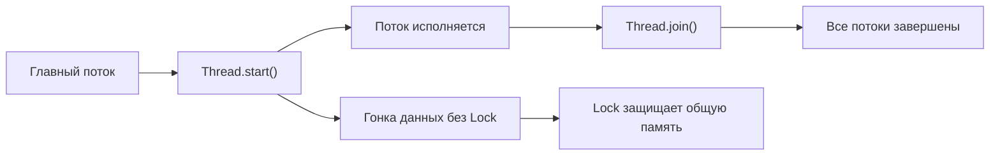

Привет! До сих пор все наши программы выполняли команды строго по одной, сверху вниз. Но часто нужно делать несколько вещей одновременно: пока программа ждёт ответа от сети, она могла бы считать что-то ещё. Сегодня мы научимся запускать код параллельно с помощью **потоков** (threads) и разберёмся, почему без аккуратности это приводит к ошибкам.

## Что такое поток

Поток — это отдельная «линия исполнения» внутри одного процесса. Все потоки одного процесса разделяют память: они видят одни и те же глобальные переменные. Для IO-задач — например, ожидания ввода-вывода — это отличная новость: пока один поток ждёт данные, другой продолжает работать.

В Python потоки реализованы в стандартном модуле `threading`. Самый простой способ создать поток — передать функции `Thread` имя функции и её аргументы:

```python
import threading
import time

def say_hello(name):
    time.sleep(0.5)          # имитация полезной работы
    print(f"Привет, {name}!")

threads = []
for name in ["Аня", "Борис", "Вика"]:
    t = threading.Thread(target=say_hello, args=(name,))
    t.start()                # поток начинает выполняться
    threads.append(t)
```

Если просто вызвать `say_hello(...)` напрямую, строчки напечатаются по очереди. А через потоки они могут печататься вперемешку — кто успел, тот и напечатал.

Можно объявить поток и классом, унаследовавшись от `Thread` и переопределив метод `run`:

```python
class Greeter(threading.Thread):
    def __init__(self, name):
        super().__init__()
        self.name = name

    def run(self):
        print(f"Поток {self.name} стартовал")
```

Такой подход удобен, когда потоку нужно хранить своё состояние.

## join(): дождаться завершения

Когда главный поток вызывает `t.start()`, он не останавливается — он продолжает идти дальше. Если программа закончит работать раньше, чем потоки, те будут прерваны. Чтобы дождаться завершения конкретного потока, используется метод `join()`:

```python
for t in threads:
    t.join()   # ждём, пока поток t завершится
print("Все потоки завершились")
```

У `join()` есть необязательный параметр `timeout` — сколько секунд ждать максимум. Это полезно, если поток может зависнуть.

## Потоки-демоны

По умолчанию программа завершается только тогда, когда завершились все недемонные потоки. Иногда это не нужно: например, фоновый поток обновляет индикатор прогресса, и нам не важно, успеет ли он дорисовать картинку при выходе. Для таких случаев существует режим демона:

```python
t = threading.Thread(target=some_worker, daemon=True)
t.start()
```

Демонные потоки не блокируют завершение интерпретатора: если главный поток дошёл до конца и других живых потоков нет, программа закроется, даже если демон ещё работает.

## Гонка данных: когда всё ломается

Раз потоки видят общие переменные, два потока могут одновременно менять одну и ту же переменную. Посмотрим на классический пример — счётчик:

```python
import threading

counter = 0
ITERATIONS = 1_000_000

def increment():
    global counter
    for _ in range(ITERATIONS):
        counter += 1

threads = [threading.Thread(target=increment) for _ in range(8)]
for t in threads:
    t.start()
for t in threads:
    t.join()

print(counter)   # обычно МЕНЬШЕ 8_000_000!
```

Казалось бы, восемь потоков по миллиону увеличений должны дать ровно 8 000 000. Но операция `counter += 1` не атомарна: она состоит из трёх шагов — прочитать значение, прибавить единицу, записать обратно. Поток может быть прерван между этими шагами: два потока прочитают одно и то же число, оба прибавят единицу и запишут одно и то же. Часть увеличений «теряется». Это называется **гонкой данных** (data race).

## Lock: мьютекс

Чтобы защитить общую переменную, нужна блокировка — объект `threading.Lock`. Смысл прост: перед входом в опасный участок поток захватывает блокировку (`acquire`), а после выхода — освобождает (`release`). Пока блокировка занята одним потоком, остальные ждут своей очереди.

```python
lock = threading.Lock()
counter = 0

def increment_safe():
    global counter
    for _ in range(ITERATIONS):
        with lock:            # захват и гарантированное освобождение
            counter += 1
```

Заметь: используется контекстный менеджер `with lock:`. Это правильный стиль — даже если внутри случится исключение, блокировка будет освобождена автоматически. Теперь результат будет ровно `8_000_000` при любом раскладе.

Стоит помнить: мьютекс решает проблему корректности, но замедляет программу — потоки ждут друг друга. Поэтому блокировкой нужно защищать только минимально необходимые участки.

## RLock и другие примитивы

Иногда функция берёт блокировку, а потом вызывает другую функцию, которая хочет взять ту же самую блокировку. Обычный `Lock` здесь упрётся в сам себя и возникнет взаимная блокировка (deadlock). Для таких случаев есть `threading.RLock` — реентерабельная блокировка: один и тот же поток может захватить её несколько раз, если правильно чередует с освобождениями. Также в `threading` есть семафоры `Semaphore`, события `Event` и барьеры `Barrier` — они пригодятся в более сложных схемах.




## Итог урока

Мы узнали: как создавать потоки через `threading.Thread`, как ждать их завершения через `join()`, чем отличаются потоки-демоны, что такое гонка данных и как мьютекс `Lock` защищает общие данные. Главная идея урока: потоки дают параллельность, но за порядок обращения к общим данным отвечаешь ты сам.

<!--TASK-->
### Задача 1 — Потоки-приветствия и join

Напиши программу `hello_threads.py`, которая создаёт пять потоков. Каждый поток печатает строку вида «Поток 1 стартовал», ждёт `time.sleep(0.3)` и печатает «Поток 1 завершился». После запуска всех потоков вызови у каждого из них `join()`, а затем напечатай строку «Все потоки завершились».

Ожидаемый вывод: десять строк про потоки в любом порядке (потоки конкурируют за вывод) и самой последней строкой — «Все потоки завершились». Финальное сообщение должно появляться строго после завершения работы всех пяти потоков. Если оно печатается раньше или «вперемешку» со строками потоков — значит, ты забыл `join()`. Добавь в код комментарий, объясняющий роль `join()`.

### Задача 2 — Гонка данных

Напиши программу `race_demo.py`. Заведи глобальный счётчик `counter = 0` и функцию `increment()`, которая выполняет `counter += 1` ровно 1 000 000 раз. Запусти восемь потоков `threading.Thread(target=increment)`, дождись их завершения через `join()` и напечатай итоговое значение счётчика.

Ожидаемый вывод: число, которое с очень высокой вероятностью меньше 8 000 000 (например, 7 834 217). В комментариях кода объясни, почему часть увеличений «теряется», хотя формально каждый поток выполнил по миллиону операций. Если вдруг получилось ровно 8 000 000, увеличь число итераций (например, до 5 000 000) и запусти ещё раз.

### Задача 3 — Счётчик под защитой Lock

Модифицируй программу из Задачи 2: создай объект `threading.Lock()` и оберни инкремент в контекстный менеджер `with lock:`. Запусти те же восемь потоков по 1 000 000 итераций и напечатай результат.

Ожидаемый вывод: ровно 8 000 000 при любом количестве запусков. В комментарии объясни, почему блокировка даёт гарантированный результат и какую цену платит программа (потоки ждут друг друга, поэтому критическую секцию нужно держать максимально короткой).

### Задача 4 — RLock: вложенная блокировка

Напиши программу `rlock_demo.py`. Создай функцию `safe_add(data)`, которая суммирует элементы вложенного списка: если `data` — список, функция рекурсивно вызывает саму себя для каждого элемента; иначе прибавляет число к глобальной сумме. На каждом уровне входа в функцию захватывай одну и ту же блокировку `threading.RLock()` через `with lock:`. Запусти десять потоков, каждый из которых обрабатывает список `[1, [2, 3], [4, [5, 6]]]`, дождись завершения и напечатай сумму.

Ожидаемый вывод: 210 (десять потоков × сумма 21). В комментарии объясни, почему обычный `Lock` здесь привёл бы к взаимной блокировке, а `RLock` — нет.

### Задача 5 — Потоки-демоны

Напиши программу `daemon_demo.py`. Создай поток с параметром `daemon=True`, который в бесконечном цикле каждые 0.2 секунды печатает «тик». Главный поток спит 1 секунду, печатает «Главный поток завершился» и завершается.

Ожидаемый вывод: примерно пять строк «тик» и затем «Главный поток завершился», после чего программа закрывается немедленно — без ожидания демона. В комментарии объясни, почему программа не висит вечно, и что изменится, если убрать `daemon=True` (проверь это на практике).
### Задача 6 — Event: синхронизация старта
Напиши программу `event_demo.py`. Создай `threading.Event()` и пять потоков: каждый ждёт `event.wait()`, затем печатает «Работает поток N» и завершается. Главный поток спит 1 секунду, печатает «Старт!», вызывает `event.set()` и дожидается завершения всех потоков через `join()`.
Ожидаемый вывод: сначала «Старт!», затем пять строк «Работает поток N» (порядок N произвольный). В комментарии объясни, почему `wait()` не блокирует главный поток и что было бы без `set()`.

### Задача 7 — ThreadPoolExecutor: пул готовых потоков
Напиши программу `pool_demo.py`. Используй `concurrent.futures.ThreadPoolExecutor(max_workers=4)`: передай в пул десять задач через `executor.map` — функция `square(x)` возвращает `x * x`. Собери результаты в список и напечатай его.
Ожидаемый вывод: `[0, 1, 4, 9, 16, 25, 36, 49, 64, 81]`. В комментарии сравни ручное создание потоков и пул: что делает пул проще и какие ресурсы экономит.


<!--/TASK-->

<!--HINT-->
### Подсказка 1

Создай список потоков и заполни его в цикле: `threading.Thread(target=worker, args=(f"Поток {i}",))`. Метод `start()` запускает поток и сразу возвращает управление — поэтому финальную строку печатай только после того, как вызовешь `join()` для каждого потока из списка. Не забудь про `time.sleep(0.3)` внутри функции-работника.

### Подсказка 2

Внутри функции-инкремента обязательно объяви `global counter`, иначе Python создаст локальную переменную и глобальный счётчик вообще не изменится. Помни: `counter += 1` — это три шага: чтение, сложение, запись. Подумай, что произойдёт, если два потока прочитают одно и то же значение раньше, чем кто-либо запишет результат.

### Подсказка 3

Заведи `lock = threading.Lock()` и оберни инкремент в `with lock: counter += 1`. Контекстный менеджер сам захватит и гарантированно освободит блокировку, даже если внутри возникнет исключение. Старайся держать критическую секцию минимальной: чем она длиннее, тем сильнее потоки замедляют друг друга.

### Подсказка 4

Обычный `Lock` в рекурсии упрётся в самого себя: второй вход в тот же участок заблокирует поток навсегда — это и есть взаимная блокировка. Используй `threading.RLock()`: она разрешает одному и тому же потоку захватывать себя многократно. Для проверки запусти вариант с обычным `Lock` и убедись, что программа зависнет.

### Подсказка 5

Демону нужен бесконечный цикл: `while True:` с `time.sleep(0.2)` и печатью «тик». В главном потоке хватит `time.sleep(1)` и печати финального сообщения. Убери `daemon=True` и сравни поведение: второй вариант зависнет навсегда, потому что интерпретатор ждёт недемонные потоки.
### Подсказка 6
`threading.Event` — простой флаг синхронизации: `wait()` блокирует поток, пока другой поток не вызовет `set()`. Создай событие до потоков, передай его в target через args. В конце главного потока не забудь `join()` для всех потоков.
### Подсказка 7
`ThreadPoolExecutor(max_workers=4)` берёт на себя создание и переиспользование потоков. `executor.map(square, range(10))` возвращает итератор результатов строго в порядке входов; преврати его в список через `list(...)`.

<!--/HINT-->

<!--SOLUTION-->
### Разбор 1

Полное решение:

```python
import threading
import time

def worker(name):
    print(f"{name} стартовал")
    time.sleep(0.3)
    print(f"{name} завершился")

threads = []
for i in range(1, 6):
    t = threading.Thread(target=worker, args=(f"Поток {i}",))
    t.start()
    threads.append(t)

for t in threads:
    t.join()

print("Все потоки завершились")
```

Что здесь происходит? `Thread.start()` ставит поток в очередь планировщика и сразу возвращает управление: главный поток не ждёт, пока поток отработает. Поэтому строки «стартовал» и «завершился» печатаются в произвольном порядке — потоки конкурируют за `print`. Но `join()` блокирует вызывающий (главный) поток до тех пор, пока поток `t` не завершится. Так как я вызвал `join()` для всех пяти потоков по очереди, к моменту печати «Все потоки завершились» все они гарантированно отработали. Если бы я забыл `join()`, главный поток дошёл бы до финального `print` почти мгновенно, и сообщение о завершении появилось бы раньше, чем потоки закончат работу, — это классическая ошибка начинающих. Время сна 0.3 секунды выбрано, чтобы было хорошо видно асинхронность печати: без него потоки могут успеть напечатать слишком быстро.

### Разбор 2

Полное решение:

```python
import threading

counter = 0
ITERATIONS = 1_000_000
THREADS = 8

def increment():
    global counter
    for _ in range(ITERATIONS):
        counter += 1

threads = [threading.Thread(target=increment) for _ in range(THREADS)]
for t in threads:
    t.start()
for t in threads:
    t.join()

print(counter)
```

Возможный вывод: `7834217`. Почему так? В CPython операция `counter += 1` не атомарна: она разворачивается в три шага — прочитать текущее значение `counter`, прибавить единицу, записать результат обратно. Планировщик может прервать поток в любой момент, в том числе между этими шагами. Представь: поток A прочитал 100, поток B тоже прочитал 100, оба прибавили единицу и записали 101. Одно увеличение потерялось. При восьми потоках и миллионе итераций такие пересечения случаются тысячи раз, поэтому итог почти всегда меньше 8 000 000. Ключевой момент: проблема не в «медленных» потоках, а в отсутствии порядка доступа к общей переменной — именно эту проблему решает блокировка из следующего разбора.

### Разбор 3

Полное решение:

```python
import threading

lock = threading.Lock()
counter = 0
ITERATIONS = 1_000_000
THREADS = 8

def increment_safe():
    global counter
    for _ in range(ITERATIONS):
        with lock:
            counter += 1

threads = [threading.Thread(target=increment_safe) for _ in range(THREADS)]
for t in threads:
    t.start()
for t in threads:
    t.join()

print(counter)  # 8000000
```

Здесь `with lock:` окружает инкремент «критической секцией». Смысл мьютекса прост: одновременно выполнять этот участок может только один поток. Остальные ждут у входа, пока владелец не освободит блокировку. Так операция «чтение-сложение-запись» становится неделимой с точки зрения других потоков: никто не может прочитать значение посередине чужого обновления. Поэтому каждая из восьми миллионов операций реально увеличивает счётчик, и итог равен ровно 8 000 000. Контекстный менеджер `with lock:` — правильный выбор: даже если внутри блока возникнет исключение, блокировка всё равно будет освобождена. Цена корректности — ожидание: потоки, не получившие блокировку, простаивают, поэтому защищать нужно лишь минимально необходимые участки, а не весь цикл целиком.

### Разбор 4

Полное решение:

```python
import threading

lock = threading.RLock()
total = 0
DATA = [1, [2, 3], [4, [5, 6]]]

def safe_add(data):
    global total
    with lock:
        if isinstance(data, list):
            for item in data:
                safe_add(item)
        else:
            total += data

threads = [threading.Thread(target=safe_add, args=(DATA,)) for _ in range(10)]
for t in threads:
    t.start()
for t in threads:
    t.join()

print(total)  # 210
```

Сумма чисел во вложенном списке: 1 + 2 + 3 + 4 + 5 + 6 = 21, а десять потоков дают 210. Функция `safe_add` на каждом уровне рекурсии входит в `with lock:`. С обычным `Lock` это было бы катастрофой: первый вход захватывает блокировку, затем рекурсивный вызов пытается захватить её снова — но владелец — тот же самый поток, а `Lock` не различает владельцев. Возникает взаимная блокировка: поток навсегда ждёт сам себя. `RLock` (reentrant lock) решает проблему: она помнит, какой поток владеет ею, и ведёт счётчик захватов. Повторный `acquire` тем же потоком просто увеличивает счётчик; каждый `release` уменьшает его, и только когда он становится нулевым, блокировка освобождается для других. Благодаря этому рекурсия внутри одной функции безопасна. Внешние потоки по-прежнему взаимоисключают друг друга: пока один поток выполняет всю рекурсию, остальные ждут.

### Разбор 5

Полное решение:

```python
import threading
import time

def ticker():
    while True:
        time.sleep(0.2)
        print("тик")

t = threading.Thread(target=ticker, daemon=True)
t.start()

time.sleep(1)
print("Главный поток завершился")
```

Примерный вывод:

```
тик
тик
тик
тик
тик
Главный поток завершился
```

Интерпретатор ждёт завершения всех недемонных потоков, прежде чем закрыться. Демонные потоки — исключение: они живут ровно до тех пор, пока жив хотя бы один недемонный поток (в нашем случае — главный). Когда главный поток после секунды сна печатает финальное сообщение и завершается, интерпретатор закрывает программу сразу, не дожидаясь спящего `ticker`, — демон просто уничтожается вместе с процессом. Поэтому мы видим примерно пять «тиков» (за 1 секунду по одному каждые 0.2 с) и мгновенный выход. Если убрать `daemon=True`, цикл `while True` никогда не закончится, и программа зависнет навсегда, даже когда главный поток уже отработал. Вывод: демоны хороши для фоновых задач, которыми можно пожертвовать при выходе, но не стоит доверять им незавершённую критическую работу — например, запись файлов без явного контроля.
### Разбор 6
```python
import threading
import time

event = threading.Event()

def worker(n):
    event.wait()
    print(f"Работает поток {n}")

threads = [threading.Thread(target=worker, args=(i,)) for i in range(5)]
for t in threads:
    t.start()

time.sleep(1)
print("Старт!")
event.set()

for t in threads:
    t.join()
```
Вывод: «Старт!», затем пять строк «Работает поток N». `Event.wait()` приостанавливает каждый поток, пока не будет вызван `event.set()`: это один из самых простых способов синхронизации «все готовы — поехали». Главный поток не блокируется — `wait()` вызывают только рабочие потоки. Без `set()` потоки ждали бы вечно: поэтому событие всегда нужно «отпускать». Один флаг обслуживает сразу всех ожидающих.
### Разбор 7
```python
from concurrent.futures import ThreadPoolExecutor

def square(x):
    return x * x

with ThreadPoolExecutor(max_workers=4) as executor:
    results = list(executor.map(square, range(10)))

print(results)
```
Вывод: `[0, 1, 4, 9, 16, 25, 36, 49, 64, 81]`. Пул сам создаёт потоков, распределяет десять задач по четырём рабочим потокам и возвращает результаты в порядке поступления задач (`map` сохраняет порядок). Контекстный менеджер гарантированно вызывает `shutdown(wait=True)` — не нужно вручную собирать потоки и звать `join()`. Это основной способ «потоков на каждый день»: меньше кода, меньше шансов на забытый `join`.

<!--/SOLUTION-->

<!--QUIZ-->
Чем отличается поток, созданный с параметром daemon=True?
- Он выполняется быстрее остальных
- Он не блокирует завершение программы: при выходе интерпретатор не ждёт его
- Он не может использовать print()
- Он автоматически получает блокировку Lock
* Правильный ответ: Он не блокирует завершение программы: при выходе интерпретатор не ждёт его
Обычные потоки не дают программе завершиться, пока работают. Демонные потоки принудительно завершаются вместе с программой, поэтому их используют для фоновой работы.

Почему counter += 1 в нескольких потоках без Lock может дать меньший результат, чем ожидалось?
- Потому что операция состоит из нескольких шагов (чтение, сложение, запись), и потоки могут прерываться между ними
- Потому что Python округляет числа
- Потому что += не работает с целыми числами
- Потому что потоки выполняются строго по очереди
* Правильный ответ: Потому что операция состоит из нескольких шагов (чтение, сложение, запись), и потоки могут прерываться между ними
Если два потока прочитают одно и то же значение и оба запишут результат, одно увеличение «теряется» — итог меньше ожидаемого.

Что делает метод join()?
- Запускает поток
- Останавливает поток навсегда
- Блокирует вызывающий поток, пока поток, у которого вызван join, не завершится
- Удаляет поток из памяти
* Правильный ответ: Блокирует вызывающий поток, пока поток, у которого вызван join, не завершится
join() позволяет дождаться окончания работы потока, например, прежде чем печатать итоговый результат.

Какой способ захвата Lock считается правильным и безопасным даже при исключении?
- lock.acquire() и lock.release() вручную
- with lock: ... 
- lock.enter() и lock.exit()
- Lock нельзя использовать с with
* Правильный ответ: with lock: ...
Контекстный менеджер гарантированно освободит блокировку, даже если внутри блока возникнет исключение — ручное освобождение при ошибке легко забыть.

Что произойдёт, если главный поток завершится, а недемонный поток продолжает выполняться?
- Программа будет ждать завершения этого потока
- Программа немедленно завершится
- Будет возбуждено исключение RuntimeError
- Поток автоматически станет демоном
* Правильный ответ: Программа будет ждать завершения этого потока
Интерпретатор держит процесс живым, пока работает хотя бы один недемонный поток. Именно поэтому в реальном коде используют join() или продумывают условия завершения рабочих потоков.

Почему RLock не приводит к взаимной блокировке при повторном захвате тем же потоком?
- Она вообще не блокирует потоки
- Она запоминает владельца и ведёт счётчик захватов: повторный захват тем же потоком просто увеличивает счётчик
- Каждый вызов acquire() создаёт новую блокировку
- RLock запрещает повторные захваты
* Правильный ответ: Она запоминает владельца и ведёт счётчик захватов: повторный захват тем же потоком просто увеличивает счётчик
Обычный Lock не отличает «чужой» поток от «своего» и блокирует повторный вход. RLock разрешает владельцу входить повторно, а освобождение происходит только после уравновешивания всех захватов.
Можно ли из одного потока безопасно ждать сигнала от другого потока без блокировки и гонок?
- Да, с помощью threading.Event: один поток вызывает set(), другой — wait()
- Нет, такого механизма в Python не существует
- Только если использовать time.sleep() в цикле
* Правильный ответ: Да, с помощью threading.Event: один поток вызывает set(), другой — wait()
Event — простой способ синхронизации: wait() блокирует поток, пока другой поток не вызовет set(), после чего все ожидающие продолжают работу.

Зачем используется threading.Semaphore?
- Чтобы ограничить число потоков, которые одновременно входят в критическую секцию
- Чтобы ускорить сложение чисел
- Чтобы превратить поток в процесс
* Правильный ответ: Чтобы ограничить число потоков, которые одновременно входят в критическую секцию
Семафор разрешает войти в секцию только заданному числу потоков; остальные ждут освобождения слота. Это удобно, например, для ограничения одновременных сетевых подключений.
Что вернёт executor.map(square, range(5)), если square(x)=x*x?
- Список [0,1,4,9,16] сразу
- Итератор, отдающий результаты в порядке входов
- Словарь вход->результат
- Кортеж с индексами
* Правильный ответ: Итератор, отдающий результаты в порядке входов
map возвращает ленивый итератор: чтобы получить список, его оборачивают в list().

Зачем нужен threading.Event?
- Чтобы ограничить число потоков
- Чтобы один поток мог «подать сигнал» и разбудить другой(ие)
- Чтобы ускорить вычисления
- Чтобы автоматически дожидаться всех потоков
* Правильный ответ: Чтобы один поток мог «подать сигнал» и разбудить другой(ие)
Event — примитив синхронизации: wait() блокирует поток до вызова set().

В чём преимущество ThreadPoolExecutor перед ручным созданием потоков?
- Автоматическое переиспользование потоков и завершение пула
- Он всегда быстрее потоков
- Он не требует функции-мишени
- Он исключает GIL
* Правильный ответ: Автоматическое переиспользование потоков и завершение пула
Пул берёт на себя жизненный цикл потоков: создание, распределение задач и shutdown.

Что произойдёт, если два потока вызывают wait() на одном Event, а третий вызывает set()?
- Оба потока продолжат работу после set()
- Продолжит только первый
- Возникнет ошибка
- Нужен отдельный Event на поток
* Правильный ответ: Оба потока продолжат работу после set()
set() отпускает всех ожидающих: Event — это «широковещательный» сигнал.

# 
<!--/QUIZ-->
