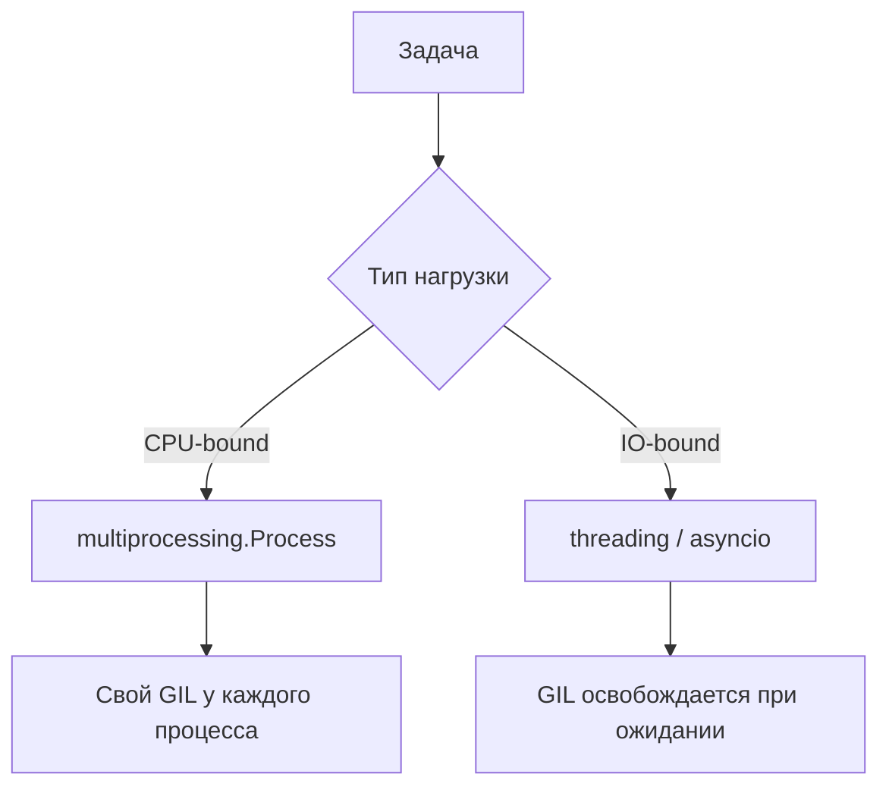

Привет! На прошлом уроке мы научились создавать потоки, но честно предупредили: с общими данными нужно работать аккуратно. Сегодня разберёмся, почему для настоящих вычислений потоки в Python часто бесполезны, и познакомимся с модулем `multiprocessing`, который решает эту проблему.

## Что такое GIL

GIL (Global Interpreter Lock) — это глобальная блокировка интерпретатора CPython — самой распространённой реализации Python. Она гарантирует, что в любой момент времени байт-код Python исполняет только один поток. Зачем она нужна? Интерпретатор автоматически управляет памятью (подсчёт ссылок), и если бы несколько потоков одновременно меняли внутренние структуры объектов, легко было бы получить повреждение памяти. GIL упрощает реализацию, но ограничивает настоящую параллельность.

## Почему потоки не ускоряют вычисления

Раз одновременно исполняется только один поток, вычислительная нагрузка (CPU-bound) от потоков не ускоряется. Потоки лишь быстро переключаются, создавая иллюзию параллельности. Проверим это на деле — напишем функцию с тяжёлым циклом на чистом Python:

```python
def cpu_work(n=3_000_000):
    total = 0
    for i in range(n):
        total += i % 7
    return total
```

Замерим время четырёх последовательных вызовов и четырёх потоков:

```python
import threading
import time

def timed(label, fn, repeats=4):
    start = time.perf_counter()
    for _ in range(repeats):
        fn()
    elapsed = time.perf_counter() - start
    print(f"{label}: {elapsed:.2f} c")

timed("Последовательно", cpu_work)

threads = [threading.Thread(target=cpu_work) for _ in range(4)]
start = time.perf_counter()
for t in threads:
    t.start()
for t in threads:
    t.join()
print(f"Потоки: {time.perf_counter() - start:.2f} c")
```

На многоядерной машине время окажется примерно одинаковым (потоки даже чуть медленнее из-за переключений). Честного ускорения нет — вот он, ценник GIL.

Но есть важное исключение: **ввод-вывод**. Когда поток ждёт ответ от сети, читает диск или спит, интерпретатор освобождает GIL, и другие потоки работают. Поэтому для IO-bound задач (сетевые запросы, загрузка файлов) потоки — рабочий инструмент, даже несмотря на GIL.

## multiprocessing: обход GIL

Чтобы по-настоящему задействовать несколько ядер процессора, нужно запустить несколько процессов. Каждый процесс — это отдельный интерпретатор со своей памятью и своим GIL. Модуль `multiprocessing` предоставляет API, похожий на `threading`:

```python
from multiprocessing import Process

def worker():
    return cpu_work()

if __name__ == "__main__":
    processes = [Process(target=worker) for _ in range(4)]
    for p in processes:
        p.start()
    for p in processes:
        p.join()
```

Код почти как с потоками, но теперь четыре ядра реально работают параллельно, и суммарное время падает примерно вчетверо (с учётом расходов на запуск процессов).

Обрати внимание на обязательную конструкцию `if __name__ == "__main__":`. На Windows процессы создаются через `spawn`: Python перезапускает скрипт в дочернем процессе. Без этой защиты дочерний процесс заново создал бы свои дочерние процессы, и программа упала бы или рекурсивно размножилась.

## Обмен данными между процессами

Процессы не разделяют обычные переменные: изменение значения внутри одного процесса не видно другим. Для обмена есть специальные средства.

**Общая память** — `Value` и `Array`:

```python
from multiprocessing import Process, Value

def increment_shared(counter):
    for _ in range(1_000_000):
        with counter.get_lock():
            counter.value += 1

if __name__ == "__main__":
    counter = Value("i", 0)          # целое число в общей памяти
    processes = [Process(target=increment_shared, args=(counter,)) for _ in range(8)]
    for p in processes:
        p.start()
    for p in processes:
        p.join()
    print(counter.value)             # ровно 8_000_000
```

`Value` умеет блокироваться — метод `get_lock()` даёт мьютекс, защищающий значение. Тут важно понимать отличие от потоков: у потоков общая память и есть, но GIL + отсутствие порядка приводят к гонке; у процессов память не общая, поэтому любое взаимодействие нужно строить явно.

**Очередь** — `multiprocessing.Queue` для передачи объектов между процессами:

```python
from multiprocessing import Process, Queue

def square(x, q):
    q.put(x * x)

if __name__ == "__main__":
    q = Queue()
    processes = [Process(target=square, args=(i, q)) for i in range(5)]
    for p in processes:
        p.start()
    for p in processes:
        p.join()
    while not q.empty():
        print(q.get())
```

Очередь сама занимается синхронизацией — можно смело класть и забирать значения из разных процессов.

## Когда что выбирать

Простая памятка. Задача упирается в вычисления (сложная математика, обработка больших массивов) — бери `multiprocessing`, потому что потоки упрутся в GIL. Задача в основном ждёт ввода-вывода — бери `threading` или asyncio, они легче и дешевле. Задачи смешанные — комбинируй: процессы считают, потоки обслуживают сеть. Ну и помни, что запуск процессов дороже: у каждого свой интерпретатор, свои ресурсы; не плоди их по сто штук.




## Итог урока

Мы разобрались, что такое GIL и почему он мешает потокам ускорять вычисления; убедились на примере, что потоки почти не изменяют время CPU-bound задач; освоили модуль `multiprocessing` — создание процессов, защиту общей памяти через `Value` и обмен данными через `Queue`; узнали, зачем нужна конструкция `if __name__ == "__main__":`. Теперь закрепим это на практике.

<!--TASK-->
### Задача 1 — Потоки не ускоряют вычисления

Напиши программу `timer_threads.py`. Определи вычислительную функцию `cpu_work(n=3_000_000)`, которая в обычном цикле на чистом Python суммирует `i % 7` для всех `i` от 0 до `n-1` (без встроенных агрегатов и функций). Замерь время четырёх последовательных вызовов `cpu_work()` с помощью `time.perf_counter()` и напечатай его. Затем запусти четыре потока `threading.Thread(target=cpu_work)`, дождись их завершения через `join()` и замерь время так же.

Ожидаемый вывод: два числа в секундах, близких друг к другу (время потоков примерно равно последовательному или чуть больше из-за переключений). В комментарии объясни, почему потоки не дают ускорения для вычислительной нагрузки.

### Задача 2 — Процессы ускоряют вычисления

Возьми ту же функцию `cpu_work` и запусти её в четырёх процессах через `multiprocessing.Process`. Обязательно используй конструкцию `if __name__ == "__main__":`. Дождись завершения всех процессов через `join()` и напечатай затраченное время.

Ожидаемый вывод: время, заметно меньшее, чем в Задаче 1 (на многоядерной машине обычно в 2–4 раза). В комментарии объясни, почему процессы обходят ограничение GIL и чем это достигается.

### Задача 3 — Общая память: Value и блокировка

Напиши программу `shared_counter.py`. Заведи общее целое через `multiprocessing.Value("i", 0)`. Запусти восемь процессов, каждый из которых 1 000 000 раз выполняет `with counter.get_lock(): counter.value += 1`. Дождись завершения всех процессов и напечатай итоговое значение.

Ожидаемый вывод: ровно 8 000 000. В комментарии объясни, почему даже здесь, при наличии общей памяти, нужна явная блокировка, — и чем эта ситуация отличается от потоков с общими глобальными переменными.

### Задача 4 — Передача данных через Queue

Создай `multiprocessing.Queue()`. Запусти пять процессов: каждый получает свой номер `i` (от 0 до 4), считает `i * i` и кладёт результат в очередь через `q.put(...)`. После завершения всех процессов (`join()`) достань результаты и напечатай их отсортированными.

Ожидаемый вывод: `[0, 1, 4, 9, 16]` — порядок в очереди случаен, поэтому перед печатью отсортируй список. В комментарии объясни, почему обычная переменная здесь не подошла бы.

### Задача 5 — Что будет без get_lock()?

Возьми программу из Задачи 3 и убери защиту: оставь внутри цикла просто `counter.value += 1`. Запусти и напечатай результат.

Ожидаемый вывод: число, которое с высокой вероятностью меньше 8 000 000. В комментарии объясни, какие шаги операции «чтение-изменение-запись» теряются и почему блокировка возвращает точный результат. Если результат вдруг оказался точным, увеличь число итераций или запусти программу несколько раз.
### Задача 6 — Pipe: обмен между двумя процессами
Напиши программу `pipe_demo.py`. Создай пару каналов через `multiprocessing.Pipe()`. Родительский процесс посылает в канал строку «Привет, процесс!», дочерний процесс принимает её, переводит в верхний регистр и отправляет обратно. Родитель печатает полученный ответ.
Ожидаемый вывод: `ПРИВЕТ, ПРОЦЕСС!`. В комментарии объясни, почему канал удобен для связи «родитель — потомок» и чем отличается от Queue.

### Задача 7 — Маппинг задач на процессы
Напиши программу `process_pool.py`. Используй `multiprocessing.Pool(4)` и его метод `map(func, iterable)` для вычисления `cube(x) = x ** 3` на числах от 1 до 8. Закрой пул через `pool.close()` и дождись через `pool.join()`.
Ожидаемый вывод: `[1, 8, 27, 64, 125, 216, 343, 512]`. В комментарии объясни, чем Pool удобнее ручного списка процессов.


<!--/TASK-->

<!--HINT-->
### Подсказка 1

Замеряй время вокруг всей группы вызовов, а не вокруг каждого по отдельности: `start = time.perf_counter()`, затем цикл, затем `elapsed = time.perf_counter() - start`. Не забывай, что `threading.Thread(target=cpu_work)` принимает функцию целиком, а не её результат, — без скобок. Стандартный модуль `time` даёт микросекундную точность.

### Подсказка 2

Передавай в `Process(target=cpu_work)` функцию без вызова. Конструкция `if __name__ == "__main__":` обязательна: на Windows процессы создаются через spawn, и без неё дочерний процесс заново создал бы свои дочерние процессы. Для замера времени ставь `start` до `start()` всех процессов, а финальный замер — после всех `join()`.

### Подсказка 3

`Value("i", 0)` помещает целое в общую память; тип `"i"` — знаковое целое (C int). Метод `get_lock()` возвращает мьютекс для этого значения — используй его как контекстный менеджер: `with counter.get_lock():`. Сам инкремент выполняется через `counter.value += 1`.

### Подсказка 4

Очередь `multiprocessing.Queue` рассчитана на передачу между процессами: `q.put(value)` с одной стороны, `q.get()` — с другой. После `join()` всех процессов в очереди лежит ровно пять значений: достань их циклом `for _ in range(5)` и отсортируй результат при помощи `sorted()`.

### Подсказка 5

Без `get_lock()` операция `counter.value += 1` снова превращается в три шага: чтение `.value`, сложение, запись. Процессы переключаются между этими шагами, и часть увеличений теряется. Сравни результат с Задачей 3 и объясни, почему блокировка устраняет потерю.
### Подсказка 6
`multiprocessing.Pipe()` возвращает кортеж `(conn1, conn2)`. Один конец отдай родителю, другой — дочернему процессу через args. Приём — `conn.recv()`, отправка — `conn.send()`. Не забудь закрыть неиспользуемый конец.
### Подсказка 7
`Pool(4)` создаёт пул из четырёх процессов. `pool.map(cube, range(1, 9))` раздаёт задачи процессам и возвращает список результатов в порядке входов. После работы обязательны `pool.close()` и `pool.join()`.

<!--/HINT-->

<!--SOLUTION-->
### Разбор 1

Полное решение:

```python
import threading
import time

def cpu_work(n=3_000_000):
    total = 0
    for i in range(n):
        total += i % 7
    return total

# Последовательно
start = time.perf_counter()
for _ in range(4):
    cpu_work()
sequential = time.perf_counter() - start
print(f"Последовательно: {sequential:.2f} c")

# Четыре потока
threads = [threading.Thread(target=cpu_work) for _ in range(4)]
start = time.perf_counter()
for t in threads:
    t.start()
for t in threads:
    t.join()
threaded = time.perf_counter() - start
print(f"Потоки: {threaded:.2f} c")
```

Примерный вывод:

```
Последовательно: 1.20 c
Потоки: 1.22 c
```

Почему времена почти одинаковые? Из-за GIL в любой момент времени байт-код Python исполняет только один поток, поэтому четыре потока не могут реально использовать четыре ядра — они лишь быстро переключаются. Для вычислительной нагрузки это означает, что суммарное время работы определяется общим объёмом вычислений, а не числом потоков. Более того, переключения между потоками имеют накладные расходы, поэтому вариант с потоками даже чуть медленнее последовательного. Важный вывод: потоки — инструмент для параллельного ожидания ввода-вывода, а не для ускорения вычислений. Замер через `time.perf_counter()` вокруг всей группы вызовов даёт честную цифру, не искажённую накладными расходами отдельных измерений.

### Разбор 2

Полное решение:

```python
import time
from multiprocessing import Process

def cpu_work(n=3_000_000):
    total = 0
    for i in range(n):
        total += i % 7
    return total

if __name__ == "__main__":
    start = time.perf_counter()
    processes = [Process(target=cpu_work) for _ in range(4)]
    for p in processes:
        p.start()
    for p in processes:
        p.join()
    elapsed = time.perf_counter() - start
    print(f"Процессы: {elapsed:.2f} c")
```

Примерный вывод:

```
Процессы: 0.35 c
```

Каждый процесс — это отдельный интерпретатор со своей памятью и своим собственным GIL. Поэтому четыре процесса действительно исполняются на разных ядрах одновременно, и суммарное время приближается ко времени одного вызова `cpu_work` (плюс накладные расходы на запуск процессов). Именно поэтому результат заметно меньше, чем в Задаче 1. Конструкция `if __name__ == "__main__":` критична: на Windows дочерние процессы создаются через `spawn`, который перезапускает скрипт. Если бы код создания процессов находился на верхнем уровне, каждый дочерний процесс создавал бы собственных потомков, и программа рекурсивно размножилась бы или упала. В этом примере результаты работы процессов нигде не собираются — следующий разбор покажет, как вернуть данные в главный процесс.

### Разбор 3

Полное решение:

```python
from multiprocessing import Process, Value

def increment_shared(counter):
    for _ in range(1_000_000):
        with counter.get_lock():
            counter.value += 1

if __name__ == "__main__":
    counter = Value("i", 0)
    processes = [Process(target=increment_shared, args=(counter,)) for _ in range(8)]
    for p in processes:
        p.start()
    for p in processes:
        p.join()
    print(counter.value)  # 8000000
```

`Value("i", 0)` размещает целое число в общей памяти, доступной всем процессам. Однако обычные переменные между процессами не разделяются, поэтому без явного механизма обмена никакие изменения не были бы видны. Даже с общей памятью операция `counter.value += 1` не атомарна: она читает значение, прибавляет единицу и записывает обратно, и два процесса могут выполнить эти шаги вперемешку, «теряя» увеличения. Метод `get_lock()` возвращает мьютекс, ассоциированный с этим `Value`, — `with counter.get_lock():` делает критическую секцию, внутри которой операция выполняется целиком. В результате каждое из восьми миллионов увеличений реально сохраняется, и итог равен ровно 8 000 000. Отличие от потоков принципиальное: у потоков общая память «по умолчанию», и GIL не спасает от гонки, а у процессов память раздельная, и любые взаимодействия приходится строить явно через `Value`, `Array` или очереди.

### Разбор 4

Полное решение:

```python
from multiprocessing import Process, Queue

def square(i, q):
    q.put(i * i)

if __name__ == "__main__":
    q = Queue()
    processes = [Process(target=square, args=(i, q)) for i in range(5)]
    for p in processes:
        p.start()
    for p in processes:
        p.join()
    results = [q.get() for _ in range(5)]
    print(sorted(results))
```

Вывод:

```
[0, 1, 4, 9, 16]
```

Очередь `multiprocessing.Queue` сама решает проблемы синхронизации: она безопасна для одновременной записи и чтения из нескольких процессов и использует механизм блокировки внутри себя. Процессы складывают квадраты своих номеров через `q.put(...)`, а главный процесс после `join()` забирает их через `q.get()`. Так как `get()` блокирует поток, пока очередь не пуста, а мы точно знаем, что было положено ровно пять значений, цикл `for _ in range(5)` заберёт их все. Порядок элементов в очереди зависит от того, какой процесс успел первым, поэтому результат сортируется перед печатью. Обычная переменная здесь не подошла бы: изменение `i * i` внутри процесса осталось бы невидимым для остальных, ведь процессы не разделяют обычную память — для передачи данных нужен явный канал вроде `Queue`.

### Разбор 5

Полное решение:

```python
from multiprocessing import Process, Value

def increment_racy(counter):
    for _ in range(1_000_000):
        counter.value += 1

if __name__ == "__main__":
    counter = Value("i", 0)
    processes = [Process(target=increment_racy, args=(counter,)) for _ in range(8)]
    for p in processes:
        p.start()
    for p in processes:
        p.join()
    print(counter.value)
```

Возможный вывод: `6521893`. Без блокировки `counter.value += 1` выполняется за три шага: прочитать текущее значение, прибавить единицу, записать обратно. Планировщик операционной системы может переключить процесс в любой момент, в том числе между этими шагами. Если два процесса прочитали одно и то же значение и оба записали результат, одно увеличение теряется. Чем больше процессов и итераций, тем больше пересечений и тем заметнее потери. В отличие от потоков, здесь гонка возникает не из-за GIL (у каждого процесса свой GIL), а из-за отсутствия взаимного исключения при доступе к разделяемой памяти. Передача блокировки из `get_lock()` сериализует доступ к значению: пока один процесс выполняет операцию целиком, остальные ждут, и ни одно увеличение не теряется. Это наглядное доказательство того, что общая память без синхронизации опасна в равной степени и для потоков, и для процессов.
### Разбор 6
```python
from multiprocessing import Process, Pipe

def child(conn):
    msg = conn.recv()
    conn.send(msg.upper())

if __name__ == "__main__":
    parent, child_conn = Pipe()
    p = Process(target=child, args=(child_conn,))
    p.start()
    parent.send("Привет, процесс!")
    print(parent.recv())
    p.join()
```
Вывод: `ПРИВЕТ, ПРОЦЕСС!`. `Pipe()` даёт два связанных конца: данные, отправленные в один, читаются из другого. Родитель отправляет сообщение, дочерний процесс превращает его в верхний регистр и возвращает. Канал удобен для связи «один на один»: он легче Queue и не требует общего буфера. Важно закрыть неиспользуемый конец — в примере родительский `child_conn` остаётся в дочернем процессе, а в родительском мы держим только `parent`.
### Разбор 7
```python
from multiprocessing import Pool

def cube(x):
    return x ** 3

if __name__ == "__main__":
    with Pool(4) as pool:
        results = pool.map(cube, range(1, 9))
    print(results)
```
Вывод: `[1, 8, 27, 64, 125, 216, 343, 512]`. Пул процессов сам распределяет задачи по четырём воркерам и собирает результаты в порядке входов. Контекстный менеджер `with Pool(4) as pool:` закрывает пул автоматически — не нужны `close()`/`join()` вручную. Это самый короткий способ параллельного маппинга: он похож на `ThreadPoolExecutor`, но процессы обходят GIL и реально загружают несколько ядер.

<!--/SOLUTION-->

<!--QUIZ-->
Что такое GIL?
- Это библиотека для создания графических интерфейсов
- Это глобальная блокировка интерпретатора CPython, позволяющая в каждый момент времени исполнять байт-код только одному потоку
- Это механизм кэширования импортов
- Это режим отладки многопоточности
* Правильный ответ: Это глобальная блокировка интерпретатора CPython, позволяющая в каждый момент времени исполнять байт-код только одному потоку
GIL защищает внутренние структуры интерпретатора, но из-за него настоящая параллельность потоков невозможна.

Почему множество потоков не ускоряет вычисления (CPU-bound)?
- Потоки запрещены на большинстве платформ
- Из-за GIL одновременно выполняется только один поток, поэтому суммарное время почти не меняется
- Потоки ускоряют только операции ввода-вывода
- У потоков нет доступа к процессору
* Правильный ответ: Из-за GIL одновременно выполняется только один поток, поэтому суммарное время почти не меняется
Потоки лишь переключаются между собой; для CPU-bound задач это не даёт ускорения, а накладные расходы даже добавляют время.

Какой результат даст запуск примера с multiprocessing.Process на компьютере с несколькими ядрами?
- Результат будет неверным из-за гонки данных
- Задача выполнится заметно быстрее, чем последовательно, потому что процессы исполняются независимо
- Программа упадёт с ошибкой деления на ноль
- Время будет таким же, как у потоков
* Правильный ответ: Задача выполнится заметно быстрее, чем последовательно, потому что процессы исполняются независимо
У каждого процесса свой интерпретатор и свой GIL, поэтому несколько ядер действительно работают параллельно.

Зачем нужна конструкция if __name__ == "__main__": в скриптах с multiprocessing?
- Чтобы запускать программу быстрее
- Чтобы при перезапуске интерпретатора (spawn на Windows) код создания процессов не исполнялся заново в каждом дочернем процессе
- Это синтаксическое требование всех программ на Python
- Чтобы избежать переполнения стека
* Правильный ответ: Чтобы при перезапуске интерпретатора (spawn на Windows) код создания процессов не исполнялся заново в каждом дочернем процессе
Без этой защиты дочерний процесс создавал бы новые процессы рекурсивно.

Какой инструмент выбрать для параллельного скачивания 100 файлов, если большая часть работы — сетевые запросы?
- multiprocessing.Process для каждого файла
- Потоки (threading): сетевые операции освобождают GIL, и потоки одновременно ждут ответов
- Обычный цикл без потоков
- Байтовые операции с диском
* Правильный ответ: Потоки (threading): сетевые операции освобождают GIL, и потоки одновременно ждут ответов
Пока поток ждёт ввода-вывода, GIL освобождён, поэтому потоки отлично подходят для IO-bound задач и дешевле процессов.
Чем отличаются процессы multiprocessing от потоков по памяти?
- У каждого процесса своя память, поэтому они не могут случайно испортить данные друг друга
- Процессы разделяют одну общую память
- Потоки имеют больше памяти, чем процессы
* Правильный ответ: У каждого процесса своя память, поэтому они не могут случайно испортить данные друг друга
Процессы изолированы: обмен данными требует явных механизмов (Queue, Pipe, Value/Array), зато нет гонок за общие переменные.

Как передать данные между двумя процессами multiprocessing?
- Через multiprocessing.Queue или Pipe
- Через глобальные переменные модуля
- Через print() в консоль
* Правильный ответ: Через multiprocessing.Queue или Pipe
Очередь и канал — стандартные способы обмена данными между процессами: родитель кладёт значения, дочерний процесс их читает.

Что делает multiprocessing.Value при передаче между процессами?
- Создаёт переменную в общей памяти с встроенной блокировкой для синхронизации доступа
- Копирует объект в каждый процесс
- Сохраняет значение на диск
* Правильный ответ: Создаёт переменную в общей памяти с встроенной блокировкой для синхронизации доступа
Value/Array размещают совместно используемые данные в общей памяти и защищают доступ к ним блокировкой, чтобы несколько процессов не писали одновременно.
Что такое Pipe в multiprocessing?
- Канал для связи двух процессов «один на один»
- Очередь для многих производителей
- Буфер на диске
- Семафор
* Правильный ответ: Канал для связи двух процессов «один на один»
Pipe соединяет ровно две стороны: send() в одном конце, recv() в другом.

Какой метод Pool возвращает результаты в порядке входов?
- apply_async
- map
- starmap_async
- imap_unordered
* Правильный ответ: map
map раздаёт задачи и возвращает список результатов в том же порядке.

Что будет, если не закрыть Pool?
- Ресурсы (процессы) не освободятся до завершения программы
- Результаты будут перемешаны
- Программа упадёт с ошибкой
- Ничего не произойдёт
* Правильный ответ: Ресурсы (процессы) не освободятся до завершения программы
Pool без close()/join() держит процессы живыми и тратит память.

Для какого типа задач процессы дают наибольший выигрыш?
- CPU-bound, тяжёлые вычисления
- IO-bound, ожидание сети
- Строковые операции малого объёма
- Работа с базами данных
* Правильный ответ: CPU-bound, тяжёлые вычисления
Процессы обходят GIL и используют несколько ядер; ожидание сети лучше обслуживать потоками.

# 
<!--/QUIZ-->
