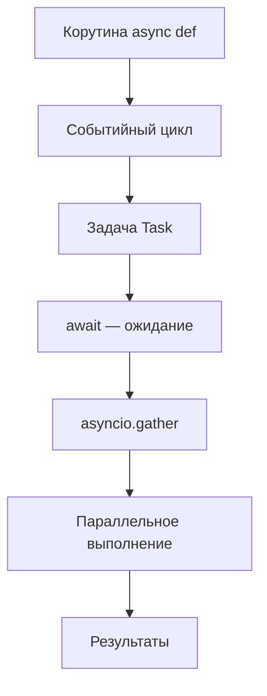

Привет! Мы уже знаем, что потоки позволяют ждать ввод-вывод параллельно. Сегодня поговорим об альтернативе — **асинхронном программировании** на `asyncio`: одном потоке, который «танцует» между задачами, пока те ждут внешние события. Научимся запускать задачи действительно параллельно, ограничивать время ожидания и ходить в сеть через `aiohttp`.

## Корутины и цикл событий

Асинхронная функция — **корутина** — объявляется через `async def`. Внутри неё можно встречать `await`: в этой точке функция отдаёт управление циклу событий и возобновляется, когда ожидаемое событие произойдёт. Весь оркестр дирижирует цикл событий — единственный поток, который крутит очередь задач.

```python
import asyncio

async def say(message, delay):
    await asyncio.sleep(delay)   # отдали управление на delay секунд
    print(message)

async def main():
    await say("Привет!", 1)
    await say("Пока!", 1)

asyncio.run(main())
```

Здесь строчки напечатаются последовательно: второй вызов начнётся только после первого. Чтобы они выполнялись одновременно, нужны задачи.

## Задачи: asyncio.create_task

Задача (`Task`) — это корутина, поставленная в очередь цикла событий. Она стартует немедленно и выполняется параллельно с остальным кодом:

```python
async def main():
    task1 = asyncio.create_task(say("Первая", 1))
    task2 = asyncio.create_task(say("Вторая", 1))
    await task1                       # ждём завершения первой
    await task2                       # ждём завершения второй
```

Теперь обе корутины «спят» одновременно, а не по очереди. Практический смысл огромен: если вместо `sleep` стоит сетевой запрос, мы ждём все ответы параллельно, а не суммируем задержки.

## Собираем результаты: gather и as_completed

Самый популярный способ запустить несколько задач и собрать их результаты — `asyncio.gather`. Он возвращает список результатов в том же порядке, в котором переданы корутины:

```python
async def load(name, delay):
    await asyncio.sleep(delay)
    return f"{name}: готово"

async def main():
    results = await asyncio.gather(
        load("первый", 2),
        load("второй", 1),
    )
    print(results)   # ['первый: готово', 'второй: готово']
```

Если результат нужен по мере готовности (а не в исходном порядке), используй `asyncio.as_completed`:

```python
async def main():
    tasks = [load(f"задача {i}", i) for i in range(1, 4)]
    for coro in asyncio.as_completed(tasks):
        print(await coro)   # в порядке завершения
```

## Тайм-ауты: wait_for и asyncio.timeout

Асинхронная программа не должна ждать медленного сервиса вечно. Классический способ — `asyncio.wait_for`:

```python
async def slow():
    await asyncio.sleep(60)

async def main():
    try:
        await asyncio.wait_for(slow(), timeout=2)
    except asyncio.TimeoutError:
        print("Слишком долго, отменяем!")
```

По истечении лимита задача отменяется, а наружу выбрасывается `asyncio.TimeoutError`. Начиная с Python 3.11 есть и контекстный менеджер `asyncio.timeout(2)`, который отменяет всё, что внутри блока.

## Блокирующий код: asyncio.to_thread

Цикл событий настолько быстр, что даже короткая блокирующая операция (синхронное чтение файла, вызов обычной функции) заморозит все задачи. Для таких случаев есть `asyncio.to_thread` — она выполняет обычную функцию в отдельном потоке, не блокируя цикл:

```python
def read_big_file(path):
    with open(path, encoding="utf-8") as f:
        return f.read()

async def main():
    text = await asyncio.to_thread(read_big_file, "big.txt")
    print(len(text))
```

Внутри это тот же `loop.run_in_executor` — генеральный способ «обхода» блокирующего кода.

## Сеть: aiohttp

Стандартных асинхронных HTTP-клиентов в Python почти нет, поэтому стандарт де-факто — сторонний пакет `aiohttp`. Установи его:

```bash
pip install aiohttp
```

Основная конструкция — сессия `ClientSession`, которую заводят один раз и переиспользуют для всех запросов:

```python
import aiohttp

async def fetch_status(session, url):
    async with session.get(url) as response:
        return url, response.status

async def main():
    urls = [
        "https://www.python.org",
        "https://github.com",
        "https://pypi.org",
    ]
    async with aiohttp.ClientSession() as session:
        tasks = [asyncio.create_task(fetch_status(session, u)) for u in urls]
        for coro in asyncio.as_completed(tasks):
            url, status = await coro
            print(f"{url} -> {status}")
```

`async with` корректно закрывает и сессию, и ответы. Теперь три сайта опрашиваются параллельно: суммарное время ≈ максимальной задержке, а не сумме.




## Итог урока

Мы разобрались, как работают корутины и цикл событий; научились запускать задачи параллельно через `create_task`, собирать результаты через `gather` и `as_completed`; ограничивать время через `wait_for`; выполнять блокирующий код через `to_thread`; ходить в сеть через `aiohttp`. Теперь практика: напишем мини-краулер.

<!--TASK-->
### Задача 1 — Последовательно или параллельно?

Напиши корутину `say(message, delay)`, которая ждёт `asyncio.sleep(delay)` и печатает `message`. В `main()` сначала дважды подряд выполни `await say("первое", 1)` и `await say("второе", 1)`, замерив общее время через `time.perf_counter()` (его можно вызывать и внутри корутины). Затем повтори запуск этих же двух сообщений, но оберни вызовы в `asyncio.create_task` и дождись обеих задач через `await`. Напечатай оба времени.

Ожидаемый вывод: первое время ≈ 2 c, второе ≈ 1 c, а строки «первое» и «второе» появятся в обоих случаях. В комментарии объясни, почему задачи вдвое быстрее.

### Задача 2 — gather собирает результаты

Создай корутину `load(name, delay)`, которая ждёт `asyncio.sleep(delay)` и возвращает строку `f"{name}: готово"`. В `main()` вызови `asyncio.gather` с тремя экземплярами `load` и разными задержками (например, 2, 1 и 3 секунды) и напечатай возвращённый список.

Ожидаемый вывод: `['первый: готово', 'второй: готово', 'третий: готово']` — строго в порядке передачи, независимо от того, кто из них завершился раньше. В комментарии поясни, почему это удобно.

### Задача 3 — as_completed: порядок завершения

Используя ту же корутину `load`, создай три задачи через `asyncio.create_task` с задержками 3, 1 и 2 секунды. Пройдись по `asyncio.as_completed(tasks)` и напечатай каждый результат по мере его готовности.

Ожидаемый вывод: три строки в порядке завершения — сначала результат с задержкой 1 c, затем 2 c, затем 3 c (этот порядок не совпадает с порядком создания задач). Сравни с Задачей 2 и объясни разницу в комментарии.

### Задача 4 — Тайм-аут через wait_for

Напиши корутину `slow()`, которая ждёт `asyncio.sleep(60)`. В `main()` оберни её вызов в `asyncio.wait_for(slow(), timeout=2)`, поймай `asyncio.TimeoutError` и напечатай строку «Слишком долго, отменяем!».

Ожидаемый вывод: эта строка появляется примерно через 2 секунды, после чего программа завершается нормально, без traceback. В комментарии объясни, что произойдёт с задачей после истечения тайм-аута.

### Задача 5 — Не блокируй цикл событий

Определи обычную синхронную функцию `heavy_work(seconds)`, которая «работает», вызвав `time.sleep(seconds)`, и возвращает строку `f"обработано за {seconds} c"`. В `main()` запусти фоновую задачу `ticker()`, которая каждые 0.1 секунды печатает «тик» (всего 12 тиков). Параллельно получи результат через `await asyncio.to_thread(heavy_work, 1)` и напечатай его. Затем дождись `ticker`.

Ожидаемый вывод: примерно десять строк «тик» до строки результата и оставшиеся тики после неё — цикл событий остаётся живым всё время. Если вместо `to_thread` вызвать `heavy_work(1)` напрямую внутри `main()`, тики остановятся на 1 секунду: проверь оба варианта и объясни разницу в комментарии.
### Задача 6 — Ограничение параллелизма семафором
Напиши программу `semaphore_demo.py`. Создай `asyncio.Semaphore(2)` и шесть корутин `fetch(i)`: каждая захватывает семафор, печатает «Загрузка i», ждёт `asyncio.sleep(1)` и печатает «Готово i». Запусти их через `asyncio.gather`. Замерь время.
Ожидаемый результат: общее время ~3 секунды (а не 6), одновременно выполняются не более двух загрузок. В комментарии объясни, зачем ограничивать параллелизм.

### Задача 7 — Тайм-аут и отмена
Напиши программу `timeout_demo.py`. Корутина `slow()` ждёт `asyncio.sleep(10)` и возвращает «медленно». Вызови её через `asyncio.wait_for(slow(), timeout=1)` и обработай `asyncio.TimeoutError` — напечатай «Тайм-аут!».
Ожидаемый вывод: `Тайм-аут!`, программа завершается примерно за 1 секунду. В комментарии объясни, что происходит с корутиной при срабатывании тайм-аута.


<!--/TASK-->

<!--HINT-->
### Подсказка 1

Для каждой части используй пару `start = time.perf_counter()` / `elapsed = time.perf_counter() - start`. Помни: обычный `await` ждёт завершения корутины, а `create_task` лишь ставит её в очередь цикла событий — поэтому в первом случае задержки складываются, а во втором выполняются одновременно.

### Подсказка 2

`asyncio.gather` принимает несколько корутин и возвращает список (кортеж) результатов в том же порядке, в котором они переданы. Заметь: между `gather` и `create_task` есть разница — `gather` сам следит за задачами, но порядок возврата всегда определяется аргументами, а не временем завершения.

### Подсказка 3

`asyncio.as_completed(tasks)` возвращает итератор корутин-обёрток: `for coro in asyncio.as_completed(tasks): print(await coro)`. Так ты получаешь первые результаты раньше, чем дождался бы самого медленного кандидата.

### Подсказка 4

Лови исключение именно `asyncio.TimeoutError` (не путай со встроенным `TimeoutError`). `wait_for` при истечении лимита отменяет задачу: она не продолжит выполняться в фоне, а наружу выбрасывается исключение, которое ты перехватываешь.

### Подсказка 5

`asyncio.to_thread` принимает обычную функцию и её позиционные аргументы: `await asyncio.to_thread(heavy_work, 1)`. Прямой вызов `heavy_work(1)` не является await-выражением: он выполняет `time.sleep(1)` прямо в цикле событий, заморозив все задачи, — сравнение двух вариантов наглядно покажет разницу.
### Подсказка 6
Семафор создаётся вне корутин: `sem = asyncio.Semaphore(2)`. Внутри каждой корутины используй `async with sem:` — блок захватит слот только если есть свободный. Замерь время через `time.perf_counter()` вокруг `asyncio.run(main())`.
### Подсказка 7
`asyncio.wait_for(awaitable, timeout)` оборачивает корутину и ограничивает время ожидания. Если дедлайн превышен — приходит исключение `asyncio.TimeoutError`, а сама корутина отменяется (cancel). Обязательно поймай исключение.

<!--/HINT-->

<!--SOLUTION-->
### Разбор 1

Полное решение:

```python
import asyncio
import time

async def say(message, delay):
    await asyncio.sleep(delay)
    print(message)

async def main():
    # 1. Последовательно
    start = time.perf_counter()
    await say("первое", 1)
    await say("второе", 1)
    print(f"Последовательно: {time.perf_counter() - start:.2f} c")

    # 2. Параллельно через задачи
    start = time.perf_counter()
    task1 = asyncio.create_task(say("первое", 1))
    task2 = asyncio.create_task(say("второе", 1))
    await task1
    await task2
    print(f"Параллельно: {time.perf_counter() - start:.2f} c")

asyncio.run(main())
```

Примерный вывод:

```
первое
второе
Последовательно: 2.00 c
первое
второе
Параллельно: 1.00 c
```

В первом блоке каждый `await say(...)` останавливает выполнение до полного завершения корутины: сначала отрабатывает первое сообщение (1 секунда), потом второе (ещё 1 секунда), итого 2 секунды. Во втором блоке `asyncio.create_task` немедленно ставит обе корутины в очередь цикла событий: они стартуют практически одновременно и «спят» параллельно, поэтому суммарное время равно максимальной задержке — 1 секунде. Разница в два раза — и это минимальный пример той выгоды, которую даёт асинхронность для задач ожидания. Обрати внимание: `await task1; await task2` ждёт завершения обеих задач, но это ожидание уже не последовательное — обе давно работают.

### Разбор 2

Полное решение:

```python
import asyncio

async def load(name, delay):
    await asyncio.sleep(delay)
    return f"{name}: готово"

async def main():
    results = await asyncio.gather(
        load("первый", 2),
        load("второй", 1),
        load("третий", 3),
    )
    print(results)

asyncio.run(main())
```

Вывод:

```
['первый: готово', 'второй: готово', 'третий: готово']
```

`asyncio.gather` принимает корутины, оборачивает их в задачи и ждёт завершения всех сразу. Результаты возвращаются в виде списка в том же порядке, в котором корутины были переданы, — независимо от того, кто из них завершился раньше. Здесь вторая задача завершится через 1 секунду, но в списке она всё равно окажется на своём месте, между первой и третьей. Такой порядок удобен, когда результат должен соответствовать входным данным: например, если мы опрашиваем URL-адреса и хотим сопоставить ответы с исходным списком. Суммарное время работы — около 3 секунд (максимальная задержка), а не 6, как было бы при последовательном ожидании.

### Разбор 3

Полное решение:

```python
import asyncio

async def load(name, delay):
    await asyncio.sleep(delay)
    return f"{name}: готово"

async def main():
    tasks = [
        asyncio.create_task(load("A", 3)),
        asyncio.create_task(load("B", 1)),
        asyncio.create_task(load("C", 2)),
    ]
    for coro in asyncio.as_completed(tasks):
        print(await coro)

asyncio.run(main())
```

Вывод:

```
B: готово
C: готово
A: готово
```

`asyncio.as_completed` возвращает итератор, который отдаёт результаты по мере завершения соответствующих задач: первой завершится задача с задержкой 1 c (B), затем 2 c (C), затем 3 c (A). Это прямо противоположно `gather`, который всегда сохраняет порядок передачи. Такой режим нужен, когда важно как можно раньше начать обрабатывать первые готовые результаты: например, показывать уже загруженные страницы, не дожидаясь самых медленных. Обрати внимание на важный нюанс: задачи создаются через `create_task` до цикла — если бы мы передавали в `as_completed` корутины, они стартовали бы только по мере итерирования.

### Разбор 4

Полное решение:

```python
import asyncio

async def slow():
    await asyncio.sleep(60)

async def main():
    try:
        await asyncio.wait_for(slow(), timeout=2)
    except asyncio.TimeoutError:
        print("Слишком долго, отменяем!")

asyncio.run(main())
```

Вывод (примерно через 2 секунды):

```
Слишком долго, отменяем!
```

`asyncio.wait_for` оборачивает корутину и накладывает лимит времени: если за `timeout` секунд результат не получен, ожидаемая задача отменяется (ей отправляется запрос на отмену), а наружу выбрасывается `asyncio.TimeoutError`. Мы ловим это исключение и превращаем его в понятное сообщение — программа завершается нормально, без traceback. Если бы `try/except` отсутствовал, исключение распространилось бы наверх и уронило программу. Важно, что отменённая задача не продолжает «фонить»: `wait_for` действительно прерывает её выполнение. Это главный инструмент защиты от зависших сервисов: любая внешняя операция должна иметь верхнюю границу времени ожидания.

### Разбор 5

Полное решение:

```python
import asyncio
import time

def heavy_work(seconds):
    time.sleep(seconds)
    return f"обработано за {seconds} c"

async def ticker():
    for _ in range(12):
        print("тик")
        await asyncio.sleep(0.1)

async def main():
    tick = asyncio.create_task(ticker())
    result = await asyncio.to_thread(heavy_work, 1)
    print(result)
    await tick

asyncio.run(main())
```

Примерный вывод:

```
тик
тик
тик
тик
тик
тик
тик
тик
тик
тик
обработано за 1 c
тик
тик
```

`asyncio.to_thread` выполняет синхронную функцию `heavy_work` в отдельном рабочем потоке (через исполнитель по умолчанию), не блокируя цикл событий. Пока `time.sleep(1)` работает в этом потоке, цикл продолжает обслуживать задачу `ticker` — мы видим примерно десять «тиков» до строки результата и оставшиеся тики после неё. Если бы мы вызвали `heavy_work(1)` напрямую внутри `main()`, цикл событий заморозился бы на целую секунду: ни одна задача не переключилась бы, и тики прекратились бы. Это ключевое правило асинхронного кода: любые блокирующие вызовы (файловые операции, тяжёлые вычисления, синхронные библиотеки) нужно выносить через `to_thread` или `run_in_executor`, иначе один «тяжёлый» участок уничтожит всю выгоду асинхронности.
### Разбор 6
```python
import asyncio
import time

sem = asyncio.Semaphore(2)

async def fetch(i):
    async with sem:
        print(f"Загрузка {i}")
        await asyncio.sleep(1)
        print(f"Готово {i}")

async def main():
    await asyncio.gather(*(fetch(i) for i in range(6)))

start = time.perf_counter()
asyncio.run(main())
print(f"Время: {time.perf_counter() - start:.1f} c")
```
Вывод показывает пары «Загрузка i», затем «Готово i», и общее время около 3 секунд. `Semaphore(2)` разрешает одновременно выполнять только две корутины: остальные ждут слота в `async with sem:`. Такой лимит важен для API с ограничением запросов и для бережного использования ресурсов. Время 3 секунды = 6 задач / 2 слота × 1 секунда.
### Разбор 7
```python
import asyncio

async def slow():
    await asyncio.sleep(10)
    return "медленно"

async def main():
    try:
        result = await asyncio.wait_for(slow(), timeout=1)
        print(result)
    except asyncio.TimeoutError:
        print("Тайм-аут!")

asyncio.run(main())
```
Вывод: `Тайм-аут!`. `wait_for` оборачивает корутину и следит за дедлайном: если лимит превышен, корутина отменяется и бросается `TimeoutError`. Это стандартная защита от «зависших» внешних обращений — API, сети, подпроцессов.

<!--/SOLUTION-->

<!--QUIZ-->
Что вернёт asyncio.gather, если все переданные корутины успешно завершились?
- Список результатов в порядке завершения
- Кортеж результатов в том же порядке, в котором были переданы задачи
- Словарь «задача: результат»
- Число выполненных задач
* Правильный ответ: Кортеж результатов в том же порядке, в котором были переданы задачи
gather сохраняет порядок передачи, а не порядок завершения. Если порядок не важен — используй as_completed.

Что произойдёт, если время ожидания превысит лимит, заданный asyncio.wait_for?
- Задача продолжит выполняться в фоне
- Будет возбуждено исключение asyncio.TimeoutError, а задача будет отменена
- Программа зависнет навсегда
- Результат станет равным None
* Правильный ответ: Будет возбуждено исключение asyncio.TimeoutError, а задача будет отменена
Тайм-аут — это способ не ждать вечно: по истечении лимита ожидание прерывается исключением.

Зачем нужна функция asyncio.to_thread?
- Чтобы превратить поток в процесс
- Чтобы выполнить блокирующую (синхронную) функцию в отдельном потоке, не блокируя цикл событий
- Чтобы ускорить вычисления за счёт нескольких ядер
- Чтобы создать поток-демон
* Правильный ответ: Чтобы выполнить блокирующую (синхронную) функцию в отдельном потоке, не блокируя цикл событий
Блокирующий вызов внутри корутины заморозил бы все остальные задачи; to_thread выносит его из цикла событий.

Что нужно сделать, чтобы несколько корутин выполнялись параллельно, а не по очереди?
- Просто вызвать их друг за другом с await
- Обернуть их в задачи через asyncio.create_task и затем дождаться их завершения
- Создать threading.Thread для каждой корутины
- Корутины всегда выполняются параллельно сами по себе
* Правильный ответ: Обернуть их в задачи через asyncio.create_task и затем дождаться их завершения
Обычный await выполняется последовательно: вторая корутина начнётся после завершения первой. Задачи позволяют им работать одновременно.

Что нужно сделать перед использованием пакета aiohttp?
- Установить его командой pip install aiohttp
- Ничего: aiohttp встроен в Python
- Импортировать threading
- Переключить Python на ветку 2.x
* Правильный ответ: Установить его командой pip install aiohttp
aiohttp — сторонний пакет, его нужно установить и затем импортировать как обычный модуль.
Что делает asyncio.run(coro)?
- Создаёт новый цикл событий, выполняет корутину до завершения и закрывает цикл
- Запускает функцию в отдельном процессе
- Превращает асинхронный код в синхронный
* Правильный ответ: Создаёт новый цикл событий, выполняет корутину до завершения и закрывает цикл
asyncio.run — точка входа в асинхронную программу: он сам управляет жизненным циклом цикла событий.

Чем задача (Task) отличается от обычной корутины?
- Задача регистрирует корутину в цикле событий и позволяет ей выполняться конкурентно с другими
- Задача выполняется быстрее корутины
- Задача не может быть отменена
* Правильный ответ: Задача регистрирует корутину в цикле событий и позволяет ей выполняться конкурентно с другими
Корутина сама по себе ничего не выполняет, пока не запущена. Задача планирует её выполнение в цикле и возвращает Future, который можно дождаться.

Что происходит, когда корутина встречает await?
- Она приостанавливается и передаёт управление циклу событий, который может выполнить другие задачи
- Программа немедленно завершается
- Цикл событий останавливается навсегда
* Правильный ответ: Она приостанавливается и передаёт управление циклу событий, который может выполнить другие задачи
await — точка уступки: пока ожидается результат, цикл событий занят другими готовыми корутинами. Именно так достигается конкурентность.
Что делает asyncio.Semaphore(2)?
- Ограничивает число одновременно выполняющихся корутин
- Запрещает выполнение вторых await
- Ускоряет sleep
- Создаёт два события
* Правильный ответ: Ограничивает число одновременно выполняющихся корутин
Семафор выдаёт ограниченное число «слотов»; остальные ожидают async with sem:.

Что случится с корутиной при срабатывании wait_for(timeout)?
- Она отменяется, и бросается TimeoutError
- Она продолжит работу в фоне
- Она вернёт None
- Она перезапустится
* Правильный ответ: Она отменяется, и бросается TimeoutError
wait_for отменяет задачу по истечении тайм-аута, чтобы фоновая работа не висела.

Зачем нужен asyncio.gather?
- Запустить несколько корутин и дождаться всех результатов
- Отменить все корутины
- Выполнить их последовательно
- Замерять скорость
* Правильный ответ: Запустить несколько корутин и дождаться всех результатов
gather принимает несколько awaitable-объектов и возвращает их результаты вместе.

Что такое корутина?
- Функция, объявленная через async def, способная приостанавливаться на await
- Поток
- Процесс
- Класс
* Правильный ответ: Функция, объявленная через async def, способная приостанавливаться на await
Корутина — основной строительный блок асинхронного кода: await передаёт управление событийному циклу.

# 
<!--/QUIZ-->
