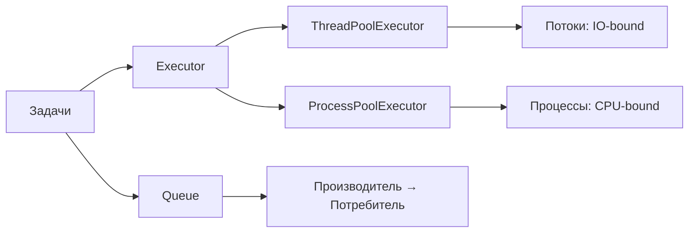

Привет! На прошлых уроках мы создавали потоки и процессы вручную, а это достаточно многословно. Сегодня познакомимся с высокоуровневым модулем `concurrent.futures`, который прячет рутину: **пулы** потоков и процессов. А ещё разберём потокобезопасную очередь `queue.Queue` — незаменимый инструмент для передачи работы между потоками.

## Зачем нужны пулы

Создание потока или процесса — дорогая операция. Если задач тысячи, плодить по потоку на каждую неразумно. Пул — это «фабрика» фиксированного числа рабочих: задачи ставятся в очередь и разбираются свободными работниками. Модуль `concurrent.futures` предоставляет два класса — `ThreadPoolExecutor` (потоки) и `ProcessPoolExecutor` (процессы).

## ThreadPoolExecutor

Начнём с самого простого использования — метод `submit` принимает функцию и аргументы, возвращает объект `Future` — «обещание» результата:

```python
from concurrent.futures import ThreadPoolExecutor

def load_page(url):
    return f"{url}: загружено"

urls = ["https://python.org", "https://github.com", "https://pypi.org"]

with ThreadPoolExecutor(max_workers=3) as pool:
    future = pool.submit(load_page, urls[0])
    print(future.result())   # блокирует до получения результата
```

Форма `with` удобна: при выходе пул закрывается и ждёт завершения всех задач. Бывает, что нужно запустить много однотипных задач — используй `map`, он применяет функцию ко всем элементам и сохраняет порядок результатов:

```python
with ThreadPoolExecutor(max_workers=3) as pool:
    for result in pool.map(load_page, urls):
        print(result)
```

`map` блокирует поток между результатами: следующий результат ждётся, пока предыдущий не получен. Если порядок не важен, лучше `submit` + `as_completed`:

```python
from concurrent.futures import as_completed

with ThreadPoolExecutor(max_workers=3) as pool:
    futures = [pool.submit(load_page, url) for url in urls]
    for future in as_completed(futures):
        print(future.result())   # по мере готовности
```

Что важно знать про `Future.result()`: если в задаче произошло исключение, оно будет возбуждено заново именно здесь — в вызывающем коде. Так ошибки не теряются.

## ProcessPoolExecutor

Всё сказанное верно и для процессов, с той лишь разницей, что процессы обходят GIL и реально используют несколько ядер. Для CPU-bound задач — например, расчёта:

```python
from concurrent.futures import ProcessPoolExecutor

def heavy_sum(n):
    total = 0
    for i in range(n):
        total += i % 7
    return total

with ProcessPoolExecutor(max_workers=4) as pool:
    results = list(pool.map(heavy_sum, [7_000_000] * 4))
print(results)
```

Аргументы и результаты передаются между процессами через сериализацию, поэтому функция и её аргументы должны «пиклиться» (то есть быть обычными значениями или функциями верхнего уровня — не лямбдами и не методами классов).

## queue.Queue: потокобезопасная очередь

Очередь `queue.Queue` — стандартный инструмент для организации работы по схеме «производитель–потребитель»: одни потоки производят задания, другие потребляют. Очередь потокобезопасна: её можно читать и писать из разных потоков без дополнительных блокировок.

```python
import queue
import threading
import time

q = queue.Queue(maxsize=5)   # максимум 5 элементов в очереди

def producer():
    for i in range(10):
        q.put(i)
        print(f"Положил {i}")
        time.sleep(0.1)

def consumer():
    while True:
        item = q.get()
        if item is None:       # сигнал остановки
            break
        print(f"Обработал {item}")
        q.task_done()          # сообщаем, что элемент обработан
```

Основные методы: `put` (положить, ждёт места, если очередь полна), `get` (забрать, ждёт элемента, если очередь пуста), `task_done` (отметить обработку), `join` (ждать, пока все добавленные элементы не будут помечены `task_done`). Сигнал остановки — условность: часто кладут `None` или другой маркер; потребители проверяют его и завершают цикл. Важный нюанс: если потребителей несколько, маркеров должно быть столько же, сколько потребителей — иначе часть из них навсегда останется ждать.

Есть вариации: `queue.LifoQueue` (последним пришёл — первым ушёл) и `queue.PriorityQueue` (элементы с меньшим приоритетом достаются раньше).

## Комбинируем: пулы + очередь

На практике пулы и очереди часто работают вместе: пул потоков может скачивать страницы и складывать их в очередь для дальнейшей обработки, а пул процессов параллельно обрабатывает уже скачанное. Такая схема позволяет строить гибкие конвейеры.




## Итог урока

Мы выучили `ThreadPoolExecutor` и `ProcessPoolExecutor`: `submit`, `map`, `as_completed`, работу с `Future`; поняли, когда выбирать пул потоков, а когда — процессов. Разобрали очередь `queue.Queue` и её вариации, а также схему «производитель–потребитель» с сигналом остановки. Теперь соберём всё вместе.

<!--TASK-->
### Задача 1 — submit и Future.result()

Напиши функцию `load_page(url)`, которая печатает «Загружаю <url>», спит 0.2 секунды (`time.sleep(0.2)`) и возвращает строку `f"{url}: загружено"`. С помощью `ThreadPoolExecutor(max_workers=2)` отправь три URL методом `submit` и напечатай результат каждого `future.result()`.

Ожидаемый вывод: строки «Загружаю …» для трёх URL и три строки вида «https://python.org: загружено». В комментарии объясни, что делает `result()` и почему исключения из задач всплывают именно в этой точке.

### Задача 2 — map сохраняет порядок

Создай функцию `fetch(url, delay)`, которая спит `delay` секунд и возвращает `f"{url}: {delay}c"`. Запусти через `pool.map(fetch, urls, delays)` три пары «URL + задержка» (например, задержки 0.5, 0.1 и 0.3 секунды) и напечатай результаты.

Ожидаемый вывод: три строки в том же порядке, что и входные данные: сначала 0.5c, затем 0.1c, затем 0.3c, — несмотря на то что задача с 0.1c завершается первой. В комментарии объясни, чем `map` отличается от `submit` + `as_completed`.

### Задача 3 — as_completed: по мере готовности

Используя ту же функцию `fetch`, отправь три задачи через `submit` с задержками 0.5, 0.1 и 0.3 секунды. Обработай результаты через `concurrent.futures.as_completed(futures)` и напечатай их.

Ожидаемый вывод: три строки в порядке завершения: сначала результат с задержкой 0.1c, затем 0.3c, затем 0.5c. Сравни с Задачей 2 и объясни разницу в комментарии.

### Задача 4 — Производитель–потребитель на queue.Queue

Построй конвейер из двух очередей `queue.Queue()`: в первую (`jobs`) производитель кладёт числа от 0 до 9, во вторую (`results_q`) работники кладут результаты. Три потока-работника в бесконечном цикле берут число из `jobs`, считают его квадрат и кладут в `results_q`; получив маркер `None`, они завершаются. После всех чисел производитель кладёт три маркера `None` (по одному на работника). Главный поток дожидается работников через `join()` и печатает отсортированные результаты.

Ожидаемый вывод: `[0, 1, 4, 9, 16, 25, 36, 49, 64, 81]`. В комментарии объясни, зачем нужны маркеры и почему их должно быть столько же, сколько работников.

### Задача 5 — Пулы процессов для вычислений

Определи функцию верхнего уровня `heavy_sum(n)`, возвращающую `sum(range(n))`. Через `ProcessPoolExecutor(max_workers=4)` посчитай `heavy_sum(10_000_000)` четырьмя процессами параллельно (используй `pool.map`) и напечатай список результатов и первый элемент списка.

Ожидаемый вывод: список из четырёх одинаковых чисел `[49999995000000, 49999995000000, 49999995000000, 49999995000000]` и затем само число `49999995000000`. В комментарии объясни, почему значения совпадают и почему `heavy_sum` должна быть функцией верхнего уровня.
### Задача 6 — Процессный пул для вычислений
Напиши программу `process_pool_executor.py`. Используй `concurrent.futures.ProcessPoolExecutor(max_workers=4)`: запусти задачу `count_primes(n)` — подсчёт количества простых чисел до n (например, через перебор делителей для каждого числа). Выполни её для значений [100000, 200000, 300000, 400000] через `executor.map` и напечатай результаты.
Ожидаемый результат: четыре числа (количество простых чисел до каждого n). В комментарии объясни, почему именно ProcessPoolExecutor подходит для этой CPU-bound задачи.

### Задача 7 — Producer-Consumer на очереди
Напиши программу `queue_pc.py`. Создай `queue.Queue()`. Два потока-производителя кладут в очередь числа 0..19 (каждый свою половину), а два потока-потребителя забирают их и считают сумму. Дождись завершения всех потоков и напечатай итоговую сумму и длину очереди после обработки.
Ожидаемый результат: сумма 190, очередь пуста. В комментарии объясни, почему Queue безопасна для многопоточного доступа.


<!--/TASK-->

<!--HINT-->
### Подсказка 1

`submit` сразу возвращает `Future` — объект-«обещание» результата. Сам результат получают через `future.result()`, который блокирует поток до готовности. Помни: `max_workers=2` означает, что одновременно работают только два потока, а третья задача подождёт своей очереди.

### Подсказка 2

`pool.map(fn, iterable1, iterable2)` применяет функцию к элементам нескольких итерируемых попарно: `pool.map(fetch, urls, delays)`. Итоговая последовательность сохраняет порядок входных данных; внутри она блокируется между результатами — следующий результат ждётся только после предыдущего.

### Подсказка 3

`as_completed(futures)` возвращает итератор, который отдаёт `Future` в порядке их завершения: `for future in as_completed(futures): print(future.result())`. Так первые результаты появляются раньше самых медленных — прямое отличие от `map`.

### Подсказка 4

Работник: `number = jobs.get()`, затем `if number is None: break`, обработка и `results_q.put(number * number)`. Маркеров `None` должно быть ровно столько, сколько работников: если положить меньше, часть потоков навсегда останется ждать в `jobs.get()`.

### Подсказка 5

`ProcessPoolExecutor` сериализует аргументы и функцию, поэтому `heavy_sum` обязана быть функцией верхнего уровня (не лямбдой и не методом). `pool.map(heavy_sum, [10_000_000] * 4)` вернёт четыре одинаковых результата — выведи список и `results[0]`.
### Подсказка 6
`ProcessPoolExecutor` создаёт пул процессов, а `executor.map(func, values)` распределяет задачи. Внутри функции НЕ создавай пул повторно; используй обычный цикл. Возвращаемые значения — обычные Python-объекты: пул сам выполняет сериализацию.
### Подсказка 7
`queue.Queue()` уже потокобезопасна: `put()` и `get()` можно вызывать из любых потоков. Когда потребитель забирает элемент, добавь его к общей сумме под `threading.Lock` или через локальную сумму каждого потребителя с последующим суммированием.

<!--/HINT-->

<!--SOLUTION-->
### Разбор 1

Полное решение:

```python
import time
from concurrent.futures import ThreadPoolExecutor

def load_page(url):
    print(f"Загружаю {url}")
    time.sleep(0.2)
    return f"{url}: загружено"

with ThreadPoolExecutor(max_workers=2) as pool:
    futures = [pool.submit(load_page, url) for url in
               ["https://python.org", "https://github.com", "https://pypi.org"]]
    for future in futures:
        print(future.result())
```

`submit` немедленно возвращает объект `Future` — «обещание» будущего результата, а сама задача ставится в очередь пула. Так как `max_workers=2`, одновременно работают только два потока: третья задача стартует, как только освободится один из них. Метод `result()` блокирует вызывающий поток до тех пор, пока задача не завершится, и возвращает её результат. Именно в этой точке повторно возбуждаются исключения из задач: если внутри `load_page` что-то упадёт, программа увидит ошибку здесь, а не потеряет её молча. Контекстный менеджер `with` по выходу закрывает пул и ждёт завершения всех поданных задач. Порядок печати «Загружаю …» может меняться — потоки конкурируют, — но результаты выводятся в порядке списка `futures`.

### Разбор 2

Полное решение:

```python
import time
from concurrent.futures import ThreadPoolExecutor

def fetch(url, delay):
    time.sleep(delay)
    return f"{url}: {delay}c"

urls = ["первый", "второй", "третий"]
delays = [0.5, 0.1, 0.3]

with ThreadPoolExecutor(max_workers=3) as pool:
    for result in pool.map(fetch, urls, delays):
        print(result)
```

Вывод:

```
первый: 0.5c
второй: 0.1c
третий: 0.3c
```

`pool.map(fetch, urls, delays)` принимает функцию и несколько итерируемых, из которых берутся аргументы попарно: `fetch("первый", 0.5)`, `fetch("второй", 0.1)`, `fetch("третий", 0.3)`. Задачи запускаются параллельно, но итерация по результатам сохраняет порядок входных данных: первым всегда печатается результат первой задачи, даже если она завершилась последней. Внутри `map` блокируется между результатами — следующий результат ждётся, пока предыдущий не будет получен, поэтому мы видим строки строго во входном порядке. Это удобно, когда результат должен соответствовать запросу: например, при обработке списка файлов или URL, когда важно знать, какой результат к какому входу относится.

### Разбор 3

Полное решение:

```python
import time
from concurrent.futures import ThreadPoolExecutor, as_completed

def fetch(url, delay):
    time.sleep(delay)
    return f"{url}: {delay}c"

with ThreadPoolExecutor(max_workers=3) as pool:
    futures = [pool.submit(fetch, url, delay) for url, delay in
               zip(["первый", "второй", "третий"], [0.5, 0.1, 0.3])]
    for future in as_completed(futures):
        print(future.result())
```

Вывод:

```
второй: 0.1c
третий: 0.3c
первый: 0.5c
```

`as_completed(futures)` возвращает итератор, который отдаёт объекты `Future` в порядке их завершения, а не в порядке создания. Поэтому первым печатается результат задачи с минимальной задержкой (0.1 c), затем с задержкой 0.3 c и только потом — с 0.5 c. Это обратная логика по сравнению с `map`: здесь мы жертвуем соответствием порядку входных данных, но зато получаем результаты по мере готовности и можем начать их обрабатывать, не дожидаясь самого медленного участника. Такой режим идеален, когда порядок не важен, а ценна скорость: например, когда нужно как можно быстрее собрать первые N готовых ответов.

### Разбор 4

Полное решение:

```python
import queue
import threading

jobs = queue.Queue()
results_q = queue.Queue()
WORKERS = 3

def worker():
    while True:
        number = jobs.get()
        if number is None:
            break
        results_q.put(number * number)

for n in range(10):
    jobs.put(n)
for _ in range(WORKERS):
    jobs.put(None)

threads = [threading.Thread(target=worker) for _ in range(WORKERS)]
for t in threads:
    t.start()
for t in threads:
    t.join()

results = []
while not results_q.empty():
    results.append(results_q.get())
print(sorted(results))
```

Вывод:

```
[0, 1, 4, 9, 16, 25, 36, 49, 64, 81]
```

Обе очереди потокобезопасны, поэтому их можно спокойно читать и писать из разных потоков. Производитель кладёт десять чисел, а затем — по одному маркеру `None` на каждого из трёх работников. Каждый работник в бесконечном цикле берёт число из `jobs`, считает квадрат и кладёт его в `results_q`; когда он достаёт `None`, он выходит из цикла, и поток завершается. Маркеров должно быть ровно столько же, сколько работников: если положить меньше, часть потоков навсегда останется ждать в `jobs.get()`, и `join()` никогда не вернёт управление. После завершения всех потоков главный поток собирает результаты и сортирует их: порядок попадания квадратов в `results_q` случаен, ведь работники конкурируют. Обрати внимание: `None` — лишь условный маркер; главное, чтобы он не мог встретиться как настоящие данные.

### Разбор 5

Полное решение:

```python
from concurrent.futures import ProcessPoolExecutor

def heavy_sum(n):
    return sum(range(n))

if __name__ == "__main__":
    with ProcessPoolExecutor(max_workers=4) as pool:
        results = list(pool.map(heavy_sum, [10_000_000] * 4))
    print(results)
    print(results[0])
```

Вывод:

```
[49999995000000, 49999995000000, 49999995000000, 49999995000000]
49999995000000
```

`ProcessPoolExecutor` создаёт четыре процесса, каждый из которых считает `sum(range(10_000_000))`. Сумма арифметической прогрессии от 0 до 9 999 999 равна `n * (n - 1) / 2 = 10_000_000 * 9_999_999 / 2 = 49_999_995_000_000`. Так как функция детерминирована и не зависит от порядка выполнения, все четыре результата совпадают; `map` сохраняет порядок, поэтому `results[0]` равен любому другому элементу. Аргументы и результаты передаются между процессами через сериализацию (pickle), поэтому `heavy_sum` обязана быть функцией верхнего уровня: лямбды и методы классов сериализовать нельзя. Благодаря отсутствию GIL у процессов четыре ядра работают по-настоящему параллельно, и суммарное время близко ко времени одного вызова. Конструкция `if __name__ == "__main__":` обязательна по тем же причинам, что и в `multiprocessing`, — при spawn-запуске процессов скрипт перезапускается.
### Разбор 6
```python
from concurrent.futures import ProcessPoolExecutor

def count_primes(n):
    count = 0
    for num in range(2, n + 1):
        if all(num % d for d in range(2, int(num ** 0.5) + 1)):
            count += 1
    return count

values = [100000, 200000, 300000, 400000]
with ProcessPoolExecutor(max_workers=4) as executor:
    results = list(executor.map(count_primes, values))
print(results)
```
Вывод: например, `[9592, 17984, 25997, 33860]`. Подсчёт простых чисел — тяжёлая вычислительная работа, поэтому несколько процессов реально используют ядра (в отличие от потоков с GIL). `ProcessPoolExecutor.map` возвращает результаты в порядке входов. Внутри функции можно использовать только пересылаемые объекты: пул сериализует аргументы и результаты через pickle.
### Разбор 7
```python
import threading
import queue

q = queue.Queue()
total = 0
total_lock = threading.Lock()

def producer(start):
    for i in range(start, start + 10):
        q.put(i)

def consumer():
    global total
    while True:
        try:
            item = q.get(timeout=1)
        except queue.Empty:
            return
        with total_lock:
            total += item
        q.task_done()

threads = []
threads.append(threading.Thread(target=producer, args=(0,)))
threads.append(threading.Thread(target=producer, args=(10,)))
for _ in range(2):
    threads.append(threading.Thread(target=consumer))
for t in threads:
    t.start()
for t in threads:
    t.join()

print("Сумма:", total)
print("Очередь пуста:", q.empty())
```
Вывод: `Сумма: 190`, `Очередь пуста: True`. `queue.Queue` — потокобезопасна: внутри неё блокировки, поэтому производители и потребители не мешают друг другу. Потребители берут элемент через `get(timeout=1)` и, если очередь опустела, выходят из цикла. Сумму защищает отдельный `Lock`, потому что `+=` не атомарно.

<!--/SOLUTION-->

<!--QUIZ-->
В чём разница между ThreadPoolExecutor и ProcessPoolExecutor?
- ThreadPoolExecutor использует потоки одного процесса (общая память, но GIL), ProcessPoolExecutor — отдельные процессы (нет GIL, но выше накладные расходы)
- Никакой разницы нет
- ThreadPoolExecutor работает только на Windows
- ProcessPoolExecutor быстрее для IO-bound задач
* Правильный ответ: ThreadPoolExecutor использует потоки одного процесса (общая память, но GIL), ProcessPoolExecutor — отдельные процессы (нет GIL, но выше накладные расходы)
Для CPU-bound задач выбирают пул процессов, для IO-bound — пул потоков: он легче и дешевле.

Что делает метод Future.result()?
- Запускает задачу заново
- Блокирует поток до получения результата; если в задаче было исключение — пробрасывает его здесь
- Отменяет задачу
- Возвращает количество оставшихся задач
* Правильный ответ: Блокирует поток до получения результата; если в задаче было исключение — пробрасывает его здесь
result() — единственная точка, где можно узнать результат задачи; исключения из задачи всплывают именно здесь.

Что произойдёт, если в задаче пула возникнет необработанное исключение?
- Программа сразу упадёт
- Исключение сохранится внутри Future и будет возбуждено повторно в вызывающем коде при вызове result()
- Исключение молча проигнорируется
- Пул автоматически перезапустится
* Правильный ответ: Исключение сохранится внутри Future и будет возбуждено повторно в вызывающем коде при вызове result()
Ошибка не теряется: она ждёт, пока её не запросят через result().

Зачем вызывается q.task_done() после обработки элемента из queue.Queue?
- Чтобы удалить элемент из очереди
- Чтобы сообщить очереди, что элемент обработан; это позволяет методу join() дождаться обработки всех элементов
- Чтобы остановить очередь
- Чтобы добавить элемент обратно
* Правильный ответ: Чтобы сообщить очереди, что элемент обработан; это позволяет методу join() дождаться обработки всех элементов
task_done() отмечает завершение обработки; метод join() ждёт, пока таких отметок не станет столько же, сколько было добавлений.

Как корректно остановить бесконечный цикл потребителя, который читает из очереди по q.get()?
- Положить в очередь специальное маркерное значение (например, None) и проверять его
- Вызвать q.close()
- Убить процесс
- Вызвать sys.exit() из другого потока
* Правильный ответ: Положить в очередь специальное маркерное значение (например, None) и проверять его
Это идиоматический способ завершить потребителя: он сам увидит маркер и выйдет из цикла, не оставив очередь в несогласованном состоянии.
Для чего служит параметр max_workers у пула?
- Ограничивает максимальное число одновременно выполняемых задач
- Задаёт размер очереди задач
- Указывает максимальную длину результата
* Правильный ответ: Ограничивает максимальное число одновременно выполняемых задач
max_workers определяет, сколько потоков (или процессов) создаст пул: лишние задачи ждут в очереди свободного воркера.

Что возвращает executor.submit(fn, arg) сразу после вызова?
- Объект Future, который ещё может быть не завершён
- Финальный результат функции fn
- None
* Правильный ответ: Объект Future, который ещё может быть не завершён
submit возвращается сразу и даёт Future. Результат получают позже через result(), а задача тем временем выполняется в фоне.

Что возвращает executor.map(fn, seq)?
- Итератор результатов в том же порядке, что и элементы последовательности
- Словарь «элемент: результат»
- Список завершённых задач
* Правильный ответ: Итератор результатов в том же порядке, что и элементы последовательности
map применяет функцию ко всем элементам и отдаёт результаты в исходном порядке — удобно, когда порядок важен.
Почему ProcessPoolExecutor ускоряет CPU-bound задачи, а ThreadPoolExecutor нет?
- Процессы имеют отдельные GIL и используют несколько ядер
- Потоки запрещены в Python
- Процессы быстрее создаются
- Потоки потребляют больше памяти
* Правильный ответ: Процессы имеют отдельные GIL и используют несколько ядер
У каждого процесса свой интерпретатор, поэтому вычисления идут параллельно.

Что гарантирует queue.Queue?
- Потокобезопасные put/get без ручных блокировок
- Автоматическую сортировку элементов
- Ограничение размера очереди по умолчанию
- Ускорение get
* Правильный ответ: Потокобезопасные put/get без ручных блокировок
Queue внутри использует блокировки: производители и потребители могут работать одновременно.

Зачем вызовать task_done() в потребителе?
- Чтобы join() очереди знал о завершении обработки всех элементов
- Чтобы освободить память
- Чтобы ускорить очередь
- Чтобы остановить производителей
* Правильный ответ: Чтобы join() очереди знал о завершении обработки всех элементов
task_done() уменьшает счётчик незавершённых задач: q.join() ждёт его нуля.

Какой пул выбрать для параллельного скачивания 50 страниц?
- ThreadPoolExecutor: ожидание сети освобождает ресурсы
- ProcessPoolExecutor: он всегда быстрее
- Оба одинаковы
- Свои процессы на каждую страницу
* Правильный ответ: ThreadPoolExecutor: ожидание сети освобождает ресурсы
IO-bound задачи хорошо обслуживают потоки: GIL не мешает ожиданию.

# 
<!--/QUIZ-->
