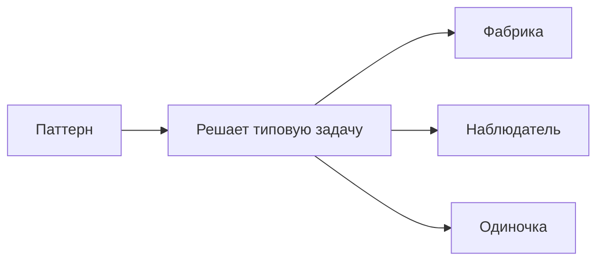

Паттерн проектирования — это **проверенное решение типовой задачи**. Не готовый код, а схема: «когда у тебя проблема X, структурируй классы вот так». Изучать их стоит не ради названий, а ради того, чтобы видеть в своих задачах повторяющиеся формы и решать их надёжным способом. Паттерны делят на три группы: **порождающие** (как создавать объекты), **структурные** (как строить отношения между классами) и **поведенческие** (как объекты общаются). Разберём по одному яркому представителю каждой группы.

## Фабричный метод (порождающий)

Когда создание объекта требует логики («создай отчёт нужного формата»), а не просто `ClassName()`, выноси создание в отдельную функцию или класс. Это фабрика:

```python
class Report:
    def render(self) -> str:
        raise NotImplementedError


class PdfReport(Report):
    def render(self) -> str:
        return "PDF: содержимое отчёта"


class HtmlReport(Report):
    def render(self) -> str:
        return "<html>содержимое</html>"


def report_factory(kind: str) -> Report:
    factories = {"pdf": PdfReport, "html": HtmlReport}
    try:
        return factories[kind]()
    except KeyError:
        raise ValueError(f"Неизвестный формат: {kind}") from None


print(report_factory("pdf").render())
```

Польза: место создания объектов собрано в одном месте. Добавил новый формат — добавил класс и одну строку в словарь. Остальной код не меняется.

## Стратегия (поведенческий)

Стратегия — это «вынести изменяющийся алгоритм в отдельный объект». Классический пример — расчёт стоимости доставки: способ доставки меняется, а процесс оформления заказа — нет.

```python
from abc import ABC, abstractmethod


class DeliveryStrategy(ABC):
    @abstractmethod
    def cost(self, distance_km: float) -> float:
        ...


class CourierDelivery(DeliveryStrategy):
    BASE = 150.0

    def cost(self, distance_km: float) -> float:
        return self.BASE + distance_km * 20


class PostDelivery(DeliveryStrategy):
    RATE = 30.0

    def cost(self, distance_km: float) -> float:
        return max(120.0, distance_km * self.RATE)


class PickupDelivery(DeliveryStrategy):
    def cost(self, distance_km: float) -> float:
        return 0.0


def order_cost(distance_km: float, method: DeliveryStrategy) -> float:
    return method.cost(distance_km)
```

Ключевая идея — **композиция вместо наследования**: вместо того чтобы плодить классы `CourierOrder`, `PostOrder`, мы передаём стратегию объекту заказа. Менять поведение можно на лету, а новые способы доставки добавляются без правки существующего кода. Это же паттерн лежит в основе `sorted(key=...)` — критерий сортировки передаётся как «стратегия».

## Наблюдатель (поведенческий)

Когда одно событие должно «разбудить» несколько независимых объектов, используют наблюдателя: центральный субъект хранит список подписчиков и уведомляет их:

```python
class EventBus:
    def __init__(self) -> None:
        self._observers = []

    def attach(self, observer) -> None:
        self._observers.append(observer)

    def notify(self, event: str) -> None:
        for observer in self._observers:
            observer.update(event)


class EmailNotifier:
    def update(self, event: str) -> None:
        print(f"[email] Событие: {event}")


class Logger:
    def update(self, event: str) -> None:
        print(f"[log] {event}")


bus = EventBus()
bus.attach(EmailNotifier())
bus.attach(Logger())
bus.notify("пользователь зарегистрировался")
```

Субъект не знает, кто именно подписан, — он просто зовёт `update()`. Поэтому новых подписчиков добавляют, не трогая `EventBus`. В стандартной библиотеке такой же принцип используют события в GUI-фреймворках и системах рассылки.

## Singleton и его подводный камень

Паттерн Singleton (единственный экземпляр класса) известен всем, но в Python он чаще всего не нужен: **модуль уже является синглтоном**. Переменная на уровне модуля импортируется один раз и живёт весь процесс. Порой Singleton усложняет тестирование и прячет глобальное состояние — прежде чем вводить его, подумай, не решается ли задача модулем или явной передачей объекта.



## Итог урока

Фабрика управляет созданием объектов, стратегия подменяет алгоритмы, наблюдатель рассылает события, а Singleton в Python часто лишний. Общая мысль: паттерны — это не «магические формулы», а способы сделать код расширяемым и тестируемым. Теперь собери свой мини-проект со стратегией.

<!--TASK-->
### Задача 1
Создай файл `delivery.py` — систему расчёта доставки магазина. Требования:

1. Абстрактный класс `DeliveryStrategy` с методом `cost(distance_km: float) -> float`.
2. Три конкретные стратегии: `CourierDelivery` (150 + 20 за км), `PostDelivery` (максимум из 120 и 30 за км), `PickupDelivery` (0).
3. Словарь `STRATEGIES` с готовыми экземплярами стратегий.
4. Функция `order_cost(distance_km: float, method: str) -> float`, которая выбирает стратегию по имени из словаря.
5. В `main()` прочитай с клавиатуры расстояние и способ доставки, выведи стоимость.

Ожидаемый вывод:

```
Расстояние (км): 10
Способ (courier / post / pickup): post
Стоимость доставки: 300.0 руб.
```

Дополнительно: добавь четвёртую стратегию (например, экспресс-курьера с бóльшим коэффициентом) — и покажи, что для этого не пришлось менять `order_cost`.

### Задача 2
Создай файл `reports.py` — фабрику отчётов. Реализуй базовый класс `Report` с абстрактным методом `render() -> str` и три наследника: `PdfReport` (возвращает `"PDF: <текст>"`), `HtmlReport` (`"<html><body><текст></body></html>"`), `JsonReport` (`'{"text": "<текст>"}'`). Функция `report_factory(kind: str, text: str) -> Report` выбирает класс по имени из словаря, а для неизвестного формата бросает `ValueError` с сообщением. В `main()` выведи render каждого из трёх форматов, а также перехвати исключение для `report_factory("xml", "привет")`. Ожидаемый вывод:

```
PDF: отчёт
<html><body>отчёт</body></html>
{"text": "отчёт"}
ValueError: Неизвестный формат: xml
```

### Задача 3
Создай файл `events.py` — наблюдателя с отпиской. Реализуй `EventBus` с методами `attach(observer)`, `detach(observer)` и `notify(event)`. Создай наблюдателей: `EmailNotifier` (печатает `[email] <событие>`), `SmsNotifier` (`[sms] <событие>`), `Logger` (`[log] <событие>`). В `main()` подпиши всех троих, вызови `notify("user_login")`, затем отпиши `Logger` и вызови `notify("user_logout")`. Ожидаемый вывод:

```
[email] user_login
[sms] user_login
[log] user_login
[email] user_logout
[sms] user_logout
```

### Задача 4
Создай файл `settings.py`, который показывает разницу между паттерном Singleton и модульным подходом. 1) Реализуй класс `Settings` с приватным конструктором через `__new__`: любые два вызова `Settings()` должны возвращать один и тот же объект. Проверь и выведи `Settings() is Settings()`. 2) В том же модуле заведи «модульный синглтон» — переменную `settings = {}` на уровне модуля и функции `set_option(key, value)` / `get_option(key)`. Покажи, что импорт модуля из любого другого файла даёт тот же самый словарь. Ожидаемый вывод:

```
Settings() is Settings(): True
option theme = dark
```

### Задача 5
Создай файл `discounts.py` — стратегию скидок в связке с фабрикой. Определи абстрактный класс `DiscountStrategy` с методом `apply(price: float) -> float`. Реализуй `RegularDiscount` (без скидки), `SeasonalDiscount` (10%), `LoyaltyDiscount` (15%). Словарь `DISCOUNTS` с экземплярами. Функция `final_price(price: float, kind: str) -> float` берёт стратегию из словаря и применяет её. Затем добавь `BlackFridayDiscount` (30%) и покажи, что `final_price` менять не пришлось. В `main()` выведи цену 1000 для каждой стратегии. Ожидаемый вывод:

```
regular: 1000.0
seasonal: 900.0
loyalty: 850.0
black_friday: 700.0
```

### Задача 6 — Фабричный метод
Создай классы `EmailNotifier` и `SmsNotifier` с методом `send(message)`, и фабрику `create_notifier(kind)`, возвращающую нужный объект. Проверь обе ветки. Ожидаемый результат: фабрика возвращает экземпляр нужного класса.
### Задача 7 — Наблюдатель
Реализуй простой событийный класс `Event`: методы `subscribe(fn)` и `emit(*args)`. Подпиши две функции, вызови emit и убедись, что обе вызвались с аргументами.

<!--/TASK-->

<!--HINT-->
### Подсказка 1
Начни с абстрактного класса по образцу из теории. Словарь стратегий держи на уровне модуля: `STRATEGIES = {"courier": CourierDelivery(), "post": PostDelivery(), "pickup": PickupDelivery()}`. В `order_cost` бери стратегию из словаря, а для неизвестного имени бросай `ValueError`. Экспресс-доставку добавь как новый класс и новую запись словаря.

### Подсказка 2
В фабрике используй словарь «имя → класс» и создавай экземпляр через `factories[kind](text)` — классы принимают текст в конструкторе. Для `JsonReport` собери строку через f-строку с экранированием фигурных скобок: `f'{{"text": "{text}"}}'`. Перехват исключения делай через `try/except ValueError` вокруг вызова `report_factory`.

### Подсказка 3
`detach` должен удалять наблюдателя из списка: `self._observers.remove(observer)`. Перед `remove` можно проверить `if observer in self._observers:`. События передавай строкой, а наблюдатели просто печатают свой префикс и событие. Порядок вывода определяется порядком подписки.

### Подсказка 4
Чтобы сделать Singleton, переопредели `__new__`: храни единственный экземпляр в атрибуте класса, например `_instance`. Если `_instance is None` — создавай новый, иначе возвращай существующий. Для модульного подхода просто заведи переменную на уровне модуля: `settings = {}` — она одна на весь процесс.

### Подсказка 5
Построй всё на одном каркасе: абстрактный класс наследует `ABC` и декорируется `@abstractmethod`. Каждая конкретная стратегия возвращает `price * (1 - percent / 100)`. Для новой скидки достаточно добавить класс и строку в `DISCOUNTS` — `final_price` работает со словарём, поэтому не меняется.
### Подсказка 6
Фабрика — функция или класс с if/elif по параметру.
### Подсказка 7
Храни список функций; emit вызывает каждую.

<!--/HINT-->

<!--SOLUTION-->
### Разбор 1
Одно из возможных решений:

```python
from abc import ABC, abstractmethod


class DeliveryStrategy(ABC):
    @abstractmethod
    def cost(self, distance_km: float) -> float:
        ...


class CourierDelivery(DeliveryStrategy):
    BASE = 150.0
    PER_KM = 20.0

    def cost(self, distance_km: float) -> float:
        return self.BASE + distance_km * self.PER_KM


class PostDelivery(DeliveryStrategy):
    MIN_COST = 120.0
    PER_KM = 30.0

    def cost(self, distance_km: float) -> float:
        return max(self.MIN_COST, distance_km * self.PER_KM)


class PickupDelivery(DeliveryStrategy):
    def cost(self, distance_km: float) -> float:
        return 0.0


class ExpressDelivery(DeliveryStrategy):
    BASE = 300.0
    PER_KM = 50.0

    def cost(self, distance_km: float) -> float:
        return self.BASE + distance_km * self.PER_KM


STRATEGIES = {
    "courier": CourierDelivery(),
    "post": PostDelivery(),
    "pickup": PickupDelivery(),
    "express": ExpressDelivery(),
}


def order_cost(distance_km: float, method: str) -> float:
    try:
        strategy = STRATEGIES[method]
    except KeyError:
        raise ValueError(f"Неизвестный способ доставки: {method}") from None
    return strategy.cost(distance_km)


def main() -> None:
    distance = float(input("Расстояние (км): "))
    method = input("Способ (courier / post / pickup): ")
    print(f"Стоимость доставки: {order_cost(distance, method):.1f} руб.")


if __name__ == "__main__":
    main()
```

Почему это паттерн Стратегия? Алгоритм расчёта вынесен в отдельные классы, а `order_cost` выбирает нужный по имени. Самое ценное — **расширяемость**: чтобы добавить экспресс-доставку, мы создали класс `ExpressDelivery` и добавили запись в словарь. `order_cost` не изменилась ни на строчку — она по-прежнему работает со словарём. Если бы вместо стратегий мы нагородили `if method == "courier":`, то каждая новая доставка заставляла бы лезть в середину функции и рисковать сломать существующий код.

Обрати внимание на `@abstractmethod`: он запрещает создавать экземпляр самого `DeliveryStrategy` и заставляет каждый подкласс реализовать `cost`. Это контракт — если кто-то забудет метод, Python упадёт сразу при создании объекта, а не в середине работы.

### Разбор 2
Решение:

```python
from abc import ABC, abstractmethod


class Report(ABC):
    @abstractmethod
    def render(self) -> str:
        ...


class PdfReport(Report):
    def __init__(self, text: str) -> None:
        self.text = text

    def render(self) -> str:
        return f"PDF: {self.text}"


class HtmlReport(Report):
    def __init__(self, text: str) -> None:
        self.text = text

    def render(self) -> str:
        return f"<html><body>{self.text}</body></html>"


class JsonReport(Report):
    def __init__(self, text: str) -> None:
        self.text = text

    def render(self) -> str:
        return f'{{"text": "{self.text}"}}'


def report_factory(kind: str, text: str) -> Report:
    factories = {"pdf": PdfReport, "html": HtmlReport, "json": JsonReport}
    try:
        return factories[kind](text)
    except KeyError:
        raise ValueError(f"Неизвестный формат: {kind}") from None


def main() -> None:
    for kind in ("pdf", "html", "json"):
        print(report_factory(kind, "отчёт").render())
    try:
        report_factory("xml", "привет")
    except ValueError as exc:
        print(f"ValueError: {exc}")


if __name__ == "__main__":
    main()
```

Фабрика собирает логику создания в одном месте: словарь `factories` связывает имя формата с классом. Новый формат добавляется одной строкой в словарь и одним классом — код вызова не меняется. Вопрос «что делать с неизвестным именем» решён бросанием `ValueError`: вызывающий код обязан его перехватить, что мы и делаем в `main()` с `try/except`. В `JsonReport` обрати внимание на f-строку с двойными фигурными скобками — `{{` и `}}` экранируются, чтобы получить буквальные `{` и `}` в JSON. Это пример, как фабрика разделяет «когда и как создавать» и «что делать с объектом».

### Разбор 3
Решение:

```python
class EventBus:
    def __init__(self) -> None:
        self._observers = []

    def attach(self, observer) -> None:
        self._observers.append(observer)

    def detach(self, observer) -> None:
        if observer in self._observers:
            self._observers.remove(observer)

    def notify(self, event: str) -> None:
        for observer in self._observers:
            observer.update(event)


class EmailNotifier:
    def update(self, event: str) -> None:
        print(f"[email] {event}")


class SmsNotifier:
    def update(self, event: str) -> None:
        print(f"[sms] {event}")


class Logger:
    def update(self, event: str) -> None:
        print(f"[log] {event}")


bus = EventBus()
bus.attach(EmailNotifier())
bus.attach(SmsNotifier())
bus.attach(Logger())
bus.notify("user_login")
bus.detach(Logger())
bus.notify("user_logout")
```

Субъект `EventBus` не знает ничего о конкретных наблюдателях — он лишь зовёт `update(event)` у каждого подписчика. Поэтому новых наблюдателей можно добавлять, не трогая шину. `detach` убирает наблюдателя из списка; проверка `if observer in self._observers` защищает от повторной отписки. Вывод демонстрирует, что после `bus.detach(Logger())` логгер больше не получает события. Такая схема лежит в основе GUI-фреймворков, систем событий и модулей pub/sub: источник событий не зависит от того, кто на них реагирует.

### Разбор 4
Решение:

```python
class Settings:
    _instance = None

    def __new__(cls):
        if cls._instance is None:
            cls._instance = super().__new__(cls)
        return cls._instance


settings = {}


def set_option(key: str, value) -> None:
    settings[key] = value


def get_option(key: str):
    return settings.get(key)


s1 = Settings()
s2 = Settings()
print(f"Settings() is Settings(): {s1 is s2}")

set_option("theme", "dark")
print(f"option theme = {get_option('theme')}")
```

Первая часть — классический Singleton через `__new__`: единственный экземпляр хранится в `_instance`, и при повторном вызове `Settings()` возвращается он же. Поэтому `s1 is s2` печатает `True`. Вторая часть — альтернатива: переменная `settings` на уровне модуля. Модуль в Python загружается один раз, поэтому любой файл, импортировавший `settings`, работает с тем же словарём — это и есть «модульный синглтон». Он проще, легче тестируется и не требует магии с `__new__`. Вывод показывает: Singleton-объект единственен, а модульная переменная доступна отовсюду.

### Разбор 5
Решение:

```python
from abc import ABC, abstractmethod


class DiscountStrategy(ABC):
    @abstractmethod
    def apply(self, price: float) -> float:
        ...


class RegularDiscount(DiscountStrategy):
    def apply(self, price: float) -> float:
        return price


class SeasonalDiscount(DiscountStrategy):
    def apply(self, price: float) -> float:
        return price * 0.9


class LoyaltyDiscount(DiscountStrategy):
    def apply(self, price: float) -> float:
        return price * 0.85


class BlackFridayDiscount(DiscountStrategy):
    def apply(self, price: float) -> float:
        return price * 0.7


DISCOUNTS = {
    "regular": RegularDiscount(),
    "seasonal": SeasonalDiscount(),
    "loyalty": LoyaltyDiscount(),
    "black_friday": BlackFridayDiscount(),
}


def final_price(price: float, kind: str) -> float:
    return DISCOUNTS[kind].apply(price)


def main() -> None:
    for kind in DISCOUNTS:
        print(f"{kind}: {final_price(1000.0, kind)}")


if __name__ == "__main__":
    main()
```

Здесь пересекаются Стратегия и Фабрика. Стратегия определяет интерфейс `apply` — «скидка вычисляется вот так»; фабричная роль досталась словарю `DISCOUNTS`, который собирает готовые стратегии. `final_price` делает только одно: достаёт стратегию по имени и применяет. Когда появилась `BlackFridayDiscount`, мы добавили класс и запись в словарь — `final_price` не менялась. Это и есть цель паттернов: код открыт для расширения, но закрыт для изменения. Цены выводятся как 1000, 900, 850, 700 — скидки 0%, 10%, 15%, 30% соответственно.
### Разбор 6
```python
class EmailNotifier:
    def send(self, message):
        print(f"Email: {message}")

class SmsNotifier:
    def send(self, message):
        print(f"SMS: {message}")

def create_notifier(kind):
    if kind == "email":
        return EmailNotifier()
    if kind == "sms":
        return SmsNotifier()
    raise ValueError(kind)

create_notifier("email").send("Привет")
create_notifier("sms").send("Привет")
```
Фабрика централизует выбор реализации.
### Разбор 7
```python
class Event:
    def __init__(self):
        self._handlers = []
    def subscribe(self, fn):
        self._handlers.append(fn)
    def emit(self, *args):
        for fn in self._handlers:
            fn(*args)

e = Event()
e.subscribe(lambda x: print("A", x))
e.subscribe(lambda x: print("B", x))
e.emit(1)
```
Вывод: A 1, B 1. Наблюдатель разделяет источник и обработчики.

<!--/SOLUTION-->

<!--QUIZ-->
К какой группе паттернов относится Стратегия?

- Порождающие
- Поведенческие
- Структурные
* Правильный ответ: Поведенческие
Стратегия описывает, как объекты выбирают алгоритм поведения — это группа поведенческих паттернов.

Что предпочтительнее в большинстве случаев: наследование или композиция?

- Наследование — оно всегда надёжнее
- Композиция — она гибче и не привязывает класс к родителю навсегда
- Они взаимозаменяемы
* Правильный ответ: Композиция — она гибче и не привязывает класс к родителю навсегда
Композиция позволяет менять поведение на лету и легче тестируется; наследование уместно при настоящем отношении «является».

Зачем нужна фабрика?

- Чтобы скрыть логику создания объектов в одном месте
- Чтобы ускорить создание объектов
- Чтобы запретить создание объектов
* Правильный ответ: Чтобы скрыть логику создания объектов в одном месте
Фабрика собирает «как создать объект нужного вида» в одном месте — добавление новых видов не требует правки остального кода.

Почему Singleton в Python часто не нужен?

- Потому что модуль уже существует в единственном экземпляре
- Потому что Python запрещает одиночные объекты
- Потому что метаклассы не поддерживаются
* Правильный ответ: Потому что модуль уже существует в единственном экземпляре
Переменная уровня модуля импортируется один раз и живёт весь процесс — для многих «синглтон-задач» достаточно модуля.

Какой паттерн уместен, когда одно событие должно уведомить несколько независимых объектов?

- Наблюдатель
- Одиночка
- Строитель
* Правильный ответ: Наблюдатель
Наблюдатель (Observer) рассылает события всем подписчикам, не зная об их устройстве.
Что характерно для паттерна «Строитель» (Builder)?

- Пошаговое создание сложного объекта с отделением процесса сборки от представления
- Создание единственного экземпляра класса
- Передача алгоритма в объект
* Правильный ответ: Пошаговое создание сложного объекта с отделением процесса сборки от представления
Builder позволяет собрать объект из частей по-разному, например задав только нужные поля: заголовок, тело, подпись.

Когда уместен паттерн «Адаптер» (Adapter)?

- Когда нужно согласовать интерфейс существующего класса с ожидаемым клиентом интерфейсом
- Когда нужно гарантировать единственный экземпляр
- Когда нужно скрыть фабрику объектов
* Правильный ответ: Когда нужно согласовать интерфейс существующего класса с ожидаемым клиентом интерфейсом
Адаптер оборачивает объект и предлагает «переводчик» методов, не меняя его исходный код.

Чем абстрактная фабрика отличается от фабричного метода?

- Абстрактная фабрика создаёт семейства связанных объектов, а фабричный метод — один объект
- Это одно и то же
- Фабричный метод работает только с потоками
* Правильный ответ: Абстрактная фабрика создаёт семейства связанных объектов, а фабричный метод — один объект
Фабричный метод инкапсулирует создание одного конкретного продукта; абстрактная фабрика группирует несколько фабричных методов, порождающих совместимые между собой объекты.
Что делает фабричный метод?
- Возвращает объект нужного типа по параметру
- Создаёт класс
- Удаляет объекты
- Вызывает метод
* Правильный ответ: Возвращает объект нужного типа по параметру
Фабрика инкапсулирует создание.

Что такое паттерн «Наблюдатель»?
- Один объект уведомляет подписчиков о событиях
- Клонирование объектов
- Наследование
- Кэширование
* Правильный ответ: Один объект уведомляет подписчиков о событиях
subscribe/emit — простая реализация.

Зачем использовать паттерны?
- Для проверенных решений типовых задач
- Для ускорения Python
- Вместо комментариев
- Для линта
* Правильный ответ: Для проверенных решений типовых задач
Паттерны — общий язык и архитектура.

Что такое Singleton?
- Гарантия одного экземпляра класса
- Список
- Куча
- Поток
* Правильный ответ: Гарантия одного экземпляра класса
Используется для общих состояний (конфиг).

# 
<!--/QUIZ-->
