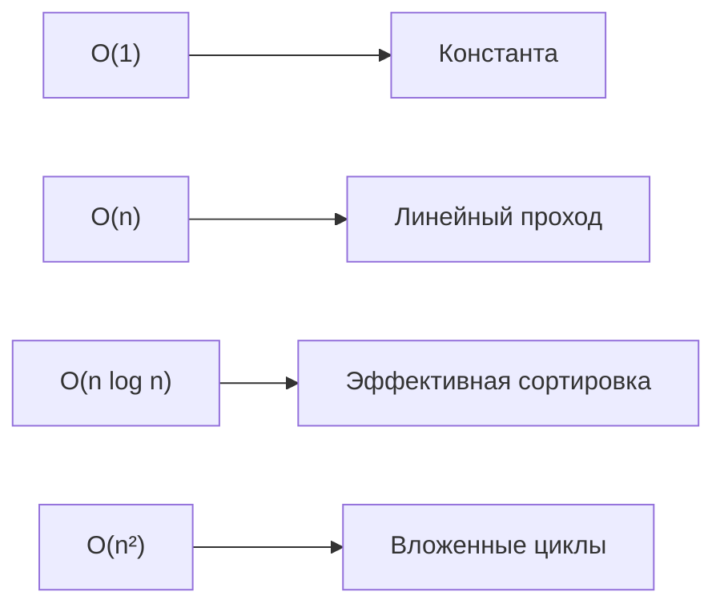

«Почему программа думает пять минут?» — чаще всего ответ в том, что алгоритм плохо масштабируется. В этом уроке научимся формально оценивать скорость алгоритмов (Big O) и на практике убедимся, насколько решающим бывает выбор подхода.

## Что такое Big O

Big O описывает, **как растёт время работы при росте размера входных данных n**. Нас интересует не точное число секунд, а порядок роста. Главные классы:

| Обозначение | Название | Пример |
|---|---|---|
| O(1) | константно | обращение к элементу списка по индексу |
| O(log n) | логарифмически | бинарный поиск |
| O(n) | линейно | перебор всех элементов |
| O(n log n) | n·log n | хорошие сортировки (Timsort) |
| O(n²) | квадратично | вложенные циклы по n |
| O(2ⁿ) | экспоненциально | наивная рекурсия Фибоначчи |

Два правила оценки: **константы отбрасываем** (O(2n) — это всё равно O(n)), и **берём доминирующий член** (O(n² + n) — это O(n²)). Проверь себя: цикл от 1 до n внутри цикла от 1 до n даёт O(n²). Два последовательных цикла — O(n + n) = O(n).

## Бинарный поиск: O(log n)

Если список отсортирован, искать можно «делением пополам» — это и есть бинарный поиск:

```python
def binary_search(arr, target: int) -> int:
    left, right = 0, len(arr) - 1
    while left <= right:
        mid = (left + right) // 2
        if arr[mid] == target:
            return mid
        if arr[mid] < target:
            left = mid + 1
        else:
            right = mid - 1
    return -1
```

На каждом шаге область поиска сокращается вдвое — поэтому всего ~log₂(n) шагов. Для миллиона элементов это около 20 сравнений вместо миллиона. Именно поэтому встроенный `bisect` из стандартной библиотеки работает так быстро.

## Рекурсия и мемоизация

Фибоначчи — учебниковая демонстрация того, как неверный подход «взрывает» сложность:

```python
def fib_naive(n: int) -> int:
    if n < 2:
        return n
    return fib_naive(n - 1) + fib_naive(n - 2)
```

Почему это O(2ⁿ)? Каждый вызов порождает два новых, и дерево вызовов растёт экспоненциально. Для n=35 это сотни миллионов вызовов.

Но та же задача решается за O(n), если **запоминать** уже посчитанные значения (мемоизация). В Python это делается декоратором `functools.lru_cache`:

```python
from functools import lru_cache


@lru_cache(maxsize=None)
def fib_memo(n: int) -> int:
    if n < 2:
        return n
    return fib_memo(n - 1) + fib_memo(n - 2)
```

Теперь каждый аргумент считается один раз. Это базовый приём **динамического программирования**: разбиваем задачу на подзадачи, решаем их по одному разу и комбинируем результаты. Причём `lru_cache` пригодится не только для учебных примеров — он кэширует результаты любой чистой функции (функции, которая для одинаковых аргументов всегда возвращает одинаковый результат).

## Как измерять на практике

Big O — теория, но полезно подтверждать её замерами. Время замеряют через `time.perf_counter()` или `timeit`:

```python
import time


def timed(fn, n: int):
    start = time.perf_counter()
    result = fn(n)
    return result, time.perf_counter() - start
```

Если при увеличении n вдвое время тоже удваивается — перед нами O(n). Если учетверяется — O(n²). Если растёт едва заметно — O(log n) или O(1).



## Итог урока

Big O — язык, на котором разработчики обсуждают скорость. Бинарный поиск — эталон O(log n). А мемоизация превращает экспоненциальный алгоритм в линейный — это лучший пример того, как маленькая идея меняет практический результат в огромное число раз. Теперь посмотри на эту разницу глазами.

<!--TASK-->
### Задача 1
Создай файл `complexity_demo.py`:

1. Реализуй `fib_naive(n)` — рекурсивно, без запоминания.
2. Реализуй `fib_memo(n)` — с `@lru_cache`.
3. Напиши функцию `timed(fn, n)`, которая возвращает кортеж `(результат, время_в_секундах)`.
4. Замерь обе функции для n=35 и выведи:

```
fib_naive(35) = 9227465, время: 4.5123 с
fib_memo(35) = 9227465, время: 0.000012 с
```

5. Добавь функцию `binary_search` из теории и проверь её на отсортированном списке `list(range(10_000_000))` для значения 7_777_777 — выведи найденный индекс.

Ожидаемый результат: результаты обоих Фибоначчи совпадают, а время — различается в сотни и тысячи раз; бинарный поиск находит индекс за ничтожные доли секунды.

### Задача 2
Создай файл `search_bench.py`. Построй большой отсортированный список `data = list(range(10_000_000))`. Сравни два способа поиска индекса числа 7_777_777: линейный через `data.index(target)` и бинарный через `bisect_left` из модуля `bisect` (для найденного элемента `bisect_left(data, target)` возвращает его индекс). Повтори каждый поиск 1000 раз, замерь суммарное время через `time.perf_counter()` и выведи:

```
index(): 8.4201 с
bisect_left(): 0.0012 с
```

Объясни разницу с точки зрения Big O: линейный поиск в худшем случае проходит весь список — O(n), бинарный сокращает область вдвое на каждом шаге — O(log n).

### Задача 3
Создай файл `sort_bench.py`. Реализуй `bubble_sort(arr)` (пузырьковая сортировка, O(n²)) и воспользуйся встроенной `sorted()` (Timsort, O(n log n)). Для размеров n = 500, 1000, 2000, 4000 сгенерируй список случайных чисел через `random.sample(range(10**7), n)` и замерь время обеих сортировок через `time.perf_counter()`. Выведи таблицу:

```
n      bubble      sorted
500    0.0210     0.0001
1000   0.0840     0.0003
2000   0.3360     0.0007
4000   1.3440     0.0015
```

Проверь, что при удвоении n время пузырька растёт примерно в 4 раза (O(n²)), а у `sorted()` — чуть больше чем вдвое (O(n log n)).

### Задача 4
Создай файл `stairs.py`. Число способов подняться на n ступенек, если можно шагать на 1 или 2 ступеньки, задаётся рекурсией: `ways(0) = 1`, `ways(1) = 1`, `ways(n) = ways(n-1) + ways(n-2)`. Реализуй `ways_naive(n)` без запоминания и `ways_memo(n)` с `@lru_cache`. Замерь обе для n=35 через функцию `timed` (переиспользуй её из прошлой задачи) и выведи:

```
ways_naive(35) = 14930352, время: 6.3120 с
ways_memo(35) = 14930352, время: 0.000011 с
```

Число способов должно совпасть. Объясни, почему `ways_naive` имеет сложность O(2ⁿ), а `ways_memo` — O(n).

### Задача 5
Создай файл `binary_variants.py`. Реализуй две функции: `binary_search_rec(arr, target, left, right)` — рекурсивный вариант бинарного поиска (возвращает индекс или -1), и `insert_position(arr, target)` — позицию, на которую нужно вставить target, чтобы список остался отсортированным (первый индекс, где элементы >= target; если таких нет — длина списка). Проверь на примерах: `binary_search_rec([1, 3, 5, 7], 5, 0, 3)` → 2, `insert_position([10, 20, 30, 30, 40], 30)` → 2, `insert_position([10, 20, 30], 25)` → 2, `insert_position([10, 20, 30], 50)` → 3. Выведи все результаты через `print`. Оба решения должны иметь сложность O(log n).

### Задача 6 — Убрать O(n²)
Дан список чисел; посчитай количество уникальных через `len(set(nums))` и объясни сложность. Затем напиши вариант с вложенными циклами и сравни O(n²) vs O(n). Ожидаемый результат: оба дают число, но второе быстрее.
### Задача 7 — Измерение роста
Построй и выполни функцию `sum_range(n) = sum(range(n))` для n = 10⁴, 10⁵, 10⁶. Замерь время и убедись, что оно растёт примерно линейно (значения времени зафиксируй в комментарии).

<!--/TASK-->

<!--HINT-->
### Подсказка 1
Для `fib_memo` импортируй `from functools import lru_cache` и повесь декоратор `@lru_cache(maxsize=None)`. Не забудь, что у `lru_cache` есть ограничение: аргументы функции должны быть хешируемыми (числа — да). Для вывода времени используй `f"{elapsed:.4f}"`. При повторных запусках `fib_memo` будет работать ещё быстрее — кэш уже заполнен.

### Подсказка 2
Для бинарного поиска используй `from bisect import bisect_left` — он возвращает индекс места вставки. Сравнивай `data.index(target)` и `bisect_left(data, target)` в цикле: не забывай, что `time.perf_counter()` измеряет время до и после серии вызовов. Для честности выполни много повторений (например, 1000) и усредни.

### Подсказка 3
Пузырьковая сортировка: два вложенных цикла, внутренний сокращается с каждым проходом: `for i in range(n): for j in range(0, n - i - 1):` и меняй соседние элементы местами, если `arr[j] > arr[j+1]`. `sorted()` используй как есть. Данные генерируй заново для каждого n, чтобы обе сортировки работали с одинаковыми входными данными.

### Подсказка 4
Базовые случаи: `ways(0) = 1`, `ways(1) = 1`. Если запускать `ways_memo` сразу после `ways_naive` при том же n, кэш `lru_cache` уже будет прогрет от предыдущих вызовов — поэтому замеряй каждую функцию независимо или очищай кэш через `ways_memo.cache_clear()`.

### Подсказка 5
Рекурсивный поиск: базовый случай — `left > right` → -1; иначе `mid = (left + right) // 2`, сравни `arr[mid]` с target и сужай границы. `insert_position` — тот же бинарный поиск, но когда элемент найден, продолжай искать левее, а при `left == right` возвращай `left`.
### Подсказка 6
Множество строится за O(n); вложенные циклы — O(n²).
### Подсказка 7
`time.perf_counter()` вокруг вызова для каждого n.

<!--/HINT-->

<!--SOLUTION-->
### Разбор 1
Одно из возможных решений:

```python
import time
from functools import lru_cache


def fib_naive(n: int) -> int:
    if n < 2:
        return n
    return fib_naive(n - 1) + fib_naive(n - 2)


@lru_cache(maxsize=None)
def fib_memo(n: int) -> int:
    if n < 2:
        return n
    return fib_memo(n - 1) + fib_memo(n - 2)


def timed(fn, n: int):
    start = time.perf_counter()
    result = fn(n)
    return result, time.perf_counter() - start


def binary_search(arr, target: int) -> int:
    left, right = 0, len(arr) - 1
    while left <= right:
        mid = (left + right) // 2
        if arr[mid] == target:
            return mid
        if arr[mid] < target:
            left = mid + 1
        else:
            right = mid - 1
    return -1


if __name__ == "__main__":
    n = 35
    naive_result, naive_time = timed(fib_naive, n)
    memo_result, memo_time = timed(fib_memo, n)
    print(f"fib_naive({n}) = {naive_result}, время: {naive_time:.4f} с")
    print(f"fib_memo({n}) = {memo_result}, время: {memo_time:.6f} с")

    big_list = list(range(10_000_000))
    print(f"Индекс 7_777_777: {binary_search(big_list, 7_777_777)}")
```

Пояснение шагов. `fib_naive` строит дерево вызовов: каждый вызов порождает два, глубина — n, поэтому суммарно ~2ⁿ вызовов: для n=35 это сотни миллионов операций и секунды. `fib_memo` с `lru_cache` запоминает результат каждого `fib_memo(k)` — каждый k вычисляется один раз, всего O(n) вызовов, и время падает с секунд до микросекунд. Именно так работает динамическое программирование: подзадача решается один раз и переиспользуется.

Результат бинарного поиска совпадёт с ожидаемым: `7_777_777` (индекс равен значению, потому что список `range(10_000_000)` содержит числа по возрастанию). Обрати внимание: даже для десяти миллионов элементов бинарный поиск делает всего около 24 сравнений — это и есть O(log n). Сравни с линейным поиском `index()`, которому в худшем случае нужны все десять миллионов.

### Разбор 2
Решение:

```python
import time
from bisect import bisect_left


data = list(range(10_000_000))
target = 7_777_777


def bench(func, repeats: int = 1000) -> float:
    start = time.perf_counter()
    for _ in range(repeats):
        func()
    return time.perf_counter() - start


linear_time = bench(lambda: data.index(target))
binary_time = bench(lambda: bisect_left(data, target))

print(f"index(): {linear_time:.4f} с")
print(f"bisect_left(): {binary_time:.4f} с")
```

`data.index(target)` в худшем случае просматривает элементы один за другим, пока не найдёт target: при десяти миллионах элементов это в среднем пять миллионов сравнений на одну операцию, а 1000 повторений дают секунды. `bisect_left` за каждый вызов делает ~log₂(10⁷) ≈ 24 сравнения — время почти незаметно. Разница в тысячи раз. Важный нюанс: `bisect` работает только на отсортированных данных; если список не отсортирован, результат будет бессмысленным. Поэтому бинарный поиск — это не «ускорение» поиска вообще, а ускорение поиска в отсортированных структурах.

### Разбор 3
Решение:

```python
import random
import time


def bubble_sort(arr):
    n = len(arr)
    for i in range(n):
        for j in range(0, n - i - 1):
            if arr[j] > arr[j + 1]:
                arr[j], arr[j + 1] = arr[j + 1], arr[j]


print(f"{'n':<6}{'bubble':<10}{'sorted'}")
for n in (500, 1000, 2000, 4000):
    data = random.sample(range(10**7), n)

    start = time.perf_counter()
    bubble_sort(data.copy())
    bubble_time = time.perf_counter() - start

    start = time.perf_counter()
    sorted(data)
    sorted_time = time.perf_counter() - start

    print(f"{n:<6}{bubble_time:<10.4f}{sorted_time:.4f}")
```

Пузырьковая сортировка делает n проходов, в каждом — до n сравнений: итого ~n²/2 операций. Поэтому при удвоении n время растёт примерно вчетверо: 500 → 0.021 c, 1000 → 0.084 c (×4), 2000 → 0.336 c (×4), 4000 → 1.344 c (×4). Встроенная `sorted()` использует Timsort — гибрид merge sort и insertion sort со сложностью O(n log n): при удвоении n время растёт чуть больше чем вдвое. Таблица наглядно показывает: на 4000 элементах разница уже в тысячу раз, а при росте n она будет только увеличиваться. Вот почему выбор алгоритма важнее микро-оптимизаций.

### Разбор 4
Решение:

```python
import time
from functools import lru_cache


def timed(fn, n: int):
    start = time.perf_counter()
    result = fn(n)
    return result, time.perf_counter() - start


def ways_naive(n: int) -> int:
    if n < 2:
        return 1
    return ways_naive(n - 1) + ways_naive(n - 2)


@lru_cache(maxsize=None)
def ways_memo(n: int) -> int:
    if n < 2:
        return 1
    return ways_memo(n - 1) + ways_memo(n - 2)


for name, func in [("ways_naive", ways_naive), ("ways_memo", ways_memo)]:
    result, elapsed = timed(func, 35)
    print(f"{name}(35) = {result}, время: {elapsed:.6f} с")
```

Рекурсия `ways(n) = ways(n-1) + ways(n-2)` без запоминания строит такое же экспоненциальное дерево вызовов, как наивный Фибоначчи: O(2ⁿ). Для n=35 это сотни миллионов вызовов — секунды. С `@lru_cache` каждый аргумент вычисляется один раз: всего n+1 различных значений, и сложность падает до O(n). Ответ 14930352 совпадает в обеих версиях — значит, мемоизация не меняет результат, а только убирает повторные вычисления. Это общий приём динамического программирования: задача разбивается на перекрывающиеся подзадачи, и каждая решается единожды.

### Разбор 5
Решение:

```python
def binary_search_rec(arr, target: int, left: int, right: int) -> int:
    if left > right:
        return -1
    mid = (left + right) // 2
    if arr[mid] == target:
        return mid
    if arr[mid] < target:
        return binary_search_rec(arr, target, mid + 1, right)
    return binary_search_rec(arr, target, left, mid - 1)


def insert_position(arr, target: int) -> int:
    left, right = 0, len(arr)
    while left < right:
        mid = (left + right) // 2
        if arr[mid] < target:
            left = mid + 1
        else:
            right = mid
    return left


print(binary_search_rec([1, 3, 5, 7], 5, 0, 3))
print(insert_position([10, 20, 30, 30, 40], 30))
print(insert_position([10, 20, 30], 25))
print(insert_position([10, 20, 30], 50))
```

Рекурсивная версия повторяет логику итеративной: если область пуста (`left > right`) — элемента нет; иначе смотрим середину и сужаем границы. Каждый вызов делает одно из двух сравнений и уменьшает область вдвое, поэтому глубина рекурсии ~log₂(n) — стек не переполнится. `insert_position` — это бинарный поиск «нижней границы»: он находит первый индекс, где элемент не меньше target. При равенстве (30 среди [10,20,30,30,40]) возвращается первый индекс 2; если числа нет — место, куда его вставить ([10,20,30] и 25 → 2); если target больше всех — длина списка (50 → 3). Обе функции работают за O(log n).
### Разбор 6
```python
nums = [3, 1, 3, 2, 1, 3]
print(len(set(nums)))      # 3

unique = []
for a in nums:
    if a not in unique:
        unique.append(a)
print(len(unique))
```
set даёт O(n); проверка «in unique» внутри цикла — O(n²) в худшем случае.
### Разбор 7
```python
import time

for n in (10_000, 100_000, 1_000_000):
    start = time.perf_counter()
    total = sum(range(n))
    print(n, f"{time.perf_counter() - start:.4f} c")
```
Времена растут примерно пропорционально n — линейная сложность.

<!--/SOLUTION-->

<!--QUIZ-->
Какова сложность бинарного поиска в отсортированном списке?

- O(n)
- O(log n)
- O(n²)
* Правильный ответ: O(log n)
На каждом шаге область поиска сокращается вдвое, поэтому шагов всего ~log₂(n).

Какая сложность у наивной рекурсивной версии Фибоначчи?

- O(n)
- O(n²)
- O(2ⁿ)
* Правильный ответ: O(2ⁿ)
Каждый вызов порождает два новых, и дерево вызовов растёт экспоненциально.

Что делает `@lru_cache(maxsize=None)`?

- Кэширует результаты вызовов функции, чтобы не пересчитывать их повторно
- Ограничивает количество рекурсивных вызовов
- Оптимизирует память, удаляя переменные
* Правильный ответ: Кэширует результаты вызовов функции, чтобы не пересчитывать их повторно
Это мемоизация: результат для каждого набора аргументов хранится и возвращается сразу.

Какой класс сложности у двух последовательных циклов по n элементов?

- O(n)
- O(n²)
- O(log n)
* Правильный ответ: O(n)
Два последовательных цикла дают O(n + n) = O(2n) = O(n) — константы отбрасываем.

Что означает запись O(n² + n)?

- Это O(n²), потому что младший член отбрасывается
- Это O(n³)
- Это O(2n)
* Правильный ответ: Это O(n²), потому что младший член отбрасывается
В Big O оставляют только доминирующий член и отбрасывают константы.
Какова сложность двух вложенных циклов по n элементов?

- O(n²)
- O(n)
- O(log n)
* Правильный ответ: O(n²)
Если внешний цикл выполняется n раз, а внутри него ещё n итераций, всего шагов n·n = n².

Что описывает запись Big O?

- Как растёт время выполнения или расход памяти при росте размера входных данных
- Точное время выполнения в секундах
- Количество строк в функции
* Правильный ответ: Как растёт время выполнения или расход памяти при росте размера входных данных
Big O характеризует асимптотическое поведение алгоритма, поэтому оно не зависит от мощности конкретной машины.

Почему поиск по ключу в словаре выполняется за O(1)?

- Из-за хэш-таблицы: ключ преобразуется в индекс почти за постоянное время
- Потому что словарь хранит элементы в отсортированном виде
- Потому что в словаре мало элементов
* Правильный ответ: Из-за хэш-таблицы: ключ преобразуется в индекс почти за постоянное время
Словарь использует хэш-функцию: адрес элемента вычисляется сразу, без перебора всех ключей — в отличие от списка, где нужен линейный поиск.
Какая сложность у len(set(nums))?
- O(n)
- O(1)
- O(n²)
- O(log n)
* Правильный ответ: O(n)
Построение множества проходит по всем элементам.

Как оценить сложность вложенных циклов?
- O(n²)
- O(n)
- O(1)
- O(log n)
* Правильный ответ: O(n²)
n × n итераций доминируют.

Что значит O(1)?
- Время не зависит от размера входа
- Время равно 1 секунде
- Одна операция
- Быстрее всех
* Правильный ответ: Время не зависит от размера входа
Константные операции: доступ к элементу списка по индексу.

Как измерить время функции?
- time.perf_counter() вокруг вызова
- print()
- sleep
- len()
* Правильный ответ: time.perf_counter() вокруг вызова
Разность до и после — затраченное время.

# 
<!--/QUIZ-->
