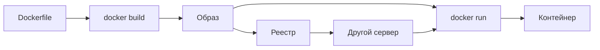

Ты написал приложение, и оно работает у тебя на компьютере. Но «у меня всё работает» — это ещё не продакшен. На чужой машине нет твоих библиотек, другой Python, другие переменные окружения. Docker решает именно эту проблему: он упаковывает приложение вместе со всем окружением в изолированный контейнер, который запускается одинаково везде.

## Зачем нужен Docker

Контейнер — это изолированный процесс со своим файловым пространством, кто библиотеками и настройками. Контейнеры дают:

- **Воспроизводимость** — приложение запускается одинаково на ноутбуке, на сервере и в облаке;
- **Изоляцию** — два приложения на одном сервере не конфликтуют;
- **Простоту деплоя** — образ можно загрузить в реестр (например, Docker Hub) и развернуть одной командой.

## Образ и контейнер

**Образ** (image) — это неизменяемый шаблон: слои файловой системы и метаданные. **Контейнер** (container) — запущенный экземпляр образа. Из одного образа можно запустить много контейнеров. Аналогия: образ — это «рецепт», а контейнер — «блюдо», приготовленное по рецепту.

## Первый Dockerfile

Образ описывается файлом `Dockerfile`. Создай проект:

```python
# app.py
from flask import Flask

app = Flask(__name__)

@app.route("/")
def home():
    return "Привет из контейнера!"

if __name__ == "__main__":
    app.run(host="0.0.0.0", port=8000)
```

```text
# requirements.txt
flask==3.0.3
```

А теперь `Dockerfile`:

```dockerfile
# Берём базовый образ с Python 3.12
FROM python:3.12-slim

# Рабочая директория внутри контейнера
WORKDIR /app

# Сначала — зависимости: так они кэшируются
COPY requirements.txt .
RUN pip install --no-cache-dir -r requirements.txt

# Потом — код приложения
COPY . .

# Какой порт слушает приложение
EXPOSE 8000

# Команда по умолчанию при запуске контейнера
CMD ["python", "app.py"]
```

Соберём образ и запустим контейнер:

```bash
docker build -t my-app .
docker run -p 8000:8000 my-app
```

Проверь в браузере `http://localhost:8000/` — увидишь `Привет из контейнера!`. Флаг `-p 8000:8000` пробрасывает порт: `8000` хоста → `8000` контейнера.

## .dockerignore

Как `.gitignore` для git, файл `.dockerignore` исключает лишние файлы из контекста сборки:

```text
__pycache__/
*.pyc
.venv/
.env
```

## Docker Compose

Реальное приложение редко состоит из одного сервиса: рядом с веб-приложением живут база данных, кэш, очередь. Compose описывает связку в `docker-compose.yml`:

```yaml
services:
  web:
    build: .
    ports:
      - "8000:8000"
    depends_on:
      - db

  db:
    image: postgres:16-alpine
    environment:
      POSTGRES_USER: app
      POSTGRES_PASSWORD: secret
      POSTGRES_DB: appdb
    volumes:
      - pgdata:/var/lib/postgresql/data

volumes:
  pgdata:
```

Запуск одной командой:

```bash
docker compose up --build
docker compose ps          # список запущенных сервисов
docker compose logs -f web # логи в реальном времени
docker compose down        # остановить и убрать сети
```

Объём `pgdata` сохранит данные базы даже после `docker compose down` — без него все данные при остановке исчезли бы.

Вот весь путь от описания образа до работающего контейнера:



## Итог урока

Мы разобрались, чем образ отличается от контейнера, написали `Dockerfile` для Flask-приложения и подняли связку из веб-сервиса и базы данных через Compose. Дальше в модуле ты узнаешь, как автоматизировать сборку (GitHub Actions) и как запускать такое приложение в продакшене на Gunicorn и Nginx.

<!--TASK-->
### Задача 1
Создай папку `docker_app` со следующими файлами:

1. `app.py` — простое Flask-приложение из урока (можно без изменений);
2. `requirements.txt` — с `flask==3.0.3`;
3. `Dockerfile` — базовый образ `python:3.12-slim`, установка зависимостей, копирование кода, `EXPOSE 8000`, запуск через `python app.py`;
4. `.dockerignore` — исключи `__pycache__/` и `.env`;
5. `docker-compose.yml` — два сервиса: `web` (сборка из текущей папки, порт `8000:8000`) и `db` (образ `postgres:16-alpine`, пользователь `app`, пароль `secret`, база `appdb`, том `pgdata`).

Собери и запусти связку: `docker compose up --build`. Убедись, что по адресу `http://localhost:8000/` открывается страница с текстом `Привет из контейнера!`, а сервис `db` запущен. После проверки останови всё командой `docker compose down`.

### Задача 2
Собери образ вручную, без Compose: выполни `docker build -t my-app .` из папки `docker_app`. Затем запусти контейнер с пробросом порта и именем: `docker run -d --name my-app-container -p 8000:8000 my-app`. Убедись, что `http://localhost:8000/` отвечает текстом `Привет из контейнера!`. Посмотри список запущенных контейнеров (`docker ps`) — строка с `my-app-container` должна быть в списке. Останови контейнер (`docker stop my-app-container`) и удали его (`docker rm my-app-container`). Ожидаемый результат: до остановки `docker ps` показывает контейнер, после `stop` его нет в списке запущенных, а страница перестаёт открываться.

### Задача 3
Измени `app.py`: пусть приветствие берётся из переменной окружения `GREETING` со значением по умолчанию `Привет из контейнера!` (используй `os.environ.get("GREETING", "Привет из контейнера!")`). Пересобери образ (`docker build -t my-app .`). Запусти два контейнера: один без флага `-e`, второй с `-e GREETING=Привет из Docker`. Проверь обе страницы. Ожидаемый результат: первый контейнер показывает `Привет из контейнера!`, второй — `Привет из Docker`. Так один и тот же образ ведёт себя по-разному в зависимости от окружения, без правок кода.

### Задача 4
Создай в папке `docker_app` файл `secret.txt` с любым содержимым. Собери образ и проверь, что файл попал внутрь: `docker run --rm my-app ls /app` — `secret.txt` должен быть в списке. Теперь добавь `secret.txt` в `.dockerignore`, пересобери образ и снова выполни `docker run --rm my-app ls /app`. Ожидаемый результат: после первой сборки файл присутствует, после второй — отсутствует. Убедись, что пересборка действительно произошла: вывод `docker build` для шага копирования кода не должен помечаться как `CACHED`.

### Задача 5
Создай на хосте папку `host_data`. Запусти контейнер с монтированием этой папки: `docker run --rm -v <абсолютный путь к host_data>:/data python:3.12-slim sh -c "echo Привет с хоста > /data/hello.txt"`. Убедись, что на хосте появился файл `host_data/hello.txt` с текстом `Привет с хоста`. Объясни словами, почему файл появился на хосте, и чем этот механизм отличается от именованного тома `pgdata` из `docker-compose.yml`.
### Задача 6
Перепиши `Dockerfile` из задачи 1 в многоступенчатом виде (multi-stage). Первая ступень с именем `builder` на образе `python:3.12-slim` должна установить зависимости в отдельную папку командой `RUN pip install --no-cache-dir --prefix=/install -r requirements.txt`. Вторая ступень `runtime` на том же базовом образе копирует только результат установки (`COPY --from=builder /install /usr/local`) и файл `app.py` — без кэша pip и лишних файлов. Собери образ под тегом `my-app-slim` и сравни размеры: `docker images | grep my-app`. Ожидаемый результат: `my-app-slim` меньше исходного `my-app`, а контейнер из нового образа по-прежнему отвечает на `http://localhost:8000/` текстом `Привет из контейнера!`.

### Задача 7
Сделай образ безопаснее: добавь в `Dockerfile` отдельного пользователя и проверку здоровья. Создай пользователя строкой `RUN useradd --create-home appuser`, отдай ему права на рабочую папку (`RUN chown -R appuser:appuser /app`) и переключись на него инструкцией `USER appuser` перед `CMD`. Добавь `HEALTHCHECK --interval=30s --timeout=3s --start-period=10s CMD python -c "import urllib.request; urllib.request.urlopen('http://127.0.0.1:8000/')"`. Собери образ `my-app-secure`, запусти `docker run -d --name secure-app -p 8002:8000 my-app-secure` и проверь: `docker exec secure-app whoami` печатает `appuser`, а `docker inspect --format '{{.State.Health.Status}}' secure-app` через полминуты печатает `healthy`.
<!--/TASK-->

<!--HINT-->
### Подсказка 1
В `Dockerfile` сначала копируй `requirements.txt` и ставь зависимости, и только потом — весь остальной код: так слои кэшируются. Не забудь `WORKDIR /app`. В Compose порты пишутся в формате `"8000:8000"` (хост:контейнер). Если порт занят — поменяй левую часть. Ошибки ищи в `docker compose logs -f web`.

### Подсказка 2
Команда `docker run -d` запускает контейнер в фоне и печатает его ID — он понадобится, если захочешь посмотреть логи (`docker logs my-app-container`). Проброс порта работает так же, как в Compose: левая часть — порт хоста, правая — порт контейнера. После `docker stop` контейнер перестаёт работать, но остаётся в системе до `docker rm`.

### Подсказка 3
Переменные окружения задаются при запуске флагом `-e ИМЯ=значение`, а в Python читаются через `os.environ.get(...)` — не забудь `import os`. Значение по умолчанию передаётся вторым аргументом `get`. Так как образ один и тот же, разные результаты возможны только из-за разных переменных окружения.

### Подсказка 4
`docker build` собирает образ из контекста — папки, в которой выполняется команда. `.dockerignore` действует только при сборке и не влияет на git. После изменения `.dockerignore` обязательно пересобери образ, иначе увидишь старый результат из кэша. Проверка `ls /app` изнутри контейнера покажет реальный состав образа.

### Подсказка 5
Флаг `-v /путь/на/хосте:/путь/в/контейнере` монтирует папку хоста напрямую — файлы, записанные в контейнере, сразу появляются на хосте, и наоборот. Именованный том (`pgdata` в Compose) хранит данные в управляемом Docker месте и привязан к имени, а не к пути на хосте. Оба варианта переживают пересоздание контейнера.
### Подсказка 6
Две ступени описываются двумя инструкциями `FROM`, у первой должно быть имя: `FROM python:3.12-slim AS builder`. Во второй ступени не нужно повторять `pip install` — достаточно скопировать готовые пакеты из `/install` в `/usr/local`. Убедиться, что в финальный образ не попал кэш pip, можно командой `docker run --rm my-app-slim ls /root/.cache` — каталога быть не должно.

### Подсказка 7
`useradd` создаёт пользователя на этапе сборки, а `USER` переключает на него процессы контейнера. Права на рабочую папку отдай до переключения, иначе приложение не сможет писать файлы. `HEALTHCHECK` выполняется внутри контейнера, поэтому сервер проверяется по `127.0.0.1`, а не по адресу хоста. Статус появляется не сразу: подожди интервал и посмотри `docker inspect` ещё раз.
<!--/HINT-->

<!--SOLUTION-->
### Разбор 1
Все файлы проекта:

```text
docker_app/
├── .dockerignore
├── Dockerfile
├── app.py
├── docker-compose.yml
└── requirements.txt
```

```dockerfile
# Dockerfile
FROM python:3.12-slim

WORKDIR /app

COPY requirements.txt .
RUN pip install --no-cache-dir -r requirements.txt

COPY . .

EXPOSE 8000

CMD ["python", "app.py"]
```

```text
# .dockerignore
__pycache__/
*.pyc
.venv/
.env
```

```yaml
# docker-compose.yml
services:
  web:
    build: .
    ports:
      - "8000:8000"
    depends_on:
      - db

  db:
    image: postgres:16-alpine
    environment:
      POSTGRES_USER: app
      POSTGRES_PASSWORD: secret
      POSTGRES_DB: appdb
    volumes:
      - pgdata:/var/lib/postgresql/data

volumes:
  pgdata:
```

Запуск:

```bash
cd docker_app
docker compose up --build
```

Ожидаемый результат: Compose соберёт образ `web`, скачает `postgres:16-alpine`, запустит оба сервиса, а в браузере на `http://localhost:8000/` появится `Привет из контейнера!`. Останавливаем:

```bash
docker compose down
```

Что здесь происходит? `Dockerfile` описывает образ: базовый слой `python:3.12-slim`, затем слой с зависимостями — он пересобирается только при изменении `requirements.txt`, и наконец слой с кодом приложения. Compose связывает сервисы общей сетью: `web` видит хост `db` по имени сервиса (внутри контейнера это DNS-имя). Том `pgdata` монтируется в `/var/lib/postgresql/data` — данные базы переживают перезапуски. `depends_on` гарантирует, что `db` стартует раньше `web`, хотя это не заменяет проверку готовности базы в коде приложения.

### Разбор 2
Команды:

```bash
cd docker_app
docker build -t my-app .
docker run -d --name my-app-container -p 8000:8000 my-app
curl http://localhost:8000/
docker ps
docker stop my-app-container
docker rm my-app-container
```

Ожидаемый результат: `curl` возвращает `Привет из контейнера!`; `docker ps` показывает строку с `my-app-container`, портом `0.0.0.0:8000->8000/tcp` и статусом `Up`; после `docker stop` контейнер исчезает из списка запущенных, а `docker rm` удаляет его полностью.

Что здесь происходит? `docker build` собирает образ из `Dockerfile` и помечает его тегом `my-app`. `docker run -d` создаёт контейнер из образа и запускает его в фоне (флаг `-d` возвращает управление терминалу). `--name` даёт контейнеру понятное имя, чтобы не запоминать ID. Флаг `-p 8000:8000` пробрасывает порт: запрос на `localhost:8000` попадает на порт 8000 внутри контейнера. `docker ps` показывает работающие контейнеры, а `docker stop` посылает контейнеру сигнал остановки — контейнер остаётся в системе, но не работает, пока его не удалишь через `docker rm`.

### Разбор 3
Изменённый `app.py`:

```python
import os
from flask import Flask

app = Flask(__name__)

@app.route("/")
def home():
    greeting = os.environ.get("GREETING", "Привет из контейнера!")
    return greeting
```

Команды:

```bash
docker build -t my-app .
docker run -d --name default-app -p 8000:8000 my-app
docker run -d --name custom-app -p 8001:8000 -e GREETING=Привет из Docker my-app
```

Ожидаемый результат: `http://localhost:8000/` показывает `Привет из контейнера!`, а `http://localhost:8001/` — `Привет из Docker`. После проверки останови оба контейнера: `docker stop default-app custom-app`.

Что здесь происходит? Образ один и тот же, но контейнеры получают разные переменные окружения. `os.environ.get("GREETING", ...)` читает переменную, а если её нет — подставляет значение по умолчанию, поэтому контейнер без `-e` не падает. Флаг `-e ИМЯ=значение` передаёт переменную только на время жизни конкретного контейнера, ничего не меняя в образе. Это ключевая идея контейнеров: окружение — часть запуска, а не часть кода или образа.

### Разбор 4
Шаги:

```bash
cd docker_app
echo "my secret" > secret.txt
docker build -t my-app .
docker run --rm my-app ls /app
```

Затем добавь `secret.txt` в `.dockerignore`:

```text
__pycache__/
*.pyc
.venv/
.env
secret.txt
```

и снова собери и проверь:

```bash
docker build -t my-app .
docker run --rm my-app ls /app
```

Ожидаемый результат: первый `ls` показывает `secret.txt`, второй — нет.

Что здесь происходит? `docker build` отправляет на сборку контекст — всё содержимое папки, где выполняется команда. Без `.dockerignore` `secret.txt` попадает в образ на шаге `COPY . .` и потом лежит в контейнере. `.dockerignore` исключает файлы из контекста, поэтому шаг копирования просто их не видит. Важно пересоберить образ: если `Dockerfile` не менялся, Docker может взять слой из кэша — обрати внимание, что после изменения `.dockerignore` шаг `COPY . .` должен выполниться заново, а не быть помеченным как `CACHED`.

### Разбор 5
Команды:

```bash
mkdir -p /home/user/host_data
docker run --rm -v /home/user/host_data:/data python:3.12-slim sh -c "echo Привет с хоста > /data/hello.txt"
cat /home/user/host_data/hello.txt
```

Ожидаемый результат: `cat` выводит `Привет с хоста` — файл, созданный внутри контейнера, виден на хосте.

Что здесь происходит? Флаг `-v /путь/на/хосте:/путь/в/контейнере` создаёт **bind mount**: папка хоста подставляется в файловую систему контейнера. Всё, что контейнер пишет в `/data`, физически записывается в папку хоста, поэтому файл виден сразу после завершения команды (`--rm` удаляет контейнер, но не данные). Именованный том (`pgdata` в Compose) работает иначе: Docker выделяет для него отдельное хранилище и управляет им сам — путь на хосте находится внутри каталога Docker (его можно посмотреть через `docker volume inspect pgdata`). Оба механизма переживают пересоздание контейнеров, но bind mount привязан к конкретному пути, а именованный том — к имени и удобнее для баз данных.
### Разбор 6
Многоступенчатый `Dockerfile`:

```dockerfile
# --- ступень сборки ---
FROM python:3.12-slim AS builder

WORKDIR /app
COPY requirements.txt .
RUN pip install --no-cache-dir --prefix=/install -r requirements.txt

# --- ступень запуска ---
FROM python:3.12-slim AS runtime

WORKDIR /app
COPY --from=builder /install /usr/local
COPY app.py .

EXPOSE 8000
CMD ["python", "app.py"]
```

Сборка и сравнение:

```bash
docker build -t my-app-slim .
docker images | grep my-app
docker run -d --name slim-app -p 8000:8000 my-app-slim
curl http://localhost:8000/
```

Пример вывода `docker images` (точные размеры зависят от версии базового образа):

```text
REPOSITORY    TAG       IMAGE ID       CREATED          SIZE
my-app-slim   latest    9c1f2a7b4d10   10 seconds ago   143MB
my-app        latest    4b7e0c9a1f22   2 minutes ago    182MB
```

Ожидаемый результат: `curl` возвращает `Привет из контейнера!`, а образ `my-app-slim` меньше собранного по одноступенчатому `Dockerfile`.

Что здесь происходит? `FROM ... AS builder` даёт ступени имя, чтобы на неё можно было ссылаться. В ступени сборки pip ставит пакеты в изолированный префикс `/install` — там оказываются только нужные файлы, без кэша загрузок. Вторая инструкция `FROM` начинает фактически новый образ: всё, что было сделано в `builder`, в него не попадает. `COPY --from=builder /install /usr/local` переносит уже установленные пакеты в системный путь Python, поэтому `import flask` работает без повторной установки. В итоговый образ не попадают ни компиляторы, ни заголовочные файлы, ни кэш pip — отсюда экономия размера. Меньше слоёв и файлов — быстрее загрузка из реестра и меньше поверхность атаки.

### Разбор 7
`Dockerfile` с отдельным пользователем и проверкой здоровья:

```dockerfile
FROM python:3.12-slim

WORKDIR /app

RUN useradd --create-home --shell /bin/bash appuser

COPY requirements.txt .
RUN pip install --no-cache-dir -r requirements.txt

COPY app.py .
RUN chown -R appuser:appuser /app

USER appuser

EXPOSE 8000

HEALTHCHECK --interval=30s --timeout=3s --start-period=10s --retries=3 \
  CMD python -c "import urllib.request; urllib.request.urlopen('http://127.0.0.1:8000/')" || exit 1

CMD ["python", "app.py"]
```

Проверка:

```bash
docker build -t my-app-secure .
docker run -d --name secure-app -p 8002:8000 my-app-secure
docker exec secure-app whoami
docker inspect --format '{{.State.Health.Status}}' secure-app
```

Ожидаемый результат: `whoami` печатает `appuser`; сразу после запуска статус может быть `starting`, через 30–40 секунд — `healthy`.

Что здесь происходит? По умолчанию процессы в контейнере работают от `root`, и при удачной атаке через приложение злоумышленник получает максимальные права внутри контейнера. `useradd` создаёт непривилегированного пользователя, `chown` отдаёт ему рабочую папку, а `USER appuser` гарантирует, что и `CMD`, и любой `docker exec` по умолчанию выполняются от него. `HEALTHCHECK` запускает указанную команду внутри контейнера каждые 30 секунд: код возврата 0 означает «здоров», иначе Docker помечает контейнер как `unhealthy`. Флаг `--start-period=10s` даёт приложению время на старт, чтобы первые неудачные проверки не считались провалом, а `--retries=3` требует трёх провалов подряд. Оркестраторы и `docker compose` умеют перезапускать контейнеры со статусом `unhealthy`.
<!--/SOLUTION-->

<!--QUIZ-->
Что такое образ (image) в Docker?
- Запущенный процесс приложения
- Неизменяемый шаблон с файловой системой и метаданными
- Файл с настройками сети
* Правильный ответ: Неизменяемый шаблон с файловой системой и метаданными
Образ — это шаблон, из которого запускаются контейнеры. Контейнер — это уже работающий экземпляр образа.

Какая инструкция Dockerfile задаёт команду по умолчанию при запуске контейнера?
- RUN
- EXPOSE
- CMD
* Правильный ответ: CMD
CMD определяет команду по умолчанию. RUN выполняет команды на этапе сборки, а EXPOSE лишь декларирует порт.

Что делает команда docker run -p 8000:8000 my-app?
- Запускает контейнер и пробрасывает порт 8000 хоста на порт 8000 контейнера
- Загружает образ в реестр
- Удаляет старый контейнер
* Правильный ответ: Запускает контейнер и пробрасывает порт 8000 хоста на порт 8000 контейнера
Флаг -p связывает порт хоста с портом контейнера, чтобы к приложению можно было обратиться снаружи.

Зачем в docker-compose.yml нужен том (volumes) pgdata?
- Чтобы увеличить скорость сборки образа
- Чтобы данные базы данных сохранялись между перезапусками контейнеров
- Чтобы скрыть пароли из конфига
* Правильный ответ: Чтобы данные базы данных сохранялись между перезапусками контейнеров
Том хранит данные вне файловой системы контейнера — они не исчезают при пересоздании контейнера.

Что делает файл .dockerignore?
- Исключает файлы из контекста сборки образа
- Исключает файлы из репозитория git
- Ускоряет выполнение docker compose up
* Правильный ответ: Исключает файлы из контекста сборки образа
.dockerignore работает для docker build так же, как .gitignore для git, — лишние файлы не попадают внутрь образа.
Что делает инструкция COPY в Dockerfile?
- Копирует файлы из контекста сборки внутрь образа
- Загружает образ из реестра
- Запускает команду в контейнере
* Правильный ответ: Копирует файлы из контекста сборки внутрь образа
COPY переносит, например, код приложения из папки проекта в файловую систему образа — без этих файлов контейнер не сможет запустить программу.

Что делает команда docker compose up?
- Собирает и запускает все сервисы, описанные в docker-compose.yml
- Удаляет все контейнеры
- Распаковывает образ в файл
* Правильный ответ: Собирает и запускает все сервисы, описанные в docker-compose.yml
docker compose up поднимает всё приложение целиком: базу данных, бэкенд и другие сервисы — одной командой.

Что делает инструкция EXPOSE в Dockerfile?
- Декларирует, какие порты открывает контейнер
- Публикует порт на хосте
- Устанавливает сетевой мост
* Правильный ответ: Декларирует, какие порты открывает контейнер
EXPOSE — это документация: она сообщает, что контейнер слушает порт, но сама по себе не делает его доступным снаружи — для этого нужен флаг -p.
Зачем в Dockerfile используют несколько инструкций FROM?
- Чтобы описать несколько ступеней сборки и оставить в финальном образе только нужные файлы
- Чтобы запустить несколько контейнеров из одного образа
- Чтобы ускорить скачивание базового образа
* Правильный ответ: Чтобы описать несколько ступеней сборки и оставить в финальном образе только нужные файлы
Многоступенчатая сборка позволяет ставить зависимости и собирать код в одной ступени, а в итоговый образ копировать только результат.

Что делает инструкция USER appuser в Dockerfile?
- Запускает процессы контейнера от указанного пользователя
- Создаёт пользователя в системе
- Даёт пользователю права администратора
* Правильный ответ: Запускает процессы контейнера от указанного пользователя
Самого пользователя создаёт useradd, а USER лишь переключает на него процессы — это снижает риск при компрометации приложения.

Что делает инструкция HEALTHCHECK?
- Периодически выполняет команду и помечает контейнер как healthy или unhealthy
- Проверяет синтаксис Dockerfile при сборке
- Перезапускает контейнер при падении
* Правильный ответ: Периодически выполняет команду и помечает контейнер как healthy или unhealthy
Docker сам запускает проверку по интервалу; статус виден в docker ps и docker inspect.

Что скопирует инструкция COPY --from=builder /install /usr/local?
- Файлы из ступени builder в финальный образ
- Файлы с хоста в контейнер
- Файлы из реестра в локальный кэш
* Правильный ответ: Файлы из ступени builder в финальный образ
Флаг --from указывает, из какой ступени брать файлы; так в финальный образ попадают только установленные пакеты.
<!--/QUIZ-->
