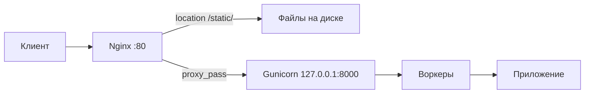

Ты запускал Flask с `app.run()` — и это отлично работало на локальной машине. Но попробуй так же запустить приложение для ста реальных пользователей: встроенный сервер обрабатывает запросы по одному, не умеет должным образом работать в несколько процессов и вообще предназначен для разработки. В продакшене приложение запускают через отдельный WSGI-сервер — Gunicorn, а перед ним ставят Nginx.

## Почему нужен отдельный WSGI-сервер

Flask, Django и FastAPI — это не серверы, а фреймворки: они получают HTTP-запрос и возвращают ответ. За передачу запросов из сети отвечает WSGI-сервер. Gunicorn — зрелый WSGI-сервер на Python, который умеет работать в несколько процессов и переживает тысячи одновременных соединений.

Установим и запустим его:

```bash
pip install gunicorn
```

Для приложения из прошлых уроков (`app.py` с переменной `app`):

```bash
gunicorn -w 4 -b 0.0.0.0:8000 app:app
```

Разбор команды:

- `-w 4` — четыре рабочих процесса (воркера): запросы распределяются между ними;
- `-b 0.0.0.0:8000` — адрес и порт, на котором сервер принимает соединения;
- `app:app` — модуль и имя WSGI-объекта (переменная `app` из `app.py`).

Проверь: `curl http://localhost:8000/` должен вернуть ответ приложения.

## Что такое Nginx

Nginx — это быстрый веб-сервер и обратный прокси. В связке с Gunicorn он берёт на себя то, что WSGI-серверу делать не положено:

- **Раздача статики** (CSS, JS, изображения) напрямую из файлов, без участия Python;
- **Терминация SSL/TLS** — расшифровка HTTPS-трафика;
- **Балансировка** — распределение нагрузки между несколькими процессами Gunicorn;
- **Заголовки** — передача реального IP клиента приложению.

## Настройка Nginx

Конфигурация сайта лежит в `/etc/nginx/sites-available/`. Создай файл `myapp`:

```nginx
server {
    listen 80;
    server_name example.com;

    location /static/ {
        alias /home/user/myapp/static/;
    }

    location / {
        proxy_pass http://127.0.0.1:8000;
        proxy_set_header Host $host;
        proxy_set_header X-Real-IP $remote_addr;
        proxy_set_header X-Forwarded-For $proxy_add_x_forwarded_for;
        proxy_set_header X-Forwarded-Proto $scheme;
    }
}
```

Что происходит: запрос на `http://example.com/` приходит на Nginx, который передаёт его внутреннему адресу `http://127.0.0.1:8000` — там слушает Gunicorn. Ответ возвращается клиенту тем же путём.

Подключаем сайт и проверяем конфигурацию:

```bash
sudo ln -s /etc/nginx/sites-available/myapp /etc/nginx/sites-enabled/
sudo nginx -t        # проверка синтаксиса
sudo systemctl reload nginx
```

## Итоговая связка

Порядок запроса: **Клиент → Nginx (порт 80, статика, SSL) → Gunicorn (127.0.0.1:8000) → приложение**. Gunicorn слушает только на `127.0.0.1` — наружу его порт не торчит, всё внешние запросы идут через Nginx. В приложении не забудь учитывать заголовок `X-Forwarded-Proto`, если генерируешь абсолютные ссылки по протоколу.

Полный путь запроса в такой связке выглядит так:



## Итог урока

Мы выяснили, почему встроенный сервер не годится для продакшена, запустили приложение на Gunicorn с несколькими воркерами и спрятали его за Nginx, который отдаёт статику и проксирует динамику.

<!--TASK-->
### Задача 1
На сервере Ubuntu в папке `/home/user/myapp` лежит Flask-приложение `app.py` с переменной `app`, статика — в `/home/user/myapp/static/`, зависимости установлены.

1. Запусти приложение на Gunicorn: 4 воркера, адрес `127.0.0.1:8000` (не `0.0.0.0` — наружу смотрит только Nginx);
2. Создай конфиг Nginx `/etc/nginx/sites-available/myapp`: слушает порт 80, `location /static/` отдаёт файлы из `/home/user/myapp/static/`, `location /` проксирует на `http://127.0.0.1:8000` с заголовками `Host`, `X-Real-IP`, `X-Forwarded-For`, `X-Forwarded-Proto`;
3. Подключи сайт, выполни `sudo nginx -t` и перезагрузи Nginx;
4. Проверь: `curl http://localhost/` возвращает ответ приложения, а `curl -I http://localhost/static/style.css` — код 200.

### Задача 2
Создай файл `/home/user/myapp/static/style.css` с минимальным CSS (например, `body { color: navy; }`). Выполни `sudo systemctl reload nginx` и проверь отдачу статики: `curl -I http://localhost/static/style.css`. Ожидаемый результат: ответ с кодом `200 OK` и заголовком `Content-Type: text/css`, а содержимое файла доступно по адресу `http://localhost/static/style.css`. Убедись, что динамический маршрут `http://localhost/` продолжает отдавать ответ приложения.

### Задача 3
Проверь изоляцию портов. С самого сервера выполни `sudo ss -tlnp | grep 8000` — строка должна показывать адрес `127.0.0.1:8000`. Затем с другой машины попробуй открыть `http://<публичный-IP-сервера>:8000/`. Ожидаемый результат: подключение к порту 8000 отклоняется (отказ в соединении или таймаут), а `http://<публичный-IP-сервера>/` (порт 80) работает и отдаёт приложение через Nginx. Если внешнего доступа нет, достаточно убедиться, что в выводе `ss` адрес привязки именно `127.0.0.1:8000`.

### Задача 4
Добавь в `app.py` маршрут `/headers`, который возвращает JSON с заголовками `X-Real-IP`, `X-Forwarded-For` и `X-Forwarded-Proto` из `request.headers` (Flask). Перезапусти Gunicorn. Проверь: `curl http://localhost/headers`. Ожидаемый результат: в ответе есть все три заголовка, причём `X-Forwarded-For` содержит IP клиента, а `X-Forwarded-Proto` — `http` (или `https`, если включён SSL).

### Задача 5
Подними второй экземпляр Gunicorn: `gunicorn -w 2 -b 127.0.0.1:8001 app:app`. В конфиге Nginx замени прямой `proxy_pass` на блок `upstream backend` с двумя серверами (`127.0.0.1:8000` и `127.0.0.1:8001`) и используй `proxy_pass http://backend;`. Для проверки распределения добавь в `app.py` маршрут `/instance`, возвращающий `os.getpid()`. Выполни `sudo nginx -t`, перезагрузи Nginx и несколько раз выполни `curl http://localhost/instance`. Ожидаемый результат: `curl` продолжает работать, а PID в ответах чередуются — запросы распределяются между обоими экземплярами Gunicorn.
### Задача 6
Оформи запуск Gunicorn как systemd-сервис, чтобы приложение поднималось само после перезагрузки сервера. Создай файл `/etc/systemd/system/myapp.service`: в секции `[Unit]` укажи `Description=Gunicorn для Flask-приложения` и `After=network.target`; в `[Service]` — `User=user`, `WorkingDirectory=/home/user/myapp`, `ExecStart=/usr/bin/gunicorn -w 4 -b 127.0.0.1:8000 app:app`, `Restart=always`; в `[Install]` — `WantedBy=multi-user.target`. Выполни `sudo systemctl daemon-reload`, `sudo systemctl enable --now myapp`, затем `systemctl status myapp --no-pager`. Ожидаемый результат: в статусе строка `Active: active (running)`, а `journalctl -u myapp -n 5` показывает строки `Booting worker with pid`. После `sudo reboot` приложение доступно без ручного запуска.

### Задача 7
Включи HTTPS для того же сайта через Let's Encrypt. Установи пакеты `sudo apt install certbot python3-certbot-nginx`, затем выполни `sudo certbot --nginx -d example.com --redirect` (почту и согласие можно указать в интерактивном режиме). Certbot сам допишет конфиг Nginx и добавит переадресацию с HTTP. Проверь результат: `curl -I http://example.com` и `curl -I https://example.com`. Ожидаемый результат: первая команда отдаёт `301 Moved Permanently` с заголовком `Location: https://example.com/`, вторая — `HTTP/2 200`, а в `/etc/letsencrypt/live/example.com/` лежат `fullchain.pem` и `privkey.pem`.
<!--/TASK-->

<!--HINT-->
### Подсказка 1
Gunicorn запускается в фоне или под systemd, но для проверки можно держать его в отдельном терминале: `gunicorn -w 4 -b 127.0.0.1:8000 app:app` (из папки `/home/user/myapp`). В конфиге Nginx имя сервера можно оставить как `_` для теста. После изменений всегда делай `sudo nginx -t`, прежде чем перезагружать.

### Подсказка 2
Директива `alias` в `location /static/` указывает, где на диске лежат файлы; `curl -I` показывает только заголовки ответа — проверяй код статуса и `Content-Type`. После создания файла перезагрузка Nginx не обязательна, но не помешает. Если вместо `200` видишь `404` — проверь, что путь в `alias` заканчивается слешем и совпадает с реальным расположением папки.

### Подсказка 3
`ss -tlnp` показывает, какие адреса слушают процессы; привязка к `127.0.0.1` означает, что порт доступен только внутри сервера. Порт 80 Nginx слушает на всех адресах, поэтому он доступен снаружи. Если соединение к порту 8000 с другой машины не отклоняется — значит, Gunicorn запущен с `0.0.0.0`, а не с `127.0.0.1`.

### Подсказка 4
В Flask заголовки читаются через `request.headers.get("X-Real-IP")`; не забудь `from flask import request`, а для JSON-ответа — `jsonify`. После правки `app.py` Gunicorn обязательно нужно перезапустить: старые процессы держат старый код в памяти.

### Подсказка 5
Блок `upstream` размещается вне блока `server`, а `proxy_pass` ссылается на его имя: `http://backend`. Nginx по умолчанию распределяет запросы по кругу (round-robin). Каждый экземпляр Gunicorn слушает свой порт, и у каждого воркера свой PID — поэтому несколько `curl http://localhost/instance` подряд должны показывать разные числа.
### Подсказка 6
Unit-файл состоит из трёх секций: `[Unit]`, `[Service]`, `[Install]`. В `ExecStart` указывай полный путь к gunicorn и обязательно рабочую папку — иначе он не найдёт `app:app`. После правки unit-файла `daemon-reload` обязателен, иначе systemd будет работать со старой версией. `enable --now` одновременно включает автозапуск и стартует сервис.

### Подсказка 7
Certbot должен найти блок `server` с правильным `server_name`, иначе он откажется настраивать сайт. Флаг `--redirect` добавляет отдельный сервер с `return 301 https://$host$request_uri`. Проверять редирект нужно без `-L`, иначе `curl` сразу перейдёт на HTTPS и ты не увидишь код 301.
<!--/HINT-->

<!--SOLUTION-->
### Разбор 1
Команда запуска Gunicorn (из `/home/user/myapp`):

```bash
gunicorn -w 4 -b 127.0.0.1:8000 app:app
```

Конфиг `/etc/nginx/sites-available/myapp`:

```nginx
server {
    listen 80;
    server_name _;

    location /static/ {
        alias /home/user/myapp/static/;
    }

    location / {
        proxy_pass http://127.0.0.1:8000;
        proxy_set_header Host $host;
        proxy_set_header X-Real-IP $remote_addr;
        proxy_set_header X-Forwarded-For $proxy_add_x_forwarded_for;
        proxy_set_header X-Forwarded-Proto $scheme;
    }
}
```

Подключение и проверка:

```bash
sudo ln -s /etc/nginx/sites-available/myapp /etc/nginx/sites-enabled/
sudo nginx -t
sudo systemctl reload nginx
```

Проверка:

```bash
curl http://localhost/
curl -I http://localhost/static/style.css
```

Ожидаемый результат: первая команда возвращает HTML приложения, вторая — ответ с кодом `200 OK` и заголовком `Content-Type: text/css`.

Что здесь происходит? Gunicorn слушает только `127.0.0.1:8000` — снаружи сервера этот порт недоступен, все внешние запросы приходят на Nginx (порт 80). Блок `location /static/` обрабатывается самим Nginx: файлы отдаются прямо с диска, и Python не тратит время на статику. Всё остальное (`location /`) проксируется на Gunicorn. Заголовки `X-Real-IP` и `X-Forwarded-For` передают настоящий IP клиента, потому что иначе приложение увидело бы только `127.0.0.1`. `sudo nginx -t` проверяет синтаксис конфига до перезагрузки — это обязательный шаг, чтобы не потерять доступ к серверу из-за ошибки в конфигурации.

### Разбор 2
Создай файл:

```css
/* /home/user/myapp/static/style.css */
body { color: navy; }
```

Команды:

```bash
sudo systemctl reload nginx
curl -I http://localhost/static/style.css
curl http://localhost/static/style.css
```

Ожидаемый результат: `curl -I` возвращает `HTTP/1.1 200 OK` с заголовком `Content-Type: text/css`, а вторая команда печатает тело `body { color: navy; }`.

Что здесь происходит? Запрос на `/static/style.css` попадает в `location /static/`, и директива `alias` заменяет префикс URL на путь в файловой системе: `/static/style.css` → `/home/user/myapp/static/style.css`. Nginx отдаёт файл напрямую с диска, не передавая запрос в Gunicorn и не запуская Python — поэтому статика отдаётся быстро и не нагружает воркеров. Важно, чтобы путь в `alias` заканчивался слешем: иначе Nginx склеит путь неправильно. Динамические запросы (`location /`) по-прежнему уходят на Gunicorn.

### Разбор 3
Команды:

```bash
sudo ss -tlnp | grep 8000
```

Ожидаемый вывод (порядок колонок может отличаться):

```text
LISTEN 0 2048 127.0.0.1:8000 0.0.0.0:* users:(("gunicorn",pid=1234,fd=3))
```

Ожидаемый результат: `ss` показывает привязку `127.0.0.1:8000`; с другой машины `http://<IP>:8000/` не открывается, а `http://<IP>/` работает.

Что здесь происходит? Флаг `-b 127.0.0.1:8000` говорит Gunicorn слушать только loopback-адрес. Ядро принимает соединения на этот порт только с самого сервера, поэтому из интернета порт 8000 недоступен — соединение отклоняется или упирается в таймаут. Nginx со `listen 80` слушает все адреса и принимает внешние запросы. Это важный элемент безопасности: приложение не выставлено в интернет напрямую, весь внешний трафик проходит через веб-сервер, где можно настроить SSL, ограничения и защиту от атак.

### Разбор 4
Добавь в `app.py`:

```python
from flask import Flask, jsonify, request

app = Flask(__name__)

@app.route("/headers")
def headers():
    return jsonify(
        x_real_ip=request.headers.get("X-Real-IP"),
        x_forwarded_for=request.headers.get("X-Forwarded-For"),
        x_forwarded_proto=request.headers.get("X-Forwarded-Proto"),
    )
```

Перезапусти Gunicorn (Ctrl+C в терминале с Gunicorn и запусти заново), затем:

```bash
curl http://localhost/headers
```

Ожидаемый ответ:

```json
{"x_forwarded_for":"<IP клиента>","x_forwarded_proto":"http","x_real_ip":"<IP клиента>"}
```

Что здесь происходит? Когда запрос приходит на Nginx, он запоминает настоящий IP клиента (`$remote_addr`) и подставляет его в заголовок `X-Real-IP`, а в `X-Forwarded-For` добавляет всю цепочку прокси. Gunicorn не меняет эти заголовки — приложение читает их через `request.headers`. Без этих заголовков приложение видело бы в соединении только `127.0.0.1` и не могло бы отличить пользователей друг от друга. В продакшене важно, чтобы приложение доверяло заголовкам только от своего Nginx (например, через `ProxyFix` во Flask), иначе клиент мог бы подделать свой IP.

### Разбор 5
Конфиг Nginx с upstream:

```nginx
upstream backend {
    server 127.0.0.1:8000;
    server 127.0.0.1:8001;
}

server {
    listen 80;
    server_name _;

    location /static/ {
        alias /home/user/myapp/static/;
    }

    location / {
        proxy_pass http://backend;
        proxy_set_header Host $host;
        proxy_set_header X-Real-IP $remote_addr;
        proxy_set_header X-Forwarded-For $proxy_add_x_forwarded_for;
        proxy_set_header X-Forwarded-Proto $scheme;
    }
}
```

Добавь в `app.py` маршрут `/instance`:

```python
import os

@app.route("/instance")
def instance():
    return str(os.getpid())
```

Команды:

```bash
gunicorn -w 2 -b 127.0.0.1:8001 app:app
sudo nginx -t
sudo systemctl reload nginx
for i in 1 2 3 4; do curl http://localhost/instance; echo; done
```

Ожидаемый результат: `sudo nginx -t` сообщает `syntax is ok`; серия `curl` возвращает чередующиеся PID.

Что здесь происходит? Блок `upstream backend` описывает группу серверов-бэкендов. Nginx по умолчанию использует алгоритм round-robin: каждый новый запрос уходит к следующему серверу по кругу, поэтому PID в ответах чередуются. Это балансировка нагрузки: запросы распределяются между двумя экземплярами Gunicorn, и каждый обрабатывает примерно половину трафика. Обрати внимание: так как приложение теперь живёт в нескольких процессах, хранить состояние в памяти нельзя — сессии и данные должны лежать во внешнем хранилище (база данных, Redis).
### Разбор 6
Unit-файл `/etc/systemd/system/myapp.service`:

```ini
[Unit]
Description=Gunicorn для Flask-приложения
After=network.target

[Service]
User=user
Group=www-data
WorkingDirectory=/home/user/myapp
ExecStart=/usr/bin/gunicorn -w 4 -b 127.0.0.1:8000 app:app
Restart=always
RestartSec=3

[Install]
WantedBy=multi-user.target
```

Команды:

```bash
sudo systemctl daemon-reload
sudo systemctl enable --now myapp
systemctl status myapp --no-pager
journalctl -u myapp -n 5 --no-pager
```

Ожидаемый результат:

```text
● myapp.service - Gunicorn для Flask-приложения
     Loaded: loaded (/etc/systemd/system/myapp.service; enabled)
     Active: active (running)
```

а в журнале видны строки `Booting worker with pid: ...` — их печатает каждый воркер при старте.

Что здесь происходит? systemd — это менеджер служб Linux: он запускает процессы при загрузке, следит за ними и перезапускает при падении. `After=network.target` говорит, что сервис нужно поднимать после настройки сети. `WorkingDirectory` задаёт папку, из которой Gunicorn импортирует модуль `app`, — без неё он не найдёт приложение. `Restart=always` перезапускает процесс через `RestartSec` секунд, если тот упал, поэтому приложение переживает ошибки. `systemctl enable` создаёт символическую ссылку в каталоге автозапуска, а `--now` сразу стартует сервис. `daemon-reload` заставляет systemd перечитать unit-файлы: без него изменения просто не применятся. Логи идут в journald, поэтому смотреть их нужно через `journalctl -u myapp`, а не в файле рядом с приложением.

### Разбор 7
Команды:

```bash
sudo apt update
sudo apt install -y certbot python3-certbot-nginx
sudo certbot --nginx -d example.com --redirect
```

Проверка:

```bash
curl -I http://example.com
curl -I https://example.com
sudo ls /etc/letsencrypt/live/example.com/
```

Ожидаемый результат:

```text
HTTP/1.1 301 Moved Permanently
Location: https://example.com/

HTTP/2 200
```

Что здесь происходит? Certbot — клиент Let's Encrypt: он проходит проверку владения доменом (HTTP-01), получает бесплатный сертификат на 90 дней и сам правит конфиг Nginx. Плагин `nginx` находит блок `server` с указанным `server_name`, добавляет `listen 443 ssl`, прописывает пути к `fullchain.pem` и `privkey.pem` и, благодаря флагу `--redirect`, создаёт отдельный сервер на порту 80 с `return 301 https://$host$request_uri`. Теперь любой HTTP-запрос уходит на HTTPS, а браузер видит валидный сертификат. Certbot также ставит таймер `certbot.timer`, который продлевает сертификат автоматически. Важно: порт 443 должен быть открыт в брандмауэре и облачной панели, иначе проверка Let's Encrypt не пройдёт.
<!--/SOLUTION-->

<!--QUIZ-->
Почему встроенный сервер Flask не подходит для продакшена?
- Он нарушает лицензию Python
- Он не рассчитан на высокие нагрузки и предназначен для разработки
- Он не умеет обрабатывать HTTP
* Правильный ответ: Он не рассчитан на высокие нагрузки и предназначен для разработки
Встроенный сервер создан для удобства разработки; в продакшене используют отдельный WSGI-сервер вроде Gunicorn.

Что делает флаг -w 4 в команде gunicorn?
- Задаёт таймаут запросов
- Указывает количество рабочих процессов (воркеров)
- Включает отладку
* Правильный ответ: Указывает количество рабочих процессов (воркеров)
`-w` задаёт число воркеров: запросы распределяются между ними, что повышает пропускную способность.

Что делает директива proxy_pass в конфиге Nginx?
- Отдаёт статические файлы
- Передаёт запросы на указанный внутренний адрес
- Включает сжатие ответов
* Правильный ответ: Передаёт запросы на указанный внутренний адрес
`proxy_pass` — сердце обратного прокси: Nginx пересылает запрос на бэкенд, например `http://127.0.0.1:8000`, где слушает Gunicorn.

Зачем отдавать статику через Nginx, а не через Python-приложение?
- Потому что это быстрее и не нагружает Python-процессы
- Потому что иначе не заработает HTTPS
- Потому что Python не умеет отдавать файлы
* Правильный ответ: Потому что это быстрее и не нагружает Python-процессы
Nginx раздаёт файлы напрямую с диска, не запуская Python-код, — это разгружает воркеров Gunicorn.

Что делает директива alias в блоке location /static/?
- Задаёт внутренний адрес бэкенда
- Сопоставляет URL-путь с папкой на диске, отдавая файлы напрямую
- Включает кэширование ответов
* Правильный ответ: Сопоставляет URL-путь с папкой на диске, отдавая файлы напрямую
`alias` заменяет часть URL-пути на реальный путь в файловой системе сервера, поэтому запрос `/static/style.css` читает файл из `/home/user/myapp/static/style.css`.
Что делает директива listen 80 в конфиге Nginx?
- Указывает порт, на котором Nginx принимает входящие соединения
- Открывает порт в брандмауэре
- Перенаправляет запросы на HTTPS
* Правильный ответ: Указывает порт, на котором Nginx принимает входящие соединения
listen задаёт адрес и порт сервера: 80 — стандартный порт HTTP, к которому обращаются пользователи.

Зачем в команде gunicorn указывают --bind 127.0.0.1:8000?
- Чтобы Gunicorn слушал запросы только на внутреннем адресе, куда их направляет Nginx
- Чтобы открыть доступ к приложению из интернета напрямую
- Чтобы включить шифрование трафика
* Правильный ответ: Чтобы Gunicorn слушал запросы только на внутреннем адресе, куда их направляет Nginx
В связке Nginx + Gunicorn сервер приложений обычно слушает localhost, а наружу смотрит только Nginx — так безопаснее и проще балансировать.

Что такое обратный прокси (reverse proxy) в этой связке?
- Посредник между клиентами и серверами приложений: принимает запросы и распределяет их
- Сервер, который хранит базу данных
- Инструмент для нагрузки кода на GitHub
* Правильный ответ: Посредник между клиентами и серверами приложений: принимает запросы и распределяет их
Nginx выступает точкой входа: он принимает запросы пользователей, отдаёт статику и передаёт динамические запросы Gunicorn через proxy_pass.
Что делает директива Restart=always в unit-файле systemd?
- Перезапускает процесс, если он завершился с ошибкой или был убит
- Перезагружает сервер при изменении кода
- Перечитывает конфигурацию Nginx
* Правильный ответ: Перезапускает процесс, если он завершился с ошибкой или был убит
Без неё упавший Gunicorn остался бы лежать, и сайт перестал бы отвечать до ручного вмешательства.

Что делает команда systemctl enable myapp?
- Включает автозапуск сервиса при загрузке системы
- Запускает сервис прямо сейчас
- Проверяет синтаксис unit-файла
* Правильный ответ: Включает автозапуск сервиса при загрузке системы
Сам запуск выполняет start (или флаг --now), а enable лишь создаёт ссылку для автозапуска.

Где смотреть логи сервиса, запущенного через systemd?
- В journalctl -u myapp
- В /var/log/nginx/error.log
- В stdout текущего терминала
* Правильный ответ: В journalctl -u myapp
systemd собирает вывод сервиса в journald, и обращаться к нему нужно по имени unit-файла.

Зачем нужна команда systemctl daemon-reload после правки unit-файла?
- Чтобы systemd перечитал изменённые файлы служб
- Чтобы перезапустить все сервисы на сервере
- Чтобы удалить старые логи
* Правильный ответ: Чтобы systemd перечитал изменённые файлы служб
Без перечитывания systemd продолжает использовать старые параметры службы.
<!--/QUIZ-->
