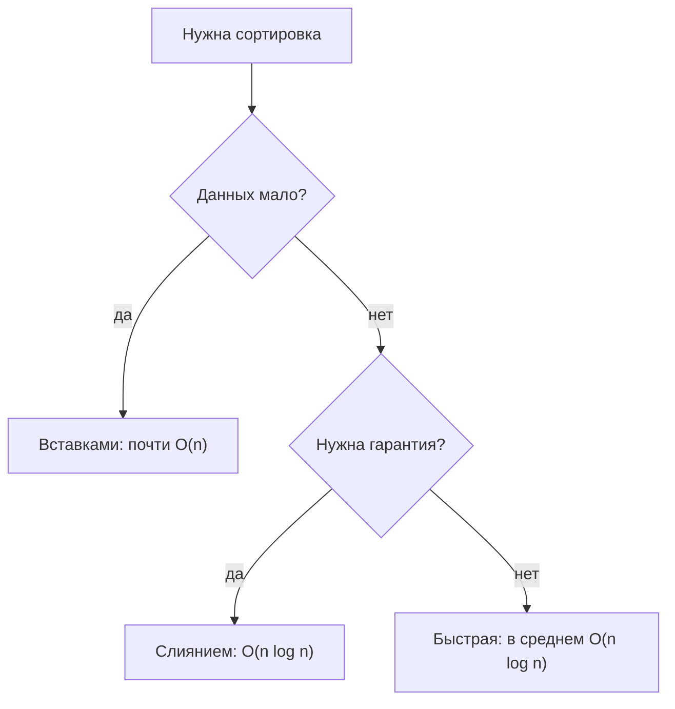

Привет! Сортировка — одна из самых изученных задач в информатике: отсортированные данные ускоряют поиск, сжатие и анализ. В этом уроке мы реализуем четыре классических алгоритма — «пузырьком», вставками, слиянием и быструю — и разберёмся, чем они отличаются, Встроенная функция `sorted()` обычно решает задачу за тебя, но понимание алгоритмов важно: они встречаются в собеседованиях, а на их основе строятся более сложные структуры.

## Пузырьковая сортировка

Самый простой алгоритм. Идея: проходим по списку и сравниваем соседние элементы; если левый больше правого — меняем их местами. После каждого полного прохода самый большой элемент «всплывает» в конец, как пузырёк. Повторяем проходы, пока не останется обменов.

```python
def bubble_sort(arr):
    arr = arr[:]                     # работаем с копией
    n = len(arr)
    for i in range(n - 1):
        swapped = False
        for j in range(n - 1 - i):
            if arr[j] > arr[j + 1]:
                arr[j], arr[j + 1] = arr[j + 1], arr[j]
                swapped = True
        if not swapped:              # ничего не менялось — готово
            break
    return arr

print(bubble_sort([64, 34, 25, 12, 22, 11, 90]))
```

Результат: `[11, 12, 22, 25, 34, 64, 90]`. В худшем случае (список отсортирован в обратном порядке) каждый из `n` элементов сравнивается с `n` другими — сложность `O(n²)`. Флаг `swapped` — оптимизация: если за проход не было ни одного обмена, список уже отсортирован, и можно остановиться.

## Сортировка вставками

Представь, как ты раскладываешь карты в руке: берёшь новую карту и вставляешь её в правильное место среди уже разложенных. Алгоритм проходит по списку слева направо, и для каждого элемента «проталкивает» его влево, пока слева не окажется меньший или равный.

```python
def insertion_sort(arr):
    arr = arr[:]
    for i in range(1, len(arr)):
        key = arr[i]
        j = i - 1
        while j >= 0 and arr[j] > key:
            arr[j + 1] = arr[j]
            j -= 1
        arr[j + 1] = key
    return arr

print(insertion_sort([5, 2, 9, 1, 5, 6]))
```

Результат: `[1, 2, 5, 5, 6, 9]`. В худшем случае сложность тоже `O(n²)`, но у вставок есть важное преимущество: на почти отсортированных данных внутренний цикл почти не работает, и алгоритм оказывается очень быстрым — лучший случай `O(n)`.

## Сортировка слиянием

Это первый алгоритм из класса «разделяй и властвуй». Список рекурсивно делится пополам, пока в каждой части не останется один элемент, а затем части попарно сливаются в отсортированные:

```python
def merge(left, right):
    result = []
    i = j = 0
    while i < len(left) and j < len(right):
        if left[i] <= right[j]:
            result.append(left[i])
            i += 1
        else:
            result.append(right[j])
            j += 1
    result.extend(left[i:])
    result.extend(right[j:])
    return result

def merge_sort(arr):
    if len(arr) <= 1:
        return arr
    mid = len(arr) // 2
    left = merge_sort(arr[:mid])
    right = merge_sort(arr[mid:])
    return merge(left, right)

print(merge_sort([38, 27, 43, 3, 9, 82, 10]))
```

Результат: `[3, 9, 10, 27, 38, 43, 82]`. Слияние двух частей занимает `O(n)`, а глубина деления — `log n`, поэтому суммарно `O(n log n)` в любом случае. Это очень надёжный алгоритм, но ему нужна дополнительная память под результат слияния.

## Быстрая сортировка

Тоже «разделяй и властвуй», но по-другому: выбираем опорный элемент (pivot) и разбиваем список на три части — меньшие опоры, равные ей и большие. Затем рекурсивно сортируем меньшие и большие:

```python
def quick_sort(arr):
    if len(arr) <= 1:
        return arr
    pivot = arr[len(arr) // 2]
    less = [x for x in arr if x < pivot]
    equal = [x for x in arr if x == pivot]
    greater = [x for x in arr if x > pivot]
    return quick_sort(less) + equal + quick_sort(greater)

print(quick_sort([3, 6, 8, 10, 1, 2, 1]))
```

Результат: `[1, 1, 2, 3, 6, 8, 10]`. В среднем быстрая сортировка работает за `O(n log n)` и обычно быстрее слияния на случайных данных, потому что меньше тратит на слияние. Но в худшем случае (например, когда опора всегда оказывается минимумом) она деградирует до `O(n²)`.

## Что выбрать

- **Пузырьком** — учебный алгоритм; на практике не используется.
- **Вставками** — отлично подходит для маленьких или почти отсортированных списков.
- **Слиянием** — стабильная гарантированная `O(n log n)`, но требует дополнительной памяти.
- **Быстрая** — лучший выбор для больших случайных данных, но без гарантий худшего случая.

В реальном коде чаще всего используют встроенную `sorted()`, которая реализована на C и использует комбинацию приёмов. Но умение написать сортировку руками — незаменимый навык.

Как выбрать алгоритм под задачу:



## Итог урока

Мы узнали:

- четыре классических алгоритма и их реализации;
- пузырьковая и вставками — `O(n²)`, но вставки быстры на почти отсортированных данных;
- слияние — гарантированно `O(n log n)`, но с дополнительной памятью;
- быстрая — `O(n log n)` в среднем, быстрее всего на случайных данных.

Теперь попрактикуемся.

<!--TASK-->
### Задача 1
Реализуй функцию `bubble_sort(arr)`, которая сортирует список пузырьком и возвращает новый отсортированный список, не изменяя исходный. Используй оптимизацию с флагом `swapped`, как в теории. Вызови функцию для списка `[64, 34, 25, 12, 22, 11, 90]` и выведи результат на экран. Дополнительно выведи исходный список, чтобы убедиться, что он не изменился: две строки вида `Было: [64, 34, 25, 12, 22, 11, 90]` и `Стало: [11, 12, 22, 25, 34, 64, 90]`.

### Задача 2
Реализуй функцию `insertion_sort(arr)` — сортировку вставками, как в теории. Примени её к списку `[5, 2, 9, 1, 5, 6]` и выведи результат. Обрати внимание: в списке есть две пятёрки — они обе должны сохраниться в отсортированном результате (сортировка «стабильная»). Выведи строку `Отсортировано: [1, 2, 5, 5, 6, 9]`. Затем в комментарии объясни, почему внутренний цикл `while` в худшем случае делает порядка n²/2 сдвигов.

### Задача 3
Реализуй сортировку слиянием: две функции `merge(left, right)` и `merge_sort(arr)`. Функция `merge` должна сливать два отсортированных списка в один отсортированный, а `merge_sort` — рекурсивно делить список пополам и сливать результаты. Примени сортировку к списку `[38, 27, 43, 3, 9, 82, 10]` и выведи результат. В комментарии напиши, почему глубина рекурсии равна примерно `log2(n)` и откуда берётся сложность `O(n log n)`.

### Задача 4
Реализуй быструю сортировку `quick_sort(arr)` с опорным элементом — средним по позиции элементом списка, как в теории. Отсортируй список `[3, 6, 8, 10, 1, 2, 1]` и выведи результат. Заметь: единицы встречаются дважды, и обе должны попасть в ответ. Затем в комментарии объясни, почему в худшем случае (когда опора всегда минимальна или максимальна) сложность становится `O(n²)`, а в среднем остаётся `O(n log n)`.

### Задача 5
Напиши программу-сравнение. Возьми список `[33, 5, 17, 9, 42, 7, 5]` и отсортируй его четырьмя способами: `bubble_sort`, `insertion_sort`, `merge_sort`, `quick_sort` (используй функции из предыдущих задач). Выведи четыре строки с результатами в порядке: пузырьком, вставками, слиянием, быстрая. Затем проверь, что все четыре результата равны результату встроенной `sorted()`, и выведи `Все сортировки дали одинаковый результат: True`.
### Задача 6
Сравни число сравнений у пузырьковой сортировки и сортировки вставками. Доработай обе функции так, чтобы они возвращали кортеж `(отсортированный_список, число_сравнений)`: в пузырьковой увеличивай счётчик перед каждым `if arr[j] > arr[j + 1]`, в сортировке вставками — перед каждой проверкой `arr[j] > key`. Прогони обе на почти отсортированном списке `[1, 2, 3, 4, 5, 6, 8, 7]` и на обратном `[8, 7, 6, 5, 4, 3, 2, 1]`. Выведи две строки: `Почти отсортирован: пузырёк 13, вставки 8` и `Обратный порядок: пузырёк 28, вставки 28`. В комментарии объясни, почему на почти отсортированных данных вставки выигрывают, а на обратных — сравниваются.

### Задача 7
Отсортируй список студентов по двум ключам: по оценке по убыванию, а при равных оценках — по имени по возрастанию. Дан список `[("Аня", 4), ("Боря", 5), ("Витя", 4), ("Галя", 5), ("Дима", 3)]`. Сначала отсортируй его по имени встроенной `sorted` с `key=lambda s: s[0]`, затем устойчивой сортировкой — по оценке с `reverse=True`. Выведи результат строками `Боря: 5`, `Галя: 5`, `Аня: 4`, `Витя: 4`, `Дима: 3`. В комментарии объясни, почему двухпроходная устойчивая сортировка даёт тот же результат, что и сортировка по составному ключу.
<!--/TASK-->

<!--HINT-->
### Подсказка 1
Скопируй `bubble_sort` из теории. Чтобы не менять исходный список, первой строкой сделай копию: `arr = arr[:]`. Для проверки, что исходник цел, сохрани его в переменную до вызова и выведи после.

### Подсказка 2
Внешний цикл идёт с `i = 1`. Ключевой элемент `key = arr[i]`, а внутренний `while` сдвигает вправо все элементы, которые больше `key`. После цикла вставь `key` на освободившееся место.

### Подсказка 3
Базовый случай: если `len(arr) <= 1`, верни `arr`. Иначе посчитай `mid = len(arr) // 2`, вызови `merge_sort` для левой и правой половин, а затем `merge` от результатов. В `merge` сравнивай первые элементы частей и добавляй меньший в результат.

### Подсказка 4
Если длина списка меньше или равна 1 — верни его. Иначе возьми `pivot = arr[len(arr) // 2]` и собери три списка через генераторы списков с условиями `<`, `==`, `>`. Склей результаты: `quick_sort(less) + equal + quick_sort(greater)`.

### Подсказка 5
Собери четыре результата вызовов в список `results`. Для проверки сравни каждый из них со `sorted(original)`. Если все равны, выведи `True`. Помни: каждая функция должна возвращать новый список, а не менять исходный.
### Подсказка 6
Счётчик объяви до циклов и возвращай вместе со списком. В пузырьке считай каждое обращение к паре, даже если обмена не было. В вставках цикл `while` удобно переписать так: сначала проверь `j >= 0`, затем увеличивай счётчик и сравнивай `arr[j] > key`, а при ложном результате сразу делай `break`.

### Подсказка 7
Ключ сортировки — функция от элемента: `lambda s: s[0]` для имени и `lambda s: s[1]` для оценки. Порядок важен: сначала сортируй по младшему ключу (имя), потом по старшему (оценка). Встроенная `sorted` устойчива, поэтому второй проход не ломает первый.
<!--/HINT-->

<!--SOLUTION-->
### Разбор 1
Решение:

```python
def bubble_sort(arr):
    arr = arr[:]
    n = len(arr)
    for i in range(n - 1):
        swapped = False
        for j in range(n - 1 - i):
            if arr[j] > arr[j + 1]:
                arr[j], arr[j + 1] = arr[j + 1], arr[j]
                swapped = True
        if not swapped:
            break
    return arr

original = [64, 34, 25, 12, 22, 11, 90]
print(f"Было: {original}")
print(f"Стало: {bubble_sort(original)}")
```

Результат:

```
Было: [64, 34, 25, 12, 22, 11, 90]
Стало: [11, 12, 22, 25, 34, 64, 90]
```

Что здесь происходит? Первая строка `arr = arr[:]` создаёт копию, поэтому исходный список остаётся нетронутым. Внешний цикл выполняет проходы, внутренний — сравнивает соседние пары. Граница `n - 1 - i` не заглядывает в уже «всплывший» хвост — это экономит сравнения. Флаг `swapped` позволяет выйти рано: если проход прошёл без обменов, список отсортирован. В худшем случае сложность `O(n²)`, но на почти отсортированных данных с флагом алгоритм отработает быстро.

### Разбор 2
Решение:

```python
def insertion_sort(arr):
    arr = arr[:]
    for i in range(1, len(arr)):
        key = arr[i]
        j = i - 1
        while j >= 0 and arr[j] > key:
            arr[j + 1] = arr[j]
            j -= 1
        arr[j + 1] = key
    return arr

print(f"Отсортировано: {insertion_sort([5, 2, 9, 1, 5, 6])}")
# В худшем случае для каждого i сдвигаются все элементы левее,
# то есть 1 + 2 + ... + (n - 1) = n*(n-1)/2 сдвигов — O(n²).
```

Результат:

```
Отсортировано: [1, 2, 5, 5, 6, 9]
```

Что здесь происходит? Для каждого элемента мы запоминаем его в `key` и двигаемся влево, пока не встретим меньший или равный элемент: все большие сдвигаются на одну позицию вправо. Условие `arr[j] > key` со строгим знаком делает вставку стабильной: равные элементы не перепрыгивают друг друга, поэтому две пятёрки сохраняют исходный порядок. В худшем случае сдвигов примерно `n*(n-1)/2` — это `O(n²)`, но на почти отсортированных данных цикл почти не выполняется, и алгоритм работает почти за `O(n)`.

### Разбор 3
Решение:

```python
def merge(left, right):
    result = []
    i = j = 0
    while i < len(left) and j < len(right):
        if left[i] <= right[j]:
            result.append(left[i])
            i += 1
        else:
            result.append(right[j])
            j += 1
    result.extend(left[i:])
    result.extend(right[j:])
    return result

def merge_sort(arr):
    if len(arr) <= 1:
        return arr
    mid = len(arr) // 2
    return merge(merge_sort(arr[:mid]), merge_sort(arr[mid:]))

print(merge_sort([38, 27, 43, 3, 9, 82, 10]))
```

Результат:

```
[3, 9, 10, 27, 38, 43, 82]
```

Что здесь происходит? Деление списка пополам повторяется, пока не останутся одиночные элементы: глубина рекурсии равна примерно `log2(n)`. На каждом уровне объём данных для слияния — `n`, а уровней — `log n`, откуда и берётся `O(n log n)`. Важно: эта оценка верна всегда, независимо от входных данных, поэтому слияние — самый предсказуемый из четырёх алгоритмов. Плата за это — дополнительная память: на каждом уровне создаются новые списки. Алгоритм стабилен, потому что в `merge` при равенстве мы берём элемент из левой части.

### Разбор 4
Решение:

```python
def quick_sort(arr):
    if len(arr) <= 1:
        return arr
    pivot = arr[len(arr) // 2]
    less = [x for x in arr if x < pivot]
    equal = [x for x in arr if x == pivot]
    greater = [x for x in arr if x > pivot]
    return quick_sort(less) + equal + quick_sort(greater)

print(quick_sort([3, 6, 8, 10, 1, 2, 1]))
```

Результат:

```
[1, 1, 2, 3, 6, 8, 10]
```

Что здесь происходит? Опорный элемент делит список на три части: меньшие, равные и большие. Рекурсия сортирует меньшие и большие, а равные уже стоят на своём месте — благодаря этому дубликаты (обе единицы) попадают в ответ автоматически. В среднем опора делит список примерно пополам, и мы получаем `O(n log n)`. Но если опора всегда оказывается минимумом или максимумом (например, на уже отсортированных данных), деление получается неравномерным и сложность деградирует до `O(n²)`. Поэтому на практике опору выбирают случайно или по правилу «медиана из трёх».

### Разбор 5
Решение:

```python
def bubble_sort(arr):
    arr = arr[:]
    n = len(arr)
    for i in range(n - 1):
        swapped = False
        for j in range(n - 1 - i):
            if arr[j] > arr[j + 1]:
                arr[j], arr[j + 1] = arr[j + 1], arr[j]
                swapped = True
        if not swapped:
            break
    return arr

def insertion_sort(arr):
    arr = arr[:]
    for i in range(1, len(arr)):
        key = arr[i]
        j = i - 1
        while j >= 0 and arr[j] > key:
            arr[j + 1] = arr[j]
            j -= 1
        arr[j + 1] = key
    return arr

def merge(left, right):
    result = []
    i = j = 0
    while i < len(left) and j < len(right):
        if left[i] <= right[j]:
            result.append(left[i])
            i += 1
        else:
            result.append(right[j])
            j += 1
    result.extend(left[i:])
    result.extend(right[j:])
    return result

def merge_sort(arr):
    if len(arr) <= 1:
        return arr
    mid = len(arr) // 2
    return merge(merge_sort(arr[:mid]), merge_sort(arr[mid:]))

def quick_sort(arr):
    if len(arr) <= 1:
        return arr
    pivot = arr[len(arr) // 2]
    less = [x for x in arr if x < pivot]
    equal = [x for x in arr if x == pivot]
    greater = [x for x in arr if x > pivot]
    return quick_sort(less) + equal + quick_sort(greater)

original = [33, 5, 17, 9, 42, 7, 5]
print(f"Пузырьком: {bubble_sort(original)}")
print(f"Вставками: {insertion_sort(original)}")
print(f"Слиянием: {merge_sort(original)}")
print(f"Быстрая: {quick_sort(original)}")
results = [bubble_sort(original), insertion_sort(original),
           merge_sort(original), quick_sort(original)]
expected = sorted(original)
print(f"Все сортировки дали одинаковый результат: "
      f"{all(r == expected for r in results)}")
```

Результат:

```
Пузырьком: [5, 5, 7, 9, 17, 33, 42]
Вставками: [5, 5, 7, 9, 17, 33, 42]
Слиянием: [5, 5, 7, 9, 17, 33, 42]
Быстрая: [5, 5, 7, 9, 17, 33, 42]
Все сортировки дали одинаковый результат: True
```

Что здесь происходит? Мы вызываем все четыре функции с одним и тем же списком и проверяем их результаты через `all(...)` против встроенной `sorted()`. Совпадение в `True` говорит, что все реализации корректны. Обрати внимание на `5` и `5`: при том, что все четыре алгоритма выдают одинаковый результат, быстрая сортировка в этой реализации не обязана быть стабильной — но благодаря разбиению на «меньшие / равные / большие» дубликаты всё равно собираются вместе. Понимание того, как устроены разные сортировки, поможет тебе выбирать подходящую в реальных проектах.
### Разбор 6
Решение:

```python
def bubble_sort_count(arr):
    arr = arr[:]
    n = len(arr)
    comparisons = 0
    for i in range(n - 1):
        swapped = False
        for j in range(n - 1 - i):
            comparisons += 1
            if arr[j] > arr[j + 1]:
                arr[j], arr[j + 1] = arr[j + 1], arr[j]
                swapped = True
        if not swapped:
            break
    return arr, comparisons


def insertion_sort_count(arr):
    arr = arr[:]
    comparisons = 0
    for i in range(1, len(arr)):
        key = arr[i]
        j = i - 1
        while j >= 0:
            comparisons += 1
            if arr[j] > key:
                arr[j + 1] = arr[j]
                j -= 1
            else:
                break
        arr[j + 1] = key
    return arr, comparisons


nearly = [1, 2, 3, 4, 5, 6, 8, 7]
reversed_arr = [8, 7, 6, 5, 4, 3, 2, 1]

b1 = bubble_sort_count(nearly)[1]
i1 = insertion_sort_count(nearly)[1]
b2 = bubble_sort_count(reversed_arr)[1]
i2 = insertion_sort_count(reversed_arr)[1]

print(f"Почти отсортирован: пузырёк {b1}, вставки {i1}")
print(f"Обратный порядок: пузырёк {b2}, вставки {i2}")
```

Результат:

```
Почти отсортирован: пузырёк 13, вставки 8
Обратный порядок: пузырёк 28, вставки 28
```

Что здесь происходит? На почти отсортированном списке пузырёк делает полный первый проход (7 сравнений с одним обменом) и второй проход без обменов (6 сравнений) — всего 13. Вставки же для большинства элементов сразу видят, что левый сосед меньше ключа, и тратят одно сравнение; только для семёрки нужно два. На полностью обратном массиве оба алгоритма делают по 28 сравнений, то есть `n*(n-1)/2` — худший случай для обоих. Вывод: асимптотика у них одна, но константы и поведение на реальных данных различаются, и именно поэтому вставки считаются практичным выбором для небольших или почти упорядоченных массивов.

### Разбор 7
Решение:

```python
students = [("Аня", 4), ("Боря", 5), ("Витя", 4),
            ("Галя", 5), ("Дима", 3)]

by_name = sorted(students, key=lambda s: s[0])
by_grade = sorted(by_name, key=lambda s: s[1], reverse=True)

for name, grade in by_grade:
    print(f"{name}: {grade}")

# Сортировка по младшему ключу, затем устойчивая — по старшему.
# Равные оценки сохраняют алфавитный порядок, полученный на первом проходе.
```

Результат:

```
Боря: 5
Галя: 5
Аня: 4
Витя: 4
Дима: 3
```

Что здесь происходит? Встроенная `sorted` в Python устойчива: элементы с равными ключами остаются в том порядке, в котором были. Поэтому две последовательные сортировки работают как одна по составному ключу — сначала упорядочиваем по имени, затем по оценке; при равных оценках порядок имён уже правильный, и вторая сортировка его не ломает. Тот же результат можно получить за один вызов: `sorted(students, key=lambda s: (-s[1], s[0]))`. Минус перед оценкой превращает возрастание в убывание, потому что сортировка всегда по возрастанию. Двухпроходный вариант полезнее, когда ключи вычисляются дорого или когда нужно явно показать, что алгоритм устойчив.
<!--/SOLUTION-->

<!--QUIZ-->
Какая сложность у пузырьковой сортировки в худшем случае?
- O(n)
- O(n²)
- O(n log n)
* Правильный ответ: O(n²)
В худшем случае каждый элемент сравнивается с каждым — примерно n²/2 сравнений.

Какой алгоритм использует принцип «разделяй и властвуй»?
- Пузырьковая сортировка
- Сортировка вставками
- Сортировка слиянием и быстрая
* Правильный ответ: Сортировка слиянием и быстрая
Оба алгоритма делят данные на части и рекурсивно сортируют их.

Почему сортировка слиянием всегда работает за O(n log n)?
- Потому что она сортирует только уникальные элементы
- Потому что список делится пополам, а слияние на каждом уровне занимает O(n)
- Потому что она использует встроенную sorted()
* Правильный ответ: Потому что список делится пополам, а слияние на каждом уровне занимает O(n)
Глубина деления — log2(n), на каждом уровне работа — O(n), итого O(n log n).

В каком случае сортировка вставками работает почти за O(n)?
- На почти отсортированных данных
- На случайных данных
- На данных, отсортированных в обратном порядке
* Правильный ответ: На почти отсортированных данных
Внутренний цикл почти не сдвигает элементы, поэтому работа близка к O(n).

Какая сортировка обычно самая быстрая на больших случайных данных?
- Пузырьковая
- Быстрая
- Сортировка слиянием
* Правильный ответ: Быстрая
В среднем быстрая сортировка работает за O(n log n) с малыми константами и на случайных данных обычно обгоняет слияние.

Что делает строчка arr = arr[:] в начале функции сортировки?
- Создаёт копию списка, чтобы не менять исходный
- Сортирует список на месте
- Удаляет дубликаты
* Правильный ответ: Создаёт копию списка, чтобы не менять исходный
Срез arr[:] создаёт новый список, и все изменения происходят с копией.

В каком порядке элементы выходят после полного прохода пузырьковой сортировки?
- Самый большой элемент «всплывает» в конец
- Самый маленький элемент становится первым
- Порядок не меняется
* Правильный ответ: Самый большой элемент «всплывает» в конец
После каждого прохода самый большой из неотсортированных элементов оказывается в конце.

Почему сортировка вставками стабильная?
- Равные элементы не переставляются местами: while сдвигает только те, что строго больше key
- Она никогда не сравнивает равные элементы
- Она сортирует только числа
* Правильный ответ: Равные элементы не переставляются местами: while сдвигает только те, что строго больше key
Условие arr[j] > key со строгим знаком сохраняет порядок равных элементов.
Что означает «стабильная сортировка»?
- Равные элементы сохраняют свой исходный взаимный порядок
- Сортировка никогда не падает с ошибкой
- Сортировка не меняет исходный список
* Правильный ответ: Равные элементы сохраняют свой исходный взаимный порядок
Именно поэтому цепочка устойчивых сортировок позволяет упорядочить данные по нескольким ключам.

Сколько сравнений сделает пузырёк с флагом swapped на уже отсортированном массиве из n элементов?
- n − 1
- n²
- 1
* Правильный ответ: n − 1
Первый проход сравнивает все соседние пары и не находит обменов, после чего цикл завершается досрочно.

Какая из четырёх сортировок требует O(n) дополнительной памяти?
- Пузырьковая
- Вставками
- Слиянием
* Правильный ответ: Слиянием
На каждом уровне рекурсии создаются новые списки для слияния, поэтому нужна память порядка n.

Как отсортировать записи по двум ключам, используя устойчивую сортировку?
- Сначала по младшему ключу, затем по старшему
- Сначала по старшему ключу, затем по младшему
- Достаточно одного прохода без ключа
* Правильный ответ: Сначала по младшему ключу, затем по старшему
Второй проход не должен разрушать порядок, установленный первым, поэтому главный ключ сортируется последним.
<!--/QUIZ-->
