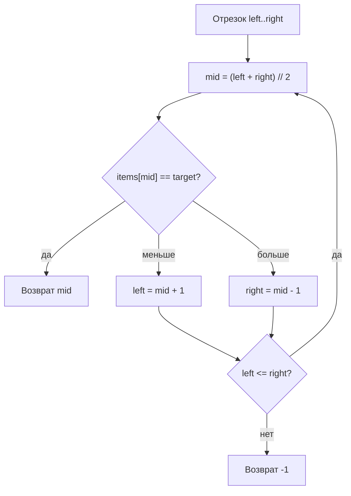

Привет! Поиск элемента в данных — вторая по важности задача после сортировки. Мы разберём два классических алгоритма: линейный, который работает с любым списком, и бинарный, который многократно быстрее, но требует отсортированных данных. Ты реализуешь оба, разберёшься, когда какой применять, и увидишь, сколько времени экономит понимание структур данных.

## Линейный поиск

Самый естественный способ найти элемент — пройти по списку от начала до конца и сравнить каждый элемент с искомым:

```python
def linear_search(items, target):
    for index, value in enumerate(items):
        if value == target:
            return index
    return -1

print(linear_search([4, 2, 9, 7], 9))   # 2
print(linear_search([4, 2, 9, 7], 5))   # -1
```

Если элемент найден, возвращаем его индекс; если список закончился и ничего не нашлось — возвращаем `-1` (так принято, потому что индекс `-1` в списке быть не может). В худшем случае придётся просмотреть весь список, поэтому сложность — `O(n)`. Зато линейный поиск работает с любыми данными: неважно, отсортирован список или нет. Именно поэтому без него не обойтись, когда список короткий или заранее неизвестен.

## Бинарный поиск

Представь игру «угадай число»: тебе говорят «загадано число от 1 до 1000», и ты каждый раз называешь число, а партнёр отвечает «больше» или «меньше». Умный игрок всегда называет середину отрезка — так каждый ход отбрасывает половину возможных чисел. Точно так же работает бинарный поиск.

Условие одно: список должен быть **отсортирован** по возрастанию. Тогда мы можем сравнивать искомое со средним элементом:

- если средний элемент равен искомому — он найден;
- если искомое меньше среднего — значит, оно в левой половине;
- если больше — в правой половине.

На каждом шаге область поиска уменьшается вдвое:

```python
def binary_search(items, target):
    left, right = 0, len(items) - 1
    while left <= right:
        mid = (left + right) // 2
        if items[mid] == target:
            return mid
        elif items[mid] < target:
            left = mid + 1
        else:
            right = mid - 1
    return -1

print(binary_search([1, 3, 5, 7, 9], 5))   # 2
print(binary_search([1, 3, 5, 7, 9], 4))   # -1
```

Неподвижные границы `left` и `right` задают текущий отрезок. Пока `left <= right`, считаем середину `mid` и сужаем отрезок. Если границы сошлись, а элемент не найден — возвращаем `-1`.

## Сколько шагов нужно

После каждого сравнения остаётся половина данных. Деление пополам повторяется, пока не останется один элемент: при `n` элементах это `log2(n)` шагов. Для миллиона элементов это около 20 сравнений — против миллиона в худшем случае у линейного поиска. Запиши это в нотации: бинарный поиск — `O(log n)`. Сравни с таблицей из урока о сложности: логарифмический рост почти не ощущается даже на гигантских данных.

## Граничные случаи

Есть несколько тонкостей, которые важно понимать:

- **Пустой список.** Сразу возвращаем `-1` — цикл не выполнится ни разу.
- **Элемента нет.** Границы сходятся, цикл заканчивается, возвращаем `-1`.
- **Дубликаты.** Обычный бинарный поиск вернёт какой-то из индексов повторяющегося элемента — не обязательно первый. Если нужно первое вхождение, после нахождения элемента надо продолжить поиск в левой половине:

```python
def binary_search_first(items, target):
    left, right = 0, len(items) - 1
    result = -1
    while left <= right:
        mid = (left + right) // 2
        if items[mid] == target:
            result = mid          # запомнили, но ищем ещё левее
            right = mid - 1
        elif items[mid] < target:
            left = mid + 1
        else:
            right = mid - 1
    return result

print(binary_search_first([2, 2, 2, 2], 2))   # 0
```

## Что выбрать

Правило простое: если список маленький или неотсортированный — линейный поиск (его сложность `O(n)`, но он прост и не требует подготовки). Если данных много и они отсортированы — бинарный (`O(log n)`). А если данные часто меняются, иногда выгоднее поддерживать отсортированность и всегда иметь доступ к быстрому поиску, чем каждый раз сканировать весь список.

Логика бинарного поиска в виде схемы:



## Итог урока

Мы узнали:

- линейный поиск проходит по списку и работает с любыми данными — `O(n)`;
- бинарный поиск требует отсортированного списка и отбрасывает половину данных на каждом шаге — `O(log n)`;
- для поиска первого вхождения при дубликатах нужно продолжать поиск в левой половине;
- `-1` — стандартный ответ, когда элемент не найден.

Теперь практика.

<!--TASK-->
### Задача 1
Реализуй функцию `linear_search(items, target)`, которая возвращает индекс первого вхождения `target` в списке `items`, или `-1`, если элемент не найден. Проверь её на списке `[4, 2, 9, 7]`: выведи результат поиска числа 9 (ожидаем `2`) и числа 5 (ожидаем `-1`). Используй `enumerate`, чтобы получать и индекс, и значение. В комментарии объясни, почему в худшем случае функция выполняет сравнений не больше, чем длина списка.

### Задача 2
Реализуй итеративную функцию `binary_search(items, target)` — бинарный поиск по отсортированному списку. Проверь её на списке `[1, 3, 5, 7, 9]`: выведи результаты поиска чисел 5 (ожидаем `2`) и 4 (ожидаем `-1`). Убедись, что пустой список тоже обрабатывается корректно: выведи результат `binary_search([], 1)` (ожидаем `-1`).

### Задача 3
Реализуй рекурсивную версию бинарного поиска `binary_search_recursive(items, target, left=0, right=None)`. Пусть функция сама решает, в какой половине искать, и вызывает себя для неё. Проверь её на списке `[2, 4, 6, 8, 10, 12]`: выведи результаты поиска чисел 8 (ожидаем `3`) и 7 (ожидаем `-1`). В комментарии объясни, что происходит с глубиной рекурсии при каждом вызове.

### Задача 4
Реализуй функцию `binary_search_first(items, target)`, которая находит **первое** вхождение `target` в отсортированном списке с дубликатами. Проверь её на списке `[1, 3, 3, 3, 5]`: выведи результат поиска числа 3 (ожидаем `1`) и числа 1 (ожидаем `0`). Отличие от обычного бинарного поиска: после нахождения элемента запоминай индекс и продолжай искать в левой половине.

### Задача 5
Напиши итоговую программу: она читает с клавиатуры две строки — в первой строке числа через пробел (они уже отсортированы), во второй — искомое число. Программа должна найти **первое** вхождение числа с помощью бинарного поиска и вывести его индекс или `-1`, если числа нет. Используй функцию `binary_search_first` из предыдущей задачи. Пример: для входа `1 3 5 7 9` и `5` программа выведет `2`, а для входа `1 3 5 7 9` и `4` — `-1`.
### Задача 6
Сравни число сравнений линейного и бинарного поиска. Напиши две функции: `linear_search_count(items, target)` и `binary_search_count(items, target)`, которые возвращают кортеж `(индекс, число_сравнений)`. Одно обращение к элементу считай одним сравнением. Прогони обе на списке `list(range(1, 101))` для `target = 100` и `target = 1`. Выведи четыре строки: `target=100: линейный индекс 99, сравнений 100`, `target=100: бинарный индекс 99, сравнений 7`, `target=1: линейный индекс 0, сравнений 1`, `target=1: бинарный индекс 0, сравнений 7`. В комментарии объясни, почему бинарный поиск стабильно тратит около семи сравнений, а линейный сильно зависит от позиции элемента.

### Задача 7
Найди границы вхождения элемента. Добавь к `binary_search_first` функцию `binary_search_last`, которая ищет последнее вхождение: при совпадении запоминай индекс и двигайся в правую половину (`left = mid + 1`). Для списка `[1, 3, 3, 3, 5, 7]` выведи для `target = 3` строку `target=3: первое 1, последнее 3, количество 3`, а для `target = 4` — `target=4: первое -1, последнее -1, количество 0`. Ожидаемый результат: обе функции работают за O(log n), а количество считается как `last - first + 1`.
<!--/TASK-->

<!--HINT-->
### Подсказка 1
`enumerate(items)` даёт пары `(index, value)`. Возвращай `index`, как только `value == target`. Если цикл завершился без возврата — верни `-1`.

### Подсказка 2
Заведи `left = 0` и `right = len(items) - 1`. В цикле `while left <= right` считай `mid = (left + right) // 2` и сравнивай `items[mid]` с `target`, сужая одну из границ. Если цикл закончился — верни `-1`.

### Подсказка 3
Базовый случай: если `right` ещё не задан, присвой `right = len(items) - 1`. Если `left > right` — верни `-1`. Иначе посчитай `mid`, сравни и вызови функцию рекурсивно для левой или правой половины.

### Подсказка 4
Заведи переменную `result = -1`. Когда `items[mid] == target`, сохрани `result = mid` и продолжай искать в левой половине: `right = mid - 1`. Верни `result` после цикла.

### Подсказка 5
Прочитай первую строку: `data = input().split()` и преобразуй в числа. Прочитай вторую строку с искомым числом. Выведи `binary_search_first(numbers, target)`.
### Подсказка 6
Счётчик увеличивай ровно там, где происходит обращение к элементу: в линейном поиске — перед сравнением `value == target`, в бинарном — после вычисления `mid`. Обрати внимание: для цели 1 линейный поиск выигрывает, потому что элемент стоит первым. Сделай вывод по четырём строкам, не смешивая алгоритмы.

### Подсказка 7
`binary_search_last` — зеркальное отражение `binary_search_first`: при совпадении записывай `result = mid` и сдвигай левую границу. Не забудь, что при отсутствии элемента обе функции возвращают `-1`, и в этом случае количество равно нулю, а не двум.
<!--/HINT-->

<!--SOLUTION-->
### Разбор 1
Решение:

```python
def linear_search(items, target):
    for index, value in enumerate(items):
        if value == target:
            return index
    return -1

print(linear_search([4, 2, 9, 7], 9))
print(linear_search([4, 2, 9, 7], 5))
# В худшем случае мы сравниваем target с каждым элементом списка,
# поэтому число сравнений не превышает длину списка — это O(n).
```

Результат:

```
2
-1
```

Что здесь происходит? `enumerate(items)` возвращает пары «индекс — значение», и мы на первом же совпадении возвращаем индекс. Если совпадений нет, цикл доходит до конца, и функция возвращает `-1`. Обрати внимание: если в списке несколько одинаковых элементов, мы возвращаем индекс самого первого — про `enumerate` мы не пропускаем ни одного элемента, и в худшем случае (когда элемента нет или он в самом конце) сравнений ровно столько, сколько элементов. Это и есть линейная сложность `O(n)`.

### Разбор 2
Решение:

```python
def binary_search(items, target):
    left, right = 0, len(items) - 1
    while left <= right:
        mid = (left + right) // 2
        if items[mid] == target:
            return mid
        elif items[mid] < target:
            left = mid + 1
        else:
            right = mid - 1
    return -1

print(binary_search([1, 3, 5, 7, 9], 5))
print(binary_search([1, 3, 5, 7, 9], 4))
print(binary_search([], 1))
```

Результат:

```
2
-1
-1
```

Что здесь происходит? Для списка `[1, 3, 5, 7, 9]` и цели `5`: `mid = (0 + 4) // 2 = 2`, `items[2] == 5` — сразу возвращаем индекс `2`. Для цели `4` при `mid = 2` оказывается `4 < 5`, поэтому `right = 1`; далее `mid = 0`, `items[0] == 1 < 4`, значит `left = 1`; теперь `left > right`, цикл заканчивается, возвращаем `-1`. Для пустого списка `right = -1`, условие `left <= right` не выполняется — сразу `-1`. Каждое сравнение сокращает отрезок вдвое: после `k` шагов остаётся `n / 2^k` элементов, отсюда и `O(log n)`.

### Разбор 3
Решение:

```python
def binary_search_recursive(items, target, left=0, right=None):
    if right is None:
        right = len(items) - 1
    if left > right:
        return -1
    mid = (left + right) // 2
    if items[mid] == target:
        return mid
    elif items[mid] < target:
        return binary_search_recursive(items, target, mid + 1, right)
    else:
        return binary_search_recursive(items, target, left, mid - 1)

print(binary_search_recursive([2, 4, 6, 8, 10, 12], 8))
print(binary_search_recursive([2, 4, 6, 8, 10, 12], 7))
# Каждый рекурсивный вызов работает с половиной данных,
# поэтому глубина рекурсии равна log2(n).
```

Результат:

```
3
-1
```

Что здесь происходит? Каждый вызов либо находит элемент, либо вызывает себя для левой или правой половины. Базовый случай — `left > right`, когда область поиска пуста. Так как на каждом уровне данных становится вдвое меньше, глубина рекурсии не превышает `log2(n)`. Для списка из миллиона элементов это около 20 вложенных вызовов — глубина безопасна. Рекурсивная версия хорошо показывает структуру алгоритма, и на практике её чаще используют в учебных целях, а итеративную — в продакшене, чтобы не тратить память на стек вызовов.

### Разбор 4
Решение:

```python
def binary_search_first(items, target):
    left, right = 0, len(items) - 1
    result = -1
    while left <= right:
        mid = (left + right) // 2
        if items[mid] == target:
            result = mid
            right = mid - 1
        elif items[mid] < target:
            left = mid + 1
        else:
            right = mid - 1
    return result

print(binary_search_first([1, 3, 3, 3, 5], 3))
print(binary_search_first([1, 3, 3, 3, 5], 1))
```

Результат:

```
1
0
```

Что здесь происходит? Обычный бинарный поиск вернул бы для числа 3 индекс `2` — он находит любой индекс равного элемента. А нам нужен самый левый. Поэтому при совпадении мы не выходим сразу, а запоминаем `result = mid` и продолжаем искать в левой половине: `right = mid - 1`. Если левее есть ещё такие же элементы, они обязательно найдутся и перезапишут `result`. Для числа 1 поиск сразу находит его на индексе `0`, дальше `right = -1`, цикл завершается — возвращаем `0`. Такой приём полезен в реальных задачах: найти первую запись, первый день, первый заказ — паттерн одинаковый.

### Разбор 5
Решение:

```python
def binary_search_first(items, target):
    left, right = 0, len(items) - 1
    result = -1
    while left <= right:
        mid = (left + right) // 2
        if items[mid] == target:
            result = mid
            right = mid - 1
        elif items[mid] < target:
            left = mid + 1
        else:
            right = mid - 1
    return result

data = input().split()
numbers = [int(x) for x in data]
target = int(input())
print(binary_search_first(numbers, target))
```

Пример работы:

```
Ввод:
1 3 5 7 9
5
Ожидаемый вывод:
2
```

Что здесь происходит? `input()` читает строку, `split()` разбивает её по пробелам, а список-понимание `[int(x) for x in data]` превращает текстовые числа в настоящие `int`. Вторая строка — искомое число. Затем мы вызываем `binary_search_first`, которая возвращает индекс первого вхождения или `-1`. Обрати внимание: программа предполагает, что список уже отсортирован — это условие бинарного поиска. Именно эту программу будет проверять автотест: она читает данные со стандартного ввода и печатает результат.
### Разбор 6
Решение:

```python
def linear_search_count(items, target):
    comparisons = 0
    for index, value in enumerate(items):
        comparisons += 1
        if value == target:
            return index, comparisons
    return -1, comparisons


def binary_search_count(items, target):
    left, right = 0, len(items) - 1
    comparisons = 0
    while left <= right:
        mid = (left + right) // 2
        comparisons += 1
        if items[mid] == target:
            return mid, comparisons
        elif items[mid] < target:
            left = mid + 1
        else:
            right = mid - 1
    return -1, comparisons


numbers = list(range(1, 101))
for target in (100, 1):
    idx, cnt = linear_search_count(numbers, target)
    print(f"target={target}: линейный индекс {idx}, сравнений {cnt}")
    idx, cnt = binary_search_count(numbers, target)
    print(f"target={target}: бинарный индекс {idx}, сравнений {cnt}")
```

Результат:

```
target=100: линейный индекс 99, сравнений 100
target=100: бинарный индекс 99, сравнений 7
target=1: линейный индекс 0, сравнений 1
target=1: бинарный индекс 0, сравнений 7
```

Что здесь происходит? Линейный поиск идёт с начала, поэтому его стоимость целиком зависит от позиции элемента: первый элемент находится за одно сравнение, последний — за сто. Бинарный поиск каждый раз делит отрезок пополам, и после семи делений от ста элементов остаётся меньше одного — поэтому семь сравнений хватает и для первого, и для последнего элемента. На маленьких данных или при удачном расположении цели линейный поиск может оказаться быстрее, но на больших объёмах разрыв становится огромным: для миллиона элементов это 20 сравнений против миллиона. Именно поэтому важно смотреть не только на «средний» случай, но и на худший, и на размер данных.

### Разбор 7
Решение:

```python
def binary_search_first(items, target):
    left, right = 0, len(items) - 1
    result = -1
    while left <= right:
        mid = (left + right) // 2
        if items[mid] == target:
            result = mid
            right = mid - 1
        elif items[mid] < target:
            left = mid + 1
        else:
            right = mid - 1
    return result


def binary_search_last(items, target):
    left, right = 0, len(items) - 1
    result = -1
    while left <= right:
        mid = (left + right) // 2
        if items[mid] == target:
            result = mid
            left = mid + 1
        elif items[mid] < target:
            left = mid + 1
        else:
            right = mid - 1
    return result


def describe(items, target):
    first = binary_search_first(items, target)
    last = binary_search_last(items, target)
    count = last - first + 1 if first != -1 else 0
    print(f"target={target}: первое {first}, последнее {last}, количество {count}")


data = [1, 3, 3, 3, 5, 7]
describe(data, 3)
describe(data, 4)
```

Результат:

```
target=3: первое 1, последнее 3, количество 3
target=4: первое -1, последнее -1, количество 0
```

Что здесь происходит? Обе функции используют один и тот же приём: при совпадении они не выходят из цикла, а запоминают индекс и продолжают поиск в сторону нужной границы. `first` уходит влево (`right = mid - 1`), `last` — вправо (`left = mid + 1`). Такой поиск называют левым и правым биномиальным поиском, и он остаётся логарифмическим: каждое сужение отбрасывает половину оставшихся индексов. Зная обе границы, легко получить количество вхождений одной формулой, без второго прохода по списку. Этот шаблон пригодится везде, где нужно найти диапазон: страницы с одинаковым рейтингом, события за один день, заказы одного клиента в отсортированном журнале.
<!--/SOLUTION-->

<!--QUIZ-->
Может ли линейный поиск работать с неотсортированным списком?
- Да
- Нет
- Только если список состоит из чисел
* Правильный ответ: Да
Линейный поиск просто сравнивает элементы по очереди — порядок для него не важен.

Какая сложность у бинарного поиска?
- O(1)
- O(n)
- O(log n)
* Правильный ответ: O(log n)
Каждый шаг отбрасывает половину данных, поэтому шагов примерно log2(n).

Какое обязательное условие нужно для бинарного поиска?
- Список отсортирован по возрастанию
- В списке нет дубликатов
- Список содержит только положительные числа
* Правильный ответ: Список отсортирован по возрастанию
Только на отсортированных данных можно уверенно отбрасывать половину списка.

Что вернёт линейный поиск, если элемента в списке нет?
- -1
- 0
- Ничего, программа упадёт с ошибкой
* Правильный ответ: -1
Возврат -1 — стандартный способ сообщить, что элемент не найден.

Сколько примерно шагов сделает бинарный поиск в списке из миллиона элементов?
- Около 20
- Около 1000
- Ровно миллион
* Правильный ответ: Около 20
2²⁰ ≈ 1 000 000, поэтому хватит примерно двадцати сравнений.

Чем binary_search_first отличается от обычного бинарного поиска?
- После нахождения элемента продолжает искать в левой половине
- Ищет только в правой половине
- Работает только с отрицательными числами
* Правильный ответ: После нахождения элемента продолжает искать в левой половине
Это позволяет вернуть самое первое вхождение при дубликатах.

Почему бинарный поиск не работает на неотсортированном списке?
- Нельзя уверенно отбрасывать половину данных, если порядок неизвестен
- Python запрещает вызывать его для неотсортированных списков
- Он вернёт ошибку деления на ноль
* Правильный ответ: Нельзя уверенно отбрасывать половину данных, если порядок неизвестен
Без сортировки сравнение со средним элементом ничего не говорит о том, где искать дальше.

Что вернёт binary_search([1, 3, 5, 7, 9], 0)?
- -1
- 0
- 1
* Правильный ответ: -1
Число 0 меньше всех элементов: границы сойдутся, и функция вернёт -1.
Сколько примерно сравнений нужно бинарному поиску в отсортированном массиве из 100 элементов?
- Около 7
- Около 50
- Ровно 100
* Правильный ответ: Около 7
log2(100) ≈ 6,6, поэтому хватает семи делений пополам — независимо от того, где стоит искомый элемент.

Что произойдёт, если запустить бинарный поиск на неотсортированном массиве?
- Результат не определён: алгоритм может вернуть -1 даже при наличии элемента
- Алгоритм сам отсортирует массив
- Python выбросит ValueError
* Правильный ответ: Результат не определён: алгоритм может вернуть -1 даже при наличии элемента
Без порядка нельзя решить, какую половину отбросить, поэтому вывод алгоритма теряет смысл.

Как найти последнее вхождение элемента в отсортированном массиве с дубликатами?
- При совпадении запоминать индекс и продолжать поиск в правой половине
- Всегда возвращать последний индекс массива
- Искать с конца линейным поиском
* Правильный ответ: При совпадении запоминать индекс и продолжать поиск в правой половине
Такой правый бинарный поиск остаётся O(log n) и находит самую правую позицию.

Почему в бинарном поиске используют mid = (left + right) // 2, а не обычное деление?
- Потому что индекс элемента должен быть целым числом
- Потому что так быстрее работает Python
- Потому что иначе цикл никогда не закончится
* Правильный ответ: Потому что индекс элемента должен быть целым числом
Обычное деление дало бы float, а индексы в списке — целые; // сразу округляет вниз.
<!--/QUIZ-->

<!--TESTS-->
### Тест 1
Ввод:
```
1 3 5 7 9
5
```
Ожидаемый вывод:
```
2
```
### Тест 2
Ввод:
```
1 3 5 7 9
4
```
Ожидаемый вывод:
```
-1
```
### Тест 3
Ввод:
```
2 2 2 2
2
```
Ожидаемый вывод:
```
0
```
### Тест 4
Ввод:
```
10 20 30 40 50
40
```
Ожидаемый вывод:
```
3
```
### Тест 5
Ввод:
```
5
5
```
Ожидаемый вывод:
```
0
```
### Тест 6
Ввод:
```
2 4 4 4 8
4
```
Ожидаемый вывод:
```
1
```
### Тест 7
Ввод:
```
1
1
```
Ожидаемый вывод:
```
0
```
### Тест 8
Ввод:
```
1 2 3
0
```
Ожидаемый вывод:
```
-1
```
<!--/TESTS-->
