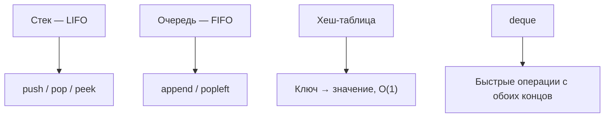

Привет! Алгоритмы работают с данными, а данные удобно хранить в специальных структурах. В этом уроке мы разберём четыре базовые структуры: стек, очередь, двустороннюю очередь `deque` и хеш-таблицу (в Python это словарь). Они встречаются повсюду: от проверки скобок в редакторе кода до буферов сообщений и подсчёта частоты слов. Поймёшь их — будешь писать более ясный и быстрый код.

## Стек: принцип LIFO

Стек — как стопка тарелок: ты кладёшь новую сверху и снимаешь тоже сверху. Последний добавленный элемент уходит первым. Это правило называют **LIFO** — last in, first out («последним пришёл — первым ушёл»). Реализуется стек обычным списком:

```python
class Stack:
    def __init__(self):
        self.items = []

    def push(self, item):          # положить наверх
        self.items.append(item)

    def pop(self):                 # снять сверху
        return self.items.pop()

    def peek(self):                # посмотреть верхний, не снимая
        return self.items[-1]

    def is_empty(self):
        return len(self.items) == 0

    def size(self):
        return len(self.items)

stack = Stack()
stack.push(1)
stack.push(2)
stack.push(3)
print(stack.peek())    # 3
print(stack.pop())     # 3
print(stack.pop())     # 2
```

Где стек используется? Классика — проверка парных скобок в коде: открой `(` — положи в стек, встреть `)` — проверь, что наверху лежит именно `(`, и сними. Ещё примеры: кнопка «отменить» в редакторах, история переходов в браузере (кнопка «назад»), обход графов в глубину. Все операции простые и работают за `O(1)`.

## Очередь: принцип FIFO

Очередь работает иначе: как в магазине — кто пришёл первым, того и обслуживают первым. Правило **FIFO** — first in, first out («первым пришёл — первым ушёл»). Просто добавить элемент в конец списка и удалять из начала через `pop(0)` нельзя: удаление из начала списка сдвигает все остальные элементы, и это `O(n)`. Поэтому для очереди используют `deque` из модуля `collections`:

```python
from collections import deque

class Queue:
    def __init__(self):
        self.items = deque()

    def enqueue(self, item):       # встать в конец очереди
        self.items.append(item)

    def dequeue(self):             # обслужить первого
        return self.items.popleft()

    def front(self):
        return self.items[0]

    def is_empty(self):
        return len(self.items) == 0

queue = Queue()
queue.enqueue("Аня")
queue.enqueue("Боря")
queue.enqueue("Витя")
print(queue.dequeue())   # Аня
print(queue.dequeue())   # Боря
```

Очереди лежат в основе задач планирования: печать документов, обработка заявок сервером, обход графов в ширину.

## Деque: двусторонняя очередь

`deque` (произносится «дек») — очередь, в которую можно добавлять и удалять элементы **с обоих концов**, и обе операции работают за `O(1)`:

```python
from collections import deque

d = deque([1, 2, 3])
d.append(4)          # в конец: deque([1, 2, 3, 4])
d.appendleft(0)      # в начало: deque([0, 1, 2, 3, 4])
print(d.popleft())   # 0 — убрали с начала
print(d.pop())       # 4 — убрали с конца
d.rotate(1)          # сдвиг вправо на один шаг
print(list(d))       # [4, 1, 2, 3]
```

`deque` отлично подходит для буферов: история действий, кольцевой буфер, очередь задач с приоритетом «из начала и из конца».

## Хеш-таблицы и словари

Словарь `dict` — это реализация хеш-таблицы. Ключ превращается в число — хеш, — по которому сразу вычисляется место хранения значения. Поэтому поиск по ключу, вставка и удаление в среднем работают за `O(1)`. Вспомни урок о сложности: это тот самый константный доступ, который мы обсуждали.

```python
counter = {}
for word in ["яблоко", "груша", "яблоко", "слива"]:
    counter[word] = counter.get(word, 0) + 1

print(counter)                # {'яблоко': 2, 'груша': 1, 'слива': 1}
print(counter["яблоко"])      # 2
print("банан" in counter)     # False
```

`counter.get(word, 0)` возвращает текущий счётчик или ноль, если ключа ещё нет. Словари — главный инструмент для подсчётов, кеширования и быстрых справочников. Важное ограничение: ключи должны быть **неизменяемыми** (строки, числа, кортежи) — потому что хеш ключа не должен меняться. Списки ключами быть не могут.

## Как выбрать структуру

- Нужно «последним пришёл — первым ушёл» → стек.
- Нужно «первым пришёл — первым ушёл» → очередь на `deque`.
- Нужны быстрые вставки и удаления с обоих концов → `deque`.
- Нужен быстрый поиск по ключу → словарь.

Помни: выбор правильной структуры данных часто важнее выбора алгоритма. Хорошая структура делает программу и проще, и быстрее.




## Итог урока

Мы узнали:

- стек — LIFO, список с `append`/`pop`, операции `O(1)`;
- очередь — FIFO, `deque` с `append`/`popleft`;
- `deque` — быстрые операции с обоих концов;
- словарь — хеш-таблица, поиск по ключу `O(1)`, ключи неизменяемые.

Теперь практика.

<!--TASK-->
### Задача 1
Создай класс `Stack` с методами `push`, `pop`, `peek`, `is_empty` и `size`, как в теории. В программе создай стек, добавь числа 10, 20 и 30, затем выведи: `Верхний элемент: 30`, `Размер: 3`, `Удалили: 30`, `Удалили: 20`, `Стек пуст? False`. После удаления оставшегося элемента выведи `Стек пуст? True`. Убедись, что `pop` с пустого стека не вызывается (иначе будет ошибка).

### Задача 2
Напиши функцию `is_balanced(text)`, которая проверяет баланс скобок `()`, `[]` и `{}` с помощью стека. Она возвращает `True`, если все открывающие скобки закрыты правильно и в правильном порядке, иначе `False`. Проверь её на строках `"(){}[]"` (ожидаем `True`), `"([{}])"` (ожидаем `True`), `"({[)]}"` (ожидаем `False` — скобки перекрываются) и `"(()"` (ожидаем `False` — одна не закрыта). Выведи четыре строки вида `(){}[] -> True`.

### Задача 3
Создай класс `Queue` на основе `deque` с методами `enqueue`, `dequeue`, `front` и `is_empty`, как в теории. Сымитируй обслуживание клиентов: добавь в очередь имена `["Аня", "Боря", "Витя"]`, затем обслуживай по одному, выводя `Обслуживаем: <имя>`, пока очередь не опустеет. В конце выведи `Все клиенты обслужены`. Проверь, что порядок обслуживания совпадает с порядком прихода (FIFO).

### Задача 4
Напиши функцию `word_frequency(words)`, которая принимает список слов и возвращает словарь: слово → сколько раз оно встретилось. Используй `dict.get(word, 0)`. Для списка `["яблоко", "груша", "яблоко", "слива", "яблоко"]` выведи сам словарь, а затем строку `Самое частое слово: яблоко (3 раза)` — найди его через `max(freq, key=freq.get)`.

### Задача 5
Напиши итоговую программу: она читает с клавиатуры строку, состоящую из скобок `()[]{}`, и выводит `OK`, если скобки сбалансированы, иначе `Ошибка`. Остальные символы в строке игнорируй. Используй функцию `is_balanced` из задачи 2. Пример: для входа `([{}])` программа выведет `OK`, а для входа `({[)]}` — `Ошибка`.
### Задача 6 — Проверка сбалансированных скобок
Напиши функцию `is_balanced(s)`, которая использует стек (`list` + `append`/`pop`), чтобы проверить, что скобки `() [] {}` в строке сбалансированы и правильно вложены. Проверь её на `"([])"` (True), `"([)]"` (False), `"{{}}"` (True), `"("` (False). Напечатай результаты четырёх проверок. Ожидаемый вывод: `True False True False`. В комментарии объясни, почему стек — правильная структура для этой задачи.
### Задача 7 — Топ-3 самых частых слов
Напиши программу, которая считывает текст (можешь взять встроенную строку из 30–50 слов), разбивает его на слова через `re.findall(r"[a-zа-яё]+", text.lower())`, считает частоты через `collections.Counter` и печатает три самых частых слова через `most_common(3)`. Ожидаемый вывод: список из трёх кортежей (слово, частота). В комментарии объясни, почему словарь/хеш-таблица идеально подходит для подсчёта частот.

<!--/TASK-->

<!--HINT-->
### Подсказка 1
Методы `push`/`pop` — это `append`/`pop` списка. `peek` — `self.items[-1]`. Для второго вывода `Удалили: 20` вызови `pop` дважды и напечатай результат второго вызова.

### Подсказка 2
Таблицы: открывающие — `"([{"`, закрывающие — `")]}"`. Для каждой закрывающей скобки проверяй, что верх стека — парная открывающая: `')' -> '('`, `']' -> '['`, `'}' -> '{'`. Если стек пуст или пара не совпала — верни `False`, В конце верни `not stack`.

### Подсказка 3
Внутри храни `self.items = deque()`. `enqueue` — `self.items.append(item)`, `dequeue` — `self.items.popleft()`, `front` — `self.items[0]`. Для обработки используй цикл `while not queue.is_empty()`.

### Подсказка 4
Проходи по словам и для каждого делай `freq[word] = freq.get(word, 0) + 1`. Самое частое слово: `max(freq, key=freq.get)` — вернёт ключ с максимальным значением.

### Подсказка 5
Прочитай строку `text = input().strip()`. Для проверки игнорируй всё, что не является скобкой: добавь в `is_balanced` проверку `if ch not in "()[]{}": continue`. Печатай `OK` или `Ошибка` в зависимости от результата.
### Подсказка 6
Иди по символам: если символ — открывающая скобка, клади её в стек; если закрывающая — проверь, что стек не пуст и последняя скобка парная. Карта пар: `{")": "(", "]": "[", "}": "{"}`. В конце стек должен быть пуст.
### Подсказка 7
`Counter(text.split())` уже считает частоты. Для очистки слов используй `re.findall`, а не `split()`, чтобы отрезать знаки препинания. `most_common(3)` вернёт список кортежей.

<!--/HINT-->

<!--SOLUTION-->
### Разбор 1
Решение:

```python
class Stack:
    def __init__(self):
        self.items = []

    def push(self, item):
        self.items.append(item)

    def pop(self):
        return self.items.pop()

    def peek(self):
        return self.items[-1]

    def is_empty(self):
        return len(self.items) == 0

    def size(self):
        return len(self.items)

stack = Stack()
stack.push(10)
stack.push(20)
stack.push(30)
print(f"Верхний элемент: {stack.peek()}")
print(f"Размер: {stack.size()}")
print(f"Удалили: {stack.pop()}")
print(f"Удалили: {stack.pop()}")
print(f"Стек пуст? {stack.is_empty()}")
stack.pop()
print(f"Стек пуст? {stack.is_empty()}")
```

Результат:

```
Верхний элемент: 30
Размер: 3
Удалили: 30
Удалили: 20
Стек пуст? False
Стек пуст? True
```

Что здесь происходит? Все методы — тонкая обёртка над списком. `push` кладёт элемент в конец, `pop` снимает с конца, `peek` только смотрит на последний элемент, ничего не удаляя. После двух `pop` в стеке остаётся `10` — поэтому `is_empty()` возвращает `False`. Третий `pop` опустошает стек, и теперь `True`. Заметь: операции `append` и `pop` с конца списка выполняются за `O(1)` — именно поэтому список — хорошая основа для стека.

### Разбор 2
Решение:

```python
PAIRS = {")": "(", "]": "[", "}": "{"}
OPENING = set("([{")
CLOSING = set(")]}")

def is_balanced(text):
    stack = []
    for ch in text:
        if ch in OPENING:
            stack.append(ch)
        elif ch in CLOSING:
            if not stack or stack[-1] != PAIRS[ch]:
                return False
            stack.pop()
    return not stack

tests = ["(){}[]", "([{}])", "({[)]}", "(()"]
for t in tests:
    print(f"{t} -> {is_balanced(t)}")
```

Результат:

```
(){}[] -> True
([{}]) -> True
({[)]} -> False
(() -> False
```

Что здесь происходит? Открывающая скобка всегда кладётся в стек. Закрывающая — сверяется с верхушкой: если стек пуст или наверху лежит не та пара, баланс нарушен. Строка `({[)]}` интереснее всех: после `({[` приходит `)` — а наверху `[`, поэтому `False`, хотя все скобки по отдельности присутствуют: порядок нарушен. В конце `not stack` проверяет, что не осталось незакрытых открывающих. Такой алгоритм — классическая задача на собеседованиях, и он же лежит в основе проверки синтаксиса в редакторах кода.

### Разбор 3
Решение:

```python
from collections import deque

class Queue:
    def __init__(self):
        self.items = deque()

    def enqueue(self, item):
        self.items.append(item)

    def dequeue(self):
        return self.items.popleft()

    def front(self):
        return self.items[0]

    def is_empty(self):
        return len(self.items) == 0

queue = Queue()
for name in ["Аня", "Боря", "Витя"]:
    queue.enqueue(name)

while not queue.is_empty():
    print(f"Обслуживаем: {queue.dequeue()}")

print("Все клиенты обслужены")
```

Результат:

```
Обслуживаем: Аня
Обслуживаем: Боря
Обслуживаем: Витя
Все клиенты обслужены
```

Что здесь происходит? `enqueue` добавляет имя в конец очереди, а `dequeue` через `popleft()` забирает первого — так соблюдается FIFO. Список клиентов выводится в том же порядке, в котором они приходили. Важно: если бы мы реализовали очередь на списке с `pop(0)`, каждое удаление из начала сдвигало бы все остальные элементы — это `O(n)`. А `popleft()` у `deque` работает за `O(1)`. Такая очередь — основа планирования задач: печать, заявки, буферы сообщений.

### Разбор 4
Решение:

```python
def word_frequency(words):
    freq = {}
    for word in words:
        freq[word] = freq.get(word, 0) + 1
    return freq

words = ["яблоко", "груша", "яблоко", "слива", "яблоко"]
freq = word_frequency(words)
print(freq)

most_common = max(freq, key=freq.get)
print(f"Самое частое слово: {most_common} ({freq[most_common]} раза)")
```

Результат:

```
{'яблоко': 3, 'груша': 1, 'слива': 1}
Самое частое слово: яблоко (3 раза)
```

Что здесь происходит? `freq.get(word, 0)` возвращает текущий счётчик или ноль, если слова ещё не было — затем мы прибавляем единицу. Это идиоматичный способ подсчёта на Python. Сам `max(freq, key=freq.get)` ищет ключ с максимальным значением: `key` — функция, которая извлекает из ключа число для сравнения. Словарь здесь — хеш-таблица: каждая вставка и каждый поиск ключа в среднем стоят `O(1)`, поэтому обработка всех слов — `O(n)`. Такой подсчёт частоты — один из самых частых реальных сценариев.

### Разбор 5
Решение:

```python
PAIRS = {")": "(", "]": "[", "}": "{"}
OPENING = set("([{")
CLOSING = set(")]}")

def is_balanced(text):
    stack = []
    for ch in text:
        if ch not in "()[]{}":
            continue
        if ch in OPENING:
            stack.append(ch)
        elif ch in CLOSING:
            if not stack or stack[-1] != PAIRS[ch]:
                return False
            stack.pop()
    return not stack

text = input().strip()
print("OK" if is_balanced(text) else "Ошибка")
```

Пример работы:

```
Ввод:
([{}])
Ожидаемый вывод:
OK
```

Что здесь происходит? Программа читает строку со стандартного ввода и пропускает все символы, кроме скобок, — так можно проверять целые строки кода, а не только «скобочные» строки. Если баланс сошёлся, печатаем `OK`, иначе — `Ошибка`. Именно эту программу проверяет автотест: она читает входные данные и выводит результат. Обрати внимание: благодаря `continue` символы вроде пробелов и букв не ломают проверку. Это полезное свойство, которое делает функцию пригодной для реальных текстов.
### Разбор 6
```python
PAIRS = {")": "(", "]": "[", "}": "{"}

def is_balanced(s):
    stack = []
    for ch in s:
        if ch in "([{":
            stack.append(ch)
        elif ch in ")]}":
            if not stack or stack.pop() != PAIRS[ch]:
                return False
    return not stack

print(is_balanced("([])"))
print(is_balanced("([)]"))
print(is_balanced("{{}}"))
print(is_balanced("("))
```
Вывод: `True False True False`. Стек идеально подходит: последняя открытая скобка должна закрыться первой (LIFO). Если в момент закрытия верх стека не совпал — вложенность нарушена. В конце стек должен быть пуст — иначе есть незакрытые скобки.
### Разбор 7
```python
import re
from collections import Counter

text = ("Python это язык который любят. Python простой Python мощный "
        "а экосистема огромная это факт")
words = re.findall(r"[a-zа-яё]+", text.lower())
print(Counter(words).most_common(3))
```
Вывод: `[('python', 3), ('это', 2), ('язык', 1)]` (порядок внутри тройки может отличаться). Словарь даёт O(1) доступ к частоте слова, поэтому подсчёт всех частот занимает O(n). `most_common` сортирует по убыванию и берёт первые три.

<!--/SOLUTION-->

<!--QUIZ-->
Какой принцип у стека?
- LIFO — последним пришёл, первым ушёл
- FIFO — первым пришёл, первым ушёл
- Случайный порядок
* Правильный ответ: LIFO — последним пришёл, первым ушёл
Стек работает как стопка тарелок: сверху кладём и сверху снимаем.

Какой модуль содержит структуру deque?
- collections
- math
- functools
* Правильный ответ: collections
deque живёт в модуле collections: from collections import deque.

Почему для очереди лучше deque, а не список с pop(0)?
- pop(0) сдвигает все элементы списка — это O(n)
- Список вообще нельзя использовать для очереди
- deque не может хранить строки
* Правильный ответ: pop(0) сдвигает все элементы списка — это O(n)
Удаление из начала списка сдвигает все остальные элементы, а popleft() работает за O(1).

Что можно использовать в качестве ключа словаря?
- Строки, числа, кортежи — неизменяемые типы
- Списки
- Любые объекты
* Правильный ответ: Строки, числа, кортежи — неизменяемые типы
Ключ должен быть неизменяемым, потому что его хеш не должен меняться.

Какая сложность поиска по ключу в словаре в среднем?
- O(1)
- O(n)
- O(log n)
* Правильный ответ: O(1)
Словарь — хеш-таблица: хеш ключа сразу указывает на место хранения значения.

Что вернёт counter.get(word, 0), если слова word нет в словаре?
- 0
- Ошибку
- None
* Правильный ответ: 0
Второй аргумент get — значение по умолчанию, когда ключа нет. Это удобно для подсчёта.

Какой метод deque удаляет элемент из начала за O(1)?
- popleft()
- pop()
- remove()
* Правильный ответ: popleft()
popleft() забирает первый элемент очереди за константное время.

Что произойдёт при выполнении stack.pop() на пустом стеке?
- Ошибка IndexError: pop from empty list
- Вернётся None
- Стек останется пустым без ошибки
* Правильный ответ: Ошибка IndexError: pop from empty list
pop() с пустого списка вызывает исключение, поэтому перед удалением нужно проверять is_empty().
Почему стек подходит для проверки скобок?
- Последняя открытая скобка закрывается первой (LIFO)
- Стек хранит только числа
- Он быстрее массива
- Он автоматически сортирует
* Правильный ответ: Последняя открытая скобка закрывается первой (LIFO)
Правильная вложенность описывается именно стековой логикой.

Что вернёт is_balanced("([)]")?
- False
- True
- Ошибку
- None
* Правильный ответ: False
Закрывающая ) не совпадает с верхом стека [ — последовательность неверна.

Что делает most_common(3)?
- Возвращает три самых частых элемента по убыванию частоты
- Сортирует словарь
- Возвращает три первых элемента
- Удаляет три элемента
* Правильный ответ: Возвращает три самых частых элемента по убыванию частоты
most_common сортирует по частоте и отдаёт первые N элементов.

Какая сложность доступа к значению по ключу в словаре?
- O(1) в среднем
- O(n)
- O(log n)
- O(n²)
* Правильный ответ: O(1) в среднем
Хеш-таблица даёт почти постоянное время доступа.

# 
<!--/QUIZ-->

<!--TESTS-->
### Тест 1
Ввод:
```
(){}[]
```
Ожидаемый вывод:
```
OK
```
### Тест 2
Ввод:
```
([{}])
```
Ожидаемый вывод:
```
OK
```
### Тест 3
Ввод:
```
({[)]}
```
Ожидаемый вывод:
```
Ошибка
```
### Тест 4
Ввод:
```
((()
```
Ожидаемый вывод:
```
Ошибка
```
### Тест 5
Ввод:
```
{{}}
```
Ожидаемый вывод:
```
OK
```
<!--/TESTS-->
