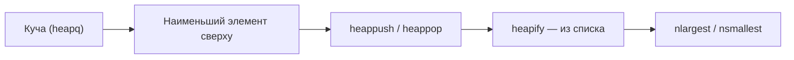

Привет! В этом уроке ты познакомишься с кучей (heap) — структурой данных, которая умеет мгновенно отдавать минимальный элемент и быстро принимать новые. Это одна из самых полезных идей для задач, где нужно постоянно выбирать «самое маленькое» или «самое важное».

## Что такое куча

Куча — это бинарное дерево, которое хранится в обычном списке и подчиняется одному правилу: **родитель не больше своих детей** (такая куча называется min-кучей). Из этого правила сразу следует главный вывод: минимальный элемент всего набора всегда лежит в корне, то есть в `heap[0]`. Дерево хранится в списке так: для элемента с индексом `i` его дети находятся на позициях `2*i + 1` и `2*i + 2`.

## Модуль heapq

В Python куча реализована в стандартном модуле `heapq`. Его главные функции:

- `heapq.heappush(heap, x)` — добавить элемент `x` (O(log n));
- `heapq.heappop(heap)` — достать и вернуть минимальный элемент (O(log n));
- `heapq.heapify(lst)` — превратить список в кучу (O(n));
- `heapq.heapreplace(heap, x)` — достать минимум и сразу добавить `x`;
- `heapq.heappushpop(heap, x)` — добавить `x` и достать минимум;
- `heapq.nlargest(k, iterable)` и `heapq.nsmallest(k, iterable)` — k наибольших/наименьших элементов.

Смотри, как это работает:

```python
import heapq

h = []
heapq.heappush(h, 5)
heapq.heappush(h, 1)
heapq.heappush(h, 3)
print(h)                     # [1, 5, 3] — элементы частично упорядочены
print(heapq.heappop(h))      # 1 — минимальный элемент
```

Обрати внимание: список `h` на экране не выглядит отсортированным. Это нормально — куча гарантирует только то, что корень минимален. Зато добавление и удаление происходят за O(log n), что сильно быстрее, чем пересортировывать список.

Функция `heapify` превращает любой список в кучу за линейное время:

```python
data = [7, 2, 9, 1, 5]
heapq.heapify(data)
print(heapq.heappop(data))   # 1
print(data)                  # [2, 5, 9, 7]
```

## Приоритетные очереди

Главное применение кучи — приоритетная очередь: структура, из которой элемент достаётся не по порядку добавления (как в обычной очереди), а по приоритету. Классический пример — задачи в проекте: чем ниже число, тем важнее задача.

```python
import heapq

tasks = []          # кортежи (приоритет, счётчик, имя)
counter = 0

heapq.heappush(tasks, (3, counter, "написать отчёт")); counter += 1
heapq.heappush(tasks, (1, counter, "исправить баг")); counter += 1
heapq.heappush(tasks, (2, counter, "созвониться")); counter += 1

while tasks:
    _, _, name = heapq.heappop(tasks)
    print(name)
```

На экране появится:

```
исправить баг
созвониться
написать отчёт
```

Счётчик в кортеже нужен, чтобы при равных приоритетах не возникало путаницы: тогда порядок определяется номером добавления. Этот приём используется повсюду — от планировщиков задач до алгоритма Дейкстры.

## Максимальная куча

Стандартная `heapq` умеет только min-кучи. Но получить максимальную очень просто: храни **отрицательные значения**. Тогда самый большой исходный элемент станет самым маленьким отрицательным и окажется в корне:

```python
h = []
for x in [4, 9, 2, 7]:
    heapq.heappush(h, -x)
print(-heapq.heappop(h))     # 9
```

## Когда куча полезна

Куча незаменима, когда нужно:

- постоянно доставать минимум/максимум и добавлять новые элементы,
- найти k наибольших или k наименьших элементов большого набора,
- слить несколько отсортированных последовательностей,
- моделировать приоритетные очереди.

Итог: куча даёт O(log n) на вставку и извлечение минимума, а построение из списка занимает O(n). Следующие задачи закрепят эти идеи на практике.




<!--TASK-->
### Задача 1
Реализуй программу «приоритетная очередь». Первая строка ввода — число операций `n`. Далее идут `n` строк: `push <приоритет> <имя>` — добавить задачу, или `pop` — достать задачу с наименьшим приоритетом и напечатать её имя. Если очередь пуста, `pop` печатает `очередь пуста`. Приоритет — целое число, имя — одно слово без пробелов. Используй модуль `heapq` и счётчик для устойчивости среди равных приоритетов. Это именно та программа, которую проверяют тесты в конце урока.

### Задача 2
Первая строка ввода — число `n`, вторая — `n` целых чисел через пробел, третья — число `k`. Выведи `k` наименьших чисел в порядке возрастания через пробел. Используй `heapq.heapify` и `heapq.heappop`. Подумай: после превращения списка в кучу минимум всегда лежит на позиции 0.

### Задача 3
Даны `k` отсортированных списков чисел. Первая строка — `k`, далее `k` строк, каждая — отсортированный список. Слей их в один отсортированный список и выведи все числа через пробел. Идея: храни в куче текущий элемент каждого списка вместе с номером списка и позицией. Доставая минимум, добавляй в кучу следующий элемент этого же списка, если он существует.

### Задача 4
Найди `k` наибольших чисел во входном потоке. Первая строка — `k`, вторая — числа через пробел, поток заканчивается нулём (ноль не считается числом потока). Выведи `k` наибольших чисел в порядке убывания через пробел. Поддерживай min-кучу размера ровно `k`: если новое число больше корня, заменяй корень через `heapq.heapreplace`.

### Задача 5
Дано `n` точек на плоскости. Первая строка — `n` и `k`, далее `n` строк вида `x y`. Выведи `k` ближайших к началу координат точек (по одной на строку, через пробел `x y`) в порядке возрастания расстояния. Храни в куче кортежи `(квадрат_расстояния, x, y)` — тогда куча сама упорядочит точки по близости, а сравнивать расстояния можно без корня.
### Задача 6 — k наименьших элементов
Напиши функцию `k_smallest(numbers, k)`, которая использует `heapq.nsmallest(k, numbers)`. Проверь на `[7, 3, 9, 1, 5]` с `k=3` и напечатай результат. Ожидаемый вывод: `[1, 3, 5]`. В комментарии объясни, почему для большого массива nsmallest эффективнее сортировки всего списка.
### Задача 7 — Медиана потока чисел
Реализуй класс `MedianFinder` с двумя кучами: max-кучей для левой половины (храним отрицательные значения в heapq) и min-кучей для правой. Метод `add_num(x)` добавляет число, `find_median()` возвращает медиану: если размеры равны — среднее двух вершин, иначе вершина большей кучи. Проверь на последовательности [5, 15, 1, 3] и напечатай медианы после каждого добавления. Ожидаемый вывод: `5.0 10.0 5.0 4.0`.

<!--/TASK-->

<!--HINT-->
### Подсказка 1
Куча всегда держит минимальный элемент на позиции 0. Для `pop` проверь, не пуста ли куча, иначе напечатай `очередь пуста`. Чтобы не путаться при одинаковых приоритетах, храни кортежи `(приоритет, счётчик, имя)` — счётчик увеличивай на единицу после каждой вставки.

### Подсказка 2
Сначала преврати список в кучу: `heapq.heapify(nums)`. Затем ровно `k` раз вызови `heapq.heappop(nums)` и собери результаты в список. Минимум после каждого `heappop` снова оказывается в корне, поэтому числа выйдут в порядке возрастания.

### Подсказка 3
В кучу клади кортежи `(значение, номер_списка, позиция)`. Когда достаёшь минимум, проверь: если в списке с этим номером есть следующий элемент, добавь его. Цикл продолжается, пока куча не станет пустой. Для каждого списка не забудь обработать случай, когда он пуст или уже исчерпан.

### Подсказка 4
Держи кучу размера ровно `k`: пока элементов меньше `k`, просто делай `heappush`. Дальше сравнивай новое число с `heap[0]`: если оно больше — вызывай `heapq.heapreplace(heap, x)`. В конце отсортируй кучу по убыванию, чтобы вывести топ-k правильно.

### Подсказка 5
Квадрат расстояния до начала координат считается как `x * x + y * y` — так ты избегаешь плавающей точки. Клади в кучу `(d2, x, y)` и бери кортежи через `heappop`. Точки выведутся в порядке возрастания расстояния автоматически.
### Подсказка 6
`heapq.nsmallest(k, numbers)` возвращает k наименьших элементов, не сортируя весь список: внутренне используется куча размера k. Для маленьких списков можно было бы и sorted, но при n ≫ k выигрыш значителен.
### Подсказка 7
Держи баланс: после каждого add_num разность длин куч не больше 1. Для max-кучи складывай отрицательные значения: `-x`. При `find_median()` сравни длины куч.

<!--/HINT-->

<!--SOLUTION-->
### Разбор 1
Решение:

```python
import sys
import heapq

def main():
    data = sys.stdin.read().strip().splitlines()
    n = int(data[0])
    heap = []
    counter = 0
    out = []
    for line in data[1:1 + n]:
        parts = line.split()
        if parts[0] == "push":
            priority = int(parts[1])
            name = parts[2]
            counter += 1
            heapq.heappush(heap, (priority, counter, name))
        else:  # pop
            if not heap:
                out.append("очередь пуста")
            else:
                _, _, name = heapq.heappop(heap)
                out.append(name)
    print("\n".join(out))

if __name__ == "__main__":
    main()
```

Что здесь происходит? Мы читаем все строки ввода сразу, берём первые `n` строк после первой. Для `push` создаём кортеж `(приоритет, счётчик, имя)`: приоритет определяет, какую задачу достанут раньше, а счётчик — порядок среди равных приоритетов. Для `pop` проверяем пустоту кучи: если пустая — печатаем `очередь пуста`, иначе достаём минимум через `heappop` и берём из кортежа имя (позиция 2). Результаты копим в списке `out` и печатаем через перевод строки.

Проверим на примере:

```
4
push 3 баг
push 1 фича
push 2 рефактор
pop
```

Будут вставлены три задачи, затем `pop` достанет `(1, 2, "фича")` — ведь наименьший приоритет именно у «фичи». Вывод: `фича`. Обрати внимание: имя и приоритет разделяются пробелами, поэтому для разбора строки удобно использовать `line.split()`.

### Разбор 2
Решение:

```python
import sys
import heapq

def main():
    data = sys.stdin.read().strip().splitlines()
    n = int(data[0])
    nums = list(map(int, data[1].split()))
    k = int(data[2])
    heapq.heapify(nums)
    ans = [heapq.heappop(nums) for _ in range(k)]
    print(*ans)

if __name__ == "__main__":
    main()
```

Сначала читаем `n`, затем сам список чисел, затем `k`. `heapify` превращает список в кучу за O(n) — это дешевле, чем сортировка O(n log n), при этом нам не нужен весь отсортированный список. Затем `k` раз вызываем `heappop`: каждый раз из корня уходит текущий минимум, а куча восстанавливает своё свойство. В результате `ans` содержит `k` наименьших чисел строго в порядке возрастания. Например, для входа:

```
6
5 2 8 1 9 3
3
```

получим `1 2 3`. Обрати внимание: `print(*ans)` печатает элементы списка через пробел одним вызовом.

### Разбор 3
Решение:

```python
import sys
import heapq

def main():
    data = sys.stdin.read().strip().splitlines()
    k = int(data[0])
    lists = [list(map(int, data[i + 1].split())) for i in range(k)]

    heap = []
    for idx, lst in enumerate(lists):
        if lst:
            heapq.heappush(heap, (lst[0], idx, 0))

    result = []
    while heap:
        value, idx, pos = heapq.heappop(heap)
        result.append(value)
        if pos + 1 < len(lists[idx]):
            heapq.heappush(heap, (lists[idx][pos + 1], idx, pos + 1))

    print(*result)

if __name__ == "__main__":
    main()
```

Идея в том, чтобы никогда не смотреть на все элементы сразу. В куче хранится по одному «представителю» каждого списка — его текущий минимальный неиспользованный элемент. Когда мы достаём минимум `value`, этот элемент «записан» в результат, и мы сразу выдвигаем представителя дальше — следующий элемент того же списка. Так за O(суммарная длина · log k) мы сливаем все списки. Для входа:

```
3
1 4 7
2 5 8
3 6 9
```

куча последовательно отдаст 1, 2, 3, ..., 9 — вывод `1 2 3 4 5 6 7 8 9`. Этот приём используется, например, при внешней сортировке огромных файлов.

### Разбор 4
Решение:

```python
import sys
import heapq

def main():
    data = sys.stdin.read().strip().splitlines()
    k = int(data[0])
    heap = []
    for token in data[1].split():
        x = int(token)
        if x == 0:
            break
        if len(heap) < k:
            heapq.heappush(heap, x)
        elif x > heap[0]:
            heapq.heapreplace(heap, x)
    result = sorted(heap, reverse=True)
    print(*result)

if __name__ == "__main__":
    main()
```

Здесь мы поддерживаем «окно» из `k` самых больших чисел. Пока элементов меньше `k`, просто добавляем. Когда куча заполнена, её корень — наименьший из топ-k. Если новое число `x` больше корня, оно должно попасть в топ-k, а корень — вылететь; это ровно то, что делает `heapreplace`. Если `x` меньше или равно корню — оно не лучше ни одного из текущих топ-k, пропускаем. Размер кучи всегда равен `k`, а сложность обработки одного числа — O(log k). Для входа:

```
3
7 1 8 3 9 2 0
```

к концу потока в куче останутся 7, 8, 9, а вывод `9 8 7` после сортировки по убыванию.

### Разбор 5
Решение:

```python
import sys
import heapq

def main():
    data = sys.stdin.read().strip().splitlines()
    n, k = map(int, data[0].split())
    heap = []
    for i in range(1, n + 1):
        x, y = map(int, data[i].split())
        heapq.heappush(heap, (x * x + y * y, x, y))

    for _ in range(k):
        _, x, y = heapq.heappop(heap)
        print(x, y)

if __name__ == "__main__":
    main()
```

Каждая точка кладётся в кучу как кортеж `(d2, x, y)`, где `d2 = x*x + y*y` — квадрат расстояния до начала координат. Python сравнивает кортежи покомпонентно: сначала по `d2`, поэтому в корне всегда окажется ближайшая точка. Достаём `k` раз через `heappop` и печатаем координаты. Например, для входа:

```
4 2
1 1
-2 1
3 0
0 -2
```

расстояния-квадраты равны 2, 5, 9, 4, значит, ближайшие две — `1 1` (d2=2) и `0 -2` (d2=4). Такой приём часто используется в геометрических задачах, где нужно выбрать k ближайших объектов.
### Разбор 6
```python
import heapq

def k_smallest(numbers, k):
    return heapq.nsmallest(k, numbers)

print(k_smallest([7, 3, 9, 1, 5], 3))
```
Вывод: `[1, 3, 5]`. Полная сортировка стоит O(n log n). nsmallest держит кучу размера k — сложность O(n log k), что критично при огромных n и маленьком k.
### Разбор 7
```python
import heapq

class MedianFinder:
    def __init__(self):
        self.lo = []   # max-куча (отрицательные)
        self.hi = []   # min-куча

    def add_num(self, x):
        heapq.heappush(self.lo, -x)
        heapq.heappush(self.hi, -heapq.heappop(self.lo))
        if len(self.lo) < len(self.hi):
            heapq.heappush(self.lo, -heapq.heappop(self.hi))

    def find_median(self):
        if len(self.lo) > len(self.hi):
            return float(-self.lo[0])
        return (-self.lo[0] + self.hi[0]) / 2.0

mf = MedianFinder()
for x in [5, 15, 1, 3]:
    mf.add_num(x)
    print(mf.find_median())
```
Вывод: `5.0 10.0 5.0 4.0`. После [5,15] медиана (5+15)/2=10. После [5,15,1] — 5. После [5,15,1,3] — (3+5)/2=4. Обе операции — O(log n).

<!--/SOLUTION-->

<!--QUIZ-->
Где в min-куче находится минимальный элемент?
- На позиции 0
- В середине списка
- На последней позиции
* Правильный ответ: На позиции 0
Инвариант кучи: родитель не больше детей, поэтому минимум всегда в корне — в heap[0].

Какая сложность у heapq.heappush и heapq.heappop?
- O(1)
- O(log n)
- O(n)
* Правильный ответ: O(log n)
Балансировка дерева идёт по его высоте, а высота бинарной кучи — логарифмическая.

Что выведет следующий код?
```python
import heapq
h = [3, 1, 2]
heapq.heapify(h)
print(heapq.heappop(h))
```
- 3
- 1
- 2
* Правильный ответ: 1
После heapify минимум стоит в корне, и heappop возвращает именно его.

Как изобразить максимальную кучу средствами heapq?
- Перевернуть список
- Хранить отрицательные значения
- Вызвать heapify(reverse=True)
* Правильный ответ: Хранить отрицательные значения
Тогда минимум среди отрицательных соответствует максимуму исходных чисел; при извлечении не забудь сменить знак.

Что вернёт heapq.nlargest(2, [1, 5, 3])?
- [5, 3]
- [1, 3]
- [3, 5]
* Правильный ответ: [5, 3]
nlargest возвращает k наибольших элементов в порядке убывания.

Чем приоритетная очередь отличается от обычной очереди?
- В ней нет никаких ограничений
- Элемент достаётся по приоритету, а не по порядку добавления
- Она работает только с числами
* Правильный ответ: Элемент достаётся по приоритету, а не по порядку добавления
Обычная очередь работает по принципу FIFO, а приоритетная всегда отдаёт «лучший» элемент.

Что выведет следующий код?
```python
import heapq
h = [5, 3, 2]
heapq.heapify(h)
heapq.heappush(h, 1)
print(heapq.heappop(h))
```
- 1
- 2
- 5
* Правильный ответ: 1
После heapify и heappush минимальный элемент 1 стоит в корне и будет извлечён первым.

Для чего в приоритетной очереди хранят кортежи (приоритет, счётчик, имя)?
- Чтобы при равных приоритетах порядок определялся номером добавления
- Чтобы экономить память
- Чтобы имена сортировались по алфавиту
* Правильный ответ: Чтобы при равных приоритетах порядок определялся номером добавления
Счётчик делает кортежи уникальными, и куча не пытается сравнивать имена при равных приоритетах.
Что лежит на вершине min-кучи?
- Наименьший элемент
- Наибольший элемент
- Случайный элемент
- Последний добавленный
* Правильный ответ: Наименьший элемент
heapq — min-куча: heap[0] всегда минимален.

Как организовать max-кучу на heapq?
- Класть отрицательные значения
- Использовать отдельный модуль
- Сортировать в обратном порядке
- Нельзя
* Правильный ответ: Класть отрицательные значения
-min(x) превращает min-кучу в max-кучу по x.

Что вернёт nsmallest(2, [5,1,4,2])?
- [1, 2]
- [1, 4]
- [5, 4]
- [2, 1]
* Правильный ответ: [1, 2]
Два наименьших элемента в порядке возрастания.

Зачем нужны две кучи для медианы потока?
- Чтобы за O(log n) поддерживать середину отсортированной последовательности
- Чтобы ускорить ввод
- Чтобы хранить отрицательные
- Чтобы сэкономить память
* Правильный ответ: Чтобы за O(log n) поддерживать середину отсортированной последовательности
Левая max-куча хранит меньшую половину, правая min-куча — большую.

# 
<!--/QUIZ-->

<!--TESTS-->
### Тест 1
Ввод:
```
4
push 3 баг
push 1 фича
push 2 рефактор
pop
```
Ожидаемый вывод:
```
фича
```
### Тест 2
Ввод:
```
3
pop
push 5 задача
pop
```
Ожидаемый вывод:
```
очередь пуста
задача
```
### Тест 3
Ввод:
```
6
push 4 а
push 2 б
pop
push 1 в
pop
pop
```
Ожидаемый вывод:
```
б
в
а
```
### Тест 4
Ввод:
```
5
push 7 x
push 7 y
pop
push 3 z
pop
```
Ожидаемый вывод:
```
x
z
```
### Тест 5
Ввод:
```
8
push 9 девять
push 2 два
push 7 семь
pop
push 5 пять
pop
pop
pop
```
Ожидаемый вывод:
```
два
пять
семь
девять
```
<!--/TESTS-->
